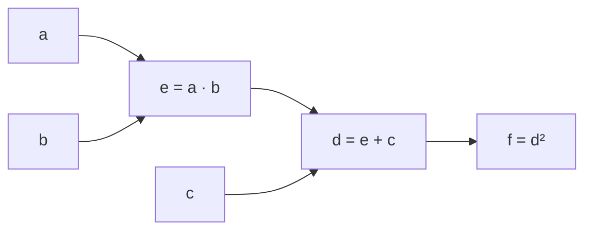

## Passo 1 · Leitura · Funções dentro de funções

O custo de um modelo nunca é uma função simples dos pesos. Na regressão logística, por exemplo, o peso entra num produto, o produto entra numa sigmoide, a sigmoide entra num logaritmo e o logaritmo entra numa média. Para derivar uma composição dessas, usa-se a **regra da cadeia**:

$$
\frac{d}{dx}\, f(g(x)) = f'(g(x))\; g'(x)
$$

Em palavras: a derivada de fora, calculada no valor de dentro, vezes a derivada de dentro. Para $h(x) = (3x + 1)^2$, a função de fora é $u^2$ (derivada $2u$) e a de dentro é $3x + 1$ (derivada 3), então $h'(x) = 2(3x + 1) \cdot 3$. Esquecer o fator interno, o 3, é o erro mais comum do assunto.

Com várias etapas, vale desenhar o **grafo de computação**: cada nó é uma operação simples, com uma derivada **local** fácil. Para $f = (a \cdot b + c)^2$, com os nomes $e = a \cdot b$ e $d = e + c$:



As derivadas locais são: $\partial f/\partial d = 2d$; $\partial d/\partial e = 1$ e $\partial d/\partial c = 1$; $\partial e/\partial a = b$ e $\partial e/\partial b = a$. A regra da cadeia diz que a derivada de $f$ em relação a uma entrada é o **produto** das derivadas locais ao longo do caminho até ela:

$$
\frac{\partial f}{\partial a} = \frac{\partial f}{\partial d}\cdot\frac{\partial d}{\partial e}\cdot\frac{\partial e}{\partial a} = 2d \cdot 1 \cdot b
$$

O cálculo tem duas fases. **Para frente**, das entradas até $f$, calculam-se e guardam-se os valores de todos os nós, porque as derivadas locais precisam deles ($2d$ precisa de $d$, $\partial e/\partial a$ precisa de $b$). **Para trás**, de $f$ até as entradas, multiplica-se a derivada que chega a cada nó pela derivada local dele. Cada nó é visitado uma vez, e no fim todas as derivadas estão prontas.

Essa volta de trás para frente é a **retropropagação** (*backpropagation*). Uma rede neural é só um grafo enorme desse tipo, e no Nível 6 você vai escrever uma pequena biblioteca que monta o grafo e faz a volta sozinha. Aqui, a volta é feita à mão, nó por nó.

## Passo 2 · Previsão · Os números do grafo

O programa faz a ida e a volta no grafo de $f = (a \cdot b + c)^2$ com $a = 2$, $b = -3$ e $c = 10$, e confere uma das derivadas pela diferença central. Leia sem executar e digite o que ele imprime.

### Código
```python
a, b, c = 2.0, -3.0, 10.0
e = a * b
d = e + c
f = d ** 2
print("ida:", e, d, f)

df_dd = 2 * d
df_de = df_dd * 1
df_dc = df_dd * 1
df_da = df_de * b
df_db = df_de * a
print("volta:", df_dd, df_de, df_dc)
print("entradas:", df_da, df_db, df_dc)


def F(a, b, c):
    return (a * b + c) ** 2


print(round((F(2.001, -3, 10) - F(1.999, -3, 10)) / 0.002, 6))
```

### Dicas
1. A ida é só aritmética: $e = 2 \cdot (-3)$, depois soma $c$, depois eleva ao quadrado.
2. Na volta, cada derivada é a que chega ao nó vezes a derivada local: a de $e$ em relação a $a$ é $b$.
3. Como $f$ é uma parábola em $a$, a diferença central acerta a derivada (com o arredondamento a 6 casas).

### Saída esperada
```text
ida: -6.0 4.0 16.0
volta: 8.0 8.0 8.0
entradas: -24.0 16.0 8.0
-24.0
```

## Passo 3 · Exercício · Retropropagação à mão
modo: ordenar

Arraste as linhas para montar `backprop_manual` e ajuste a indentação de cada uma. Três linhas estão sobrando.

### Instruções
1. `backprop_manual(a, b, c)` calcula, para frente, $e = a \cdot b$, $d = e + c$ e $f = d^2$.
2. Para trás, calcula $\partial f/\partial d$, depois as derivadas em relação a $e$ e a $c$, e por fim em relação a $a$ e a $b$, sempre multiplicando a derivada que chega pela derivada local.
3. Devolve a tupla `(f, df_da, df_db, df_dc)`.

### Solução
```python
def backprop_manual(a, b, c):
    e = a * b
    d = e + c
    f = d ** 2
    df_dd = 2 * d
    df_de = df_dd * 1
    df_dc = df_dd * 1
    df_da = df_de * b
    df_db = df_de * a
    return f, df_da, df_db, df_dc
```

### Distratores
```python
df_da = df_de + b
df_dd = 2 * f
df_db = df_de * b
```

### Verificação
```json
[
  { "id": "exemplo", "checkpoint": 3, "kind": "call", "function": "backprop_manual", "args": [2, -3, 10],
    "expected": [16, -24, 16, 8], "type": "tuple", "tolerance": 1e-9, "name": "backprop_manual(2, -3, 10) é (16, -24, 16, 8)",
    "hint": "Confira com os números da Previsão." },
  { "id": "uns", "checkpoint": 2, "kind": "call", "function": "backprop_manual", "args": [1, 1, 1],
    "expected": [4, 4, 4, 4], "type": "tuple", "tolerance": 1e-9, "name": "backprop_manual(1, 1, 1) é (4, 4, 4, 4)" },
  { "id": "a-zero", "checkpoint": 2, "kind": "call", "function": "backprop_manual", "args": [0, 5, 3],
    "expected": [9, 30, 0, 6], "type": "tuple", "tolerance": 1e-9, "name": "Com a = 0, a derivada em b é zero e a em a não",
    "hint": "A derivada local de e = a · b em relação a a é b, e em relação a b é a." },
  { "id": "fracionario", "checkpoint": 2, "kind": "call", "function": "backprop_manual", "args": [1.5, 2, -1],
    "expected": [4, 8, 6, 4], "type": "tuple", "tolerance": 1e-9, "name": "backprop_manual(1.5, 2, -1) é (4, 8, 6, 4)" },
  { "id": "minimo", "checkpoint": 2, "kind": "call", "function": "backprop_manual", "args": [2, -3, 6],
    "expected": [0, 0, 0, 0], "type": "tuple", "tolerance": 1e-9, "name": "Com d = 0 (o mínimo de f), todas as derivadas são zero" },
  { "id": "ida", "checkpoint": 1, "kind": "call", "function": "backprop_manual", "args": [-1, 4, 2],
    "expected": [4, -16, 4, -4], "type": "tuple", "tolerance": 1e-9, "name": "backprop_manual(-1, 4, 2): com d negativo, a derivada em d é negativa" },
  { "id": "confere-numerico", "checkpoint": 2, "kind": "expr",
    "setup": "def F(a, b, c):\n    return (a * b + c) ** 2\nh = 1e-6\nentradas = [(0.7, -1.3, 2.2), (-2.5, 0.4, 1.1), (3.0, 3.0, -8.5)]\nok = []\nfor a, b, c in entradas:\n    f, da, db, dc = backprop_manual(a, b, c)\n    num = ((F(a + h, b, c) - F(a - h, b, c)) / (2 * h), (F(a, b + h, c) - F(a, b - h, c)) / (2 * h), (F(a, b, c + h) - F(a, b, c - h)) / (2 * h))\n    ok.append(max(abs(da - num[0]), abs(db - num[1]), abs(dc - num[2])) < 1e-6)",
    "expr": "ok", "expected": [true, true, true], "name": "Em três pontos, as derivadas batem com a diferença central" }
]
```

### Soluções erradas
```python name="soma as derivadas locais"
def backprop_manual(a, b, c):
    e = a * b
    d = e + c
    f = d ** 2
    df_dd = 2 * d
    df_de = df_dd * 1
    df_dc = df_dd * 1
    df_da = df_de + b
    df_db = df_de + a
    return f, df_da, df_db, df_dc
```
```python name="só a derivada local"
def backprop_manual(a, b, c):
    e = a * b
    d = e + c
    f = d ** 2
    df_dd = 2 * d
    df_de = df_dd * 1
    df_dc = df_dd * 1
    df_da = b
    df_db = a
    return f, df_da, df_db, df_dc
```
```python name="a e b trocados"
def backprop_manual(a, b, c):
    e = a * b
    d = e + c
    f = d ** 2
    df_dd = 2 * d
    df_de = df_dd * 1
    df_dc = df_dd * 1
    df_da = df_de * a
    df_db = df_de * b
    return f, df_da, df_db, df_dc
```
```python name="derivada de d² como d"
def backprop_manual(a, b, c):
    e = a * b
    d = e + c
    f = d ** 2
    df_dd = d
    df_de = df_dd * 1
    df_dc = df_dd * 1
    df_da = df_de * b
    df_db = df_de * a
    return f, df_da, df_db, df_dc
```
```python name="derivada em c como 1"
def backprop_manual(a, b, c):
    e = a * b
    d = e + c
    f = d ** 2
    df_dd = 2 * d
    df_de = df_dd * 1
    df_dc = 1
    df_da = df_de * b
    df_db = df_de * a
    return f, df_da, df_db, df_dc
```
```python name="2f no lugar de 2d"
def backprop_manual(a, b, c):
    e = a * b
    d = e + c
    f = d ** 2
    df_dd = 2 * f
    df_de = df_dd * 1
    df_dc = df_dd * 1
    df_da = df_de * b
    df_db = df_de * a
    return f, df_da, df_db, df_dc
```

## Passo 4 · Leitura · Sigmoide e perda logística

Um classificador binário precisa de uma probabilidade entre 0 e 1. A regressão logística, do módulo 3, calcula um número qualquer $z = w \cdot x + b$ e o espreme com a **sigmoide**:

$$
\sigma(z) = \frac{1}{1 + e^{-z}} \qquad \sigma'(z) = \sigma(z)\,\bigl(1 - \sigma(z)\bigr)
$$

A derivada sai da regra da cadeia: de fora, $u^{-1}$ (derivada $-u^{-2}$); de dentro, $1 + e^{-z}$ (derivada $-e^{-z}$). O produto, $e^{-z} / (1 + e^{-z})^2$, se reorganiza como $\sigma(1 - \sigma)$. A forma final é a que se usa: não precisa de nenhuma exponencial nova. Em $z = 0$ vale $0{,}5 \cdot 0{,}5 = 0{,}25$, o máximo; longe de zero, nos dois lados, cai para perto de 0.

Para um exemplo com rótulo $y \in \{0, 1\}$ e probabilidade prevista $p = \sigma(z)$, a **perda logística** (entropia cruzada binária) é

$$
L = -\bigl[\,y \ln p + (1 - y) \ln(1 - p)\,\bigr]
$$

que é pequena quando $p$ fica perto do rótulo e cresce sem limite quando o modelo erra com confiança. Pela cadeia $L \to p \to z \to w$: a derivada de fora é $\partial L/\partial p = -y/p + (1 - y)/(1 - p)$; multiplicada por $\partial p/\partial z = p(1 - p)$, ela se simplifica (faça a conta uma vez no papel) e sobra só a diferença entre o previsto e o certo:

$$
\frac{\partial L}{\partial z} = \sigma(z) - y \qquad \frac{\partial L}{\partial w} = \bigl(\sigma(z) - y\bigr)\, x \qquad \frac{\partial L}{\partial b} = \sigma(z) - y
$$

O fator $x$ é a derivada interna de $z = w \cdot x + b$ em relação a $w$; em relação a $b$, ela é 1. Trocar a ordem para $y - \sigma(z)$ inverte o sinal, e o gradiente descendente passa a subir a perda.

A forma da sigmoide em código também importa. Com `1 / (1 + np.exp(-z))`, um $z = -1000$ dá `np.exp(1000)`, que é `inf` (sem erro nem aviso no executor), e `1 / inf` é 0, o valor certo. A forma equivalente no papel `np.exp(z) / (1 + np.exp(z))` quebra em $z = 1000$: vira `inf / inf`, que é `nan`, e o `nan` contamina tudo o que vem depois.

```python
z = np.array([-1000.0, 0.0, 1000.0])
1 / (1 + np.exp(-z))                  # array([0. , 0.5, 1. ])
np.exp(z) / (1 + np.exp(z))           # array([0. , 0.5, nan])
```

## Passo 5 · Exercício · Derivadas da logística

Escreva a derivada da sigmoide, vetorizada, e o gradiente da perda logística de um exemplo.

### Instruções
1. `derivada_sigmoide(z)` recebe um número ou um array de qualquer forma e devolve $\sigma(z)(1 - \sigma(z))$ com a mesma forma, sem `nan` para $z$ muito grande ou muito pequeno.
2. `grad_perda_logistica(w, b, x, y)` recebe os pesos `w` e o exemplo `x` (vetores do mesmo tamanho), o viés `b` e o rótulo `y` (0 ou 1), e devolve a tupla `(dw, db)`: o gradiente da perda logística desse exemplo.
3. `dw` é um array do tamanho de `w`; `db` é um `float` do Python.

### Código inicial
```python
import numpy as np


def sigmoide(z):
    return 1 / (1 + np.exp(-np.asarray(z, dtype=float)))


def derivada_sigmoide(z):
    pass


def grad_perda_logistica(w, b, x, y):
    pass
```

### Solução
```python
import numpy as np


def sigmoide(z):
    return 1 / (1 + np.exp(-np.asarray(z, dtype=float)))


def derivada_sigmoide(z):
    s = sigmoide(z)
    return s * (1 - s)


def grad_perda_logistica(w, b, x, y):
    w = np.asarray(w, dtype=float)
    x = np.asarray(x, dtype=float)
    erro = sigmoide(w @ x + b) - y
    return erro * x, float(erro)
```

### Dicas
1. A derivada da sigmoide se escreve com a própria sigmoide; a função `sigmoide` do código inicial já é a forma estável.
2. Pela cadeia, a derivada da perda em relação a $z$ é $\sigma(z) - y$; multiplique pela derivada de $z$ em relação a cada parâmetro.
3. `float(...)` converte o `numpy.float64` num `float` do Python.

### Verificação
```json
[
  { "id": "dsig-zero", "checkpoint": 1, "kind": "expr", "expr": "float(derivada_sigmoide(0.0))", "expected": 0.25, "tolerance": 1e-12,
    "name": "σ'(0) = 0.25" },
  { "id": "dsig-vetor", "checkpoint": 1, "kind": "expr", "expr": "derivada_sigmoide(np.array([-2.0, 0.0, 2.0])).tolist()",
    "expected": [0.1049935854035065, 0.25, 0.10499358540350662], "tolerance": 1e-12, "name": "σ' em -2, 0 e 2 (simétrica)",
    "hint": "σ' = σ(1 − σ), com o sinal de menos." },
  { "id": "dsig-extremos", "checkpoint": 1, "kind": "expr", "expr": "derivada_sigmoide(np.array([1000.0, -1000.0])).tolist()",
    "expected": [0.0, 0.0], "tolerance": 1e-12, "name": "Em z = ±1000, a derivada é 0 (sem nan)",
    "hint": "exp(z) / (1 + exp(z)) vira inf / inf em z grande." },
  { "id": "dsig-numerico", "checkpoint": 1, "kind": "expr",
    "setup": "z = np.linspace(-6, 6, 25)\nh = 1e-5\nnum = (sigmoide(z + h) - sigmoide(z - h)) / (2 * h)",
    "expr": "bool(np.allclose(derivada_sigmoide(z), num, atol=1e-9))", "expected": true,
    "name": "Em 25 pontos de -6 a 6, bate com a diferença central" },
  { "id": "dsig-forma", "checkpoint": 1, "kind": "expr", "expr": "list(derivada_sigmoide(np.zeros((3, 4))).shape)", "expected": [3, 4],
    "name": "Uma entrada 3 × 4 dá uma saída 3 × 4" },
  { "id": "grad-y1", "checkpoint": 2, "kind": "expr", "setup": "dw, db = grad_perda_logistica([0.0, 0.0], 0.0, [1.0, 2.0], 1)",
    "expr": "[dw.tolist(), db]", "expected": [[-0.5, -1.0], -0.5], "tolerance": 1e-12,
    "name": "Pesos zero, x = (1, 2), y = 1: σ(0) − 1 = −0,5", "hint": "O erro é σ(z) − y, nessa ordem." },
  { "id": "grad-y0", "checkpoint": 2, "kind": "expr", "setup": "dw, db = grad_perda_logistica([0.0, 0.0], 0.0, [1.0, 2.0], 0)",
    "expr": "[dw.tolist(), db]", "expected": [[0.5, 1.0], 0.5], "tolerance": 1e-12, "name": "O mesmo exemplo com y = 0" },
  { "id": "grad-valor", "checkpoint": 2, "kind": "expr", "setup": "dw, db = grad_perda_logistica([0.3, -1.2, 0.5], 0.1, [1.0, 2.0, -0.5], 1)",
    "expr": "[dw.tolist(), db]", "expected": [[-0.9046505351008906, -1.809301070201781, 0.4523252675504453], -0.9046505351008906],
    "tolerance": 1e-9, "name": "Um exemplo com três atributos", "hint": "dw é o erro σ(z) − y vezes cada atributo de x." },
  { "id": "grad-numerico", "checkpoint": 2, "kind": "expr",
    "setup": "w = np.array([0.8, -0.4, 1.5])\nb = -0.3\nx = np.array([0.5, 1.5, -1.0])\ny = 0\ndef L(t):\n    p = sigmoide(t[:3] @ x + t[3])\n    return -(y * np.log(p) + (1 - y) * np.log(1 - p))\nt = np.append(w, b)\nh = 1e-5\nnum = np.array([(L(t + e) - L(t - e)) / (2 * h) for e in np.eye(4) * h])\ndw, db = grad_perda_logistica(w, b, x, y)",
    "expr": "bool(np.allclose(np.append(dw, db), num, atol=1e-7))", "expected": true,
    "name": "dw e db batem com o gradiente numérico da perda" },
  { "id": "grad-tipos", "checkpoint": 3, "kind": "expr", "setup": "r = grad_perda_logistica([0.5, 0.5], 0.0, [1.0, 1.0], 1)",
    "expr": "[type(r).__name__, type(r[0]).__name__, type(r[1]).__name__]", "expected": ["tuple", "ndarray", "float"],
    "name": "Devolve uma tupla com um array e um float" }
]
```

### Soluções erradas
```python name="σ(1 + σ)"
import numpy as np


def sigmoide(z):
    return 1 / (1 + np.exp(-np.asarray(z, dtype=float)))


def derivada_sigmoide(z):
    s = sigmoide(z)
    return s * (1 + s)


def grad_perda_logistica(w, b, x, y):
    w = np.asarray(w, dtype=float)
    x = np.asarray(x, dtype=float)
    erro = sigmoide(w @ x + b) - y
    return erro * x, float(erro)
```
```python name="sigmoide como exp(z) / (1 + exp(z))"
import numpy as np


def sigmoide(z):
    return 1 / (1 + np.exp(-np.asarray(z, dtype=float)))


def derivada_sigmoide(z):
    ez = np.exp(np.asarray(z, dtype=float))
    s = ez / (1 + ez)
    return s * (1 - s)


def grad_perda_logistica(w, b, x, y):
    w = np.asarray(w, dtype=float)
    x = np.asarray(x, dtype=float)
    erro = sigmoide(w @ x + b) - y
    return erro * x, float(erro)
```
```python name="y − σ(z): sinal trocado"
import numpy as np


def sigmoide(z):
    return 1 / (1 + np.exp(-np.asarray(z, dtype=float)))


def derivada_sigmoide(z):
    s = sigmoide(z)
    return s * (1 - s)


def grad_perda_logistica(w, b, x, y):
    w = np.asarray(w, dtype=float)
    x = np.asarray(x, dtype=float)
    erro = y - sigmoide(w @ x + b)
    return erro * x, float(erro)
```
```python name="esquece o fator x"
import numpy as np


def sigmoide(z):
    return 1 / (1 + np.exp(-np.asarray(z, dtype=float)))


def derivada_sigmoide(z):
    s = sigmoide(z)
    return s * (1 - s)


def grad_perda_logistica(w, b, x, y):
    w = np.asarray(w, dtype=float)
    x = np.asarray(x, dtype=float)
    erro = sigmoide(w @ x + b) - y
    return erro * np.ones_like(x), float(erro)
```
```python name="z no lugar de σ(z)"
import numpy as np


def sigmoide(z):
    return 1 / (1 + np.exp(-np.asarray(z, dtype=float)))


def derivada_sigmoide(z):
    s = sigmoide(z)
    return s * (1 - s)


def grad_perda_logistica(w, b, x, y):
    w = np.asarray(w, dtype=float)
    x = np.asarray(x, dtype=float)
    erro = (w @ x + b) - y
    return erro * x, float(erro)
```
```python name="multiplica por σ' de novo"
import numpy as np


def sigmoide(z):
    return 1 / (1 + np.exp(-np.asarray(z, dtype=float)))


def derivada_sigmoide(z):
    s = sigmoide(z)
    return s * (1 - s)


def grad_perda_logistica(w, b, x, y):
    w = np.asarray(w, dtype=float)
    x = np.asarray(x, dtype=float)
    z = w @ x + b
    erro = (sigmoide(z) - y) * derivada_sigmoide(z)
    return erro * x, float(erro)
```
```python name="db como numpy.float64"
import numpy as np


def sigmoide(z):
    return 1 / (1 + np.exp(-np.asarray(z, dtype=float)))


def derivada_sigmoide(z):
    s = sigmoide(z)
    return s * (1 - s)


def grad_perda_logistica(w, b, x, y):
    w = np.asarray(w, dtype=float)
    x = np.asarray(x, dtype=float)
    erro = sigmoide(w @ x + b) - y
    return erro * x, erro
```

## Passo 6 · Leitura · O custo quadrático de um modelo linear

O primeiro modelo do próximo módulo é a reta $\hat y = w x + b$, com um peso $w$ e um viés $b$, ajustada a $n$ pontos $(x_i, y_i)$ pelo **erro quadrático médio**:

$$
J(w, b) = \frac{1}{n} \sum_{i=1}^{n} \bigl(y_i - (w x_i + b)\bigr)^2
$$

Cada parcela é uma composição: a de fora é $u^2$ e a de dentro é o resíduo $u = y_i - w x_i - b$. A derivada de fora é $2u$; a de dentro em relação a $w$ é $-x_i$ e em relação a $b$ é $-1$. Juntando, e trocando o sinal para escrever com o resíduo "previsto menos certo":

$$
\frac{\partial J}{\partial w} = \frac{2}{n} \sum_{i=1}^{n} (\hat y_i - y_i)\, x_i \qquad \frac{\partial J}{\partial b} = \frac{2}{n} \sum_{i=1}^{n} (\hat y_i - y_i)
$$

O sinal é onde mais se erra. Escrito com $(y_i - \hat y_i)$, o gradiente precisa do sinal de menos que veio da derivada interna; quem copia a fórmula sem ele obtém o gradiente com o sinal trocado, e a descida passa a subir o custo. A leitura da derivada ajuda a conferir: se a reta passa **acima** dos pontos ($\hat y_i > y_i$), aumentar $b$ piora o ajuste, e $\partial J / \partial b$ tem que ser positivo.

A média ($\tfrac{1}{n}$) também importa. Com a soma no lugar da média, o gradiente cresce com o número de pontos, e uma taxa de aprendizado que funcionava com 100 pontos explode com 100 000. O fator 2 só muda a escala, mas o enunciado define o custo, e o gradiente tem que ser o desse custo.

Em numpy, a soma vira `np.mean` de um array, sem laço:

```python
residuo = (w * x + b) - y          # um resíduo por ponto
dw = 2 * np.mean(residuo * x)
db = 2 * np.mean(residuo)
```

Quando a reta passa exatamente pelos pontos, todos os resíduos são zero e o gradiente também: é o mínimo. No módulo 2, a mesma conta aparece com várias colunas, $\tfrac{2}{n} X^\top (Xw + b - y)$, e o produto de matrizes faz a soma.

## Passo 7 · Exercício · Gradiente do custo quadrático

Escreva o gradiente do erro quadrático médio da reta $\hat y = w x + b$, sem laço.

### Instruções
1. `grad_custo_quadratico(w, b, x, y)` recebe os números `w` e `b` e os vetores `x` e `y` (listas ou arrays do mesmo tamanho).
2. Devolve a tupla `(dw, db)` com as derivadas de $J(w, b) = \tfrac{1}{n} \sum (y_i - w x_i - b)^2$ em relação a `w` e a `b`, como `float` do Python.
3. Usa operações vetorizadas do numpy, sem laço (`for`, `while` ou compreensão).

### Código inicial
```python
import numpy as np


def grad_custo_quadratico(w, b, x, y):
    pass
```

### Solução
```python
import numpy as np


def grad_custo_quadratico(w, b, x, y):
    x = np.asarray(x, dtype=float)
    y = np.asarray(y, dtype=float)
    residuo = (w * x + b) - y
    dw = 2 * np.mean(residuo * x)
    db = 2 * np.mean(residuo)
    return float(dw), float(db)
```

### Dicas
1. Calcule o resíduo "previsto menos certo" de todos os pontos de uma vez.
2. A derivada em `w` tem o fator $x_i$ da derivada interna; a em `b`, não.
3. É uma média, não uma soma: o gradiente não pode crescer com o número de pontos.

### Verificação
```json
[
  { "id": "minimo", "checkpoint": 2, "kind": "expr", "expr": "grad_custo_quadratico(2.0, 1.0, [1, 2, 3], [3, 5, 7])",
    "expected": [0.0, 0.0], "tolerance": 1e-12, "name": "A reta 2x + 1 passa pelos pontos: gradiente zero" },
  { "id": "origem", "checkpoint": 2, "kind": "expr", "expr": "grad_custo_quadratico(0.0, 0.0, [1, 2, 3], [3, 5, 7])",
    "expected": [-22.666666666666668, -10.0], "tolerance": 1e-9, "name": "Com w = 0 e b = 0 a reta passa abaixo: gradiente negativo",
    "hint": "Se a reta está abaixo dos pontos, aumentar w e b diminui o custo." },
  { "id": "outro", "checkpoint": 2, "kind": "expr", "expr": "grad_custo_quadratico(1.0, 0.5, [0, 1, 2, 4], [1, 2, 2, 5])",
    "expected": [-0.75, -0.5], "tolerance": 1e-9, "name": "w = 1, b = 0.5 em quatro pontos",
    "hint": "dw tem o fator x de cada ponto; db não." },
  { "id": "duplicado", "checkpoint": 2, "kind": "expr", "expr": "grad_custo_quadratico(0.0, 0.0, [1, 2, 3, 1, 2, 3], [3, 5, 7, 3, 5, 7])",
    "expected": [-22.666666666666668, -10.0], "tolerance": 1e-9, "name": "Repetir os dados não muda o gradiente médio",
    "hint": "Média, não soma." },
  { "id": "numerico", "checkpoint": 2, "kind": "expr",
    "setup": "rng = np.random.default_rng(4)\nx = rng.uniform(-2, 2, 50)\ny = 1.5 * x - 0.7 + rng.normal(0, 0.3, 50)\ndef J(w, b):\n    return np.mean((y - w * x - b) ** 2)\nh = 1e-6\nnum = [(J(0.7 + h, -0.3) - J(0.7 - h, -0.3)) / (2 * h), (J(0.7, -0.3 + h) - J(0.7, -0.3 - h)) / (2 * h)]",
    "expr": "bool(np.allclose(grad_custo_quadratico(0.7, -0.3, x, y), num, atol=1e-6))", "expected": true,
    "name": "Em 50 pontos sorteados, bate com o gradiente numérico de J" },
  { "id": "desce", "checkpoint": 2, "kind": "expr",
    "setup": "x = np.array([0.0, 1.0, 2.0, 3.0])\ny = np.array([1.0, 3.2, 4.9, 7.1])\ndef J(w, b):\n    return np.mean((y - w * x - b) ** 2)\ndw, db = grad_custo_quadratico(0.5, 0.0, x, y)",
    "expr": "bool(J(0.5 - 0.01 * dw, 0.0 - 0.01 * db) < J(0.5, 0.0))", "expected": true,
    "name": "Um passo contra o gradiente diminui o custo", "hint": "Confira o sinal do resíduo." },
  { "id": "tipos", "checkpoint": 2, "kind": "expr", "setup": "r = grad_custo_quadratico(1.0, 0.0, [1.0, 2.0], [2.0, 2.0])",
    "expr": "[type(r).__name__, type(r[0]).__name__, type(r[1]).__name__]", "expected": ["tuple", "float", "float"],
    "name": "Devolve uma tupla de dois float do Python" },
  { "id": "sem-for", "checkpoint": 3, "kind": "source", "rule": { "type": "not_uses", "construct": "for" }, "name": "Sem laço for" },
  { "id": "sem-compreensao", "checkpoint": 3, "kind": "source", "rule": { "type": "not_uses", "construct": "list_comprehension" },
    "name": "Sem compreensão de lista" }
]
```

### Soluções erradas
```python name="resíduo y − ŷ sem o sinal"
import numpy as np


def grad_custo_quadratico(w, b, x, y):
    x = np.asarray(x, dtype=float)
    y = np.asarray(y, dtype=float)
    residuo = y - (w * x + b)
    dw = 2 * np.mean(residuo * x)
    db = 2 * np.mean(residuo)
    return float(dw), float(db)
```
```python name="soma no lugar da média"
import numpy as np


def grad_custo_quadratico(w, b, x, y):
    x = np.asarray(x, dtype=float)
    y = np.asarray(y, dtype=float)
    residuo = (w * x + b) - y
    dw = 2 * np.sum(residuo * x)
    db = 2 * np.sum(residuo)
    return float(dw), float(db)
```
```python name="esquece o 2"
import numpy as np


def grad_custo_quadratico(w, b, x, y):
    x = np.asarray(x, dtype=float)
    y = np.asarray(y, dtype=float)
    residuo = (w * x + b) - y
    dw = np.mean(residuo * x)
    db = np.mean(residuo)
    return float(dw), float(db)
```
```python name="esquece o fator x em dw"
import numpy as np


def grad_custo_quadratico(w, b, x, y):
    x = np.asarray(x, dtype=float)
    y = np.asarray(y, dtype=float)
    residuo = (w * x + b) - y
    dw = 2 * np.mean(residuo)
    db = 2 * np.mean(residuo)
    return float(dw), float(db)
```
```python name="laço pelos pontos"
import numpy as np


def grad_custo_quadratico(w, b, x, y):
    x = np.asarray(x, dtype=float)
    y = np.asarray(y, dtype=float)
    dw = 0.0
    db = 0.0
    for xi, yi in zip(x, y):
        residuo = (w * xi + b) - yi
        dw += 2 * residuo * xi / len(x)
        db += 2 * residuo / len(x)
    return float(dw), float(db)
```
```python name="devolve numpy.float64"
import numpy as np


def grad_custo_quadratico(w, b, x, y):
    x = np.asarray(x, dtype=float)
    y = np.asarray(y, dtype=float)
    residuo = (w * x + b) - y
    dw = 2 * np.mean(residuo * x)
    db = 2 * np.mean(residuo)
    return dw, db
```

## Passo 8 · Quiz · A ordem das derivadas

### Pergunta
Um colega precisa da derivada de $h(z) = \ln \sigma(z)$ e escreve $h'(z) = \sigma(z)\,(1 - \sigma(z))$. Qual é a derivada certa?
- [ ] A do colega: a derivada do logaritmo de uma função é a derivada da função
- [x] $1 - \sigma(z)$: a derivada de fora, $1/\sigma(z)$, vezes a de dentro, $\sigma(z)(1 - \sigma(z))$
- [ ] $1/\sigma(z)$: a derivada do logaritmo
- [ ] $\sigma(z)(1 - \sigma(z)) / \ln \sigma(z)$
> A regra da cadeia pede a derivada de $\ln u$, que é $1/u$, calculada em $u = \sigma(z)$, **vezes** a derivada de $\sigma$: $\tfrac{1}{\sigma}\,\sigma(1 - \sigma) = 1 - \sigma$. O colega usou só o fator interno; $1/\sigma$ é só o fator externo; e a última alternativa divide onde deveria multiplicar e põe o logaritmo onde deveria estar o seu inverso.

### Pergunta
No grafo de $f = (a \cdot b + c)^2$ com $a = 1$, $b = 4$ e $c = -2$, a ida dá $e = 4$, $d = 2$ e $f = 4$. Quanto vale $\partial f / \partial a$?
- [x] 16
- [ ] 8
- [ ] 4
- [ ] 2
> $\partial f/\partial d = 2d = 4$, $\partial d/\partial e = 1$ e $\partial e/\partial a = b = 4$; o produto dá 16. O 8 sai de **somar** a derivada que chega com a local ($4 + 4$); o 4 é só a derivada local $b$ (ou só $2d$), sem o resto do caminho; o 2 é o valor de $d$, não uma derivada.

### Pergunta
Num treino da reta $\hat y = wx + b$, o código usa `dw = 2 * np.mean((y - y_pred) * x)` e atualiza com `w = w - taxa * dw`. O custo **sobe** a cada passo, mesmo com taxa pequena. Qual é a causa?
- [ ] A taxa ainda é grande demais; basta dividi-la por 10
- [ ] Falta dividir por $n$, porque `np.mean` soma os valores
- [x] O resíduo está como "certo menos previsto" sem o sinal de menos da derivada interna: o `dw` calculado é o oposto do gradiente, e a atualização sobe o custo
- [ ] A atualização deveria ser feita em `b` antes de `w`
> A derivada de $(y - \hat y)^2$ em relação a $w$ é $-2(y - \hat y)x$. Sem o sinal de menos, `dw` aponta para cima, e `w - taxa * dw` sobe o custo com qualquer taxa: diminuir a taxa só faz subir mais devagar. `np.mean` já divide por $n$, e a ordem entre `w` e `b` não muda o sinal.
