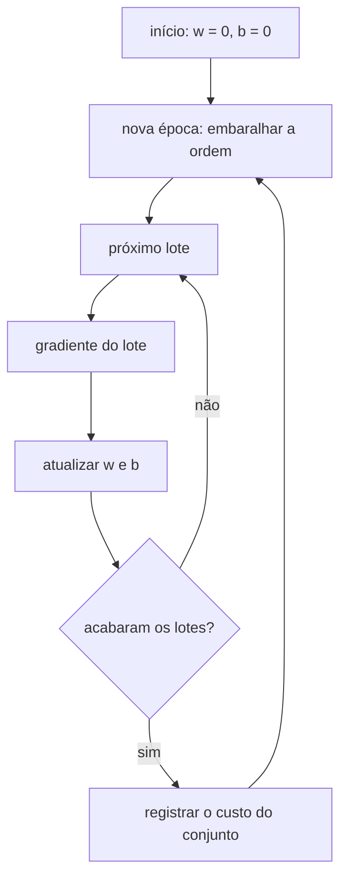

## Passo 1 · Leitura · O laço de treino

Na lição anterior você calculou o gradiente do MSE. Treinar o modelo é repetir um passo simples: andar um pouco contra o gradiente, $w \leftarrow w - \eta \nabla_w$ e $b \leftarrow b - \eta\, \partial_b$, com a **taxa de aprendizado** $\eta$. Como o MSE do modelo linear é uma bacia com um fundo só, com uma taxa razoável os passos descem até a mesma solução que a equação normal dá.

A pergunta prática é: o gradiente de quais exemplos? Há três respostas, e todas cabem no mesmo laço.

- **Batch** (lote completo): cada passo usa os $n$ exemplos. Um passo por época, direção exata, custo de $n$ linhas por passo.
- **Mini-batch**: os dados são embaralhados e cortados em lotes de $m$ exemplos (16, 32, 64…); cada lote dá um passo. São $\lceil n/m \rceil$ passos por época.
- **Estocástico** (SGD): lotes de um exemplo só; $n$ passos por época, cada um muito barato e muito ruidoso.



Dois termos que se confundem. Uma **época** é uma passada por todos os exemplos; um **passo** (ou iteração) é uma atualização dos parâmetros. No batch, os dois coincidem; com lotes de 32 e 1 000 exemplos, uma época tem 32 passos (o último lote, com 8 exemplos, também conta).

O que se registra no fim de cada época é o custo **do conjunto inteiro** com os parâmetros daquele momento: a **curva de custo**, o principal diagnóstico do treino. Registrar o custo do último lote produz uma curva que sobe e desce ao sabor do sorteio e não diz se o modelo melhorou.

```python
for epoca in range(epocas):
    ordem = rng.permutation(n)
    for inicio in range(0, n, tamanho_lote):
        lote = ordem[inicio:inicio + tamanho_lote]
        ...                               # gradiente do lote e atualização
    historico.append(mse_do_conjunto(w, b))
```

O `range(0, n, tamanho_lote)` dá o início de cada lote, e a fatia `ordem[inicio:inicio + tamanho_lote]` não reclama de passar do fim: o último lote sai menor. Esse mesmo laço, com outro modelo dentro, é o treino das redes neurais do Nível 6.

## Passo 2 · Previsão · Quantos passos por época

O programa conta os lotes de uma época com 10 exemplos e lotes de 4, e mostra uma versão que perde exemplos. Leia sem executar e digite o que ele imprime.

### Código
```python
n = 10
lote = 4
inicios = list(range(0, n, lote))
print(inicios)
print([min(i + lote, n) - i for i in inicios])
print("passos em 3 épocas:", 3 * len(inicios))

ordem = list(range(n))
print(ordem[8:8 + lote])
print(list(range(0, n - lote + 1, lote)))
```

### Dicas
1. O `range` para antes de chegar ao `n`, de 4 em 4 a partir de 0.
2. Uma fatia que passa do fim da lista devolve só o que existe.
3. Na última linha, o limite do `range` é `10 - 4 + 1`.

### Saída esperada
```text
[0, 4, 8]
[4, 4, 2]
passos em 3 épocas: 9
[8, 9]
[0, 4]
```

## Passo 3 · Exercício · Treino em lote
modo: lacunas

Complete as lacunas (`___`) do gradiente descendente em lote: cada época dá um passo com o gradiente de todos os exemplos. O arquivo `dados_regressao.py` traz o gerador do módulo, para você testar com `gerar_dados`.

### Instruções
1. `treinar_batch(X, y, taxa, epocas)` começa com `w` zerado e `b = 0.0` e, a cada época, calcula o gradiente do MSE com **todos** os exemplos.
2. Atualiza `w` e `b` **contra** o gradiente, com o passo `taxa`.
3. No fim de cada época, guarda em `historico` o MSE do conjunto com os parâmetros atualizados, e devolve `(w, b, historico)`.

### Código inicial
```python
import numpy as np


def treinar_batch(X, y, taxa, epocas):
    X = np.asarray(X, dtype=float)
    y = np.asarray(y, dtype=float)
    n, d = X.shape
    w = np.zeros(d)
    b = 0.0
    historico = []
    for _ in range(epocas):
        residuo = X @ w + b - y
        gw = ___
        gb = ___
        w = ___
        b = ___
        historico.append(float(np.mean((X @ w + b - y) ** 2)))
    return w, float(b), historico
```
```python path=dados_regressao.py
import numpy as np


def gerar_dados(n=100, semente=0, ruido=0.5, escala=(1.0, 1.0)):
    rng = np.random.default_rng(semente)
    Z = rng.normal(0.0, 1.0, size=(n, 2))
    y = 3.0 + 2.0 * Z[:, 0] - Z[:, 1] + rng.normal(0.0, ruido, size=n)
    return Z * np.asarray(escala, dtype=float), y
```

### Solução
```python
import numpy as np


def treinar_batch(X, y, taxa, epocas):
    X = np.asarray(X, dtype=float)
    y = np.asarray(y, dtype=float)
    n, d = X.shape
    w = np.zeros(d)
    b = 0.0
    historico = []
    for _ in range(epocas):
        residuo = X @ w + b - y
        gw = 2 / n * X.T @ residuo
        gb = 2 / n * residuo.sum()
        w = w - taxa * gw
        b = b - taxa * gb
        historico.append(float(np.mean((X @ w + b - y) ** 2)))
    return w, float(b), historico
```
```python path=dados_regressao.py
import numpy as np


def gerar_dados(n=100, semente=0, ruido=0.5, escala=(1.0, 1.0)):
    rng = np.random.default_rng(semente)
    Z = rng.normal(0.0, 1.0, size=(n, 2))
    y = 3.0 + 2.0 * Z[:, 0] - Z[:, 1] + rng.normal(0.0, ruido, size=n)
    return Z * np.asarray(escala, dtype=float), y
```

### Dicas
1. As duas derivadas são as da lição anterior, calculadas a partir do `residuo`.
2. Descer é subtrair: o gradiente aponta para onde o custo cresce.
3. Os dois parâmetros andam com a mesma taxa.

### Verificação
```json
[
  { "id": "mao", "checkpoint": 1, "kind": "expr",
    "setup": "w, b, h = treinar_batch([[1.0], [2.0], [3.0]], [2.0, 4.0, 6.0], 0.1, 3)",
    "expr": "[w.tolist(), b]", "expected": [[1.7007407407407407], 0.6862222222222224], "tolerance": 1e-9,
    "name": "Três épocas à mão em y = 2x: os parâmetros depois de 3 passos",
    "hint": "Com taxa 0.1 e 3 épocas, cada época dá exatamente um passo com o gradiente do MSE (fator 2/n nas duas derivadas)." },
  { "id": "mao-historico", "checkpoint": 3, "kind": "expr",
    "setup": "w, b, h = treinar_batch([[1.0], [2.0], [3.0]], [2.0, 4.0, 6.0], 0.1, 3)",
    "expr": "h", "expected": [0.29629629629629606, 0.07337613168724294, 0.0673960091449474], "tolerance": 1e-9,
    "name": "Três épocas à mão: o custo depois de cada passo" },
  { "id": "exata-w", "checkpoint": 2, "kind": "expr",
    "setup": "import numpy as np\nfrom dados_regressao import gerar_dados\nX, y = gerar_dados(100, semente=1)\nc = np.linalg.lstsq(np.column_stack([np.ones(100), X]), y)[0]\nw, b, h = treinar_batch(X, y, 0.1, 500)",
    "expr": "bool(np.allclose(w, c[1:], atol=1e-6))", "expected": true,
    "name": "Depois de 500 épocas, w chega à solução de mínimos quadrados",
    "hint": "Se w se afasta ou explode, confira o sinal da atualização e o fator 2/n." },
  { "id": "exata-b", "checkpoint": 2, "kind": "expr",
    "setup": "import numpy as np\nfrom dados_regressao import gerar_dados\nX, y = gerar_dados(100, semente=1)\nc = np.linalg.lstsq(np.column_stack([np.ones(100), X]), y)[0]\nw, b, h = treinar_batch(X, y, 0.1, 500)",
    "expr": "bool(abs(b - c[0]) < 1e-6)", "expected": true,
    "name": "Depois de 500 épocas, b chega ao intercepto de mínimos quadrados" },
  { "id": "historico-cai", "checkpoint": 3, "kind": "expr",
    "setup": "from dados_regressao import gerar_dados\nX, y = gerar_dados(100, semente=1)\nw, b, h = treinar_batch(X, y, 0.1, 50)",
    "expr": "[len(h), all(a >= c for a, c in zip(h, h[1:]))]", "expected": [50, true],
    "name": "Com taxa 0.1, o histórico tem um custo por época e nunca sobe" },
  { "id": "zero-epocas", "checkpoint": 1, "kind": "expr",
    "setup": "w, b, h = treinar_batch([[1.0, 2.0], [3.0, 4.0]], [1.0, 2.0], 0.1, 0)",
    "expr": "[w.tolist(), b, h]", "expected": [[0.0, 0.0], 0.0, []],
    "name": "Com zero épocas, os parâmetros continuam zerados e o histórico vazio" },
  { "id": "tipos", "checkpoint": 3, "kind": "expr",
    "setup": "r = treinar_batch([[1.0], [2.0]], [1.0, 2.0], 0.1, 2)",
    "expr": "[type(r[0]).__name__, type(r[1]).__name__, type(r[2]).__name__, type(r[2][0]).__name__]", "expected": ["ndarray", "float", "list", "float"],
    "name": "Devolve (array, float, lista de float)" }
]
```

### Soluções erradas
```python name="sobe o gradiente"
import numpy as np


def treinar_batch(X, y, taxa, epocas):
    X = np.asarray(X, dtype=float)
    y = np.asarray(y, dtype=float)
    n, d = X.shape
    w = np.zeros(d)
    b = 0.0
    historico = []
    for _ in range(epocas):
        residuo = X @ w + b - y
        gw = 2 / n * X.T @ residuo
        gb = 2 / n * residuo.sum()
        w = w + taxa * gw
        b = b - taxa * gb
        historico.append(float(np.mean((X @ w + b - y) ** 2)))
    return w, float(b), historico
```
```python name="gradiente somado, sem 2/n"
import numpy as np


def treinar_batch(X, y, taxa, epocas):
    X = np.asarray(X, dtype=float)
    y = np.asarray(y, dtype=float)
    n, d = X.shape
    w = np.zeros(d)
    b = 0.0
    historico = []
    for _ in range(epocas):
        residuo = X @ w + b - y
        gw = 2 * X.T @ residuo
        gb = 2 / n * residuo.sum()
        w = w - taxa * gw
        b = b - taxa * gb
        historico.append(float(np.mean((X @ w + b - y) ** 2)))
    return w, float(b), historico
```
```python name="derivada em b sem o 2"
import numpy as np


def treinar_batch(X, y, taxa, epocas):
    X = np.asarray(X, dtype=float)
    y = np.asarray(y, dtype=float)
    n, d = X.shape
    w = np.zeros(d)
    b = 0.0
    historico = []
    for _ in range(epocas):
        residuo = X @ w + b - y
        gw = 2 / n * X.T @ residuo
        gb = residuo.mean()
        w = w - taxa * gw
        b = b - taxa * gb
        historico.append(float(np.mean((X @ w + b - y) ** 2)))
    return w, float(b), historico
```
```python name="X sem transpor"
import numpy as np


def treinar_batch(X, y, taxa, epocas):
    X = np.asarray(X, dtype=float)
    y = np.asarray(y, dtype=float)
    n, d = X.shape
    w = np.zeros(d)
    b = 0.0
    historico = []
    for _ in range(epocas):
        residuo = X @ w + b - y
        gw = 2 / n * X @ residuo
        gb = 2 / n * residuo.sum()
        w = w - taxa * gw
        b = b - taxa * gb
        historico.append(float(np.mean((X @ w + b - y) ** 2)))
    return w, float(b), historico
```
```python name="b sem a taxa"
import numpy as np


def treinar_batch(X, y, taxa, epocas):
    X = np.asarray(X, dtype=float)
    y = np.asarray(y, dtype=float)
    n, d = X.shape
    w = np.zeros(d)
    b = 0.0
    historico = []
    for _ in range(epocas):
        residuo = X @ w + b - y
        gw = 2 / n * X.T @ residuo
        gb = 2 / n * residuo.sum()
        w = w - taxa * gw
        b = b - gb
        historico.append(float(np.mean((X @ w + b - y) ** 2)))
    return w, float(b), historico
```

## Passo 4 · Leitura · Mini-lotes e SGD

Com um milhão de exemplos, um passo do batch lê um milhão de linhas para andar uma vez. O mini-lote troca exatidão por quantidade: o gradiente de $m$ exemplos sorteados é uma **estimativa** do gradiente do conjunto,

$$
g_B = \frac{2}{m} X_B^\top \left(X_B w + b - y_B\right), \qquad \mathbb{E}\left[g_B\right] = \nabla_w \text{MSE}
$$

em que $X_B$ e $y_B$ são as linhas do lote $B$. Em média a estimativa aponta para o lugar certo; cada uma, sozinha, erra um pouco. Com lotes de 32, uma época sobre um milhão de linhas dá 31 250 passos em vez de um. O fator é $\frac{2}{m}$, com o tamanho **do lote**: dividir pelo $n$ do conjunto encolhe cada passo $n/m$ vezes, e o treino anda devagar sem dar erro nenhum. Como o último lote pode ser menor, use `len(lote)`, e não o `tamanho_lote` pedido.

O sorteio tem duas regras. A primeira: **embaralhar a cada época**. Os dados costumam chegar ordenados (por data, por cliente, por classe), e lotes sempre iguais repetem o mesmo ruído na mesma ordem. Um gerador criado dentro do laço de épocas, com a mesma semente, devolve a **mesma** permutação toda vez: o código parece embaralhar e não embaralha. O gerador é criado uma vez, antes das épocas:

```python
rng = np.random.default_rng(semente)     # uma vez
for _ in range(epocas):
    ordem = rng.permutation(n)           # uma ordem nova por época
```

A segunda: **o sorteio é reprodutível**. Com `default_rng(semente)` dentro da função, a mesma semente dá o mesmo modelo em qualquer máquina, e duas sementes diferentes dão dois treinos diferentes (e próximos). Um `np.random.seed(semente)` seguido de `np.random.permutation` também repete, mas mexe no estado global do numpy, que outras partes do programa usam: é o padrão antigo que o Nível 4 aposentou. Um gerador criado fora da função, no módulo, faz a segunda chamada com a mesma semente continuar a sequência da primeira, e o resultado deixa de se repetir.

Nada se perde no fim da época: o último lote, menor, também dá o seu passo. O `range(0, n - tamanho_lote + 1, tamanho_lote)` que aparece em código copiado de bibliotecas descarta as últimas linhas da ordem sorteada, e um exemplo que cai sempre no fim fica de fora daquela época.

## Passo 5 · Exercício · Mini-lotes com semente

Escreva o treino por mini-lotes. O mesmo código faz o SGD (`tamanho_lote=1`) e o batch (`tamanho_lote=n`).

### Instruções
1. `treinar_minibatch(X, y, taxa, epocas, tamanho_lote, semente)` cria **um** gerador `rng = np.random.default_rng(semente)` antes das épocas, começa com `w` zerado e `b = 0.0` e, no início de cada época, sorteia a ordem dos exemplos com `rng.permutation(n)`.
2. Percorre a ordem em lotes consecutivos de `tamanho_lote` exemplos (o último pode ser menor e também conta) e, para cada lote, dá um passo com o gradiente do MSE **do lote** (fator $2/m$, com $m$ = exemplos do lote).
3. No fim de cada época, guarda em `historico` o MSE do **conjunto inteiro** e, no fim, devolve `(w, b, historico)`, com `b` como `float`. Não use `np.random.seed` nem altere o estado global do numpy.

### Código inicial
```python
import numpy as np


def treinar_minibatch(X, y, taxa, epocas, tamanho_lote, semente):
    pass
```
```python path=dados_regressao.py
import numpy as np


def gerar_dados(n=100, semente=0, ruido=0.5, escala=(1.0, 1.0)):
    rng = np.random.default_rng(semente)
    Z = rng.normal(0.0, 1.0, size=(n, 2))
    y = 3.0 + 2.0 * Z[:, 0] - Z[:, 1] + rng.normal(0.0, ruido, size=n)
    return Z * np.asarray(escala, dtype=float), y
```

### Solução
```python
import numpy as np


def treinar_minibatch(X, y, taxa, epocas, tamanho_lote, semente):
    X = np.asarray(X, dtype=float)
    y = np.asarray(y, dtype=float)
    n, d = X.shape
    rng = np.random.default_rng(semente)
    w = np.zeros(d)
    b = 0.0
    historico = []
    for _ in range(epocas):
        ordem = rng.permutation(n)
        for inicio in range(0, n, tamanho_lote):
            lote = ordem[inicio:inicio + tamanho_lote]
            Xl = X[lote]
            yl = y[lote]
            residuo = Xl @ w + b - yl
            w = w - taxa * 2 / len(lote) * (Xl.T @ residuo)
            b = b - taxa * 2 / len(lote) * float(residuo.sum())
        historico.append(float(np.mean((X @ w + b - y) ** 2)))
    return w, float(b), historico
```
```python path=dados_regressao.py
import numpy as np


def gerar_dados(n=100, semente=0, ruido=0.5, escala=(1.0, 1.0)):
    rng = np.random.default_rng(semente)
    Z = rng.normal(0.0, 1.0, size=(n, 2))
    y = 3.0 + 2.0 * Z[:, 0] - Z[:, 1] + rng.normal(0.0, ruido, size=n)
    return Z * np.asarray(escala, dtype=float), y
```

### Dicas
1. São dois laços: o de fora percorre as épocas e sorteia a ordem; o de dentro anda pela ordem de `tamanho_lote` em `tamanho_lote`.
2. `X[lote]` com um array de posições seleciona as linhas do lote, na ordem sorteada.
3. O custo do histórico é calculado depois do laço dos lotes, com `X` e `y` inteiros.

### Verificação
```json
[
  { "id": "uma-epoca", "checkpoint": 2, "kind": "expr",
    "setup": "import numpy as np\nX = np.arange(10.0).reshape(-1, 1) / 10\ny = 1.0 + 2.0 * X[:, 0]\nw, b, h = treinar_minibatch(X, y, 0.1, 1, 4, 0)",
    "expr": "[w.tolist(), b]", "expected": [[0.49240225], 0.8800185], "tolerance": 1e-9,
    "name": "10 exemplos, lotes de 4, uma época: os parâmetros depois dos 3 passos",
    "hint": "São 3 passos (lotes de 4, 4 e 2), cada um com o gradiente médio do seu lote (fator 2/m)." },
  { "id": "tres-epocas", "checkpoint": 1, "kind": "expr",
    "setup": "import numpy as np\nX = np.arange(10.0).reshape(-1, 1) / 10\ny = 1.0 + 2.0 * X[:, 0]\nw, b, h = treinar_minibatch(X, y, 0.1, 3, 4, 0)",
    "expr": "[w.tolist(), b]", "expected": [[0.8446996118336502], 1.3896241956252882], "tolerance": 1e-9,
    "name": "Três épocas: cada época sorteia uma ordem nova do mesmo gerador",
    "hint": "O gerador é criado uma vez, antes das épocas; cada época chama rng.permutation(n) de novo." },
  { "id": "mesma-semente", "checkpoint": 1, "kind": "expr",
    "setup": "from dados_regressao import gerar_dados\nX, y = gerar_dados(60, semente=2)\nw1, b1, h1 = treinar_minibatch(X, y, 0.05, 5, 8, 11)\nw2, b2, h2 = treinar_minibatch(X, y, 0.05, 5, 8, 11)",
    "expr": "[w1.tolist() == w2.tolist(), b1 == b2, h1 == h2]", "expected": [true, true, true],
    "name": "Mesma semente, mesmo treino",
    "hint": "Crie o gerador dentro da função, a partir da semente recebida." },
  { "id": "sementes-diferentes", "checkpoint": 1, "kind": "expr",
    "setup": "from dados_regressao import gerar_dados\nX, y = gerar_dados(60, semente=2)\nw1, b1, h1 = treinar_minibatch(X, y, 0.05, 5, 8, 11)\nw2, b2, h2 = treinar_minibatch(X, y, 0.05, 5, 8, 12)",
    "expr": "w1.tolist() != w2.tolist()", "expected": true,
    "name": "Sementes diferentes, treinos diferentes",
    "hint": "A ordem dos exemplos precisa vir do gerador." },
  { "id": "perto-da-exata", "checkpoint": 2, "kind": "expr",
    "setup": "import numpy as np\nfrom dados_regressao import gerar_dados\nX, y = gerar_dados(200, semente=4)\nc = np.linalg.lstsq(np.column_stack([np.ones(200), X]), y)[0]\nw, b, h = treinar_minibatch(X, y, 0.05, 100, 16, 3)",
    "expr": "bool(np.linalg.norm(np.r_[b, w] - c) < 0.1)", "expected": true,
    "name": "Com lotes de 16 e 100 épocas, (b, w) fica a menos de 0.1 da solução exata" },
  { "id": "lote-n-e-batch", "checkpoint": 2, "kind": "expr",
    "setup": "import numpy as np\nfrom dados_regressao import gerar_dados\nX, y = gerar_dados(50, semente=5)\nwr = np.zeros(2)\nbr = 0.0\nfor _ in range(20):\n    r = X @ wr + br - y\n    wr, br = wr - 0.1 * 2 / 50 * (X.T @ r), br - 0.1 * 2 / 50 * r.sum()\nw, b, h = treinar_minibatch(X, y, 0.1, 20, 50, 0)",
    "expr": "bool(np.allclose(w, wr, atol=1e-9) and abs(b - br) < 1e-9)", "expected": true,
    "name": "Com tamanho_lote = n, o resultado é o do gradiente em lote" },
  { "id": "historico-do-conjunto", "checkpoint": 3, "kind": "expr",
    "setup": "import numpy as np\nfrom dados_regressao import gerar_dados\nX, y = gerar_dados(60, semente=2)\nw, b, h = treinar_minibatch(X, y, 0.05, 7, 8, 1)",
    "expr": "[len(h), bool(abs(h[-1] - np.mean((X @ w + b - y) ** 2)) < 1e-12)]", "expected": [7, true],
    "name": "Um custo por época, e o último é o MSE do conjunto inteiro com os parâmetros finais",
    "hint": "Registre o custo com X e y inteiros, depois dos lotes da época." },
  { "id": "estado-global", "checkpoint": 3, "kind": "expr",
    "setup": "import numpy as np\nfrom dados_regressao import gerar_dados\nX, y = gerar_dados(30, semente=2)\nnp.random.seed(0)\na = np.random.random()\nnp.random.seed(0)\ntreinar_minibatch(X, y, 0.05, 3, 8, 9)",
    "expr": "np.random.random() == a", "expected": true,
    "name": "O estado global do np.random fica intacto",
    "hint": "Use só o gerador criado com default_rng." },
  { "id": "tipos", "checkpoint": 3, "kind": "expr",
    "setup": "r = treinar_minibatch([[1.0], [2.0], [3.0]], [1.0, 2.0, 3.0], 0.1, 2, 2, 0)",
    "expr": "[type(r[0]).__name__, type(r[1]).__name__, type(r[2]).__name__, type(r[2][0]).__name__]", "expected": ["ndarray", "float", "list", "float"],
    "name": "Devolve (array, float, lista de float)" }
]
```

### Soluções erradas
```python name="não embaralha"
import numpy as np


def treinar_minibatch(X, y, taxa, epocas, tamanho_lote, semente):
    X = np.asarray(X, dtype=float)
    y = np.asarray(y, dtype=float)
    n, d = X.shape
    w = np.zeros(d)
    b = 0.0
    historico = []
    for _ in range(epocas):
        ordem = np.arange(n)
        for inicio in range(0, n, tamanho_lote):
            lote = ordem[inicio:inicio + tamanho_lote]
            Xl = X[lote]
            yl = y[lote]
            residuo = Xl @ w + b - yl
            w = w - taxa * 2 / len(lote) * (Xl.T @ residuo)
            b = b - taxa * 2 / len(lote) * float(residuo.sum())
        historico.append(float(np.mean((X @ w + b - y) ** 2)))
    return w, float(b), historico
```
```python name="gerador recriado a cada época"
import numpy as np


def treinar_minibatch(X, y, taxa, epocas, tamanho_lote, semente):
    X = np.asarray(X, dtype=float)
    y = np.asarray(y, dtype=float)
    n, d = X.shape
    w = np.zeros(d)
    b = 0.0
    historico = []
    for _ in range(epocas):
        rng = np.random.default_rng(semente)
        ordem = rng.permutation(n)
        for inicio in range(0, n, tamanho_lote):
            lote = ordem[inicio:inicio + tamanho_lote]
            Xl = X[lote]
            yl = y[lote]
            residuo = Xl @ w + b - yl
            w = w - taxa * 2 / len(lote) * (Xl.T @ residuo)
            b = b - taxa * 2 / len(lote) * float(residuo.sum())
        historico.append(float(np.mean((X @ w + b - y) ** 2)))
    return w, float(b), historico
```
```python name="gerador criado fora da função"
import numpy as np

rng = np.random.default_rng(0)


def treinar_minibatch(X, y, taxa, epocas, tamanho_lote, semente):
    X = np.asarray(X, dtype=float)
    y = np.asarray(y, dtype=float)
    n, d = X.shape
    w = np.zeros(d)
    b = 0.0
    historico = []
    for _ in range(epocas):
        ordem = rng.permutation(n)
        for inicio in range(0, n, tamanho_lote):
            lote = ordem[inicio:inicio + tamanho_lote]
            Xl = X[lote]
            yl = y[lote]
            residuo = Xl @ w + b - yl
            w = w - taxa * 2 / len(lote) * (Xl.T @ residuo)
            b = b - taxa * 2 / len(lote) * float(residuo.sum())
        historico.append(float(np.mean((X @ w + b - y) ** 2)))
    return w, float(b), historico
```
```python name="np.random.seed"
import numpy as np


def treinar_minibatch(X, y, taxa, epocas, tamanho_lote, semente):
    X = np.asarray(X, dtype=float)
    y = np.asarray(y, dtype=float)
    n, d = X.shape
    np.random.seed(semente)
    w = np.zeros(d)
    b = 0.0
    historico = []
    for _ in range(epocas):
        ordem = np.random.permutation(n)
        for inicio in range(0, n, tamanho_lote):
            lote = ordem[inicio:inicio + tamanho_lote]
            Xl = X[lote]
            yl = y[lote]
            residuo = Xl @ w + b - yl
            w = w - taxa * 2 / len(lote) * (Xl.T @ residuo)
            b = b - taxa * 2 / len(lote) * float(residuo.sum())
        historico.append(float(np.mean((X @ w + b - y) ** 2)))
    return w, float(b), historico
```
```python name="descarta o último lote"
import numpy as np


def treinar_minibatch(X, y, taxa, epocas, tamanho_lote, semente):
    X = np.asarray(X, dtype=float)
    y = np.asarray(y, dtype=float)
    n, d = X.shape
    rng = np.random.default_rng(semente)
    w = np.zeros(d)
    b = 0.0
    historico = []
    for _ in range(epocas):
        ordem = rng.permutation(n)
        for inicio in range(0, n - tamanho_lote + 1, tamanho_lote):
            lote = ordem[inicio:inicio + tamanho_lote]
            Xl = X[lote]
            yl = y[lote]
            residuo = Xl @ w + b - yl
            w = w - taxa * 2 / len(lote) * (Xl.T @ residuo)
            b = b - taxa * 2 / len(lote) * float(residuo.sum())
        historico.append(float(np.mean((X @ w + b - y) ** 2)))
    return w, float(b), historico
```
```python name="registra o custo do lote"
import numpy as np


def treinar_minibatch(X, y, taxa, epocas, tamanho_lote, semente):
    X = np.asarray(X, dtype=float)
    y = np.asarray(y, dtype=float)
    n, d = X.shape
    rng = np.random.default_rng(semente)
    w = np.zeros(d)
    b = 0.0
    historico = []
    for _ in range(epocas):
        ordem = rng.permutation(n)
        for inicio in range(0, n, tamanho_lote):
            lote = ordem[inicio:inicio + tamanho_lote]
            Xl = X[lote]
            yl = y[lote]
            residuo = Xl @ w + b - yl
            w = w - taxa * 2 / len(lote) * (Xl.T @ residuo)
            b = b - taxa * 2 / len(lote) * float(residuo.sum())
        historico.append(float(np.mean((Xl @ w + b - yl) ** 2)))
    return w, float(b), historico
```
```python name="divide por n, não pelo lote"
import numpy as np


def treinar_minibatch(X, y, taxa, epocas, tamanho_lote, semente):
    X = np.asarray(X, dtype=float)
    y = np.asarray(y, dtype=float)
    n, d = X.shape
    rng = np.random.default_rng(semente)
    w = np.zeros(d)
    b = 0.0
    historico = []
    for _ in range(epocas):
        ordem = rng.permutation(n)
        for inicio in range(0, n, tamanho_lote):
            lote = ordem[inicio:inicio + tamanho_lote]
            Xl = X[lote]
            yl = y[lote]
            residuo = Xl @ w + b - yl
            w = w - taxa * 2 / n * (Xl.T @ residuo)
            b = b - taxa * 2 / n * float(residuo.sum())
        historico.append(float(np.mean((X @ w + b - y) ** 2)))
    return w, float(b), historico
```

## Passo 6 · Leitura · O ruído do SGD e o decaimento da taxa

Com a taxa fixa, o batch desce até o fundo e para: no fundo o gradiente é zero, e o passo também. O mini-lote não para. No fundo da bacia, o gradiente **do conjunto** é zero, mas o de cada lote não é, e cada passo empurra os parâmetros para um lado diferente. O resultado é uma nuvem em volta da solução, tanto maior quanto menor o lote e maior a taxa.

Os números abaixo foram medidos no executor com 200 exemplos do gerador do módulo, taxa 0,05 e 100 épocas, em cinco sementes: a distância entre $(b, w)$ e a solução exata no fim do treino.

| Lote | Taxa fixa | Com decaimento $k = 0{,}1$ |
|---|---|---|
| 1 (SGD) | 0,15 a 0,39 | 0,010 a 0,042 |
| 16 | 0,013 a 0,040 | 0,002 a 0,005 |
| 200 (batch) | 0,0001 | 0,25 |

O remédio para a nuvem é diminuir a taxa ao longo do treino. Uma regra simples é o **decaimento inverso**:

$$
\eta_t = \frac{\eta_0}{1 + k\, t}
$$

com $t$ a época (começando em 0) e $k$ a força do decaimento. No começo, passos grandes atravessam a bacia depressa; no fim, passos pequenos assentam perto do fundo. A tabela mostra o outro lado: no batch, que já não tem ruído, o decaimento só atrasa a descida, e 100 épocas ficam longe do fundo.

O ruído também tem vantagens. Em custos que não são uma bacia (as redes do Nível 6), os empurrões ajudam a sair de regiões planas e de mínimos ruins. E cada passo de um mini-lote custa uma fração de uma época: com dados grandes, o mini-lote chega perto do fundo depois de **menos leituras de linhas** que o batch, mesmo com mais passos. Lotes de 32 a 256 são o meio-termo usual.

Para comparar treinos, olhe a curva de custo do conjunto por época. Uma pergunta útil é "em que época o custo ficou abaixo de um limiar pela primeira vez?". Numa curva do SGD, que sobe e desce, a primeira vez abaixo do limiar não garante que o custo fique lá: é por isso que o histórico guarda todas as épocas.

## Passo 7 · Exercício · Ler as curvas

Escreva duas ferramentas pequenas para comparar treinos: a época em que uma curva atinge um limiar e a taxa com decaimento.

### Instruções
1. `epoca_em_que_atinge(historico, limiar)` devolve o número da **primeira** época (a primeira posição é a época 1) em que o custo fica **menor ou igual** a `limiar`, como `int`; devolve `None` se isso nunca acontece (inclusive com histórico vazio).
2. `taxa_com_decaimento(taxa0, decaimento, epoca)` devolve $\eta_0 / (1 + k \cdot t)$ como `float`, com `epoca` = $t$ começando em 0.

### Código inicial
```python
def epoca_em_que_atinge(historico, limiar):
    pass


def taxa_com_decaimento(taxa0, decaimento, epoca):
    pass
```

### Solução
```python
def epoca_em_que_atinge(historico, limiar):
    for epoca, custo in enumerate(historico, start=1):
        if custo <= limiar:
            return epoca
    return None


def taxa_com_decaimento(taxa0, decaimento, epoca):
    return float(taxa0 / (1 + decaimento * epoca))
```

### Dicas
1. O `enumerate` aceita o número inicial da contagem.
2. Saia da função assim que achar a primeira época; se o laço terminar, nenhuma atingiu.
3. A soma $1 + k t$ fica toda no denominador.

### Verificação
```json
[
  { "id": "atinge", "checkpoint": 1, "kind": "call", "function": "epoca_em_que_atinge", "args": [[5.0, 3.0, 1.5, 0.8, 0.9, 0.4], 1.0],
    "expected": 4, "type": "int", "name": "O custo fica abaixo de 1.0 pela primeira vez na época 4" },
  { "id": "limite", "checkpoint": 1, "kind": "call", "function": "epoca_em_que_atinge", "args": [[5.0, 3.0, 1.5, 0.8], 1.5],
    "expected": 3, "name": "Um custo igual ao limiar conta",
    "hint": "Menor ou igual." },
  { "id": "primeira-vez", "checkpoint": 1, "kind": "call", "function": "epoca_em_que_atinge", "args": [[2.0, 0.9, 1.2, 1.1, 0.7, 0.6], 1.0],
    "expected": 2, "name": "Numa curva que sobe e desce, vale a primeira vez abaixo do limiar",
    "hint": "Não importa se o custo volta a subir depois." },
  { "id": "primeira-epoca", "checkpoint": 1, "kind": "call", "function": "epoca_em_que_atinge", "args": [[0.5, 0.4], 1.0],
    "expected": 1, "name": "A primeira posição do histórico é a época 1",
    "hint": "As épocas são contadas a partir de 1." },
  { "id": "nunca", "checkpoint": 1, "kind": "call", "function": "epoca_em_que_atinge", "args": [[3.0, 2.0, 1.5], 1.0],
    "expected": null, "type": "NoneType", "name": "Uma curva que nunca atinge o limiar devolve None",
    "hint": "Nenhuma época atingiu: devolva None, e não um número." },
  { "id": "vazio", "checkpoint": 1, "kind": "call", "function": "epoca_em_que_atinge", "args": [[], 1.0],
    "expected": null, "type": "NoneType", "name": "Histórico vazio devolve None" },
  { "id": "decai-inicio", "checkpoint": 2, "kind": "call", "function": "taxa_com_decaimento", "args": [0.1, 0.5, 0],
    "expected": 0.1, "type": "float", "tolerance": 1e-12, "name": "Na época 0, a taxa é a inicial" },
  { "id": "decai-4", "checkpoint": 2, "kind": "call", "function": "taxa_com_decaimento", "args": [0.1, 0.5, 4],
    "expected": 0.03333333333333333, "tolerance": 1e-12, "name": "Com k = 0.5, na época 4 a taxa é 0.1 / 3",
    "hint": "O denominador é 1 + k vezes a época." },
  { "id": "sem-decaimento", "checkpoint": 2, "kind": "call", "function": "taxa_com_decaimento", "args": [0.2, 0.0, 10],
    "expected": 0.2, "tolerance": 1e-12, "name": "Com k = 0, a taxa não muda" }
]
```

### Soluções erradas
```python name="menor estrito"
def epoca_em_que_atinge(historico, limiar):
    for epoca, custo in enumerate(historico, start=1):
        if custo < limiar:
            return epoca
    return None


def taxa_com_decaimento(taxa0, decaimento, epoca):
    return float(taxa0 / (1 + decaimento * epoca))
```
```python name="conta as épocas a partir de 0"
def epoca_em_que_atinge(historico, limiar):
    for epoca, custo in enumerate(historico):
        if custo <= limiar:
            return epoca
    return None


def taxa_com_decaimento(taxa0, decaimento, epoca):
    return float(taxa0 / (1 + decaimento * epoca))
```
```python name="argmax sem conferir"
import numpy as np


def epoca_em_que_atinge(historico, limiar):
    if len(historico) == 0:
        return None
    return int(np.argmax(np.array(historico) <= limiar)) + 1


def taxa_com_decaimento(taxa0, decaimento, epoca):
    return float(taxa0 / (1 + decaimento * epoca))
```
```python name="época a partir da qual fica abaixo"
def epoca_em_que_atinge(historico, limiar):
    resposta = None
    for epoca in range(len(historico), 0, -1):
        if historico[epoca - 1] > limiar:
            break
        resposta = epoca
    return resposta


def taxa_com_decaimento(taxa0, decaimento, epoca):
    return float(taxa0 / (1 + decaimento * epoca))
```
```python name="devolve -1 quando não atinge"
def epoca_em_que_atinge(historico, limiar):
    for epoca, custo in enumerate(historico, start=1):
        if custo <= limiar:
            return epoca
    return -1


def taxa_com_decaimento(taxa0, decaimento, epoca):
    return float(taxa0 / (1 + decaimento * epoca))
```
```python name="decaimento exponencial"
def epoca_em_que_atinge(historico, limiar):
    for epoca, custo in enumerate(historico, start=1):
        if custo <= limiar:
            return epoca
    return None


def taxa_com_decaimento(taxa0, decaimento, epoca):
    return float(taxa0 * decaimento ** epoca)
```
```python name="precedência no denominador"
def epoca_em_que_atinge(historico, limiar):
    for epoca, custo in enumerate(historico, start=1):
        if custo <= limiar:
            return epoca
    return None


def taxa_com_decaimento(taxa0, decaimento, epoca):
    return float(taxa0 / 1 + decaimento * epoca)
```

## Passo 8 · Quiz · Época, passo e lote

### Pergunta
Um conjunto tem 1 000 exemplos e o treino usa lotes de 64 durante 10 épocas, com `range(0, n, tamanho_lote)`. Quantas atualizações de `w` acontecem?
- [ ] 10
- [ ] 150
- [x] 160
- [ ] 10 000
> Cada época tem $\lceil 1000/64 \rceil = 16$ lotes: 15 completos e um de 40 exemplos, que também dá o seu passo. Em 10 épocas, 160 passos. São 10 só no batch (um passo por época) e 10 000 só no SGD (um por exemplo); 150 é o que sobra quando o último lote é descartado.

### Pergunta
Um colega treina por mini-lotes e repara que `treinar(X, y, semente=1)` e `treinar(X, y, semente=2)` dão exatamente os mesmos pesos. O trecho do laço é este:

```python
for epoca in range(epocas):
    ordem = np.arange(n)
    for inicio in range(0, n, tamanho_lote):
        ...
```

O que está acontecendo?
- [ ] Nada de errado: com a mesma taxa e os mesmos dados, o treino converge para os mesmos pesos
- [x] A ordem nunca é sorteada: a semente não é usada, e os lotes são os mesmos, na mesma ordem, em toda época e em toda chamada
- [ ] As duas sementes geram a mesma permutação, porque são próximas
- [ ] O gerador precisa ser criado dentro do laço de épocas para a semente fazer efeito
> O `np.arange(n)` é a ordem original, sempre igual; a semente não entra em lugar nenhum. Mini-lotes com ordens diferentes chegam perto da solução, mas não exatamente aos mesmos pesos, e sementes próximas não dão permutações iguais. Criar o gerador dentro do laço de épocas é outro erro: a mesma semente daria a mesma permutação em toda época.

### Pergunta
Duas curvas de custo do conjunto, uma por época:

```text
batch:     [4.1, 2.0, 1.1, 0.62, 0.41, 0.33, 0.29, 0.27, 0.26, 0.26]
lote 8:    [0.9, 0.41, 0.33, 0.30, 0.29, 0.31, 0.28, 0.30, 0.29, 0.28]
```

Qual leitura está certa?
- [ ] O lote de 8 está com defeito, porque o custo sobe em algumas épocas
- [ ] O batch é pior, porque terminou num custo menor só por sorte
- [x] O lote de 8 desce mais depressa por época, porque dá vários passos em cada uma, e depois oscila em volta do fundo; o batch desce devagar e assenta, e um decaimento da taxa reduziria a oscilação do lote de 8
- [ ] As duas curvas mostram que a taxa está alta demais
> Com lotes de 8, cada época tem vários passos, e o custo cai muito já na primeira; perto do fundo, o gradiente ruidoso de cada lote faz o custo subir e descer um pouco, sem ser defeito. O batch é determinístico (não há sorte) e desce sem oscilar, um passo por época. Taxa alta demais faria o custo crescer ou explodir, o que nenhuma das curvas mostra.
