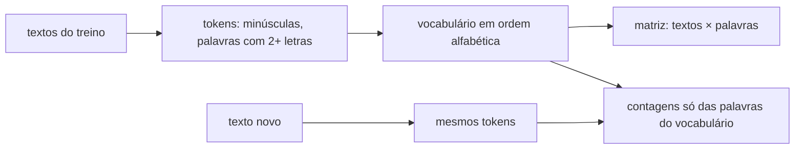

## Passo 1 · Leitura · Texto vira contagem

Um aplicativo de mensagens fictício quer separar as mensagens de **promoção** das mensagens **pessoais**. Os modelos que você viu até aqui recebem uma matriz de números, com uma linha por exemplo e uma coluna por atributo. Uma frase não é isso; o primeiro passo é transformá-la.

A transformação mais simples é o **saco de palavras** (bag of words). Cada texto é quebrado em palavras (tokens), o conjunto de todas as palavras do treino forma o **vocabulário**, e cada texto vira uma linha com a contagem de cada palavra do vocabulário. A ordem das palavras se perde: "não gostei, foi bom" e "gostei, não foi bom" viram a mesma linha.



O `CountVectorizer` do scikit-learn faz tudo isso e segue a API da m4-01: o `fit` aprende o vocabulário, o `transform` conta.

```python
from sklearn.feature_extraction.text import CountVectorizer

vetorizador = CountVectorizer()
X_treino = vetorizador.fit_transform(textos_treino)   # matriz esparsa
X_teste = vetorizador.transform(textos_teste)          # mesmo vocabulário
vetorizador.get_feature_names_out()                    # as palavras, em ordem
X_treino.toarray()                                     # a matriz densa
```

Três decisões do padrão aparecem em todo resultado. Tudo vira minúsculas (`lowercase=True`). Um token é uma sequência de **duas ou mais** letras ou dígitos, pela expressão regular `\b\w\w+\b`: palavras de uma letra, como "a", "e" e "é", são descartadas, e a pontuação separa palavras. E o vocabulário fica em ordem alfabética, com os acentos depois das letras sem acento. A matriz sai **esparsa**, porque quase todas as contagens são zero: um texto curto usa poucas palavras de um vocabulário de milhares.

Na lição, os dados são 34 mensagens curtas inventadas para o exercício, no arquivo `mensagens.py`: 24 de treino e 10 de teste, metade de cada classe. Dois exemplos:

```python
"Desconto de 50% só hoje, aproveite a oferta"     # promocao
"Mãe, esqueci a chave, deixa embaixo do tapete"   # pessoal
```

Com o texto em números, a pergunta passa a ser qual modelo usar. O Naive Bayes, assunto do passo 4, é rápido, funciona com poucos exemplos e foi por muito tempo o padrão dos filtros de spam.

## Passo 2 · Previsão · O vocabulário do CountVectorizer

O programa monta o vocabulário de três frases curtas e imprime a matriz de contagens. Leia sem executar e digite o que ele imprime.

### Código
```python
from sklearn.feature_extraction.text import CountVectorizer

textos = ["Promoção HOJE: frete grátis", "Oi, a reunião é hoje?", "Grátis só hoje e amanhã"]
vetorizador = CountVectorizer()
X = vetorizador.fit_transform(textos)
print(vetorizador.get_feature_names_out().tolist())
print(X.toarray().tolist())
```

### Dicas
1. Tudo vira minúsculas, e "a", "é" e "e" têm uma letra só: ficam de fora.
2. Na ordem alfabética, "amanhã" vem primeiro e "só" por último.
3. Cada linha da matriz é uma frase; cada coluna, uma palavra do vocabulário na ordem impressa.

### Saída esperada
```text
['amanhã', 'frete', 'grátis', 'hoje', 'oi', 'promoção', 'reunião', 'só']
[[0, 1, 1, 1, 0, 1, 0, 0], [0, 0, 0, 1, 1, 0, 1, 0], [1, 0, 1, 1, 0, 0, 0, 1]]
```

## Passo 3 · Exercício · Saco de palavras
modo: lacunas

Complete as lacunas (`___`) para reproduzir o `CountVectorizer` padrão com a biblioteca `re` e o numpy.

### Instruções
1. `tokenizar(texto)` devolve a lista de tokens do texto em minúsculas: sequências de duas ou mais letras ou dígitos, pela expressão `\b\w\w+\b`.
2. `bag_of_words(textos)` devolve a tupla `(vocabulario, matriz)`: `vocabulario` é a lista das palavras distintas de todos os textos em ordem alfabética, e `matriz` é um array de inteiros com uma linha por texto e uma coluna por palavra.
3. Cada célula da matriz conta **quantas vezes** a palavra aparece no texto.

### Código inicial
```python
import re
import numpy as np


def tokenizar(texto):
    return re.findall(___, ___)


def bag_of_words(textos):
    documentos = [tokenizar(t) for t in textos]
    vocabulario = ___
    indice = {palavra: j for j, palavra in enumerate(vocabulario)}
    matriz = np.zeros((len(textos), len(vocabulario)), dtype=int)
    for i, tokens in enumerate(documentos):
        for palavra in tokens:
            matriz[i, indice[palavra]] ___
    return vocabulario, matriz
```

### Solução
```python
import re
import numpy as np


def tokenizar(texto):
    return re.findall(r"\b\w\w+\b", texto.lower())


def bag_of_words(textos):
    documentos = [tokenizar(t) for t in textos]
    vocabulario = sorted({p for doc in documentos for p in doc})
    indice = {palavra: j for j, palavra in enumerate(vocabulario)}
    matriz = np.zeros((len(textos), len(vocabulario)), dtype=int)
    for i, tokens in enumerate(documentos):
        for palavra in tokens:
            matriz[i, indice[palavra]] += 1
    return vocabulario, matriz
```

### Dicas
1. No Python 3, o `\w` das expressões regulares já casa letras acentuadas.
2. Um conjunto por compreensão junta as palavras de todos os documentos sem repetir; o `sorted` devolve uma lista ordenada.
3. A célula acumula: cada ocorrência soma um.

### Verificação
```json
[
  { "id": "vocabulario-previsao", "checkpoint": 2, "kind": "expr",
    "expr": "bag_of_words(['Promoção HOJE: frete grátis', 'Oi, a reunião é hoje?', 'Grátis só hoje e amanhã'])[0]",
    "expected": ["amanhã", "frete", "grátis", "hoje", "oi", "promoção", "reunião", "só"],
    "name": "O vocabulário das três frases da Previsão",
    "hint": "Minúsculas, tokens de duas ou mais letras, sem repetição, em ordem alfabética." },
  { "id": "matriz-previsao", "checkpoint": 2, "kind": "expr",
    "expr": "bag_of_words(['Promoção HOJE: frete grátis', 'Oi, a reunião é hoje?', 'Grátis só hoje e amanhã'])[1].tolist()",
    "expected": [[0, 1, 1, 1, 0, 1, 0, 0], [0, 0, 0, 1, 1, 0, 1, 0], [1, 0, 1, 1, 0, 0, 0, 1]],
    "name": "A matriz de contagens das três frases" },
  { "id": "conta-repeticoes", "checkpoint": 3, "kind": "expr", "expr": "bag_of_words(['oi oi tudo bem', 'bem'])[1].tolist()", "expected": [[1, 2, 1], [1, 0, 0]],
    "name": "Uma palavra repetida conta duas vezes",
    "hint": "Some um a cada ocorrência, em vez de só marcar presença." },
  { "id": "acentos", "checkpoint": 1, "kind": "expr", "expr": "bag_of_words(['Promoção válida até sábado'])[0]", "expected": ["até", "promoção", "sábado", "válida"],
    "name": "Palavras acentuadas ficam inteiras",
    "hint": "Use \\w, que casa letras com acento; [a-z] não casa." },
  { "id": "uma-letra-e-maiusculas", "checkpoint": 1, "kind": "expr", "expr": "[bag_of_words(['A loja e a LOJA'])[0], bag_of_words(['A loja e a LOJA'])[1].tolist()]",
    "expected": [["loja"], [[2]]],
    "name": "Tokens de uma letra saem e maiúsculas se juntam às minúsculas" },
  { "id": "referencia", "checkpoint": 2, "kind": "expr",
    "setup": "from sklearn.feature_extraction.text import CountVectorizer\ntextos = ['Oferta relâmpago: compre dois e leve três', 'Chego atrasado na reunião, o ônibus quebrou', 'Ganhe um cupom de desconto na sua próxima compra', 'Compre agora e pague só no mês que vem, compre já']\ncv = CountVectorizer()\nM = cv.fit_transform(textos).toarray()\nv, m = bag_of_words(textos)",
    "expr": "[v == cv.get_feature_names_out().tolist(), m.tolist() == M.tolist()]", "expected": [true, true],
    "name": "Vocabulário e matriz iguais aos do CountVectorizer em quatro mensagens",
    "hint": "O primeiro valor compara o vocabulário e o segundo, a matriz." },
  { "id": "tipos", "checkpoint": 2, "kind": "expr", "setup": "r = bag_of_words(['bom dia', 'dia de sol'])",
    "expr": "[type(r).__name__, type(r[0]).__name__, type(r[1]).__name__, r[1].dtype.kind]", "expected": ["tuple", "list", "ndarray", "i"],
    "name": "Devolve (lista, array de inteiros)" }
]
```

### Soluções erradas
```python name="tokens de uma letra"
import re
import numpy as np


def tokenizar(texto):
    return re.findall(r"\w+", texto.lower())


def bag_of_words(textos):
    documentos = [tokenizar(t) for t in textos]
    vocabulario = sorted({p for doc in documentos for p in doc})
    indice = {palavra: j for j, palavra in enumerate(vocabulario)}
    matriz = np.zeros((len(textos), len(vocabulario)), dtype=int)
    for i, tokens in enumerate(documentos):
        for palavra in tokens:
            matriz[i, indice[palavra]] += 1
    return vocabulario, matriz
```
```python name="sem passar para minúsculas"
import re
import numpy as np


def tokenizar(texto):
    return re.findall(r"\b\w\w+\b", texto)


def bag_of_words(textos):
    documentos = [tokenizar(t) for t in textos]
    vocabulario = sorted({p for doc in documentos for p in doc})
    indice = {palavra: j for j, palavra in enumerate(vocabulario)}
    matriz = np.zeros((len(textos), len(vocabulario)), dtype=int)
    for i, tokens in enumerate(documentos):
        for palavra in tokens:
            matriz[i, indice[palavra]] += 1
    return vocabulario, matriz
```
```python name="letras sem acento"
import re
import numpy as np


def tokenizar(texto):
    return re.findall(r"[a-z0-9]{2,}", texto.lower())


def bag_of_words(textos):
    documentos = [tokenizar(t) for t in textos]
    vocabulario = sorted({p for doc in documentos for p in doc})
    indice = {palavra: j for j, palavra in enumerate(vocabulario)}
    matriz = np.zeros((len(textos), len(vocabulario)), dtype=int)
    for i, tokens in enumerate(documentos):
        for palavra in tokens:
            matriz[i, indice[palavra]] += 1
    return vocabulario, matriz
```
```python name="vocabulário na ordem em que aparece"
import re
import numpy as np


def tokenizar(texto):
    return re.findall(r"\b\w\w+\b", texto.lower())


def bag_of_words(textos):
    documentos = [tokenizar(t) for t in textos]
    vocabulario = list(dict.fromkeys(p for doc in documentos for p in doc))
    indice = {palavra: j for j, palavra in enumerate(vocabulario)}
    matriz = np.zeros((len(textos), len(vocabulario)), dtype=int)
    for i, tokens in enumerate(documentos):
        for palavra in tokens:
            matriz[i, indice[palavra]] += 1
    return vocabulario, matriz
```
```python name="presença no lugar de contagem"
import re
import numpy as np


def tokenizar(texto):
    return re.findall(r"\b\w\w+\b", texto.lower())


def bag_of_words(textos):
    documentos = [tokenizar(t) for t in textos]
    vocabulario = sorted({p for doc in documentos for p in doc})
    indice = {palavra: j for j, palavra in enumerate(vocabulario)}
    matriz = np.zeros((len(textos), len(vocabulario)), dtype=int)
    for i, tokens in enumerate(documentos):
        for palavra in tokens:
            matriz[i, indice[palavra]] = 1
    return vocabulario, matriz
```
```python name="vocabulário só do primeiro texto"
import re
import numpy as np


def tokenizar(texto):
    return re.findall(r"\b\w\w+\b", texto.lower())


def bag_of_words(textos):
    documentos = [tokenizar(t) for t in textos]
    vocabulario = sorted(set(documentos[0]))
    indice = {palavra: j for j, palavra in enumerate(vocabulario)}
    matriz = np.zeros((len(textos), len(vocabulario)), dtype=int)
    for i, tokens in enumerate(documentos):
        for palavra in tokens:
            matriz[i, indice[palavra]] += 1
    return vocabulario, matriz
```

## Passo 4 · Leitura · Bayes ingênuo com Laplace

O Naive Bayes classifica pela regra de Bayes do Nível 4: escolhe a classe $c$ que maximiza $P(c \mid \text{texto}) \propto P(c)\, P(\text{texto} \mid c)$. A parte "ingênua" é supor que, dentro de cada classe, as palavras aparecem independentemente umas das outras. Com essa hipótese, a probabilidade do texto é um produto, uma vez por ocorrência de cada palavra $j$:

$$
P(\text{texto} \mid c) \propto \prod_{j} P(w_j \mid c)^{x_j}
$$

A hipótese é falsa ("frete" e "grátis" andam juntas), mas para **decidir** a classe ela costuma funcionar bem: o modelo erra no valor das probabilidades e acerta qual é a maior.

Dois problemas numéricos aparecem logo. O primeiro é o **produto**: com centenas de palavras, um produto de probabilidades pequenas fica abaixo do menor `float64` e vira exatamente `0.0` para todas as classes, que passam a empatar. A saída, como na m1-05, é somar logaritmos:

$$
\hat c = \arg\max_c \Big[ \log P(c) + \sum_{j} x_j \log P(w_j \mid c) \Big]
$$

Em forma de matriz, com `X` de forma `(n, V)` e `log_prob` de forma `(k, V)`, isso é `X @ log_prob.T + log_prior`.

O segundo é a **probabilidade zero**. A estimativa ingênua $P(w_j \mid c) = N_{cj} / N_c$ (ocorrências da palavra na classe sobre o total de palavras da classe) vale zero para uma palavra que nunca apareceu numa classe no treino. Uma única palavra dessas zera a probabilidade da classe inteira, por melhores que sejam as outras: $\log 0$ é `-inf` e, multiplicado pela contagem 0 de outra palavra, vira `nan`. A **suavização de Laplace** soma $\alpha$ (normalmente 1) a toda contagem:

$$
P(w_j \mid c) = \frac{N_{cj} + \alpha}{N_c + \alpha V}
$$

com $V$ o tamanho do vocabulário, para as probabilidades da classe continuarem somando 1. A probabilidade a priori $P(c)$ é a fração dos **textos** do treino que são da classe $c$.

O `MultinomialNB` faz exatamente isso e guarda os logaritmos:

```python
from sklearn.naive_bayes import MultinomialNB

nb = MultinomialNB(alpha=1.0).fit(X_treino, y_treino)
nb.class_log_prior_     # log P(c), um por classe
nb.feature_log_prob_    # log P(w_j | c), forma (k, V)
nb.predict(X_teste)
```

Palavras do teste que não estão no vocabulário do treino simplesmente não viram coluna: o `transform` as ignora.

## Passo 5 · Exercício · Naive Bayes do zero

Escreva o treino e a previsão do Naive Bayes multinomial. A correção compara com um `MultinomialNB` treinado nas mensagens do arquivo `mensagens.py`.

### Instruções
1. `treinar_nb(X, y, alpha=1.0)` recebe a matriz de contagens `X` (forma `(n, V)`) e os rótulos `y`, e devolve um dicionário com `"classes"` (array com os rótulos distintos em ordem crescente), `"log_prior"` (array com $\log P(c)$, a fração de textos de cada classe) e `"log_prob"` (array `(k, V)` com $\log P(w_j \mid c)$ suavizado com `alpha`).
2. `prever_nb(modelo, X)` devolve um array com o **rótulo** de maior $\log P(c) + \sum_j x_j \log P(w_j \mid c)$ para cada linha de `X`, calculado com logaritmos.
3. Implemente sem o `MultinomialNB`.

### Código inicial
```python
import numpy as np


def treinar_nb(X, y, alpha=1.0):
    pass


def prever_nb(modelo, X):
    pass
```
```text path=mensagens.py
TEXTOS_TREINO = [
    "Promoção imperdível: frete grátis em todo o site até domingo",
    "Oi, você chega que horas no jantar de hoje?",
    "Desconto de 50% só hoje, aproveite a oferta",
    "Mãe, esqueci a chave, deixa embaixo do tapete",
    "Ganhe um cupom de desconto na sua próxima compra",
    "Vamos marcar o almoço de domingo na casa da vó?",
    "Oferta relâmpago: compre dois e leve três",
    "Chego atrasado na reunião, o ônibus quebrou",
    "Últimas unidades com preço de liquidação, compre já",
    "Obrigado pelo presente, adorei o livro",
    "Cadastre-se e ganhe frete grátis na primeira compra",
    "Você viu onde deixei o carregador do celular?",
    "Liquidação de inverno com até 70% de desconto",
    "Amanhã tem jogo, vamos assistir juntos?",
    "Seu cupom exclusivo vence hoje, use agora",
    "Pode me mandar a foto da receita do bolo?",
    "Compre agora e pague só no mês que vem",
    "A reunião de condomínio mudou para quinta",
    "Oferta especial para clientes: leve o segundo com desconto",
    "Feliz aniversário, que seu dia seja ótimo",
    "Só hoje: cupom de frete grátis para todo o país",
    "Já cheguei em casa, me avisa quando sair",
    "Aproveite os preços baixos da semana do cliente",
    "Esqueci o guarda-chuva no seu carro ontem",
]
Y_TREINO = ["promocao", "pessoal"] * 12
TEXTOS_TESTE = [
    "Frete grátis e desconto na compra de hoje",
    "Vamos almoçar juntos amanhã?",
    "Oferta da semana: cupom para a sua próxima compra",
    "Deixei o livro na sua mesa",
    "Ganhe pontos em dobro só neste domingo",
    "O jantar de hoje vai atrasar um pouco",
    "Preço baixo em toda a loja, aproveite",
    "Você pode buscar a vó no domingo?",
    "Compre o presente de aniversário com desconto",
    "A chave do carro ficou com você?",
]
Y_TESTE = ["promocao", "pessoal"] * 5
```

### Solução
```python
import numpy as np


def treinar_nb(X, y, alpha=1.0):
    X = np.asarray(X, dtype=float)
    y = np.asarray(y)
    classes = np.unique(y)
    contagens = np.array([X[y == c].sum(axis=0) for c in classes])
    log_prior = np.log(np.array([np.mean(y == c) for c in classes]))
    suavizadas = contagens + alpha
    log_prob = np.log(suavizadas / suavizadas.sum(axis=1, keepdims=True))
    return {"classes": classes, "log_prior": log_prior, "log_prob": log_prob}


def prever_nb(modelo, X):
    X = np.asarray(X, dtype=float)
    pontuacao = X @ modelo["log_prob"].T + modelo["log_prior"]
    return modelo["classes"][np.argmax(pontuacao, axis=1)]
```
```text path=mensagens.py
TEXTOS_TREINO = [
    "Promoção imperdível: frete grátis em todo o site até domingo",
    "Oi, você chega que horas no jantar de hoje?",
    "Desconto de 50% só hoje, aproveite a oferta",
    "Mãe, esqueci a chave, deixa embaixo do tapete",
    "Ganhe um cupom de desconto na sua próxima compra",
    "Vamos marcar o almoço de domingo na casa da vó?",
    "Oferta relâmpago: compre dois e leve três",
    "Chego atrasado na reunião, o ônibus quebrou",
    "Últimas unidades com preço de liquidação, compre já",
    "Obrigado pelo presente, adorei o livro",
    "Cadastre-se e ganhe frete grátis na primeira compra",
    "Você viu onde deixei o carregador do celular?",
    "Liquidação de inverno com até 70% de desconto",
    "Amanhã tem jogo, vamos assistir juntos?",
    "Seu cupom exclusivo vence hoje, use agora",
    "Pode me mandar a foto da receita do bolo?",
    "Compre agora e pague só no mês que vem",
    "A reunião de condomínio mudou para quinta",
    "Oferta especial para clientes: leve o segundo com desconto",
    "Feliz aniversário, que seu dia seja ótimo",
    "Só hoje: cupom de frete grátis para todo o país",
    "Já cheguei em casa, me avisa quando sair",
    "Aproveite os preços baixos da semana do cliente",
    "Esqueci o guarda-chuva no seu carro ontem",
]
Y_TREINO = ["promocao", "pessoal"] * 12
TEXTOS_TESTE = [
    "Frete grátis e desconto na compra de hoje",
    "Vamos almoçar juntos amanhã?",
    "Oferta da semana: cupom para a sua próxima compra",
    "Deixei o livro na sua mesa",
    "Ganhe pontos em dobro só neste domingo",
    "O jantar de hoje vai atrasar um pouco",
    "Preço baixo em toda a loja, aproveite",
    "Você pode buscar a vó no domingo?",
    "Compre o presente de aniversário com desconto",
    "A chave do carro ficou com você?",
]
Y_TESTE = ["promocao", "pessoal"] * 5
```

### Dicas
1. Some as contagens das linhas de cada classe com uma máscara (`X[y == c].sum(axis=0)`): uma linha por classe, na ordem de `classes`.
2. A suavização soma `alpha` a cada contagem **antes** de dividir pelo total da linha; o total também muda.
3. Na previsão, o `argmax` devolve a posição da classe; o rótulo está nessa posição de `"classes"`.

### Verificação
```json
[
  { "id": "log-prob-pequeno", "checkpoint": 1, "kind": "expr",
    "setup": "import numpy as np\nm = treinar_nb(np.array([[3, 0, 1], [2, 0, 0], [0, 2, 1], [0, 3, 0]]), np.array(['a', 'a', 'b', 'b']))",
    "expr": "[m['classes'].tolist(), m['log_prior'].tolist(), m['log_prob'].tolist()]",
    "expected": [["a", "b"], [-0.6931471805599453, -0.6931471805599453], [[-0.40546510810816444, -2.1972245773362196, -1.5040773967762742], [-2.1972245773362196, -0.40546510810816444, -1.5040773967762742]]], "tolerance": 1e-12,
    "name": "Quatro textos, três palavras: classes, priores e probabilidades suavizadas",
    "hint": "Com alpha = 1, a classe 'a' tem contagens 5, 0 e 1: some 1 a cada uma e divida pelo novo total." },
  { "id": "referencia-log-prob", "checkpoint": 1, "kind": "expr",
    "setup": "import numpy as np\nfrom sklearn.feature_extraction.text import CountVectorizer\nfrom sklearn.naive_bayes import MultinomialNB\nfrom mensagens import TEXTOS_TREINO, Y_TREINO\nX = CountVectorizer().fit_transform(TEXTOS_TREINO).toarray()\nref = MultinomialNB(alpha=1.0).fit(X, Y_TREINO)\nm = treinar_nb(X, Y_TREINO)",
    "expr": "[bool(np.allclose(m['log_prob'], ref.feature_log_prob_)), bool(np.allclose(m['log_prior'], ref.class_log_prior_))]", "expected": [true, true],
    "name": "log_prob e log_prior iguais aos do MultinomialNB nas 24 mensagens de treino",
    "hint": "O primeiro valor compara as probabilidades das palavras; o segundo, as probabilidades a priori (fração de textos de cada classe)." },
  { "id": "referencia-alpha", "checkpoint": 1, "kind": "expr",
    "setup": "import numpy as np\nfrom sklearn.feature_extraction.text import CountVectorizer\nfrom sklearn.naive_bayes import MultinomialNB\nfrom mensagens import TEXTOS_TREINO, Y_TREINO\nX = CountVectorizer().fit_transform(TEXTOS_TREINO).toarray()\nref = MultinomialNB(alpha=0.5).fit(X, Y_TREINO)\nm = treinar_nb(X, Y_TREINO, alpha=0.5)",
    "expr": "bool(np.allclose(m['log_prob'], ref.feature_log_prob_))", "expected": true,
    "name": "Com alpha = 0,5, o mesmo log_prob do MultinomialNB(alpha=0.5)",
    "hint": "O alpha soma em cada contagem e, no denominador, alpha vezes o tamanho do vocabulário." },
  { "id": "referencia-previsoes", "checkpoint": 2, "kind": "expr",
    "setup": "from sklearn.feature_extraction.text import CountVectorizer\nfrom sklearn.naive_bayes import MultinomialNB\nfrom mensagens import TEXTOS_TREINO, Y_TREINO, TEXTOS_TESTE\ncv = CountVectorizer()\nX = cv.fit_transform(TEXTOS_TREINO).toarray()\nXt = cv.transform(TEXTOS_TESTE).toarray()\nref = MultinomialNB().fit(X, Y_TREINO)",
    "expr": "prever_nb(treinar_nb(X, Y_TREINO), Xt).tolist() == ref.predict(Xt).tolist()", "expected": true,
    "name": "As mesmas previsões do MultinomialNB nas 10 mensagens de teste",
    "hint": "A expressão compara os seus rótulos previstos com os do MultinomialNB treinado nas mesmas contagens." },
  { "id": "palavra-ausente", "checkpoint": 1, "kind": "expr",
    "setup": "import numpy as np\nm = treinar_nb(np.array([[3, 0, 1], [2, 0, 0], [0, 2, 1], [0, 3, 0]]), np.array(['a', 'a', 'b', 'b']))",
    "expr": "prever_nb(m, np.array([[1, 4, 0]])).tolist()", "expected": ["b"],
    "name": "Uma palavra que nunca apareceu numa classe não zera a probabilidade dela",
    "hint": "Sem suavização, log(0) = -inf para as duas classes, e o argmax devolve a primeira." },
  { "id": "texto-longo", "checkpoint": 2, "kind": "expr",
    "setup": "import numpy as np\nm = treinar_nb(np.array([[3, 0, 1], [2, 0, 0], [0, 2, 1], [0, 3, 0]]), np.array(['a', 'a', 'b', 'b']))",
    "expr": "prever_nb(m, np.array([[600, 700, 0]])).tolist()", "expected": ["b"],
    "name": "Um texto com 1 300 palavras é classificado sem underflow",
    "hint": "Multiplicar 1 300 probabilidades dá 0.0 para as duas classes; some os logaritmos." },
  { "id": "prior-decide", "checkpoint": 2, "kind": "expr",
    "setup": "import numpy as np\nm = treinar_nb(np.array([[2, 1], [1, 2], [2, 1], [1, 1], [1, 3]]), np.array(['a', 'a', 'a', 'a', 'b']))",
    "expr": "prever_nb(m, np.array([[1, 2]])).tolist()", "expected": ["a"],
    "name": "Com 4 textos de 'a' e 1 de 'b', a probabilidade a priori decide um caso apertado",
    "hint": "A pontuação de cada classe soma o log da probabilidade a priori." },
  { "id": "tipo", "checkpoint": 2, "kind": "expr",
    "setup": "import numpy as np\nm = treinar_nb(np.array([[1, 0], [0, 1]]), np.array([0, 1]))",
    "expr": "[type(prever_nb(m, np.array([[2, 0], [0, 2], [1, 3]]))).__name__, prever_nb(m, np.array([[2, 0], [0, 2], [1, 3]])).tolist()]", "expected": ["ndarray", [0, 1, 1]],
    "name": "Devolve um array com os rótulos" },
  { "id": "sem-multinomialnb", "checkpoint": 3, "kind": "source", "rule": { "type": "not_calls", "name": "MultinomialNB" },
    "name": "Implementa sem o MultinomialNB" }
]
```

### Soluções erradas
```python name="sem suavização"
import numpy as np


def treinar_nb(X, y, alpha=1.0):
    X = np.asarray(X, dtype=float)
    y = np.asarray(y)
    classes = np.unique(y)
    contagens = np.array([X[y == c].sum(axis=0) for c in classes])
    log_prior = np.log(np.array([np.mean(y == c) for c in classes]))
    log_prob = np.log(contagens / contagens.sum(axis=1, keepdims=True))
    return {"classes": classes, "log_prior": log_prior, "log_prob": log_prob}


def prever_nb(modelo, X):
    X = np.asarray(X, dtype=float)
    pontuacao = X @ modelo["log_prob"].T + modelo["log_prior"]
    return modelo["classes"][np.argmax(pontuacao, axis=1)]
```
```python name="denominador sem alpha vezes V"
import numpy as np


def treinar_nb(X, y, alpha=1.0):
    X = np.asarray(X, dtype=float)
    y = np.asarray(y)
    classes = np.unique(y)
    contagens = np.array([X[y == c].sum(axis=0) for c in classes])
    log_prior = np.log(np.array([np.mean(y == c) for c in classes]))
    log_prob = np.log((contagens + alpha) / (contagens.sum(axis=1, keepdims=True) + alpha))
    return {"classes": classes, "log_prior": log_prior, "log_prob": log_prob}


def prever_nb(modelo, X):
    X = np.asarray(X, dtype=float)
    pontuacao = X @ modelo["log_prob"].T + modelo["log_prior"]
    return modelo["classes"][np.argmax(pontuacao, axis=1)]
```
```python name="produto de probabilidades sem log"
import numpy as np


def treinar_nb(X, y, alpha=1.0):
    X = np.asarray(X, dtype=float)
    y = np.asarray(y)
    classes = np.unique(y)
    contagens = np.array([X[y == c].sum(axis=0) for c in classes])
    log_prior = np.log(np.array([np.mean(y == c) for c in classes]))
    suavizadas = contagens + alpha
    log_prob = np.log(suavizadas / suavizadas.sum(axis=1, keepdims=True))
    return {"classes": classes, "log_prior": log_prior, "log_prob": log_prob}


def prever_nb(modelo, X):
    X = np.asarray(X, dtype=float)
    prob = np.exp(modelo["log_prob"])
    verossimilhanca = np.prod(prob[None, :, :] ** X[:, None, :], axis=2)
    pontuacao = verossimilhanca * np.exp(modelo["log_prior"])
    return modelo["classes"][np.argmax(pontuacao, axis=1)]
```
```python name="ignora a probabilidade a priori"
import numpy as np


def treinar_nb(X, y, alpha=1.0):
    X = np.asarray(X, dtype=float)
    y = np.asarray(y)
    classes = np.unique(y)
    contagens = np.array([X[y == c].sum(axis=0) for c in classes])
    log_prior = np.log(np.array([np.mean(y == c) for c in classes]))
    suavizadas = contagens + alpha
    log_prob = np.log(suavizadas / suavizadas.sum(axis=1, keepdims=True))
    return {"classes": classes, "log_prior": log_prior, "log_prob": log_prob}


def prever_nb(modelo, X):
    X = np.asarray(X, dtype=float)
    pontuacao = X @ modelo["log_prob"].T
    return modelo["classes"][np.argmax(pontuacao, axis=1)]
```
```python name="priori pela contagem de palavras"
import numpy as np


def treinar_nb(X, y, alpha=1.0):
    X = np.asarray(X, dtype=float)
    y = np.asarray(y)
    classes = np.unique(y)
    contagens = np.array([X[y == c].sum(axis=0) for c in classes])
    log_prior = np.log(contagens.sum(axis=1) / contagens.sum())
    suavizadas = contagens + alpha
    log_prob = np.log(suavizadas / suavizadas.sum(axis=1, keepdims=True))
    return {"classes": classes, "log_prior": log_prior, "log_prob": log_prob}


def prever_nb(modelo, X):
    X = np.asarray(X, dtype=float)
    pontuacao = X @ modelo["log_prob"].T + modelo["log_prior"]
    return modelo["classes"][np.argmax(pontuacao, axis=1)]
```
```python name="devolve a posição da classe"
import numpy as np


def treinar_nb(X, y, alpha=1.0):
    X = np.asarray(X, dtype=float)
    y = np.asarray(y)
    classes = np.unique(y)
    contagens = np.array([X[y == c].sum(axis=0) for c in classes])
    log_prior = np.log(np.array([np.mean(y == c) for c in classes]))
    suavizadas = contagens + alpha
    log_prob = np.log(suavizadas / suavizadas.sum(axis=1, keepdims=True))
    return {"classes": classes, "log_prior": log_prior, "log_prob": log_prob}


def prever_nb(modelo, X):
    X = np.asarray(X, dtype=float)
    pontuacao = X @ modelo["log_prob"].T + modelo["log_prior"]
    return np.argmax(pontuacao, axis=1)
```
```python name="usa o MultinomialNB"
import numpy as np
from sklearn.naive_bayes import MultinomialNB


def treinar_nb(X, y, alpha=1.0):
    nb = MultinomialNB(alpha=alpha).fit(X, y)
    return {"classes": nb.classes_, "log_prior": nb.class_log_prior_, "log_prob": nb.feature_log_prob_}


def prever_nb(modelo, X):
    X = np.asarray(X, dtype=float)
    pontuacao = X @ modelo["log_prob"].T + modelo["log_prior"]
    return modelo["classes"][np.argmax(pontuacao, axis=1)]
```

## Passo 6 · Leitura · TF-IDF e avaliação

A contagem dá o mesmo peso a toda palavra. Mas "de", "o" e "na" aparecem em quase todas as mensagens e não ajudam a separar nada, enquanto "cupom" aparece em poucas e diz muito. O **TF-IDF** multiplica a contagem (TF, frequência do termo) por um peso que cai para palavras comuns no conjunto (IDF, frequência inversa nos documentos). Com $n$ textos e $\text{df}_j$ o número de textos que contêm a palavra $j$, o scikit-learn usa, por padrão, o idf **suavizado**:

$$
\text{idf}_j = \ln \frac{1 + n}{1 + \text{df}_j} + 1, \qquad t_{ij} = x_{ij} \cdot \text{idf}_j
$$

O $1 +$ dentro da fração age como se houvesse um texto extra com todas as palavras, o que evita divisão por zero; o $+1$ do fim impede que uma palavra presente em todos os textos receba peso zero. Depois, cada linha é dividida pela sua norma L2, e textos longos e curtos ficam comparáveis. Uma linha sem nenhuma palavra continua toda zero.

```python
from sklearn.feature_extraction.text import TfidfTransformer, TfidfVectorizer

TfidfTransformer().fit_transform(matriz_de_contagens)   # contagens → TF-IDF
TfidfVectorizer().fit_transform(textos)                   # texto → TF-IDF direto
```

Avaliar um filtro tem as mesmas regras de qualquer modelo, com uma armadilha nova: o **vocabulário também é aprendido**. Ajustar o vetorizador com treino e teste juntos é vazamento: o vocabulário passa a conter palavras que só existem no teste, e o idf usa a frequência delas. O certo é `fit_transform` nos textos de treino e `transform` nos de teste; palavras novas no teste são ignoradas, como seriam em produção. Chamar `fit_transform` também no teste é o erro oposto e falha de forma barulhenta: o vocabulário do teste tem outro tamanho, e o modelo responde `ValueError: X has 51 features, but MultinomialNB is expecting 119 features as input.`

A métrica depende do custo dos erros, como na m3-02. Num filtro de promoções, o falso positivo (uma mensagem pessoal escondida como promoção) costuma ser o erro caro: reporte a **precisão** da classe promoção, além do recall. O hábito de olhar só a acurácia esconde esse erro quando as classes são desbalanceadas.

A limitação do saco de palavras aparece rápido: "não é promoção" e "é promoção" quase empatam, porque a ordem e a negação se perdem. Representações que guardam o contexto, os embeddings, são assunto dos Níveis 6 e 7.

## Passo 7 · Exercício · TF-IDF e o filtro

Escreva o TF-IDF do zero e a avaliação do filtro de promoções com o scikit-learn.

### Instruções
1. `tf_idf(matriz)` recebe uma matriz de contagens (lista ou array) e devolve o array TF-IDF com o idf suavizado do passo 6 e cada linha dividida pela sua norma L2, igual ao `TfidfTransformer()` padrão. Linhas sem nenhuma palavra continuam zero, sem `nan`.
2. `avaliar_filtro(textos_tr, y_tr, textos_te, y_te, vetorizador=None)` usa o `vetorizador` recebido ou, se ele for `None`, um `CountVectorizer()` novo, ajustado **só nos textos de treino**; treina um `MultinomialNB()` nas contagens do treino e prevê os textos de teste.
3. Devolve `{"precisao": ..., "recall": ...}` da classe `"promocao"` no teste, como `float`s.

### Código inicial
```python
import numpy as np
from sklearn.feature_extraction.text import CountVectorizer
from sklearn.metrics import precision_score, recall_score
from sklearn.naive_bayes import MultinomialNB


def tf_idf(matriz):
    pass


def avaliar_filtro(textos_tr, y_tr, textos_te, y_te, vetorizador=None):
    pass
```
```text path=mensagens.py
TEXTOS_TREINO = [
    "Promoção imperdível: frete grátis em todo o site até domingo",
    "Oi, você chega que horas no jantar de hoje?",
    "Desconto de 50% só hoje, aproveite a oferta",
    "Mãe, esqueci a chave, deixa embaixo do tapete",
    "Ganhe um cupom de desconto na sua próxima compra",
    "Vamos marcar o almoço de domingo na casa da vó?",
    "Oferta relâmpago: compre dois e leve três",
    "Chego atrasado na reunião, o ônibus quebrou",
    "Últimas unidades com preço de liquidação, compre já",
    "Obrigado pelo presente, adorei o livro",
    "Cadastre-se e ganhe frete grátis na primeira compra",
    "Você viu onde deixei o carregador do celular?",
    "Liquidação de inverno com até 70% de desconto",
    "Amanhã tem jogo, vamos assistir juntos?",
    "Seu cupom exclusivo vence hoje, use agora",
    "Pode me mandar a foto da receita do bolo?",
    "Compre agora e pague só no mês que vem",
    "A reunião de condomínio mudou para quinta",
    "Oferta especial para clientes: leve o segundo com desconto",
    "Feliz aniversário, que seu dia seja ótimo",
    "Só hoje: cupom de frete grátis para todo o país",
    "Já cheguei em casa, me avisa quando sair",
    "Aproveite os preços baixos da semana do cliente",
    "Esqueci o guarda-chuva no seu carro ontem",
]
Y_TREINO = ["promocao", "pessoal"] * 12
TEXTOS_TESTE = [
    "Frete grátis e desconto na compra de hoje",
    "Vamos almoçar juntos amanhã?",
    "Oferta da semana: cupom para a sua próxima compra",
    "Deixei o livro na sua mesa",
    "Ganhe pontos em dobro só neste domingo",
    "O jantar de hoje vai atrasar um pouco",
    "Preço baixo em toda a loja, aproveite",
    "Você pode buscar a vó no domingo?",
    "Compre o presente de aniversário com desconto",
    "A chave do carro ficou com você?",
]
Y_TESTE = ["promocao", "pessoal"] * 5
```

### Solução
```python
import numpy as np
from sklearn.feature_extraction.text import CountVectorizer
from sklearn.metrics import precision_score, recall_score
from sklearn.naive_bayes import MultinomialNB


def tf_idf(matriz):
    M = np.asarray(matriz, dtype=float)
    df = (M > 0).sum(axis=0)
    idf = np.log((1 + len(M)) / (1 + df)) + 1
    T = M * idf
    norma = np.linalg.norm(T, axis=1, keepdims=True)
    return np.divide(T, norma, out=np.zeros_like(T), where=norma > 0)


def avaliar_filtro(textos_tr, y_tr, textos_te, y_te, vetorizador=None):
    if vetorizador is None:
        vetorizador = CountVectorizer()
    X_tr = vetorizador.fit_transform(textos_tr)
    X_te = vetorizador.transform(textos_te)
    previsto = MultinomialNB().fit(X_tr, y_tr).predict(X_te)
    return {
        "precisao": float(precision_score(y_te, previsto, pos_label="promocao")),
        "recall": float(recall_score(y_te, previsto, pos_label="promocao")),
    }
```
```text path=mensagens.py
TEXTOS_TREINO = [
    "Promoção imperdível: frete grátis em todo o site até domingo",
    "Oi, você chega que horas no jantar de hoje?",
    "Desconto de 50% só hoje, aproveite a oferta",
    "Mãe, esqueci a chave, deixa embaixo do tapete",
    "Ganhe um cupom de desconto na sua próxima compra",
    "Vamos marcar o almoço de domingo na casa da vó?",
    "Oferta relâmpago: compre dois e leve três",
    "Chego atrasado na reunião, o ônibus quebrou",
    "Últimas unidades com preço de liquidação, compre já",
    "Obrigado pelo presente, adorei o livro",
    "Cadastre-se e ganhe frete grátis na primeira compra",
    "Você viu onde deixei o carregador do celular?",
    "Liquidação de inverno com até 70% de desconto",
    "Amanhã tem jogo, vamos assistir juntos?",
    "Seu cupom exclusivo vence hoje, use agora",
    "Pode me mandar a foto da receita do bolo?",
    "Compre agora e pague só no mês que vem",
    "A reunião de condomínio mudou para quinta",
    "Oferta especial para clientes: leve o segundo com desconto",
    "Feliz aniversário, que seu dia seja ótimo",
    "Só hoje: cupom de frete grátis para todo o país",
    "Já cheguei em casa, me avisa quando sair",
    "Aproveite os preços baixos da semana do cliente",
    "Esqueci o guarda-chuva no seu carro ontem",
]
Y_TREINO = ["promocao", "pessoal"] * 12
TEXTOS_TESTE = [
    "Frete grátis e desconto na compra de hoje",
    "Vamos almoçar juntos amanhã?",
    "Oferta da semana: cupom para a sua próxima compra",
    "Deixei o livro na sua mesa",
    "Ganhe pontos em dobro só neste domingo",
    "O jantar de hoje vai atrasar um pouco",
    "Preço baixo em toda a loja, aproveite",
    "Você pode buscar a vó no domingo?",
    "Compre o presente de aniversário com desconto",
    "A chave do carro ficou com você?",
]
Y_TESTE = ["promocao", "pessoal"] * 5
```

### Dicas
1. O `df` conta, por coluna, as linhas com contagem maior que zero; o idf é um vetor com um valor por palavra, aplicado a todas as linhas por broadcasting.
2. Para dividir sem gerar `nan` nas linhas zeradas, use `np.divide(..., out=..., where=...)`.
3. O vetorizador aprende o vocabulário uma vez, com o treino; o teste só passa pelo `transform`.

### Verificação
```json
[
  { "id": "tfidf-pequeno", "checkpoint": 1, "kind": "expr", "expr": "tf_idf([[1, 0, 2], [0, 0, 1], [3, 1, 0]]).tolist()",
    "expected": [[0.4472135954999579, 0.0, 0.8944271909999159], [0.0, 0.0, 1.0], [0.9158903319694655, 0.40142857372745955, 0.0]], "tolerance": 1e-9,
    "name": "TF-IDF de três textos e três palavras",
    "hint": "idf = ln((1 + n) / (1 + df)) + 1, e depois cada linha é dividida pela sua norma L2." },
  { "id": "tfidf-linha-vazia", "checkpoint": 1, "kind": "expr", "expr": "tf_idf([[1, 1], [0, 0]]).tolist()", "expected": [[0.7071067811865476, 0.7071067811865476], [0.0, 0.0]], "tolerance": 1e-12,
    "name": "Uma linha sem palavras continua zero, sem nan",
    "hint": "Não divida pela norma nas linhas em que ela é zero." },
  { "id": "tfidf-referencia", "checkpoint": 1, "kind": "expr",
    "setup": "import numpy as np\nfrom sklearn.feature_extraction.text import CountVectorizer, TfidfTransformer\nfrom mensagens import TEXTOS_TREINO\nX = CountVectorizer().fit_transform(TEXTOS_TREINO).toarray()\nT = tf_idf(X)",
    "expr": "[type(T).__name__, bool(np.allclose(T, TfidfTransformer().fit_transform(X).toarray(), atol=1e-9))]", "expected": ["ndarray", true],
    "name": "Igual ao TfidfTransformer() nas 24 mensagens de treino",
    "hint": "O segundo valor compara a sua matriz com a do TfidfTransformer padrão (idf suavizado, norma L2)." },
  { "id": "filtro-metricas", "checkpoint": 3, "kind": "expr",
    "setup": "from mensagens import TEXTOS_TREINO, Y_TREINO, TEXTOS_TESTE, Y_TESTE",
    "expr": "avaliar_filtro(TEXTOS_TREINO, Y_TREINO, TEXTOS_TESTE, Y_TESTE)", "expected": { "precisao": 0.8333333333333334, "recall": 1.0 }, "tolerance": 1e-9,
    "name": "Precisão e recall da classe promoção nas 10 mensagens de teste",
    "hint": "As métricas são da classe 'promocao' (pos_label)." },
  { "id": "filtro-espiao", "checkpoint": 2, "kind": "expr",
    "setup": "from sklearn.feature_extraction.text import CountVectorizer\nfrom mensagens import TEXTOS_TREINO, Y_TREINO, TEXTOS_TESTE, Y_TESTE\nchamadas = []\nclass Espiao(CountVectorizer):\n    def fit_transform(self, raw_documents, y=None):\n        chamadas.append(len(raw_documents))\n        return super().fit_transform(raw_documents, y)\nr = avaliar_filtro(TEXTOS_TREINO, Y_TREINO, TEXTOS_TESTE, Y_TESTE, Espiao())",
    "expr": "chamadas", "expected": [24],
    "name": "O vetorizador recebido aprende o vocabulário uma vez, com os 24 textos de treino",
    "hint": "Cada ajuste do vetorizador conta (o fit chama o fit_transform). Só o treino pode passar por ele." },
  { "id": "filtro-vocabulario", "checkpoint": 2, "kind": "expr",
    "setup": "from sklearn.feature_extraction.text import CountVectorizer\nfrom mensagens import TEXTOS_TREINO, Y_TREINO, TEXTOS_TESTE, Y_TESTE\nv = CountVectorizer()\nr = avaliar_filtro(TEXTOS_TREINO, Y_TREINO, TEXTOS_TESTE, Y_TESTE, v)",
    "expr": "[len(v.vocabulary_), 'almoçar' in v.vocabulary_]", "expected": [119, false],
    "name": "Depois da chamada, o vocabulário tem só as 119 palavras do treino",
    "hint": "Uma palavra que só existe no teste não pode entrar no vocabulário." },
  { "id": "filtro-tipos", "checkpoint": 3, "kind": "expr",
    "setup": "from mensagens import TEXTOS_TREINO, Y_TREINO, TEXTOS_TESTE, Y_TESTE\nr = avaliar_filtro(TEXTOS_TREINO, Y_TREINO, TEXTOS_TESTE, Y_TESTE)",
    "expr": "[sorted(r), type(r['precisao']).__name__, type(r['recall']).__name__]", "expected": [["precisao", "recall"], "float", "float"],
    "name": "Um dicionário com dois float" }
]
```

### Soluções erradas
```python name="idf sem o +1"
import numpy as np
from sklearn.feature_extraction.text import CountVectorizer
from sklearn.metrics import precision_score, recall_score
from sklearn.naive_bayes import MultinomialNB


def tf_idf(matriz):
    M = np.asarray(matriz, dtype=float)
    df = (M > 0).sum(axis=0)
    idf = np.log((1 + len(M)) / (1 + df))
    T = M * idf
    norma = np.linalg.norm(T, axis=1, keepdims=True)
    return np.divide(T, norma, out=np.zeros_like(T), where=norma > 0)


def avaliar_filtro(textos_tr, y_tr, textos_te, y_te, vetorizador=None):
    if vetorizador is None:
        vetorizador = CountVectorizer()
    X_tr = vetorizador.fit_transform(textos_tr)
    X_te = vetorizador.transform(textos_te)
    previsto = MultinomialNB().fit(X_tr, y_tr).predict(X_te)
    return {
        "precisao": float(precision_score(y_te, previsto, pos_label="promocao")),
        "recall": float(recall_score(y_te, previsto, pos_label="promocao")),
    }
```
```python name="idf sem suavizar"
import numpy as np
from sklearn.feature_extraction.text import CountVectorizer
from sklearn.metrics import precision_score, recall_score
from sklearn.naive_bayes import MultinomialNB


def tf_idf(matriz):
    M = np.asarray(matriz, dtype=float)
    df = (M > 0).sum(axis=0)
    idf = np.log(len(M) / df) + 1
    T = M * idf
    norma = np.linalg.norm(T, axis=1, keepdims=True)
    return np.divide(T, norma, out=np.zeros_like(T), where=norma > 0)


def avaliar_filtro(textos_tr, y_tr, textos_te, y_te, vetorizador=None):
    if vetorizador is None:
        vetorizador = CountVectorizer()
    X_tr = vetorizador.fit_transform(textos_tr)
    X_te = vetorizador.transform(textos_te)
    previsto = MultinomialNB().fit(X_tr, y_tr).predict(X_te)
    return {
        "precisao": float(precision_score(y_te, previsto, pos_label="promocao")),
        "recall": float(recall_score(y_te, previsto, pos_label="promocao")),
    }
```
```python name="sem normalizar as linhas"
import numpy as np
from sklearn.feature_extraction.text import CountVectorizer
from sklearn.metrics import precision_score, recall_score
from sklearn.naive_bayes import MultinomialNB


def tf_idf(matriz):
    M = np.asarray(matriz, dtype=float)
    df = (M > 0).sum(axis=0)
    idf = np.log((1 + len(M)) / (1 + df)) + 1
    return M * idf


def avaliar_filtro(textos_tr, y_tr, textos_te, y_te, vetorizador=None):
    if vetorizador is None:
        vetorizador = CountVectorizer()
    X_tr = vetorizador.fit_transform(textos_tr)
    X_te = vetorizador.transform(textos_te)
    previsto = MultinomialNB().fit(X_tr, y_tr).predict(X_te)
    return {
        "precisao": float(precision_score(y_te, previsto, pos_label="promocao")),
        "recall": float(recall_score(y_te, previsto, pos_label="promocao")),
    }
```
```python name="vocabulário com os textos de teste"
import numpy as np
from sklearn.feature_extraction.text import CountVectorizer
from sklearn.metrics import precision_score, recall_score
from sklearn.naive_bayes import MultinomialNB


def tf_idf(matriz):
    M = np.asarray(matriz, dtype=float)
    df = (M > 0).sum(axis=0)
    idf = np.log((1 + len(M)) / (1 + df)) + 1
    T = M * idf
    norma = np.linalg.norm(T, axis=1, keepdims=True)
    return np.divide(T, norma, out=np.zeros_like(T), where=norma > 0)


def avaliar_filtro(textos_tr, y_tr, textos_te, y_te, vetorizador=None):
    if vetorizador is None:
        vetorizador = CountVectorizer()
    vetorizador.fit_transform(list(textos_tr) + list(textos_te))
    X_tr = vetorizador.transform(textos_tr)
    X_te = vetorizador.transform(textos_te)
    previsto = MultinomialNB().fit(X_tr, y_tr).predict(X_te)
    return {
        "precisao": float(precision_score(y_te, previsto, pos_label="promocao")),
        "recall": float(recall_score(y_te, previsto, pos_label="promocao")),
    }
```
```python name="fit_transform também no teste"
import numpy as np
from sklearn.feature_extraction.text import CountVectorizer
from sklearn.metrics import precision_score, recall_score
from sklearn.naive_bayes import MultinomialNB


def tf_idf(matriz):
    M = np.asarray(matriz, dtype=float)
    df = (M > 0).sum(axis=0)
    idf = np.log((1 + len(M)) / (1 + df)) + 1
    T = M * idf
    norma = np.linalg.norm(T, axis=1, keepdims=True)
    return np.divide(T, norma, out=np.zeros_like(T), where=norma > 0)


def avaliar_filtro(textos_tr, y_tr, textos_te, y_te, vetorizador=None):
    if vetorizador is None:
        vetorizador = CountVectorizer()
    X_tr = vetorizador.fit_transform(textos_tr)
    modelo = MultinomialNB().fit(X_tr, y_tr)
    X_te = vetorizador.fit_transform(textos_te)
    previsto = modelo.predict(X_te)
    return {
        "precisao": float(precision_score(y_te, previsto, pos_label="promocao")),
        "recall": float(recall_score(y_te, previsto, pos_label="promocao")),
    }
```
```python name="métricas da classe errada"
import numpy as np
from sklearn.feature_extraction.text import CountVectorizer
from sklearn.metrics import precision_score, recall_score
from sklearn.naive_bayes import MultinomialNB


def tf_idf(matriz):
    M = np.asarray(matriz, dtype=float)
    df = (M > 0).sum(axis=0)
    idf = np.log((1 + len(M)) / (1 + df)) + 1
    T = M * idf
    norma = np.linalg.norm(T, axis=1, keepdims=True)
    return np.divide(T, norma, out=np.zeros_like(T), where=norma > 0)


def avaliar_filtro(textos_tr, y_tr, textos_te, y_te, vetorizador=None):
    if vetorizador is None:
        vetorizador = CountVectorizer()
    X_tr = vetorizador.fit_transform(textos_tr)
    X_te = vetorizador.transform(textos_te)
    previsto = MultinomialNB().fit(X_tr, y_tr).predict(X_te)
    return {
        "precisao": float(precision_score(y_te, previsto, pos_label="pessoal")),
        "recall": float(recall_score(y_te, previsto, pos_label="pessoal")),
    }
```

## Passo 8 · Quiz · Suavização e vocabulário

### Pergunta
Um Naive Bayes treinado **sem suavização** ($\alpha = 0$) classifica como "pessoal" uma mensagem cheia de palavras típicas de promoção, com uma única palavra, "atacado", que no treino só apareceu em mensagens pessoais. Por quê?
- [ ] O Naive Bayes ignora palavras raras quando há palavras frequentes no texto
- [x] "atacado" nunca apareceu em promoções no treino, então $P(\text{atacado} \mid \text{promoção}) = 0$, e o produto (ou a soma dos logs, com $\log 0 = -\infty$) elimina a classe promoção, por mais fortes que sejam as outras palavras
- [ ] Sem suavização, a probabilidade a priori da classe pessoal fica maior
- [ ] O modelo sofreu underflow por causa do tamanho da mensagem
> Uma única probabilidade zero zera o produto inteiro da classe; em logaritmos, um $-\infty$ vence qualquer soma finita. A suavização de Laplace soma $\alpha$ a toda contagem e garante que nenhuma palavra do vocabulário tenha probabilidade zero. A probabilidade a priori não depende de $\alpha$, e o underflow é outro problema, resolvido com logaritmos.

### Pergunta
Para montar um filtro, alguém escreve:

```python
vetorizador = CountVectorizer().fit(textos_treino + textos_teste)
X_treino = vetorizador.transform(textos_treino)
X_teste = vetorizador.transform(textos_teste)
```

O código roda e a precisão no teste sai boa. Qual é o problema?
- [ ] Nenhum: o `transform` nos dois conjuntos é o padrão recomendado
- [x] O vocabulário foi aprendido com o teste: o modelo passa a ter colunas (e, num TF-IDF, frequências) que só existem por causa do teste, e a avaliação deixa de simular dados nunca vistos
- [ ] O `CountVectorizer` não aceita a soma de duas listas e trata o resultado como um texto só
- [ ] O problema é usar contagens em vez de TF-IDF
> O `fit` do vetorizador aprende o vocabulário, e aprender com o teste é vazamento, como ajustar um escalador no conjunto inteiro. Em produção, palavras novas não viram colunas; no teste, também não deveriam. A soma de listas é uma lista com todos os textos, e contagens são uma representação válida. O certo é `fit_transform` no treino e `transform` no teste.

### Pergunta
Num conjunto de 24 mensagens, a palavra "de" aparece em todas e "cupom" em 3. No TF-IDF padrão do scikit-learn, numa mensagem que contém cada uma uma vez, o que acontece com os pesos antes da normalização?
- [ ] "de" recebe peso zero, porque está em todos os textos
- [ ] Os dois recebem o mesmo peso, porque aparecem uma vez na mensagem
- [x] "de" recebe peso $\ln(25/25) + 1 = 1$ e "cupom" recebe $\ln(25/4) + 1 \approx 2{,}83$: a palavra rara pesa quase três vezes mais
- [ ] "cupom" recebe peso menor, porque aparece em menos textos e é menos confiável
> Com o idf suavizado, $\text{idf} = \ln \frac{1 + n}{1 + \text{df}} + 1$. Para "de", $\ln(25/25) + 1 = 1$: o $+1$ impede o peso zero. Para "cupom", $\ln(25/4) + 1 \approx 2{,}83$. A contagem na mensagem é a mesma, mas o idf favorece as palavras que distinguem poucos textos.
