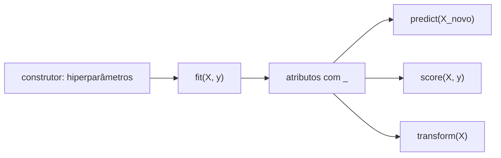

## Passo 1 · Leitura · Uma interface para todos os modelos

No Nível 4 você ajustou uma regressão com `LinearRegression().fit(X, y)`. O scikit-learn usa essa mesma forma para quase tudo: regressões, classificadores, árvores, agrupamentos e transformações de dados. Aprender o contrato uma vez vale para todos os modelos dos próximos módulos.

O objeto central é o **estimador**. Ele nasce configurado pelos **hiperparâmetros**, que você escolhe no construtor (`KNeighborsClassifier(n_neighbors=3)`, `LogisticRegression(C=0.5)`) e que o construtor só guarda. O aprendizado acontece no `fit(X, y)`: `X` é a matriz de atributos, com uma linha por amostra e uma coluna por atributo (forma `(n, d)`, sempre com duas dimensões), e `y` é o vetor de alvos. O que o `fit` aprende vira **atributo com sublinhado no fim**: `coef_`, `intercept_`, `classes_`, `n_features_in_`. O sublinhado separa o que você configurou do que veio dos dados; o `vars(modelo)` lista os dois tipos juntos. E o `fit` **devolve o próprio estimador**, o que permite encadear `modelo.fit(X, y).predict(X_novo)`.



Depois do `fit`, um **preditor** responde com `predict(X_novo)` e se avalia com `score(X, y)`: o $R^2$ num regressor e a acurácia num classificador. Um **transformador** devolve uma versão nova dos dados com `transform(X)`, como o `StandardScaler` da leitura do passo 4.

```python
modelo = KNeighborsClassifier(n_neighbors=3)
modelo.fit(X_treino, y_treino)        # devolve o próprio modelo
modelo.classes_                       # aprendido: os rótulos vistos no treino
modelo.predict(X_teste)               # um rótulo por linha de X_teste
modelo.score(X_teste, y_teste)        # acurácia no teste
```

Três erros aparecem logo. Chamar `predict` antes do `fit` dá `NotFittedError: This KNeighborsClassifier instance is not fitted yet. Call 'fit' with appropriate arguments before using this estimator.` Ler `modelo.coef_` antes do `fit` dá só `AttributeError: 'LogisticRegression' object has no attribute 'coef_'`, porque o atributo ainda não existe. E passar um vetor como `X` dá `ValueError: Expected 2D array, got 1D array instead`, seguido da sugestão de usar `reshape(-1, 1)` quando há um atributo só ou `reshape(1, -1)` quando há uma amostra só.

Os dados deste módulo são pequenos: escritos à mão ou gerados com `np.random.default_rng(semente)`, como no Nível 4.

## Passo 2 · Previsão · O que o fit guarda

O programa ajusta uma regressão a quatro pontos que estão exatamente sobre uma reta. Leia sem executar e digite o que ele imprime.

### Código
```python
import numpy as np
from sklearn.linear_model import LinearRegression

X = np.array([[1.0], [2.0], [3.0], [4.0]])
y = np.array([3.0, 5.0, 7.0, 9.0])
modelo = LinearRegression()
print(hasattr(modelo, "coef_"))
r = modelo.fit(X, y)
print(r is modelo)
print(round(float(modelo.coef_[0]), 6), round(float(modelo.intercept_), 6))
print(modelo.predict(np.array([[10.0]])).round(6).tolist())
print(modelo.get_params()["fit_intercept"])
print(sorted(a for a in vars(modelo) if a.endswith("_")))
```

### Dicas
1. Os atributos aprendidos só passam a existir depois do `fit`, e o `fit` devolve o próprio objeto.
2. Os pontos estão sobre $y = 2x + 1$.
3. O `vars(objeto)` devolve o dicionário de atributos do objeto; a última linha fica só com os que terminam em sublinhado, em ordem alfabética. A regressão linear guarda também o posto (`rank_`) e os valores singulares (`singular_`) da matriz `X`.

### Saída esperada
```text
False
True
2.0 1.0
[21.0]
True
['coef_', 'intercept_', 'n_features_in_', 'rank_', 'singular_']
```

## Passo 3 · Exercício · Ajustar, prever e avaliar
modo: lacunas

Complete as lacunas (`___`) de uma função que funciona com **qualquer** preditor do scikit-learn, porque usa só o contrato comum.

### Instruções
1. `ajustar_e_avaliar(modelo, X_treino, y_treino, X_teste, y_teste)` ajusta o `modelo` recebido **só com o treino**.
2. Em `"previsoes"`, devolve as previsões do modelo para `X_teste`, como lista.
3. Em `"score"`, devolve o `score` do modelo **no teste**, como `float` ($R^2$ num regressor, acurácia num classificador).
4. Em `"aprendidos"`, devolve os nomes dos atributos aprendidos (terminam em `_` e não começam com `_`), em ordem alfabética.

### Código inicial
```python
def ajustar_e_avaliar(modelo, X_treino, y_treino, X_teste, y_teste):
    ___
    previsoes = ___.tolist()
    score = float(modelo.score(___))
    aprendidos = sorted(a for a in vars(modelo) if ___)
    return {"previsoes": previsoes, "score": score, "aprendidos": aprendidos}
```

### Solução
```python
def ajustar_e_avaliar(modelo, X_treino, y_treino, X_teste, y_teste):
    modelo.fit(X_treino, y_treino)
    previsoes = modelo.predict(X_teste).tolist()
    score = float(modelo.score(X_teste, y_teste))
    aprendidos = sorted(a for a in vars(modelo) if a.endswith("_") and not a.startswith("_"))
    return {"previsoes": previsoes, "score": score, "aprendidos": aprendidos}
```

### Dicas
1. O mesmo objeto `modelo` é ajustado, depois prevê e depois se avalia; nenhuma linha cria um modelo novo.
2. O `score` recebe as entradas e as respostas certas de um mesmo conjunto, nessa ordem.
3. O `vars(modelo)` traz também os hiperparâmetros (`fit_intercept`, `n_neighbors`): eles não terminam em sublinhado.

### Verificação
```json
[
  { "id": "modelo-ajustado", "checkpoint": 1, "kind": "expr",
    "setup": "from sklearn.linear_model import LinearRegression\nm = LinearRegression()\nr = ajustar_e_avaliar(m, [[1.0], [2.0], [3.0], [4.0]], [3.0, 5.0, 7.0, 9.0], [[5.0], [6.0]], [11.0, 13.0])",
    "expr": "hasattr(m, 'coef_')", "expected": true, "name": "O modelo recebido sai ajustado",
    "hint": "Chame o fit do próprio objeto recebido." },
  { "id": "reta-previsoes", "checkpoint": 2, "kind": "expr",
    "setup": "from sklearn.linear_model import LinearRegression\nr = ajustar_e_avaliar(LinearRegression(), [[1.0], [2.0], [3.0], [4.0]], [3.0, 5.0, 7.0, 9.0], [[5.0], [6.0]], [11.0, 13.0])",
    "expr": "r['previsoes']", "expected": [11.0, 13.0], "tolerance": 1e-9,
    "name": "Pontos sobre y = 2x + 1: as previsões para x = 5 e x = 6" },
  { "id": "ruido-previsoes", "checkpoint": 1, "kind": "expr",
    "setup": "from sklearn.linear_model import LinearRegression\nr = ajustar_e_avaliar(LinearRegression(), [[1, 0], [2, 1], [3, 0], [4, 1], [5, 0]], [2.1, 4.3, 5.8, 8.4, 9.9], [[6, 1], [7, 0], [8, 1]], [12.5, 13.6, 16.4])",
    "expr": "r['previsoes']", "expected": [12.26, 13.813333333333333, 16.2], "tolerance": 1e-9,
    "name": "Dados com ruído: as previsões vêm de um modelo ajustado no treino",
    "hint": "Um modelo ajustado com o teste acerta o teste quase exatamente, e não é isso que se quer medir." },
  { "id": "ruido-score", "checkpoint": 3, "kind": "expr",
    "setup": "from sklearn.linear_model import LinearRegression\nr = ajustar_e_avaliar(LinearRegression(), [[1, 0], [2, 1], [3, 0], [4, 1], [5, 0]], [2.1, 4.3, 5.8, 8.4, 9.9], [[6, 1], [7, 0], [8, 1]], [12.5, 13.6, 16.4])",
    "expr": "r['score']", "expected": 0.9823028304479253, "tolerance": 1e-9,
    "name": "O R² é medido no teste",
    "hint": "O score compara as previsões para X_teste com as respostas certas, y_teste." },
  { "id": "knn-previsoes", "checkpoint": 2, "kind": "expr",
    "setup": "from sklearn.neighbors import KNeighborsClassifier\nr = ajustar_e_avaliar(KNeighborsClassifier(n_neighbors=1), [[0.0], [1.0], [4.0], [5.0]], ['baixo', 'baixo', 'alto', 'alto'], [[0.5], [2.4], [2.6], [4.5]], ['baixo', 'alto', 'alto', 'alto'])",
    "expr": "r['previsoes']", "expected": ["baixo", "baixo", "alto", "alto"],
    "name": "Com um classificador, as previsões são os rótulos" },
  { "id": "knn-score", "checkpoint": 3, "kind": "expr",
    "setup": "from sklearn.neighbors import KNeighborsClassifier\nr = ajustar_e_avaliar(KNeighborsClassifier(n_neighbors=1), [[0.0], [1.0], [4.0], [5.0]], ['baixo', 'baixo', 'alto', 'alto'], [[0.5], [2.4], [2.6], [4.5]], ['baixo', 'alto', 'alto', 'alto'])",
    "expr": "r['score']", "expected": 0.75, "tolerance": 1e-9,
    "name": "Com um classificador, o score é a acurácia no teste (3 de 4)",
    "hint": "Com n_neighbors=1, a acurácia no próprio treino é sempre 1.0." },
  { "id": "tipos", "checkpoint": 3, "kind": "expr",
    "setup": "from sklearn.linear_model import LinearRegression\nr = ajustar_e_avaliar(LinearRegression(), [[1.0], [2.0], [3.0], [4.0]], [3.0, 5.0, 7.0, 9.0], [[5.0], [6.0]], [11.0, 13.0])",
    "expr": "[type(r['previsoes']).__name__, type(r['score']).__name__]", "expected": ["list", "float"],
    "name": "previsoes é uma lista e score é float" },
  { "id": "aprendidos-regressao", "checkpoint": 4, "kind": "expr",
    "setup": "from sklearn.linear_model import LinearRegression\nr = ajustar_e_avaliar(LinearRegression(), [[1.0], [2.0], [3.0], [4.0]], [3.0, 5.0, 7.0, 9.0], [[5.0], [6.0]], [11.0, 13.0])",
    "expr": "r['aprendidos']", "expected": ["coef_", "intercept_", "n_features_in_", "rank_", "singular_"],
    "name": "Os atributos aprendidos de uma LinearRegression",
    "hint": "Hiperparâmetros como fit_intercept não terminam em sublinhado." },
  { "id": "aprendidos-knn", "checkpoint": 4, "kind": "expr",
    "setup": "from sklearn.neighbors import KNeighborsClassifier\nr = ajustar_e_avaliar(KNeighborsClassifier(n_neighbors=1), [[0.0], [1.0], [4.0], [5.0]], ['baixo', 'baixo', 'alto', 'alto'], [[0.5], [2.4], [2.6], [4.5]], ['baixo', 'alto', 'alto', 'alto'])",
    "expr": "r['aprendidos']", "expected": ["classes_", "effective_metric_", "effective_metric_params_", "n_features_in_", "n_samples_fit_", "outputs_2d_"],
    "name": "Os atributos aprendidos de um KNeighborsClassifier" }
]
```

### Soluções erradas
```python name="ajusta com o teste"
def ajustar_e_avaliar(modelo, X_treino, y_treino, X_teste, y_teste):
    modelo.fit(X_teste, y_teste)
    previsoes = modelo.predict(X_teste).tolist()
    score = float(modelo.score(X_teste, y_teste))
    aprendidos = sorted(a for a in vars(modelo) if a.endswith("_") and not a.startswith("_"))
    return {"previsoes": previsoes, "score": score, "aprendidos": aprendidos}
```
```python name="prevê o treino"
def ajustar_e_avaliar(modelo, X_treino, y_treino, X_teste, y_teste):
    modelo.fit(X_treino, y_treino)
    previsoes = modelo.predict(X_treino).tolist()
    score = float(modelo.score(X_teste, y_teste))
    aprendidos = sorted(a for a in vars(modelo) if a.endswith("_") and not a.startswith("_"))
    return {"previsoes": previsoes, "score": score, "aprendidos": aprendidos}
```
```python name="score no treino"
def ajustar_e_avaliar(modelo, X_treino, y_treino, X_teste, y_teste):
    modelo.fit(X_treino, y_treino)
    previsoes = modelo.predict(X_teste).tolist()
    score = float(modelo.score(X_treino, y_treino))
    aprendidos = sorted(a for a in vars(modelo) if a.endswith("_") and not a.startswith("_"))
    return {"previsoes": previsoes, "score": score, "aprendidos": aprendidos}
```
```python name="score contra as próprias previsões"
def ajustar_e_avaliar(modelo, X_treino, y_treino, X_teste, y_teste):
    modelo.fit(X_treino, y_treino)
    previsoes = modelo.predict(X_teste).tolist()
    score = float(modelo.score(X_teste, previsoes))
    aprendidos = sorted(a for a in vars(modelo) if a.endswith("_") and not a.startswith("_"))
    return {"previsoes": previsoes, "score": score, "aprendidos": aprendidos}
```
```python name="argumentos do score trocados"
def ajustar_e_avaliar(modelo, X_treino, y_treino, X_teste, y_teste):
    modelo.fit(X_treino, y_treino)
    previsoes = modelo.predict(X_teste).tolist()
    score = float(modelo.score(y_teste, X_teste))
    aprendidos = sorted(a for a in vars(modelo) if a.endswith("_") and not a.startswith("_"))
    return {"previsoes": previsoes, "score": score, "aprendidos": aprendidos}
```
```python name="conta os hiperparâmetros como aprendidos"
def ajustar_e_avaliar(modelo, X_treino, y_treino, X_teste, y_teste):
    modelo.fit(X_treino, y_treino)
    previsoes = modelo.predict(X_teste).tolist()
    score = float(modelo.score(X_teste, y_teste))
    aprendidos = sorted(a for a in vars(modelo) if not a.startswith("_"))
    return {"previsoes": previsoes, "score": score, "aprendidos": aprendidos}
```

## Passo 4 · Leitura · Transformadores: fit aprende, transform aplica

Na m1-01 do Nível 4 você padronizou um vetor com o escore $z$. O `StandardScaler` faz a mesma conta, coluna a coluna, dividida nos dois verbos da API. O `fit(X)` **aprende** a média e o desvio de cada coluna e os guarda em `mean_` e `scale_`; o `transform(X)` **aplica** a conta com os valores guardados:

$$
z = \frac{x - \mu_{\text{treino}}}{\sigma_{\text{treino}}}
$$

O desvio é o populacional (`ddof=0`, como o `np.std`). Uma coluna constante tem desvio zero: o `StandardScaler` usa `scale_ = 1` nela, e a coluna sai toda zero, sem `nan`. O `fit_transform(X)` faz os dois passos numa chamada só e é o que se usa no treino.

```python
escalador = StandardScaler()
X_treino_esc = escalador.fit_transform(X_treino)   # aprende μ e σ do treino e aplica
X_teste_esc = escalador.transform(X_teste)          # só aplica: μ e σ continuam os do treino
```

Por que o teste só recebe `transform`? O conjunto de teste faz o papel dos dados que o modelo vai encontrar depois de pronto, e que ainda não existem quando você treina. Se o escalador aprende com o conjunto inteiro, a média e o desvio já carregam informação do teste, e a avaliação deixa de ser sobre dados nunca vistos: é o **vazamento de dados**, assunto do módulo 7. Chamar `fit_transform` também no teste é o erro oposto: o teste passa a ser escalado com as próprias estatísticas, e um mesmo valor bruto vira números diferentes no treino e no teste. Um teste de uma linha só sai todo zero, qualquer que seja o valor.

Todo transformador segue o mesmo contrato. O `MinMaxScaler` aprende `data_min_` e `data_max_` e leva o treino para o intervalo $[0, 1]$; no teste, um valor fora da faixa do treino sai fora de $[0, 1]$, e isso é o esperado. Um `transform` antes do `fit` dá o mesmo `NotFittedError` dos preditores, agora com `This StandardScaler instance is not fitted yet`, e o `inverse_transform` desfaz a conta quando você precisa voltar às unidades originais.

Na prática, você raramente vai chamar essas etapas à mão: a próxima lição junta escalador e modelo num `Pipeline`, que segue a ordem certa sozinho. Escrever à mão uma vez é o que mostra o que o pipeline protege.

## Passo 5 · Exercício · Escalar sem espiar o teste

Escreva a função que escala treino e teste do jeito certo, com qualquer transformador do scikit-learn.

### Instruções
1. `escalar_treino_teste(X_treino, X_teste, escalador=None)` usa o `escalador` recebido (qualquer transformador do scikit-learn) ou, se ele for `None`, um `StandardScaler()` novo.
2. Ajusta o escalador **só no treino**, uma única vez, e transforma o treino e o teste com ele.
3. Devolve a tupla `(X_treino_escalado, X_teste_escalado)`, dois arrays do numpy, sem alterar os arrays recebidos.

### Código inicial
```python
from sklearn.preprocessing import StandardScaler


def escalar_treino_teste(X_treino, X_teste, escalador=None):
    pass
```

### Solução
```python
from sklearn.preprocessing import StandardScaler


def escalar_treino_teste(X_treino, X_teste, escalador=None):
    if escalador is None:
        escalador = StandardScaler()
    X_treino_escalado = escalador.fit_transform(X_treino)
    X_teste_escalado = escalador.transform(X_teste)
    return X_treino_escalado, X_teste_escalado
```

### Dicas
1. O `fit_transform` aprende e aplica de uma vez; use-o só no conjunto de onde as estatísticas devem vir.
2. Depois do `fit`, o mesmo objeto guarda a média e o desvio do treino: o teste só precisa do `transform`.
3. Não crie um escalador novo quando um foi recebido: quem chamou a função pode querer outro transformador.

### Verificação
```json
[
  { "id": "padrao-standard", "checkpoint": 1, "kind": "expr",
    "setup": "import numpy as np\na, b = escalar_treino_teste(np.array([[1.0, 10.0], [2.0, 10.0], [3.0, 10.0], [6.0, 10.0]]), np.array([[4.0, 10.0], [0.0, 12.0]]))",
    "expr": "a.tolist()", "expected": [[-1.0690449676496976, 0.0], [-0.5345224838248488, 0.0], [0.0, 0.0], [1.6035674514745464, 0.0]], "tolerance": 1e-9,
    "name": "Sem escalador, o treino sai padronizado (coluna constante vira zero)",
    "hint": "Sem escalador recebido, use um StandardScaler novo." },
  { "id": "teste-com-estatisticas-do-treino", "checkpoint": 2, "kind": "expr",
    "setup": "import numpy as np\na, b = escalar_treino_teste(np.array([[1.0, 10.0], [2.0, 10.0], [3.0, 10.0], [6.0, 10.0]]), np.array([[4.0, 10.0], [0.0, 12.0]]))",
    "expr": "b.tolist()", "expected": [[0.5345224838248488, 0.0], [-1.6035674514745464, 2.0]], "tolerance": 1e-9,
    "name": "O teste é escalado com a média e o desvio do treino",
    "hint": "As estatísticas vêm só do treino; o teste só é transformado." },
  { "id": "teste-uma-linha", "checkpoint": 2, "kind": "expr",
    "setup": "import numpy as np\na, b = escalar_treino_teste(np.array([[1.0, 10.0], [2.0, 10.0], [3.0, 10.0], [6.0, 10.0]]), np.array([[4.0, 10.0]]))",
    "expr": "b.tolist()", "expected": [[0.5345224838248488, 0.0]], "tolerance": 1e-9,
    "name": "Um teste de uma linha não sai todo zero" },
  { "id": "espiao", "checkpoint": 2, "kind": "expr",
    "setup": "import numpy as np\nfrom sklearn.preprocessing import StandardScaler\nchamadas = []\nclass Espiao(StandardScaler):\n    def fit(self, X, y=None, sample_weight=None):\n        chamadas.append(len(X))\n        return super().fit(X, y, sample_weight)\na, b = escalar_treino_teste(np.array([[1.0, 10.0], [2.0, 10.0], [3.0, 10.0], [6.0, 10.0]]), np.array([[4.0, 10.0], [0.0, 12.0]]), Espiao())",
    "expr": "chamadas", "expected": [4],
    "name": "O escalador recebido é ajustado uma única vez, com as 4 linhas do treino",
    "hint": "Cada fit (inclusive o de dentro do fit_transform) conta. Só o treino pode passar por ele." },
  { "id": "escalador-guarda-o-treino", "checkpoint": 2, "kind": "expr",
    "setup": "import numpy as np\nfrom sklearn.preprocessing import StandardScaler\ne = StandardScaler()\na, b = escalar_treino_teste(np.array([[1.0, 10.0], [2.0, 10.0], [3.0, 10.0], [6.0, 10.0]]), np.array([[4.0, 10.0], [0.0, 12.0]]), e)",
    "expr": "e.mean_.tolist()", "expected": [3.0, 10.0], "tolerance": 1e-9,
    "name": "Depois da chamada, o escalador recebido guarda a média do treino" },
  { "id": "minmax", "checkpoint": 1, "kind": "expr",
    "setup": "import numpy as np\nfrom sklearn.preprocessing import MinMaxScaler\na, b = escalar_treino_teste(np.array([[1.0, 10.0], [2.0, 10.0], [3.0, 10.0], [6.0, 10.0]]), np.array([[4.0, 10.0], [0.0, 12.0]]), MinMaxScaler())",
    "expr": "[a.tolist(), b.tolist()]", "expected": [[[0.0, 0.0], [0.2, 0.0], [0.4, 0.0], [1.0, 0.0]], [[0.6, 0.0], [-0.2, 2.0]]], "tolerance": 1e-9,
    "name": "Com um MinMaxScaler, o treino vai para [0, 1] e o teste pode sair da faixa",
    "hint": "Use o transformador recebido, seja ele qual for." },
  { "id": "entrada-intacta", "checkpoint": 3, "kind": "expr",
    "setup": "import numpy as np\nXtr = np.array([[1.0, 10.0], [2.0, 10.0], [3.0, 10.0], [6.0, 10.0]])\nXte = np.array([[4.0, 10.0], [0.0, 12.0]])\na, b = escalar_treino_teste(Xtr, Xte)",
    "expr": "[Xtr.tolist(), Xte.tolist()]", "expected": [[[1.0, 10.0], [2.0, 10.0], [3.0, 10.0], [6.0, 10.0]], [[4.0, 10.0], [0.0, 12.0]]],
    "name": "Os arrays recebidos não mudam" },
  { "id": "tipos", "checkpoint": 3, "kind": "expr",
    "setup": "import numpy as np\nr = escalar_treino_teste(np.array([[1.0, 10.0], [2.0, 10.0], [3.0, 10.0], [6.0, 10.0]]), np.array([[4.0, 10.0], [0.0, 12.0]]))",
    "expr": "[type(r).__name__, len(r), type(r[0]).__name__, type(r[1]).__name__]", "expected": ["tuple", 2, "ndarray", "ndarray"],
    "name": "Devolve uma tupla com dois arrays do numpy" }
]
```

### Soluções erradas
```python name="ajusta no conjunto inteiro"
import numpy as np
from sklearn.preprocessing import StandardScaler


def escalar_treino_teste(X_treino, X_teste, escalador=None):
    if escalador is None:
        escalador = StandardScaler()
    escalador.fit(np.vstack([X_treino, X_teste]))
    return escalador.transform(X_treino), escalador.transform(X_teste)
```
```python name="fit_transform também no teste"
from sklearn.preprocessing import StandardScaler


def escalar_treino_teste(X_treino, X_teste, escalador=None):
    if escalador is None:
        escalador = StandardScaler()
    X_treino_escalado = escalador.fit_transform(X_treino)
    X_teste_escalado = escalador.fit_transform(X_teste)
    return X_treino_escalado, X_teste_escalado
```
```python name="ajusta no teste"
from sklearn.preprocessing import StandardScaler


def escalar_treino_teste(X_treino, X_teste, escalador=None):
    if escalador is None:
        escalador = StandardScaler()
    escalador.fit(X_teste)
    return escalador.transform(X_treino), escalador.transform(X_teste)
```
```python name="ignora o escalador recebido"
from sklearn.preprocessing import StandardScaler


def escalar_treino_teste(X_treino, X_teste, escalador=None):
    escalador = StandardScaler()
    X_treino_escalado = escalador.fit_transform(X_treino)
    X_teste_escalado = escalador.transform(X_teste)
    return X_treino_escalado, X_teste_escalado
```
```python name="escala no lugar (copy=False)"
from sklearn.preprocessing import StandardScaler


def escalar_treino_teste(X_treino, X_teste, escalador=None):
    if escalador is None:
        escalador = StandardScaler(copy=False)
    X_treino_escalado = escalador.fit_transform(X_treino)
    X_teste_escalado = escalador.transform(X_teste)
    return X_treino_escalado, X_teste_escalado
```
```python name="devolve listas"
from sklearn.preprocessing import StandardScaler


def escalar_treino_teste(X_treino, X_teste, escalador=None):
    if escalador is None:
        escalador = StandardScaler()
    X_treino_escalado = escalador.fit_transform(X_treino)
    X_teste_escalado = escalador.transform(X_teste)
    return X_treino_escalado.tolist(), X_teste_escalado.tolist()
```

## Passo 6 · Leitura · O seu próprio estimador

Qualquer classe que respeite o contrato funciona com as ferramentas do scikit-learn: `cross_val_score`, `GridSearchCV`, `Pipeline` e `clone`. Duas classes da biblioteca dão o resto de graça. A `BaseEstimator` lê a assinatura do `__init__` e oferece `get_params`, `set_params` e o `repr`. A `ClassifierMixin` oferece o `score` (acurácia) e marca a classe como classificador; ela vem **antes** na lista de bases.

```python
class MeuClassificador(ClassifierMixin, BaseEstimator):
    def __init__(self, k=3):
        self.k = k                      # só guarda, com o mesmo nome

    def fit(self, X, y):
        X = np.asarray(X, dtype=float)
        self.classes_ = np.unique(y)    # aprendido: termina em _
        ...
        return self

    def predict(self, X):
        check_is_fitted(self)           # NotFittedError antes do fit
        ...
```

As regras vêm de como a biblioteca usa o objeto. O `clone(estimador)` cria um estimador novo, **sem ajuste**, com os mesmos hiperparâmetros, que ele lê com o `get_params`; a validação cruzada clona o modelo a cada partição. Por isso o `__init__` guarda cada argumento num atributo de mesmo nome e não faz mais nada: não valida, não converte, não olha dados. Um `self.vizinhos = k` quebra o `get_params` com `AttributeError: 'MeuClassificador' object has no attribute 'k'`; um `self.colunas = list(colunas)` guarda uma cópia, e o `clone` recusa com `RuntimeError: Cannot clone object Selecao(colunas=[0, 1]), as the constructor either does not set or modifies parameter colunas`. Validações e conversões vão para o `fit`.

O `fit` guarda o que aprendeu em atributos terminados em `_` e devolve `self`. Esquecer o `return self` passa despercebido no `cross_val_score`, que não encadeia chamadas, mas `modelo.fit(X, y).predict(X)` dá `AttributeError: 'NoneType' object has no attribute 'predict'`. O `check_is_fitted(self)`, de `sklearn.utils.validation`, procura atributos terminados em `_` e levanta o `NotFittedError` padrão quando não acha nenhum.

A ordem das bases importa no scikit-learn 1.8. Com `class C(BaseEstimator, ClassifierMixin)` o `score` funciona, mas `is_classifier(C())` dá `False`: a biblioteca não reconhece o classificador, e o `cross_val_score(C(), X, y, cv=3)` passa a dividir os dados em blocos seguidos, sem estratificar as classes. Com `ClassifierMixin` primeiro, `is_classifier` dá `True`.

O exercício a seguir é o classificador mais simples que existe: guarda a média de cada classe e responde com a classe da média mais próxima. A biblioteca tem um igual, o `NearestCentroid`, que a correção usa como referência.

## Passo 7 · Exercício · Um classificador pela média de cada classe

Escreva `MediaPorClasse`, um classificador compatível com o scikit-learn que classifica cada ponto pela classe de média (centróide) mais próxima.

### Instruções
1. `MediaPorClasse(p=2)` guarda só o hiperparâmetro `p`, com esse nome: `p=1` usa a distância de Manhattan e `p=2`, a euclidiana.
2. `fit(X, y)` guarda `classes_` (os rótulos distintos em ordem crescente) e `centroides_` (array com a média de cada classe, uma linha por classe, na ordem de `classes_`) e devolve o próprio objeto.
3. `predict(X)` devolve um array com o rótulo da classe de centróide mais próximo de cada linha, pela distância $\left(\sum_j |x_j - c_j|^p\right)^{1/p}$, sem usar o `NearestCentroid`.
4. Antes do `fit`, o `predict` levanta `NotFittedError` (use o `check_is_fitted`).
5. A classe é um classificador do scikit-learn: herda o `score`, `is_classifier` a reconhece e ela funciona no `cross_val_score`.

### Código inicial
```python
import numpy as np
from sklearn.base import BaseEstimator, ClassifierMixin
from sklearn.utils.validation import check_is_fitted


class MediaPorClasse:
    def __init__(self, p=2):
        pass

    def fit(self, X, y):
        pass

    def predict(self, X):
        pass
```

### Solução
```python
import numpy as np
from sklearn.base import BaseEstimator, ClassifierMixin
from sklearn.utils.validation import check_is_fitted


class MediaPorClasse(ClassifierMixin, BaseEstimator):
    def __init__(self, p=2):
        self.p = p

    def fit(self, X, y):
        X = np.asarray(X, dtype=float)
        y = np.asarray(y)
        self.classes_ = np.unique(y)
        self.centroides_ = np.array([X[y == c].mean(axis=0) for c in self.classes_])
        return self

    def predict(self, X):
        check_is_fitted(self)
        X = np.asarray(X, dtype=float)
        diferencas = np.abs(X[:, None, :] - self.centroides_[None, :, :])
        distancias = (diferencas ** self.p).sum(axis=2)
        return self.classes_[distancias.argmin(axis=1)]
```

### Dicas
1. O `np.unique` devolve os rótulos distintos já em ordem crescente; a máscara `y == c` separa as linhas de uma classe.
2. Com broadcasting, `X[:, None, :] - centroides[None, :, :]` tem forma `(n, k, d)`: somar no último eixo dá uma distância por par (ponto, classe). A raiz $1/p$ não muda qual é a menor.
3. O `argmin` devolve a posição da classe; o `predict` precisa devolver o rótulo que está nessa posição de `classes_`.

### Verificação
```json
[
  { "id": "get-params", "checkpoint": 1, "kind": "expr", "expr": "MediaPorClasse(p=1).get_params()", "expected": { "p": 1 },
    "name": "get_params devolve o hiperparâmetro p",
    "hint": "Herde de BaseEstimator e guarde o argumento num atributo com o mesmo nome." },
  { "id": "clone", "checkpoint": 1, "kind": "expr",
    "setup": "from sklearn.base import clone\nc = clone(MediaPorClasse(p=1).fit([[0.0], [1.0]], ['a', 'b']))",
    "expr": "[c.p, hasattr(c, 'centroides_')]", "expected": [1, false],
    "name": "clone copia o hiperparâmetro e devolve um modelo sem ajuste" },
  { "id": "fit-devolve-self", "checkpoint": 2, "kind": "expr",
    "setup": "m = MediaPorClasse()\nr = m.fit([[0.0, 0.0], [2.0, 0.0], [0.0, 2.0], [10.0, 10.0], [12.0, 10.0], [10.0, 12.0]], ['s', 's', 's', 'n', 'n', 'n'])",
    "expr": "r is m", "expected": true, "name": "fit devolve o próprio objeto", "hint": "Termine o fit com return self." },
  { "id": "classes", "checkpoint": 2, "kind": "expr",
    "setup": "m = MediaPorClasse()\nm.fit([[0.0, 0.0], [2.0, 0.0], [0.0, 2.0], [10.0, 10.0], [12.0, 10.0], [10.0, 12.0]], ['s', 's', 's', 'n', 'n', 'n'])",
    "expr": "m.classes_.tolist()", "expected": ["n", "s"], "name": "classes_ em ordem crescente, não na ordem em que aparecem" },
  { "id": "centroides", "checkpoint": 2, "kind": "expr",
    "setup": "m = MediaPorClasse()\nm.fit([[0.0, 0.0], [2.0, 0.0], [0.0, 2.0], [10.0, 10.0], [12.0, 10.0], [10.0, 12.0]], ['s', 's', 's', 'n', 'n', 'n'])",
    "expr": "m.centroides_.tolist()", "expected": [[10.666666666666666, 10.666666666666666], [0.6666666666666666, 0.6666666666666666]], "tolerance": 1e-9,
    "name": "centroides_ tem a média de cada classe, na ordem de classes_" },
  { "id": "igual-a-referencia", "checkpoint": 3, "kind": "expr",
    "setup": "import numpy as np\nfrom sklearn.neighbors import NearestCentroid\nrng = np.random.default_rng(5)\ncentros = np.array([[0.0, 0.0], [3.0, 1.0], [1.0, 4.0]])\nX = np.vstack([rng.normal(c, 1.0, size=(20, 2)) for c in centros]).round(2)\ny = np.repeat(['c', 'a', 'b'], 20)\nXt = rng.normal(1.3, 2.0, size=(30, 2)).round(2)\nref = NearestCentroid().fit(X, y)",
    "expr": "MediaPorClasse().fit(X, y).predict(Xt).tolist() == ref.predict(Xt).tolist()", "expected": true,
    "name": "Com p=2, as mesmas previsões do NearestCentroid em 30 pontos sorteados",
    "hint": "Devolva os rótulos (não as posições) da classe de centróide mais próximo." },
  { "id": "manhattan", "checkpoint": 3, "kind": "expr",
    "setup": "m = MediaPorClasse(p=1).fit([[-1.0, 0.0], [1.0, 0.0], [3.0, 1.0], [5.0, 1.0]], ['x', 'x', 'y', 'y'])",
    "expr": "m.predict([[1.8, 1.0], [2.2, 0.0]]).tolist()", "expected": ["y", "x"],
    "name": "Com p=1, a distância de Manhattan escolhe outras classes que a euclidiana",
    "hint": "O expoente da distância é o hiperparâmetro p." },
  { "id": "nao-ajustado", "checkpoint": 4, "kind": "expr", "expr": "MediaPorClasse().predict([[0.0, 0.0]])", "raises": "NotFittedError",
    "name": "predict antes do fit levanta NotFittedError", "hint": "Comece o predict com check_is_fitted(self)." },
  { "id": "score", "checkpoint": 5, "kind": "expr",
    "setup": "import numpy as np\nrng = np.random.default_rng(5)\ncentros = np.array([[0.0, 0.0], [3.0, 1.0], [1.0, 4.0]])\nX = np.vstack([rng.normal(c, 1.0, size=(20, 2)) for c in centros]).round(2)\ny = np.repeat(['c', 'a', 'b'], 20)\nXt = rng.normal(1.3, 2.0, size=(30, 2)).round(2)\nyt = np.where(Xt[:, 1] > 2.5, 'b', np.where(Xt[:, 0] > 1.5, 'a', 'c'))",
    "expr": "MediaPorClasse().fit(X, y).score(Xt, yt)", "expected": 0.9333333333333333, "type": "float", "tolerance": 1e-9,
    "name": "score herdado: acurácia de 28 em 30" },
  { "id": "is-classifier", "checkpoint": 5, "kind": "expr", "setup": "from sklearn.base import is_classifier",
    "expr": "is_classifier(MediaPorClasse())", "expected": true, "name": "is_classifier reconhece a classe",
    "hint": "No scikit-learn 1.8, o ClassifierMixin vem antes do BaseEstimator na lista de bases." },
  { "id": "validacao-cruzada", "checkpoint": 5, "kind": "expr",
    "setup": "import numpy as np\nfrom sklearn.model_selection import cross_val_score\nrng = np.random.default_rng(5)\ncentros = np.array([[0.0, 0.0], [3.0, 1.0], [1.0, 4.0]])\nX = np.vstack([rng.normal(c, 1.0, size=(20, 2)) for c in centros]).round(2)\ny = np.repeat(['c', 'a', 'b'], 20)",
    "expr": "cross_val_score(MediaPorClasse(), X, y, cv=3).tolist()", "expected": [0.9, 1.0, 1.0], "tolerance": 1e-9,
    "name": "cross_val_score com 3 partições estratificadas" },
  { "id": "sem-referencia", "checkpoint": 3, "kind": "source", "rule": { "type": "not_calls", "name": "NearestCentroid" },
    "name": "Implementa a conta sem usar o NearestCentroid" }
]
```

### Soluções erradas
```python name="fit não devolve self"
import numpy as np
from sklearn.base import BaseEstimator, ClassifierMixin
from sklearn.utils.validation import check_is_fitted


class MediaPorClasse(ClassifierMixin, BaseEstimator):
    def __init__(self, p=2):
        self.p = p

    def fit(self, X, y):
        X = np.asarray(X, dtype=float)
        y = np.asarray(y)
        self.classes_ = np.unique(y)
        self.centroides_ = np.array([X[y == c].mean(axis=0) for c in self.classes_])

    def predict(self, X):
        check_is_fitted(self)
        X = np.asarray(X, dtype=float)
        diferencas = np.abs(X[:, None, :] - self.centroides_[None, :, :])
        distancias = (diferencas ** self.p).sum(axis=2)
        return self.classes_[distancias.argmin(axis=1)]
```
```python name="hiperparâmetro guardado com outro nome"
import numpy as np
from sklearn.base import BaseEstimator, ClassifierMixin
from sklearn.utils.validation import check_is_fitted


class MediaPorClasse(ClassifierMixin, BaseEstimator):
    def __init__(self, p=2):
        self.ordem = p

    def fit(self, X, y):
        X = np.asarray(X, dtype=float)
        y = np.asarray(y)
        self.classes_ = np.unique(y)
        self.centroides_ = np.array([X[y == c].mean(axis=0) for c in self.classes_])
        return self

    def predict(self, X):
        check_is_fitted(self)
        X = np.asarray(X, dtype=float)
        diferencas = np.abs(X[:, None, :] - self.centroides_[None, :, :])
        distancias = (diferencas ** self.ordem).sum(axis=2)
        return self.classes_[distancias.argmin(axis=1)]
```
```python name="classes na ordem em que aparecem"
import numpy as np
from sklearn.base import BaseEstimator, ClassifierMixin
from sklearn.utils.validation import check_is_fitted


class MediaPorClasse(ClassifierMixin, BaseEstimator):
    def __init__(self, p=2):
        self.p = p

    def fit(self, X, y):
        X = np.asarray(X, dtype=float)
        y = np.asarray(y)
        self.classes_ = np.array(list(dict.fromkeys(y)))
        self.centroides_ = np.array([X[y == c].mean(axis=0) for c in self.classes_])
        return self

    def predict(self, X):
        check_is_fitted(self)
        X = np.asarray(X, dtype=float)
        diferencas = np.abs(X[:, None, :] - self.centroides_[None, :, :])
        distancias = (diferencas ** self.p).sum(axis=2)
        return self.classes_[distancias.argmin(axis=1)]
```
```python name="mediana no lugar da média"
import numpy as np
from sklearn.base import BaseEstimator, ClassifierMixin
from sklearn.utils.validation import check_is_fitted


class MediaPorClasse(ClassifierMixin, BaseEstimator):
    def __init__(self, p=2):
        self.p = p

    def fit(self, X, y):
        X = np.asarray(X, dtype=float)
        y = np.asarray(y)
        self.classes_ = np.unique(y)
        self.centroides_ = np.array([np.median(X[y == c], axis=0) for c in self.classes_])
        return self

    def predict(self, X):
        check_is_fitted(self)
        X = np.asarray(X, dtype=float)
        diferencas = np.abs(X[:, None, :] - self.centroides_[None, :, :])
        distancias = (diferencas ** self.p).sum(axis=2)
        return self.classes_[distancias.argmin(axis=1)]
```
```python name="devolve a posição da classe"
import numpy as np
from sklearn.base import BaseEstimator, ClassifierMixin
from sklearn.utils.validation import check_is_fitted


class MediaPorClasse(ClassifierMixin, BaseEstimator):
    def __init__(self, p=2):
        self.p = p

    def fit(self, X, y):
        X = np.asarray(X, dtype=float)
        y = np.asarray(y)
        self.classes_ = np.unique(y)
        self.centroides_ = np.array([X[y == c].mean(axis=0) for c in self.classes_])
        return self

    def predict(self, X):
        check_is_fitted(self)
        X = np.asarray(X, dtype=float)
        diferencas = np.abs(X[:, None, :] - self.centroides_[None, :, :])
        distancias = (diferencas ** self.p).sum(axis=2)
        return distancias.argmin(axis=1)
```
```python name="ignora p"
import numpy as np
from sklearn.base import BaseEstimator, ClassifierMixin
from sklearn.utils.validation import check_is_fitted


class MediaPorClasse(ClassifierMixin, BaseEstimator):
    def __init__(self, p=2):
        self.p = p

    def fit(self, X, y):
        X = np.asarray(X, dtype=float)
        y = np.asarray(y)
        self.classes_ = np.unique(y)
        self.centroides_ = np.array([X[y == c].mean(axis=0) for c in self.classes_])
        return self

    def predict(self, X):
        check_is_fitted(self)
        X = np.asarray(X, dtype=float)
        diferencas = np.abs(X[:, None, :] - self.centroides_[None, :, :])
        distancias = (diferencas ** 2).sum(axis=2)
        return self.classes_[distancias.argmin(axis=1)]
```
```python name="sem check_is_fitted"
import numpy as np
from sklearn.base import BaseEstimator, ClassifierMixin


class MediaPorClasse(ClassifierMixin, BaseEstimator):
    def __init__(self, p=2):
        self.p = p

    def fit(self, X, y):
        X = np.asarray(X, dtype=float)
        y = np.asarray(y)
        self.classes_ = np.unique(y)
        self.centroides_ = np.array([X[y == c].mean(axis=0) for c in self.classes_])
        return self

    def predict(self, X):
        X = np.asarray(X, dtype=float)
        diferencas = np.abs(X[:, None, :] - self.centroides_[None, :, :])
        distancias = (diferencas ** self.p).sum(axis=2)
        return self.classes_[distancias.argmin(axis=1)]
```
```python name="bases na ordem invertida"
import numpy as np
from sklearn.base import BaseEstimator, ClassifierMixin
from sklearn.utils.validation import check_is_fitted


class MediaPorClasse(BaseEstimator, ClassifierMixin):
    def __init__(self, p=2):
        self.p = p

    def fit(self, X, y):
        X = np.asarray(X, dtype=float)
        y = np.asarray(y)
        self.classes_ = np.unique(y)
        self.centroides_ = np.array([X[y == c].mean(axis=0) for c in self.classes_])
        return self

    def predict(self, X):
        check_is_fitted(self)
        X = np.asarray(X, dtype=float)
        diferencas = np.abs(X[:, None, :] - self.centroides_[None, :, :])
        distancias = (diferencas ** self.p).sum(axis=2)
        return self.classes_[distancias.argmin(axis=1)]
```

## Passo 8 · Quiz · O contrato na prática

### Pergunta
Um colega escala os dados de um modelo assim, com um teste de 5 linhas:

```python
escalador = StandardScaler()
X_treino_esc = escalador.fit_transform(X_treino)
X_teste_esc = escalador.fit_transform(X_teste)
```

O que está acontecendo?
- [ ] Nada de errado: o `fit_transform` é o atalho recomendado para os dois conjuntos
- [x] O teste é escalado com a própria média e o próprio desvio: um mesmo valor bruto vira números diferentes no treino e no teste, e o modelo é avaliado em dados escalados de outro jeito
- [ ] A segunda linha levanta erro, porque o escalador já foi ajustado
- [ ] O escalador passa a guardar as estatísticas dos dois conjuntos juntos, o que equivale a ajustar no conjunto inteiro
> O segundo `fit_transform` **substitui** a média e o desvio aprendidos no treino pelos do teste; nada é acumulado, e nenhum erro é levantado (o `fit` pode ser chamado de novo a qualquer momento). O certo é `transform` no teste. Ajustar no conjunto inteiro é outro erro, o vazamento: lá as estatísticas misturam os dois conjuntos.

### Pergunta
O que este trecho imprime, com `X` e `y` de uma classificação qualquer?

```python
modelo = LogisticRegression(C=1.0).fit(X, y)
antes = modelo.coef_.copy()
modelo.set_params(C=0.01)
print((modelo.coef_ == antes).all())
```

- [x] `True`: o `set_params` só troca o hiperparâmetro; o `coef_` muda num próximo `fit`
- [ ] `False`: o `set_params` ajusta o modelo de novo com o `C` novo
- [ ] Um `NotFittedError`: o `set_params` desfaz o ajuste anterior
- [ ] Um `ValueError`: hiperparâmetros não podem mudar depois do `fit`
> Hiperparâmetros e parâmetros aprendidos vivem separados: o `set_params` só altera o atributo `C`, e o `coef_` continua o do último `fit`, feito com `C=1.0`. O modelo fica num estado enganoso (o `repr` mostra `C=0.01`, os coeficientes são de `C=1.0`) até o próximo `fit`. Nada é desfeito e nenhum erro é levantado.

### Pergunta
Esta classe passa num teste rápido com `fit` e `predict`, mas `cross_val_score(Vizinhos(), X, y, cv=5)` falha com `AttributeError: 'Vizinhos' object has no attribute 'k'`:

```python
class Vizinhos(ClassifierMixin, BaseEstimator):
    def __init__(self, k=3):
        self.n_vizinhos = k
```

Qual é a correção?
- [ ] Devolver `self` no fim do `__init__`
- [x] Guardar o argumento com o nome do parâmetro, `self.k = k`, e usar `self.k` no resto da classe
- [ ] Trocar a ordem das bases para `(BaseEstimator, ClassifierMixin)`
- [ ] Chamar `check_is_fitted(self)` no `__init__`
> A validação cruzada clona o modelo a cada partição, e o `clone` lê os hiperparâmetros com o `get_params`, que procura um atributo com o nome de cada parâmetro do `__init__`: aqui, `k`. O `__init__` nunca devolve nada; a ordem das bases já está certa (trocá-la faria o `is_classifier` dar `False`); e o `check_is_fitted` no `__init__` levantaria `NotFittedError` ao criar o objeto.
