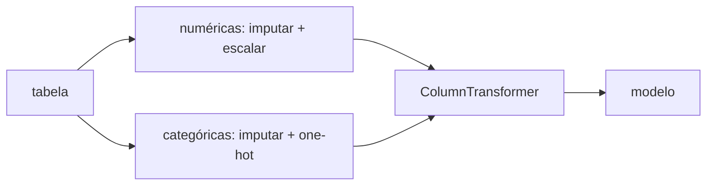

## Passo 1 · Leitura · Cada coluna com o seu tratamento

Uma tabela de clientes fictícios tem idade e renda (números, com algumas células vazias), o plano contratado e a região (textos) e um código de cliente. Nenhum modelo do scikit-learn aceita essa tabela crua: o `fit` de uma `LogisticRegression` recusa texto com `ValueError: could not convert string to float` e recusa células vazias com `ValueError: Input X contains NaN.` Cada tipo de coluna precisa do seu tratamento antes do modelo.

- **Numéricas:** o `SimpleImputer(strategy="median")` aprende a mediana de cada coluna no `fit` e preenche as células vazias com ela; depois, o `StandardScaler` padroniza.
- **Categóricas:** o `SimpleImputer(strategy="most_frequent")` preenche com a categoria mais comum, e o `OneHotEncoder` troca cada coluna de texto por uma coluna de 0 e 1 por categoria vista no treino. O `OrdinalEncoder` troca cada categoria por um número inteiro; ele serve para categorias com ordem natural (pequeno, médio, grande) e para árvores, e não para modelos lineares, que leriam "sul = 2" como o dobro de "norte = 1".

O `ColumnTransformer` aplica cada tratamento às suas colunas e junta os resultados lado a lado:



```python
prep = ColumnTransformer([
    ("num", Pipeline([("imputar", SimpleImputer(strategy="median")),
                      ("escalar", StandardScaler())]), ["idade", "renda"]),
    ("cat", OneHotEncoder(handle_unknown="ignore", sparse_output=False), ["plano"]),
])
```

Cada item é `(nome, transformador, colunas)`. O nome reaparece como prefixo nos nomes das colunas de saída (`num__idade`, `cat__plano_basico`), que o `get_feature_names_out()` devolve. Dois argumentos do `OneHotEncoder` merecem atenção. O `handle_unknown="ignore"` faz uma categoria que não apareceu no treino virar uma linha de zeros; sem ele, o `transform` falha com `ValueError: Found unknown categories ['empresarial'] in column 0 during transform`. E o `sparse_output=False` devolve um array comum em vez de uma matriz esparsa; o nome antigo, `sparse=False`, saiu no scikit-learn 1.8 e dá `TypeError: OneHotEncoder.__init__() got an unexpected keyword argument 'sparse'`.

As colunas que não aparecem em nenhum item, como o código do cliente, são **descartadas** por padrão. A leitura do passo 6 volta a esse detalhe.

## Passo 2 · Previsão · As colunas que saem do preprocessador

O programa monta um `ColumnTransformer` para uma tabela de 4 linhas, primeiro com o padrão e depois com `remainder="passthrough"`. Leia sem executar e digite o que ele imprime.

### Código
```python
import pandas as pd
from sklearn.compose import ColumnTransformer
from sklearn.preprocessing import OneHotEncoder, StandardScaler

df = pd.DataFrame({
    "renda": [2.0, 4.0, 4.0, 6.0],
    "plano": ["b", "a", "b", "c"],
    "idade": [30, 41, 25, 52],
})
itens = [
    ("num", StandardScaler(), ["renda"]),
    ("cat", OneHotEncoder(sparse_output=False), ["plano"]),
]
prep = ColumnTransformer(itens)
X = prep.fit_transform(df)
print(X.shape)
print(prep.get_feature_names_out().tolist())
print(X[0].round(3).tolist())
prep2 = ColumnTransformer(itens, remainder="passthrough")
X2 = prep2.fit_transform(df)
print(X2.shape)
print(prep2.get_feature_names_out().tolist()[-1], X2[0, -1])
```

### Dicas
1. Uma coluna de texto vira uma coluna por categoria distinta, em ordem alfabética.
2. A renda tem média 4 e desvio populacional $\sqrt{2}$.
3. Por padrão, a coluna que não está em nenhum item some; com `"passthrough"`, ela vai para o fim sem mudança, com o prefixo `remainder__`.

### Saída esperada
```text
(4, 4)
['num__renda', 'cat__plano_a', 'cat__plano_b', 'cat__plano_c']
[-1.414, 0.0, 1.0, 0.0]
(4, 5)
remainder__idade 30.0
```

## Passo 3 · Exercício · Montar o preprocessador
modo: lacunas

Complete as lacunas (`___`) da função que monta o preprocessador de uma tabela com colunas numéricas e categóricas.

### Instruções
1. `montar_preprocessador(colunas_num, colunas_cat)` devolve um `ColumnTransformer` com dois itens, `"num"` e `"cat"`. No `fit`, cada imputador aprende com o treino: a **mediana** de cada coluna numérica e a categoria mais frequente de cada categórica.
2. Depois de imputadas, as colunas numéricas são padronizadas com o `StandardScaler`.
3. As categóricas viram colunas de 0 e 1 num array comum (não esparso), e uma categoria que não apareceu no treino vira uma linha de zeros, sem erro.
4. Cada item usa a lista de colunas recebida; as colunas que não estão em nenhuma das duas listas são descartadas.

### Código inicial
```python
from sklearn.compose import ColumnTransformer
from sklearn.impute import SimpleImputer
from sklearn.pipeline import Pipeline
from sklearn.preprocessing import OneHotEncoder, StandardScaler


def montar_preprocessador(colunas_num, colunas_cat):
    numericas = Pipeline([
        ("imputar", SimpleImputer(strategy=___)),
        ("escalar", ___),
    ])
    categoricas = Pipeline([
        ("imputar", SimpleImputer(strategy="most_frequent")),
        ("codificar", OneHotEncoder(___)),
    ])
    return ColumnTransformer([
        ("num", numericas, ___),
        ("cat", categoricas, ___),
    ])
```

### Solução
```python
from sklearn.compose import ColumnTransformer
from sklearn.impute import SimpleImputer
from sklearn.pipeline import Pipeline
from sklearn.preprocessing import OneHotEncoder, StandardScaler


def montar_preprocessador(colunas_num, colunas_cat):
    numericas = Pipeline([
        ("imputar", SimpleImputer(strategy="median")),
        ("escalar", StandardScaler()),
    ])
    categoricas = Pipeline([
        ("imputar", SimpleImputer(strategy="most_frequent")),
        ("codificar", OneHotEncoder(handle_unknown="ignore", sparse_output=False)),
    ])
    return ColumnTransformer([
        ("num", numericas, colunas_num),
        ("cat", categoricas, colunas_cat),
    ])
```

### Dicas
1. Um `Pipeline` dentro de um item do `ColumnTransformer` aplica as etapas em sequência só àquelas colunas: primeiro imputa, depois escala.
2. A estratégia do imputador numérico é um texto; o escalador é um objeto criado ali mesmo.
3. O `OneHotEncoder` precisa de dois argumentos: um para categorias desconhecidas e um para a saída densa (o nome antigo deste saiu no 1.8).

### Verificação
```json
[
  { "id": "tipo", "checkpoint": 1, "kind": "expr",
    "setup": "import numpy as np\nimport pandas as pd\ntr = pd.DataFrame({'idade': [25, 32, np.nan, 41, 58, 36], 'renda': [2.1, 3.4, 2.8, np.nan, 7.9, 4.0], 'plano': ['basico', 'premium', 'basico', np.nan, 'familia', 'basico'], 'regiao': ['norte', 'sul', 'sul', 'leste', 'norte', 'sul'], 'id_cliente': [101, 102, 103, 104, 105, 106]})\nte = pd.DataFrame({'idade': [30, np.nan], 'renda': [np.nan, 5.0], 'plano': ['empresarial', 'premium'], 'regiao': ['sul', 'oeste'], 'id_cliente': [107, 108]})\np = montar_preprocessador(['idade', 'renda'], ['plano', 'regiao'])\nA = p.fit_transform(tr)",
    "expr": "type(p).__name__",
    "expected": "ColumnTransformer",
    "name": "Devolve um ColumnTransformer",
    "hint": "O último return monta um ColumnTransformer com os dois itens." },
  { "id": "forma", "checkpoint": 4, "kind": "expr",
    "setup": "import numpy as np\nimport pandas as pd\ntr = pd.DataFrame({'idade': [25, 32, np.nan, 41, 58, 36], 'renda': [2.1, 3.4, 2.8, np.nan, 7.9, 4.0], 'plano': ['basico', 'premium', 'basico', np.nan, 'familia', 'basico'], 'regiao': ['norte', 'sul', 'sul', 'leste', 'norte', 'sul'], 'id_cliente': [101, 102, 103, 104, 105, 106]})\nte = pd.DataFrame({'idade': [30, np.nan], 'renda': [np.nan, 5.0], 'plano': ['empresarial', 'premium'], 'regiao': ['sul', 'oeste'], 'id_cliente': [107, 108]})\np = montar_preprocessador(['idade', 'renda'], ['plano', 'regiao'])\nA = p.fit_transform(tr)",
    "expr": "list(A.shape)",
    "expected": [6, 8],
    "name": "6 linhas e 8 colunas: 2 numéricas e 6 categorias; id_cliente fica de fora",
    "hint": "Cada item recebe a sua lista de colunas; colunas fora das listas são descartadas." },
  { "id": "nomes", "checkpoint": 4, "kind": "expr",
    "setup": "import numpy as np\nimport pandas as pd\ntr = pd.DataFrame({'idade': [25, 32, np.nan, 41, 58, 36], 'renda': [2.1, 3.4, 2.8, np.nan, 7.9, 4.0], 'plano': ['basico', 'premium', 'basico', np.nan, 'familia', 'basico'], 'regiao': ['norte', 'sul', 'sul', 'leste', 'norte', 'sul'], 'id_cliente': [101, 102, 103, 104, 105, 106]})\nte = pd.DataFrame({'idade': [30, np.nan], 'renda': [np.nan, 5.0], 'plano': ['empresarial', 'premium'], 'regiao': ['sul', 'oeste'], 'id_cliente': [107, 108]})\np = montar_preprocessador(['idade', 'renda'], ['plano', 'regiao'])\nA = p.fit_transform(tr)",
    "expr": "p.get_feature_names_out().tolist()",
    "expected": ["num__idade", "num__renda", "cat__plano_basico", "cat__plano_familia", "cat__plano_premium", "cat__regiao_leste", "cat__regiao_norte", "cat__regiao_sul"],
    "name": "Nomes de saída com os prefixos num__ e cat__",
    "hint": "As colunas numéricas vão para o item num e as de texto para o item cat." },
  { "id": "mediana-aprendida", "checkpoint": 1, "kind": "expr",
    "setup": "import numpy as np\nimport pandas as pd\ntr = pd.DataFrame({'idade': [25, 32, np.nan, 41, 58, 36], 'renda': [2.1, 3.4, 2.8, np.nan, 7.9, 4.0], 'plano': ['basico', 'premium', 'basico', np.nan, 'familia', 'basico'], 'regiao': ['norte', 'sul', 'sul', 'leste', 'norte', 'sul'], 'id_cliente': [101, 102, 103, 104, 105, 106]})\nte = pd.DataFrame({'idade': [30, np.nan], 'renda': [np.nan, 5.0], 'plano': ['empresarial', 'premium'], 'regiao': ['sul', 'oeste'], 'id_cliente': [107, 108]})\np = montar_preprocessador(['idade', 'renda'], ['plano', 'regiao'])\nA = p.fit_transform(tr)",
    "expr": "p.named_transformers_['num'].named_steps['imputar'].statistics_.tolist()",
    "expected": [36.0, 3.4],
    "tolerance": 1e-09,
    "name": "O imputador numérico aprende a mediana de cada coluna do treino",
    "hint": "A mediana não se deixa puxar por um valor extremo como os 58 anos; a média, sim." },
  { "id": "numericas-treino", "checkpoint": 2, "kind": "expr",
    "setup": "import numpy as np\nimport pandas as pd\ntr = pd.DataFrame({'idade': [25, 32, np.nan, 41, 58, 36], 'renda': [2.1, 3.4, 2.8, np.nan, 7.9, 4.0], 'plano': ['basico', 'premium', 'basico', np.nan, 'familia', 'basico'], 'regiao': ['norte', 'sul', 'sul', 'leste', 'norte', 'sul'], 'id_cliente': [101, 102, 103, 104, 105, 106]})\nte = pd.DataFrame({'idade': [30, np.nan], 'renda': [np.nan, 5.0], 'plano': ['empresarial', 'premium'], 'regiao': ['sul', 'oeste'], 'id_cliente': [107, 108]})\np = montar_preprocessador(['idade', 'renda'], ['plano', 'regiao'])\nA = p.fit_transform(tr)",
    "expr": "A[:, :2].tolist()",
    "expected": [[-1.276803, -0.981049], [-0.589294, -0.285396], [-0.196431, -0.606466], [0.294647, -0.285396], [1.964312, 2.122632], [-0.196431, 0.035674]],
    "tolerance": 1e-06,
    "name": "As colunas numéricas saem imputadas e padronizadas",
    "hint": "Depois de imputar, cada coluna numérica passa pelo StandardScaler." },
  { "id": "categoria-vazia", "checkpoint": 1, "kind": "expr",
    "setup": "import numpy as np\nimport pandas as pd\ntr = pd.DataFrame({'idade': [25, 32, np.nan, 41, 58, 36], 'renda': [2.1, 3.4, 2.8, np.nan, 7.9, 4.0], 'plano': ['basico', 'premium', 'basico', np.nan, 'familia', 'basico'], 'regiao': ['norte', 'sul', 'sul', 'leste', 'norte', 'sul'], 'id_cliente': [101, 102, 103, 104, 105, 106]})\nte = pd.DataFrame({'idade': [30, np.nan], 'renda': [np.nan, 5.0], 'plano': ['empresarial', 'premium'], 'regiao': ['sul', 'oeste'], 'id_cliente': [107, 108]})\np = montar_preprocessador(['idade', 'renda'], ['plano', 'regiao'])\nA = p.fit_transform(tr)",
    "expr": "A[3, 2:5].tolist()",
    "expected": [1.0, 0.0, 0.0],
    "name": "O plano vazio da linha 4 vira a categoria mais frequente (basico)" },
  { "id": "categoria-nova", "checkpoint": 3, "kind": "expr",
    "setup": "import numpy as np\nimport pandas as pd\ntr = pd.DataFrame({'idade': [25, 32, np.nan, 41, 58, 36], 'renda': [2.1, 3.4, 2.8, np.nan, 7.9, 4.0], 'plano': ['basico', 'premium', 'basico', np.nan, 'familia', 'basico'], 'regiao': ['norte', 'sul', 'sul', 'leste', 'norte', 'sul'], 'id_cliente': [101, 102, 103, 104, 105, 106]})\nte = pd.DataFrame({'idade': [30, np.nan], 'renda': [np.nan, 5.0], 'plano': ['empresarial', 'premium'], 'regiao': ['sul', 'oeste'], 'id_cliente': [107, 108]})\np = montar_preprocessador(['idade', 'renda'], ['plano', 'regiao'])\nA = p.fit_transform(tr)",
    "expr": "p.transform(te)[:, 2:].tolist()",
    "expected": [[0.0, 0.0, 0.0, 0.0, 0.0, 1.0], [0.0, 0.0, 1.0, 0.0, 0.0, 0.0]],
    "name": "Categorias que não estavam no treino (empresarial, oeste) viram zeros, sem erro",
    "hint": "O OneHotEncoder recusa categorias novas, a menos que receba o argumento que manda ignorá-las." },
  { "id": "teste-numericas", "checkpoint": 2, "kind": "expr",
    "setup": "import numpy as np\nimport pandas as pd\ntr = pd.DataFrame({'idade': [25, 32, np.nan, 41, 58, 36], 'renda': [2.1, 3.4, 2.8, np.nan, 7.9, 4.0], 'plano': ['basico', 'premium', 'basico', np.nan, 'familia', 'basico'], 'regiao': ['norte', 'sul', 'sul', 'leste', 'norte', 'sul'], 'id_cliente': [101, 102, 103, 104, 105, 106]})\nte = pd.DataFrame({'idade': [30, np.nan], 'renda': [np.nan, 5.0], 'plano': ['empresarial', 'premium'], 'regiao': ['sul', 'oeste'], 'id_cliente': [107, 108]})\np = montar_preprocessador(['idade', 'renda'], ['plano', 'regiao'])\nA = p.fit_transform(tr)",
    "expr": "p.transform(te)[:, :2].tolist()",
    "expected": [[-0.785725, -0.285396], [-0.196431, 0.570792]],
    "tolerance": 1e-06,
    "name": "No teste, as células vazias recebem a mediana do treino" },
  { "id": "tipo-saida", "checkpoint": 3, "kind": "expr",
    "setup": "import numpy as np\nimport pandas as pd\ntr = pd.DataFrame({'idade': [25, 32, np.nan, 41, 58, 36], 'renda': [2.1, 3.4, 2.8, np.nan, 7.9, 4.0], 'plano': ['basico', 'premium', 'basico', np.nan, 'familia', 'basico'], 'regiao': ['norte', 'sul', 'sul', 'leste', 'norte', 'sul'], 'id_cliente': [101, 102, 103, 104, 105, 106]})\nte = pd.DataFrame({'idade': [30, np.nan], 'renda': [np.nan, 5.0], 'plano': ['empresarial', 'premium'], 'regiao': ['sul', 'oeste'], 'id_cliente': [107, 108]})\np = montar_preprocessador(['idade', 'renda'], ['plano', 'regiao'])\nA = p.fit_transform(tr)",
    "expr": "type(p.transform(te)).__name__",
    "expected": "ndarray",
    "name": "A saída é um array do numpy" },
  { "id": "outras-colunas", "checkpoint": 4, "kind": "expr",
    "setup": "import numpy as np\nimport pandas as pd\ntr = pd.DataFrame({'idade': [25, 32, np.nan, 41, 58, 36], 'renda': [2.1, 3.4, 2.8, np.nan, 7.9, 4.0], 'plano': ['basico', 'premium', 'basico', np.nan, 'familia', 'basico'], 'regiao': ['norte', 'sul', 'sul', 'leste', 'norte', 'sul'], 'id_cliente': [101, 102, 103, 104, 105, 106]})\nte = pd.DataFrame({'idade': [30, np.nan], 'renda': [np.nan, 5.0], 'plano': ['empresarial', 'premium'], 'regiao': ['sul', 'oeste'], 'id_cliente': [107, 108]})\np = montar_preprocessador(['idade', 'renda'], ['plano', 'regiao'])\nA = p.fit_transform(tr)",
    "expr": "montar_preprocessador(['renda'], ['regiao']).fit(tr).get_feature_names_out().tolist()",
    "expected": ["num__renda", "cat__regiao_leste", "cat__regiao_norte", "cat__regiao_sul"],
    "name": "Funciona com outras listas de colunas",
    "hint": "Use as listas recebidas, não nomes fixos." }
]
```

### Soluções erradas
```python name="imputa pela média"
from sklearn.compose import ColumnTransformer
from sklearn.impute import SimpleImputer
from sklearn.pipeline import Pipeline
from sklearn.preprocessing import OneHotEncoder, StandardScaler


def montar_preprocessador(colunas_num, colunas_cat):
    numericas = Pipeline([
        ("imputar", SimpleImputer(strategy="mean")),
        ("escalar", StandardScaler()),
    ])
    categoricas = Pipeline([
        ("imputar", SimpleImputer(strategy="most_frequent")),
        ("codificar", OneHotEncoder(handle_unknown="ignore", sparse_output=False)),
    ])
    return ColumnTransformer([
        ("num", numericas, colunas_num),
        ("cat", categoricas, colunas_cat),
    ])
```
```python name="preenche os vazios com zero"
from sklearn.compose import ColumnTransformer
from sklearn.impute import SimpleImputer
from sklearn.pipeline import Pipeline
from sklearn.preprocessing import OneHotEncoder, StandardScaler


def montar_preprocessador(colunas_num, colunas_cat):
    numericas = Pipeline([
        ("imputar", SimpleImputer(strategy="constant")),
        ("escalar", StandardScaler()),
    ])
    categoricas = Pipeline([
        ("imputar", SimpleImputer(strategy="most_frequent")),
        ("codificar", OneHotEncoder(handle_unknown="ignore", sparse_output=False)),
    ])
    return ColumnTransformer([
        ("num", numericas, colunas_num),
        ("cat", categoricas, colunas_cat),
    ])
```
```python name="não escala as numéricas"
from sklearn.compose import ColumnTransformer
from sklearn.impute import SimpleImputer
from sklearn.pipeline import Pipeline
from sklearn.preprocessing import OneHotEncoder, StandardScaler


def montar_preprocessador(colunas_num, colunas_cat):
    numericas = Pipeline([
        ("imputar", SimpleImputer(strategy="median")),
        ("escalar", "passthrough"),
    ])
    categoricas = Pipeline([
        ("imputar", SimpleImputer(strategy="most_frequent")),
        ("codificar", OneHotEncoder(handle_unknown="ignore", sparse_output=False)),
    ])
    return ColumnTransformer([
        ("num", numericas, colunas_num),
        ("cat", categoricas, colunas_cat),
    ])
```
```python name="sem handle_unknown"
from sklearn.compose import ColumnTransformer
from sklearn.impute import SimpleImputer
from sklearn.pipeline import Pipeline
from sklearn.preprocessing import OneHotEncoder, StandardScaler


def montar_preprocessador(colunas_num, colunas_cat):
    numericas = Pipeline([
        ("imputar", SimpleImputer(strategy="median")),
        ("escalar", StandardScaler()),
    ])
    categoricas = Pipeline([
        ("imputar", SimpleImputer(strategy="most_frequent")),
        ("codificar", OneHotEncoder(sparse_output=False)),
    ])
    return ColumnTransformer([
        ("num", numericas, colunas_num),
        ("cat", categoricas, colunas_cat),
    ])
```
```python name="sparse no lugar de sparse_output"
from sklearn.compose import ColumnTransformer
from sklearn.impute import SimpleImputer
from sklearn.pipeline import Pipeline
from sklearn.preprocessing import OneHotEncoder, StandardScaler


def montar_preprocessador(colunas_num, colunas_cat):
    numericas = Pipeline([
        ("imputar", SimpleImputer(strategy="median")),
        ("escalar", StandardScaler()),
    ])
    categoricas = Pipeline([
        ("imputar", SimpleImputer(strategy="most_frequent")),
        ("codificar", OneHotEncoder(handle_unknown="ignore", sparse=False)),
    ])
    return ColumnTransformer([
        ("num", numericas, colunas_num),
        ("cat", categoricas, colunas_cat),
    ])
```
```python name="listas de colunas trocadas"
from sklearn.compose import ColumnTransformer
from sklearn.impute import SimpleImputer
from sklearn.pipeline import Pipeline
from sklearn.preprocessing import OneHotEncoder, StandardScaler


def montar_preprocessador(colunas_num, colunas_cat):
    numericas = Pipeline([
        ("imputar", SimpleImputer(strategy="median")),
        ("escalar", StandardScaler()),
    ])
    categoricas = Pipeline([
        ("imputar", SimpleImputer(strategy="most_frequent")),
        ("codificar", OneHotEncoder(handle_unknown="ignore", sparse_output=False)),
    ])
    return ColumnTransformer([
        ("num", numericas, colunas_cat),
        ("cat", categoricas, colunas_num),
    ])
```

## Passo 4 · Leitura · Pipeline: um fit para tudo

O preprocessador do passo anterior ainda precisa ser ajustado no treino, aplicado no teste e entregue ao modelo, em três chamadas que podem sair na ordem errada. O `Pipeline` junta tudo num objeto só, que se comporta como um estimador:

```python
modelo = Pipeline([
    ("prep", montar_preprocessador(["idade", "renda"], ["plano", "regiao"])),
    ("modelo", LogisticRegression(C=0.5)),
])
modelo.fit(X_treino, y_treino)      # prep.fit_transform no treino, depois modelo.fit
modelo.score(X_teste, y_teste)      # prep.transform no teste, depois modelo.score
```

No `fit`, cada etapa intermediária faz `fit_transform` com os dados que recebe e passa o resultado adiante; a última faz só `fit`. No `predict` e no `score`, as intermediárias fazem só `transform`, com o que aprenderam no treino. A regra da lição anterior, "estatísticas só do treino", passa a ser cumprida pelo próprio objeto, e a tabela crua, com textos e células vazias, entra direto no `fit`.

Cada etapa tem um nome. O `make_pipeline(prep, LogisticRegression())` monta o mesmo pipeline e escolhe os nomes sozinho, a partir da classe em minúsculas (`"columntransformer"`, `"logisticregression"`); nomes escolhidos por você são mais curtos e não mudam quando você troca o modelo. Os nomes servem para chegar às etapas:

- `modelo.named_steps["modelo"].coef_` são os coeficientes da regressão. O `modelo.coef_` não existe: `AttributeError: 'Pipeline' object has no attribute 'coef_'`.
- `modelo.named_steps["prep"].get_feature_names_out()` são os nomes das colunas que o modelo vê, na ordem dos coeficientes. As colunas originais ficam em `modelo.feature_names_in_` e não servem para isso: um plano vira três colunas.
- `modelo[:-1]` é o pipeline sem a última etapa, útil para ver os dados já transformados.
- Os hiperparâmetros de uma etapa aparecem no `get_params()` como `etapa__parametro`, com dois sublinhados: `modelo__C`. A busca de hiperparâmetros da lição 4 usa esses nomes.

O `set_output(transform="pandas")`, chamado num transformador ou no preprocessador, faz o `transform` devolver um DataFrame com os nomes de saída como colunas, o que ajuda a inspecionar o resultado.

## Passo 5 · Exercício · O pipeline completo

O `montar_preprocessador` do passo anterior já está pronto no código, e o arquivo `dados_clientes.py` gera a tabela de clientes fictícios. Escreva as duas funções que faltam.

### Instruções
1. `pipeline_completo(colunas_num, colunas_cat, C=1.0)` devolve, **sem ajustar**, um `Pipeline` com duas etapas: `"prep"`, o preprocessador de `montar_preprocessador`, e `"modelo"`, uma `LogisticRegression`.
2. O `C` recebido é o hiperparâmetro `C` da regressão logística.
3. Um único `fit` do pipeline com a tabela crua (com vazios e textos) treina tudo, e o `predict` aceita categorias que não estavam no treino.
4. `coeficientes(pipeline)`, com o pipeline já ajustado, devolve um dicionário `{nome da coluna de saída: coeficiente}`, com os coeficientes como `float`, na ordem das colunas.

### Código inicial
```python
from sklearn.compose import ColumnTransformer
from sklearn.impute import SimpleImputer
from sklearn.linear_model import LogisticRegression
from sklearn.pipeline import Pipeline
from sklearn.preprocessing import OneHotEncoder, StandardScaler

from dados_clientes import gerar_clientes


def montar_preprocessador(colunas_num, colunas_cat):
    numericas = Pipeline([
        ("imputar", SimpleImputer(strategy="median")),
        ("escalar", StandardScaler()),
    ])
    categoricas = Pipeline([
        ("imputar", SimpleImputer(strategy="most_frequent")),
        ("codificar", OneHotEncoder(handle_unknown="ignore", sparse_output=False)),
    ])
    return ColumnTransformer([
        ("num", numericas, colunas_num),
        ("cat", categoricas, colunas_cat),
    ])


def pipeline_completo(colunas_num, colunas_cat, C=1.0):
    pass


def coeficientes(pipeline):
    pass
```
```python path=dados_clientes.py
import numpy as np
import pandas as pd


def gerar_clientes(n=120, semente=0):
    rng = np.random.default_rng(semente)
    idade = rng.integers(18, 70, n).astype(float)
    renda = rng.gamma(3.0, 1.5, n).round(2)
    plano = rng.choice(["basico", "familia", "premium"], n, p=[0.5, 0.3, 0.2]).astype(object)
    regiao = rng.choice(["norte", "sul", "leste", "oeste"], n)
    dependentes = rng.integers(0, 4, n)
    z = 0.5 + 0.05 * (40 - idade) - 0.4 * (renda - 4.5) + np.where(plano == "basico", 1.0, -0.8) - 0.5 * (dependentes - 1.5)
    cancelou = (rng.random(n) < 1 / (1 + np.exp(-z))).astype(np.int64)
    idade[rng.random(n) < 0.1] = np.nan
    renda[rng.random(n) < 0.1] = np.nan
    plano[rng.random(n) < 0.05] = np.nan
    return pd.DataFrame({"idade": idade, "renda": renda, "plano": plano, "regiao": regiao,
                         "dependentes": dependentes, "cancelou": cancelou})
```

### Solução
```python
from sklearn.compose import ColumnTransformer
from sklearn.impute import SimpleImputer
from sklearn.linear_model import LogisticRegression
from sklearn.pipeline import Pipeline
from sklearn.preprocessing import OneHotEncoder, StandardScaler

from dados_clientes import gerar_clientes


def montar_preprocessador(colunas_num, colunas_cat):
    numericas = Pipeline([
        ("imputar", SimpleImputer(strategy="median")),
        ("escalar", StandardScaler()),
    ])
    categoricas = Pipeline([
        ("imputar", SimpleImputer(strategy="most_frequent")),
        ("codificar", OneHotEncoder(handle_unknown="ignore", sparse_output=False)),
    ])
    return ColumnTransformer([
        ("num", numericas, colunas_num),
        ("cat", categoricas, colunas_cat),
    ])


def pipeline_completo(colunas_num, colunas_cat, C=1.0):
    return Pipeline([
        ("prep", montar_preprocessador(colunas_num, colunas_cat)),
        ("modelo", LogisticRegression(C=C)),
    ])


def coeficientes(pipeline):
    nomes = pipeline.named_steps["prep"].get_feature_names_out()
    pesos = pipeline.named_steps["modelo"].coef_[0]
    return {nome: float(peso) for nome, peso in zip(nomes, pesos)}
```
```python path=dados_clientes.py
import numpy as np
import pandas as pd


def gerar_clientes(n=120, semente=0):
    rng = np.random.default_rng(semente)
    idade = rng.integers(18, 70, n).astype(float)
    renda = rng.gamma(3.0, 1.5, n).round(2)
    plano = rng.choice(["basico", "familia", "premium"], n, p=[0.5, 0.3, 0.2]).astype(object)
    regiao = rng.choice(["norte", "sul", "leste", "oeste"], n)
    dependentes = rng.integers(0, 4, n)
    z = 0.5 + 0.05 * (40 - idade) - 0.4 * (renda - 4.5) + np.where(plano == "basico", 1.0, -0.8) - 0.5 * (dependentes - 1.5)
    cancelou = (rng.random(n) < 1 / (1 + np.exp(-z))).astype(np.int64)
    idade[rng.random(n) < 0.1] = np.nan
    renda[rng.random(n) < 0.1] = np.nan
    plano[rng.random(n) < 0.05] = np.nan
    return pd.DataFrame({"idade": idade, "renda": renda, "plano": plano, "regiao": regiao,
                         "dependentes": dependentes, "cancelou": cancelou})
```

### Dicas
1. O `Pipeline` recebe uma lista de pares `(nome, objeto)`; os nomes pedidos são os que os casos procuram.
2. O `named_steps` dá acesso a cada etapa pelo nome: o preprocessador sabe os nomes das colunas que produz, e a regressão guarda os coeficientes.
3. O `coef_` de uma classificação binária tem forma `(1, d)`; o `float(...)` converte cada coeficiente do numpy.

### Verificação
```json
[
  { "id": "etapas", "checkpoint": 1, "kind": "expr",
    "setup": "from dados_clientes import gerar_clientes\ndf = gerar_clientes(120, 3)\ncols = ['idade', 'renda', 'plano', 'regiao']\ntr, te = df.iloc[:90], df.iloc[90:]\np = pipeline_completo(['idade', 'renda'], ['plano', 'regiao'], C=0.5)",
    "expr": "[type(p).__name__, list(p.named_steps)]",
    "expected": ["Pipeline", ["prep", "modelo"]],
    "name": "Um Pipeline com as etapas prep e modelo, nessa ordem",
    "hint": "Dê os nomes às etapas você mesmo, numa lista de pares (nome, objeto)." },
  { "id": "sem-ajuste", "checkpoint": 1, "kind": "expr",
    "setup": "from dados_clientes import gerar_clientes\ndf = gerar_clientes(120, 3)\ncols = ['idade', 'renda', 'plano', 'regiao']\ntr, te = df.iloc[:90], df.iloc[90:]\np = pipeline_completo(['idade', 'renda'], ['plano', 'regiao'], C=0.5)",
    "expr": "hasattr(p.named_steps['modelo'], 'coef_')",
    "expected": false,
    "name": "O pipeline sai da função sem ajuste",
    "hint": "A função só monta; quem chama é que faz o fit." },
  { "id": "hiperparametro-C", "checkpoint": 2, "kind": "expr",
    "setup": "from dados_clientes import gerar_clientes\ndf = gerar_clientes(120, 3)\ncols = ['idade', 'renda', 'plano', 'regiao']\ntr, te = df.iloc[:90], df.iloc[90:]\np = pipeline_completo(['idade', 'renda'], ['plano', 'regiao'], C=0.5)",
    "expr": "p.get_params()['modelo__C']",
    "expected": 0.5,
    "name": "O C recebido chega à regressão logística",
    "hint": "Passe o C para o construtor da LogisticRegression." },
  { "id": "score-teste", "checkpoint": 3, "kind": "expr",
    "setup": "from dados_clientes import gerar_clientes\ndf = gerar_clientes(120, 3)\ncols = ['idade', 'renda', 'plano', 'regiao']\ntr, te = df.iloc[:90], df.iloc[90:]\np = pipeline_completo(['idade', 'renda'], ['plano', 'regiao'], C=0.5)\np.fit(tr[cols], tr['cancelou'])",
    "expr": "p.score(te[cols], te['cancelou'])",
    "expected": 0.8,
    "tolerance": 1e-09,
    "name": "Um fit no treino e o score no teste, com a tabela crua (vazios e textos)" },
  { "id": "score-treino", "checkpoint": 2, "kind": "expr",
    "setup": "from dados_clientes import gerar_clientes\ndf = gerar_clientes(120, 3)\ncols = ['idade', 'renda', 'plano', 'regiao']\ntr, te = df.iloc[:90], df.iloc[90:]\np = pipeline_completo(['idade', 'renda'], ['plano', 'regiao'], C=0.5)\np.fit(tr[cols], tr['cancelou'])",
    "expr": "p.score(tr[cols], tr['cancelou'])",
    "expected": 0.6888888888888889,
    "tolerance": 1e-09,
    "name": "Com C=0.5, a acurácia no treino é a de um modelo com C=0.5",
    "hint": "Um C diferente muda os coeficientes e as previsões." },
  { "id": "categoria-nova", "checkpoint": 3, "kind": "expr",
    "setup": "from dados_clientes import gerar_clientes\ndf = gerar_clientes(120, 3)\ncols = ['idade', 'renda', 'plano', 'regiao']\ntr, te = df.iloc[:90], df.iloc[90:]\np = pipeline_completo(['idade', 'renda'], ['plano', 'regiao'], C=0.5)\np.fit(tr[cols], tr['cancelou'])\nte2 = te.copy()\nte2.loc[te2.index[:3], 'plano'] = 'empresarial'",
    "expr": "p.predict(te2[cols])[:3].tolist()",
    "expected": [0, 1, 1],
    "name": "Um plano que não existia no treino não quebra o predict" },
  { "id": "coef-forma", "checkpoint": 3, "kind": "expr",
    "setup": "from dados_clientes import gerar_clientes\ndf = gerar_clientes(120, 3)\ncols = ['idade', 'renda', 'plano', 'regiao']\ntr, te = df.iloc[:90], df.iloc[90:]\np = pipeline_completo(['idade', 'renda'], ['plano', 'regiao'], C=0.5)\np.fit(tr[cols], tr['cancelou'])",
    "expr": "list(p.named_steps['modelo'].coef_.shape)",
    "expected": [1, 9],
    "name": "O modelo vê as 9 colunas que saem do preprocessador" },
  { "id": "coeficientes-nomes", "checkpoint": 4, "kind": "expr",
    "setup": "from dados_clientes import gerar_clientes\ndf = gerar_clientes(120, 3)\ncols = ['idade', 'renda', 'plano', 'regiao']\ntr, te = df.iloc[:90], df.iloc[90:]\np = pipeline_completo(['idade', 'renda'], ['plano', 'regiao'], C=0.5)\np.fit(tr[cols], tr['cancelou'])",
    "expr": "list(coeficientes(p))",
    "expected": ["num__idade", "num__renda", "cat__plano_basico", "cat__plano_familia", "cat__plano_premium", "cat__regiao_leste", "cat__regiao_norte", "cat__regiao_oeste", "cat__regiao_sul"],
    "name": "As chaves são os nomes das colunas que saem do preprocessador",
    "hint": "O modelo não vê as colunas originais: vê as que o preprocessador produz." },
  { "id": "coeficientes-valores", "checkpoint": 4, "kind": "expr",
    "setup": "from dados_clientes import gerar_clientes\ndf = gerar_clientes(120, 3)\ncols = ['idade', 'renda', 'plano', 'regiao']\ntr, te = df.iloc[:90], df.iloc[90:]\np = pipeline_completo(['idade', 'renda'], ['plano', 'regiao'], C=0.5)\np.fit(tr[cols], tr['cancelou'])",
    "expr": "list(coeficientes(p).values())",
    "expected": [-0.610817, -0.557488, 0.776261, -0.153895, -0.622465, -0.026743, -0.10279, -0.476438, 0.605871],
    "tolerance": 1e-06,
    "name": "Os valores são os coeficientes da regressão, na mesma ordem",
    "hint": "O coef_ de uma classificação binária tem forma (1, d): pegue a linha." },
  { "id": "coeficientes-tipos", "checkpoint": 4, "kind": "expr",
    "setup": "from dados_clientes import gerar_clientes\ndf = gerar_clientes(120, 3)\ncols = ['idade', 'renda', 'plano', 'regiao']\ntr, te = df.iloc[:90], df.iloc[90:]\np = pipeline_completo(['idade', 'renda'], ['plano', 'regiao'], C=0.5)\np.fit(tr[cols], tr['cancelou'])",
    "expr": "sorted({type(v).__name__ for v in coeficientes(p).values()})",
    "expected": ["float"],
    "name": "Os coeficientes são float do Python" },
  { "id": "outras-colunas", "checkpoint": 4, "kind": "expr",
    "setup": "from dados_clientes import gerar_clientes\ndf = gerar_clientes(120, 3)\np = pipeline_completo(['renda'], ['regiao'])\np.fit(df[['renda', 'regiao']], df['cancelou'])",
    "expr": "list(coeficientes(p))",
    "expected": ["num__renda", "cat__regiao_leste", "cat__regiao_norte", "cat__regiao_oeste", "cat__regiao_sul"],
    "name": "Funciona com outras colunas e com o C padrão" }
]
```

### Soluções erradas
```python name="ignora o C recebido"
from sklearn.compose import ColumnTransformer
from sklearn.impute import SimpleImputer
from sklearn.linear_model import LogisticRegression
from sklearn.pipeline import Pipeline
from sklearn.preprocessing import OneHotEncoder, StandardScaler


def montar_preprocessador(colunas_num, colunas_cat):
    numericas = Pipeline([
        ("imputar", SimpleImputer(strategy="median")),
        ("escalar", StandardScaler()),
    ])
    categoricas = Pipeline([
        ("imputar", SimpleImputer(strategy="most_frequent")),
        ("codificar", OneHotEncoder(handle_unknown="ignore", sparse_output=False)),
    ])
    return ColumnTransformer([
        ("num", numericas, colunas_num),
        ("cat", categoricas, colunas_cat),
    ])


def pipeline_completo(colunas_num, colunas_cat, C=1.0):
    return Pipeline([
        ("prep", montar_preprocessador(colunas_num, colunas_cat)),
        ("modelo", LogisticRegression()),
    ])


def coeficientes(pipeline):
    nomes = pipeline.named_steps["prep"].get_feature_names_out()
    pesos = pipeline.named_steps["modelo"].coef_[0]
    return {nome: float(peso) for nome, peso in zip(nomes, pesos)}
```
```python name="make_pipeline com os nomes automáticos"
from sklearn.compose import ColumnTransformer
from sklearn.impute import SimpleImputer
from sklearn.linear_model import LogisticRegression
from sklearn.pipeline import Pipeline, make_pipeline
from sklearn.preprocessing import OneHotEncoder, StandardScaler


def montar_preprocessador(colunas_num, colunas_cat):
    numericas = Pipeline([
        ("imputar", SimpleImputer(strategy="median")),
        ("escalar", StandardScaler()),
    ])
    categoricas = Pipeline([
        ("imputar", SimpleImputer(strategy="most_frequent")),
        ("codificar", OneHotEncoder(handle_unknown="ignore", sparse_output=False)),
    ])
    return ColumnTransformer([
        ("num", numericas, colunas_num),
        ("cat", categoricas, colunas_cat),
    ])


def pipeline_completo(colunas_num, colunas_cat, C=1.0):
    return make_pipeline(montar_preprocessador(colunas_num, colunas_cat), LogisticRegression(C=C))


def coeficientes(pipeline):
    nomes = pipeline[0].get_feature_names_out()
    pesos = pipeline[-1].coef_[0]
    return {nome: float(peso) for nome, peso in zip(nomes, pesos)}
```
```python name="coef_ pedido ao pipeline"
from sklearn.compose import ColumnTransformer
from sklearn.impute import SimpleImputer
from sklearn.linear_model import LogisticRegression
from sklearn.pipeline import Pipeline
from sklearn.preprocessing import OneHotEncoder, StandardScaler


def montar_preprocessador(colunas_num, colunas_cat):
    numericas = Pipeline([
        ("imputar", SimpleImputer(strategy="median")),
        ("escalar", StandardScaler()),
    ])
    categoricas = Pipeline([
        ("imputar", SimpleImputer(strategy="most_frequent")),
        ("codificar", OneHotEncoder(handle_unknown="ignore", sparse_output=False)),
    ])
    return ColumnTransformer([
        ("num", numericas, colunas_num),
        ("cat", categoricas, colunas_cat),
    ])


def pipeline_completo(colunas_num, colunas_cat, C=1.0):
    return Pipeline([
        ("prep", montar_preprocessador(colunas_num, colunas_cat)),
        ("modelo", LogisticRegression(C=C)),
    ])


def coeficientes(pipeline):
    nomes = pipeline.named_steps["prep"].get_feature_names_out()
    pesos = pipeline.coef_[0]
    return {nome: float(peso) for nome, peso in zip(nomes, pesos)}
```
```python name="nomes das colunas originais"
from sklearn.compose import ColumnTransformer
from sklearn.impute import SimpleImputer
from sklearn.linear_model import LogisticRegression
from sklearn.pipeline import Pipeline
from sklearn.preprocessing import OneHotEncoder, StandardScaler


def montar_preprocessador(colunas_num, colunas_cat):
    numericas = Pipeline([
        ("imputar", SimpleImputer(strategy="median")),
        ("escalar", StandardScaler()),
    ])
    categoricas = Pipeline([
        ("imputar", SimpleImputer(strategy="most_frequent")),
        ("codificar", OneHotEncoder(handle_unknown="ignore", sparse_output=False)),
    ])
    return ColumnTransformer([
        ("num", numericas, colunas_num),
        ("cat", categoricas, colunas_cat),
    ])


def pipeline_completo(colunas_num, colunas_cat, C=1.0):
    return Pipeline([
        ("prep", montar_preprocessador(colunas_num, colunas_cat)),
        ("modelo", LogisticRegression(C=C)),
    ])


def coeficientes(pipeline):
    nomes = pipeline.feature_names_in_
    pesos = pipeline.named_steps["modelo"].coef_[0]
    return {nome: float(peso) for nome, peso in zip(nomes, pesos)}
```
```python name="coef_ sem pegar a linha"
from sklearn.compose import ColumnTransformer
from sklearn.impute import SimpleImputer
from sklearn.linear_model import LogisticRegression
from sklearn.pipeline import Pipeline
from sklearn.preprocessing import OneHotEncoder, StandardScaler


def montar_preprocessador(colunas_num, colunas_cat):
    numericas = Pipeline([
        ("imputar", SimpleImputer(strategy="median")),
        ("escalar", StandardScaler()),
    ])
    categoricas = Pipeline([
        ("imputar", SimpleImputer(strategy="most_frequent")),
        ("codificar", OneHotEncoder(handle_unknown="ignore", sparse_output=False)),
    ])
    return ColumnTransformer([
        ("num", numericas, colunas_num),
        ("cat", categoricas, colunas_cat),
    ])


def pipeline_completo(colunas_num, colunas_cat, C=1.0):
    return Pipeline([
        ("prep", montar_preprocessador(colunas_num, colunas_cat)),
        ("modelo", LogisticRegression(C=C)),
    ])


def coeficientes(pipeline):
    nomes = pipeline.named_steps["prep"].get_feature_names_out()
    pesos = pipeline.named_steps["modelo"].coef_
    return dict(zip(nomes, pesos))
```
```python name="coeficientes como float do numpy"
from sklearn.compose import ColumnTransformer
from sklearn.impute import SimpleImputer
from sklearn.linear_model import LogisticRegression
from sklearn.pipeline import Pipeline
from sklearn.preprocessing import OneHotEncoder, StandardScaler


def montar_preprocessador(colunas_num, colunas_cat):
    numericas = Pipeline([
        ("imputar", SimpleImputer(strategy="median")),
        ("escalar", StandardScaler()),
    ])
    categoricas = Pipeline([
        ("imputar", SimpleImputer(strategy="most_frequent")),
        ("codificar", OneHotEncoder(handle_unknown="ignore", sparse_output=False)),
    ])
    return ColumnTransformer([
        ("num", numericas, colunas_num),
        ("cat", categoricas, colunas_cat),
    ])


def pipeline_completo(colunas_num, colunas_cat, C=1.0):
    return Pipeline([
        ("prep", montar_preprocessador(colunas_num, colunas_cat)),
        ("modelo", LogisticRegression(C=C)),
    ])


def coeficientes(pipeline):
    nomes = pipeline.named_steps["prep"].get_feature_names_out()
    pesos = pipeline.named_steps["modelo"].coef_[0]
    return dict(zip(nomes, pesos))
```

## Passo 6 · Leitura · O que o pipeline protege

Um erro comum aparece antes de qualquer modelo: preencher as células vazias da tabela inteira e só depois dividir.

```python
df[["idade", "renda"]] = SimpleImputer(strategy="median").fit_transform(df[["idade", "renda"]])
X_treino, X_teste, y_treino, y_teste = train_test_split(df.drop(columns="cancelou"), df["cancelou"])
```

A mediana usada no treino foi calculada também com as linhas do teste. É o mesmo vazamento do escalador ajustado no conjunto inteiro: o teste deixa de fazer o papel de dados nunca vistos. Com o imputador **dentro** do pipeline, o `fit` só enxerga o treino, e a validação cruzada da próxima lição ajusta o pipeline inteiro de novo em cada partição, sem nenhuma conta feita antes com dados de validação.

O pipeline também é a unidade que você salva e coloca em produção (Nível 7): os dados novos chegam crus, e o mesmo objeto imputa, codifica e prevê.

Duas escolhas do `ColumnTransformer` definem o que o modelo vê:

- **`remainder`:** o padrão `"drop"` descarta em silêncio as colunas que não estão em nenhum item. Se uma lista ficou incompleta, o modelo perde atributos sem erro nenhum. Com `remainder="passthrough"`, as colunas restantes passam sem mudança, com o prefixo `remainder__`. O cuidado inverso: com `"passthrough"`, **tudo** o que ficou na tabela entra no modelo, inclusive o alvo, se você esquecer de tirá-lo de `X`. O modelo acerta 100 % do teste, e o motivo é que ele lê a resposta.
- **`handle_unknown`:** sem `"ignore"`, a primeira categoria nova falha com `ValueError: Found unknown categories ['empresarial'] in column 0 during transform`. Num teste pequeno isso pode nem aparecer; em produção, aparece no primeiro cliente de um plano lançado depois do treino.

Sem imputador antes, o `OneHotEncoder` trata o vazio como uma categoria a mais e cria uma coluna `plano_nan`. Isso pode ser útil, porque "não informou o plano" às vezes diz algo sobre o cliente.

O exercício a seguir junta as peças numa avaliação de ponta a ponta, conferida por um imputador espião que anota quantas linhas recebe em cada `fit`.

## Passo 7 · Exercício · Avaliação honesta de ponta a ponta

Escreva a função que divide a tabela, monta o pipeline e mede o desempenho no teste sem nenhum vazamento.

### Instruções
1. `avaliar(df, alvo, colunas_num, colunas_cat, semente, imputador=None)` separa `X` (todas as colunas menos o `alvo`) e `y` (a coluna `alvo`), sem alterar o `df` recebido, e divide com `train_test_split(X, y, test_size=0.25, random_state=semente, stratify=y)`. O `stratify=y` mantém a proporção das classes nos dois lados; a próxima lição explica por quê.
2. O pipeline tem a etapa `"prep"`, um `ColumnTransformer` com `remainder="passthrough"` e dois itens: `"num"` (o `imputador` seguido de um `StandardScaler`, nas `colunas_num`) e `"cat"` (um `OneHotEncoder(handle_unknown="ignore", sparse_output=False)`, nas `colunas_cat`), e a etapa `"modelo"`, uma `LogisticRegression()`.
3. Usa o `imputador` recebido ou, se ele for `None`, um `SimpleImputer(strategy="median")`. Ele só pode ser ajustado com o treino.
4. Ajusta o pipeline no treino e devolve `{"score": acurácia no teste (float), "colunas": nomes das colunas que saem do "prep" (lista), "n_treino": linhas do treino (int)}`.

### Código inicial
```python
from sklearn.compose import ColumnTransformer
from sklearn.impute import SimpleImputer
from sklearn.linear_model import LogisticRegression
from sklearn.model_selection import train_test_split
from sklearn.pipeline import Pipeline
from sklearn.preprocessing import OneHotEncoder, StandardScaler

from dados_clientes import gerar_clientes


def avaliar(df, alvo, colunas_num, colunas_cat, semente, imputador=None):
    pass
```
```python path=dados_clientes.py
import numpy as np
import pandas as pd


def gerar_clientes(n=120, semente=0):
    rng = np.random.default_rng(semente)
    idade = rng.integers(18, 70, n).astype(float)
    renda = rng.gamma(3.0, 1.5, n).round(2)
    plano = rng.choice(["basico", "familia", "premium"], n, p=[0.5, 0.3, 0.2]).astype(object)
    regiao = rng.choice(["norte", "sul", "leste", "oeste"], n)
    dependentes = rng.integers(0, 4, n)
    z = 0.5 + 0.05 * (40 - idade) - 0.4 * (renda - 4.5) + np.where(plano == "basico", 1.0, -0.8) - 0.5 * (dependentes - 1.5)
    cancelou = (rng.random(n) < 1 / (1 + np.exp(-z))).astype(np.int64)
    idade[rng.random(n) < 0.1] = np.nan
    renda[rng.random(n) < 0.1] = np.nan
    plano[rng.random(n) < 0.05] = np.nan
    return pd.DataFrame({"idade": idade, "renda": renda, "plano": plano, "regiao": regiao,
                         "dependentes": dependentes, "cancelou": cancelou})
```

### Solução
```python
from sklearn.compose import ColumnTransformer
from sklearn.impute import SimpleImputer
from sklearn.linear_model import LogisticRegression
from sklearn.model_selection import train_test_split
from sklearn.pipeline import Pipeline
from sklearn.preprocessing import OneHotEncoder, StandardScaler

from dados_clientes import gerar_clientes


def avaliar(df, alvo, colunas_num, colunas_cat, semente, imputador=None):
    if imputador is None:
        imputador = SimpleImputer(strategy="median")
    X = df.drop(columns=alvo)
    y = df[alvo]
    X_treino, X_teste, y_treino, y_teste = train_test_split(
        X, y, test_size=0.25, random_state=semente, stratify=y)
    prep = ColumnTransformer([
        ("num", Pipeline([("imputar", imputador), ("escalar", StandardScaler())]), colunas_num),
        ("cat", OneHotEncoder(handle_unknown="ignore", sparse_output=False), colunas_cat),
    ], remainder="passthrough")
    modelo = Pipeline([("prep", prep), ("modelo", LogisticRegression())])
    modelo.fit(X_treino, y_treino)
    return {
        "score": float(modelo.score(X_teste, y_teste)),
        "colunas": modelo.named_steps["prep"].get_feature_names_out().tolist(),
        "n_treino": len(X_treino),
    }
```
```python path=dados_clientes.py
import numpy as np
import pandas as pd


def gerar_clientes(n=120, semente=0):
    rng = np.random.default_rng(semente)
    idade = rng.integers(18, 70, n).astype(float)
    renda = rng.gamma(3.0, 1.5, n).round(2)
    plano = rng.choice(["basico", "familia", "premium"], n, p=[0.5, 0.3, 0.2]).astype(object)
    regiao = rng.choice(["norte", "sul", "leste", "oeste"], n)
    dependentes = rng.integers(0, 4, n)
    z = 0.5 + 0.05 * (40 - idade) - 0.4 * (renda - 4.5) + np.where(plano == "basico", 1.0, -0.8) - 0.5 * (dependentes - 1.5)
    cancelou = (rng.random(n) < 1 / (1 + np.exp(-z))).astype(np.int64)
    idade[rng.random(n) < 0.1] = np.nan
    renda[rng.random(n) < 0.1] = np.nan
    plano[rng.random(n) < 0.05] = np.nan
    return pd.DataFrame({"idade": idade, "renda": renda, "plano": plano, "regiao": regiao,
                         "dependentes": dependentes, "cancelou": cancelou})
```

### Dicas
1. O `df.drop(columns=alvo)` devolve uma tabela nova, sem mexer no `df`.
2. O imputador entra como primeira etapa do `Pipeline` das colunas numéricas; nenhuma conta com a tabela inteira acontece antes do `train_test_split`.
3. Com `remainder="passthrough"`, toda coluna de `X` que não está nas listas chega ao modelo: confira o que sobrou em `X`.

### Verificação
```json
[
  { "id": "espiao", "checkpoint": 3, "kind": "expr",
    "setup": "from dados_clientes import gerar_clientes\ndf = gerar_clientes(120, 3)\nfrom sklearn.impute import SimpleImputer\nchamadas = []\nclass Espiao(SimpleImputer):\n    def fit(self, X, y=None):\n        chamadas.append(len(X))\n        return super().fit(X, y)\nr = avaliar(df, 'cancelou', ['idade', 'renda'], ['plano', 'regiao'], 2, Espiao(strategy='median'))",
    "expr": "chamadas",
    "expected": [90],
    "name": "O imputador recebido é ajustado uma vez, só com as 90 linhas do treino",
    "hint": "Cada fit do imputador conta. Ele deve estar dentro do pipeline, que só vê o treino." },
  { "id": "score", "checkpoint": 4, "kind": "expr",
    "setup": "from dados_clientes import gerar_clientes\ndf = gerar_clientes(120, 3)\nr = avaliar(df, 'cancelou', ['idade', 'renda'], ['plano', 'regiao'], 2)",
    "expr": "r['score']",
    "expected": 0.8,
    "tolerance": 1e-09,
    "name": "A acurácia no teste com a semente 2",
    "hint": "Divida estratificado, ajuste o pipeline no treino e meça no teste." },
  { "id": "score-outra-tabela", "checkpoint": 4, "kind": "expr",
    "setup": "from dados_clientes import gerar_clientes\ndf = gerar_clientes(100, 8)\nr = avaliar(df, 'cancelou', ['idade', 'renda'], ['plano', 'regiao'], 1)",
    "expr": "[r['score'], r['n_treino']]",
    "expected": [0.6, 75],
    "tolerance": 1e-09,
    "name": "Outra tabela (100 linhas): acurácia no teste e 75 linhas de treino" },
  { "id": "usa-o-imputador", "checkpoint": 3, "kind": "expr",
    "setup": "from dados_clientes import gerar_clientes\ndf = gerar_clientes(120, 3)\nfrom sklearn.impute import SimpleImputer\nr = avaliar(df, 'cancelou', ['idade', 'renda'], ['plano', 'regiao'], 2, SimpleImputer(strategy='mean'))",
    "expr": "r['score']",
    "expected": 0.7666666666666667,
    "tolerance": 1e-09,
    "name": "Com um imputador pela média, o resultado é o desse imputador",
    "hint": "Use o imputador recebido; o da mediana é só o padrão para None." },
  { "id": "colunas", "checkpoint": 2, "kind": "expr",
    "setup": "from dados_clientes import gerar_clientes\ndf = gerar_clientes(120, 3)\nr = avaliar(df, 'cancelou', ['idade', 'renda'], ['plano', 'regiao'], 2)",
    "expr": "r['colunas']",
    "expected": ["num__idade", "num__renda", "cat__plano_basico", "cat__plano_familia", "cat__plano_premium", "cat__plano_nan", "cat__regiao_leste", "cat__regiao_norte", "cat__regiao_oeste", "cat__regiao_sul", "remainder__dependentes"],
    "name": "As colunas que o modelo vê, com dependentes passando sem mudança no fim",
    "hint": "A coluna que não está em nenhuma lista precisa do remainder certo para não sumir." },
  { "id": "alvo-fora", "checkpoint": 1, "kind": "expr",
    "setup": "from dados_clientes import gerar_clientes\ndf = gerar_clientes(120, 3)\nr = avaliar(df, 'cancelou', ['idade', 'renda'], ['plano', 'regiao'], 2)",
    "expr": "any('cancelou' in c for c in r['colunas'])",
    "expected": false,
    "name": "O alvo não entra entre as colunas do modelo",
    "hint": "Com remainder='passthrough', tudo o que ficou em X entra no modelo, inclusive o alvo." },
  { "id": "tipos", "checkpoint": 4, "kind": "expr",
    "setup": "from dados_clientes import gerar_clientes\ndf = gerar_clientes(120, 3)\nr = avaliar(df, 'cancelou', ['idade', 'renda'], ['plano', 'regiao'], 2)",
    "expr": "[type(r['score']).__name__, type(r['n_treino']).__name__, type(r['colunas']).__name__]",
    "expected": ["float", "int", "list"],
    "name": "score é float, n_treino é int e colunas é uma lista" },
  { "id": "tabela-intacta", "checkpoint": 1, "kind": "expr",
    "setup": "from dados_clientes import gerar_clientes\ndf = gerar_clientes(120, 3)\nantes = df.copy()\nr = avaliar(df, 'cancelou', ['idade', 'renda'], ['plano', 'regiao'], 2)",
    "expr": "df.equals(antes)",
    "expected": true,
    "name": "A tabela recebida não muda" }
]
```

### Soluções erradas
```python name="imputa a tabela inteira antes de dividir"
from sklearn.compose import ColumnTransformer
from sklearn.impute import SimpleImputer
from sklearn.linear_model import LogisticRegression
from sklearn.model_selection import train_test_split
from sklearn.pipeline import Pipeline
from sklearn.preprocessing import OneHotEncoder, StandardScaler


def avaliar(df, alvo, colunas_num, colunas_cat, semente, imputador=None):
    if imputador is None:
        imputador = SimpleImputer(strategy="median")
    X = df.drop(columns=alvo)
    y = df[alvo]
    X[colunas_num] = imputador.fit_transform(X[colunas_num])
    X_treino, X_teste, y_treino, y_teste = train_test_split(
        X, y, test_size=0.25, random_state=semente, stratify=y)
    prep = ColumnTransformer([
        ("num", StandardScaler(), colunas_num),
        ("cat", OneHotEncoder(handle_unknown="ignore", sparse_output=False), colunas_cat),
    ], remainder="passthrough")
    modelo = Pipeline([("prep", prep), ("modelo", LogisticRegression())])
    modelo.fit(X_treino, y_treino)
    return {
        "score": float(modelo.score(X_teste, y_teste)),
        "colunas": modelo.named_steps["prep"].get_feature_names_out().tolist(),
        "n_treino": len(X_treino),
    }
```
```python name="divide sem stratify"
from sklearn.compose import ColumnTransformer
from sklearn.impute import SimpleImputer
from sklearn.linear_model import LogisticRegression
from sklearn.model_selection import train_test_split
from sklearn.pipeline import Pipeline
from sklearn.preprocessing import OneHotEncoder, StandardScaler


def avaliar(df, alvo, colunas_num, colunas_cat, semente, imputador=None):
    if imputador is None:
        imputador = SimpleImputer(strategy="median")
    X = df.drop(columns=alvo)
    y = df[alvo]
    X_treino, X_teste, y_treino, y_teste = train_test_split(
        X, y, test_size=0.25, random_state=semente)
    prep = ColumnTransformer([
        ("num", Pipeline([("imputar", imputador), ("escalar", StandardScaler())]), colunas_num),
        ("cat", OneHotEncoder(handle_unknown="ignore", sparse_output=False), colunas_cat),
    ], remainder="passthrough")
    modelo = Pipeline([("prep", prep), ("modelo", LogisticRegression())])
    modelo.fit(X_treino, y_treino)
    return {
        "score": float(modelo.score(X_teste, y_teste)),
        "colunas": modelo.named_steps["prep"].get_feature_names_out().tolist(),
        "n_treino": len(X_treino),
    }
```
```python name="sem remainder: dependentes some"
from sklearn.compose import ColumnTransformer
from sklearn.impute import SimpleImputer
from sklearn.linear_model import LogisticRegression
from sklearn.model_selection import train_test_split
from sklearn.pipeline import Pipeline
from sklearn.preprocessing import OneHotEncoder, StandardScaler


def avaliar(df, alvo, colunas_num, colunas_cat, semente, imputador=None):
    if imputador is None:
        imputador = SimpleImputer(strategy="median")
    X = df.drop(columns=alvo)
    y = df[alvo]
    X_treino, X_teste, y_treino, y_teste = train_test_split(
        X, y, test_size=0.25, random_state=semente, stratify=y)
    prep = ColumnTransformer([
        ("num", Pipeline([("imputar", imputador), ("escalar", StandardScaler())]), colunas_num),
        ("cat", OneHotEncoder(handle_unknown="ignore", sparse_output=False), colunas_cat),
    ])
    modelo = Pipeline([("prep", prep), ("modelo", LogisticRegression())])
    modelo.fit(X_treino, y_treino)
    return {
        "score": float(modelo.score(X_teste, y_teste)),
        "colunas": modelo.named_steps["prep"].get_feature_names_out().tolist(),
        "n_treino": len(X_treino),
    }
```
```python name="o alvo fica em X"
from sklearn.compose import ColumnTransformer
from sklearn.impute import SimpleImputer
from sklearn.linear_model import LogisticRegression
from sklearn.model_selection import train_test_split
from sklearn.pipeline import Pipeline
from sklearn.preprocessing import OneHotEncoder, StandardScaler


def avaliar(df, alvo, colunas_num, colunas_cat, semente, imputador=None):
    if imputador is None:
        imputador = SimpleImputer(strategy="median")
    X = df
    y = df[alvo]
    X_treino, X_teste, y_treino, y_teste = train_test_split(
        X, y, test_size=0.25, random_state=semente, stratify=y)
    prep = ColumnTransformer([
        ("num", Pipeline([("imputar", imputador), ("escalar", StandardScaler())]), colunas_num),
        ("cat", OneHotEncoder(handle_unknown="ignore", sparse_output=False), colunas_cat),
    ], remainder="passthrough")
    modelo = Pipeline([("prep", prep), ("modelo", LogisticRegression())])
    modelo.fit(X_treino, y_treino)
    return {
        "score": float(modelo.score(X_teste, y_teste)),
        "colunas": modelo.named_steps["prep"].get_feature_names_out().tolist(),
        "n_treino": len(X_treino),
    }
```
```python name="ignora o imputador recebido"
from sklearn.compose import ColumnTransformer
from sklearn.impute import SimpleImputer
from sklearn.linear_model import LogisticRegression
from sklearn.model_selection import train_test_split
from sklearn.pipeline import Pipeline
from sklearn.preprocessing import OneHotEncoder, StandardScaler


def avaliar(df, alvo, colunas_num, colunas_cat, semente, imputador=None):
    imputador = SimpleImputer(strategy="median")
    X = df.drop(columns=alvo)
    y = df[alvo]
    X_treino, X_teste, y_treino, y_teste = train_test_split(
        X, y, test_size=0.25, random_state=semente, stratify=y)
    prep = ColumnTransformer([
        ("num", Pipeline([("imputar", imputador), ("escalar", StandardScaler())]), colunas_num),
        ("cat", OneHotEncoder(handle_unknown="ignore", sparse_output=False), colunas_cat),
    ], remainder="passthrough")
    modelo = Pipeline([("prep", prep), ("modelo", LogisticRegression())])
    modelo.fit(X_treino, y_treino)
    return {
        "score": float(modelo.score(X_teste, y_teste)),
        "colunas": modelo.named_steps["prep"].get_feature_names_out().tolist(),
        "n_treino": len(X_treino),
    }
```
```python name="score no treino"
from sklearn.compose import ColumnTransformer
from sklearn.impute import SimpleImputer
from sklearn.linear_model import LogisticRegression
from sklearn.model_selection import train_test_split
from sklearn.pipeline import Pipeline
from sklearn.preprocessing import OneHotEncoder, StandardScaler


def avaliar(df, alvo, colunas_num, colunas_cat, semente, imputador=None):
    if imputador is None:
        imputador = SimpleImputer(strategy="median")
    X = df.drop(columns=alvo)
    y = df[alvo]
    X_treino, X_teste, y_treino, y_teste = train_test_split(
        X, y, test_size=0.25, random_state=semente, stratify=y)
    prep = ColumnTransformer([
        ("num", Pipeline([("imputar", imputador), ("escalar", StandardScaler())]), colunas_num),
        ("cat", OneHotEncoder(handle_unknown="ignore", sparse_output=False), colunas_cat),
    ], remainder="passthrough")
    modelo = Pipeline([("prep", prep), ("modelo", LogisticRegression())])
    modelo.fit(X_treino, y_treino)
    return {
        "score": float(modelo.score(X_treino, y_treino)),
        "colunas": modelo.named_steps["prep"].get_feature_names_out().tolist(),
        "n_treino": len(X_treino),
    }
```
```python name="nomes das colunas de entrada"
from sklearn.compose import ColumnTransformer
from sklearn.impute import SimpleImputer
from sklearn.linear_model import LogisticRegression
from sklearn.model_selection import train_test_split
from sklearn.pipeline import Pipeline
from sklearn.preprocessing import OneHotEncoder, StandardScaler


def avaliar(df, alvo, colunas_num, colunas_cat, semente, imputador=None):
    if imputador is None:
        imputador = SimpleImputer(strategy="median")
    X = df.drop(columns=alvo)
    y = df[alvo]
    X_treino, X_teste, y_treino, y_teste = train_test_split(
        X, y, test_size=0.25, random_state=semente, stratify=y)
    prep = ColumnTransformer([
        ("num", Pipeline([("imputar", imputador), ("escalar", StandardScaler())]), colunas_num),
        ("cat", OneHotEncoder(handle_unknown="ignore", sparse_output=False), colunas_cat),
    ], remainder="passthrough")
    modelo = Pipeline([("prep", prep), ("modelo", LogisticRegression())])
    modelo.fit(X_treino, y_treino)
    return {
        "score": float(modelo.score(X_teste, y_teste)),
        "colunas": modelo.feature_names_in_.tolist(),
        "n_treino": len(X_treino),
    }
```

## Passo 8 · Quiz · handle_unknown, remainder e vazamento

### Pergunta
Um pipeline com `OneHotEncoder(sparse_output=False)` na coluna `regiao` foi treinado com as regiões norte, sul, leste e oeste e passou na avaliação. Na primeira semana de uso, um cliente da região "centro" faz o `predict` falhar com `ValueError: Found unknown categories ['centro'] in column 0 during transform`. Qual é a correção?
- [ ] Trocar o `OneHotEncoder` por um `OrdinalEncoder`, que numera as categorias e aceita qualquer valor
- [x] Criar o codificador com `handle_unknown="ignore"` e treinar o pipeline de novo: uma região nova vira uma linha de zeros nas colunas de região
- [ ] Ajustar o `OneHotEncoder` de novo com os dados do cliente novo antes de cada `predict`
- [ ] Tirar a coluna `regiao` do modelo, porque colunas de texto sempre quebram em produção
> Com `"ignore"`, a categoria desconhecida não ativa nenhuma das colunas aprendidas, e o modelo prevê com os outros atributos. O `OrdinalEncoder` também recusa categorias desconhecidas por padrão e, num modelo linear, ainda inventaria uma ordem entre as regiões. Reajustar o codificador a cada `predict` muda as colunas de saída, e o modelo treinado espera as do treino. Tirar a coluna joga fora informação que ajudava o modelo.

### Pergunta
Uma tabela tem as colunas `idade`, `plano`, `dependentes` e o alvo `cancelou`. O preprocessador é `ColumnTransformer([("num", StandardScaler(), ["idade"]), ("cat", OneHotEncoder(handle_unknown="ignore", sparse_output=False), ["plano"])])`, e o `plano` tem 3 categorias. Depois do `fit` do pipeline com `X = df.drop(columns="cancelou")`, quantos coeficientes a regressão logística tem, e o que aconteceu com `dependentes`?
- [ ] 5: a `dependentes` passa sem mudança no fim, porque não está em nenhum item
- [x] 4: a `dependentes` foi descartada em silêncio, porque o `remainder` padrão é `"drop"`
- [ ] 5: a `dependentes` entra escalada junto com a `idade`, porque também é numérica
- [ ] Nenhum: o `fit` falha com um erro dizendo que a coluna `dependentes` não foi tratada
> O padrão do `remainder` é `"drop"`: colunas fora de todos os itens somem sem aviso, e o modelo vê `idade` e as 3 colunas do plano. Para manter `dependentes`, use `remainder="passthrough"` (ela entra sem mudança, como `remainder__dependentes`) ou inclua-a na lista numérica. O `ColumnTransformer` não escolhe colunas pelo tipo nem acusa colunas esquecidas.

### Pergunta
Um colega preenche as células vazias assim e só depois roda a validação cruzada do pipeline com o escalador e o modelo:

```python
X[["idade", "renda"]] = SimpleImputer(strategy="median").fit_transform(X[["idade", "renda"]])
print(cross_val_score(Pipeline([("escalar", StandardScaler()), ("modelo", LogisticRegression())]), X, y, cv=5))
```

O que está errado?
- [ ] Nada: a mediana é robusta, então calcular com todas as linhas não muda nada
- [ ] O `cross_val_score` falha, porque o imputador não está no pipeline
- [x] A mediana usada em cada partição de treino foi calculada também com as linhas de validação: há vazamento, e a correção é pôr o imputador como primeira etapa do pipeline
- [ ] O erro é usar a mediana: com a média, calcular na tabela inteira seria correto
> O imputador ajustado antes da divisão aprendeu com todas as linhas, inclusive as que cada partição usa para validar; a avaliação fica otimista, ainda que pouco numa tabela grande. Dentro do pipeline, o `cross_val_score` ajusta o imputador de novo em cada partição, só com o treino dela. Nada falha, porque `X` já não tem vazios, e trocar a mediana pela média não muda o problema: qualquer estatística calculada com a validação vaza.
