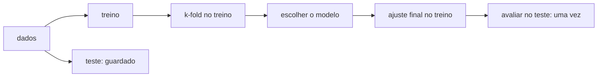

## Passo 1 · Leitura · Três conjuntos, três papéis

Um modelo treinado precisa de uma nota, e a nota só vale se vier de dados que ele não viu. Até aqui, a lição dividia os dados em treino e teste. Na prática, há uma decisão no meio: qual modelo, qual `C`, quais colunas. Se essas escolhas forem feitas olhando o teste, o teste deixa de medir "dados nunca vistos" e passa a medir "dados que ajudaram a escolher". Por isso são três papéis:

- **treino:** onde cada modelo aprende os parâmetros;
- **validação:** onde os candidatos são comparados e as escolhas são feitas;
- **teste:** separado no começo e usado **uma vez**, no fim, para medir o modelo escolhido.



Em vez de uma validação fixa, o mais comum é a **validação cruzada** no treino (o passo 4 explica), que reaproveita cada linha do treino como validação uma vez.

A divisão é feita com o `train_test_split`:

```python
X_treino, X_teste, y_treino, y_teste = train_test_split(
    X, y, test_size=0.2, random_state=0, stratify=y)
```

O `random_state` fixa o sorteio: a mesma semente dá sempre a mesma divisão, e o resultado pode ser reproduzido. O `stratify=y` sorteia dentro de cada classe, para que o treino e o teste tenham a mesma proporção de classes que os dados inteiros. Com classes equilibradas e milhares de linhas, o sorteio simples já chega perto disso. Com 10 % de positivos e um teste de 20 linhas, ele pode deixar o teste com 1 positivo ou com 4, e a acurácia, a precisão e o recall do teste passam a depender da sorte do sorteio.

Os dados que chegam ordenados (por classe, por data, por cliente) pedem cuidado extra: com `shuffle=False`, o teste são as últimas linhas, e um arquivo ordenado por classe põe todos os positivos no teste. Para dividir em três, chame o `train_test_split` duas vezes: primeiro separe o teste, depois divida o resto em treino e validação.

## Passo 2 · Previsão · Proporções com e sem embaralhar

Os dados têm 100 linhas, com 10 positivos (as últimas 10). O programa divide com `stratify` em três sementes e depois sem embaralhar, sempre com um teste de 20 linhas. Leia sem executar e digite o que ele imprime.

### Código
```python
import numpy as np
from sklearn.model_selection import train_test_split

X = np.arange(100).reshape(-1, 1)
y = np.array([0] * 90 + [1] * 10)
for semente in range(3):
    b = train_test_split(X, y, test_size=0.2, random_state=semente, stratify=y)
    print(semente, int(b[3].sum()), int(b[2].sum()))
c = train_test_split(X, y, test_size=0.2, shuffle=False)
print(len(c[1]), int(c[3].sum()), int(c[2].sum()))
print(c[1][:3].ravel().tolist())
```

### Dicas
1. O `train_test_split` devolve `X_treino, X_teste, y_treino, y_teste`, nessa ordem: o índice 2 é o `y` do treino, e o 3, o do teste.
2. Com `stratify=y`, o teste recebe a mesma proporção de positivos que os dados inteiros, qualquer que seja a semente.
3. Com `shuffle=False`, o teste são as últimas 20 linhas.

### Saída esperada
```text
0 2 8
1 2 8
2 2 8
20 10 0
[80, 81, 82]
```

## Passo 3 · Exercício · Dividir estratificado
modo: lacunas

Complete as lacunas (`___`) das duas funções de divisão. Para ter uma ideia do que o `stratify` evita: em 200 linhas com 20 positivos, um teste de 50 linhas sorteado **sem** ele recebeu 5, 6, 3, 5, 9 e 3 positivos com as sementes 0 a 5; com ele, sempre 5.

### Instruções
1. `dividir(X, y, semente, fracao_teste)` devolve `X_treino, X_teste, y_treino, y_teste`, com a fração `fracao_teste` das linhas no teste.
2. A divisão é estratificada pelas classes de `y`.
3. O sorteio é fixado pela `semente`: a mesma semente dá a mesma divisão, e sementes diferentes dão divisões diferentes.
4. `dividir_em_tres(X, y, semente, fracao_validacao, fracao_teste)` separa primeiro o teste e depois divide o resto, de modo que a validação fique com a fração `fracao_validacao` dos dados **inteiros**. Devolve `X_treino, X_val, X_teste, y_treino, y_val, y_teste`.

### Código inicial
```python
from sklearn.model_selection import train_test_split


def dividir(X, y, semente, fracao_teste):
    return train_test_split(X, y, test_size=___, random_state=___, stratify=___)


def dividir_em_tres(X, y, semente, fracao_validacao, fracao_teste):
    X_resto, X_teste, y_resto, y_teste = dividir(X, y, semente, fracao_teste)
    fracao_do_resto = ___
    X_treino, X_val, y_treino, y_val = dividir(X_resto, y_resto, semente, fracao_do_resto)
    return X_treino, X_val, X_teste, y_treino, y_val, y_teste
```

### Solução
```python
from sklearn.model_selection import train_test_split


def dividir(X, y, semente, fracao_teste):
    return train_test_split(X, y, test_size=fracao_teste, random_state=semente, stratify=y)


def dividir_em_tres(X, y, semente, fracao_validacao, fracao_teste):
    X_resto, X_teste, y_resto, y_teste = dividir(X, y, semente, fracao_teste)
    fracao_do_resto = fracao_validacao / (1 - fracao_teste)
    X_treino, X_val, y_treino, y_val = dividir(X_resto, y_resto, semente, fracao_do_resto)
    return X_treino, X_val, X_teste, y_treino, y_val, y_teste
```

### Dicas
1. Os três argumentos do `train_test_split` vêm dos parâmetros da função: a fração, a semente e o vetor cujas classes devem manter a proporção.
2. Na segunda divisão, a fração é calculada sobre o que sobrou, e não sobre os dados inteiros.
3. Com 200 linhas, 20 % de teste e 25 % de validação, sobram 160 linhas depois do teste, e a validação precisa de 50 delas.

### Verificação
```json
[
  { "id": "tamanhos", "checkpoint": 1, "kind": "expr",
    "setup": "import numpy as np\nX = np.arange(200).reshape(-1, 1)\ny = np.array([0] * 180 + [1] * 20)",
    "expr": "[len(a) for a in dividir(X, y, 0, 0.25)]",
    "expected": [150, 50, 150, 50],
    "name": "Com 25 % de teste: 150 linhas de treino e 50 de teste, nessa ordem",
    "hint": "A fração recebida é a do teste." },
  { "id": "linhas-alinhadas", "checkpoint": 1, "kind": "expr",
    "setup": "import numpy as np\nX = np.arange(200).reshape(-1, 1)\ny = np.array([0] * 180 + [1] * 20)\nr = dividir(X, y, 2, 0.25)",
    "expr": "bool(((r[1][:, 0] >= 180) == (r[3] == 1)).all())",
    "expected": true,
    "name": "Cada linha do teste continua com o seu próprio rótulo" },
  { "id": "estratificado", "checkpoint": 2, "kind": "expr",
    "setup": "import numpy as np\nX = np.arange(200).reshape(-1, 1)\ny = np.array([0] * 180 + [1] * 20)\nr = dividir(X, y, 4, 0.25)",
    "expr": "[int(r[2].sum()), int(r[3].sum())]",
    "expected": [15, 5],
    "name": "Com 10 % de positivos, o treino recebe 15 e o teste 5 (semente 4)",
    "hint": "Sem estratificar, o número de positivos no teste depende da sorte do sorteio." },
  { "id": "mesma-semente", "checkpoint": 3, "kind": "expr",
    "setup": "import numpy as np\nX = np.arange(200).reshape(-1, 1)\ny = np.array([0] * 180 + [1] * 20)",
    "expr": "bool((dividir(X, y, 7, 0.25)[1] == dividir(X, y, 7, 0.25)[1]).all())",
    "expected": true,
    "name": "A mesma semente dá o mesmo teste",
    "hint": "O random_state precisa receber a semente." },
  { "id": "outra-semente", "checkpoint": 3, "kind": "expr",
    "setup": "import numpy as np\nX = np.arange(200).reshape(-1, 1)\ny = np.array([0] * 180 + [1] * 20)",
    "expr": "bool((dividir(X, y, 7, 0.25)[1] != dividir(X, y, 8, 0.25)[1]).any())",
    "expected": true,
    "name": "Sementes diferentes dão testes diferentes",
    "hint": "Use a semente recebida, não um número fixo." },
  { "id": "tres-tamanhos", "checkpoint": 4, "kind": "expr",
    "setup": "import numpy as np\nX = np.arange(200).reshape(-1, 1)\ny = np.array([0] * 180 + [1] * 20)",
    "expr": "[len(a) for a in dividir_em_tres(X, y, 1, 0.25, 0.2)]",
    "expected": [110, 50, 40, 110, 50, 40],
    "name": "25 % de validação e 20 % de teste em 200 linhas: 110, 50 e 40",
    "hint": "Depois de separar o teste, a fração da validação é medida sobre o que sobrou." },
  { "id": "tres-padrao", "checkpoint": 4, "kind": "expr",
    "setup": "import numpy as np\nX = np.arange(200).reshape(-1, 1)\ny = np.array([0] * 180 + [1] * 20)",
    "expr": "[len(a) for a in dividir_em_tres(X, y, 0, 0.2, 0.2)]",
    "expected": [120, 40, 40, 120, 40, 40],
    "name": "20 % de validação e 20 % de teste: 120, 40 e 40" },
  { "id": "tres-positivos", "checkpoint": 4, "kind": "expr",
    "setup": "import numpy as np\nX = np.arange(200).reshape(-1, 1)\ny = np.array([0] * 180 + [1] * 20)\nr = dividir_em_tres(X, y, 1, 0.25, 0.2)",
    "expr": "[int(r[3].sum()), int(r[4].sum()), int(r[5].sum())]",
    "expected": [11, 5, 4],
    "name": "As duas divisões são estratificadas" },
  { "id": "tres-disjuntos", "checkpoint": 4, "kind": "expr",
    "setup": "import numpy as np\nX = np.arange(200).reshape(-1, 1)\ny = np.array([0] * 180 + [1] * 20)\nr = dividir_em_tres(X, y, 1, 0.25, 0.2)",
    "expr": "len(set(np.concatenate([r[0], r[1], r[2]]).ravel().tolist()))",
    "expected": 200,
    "name": "Treino, validação e teste não repetem linhas e somam as 200" }
]
```

### Soluções erradas
```python name="sem estratificar"
from sklearn.model_selection import train_test_split


def dividir(X, y, semente, fracao_teste):
    return train_test_split(X, y, test_size=fracao_teste, random_state=semente, stratify=None)


def dividir_em_tres(X, y, semente, fracao_validacao, fracao_teste):
    X_resto, X_teste, y_resto, y_teste = dividir(X, y, semente, fracao_teste)
    fracao_do_resto = fracao_validacao / (1 - fracao_teste)
    X_treino, X_val, y_treino, y_val = dividir(X_resto, y_resto, semente, fracao_do_resto)
    return X_treino, X_val, X_teste, y_treino, y_val, y_teste
```
```python name="semente fixa"
from sklearn.model_selection import train_test_split


def dividir(X, y, semente, fracao_teste):
    return train_test_split(X, y, test_size=fracao_teste, random_state=0, stratify=y)


def dividir_em_tres(X, y, semente, fracao_validacao, fracao_teste):
    X_resto, X_teste, y_resto, y_teste = dividir(X, y, semente, fracao_teste)
    fracao_do_resto = fracao_validacao / (1 - fracao_teste)
    X_treino, X_val, y_treino, y_val = dividir(X_resto, y_resto, semente, fracao_do_resto)
    return X_treino, X_val, X_teste, y_treino, y_val, y_teste
```
```python name="fração do treino no lugar da do teste"
from sklearn.model_selection import train_test_split


def dividir(X, y, semente, fracao_teste):
    return train_test_split(X, y, test_size=1 - fracao_teste, random_state=semente, stratify=y)


def dividir_em_tres(X, y, semente, fracao_validacao, fracao_teste):
    X_resto, X_teste, y_resto, y_teste = dividir(X, y, semente, fracao_teste)
    fracao_do_resto = fracao_validacao / (1 - fracao_teste)
    X_treino, X_val, y_treino, y_val = dividir(X_resto, y_resto, semente, fracao_do_resto)
    return X_treino, X_val, X_teste, y_treino, y_val, y_teste
```
```python name="fração da validação sem corrigir"
from sklearn.model_selection import train_test_split


def dividir(X, y, semente, fracao_teste):
    return train_test_split(X, y, test_size=fracao_teste, random_state=semente, stratify=y)


def dividir_em_tres(X, y, semente, fracao_validacao, fracao_teste):
    X_resto, X_teste, y_resto, y_teste = dividir(X, y, semente, fracao_teste)
    fracao_do_resto = fracao_validacao
    X_treino, X_val, y_treino, y_val = dividir(X_resto, y_resto, semente, fracao_do_resto)
    return X_treino, X_val, X_teste, y_treino, y_val, y_teste
```
```python name="fração da validação multiplicada"
from sklearn.model_selection import train_test_split


def dividir(X, y, semente, fracao_teste):
    return train_test_split(X, y, test_size=fracao_teste, random_state=semente, stratify=y)


def dividir_em_tres(X, y, semente, fracao_validacao, fracao_teste):
    X_resto, X_teste, y_resto, y_teste = dividir(X, y, semente, fracao_teste)
    fracao_do_resto = fracao_validacao * (1 - fracao_teste)
    X_treino, X_val, y_treino, y_val = dividir(X_resto, y_resto, semente, fracao_do_resto)
    return X_treino, X_val, X_teste, y_treino, y_val, y_teste
```
```python name="sorteio sem semente"
from sklearn.model_selection import train_test_split


def dividir(X, y, semente, fracao_teste):
    return train_test_split(X, y, test_size=fracao_teste, random_state=None, stratify=y)


def dividir_em_tres(X, y, semente, fracao_validacao, fracao_teste):
    X_resto, X_teste, y_resto, y_teste = dividir(X, y, semente, fracao_teste)
    fracao_do_resto = fracao_validacao / (1 - fracao_teste)
    X_treino, X_val, y_treino, y_val = dividir(X_resto, y_resto, semente, fracao_do_resto)
    return X_treino, X_val, X_teste, y_treino, y_val, y_teste
```

## Passo 4 · Leitura · k-fold e o que a média esconde

Uma validação fixa de 40 linhas dá uma nota que depende de quais 40 linhas caíram nela. A **validação cruzada k-fold** divide o treino em $k$ partes (as dobras ou partições), treina $k$ vezes, cada vez com uma parte de fora para validar, e devolve $k$ pontuações $s_1, \dots, s_k$. Todo dado do treino serve de validação exatamente uma vez. O resumo é a média e o desvio:

$$
\bar{s} = \frac{1}{k}\sum_{i=1}^{k} s_i \qquad \sigma = \sqrt{\frac{1}{k}\sum_{i=1}^{k} (s_i - \bar{s})^2}
$$

```python
cv = StratifiedKFold(n_splits=5, shuffle=True, random_state=0)
notas = cross_val_score(modelo, X_treino, y_treino, cv=cv)
print(notas.mean(), notas.std())       # 0.89 ± 0.02, por exemplo
```

O desvio diz quanto a nota oscila de uma partição para outra. Dois modelos com médias 0,89 e 0,88 e desvio 0,02 estão empatados para esses dados; a lição 5 volta a essa comparação. O `cross_val_score` clona o modelo a cada partição, e, com um `Pipeline`, o pré-processamento é refeito só com o treino de cada uma.

Como as partições são formadas importa:

- **`KFold(k)`** corta as linhas em blocos seguidos, na ordem em que estão. Com dados ordenados por classe, um bloco pode ter só uma classe. Numa tabela com 170 negativos seguidos de 30 positivos, a última partição de `KFold(5)` tem todos os positivos de validação e nenhum no treino. A regressão logística falha com `ValueError: This solver needs samples of at least 2 classes in the data`, o `cross_val_score` avisa com `FitFailedWarning`, põe `nan` naquela partição, e a média vira `nan`.
- **`KFold(k, shuffle=True, random_state=...)`** embaralha antes de cortar; resolve a ordem, mas não garante a proporção de classes.
- **`StratifiedKFold`** mantém a proporção de classes em cada partição, o que importa com classes desbalanceadas. É o que o `cross_val_score(modelo, X, y, cv=5)` usa num classificador, sem embaralhar; num regressor, `cv=5` é um `KFold(5)` sem embaralhar.

Para mais do que a nota de validação, o `cross_validate(modelo, X, y, cv=cv, return_train_score=True)` devolve um dicionário com `test_score`, `train_score` e os tempos de cada partição. A diferença entre treino e validação é o assunto da lição 6.

## Passo 5 · Exercício · Média, desvio e grupos

Escreva duas funções de validação cruzada: uma estratificada, para classes desbalanceadas, e uma por grupos, para dados com várias linhas por cliente.

### Instruções
1. `cv_media_desvio(pipeline, X, y, k, semente)` roda o `cross_val_score` do `pipeline` recebido com um `StratifiedKFold` de `k` partições, embaralhado com `random_state=semente`.
2. Devolve a tupla `(media, desvio)` das `k` pontuações, como `float`, com o desvio populacional (o `std` padrão do numpy).
3. `validacao_por_grupo(pipeline, X, y, grupos, k)` roda o `cross_val_score` com um `GroupKFold` de `k` partições, de modo que as linhas de um mesmo grupo nunca fiquem divididas entre treino e validação.
4. `validacao_por_grupo` devolve a lista das `k` pontuações, como `float`.

### Código inicial
```python
import numpy as np
from sklearn.model_selection import GroupKFold, StratifiedKFold, cross_val_score


def cv_media_desvio(pipeline, X, y, k, semente):
    pass


def validacao_por_grupo(pipeline, X, y, grupos, k):
    pass
```

### Solução
```python
import numpy as np
from sklearn.model_selection import GroupKFold, StratifiedKFold, cross_val_score


def cv_media_desvio(pipeline, X, y, k, semente):
    cv = StratifiedKFold(n_splits=k, shuffle=True, random_state=semente)
    notas = cross_val_score(pipeline, X, y, cv=cv)
    return float(notas.mean()), float(notas.std())


def validacao_por_grupo(pipeline, X, y, grupos, k):
    notas = cross_val_score(pipeline, X, y, cv=GroupKFold(n_splits=k), groups=grupos)
    return notas.tolist()
```

### Dicas
1. O `cv=` do `cross_val_score` aceita um objeto divisor (`StratifiedKFold(...)`, `GroupKFold(...)`) no lugar de um número.
2. O `GroupKFold` só sabe quais linhas andam juntas se o `cross_val_score` receber os grupos, pelo argumento `groups=`.
3. O `cross_val_score` devolve um array: `float(...)` e `.tolist()` convertem para tipos do Python.

### Verificação
```json
[
  { "id": "media-desvio", "checkpoint": 1, "kind": "expr",
    "setup": "import numpy as np\nfrom sklearn.linear_model import LogisticRegression\nfrom sklearn.pipeline import make_pipeline\nfrom sklearn.preprocessing import StandardScaler\nrng = np.random.default_rng(0)\nX = np.vstack([rng.normal(0, 1, (170, 3)), rng.normal(1.0, 1, (30, 3))]).round(3)\ny = np.array([0] * 170 + [1] * 30)\npipe = make_pipeline(StandardScaler(), LogisticRegression())",
    "expr": "cv_media_desvio(pipe, X, y, 5, 0)",
    "expected": [0.89, 0.02],
    "tolerance": 1e-09,
    "name": "Dados ordenados por classe (15 % de positivos): média e desvio com 5 partições, semente 0",
    "hint": "Estratifique e embaralhe com a semente recebida." },
  { "id": "outra-semente", "checkpoint": 1, "kind": "expr",
    "setup": "import numpy as np\nfrom sklearn.linear_model import LogisticRegression\nfrom sklearn.pipeline import make_pipeline\nfrom sklearn.preprocessing import StandardScaler\nrng = np.random.default_rng(0)\nX = np.vstack([rng.normal(0, 1, (170, 3)), rng.normal(1.0, 1, (30, 3))]).round(3)\ny = np.array([0] * 170 + [1] * 30)\npipe = make_pipeline(StandardScaler(), LogisticRegression())",
    "expr": "cv_media_desvio(pipe, X, y, 5, 1)",
    "expected": [0.885, 0.02],
    "tolerance": 1e-09,
    "name": "Com a semente 1, outras partições e outra média",
    "hint": "O random_state do divisor é a semente recebida." },
  { "id": "dummy", "checkpoint": 1, "kind": "expr",
    "setup": "import numpy as np\nfrom sklearn.linear_model import LogisticRegression\nfrom sklearn.pipeline import make_pipeline\nfrom sklearn.preprocessing import StandardScaler\nrng = np.random.default_rng(0)\nX = np.vstack([rng.normal(0, 1, (170, 3)), rng.normal(1.0, 1, (30, 3))]).round(3)\ny = np.array([0] * 170 + [1] * 30)\npipe = make_pipeline(StandardScaler(), LogisticRegression())\nfrom sklearn.dummy import DummyClassifier",
    "expr": "cv_media_desvio(DummyClassifier(), X, y, 5, 0)",
    "expected": [0.85, 0.0],
    "tolerance": 1e-09,
    "name": "Com a classe majoritária, toda partição estratificada tem 85 % de acerto",
    "hint": "Estratificar mantém a mesma proporção de classes em cada partição." },
  { "id": "tipos-media", "checkpoint": 2, "kind": "expr",
    "setup": "import numpy as np\nfrom sklearn.linear_model import LogisticRegression\nfrom sklearn.pipeline import make_pipeline\nfrom sklearn.preprocessing import StandardScaler\nrng = np.random.default_rng(0)\nX = np.vstack([rng.normal(0, 1, (170, 3)), rng.normal(1.0, 1, (30, 3))]).round(3)\ny = np.array([0] * 170 + [1] * 30)\npipe = make_pipeline(StandardScaler(), LogisticRegression())\nr = cv_media_desvio(pipe, X, y, 5, 0)",
    "expr": "[type(r).__name__, type(r[0]).__name__, type(r[1]).__name__]",
    "expected": ["tuple", "float", "float"],
    "name": "Devolve uma tupla de dois float do Python" },
  { "id": "grupos-notas", "checkpoint": 3, "kind": "expr",
    "setup": "import numpy as np\nfrom sklearn.neighbors import KNeighborsClassifier\nfrom sklearn.pipeline import make_pipeline\nfrom sklearn.preprocessing import StandardScaler\nrng = np.random.default_rng(6)\ntam = rng.integers(4, 9, 12).astype(np.intp)\ngrupos = np.repeat(np.arange(12), tam)\ncentro = rng.normal(0, 3, (12, 2))\nX = (centro[grupos] + rng.normal(0, 0.4, (len(grupos), 2))).round(3)\nrot = (rng.random(12) < 0.5).astype(np.int64)\ny = np.where(rng.random(len(grupos)) < 0.1, 1 - rot[grupos], rot[grupos])\npipe = make_pipeline(StandardScaler(), KNeighborsClassifier(3))",
    "expr": "validacao_por_grupo(pipe, X, y, grupos, 4)",
    "expected": [0.631578947368421, 0.7777777777777778, 0.7777777777777778, 0.7222222222222222],
    "tolerance": 1e-09,
    "name": "12 clientes, 73 linhas: as 4 notas por grupo",
    "hint": "Passe um GroupKFold e os grupos ao cross_val_score." },
  { "id": "grupos-espiao", "checkpoint": 3, "kind": "expr",
    "setup": "import numpy as np\nfrom sklearn.neighbors import KNeighborsClassifier\nfrom sklearn.pipeline import make_pipeline\nfrom sklearn.preprocessing import StandardScaler\nrng = np.random.default_rng(6)\ntam = rng.integers(4, 9, 12).astype(np.intp)\ngrupos = np.repeat(np.arange(12), tam)\ncentro = rng.normal(0, 3, (12, 2))\nX = (centro[grupos] + rng.normal(0, 0.4, (len(grupos), 2))).round(3)\nrot = (rng.random(12) < 0.5).astype(np.int64)\ny = np.where(rng.random(len(grupos)) < 0.1, 1 - rot[grupos], rot[grupos])\npipe = make_pipeline(StandardScaler(), KNeighborsClassifier(3))\nfrom sklearn.dummy import DummyClassifier\ntreinos, validacoes = [], []\nclass Espiao(DummyClassifier):\n    def fit(self, X, y, sample_weight=None):\n        treinos.append(set(X[:, 0].tolist()))\n        return super().fit(X, y, sample_weight)\n    def predict(self, X):\n        validacoes.append(set(X[:, 0].tolist()))\n        return super().predict(X)\nr = validacao_por_grupo(Espiao(), np.column_stack([grupos, X]), y, grupos, 4)",
    "expr": "[len(treinos), all(not (a & b) for a, b in zip(treinos, validacoes))]",
    "expected": [4, true],
    "name": "Nenhum cliente aparece no treino e na validação da mesma partição",
    "hint": "As linhas de um grupo precisam ficar todas do mesmo lado em cada partição." },
  { "id": "grupos-tipos", "checkpoint": 4, "kind": "expr",
    "setup": "import numpy as np\nfrom sklearn.neighbors import KNeighborsClassifier\nfrom sklearn.pipeline import make_pipeline\nfrom sklearn.preprocessing import StandardScaler\nrng = np.random.default_rng(6)\ntam = rng.integers(4, 9, 12).astype(np.intp)\ngrupos = np.repeat(np.arange(12), tam)\ncentro = rng.normal(0, 3, (12, 2))\nX = (centro[grupos] + rng.normal(0, 0.4, (len(grupos), 2))).round(3)\nrot = (rng.random(12) < 0.5).astype(np.int64)\ny = np.where(rng.random(len(grupos)) < 0.1, 1 - rot[grupos], rot[grupos])\npipe = make_pipeline(StandardScaler(), KNeighborsClassifier(3))\nr = validacao_por_grupo(pipe, X, y, grupos, 4)",
    "expr": "[type(r).__name__, type(r[0]).__name__]",
    "expected": ["list", "float"],
    "name": "Devolve uma lista de float" },
  { "id": "grupos-k", "checkpoint": 4, "kind": "expr",
    "setup": "import numpy as np\nfrom sklearn.neighbors import KNeighborsClassifier\nfrom sklearn.pipeline import make_pipeline\nfrom sklearn.preprocessing import StandardScaler\nrng = np.random.default_rng(6)\ntam = rng.integers(4, 9, 12).astype(np.intp)\ngrupos = np.repeat(np.arange(12), tam)\ncentro = rng.normal(0, 3, (12, 2))\nX = (centro[grupos] + rng.normal(0, 0.4, (len(grupos), 2))).round(3)\nrot = (rng.random(12) < 0.5).astype(np.int64)\ny = np.where(rng.random(len(grupos)) < 0.1, 1 - rot[grupos], rot[grupos])\npipe = make_pipeline(StandardScaler(), KNeighborsClassifier(3))",
    "expr": "len(validacao_por_grupo(pipe, X, y, grupos, 3))",
    "expected": 3,
    "name": "Com k = 3, três notas" }
]
```

### Soluções erradas
```python name="StratifiedKFold sem embaralhar"
import numpy as np
from sklearn.model_selection import GroupKFold, StratifiedKFold, cross_val_score


def cv_media_desvio(pipeline, X, y, k, semente):
    cv = StratifiedKFold(n_splits=k)
    notas = cross_val_score(pipeline, X, y, cv=cv)
    return float(notas.mean()), float(notas.std())


def validacao_por_grupo(pipeline, X, y, grupos, k):
    notas = cross_val_score(pipeline, X, y, cv=GroupKFold(n_splits=k), groups=grupos)
    return notas.tolist()
```
```python name="KFold sem embaralhar em dados ordenados"
import numpy as np
from sklearn.model_selection import GroupKFold, KFold, cross_val_score


def cv_media_desvio(pipeline, X, y, k, semente):
    cv = KFold(n_splits=k)
    notas = cross_val_score(pipeline, X, y, cv=cv)
    return float(notas.mean()), float(notas.std())


def validacao_por_grupo(pipeline, X, y, grupos, k):
    notas = cross_val_score(pipeline, X, y, cv=GroupKFold(n_splits=k), groups=grupos)
    return notas.tolist()
```
```python name="KFold embaralhado, sem estratificar"
import numpy as np
from sklearn.model_selection import GroupKFold, KFold, cross_val_score


def cv_media_desvio(pipeline, X, y, k, semente):
    cv = KFold(n_splits=k, shuffle=True, random_state=semente)
    notas = cross_val_score(pipeline, X, y, cv=cv)
    return float(notas.mean()), float(notas.std())


def validacao_por_grupo(pipeline, X, y, grupos, k):
    notas = cross_val_score(pipeline, X, y, cv=GroupKFold(n_splits=k), groups=grupos)
    return notas.tolist()
```
```python name="desvio amostral (ddof=1)"
import numpy as np
from sklearn.model_selection import GroupKFold, StratifiedKFold, cross_val_score


def cv_media_desvio(pipeline, X, y, k, semente):
    cv = StratifiedKFold(n_splits=k, shuffle=True, random_state=semente)
    notas = cross_val_score(pipeline, X, y, cv=cv)
    return float(notas.mean()), float(notas.std(ddof=1))


def validacao_por_grupo(pipeline, X, y, grupos, k):
    notas = cross_val_score(pipeline, X, y, cv=GroupKFold(n_splits=k), groups=grupos)
    return notas.tolist()
```
```python name="média e desvio como float do numpy"
import numpy as np
from sklearn.model_selection import GroupKFold, StratifiedKFold, cross_val_score


def cv_media_desvio(pipeline, X, y, k, semente):
    cv = StratifiedKFold(n_splits=k, shuffle=True, random_state=semente)
    notas = cross_val_score(pipeline, X, y, cv=cv)
    return notas.mean(), notas.std()


def validacao_por_grupo(pipeline, X, y, grupos, k):
    notas = cross_val_score(pipeline, X, y, cv=GroupKFold(n_splits=k), groups=grupos)
    return notas.tolist()
```
```python name="KFold embaralhado no lugar dos grupos"
import numpy as np
from sklearn.model_selection import KFold, StratifiedKFold, cross_val_score


def cv_media_desvio(pipeline, X, y, k, semente):
    cv = StratifiedKFold(n_splits=k, shuffle=True, random_state=semente)
    notas = cross_val_score(pipeline, X, y, cv=cv)
    return float(notas.mean()), float(notas.std())


def validacao_por_grupo(pipeline, X, y, grupos, k):
    notas = cross_val_score(pipeline, X, y, cv=KFold(n_splits=k, shuffle=True, random_state=0))
    return notas.tolist()
```
```python name="GroupKFold sem passar os grupos"
import numpy as np
from sklearn.model_selection import GroupKFold, StratifiedKFold, cross_val_score


def cv_media_desvio(pipeline, X, y, k, semente):
    cv = StratifiedKFold(n_splits=k, shuffle=True, random_state=semente)
    notas = cross_val_score(pipeline, X, y, cv=cv)
    return float(notas.mean()), float(notas.std())


def validacao_por_grupo(pipeline, X, y, grupos, k):
    notas = cross_val_score(pipeline, X, y, cv=GroupKFold(n_splits=k))
    return notas.tolist()
```

## Passo 6 · Leitura · Tempo e grupos

O k-fold supõe que as linhas são independentes: saber uma não ajuda a adivinhar outra. Dois tipos de dados quebram essa suposição.

**Grupos.** Uma tabela de compras tem várias linhas por cliente, e as linhas de um mesmo cliente se parecem. Se o modelo vai ser usado em clientes **novos**, a validação precisa medir isso: nenhum cliente pode ter linhas no treino e na validação ao mesmo tempo. O `GroupKFold(n_splits=k)` recebe o grupo de cada linha (`cross_val_score(..., cv=GroupKFold(5), groups=clientes)`) e distribui grupos inteiros entre as partições. Num exemplo do exercício anterior, com 73 linhas de 12 clientes e um KNN, o `KFold` embaralhado deu média 0,876, e o `GroupKFold`, 0,727: o vizinho mais próximo de uma linha costuma ser outra linha do mesmo cliente, e o `KFold` premia essa "memória" que não existe para um cliente novo.

**Tempo.** Numa série de vendas diárias, embaralhar põe dias de março no treino para prever fevereiro. O modelo aprende com o futuro, o que nunca acontece em uso. O `TimeSeriesSplit(n_splits=k)` mantém a ordem: divide a série em $k + 1$ blocos do mesmo tamanho, `n // (k + 1)` linhas cada (as sobras ficam no primeiro treino), e a partição $i$ treina com tudo o que vem antes do bloco $i + 1$ e valida nele. O treino cresce a cada partição e sempre termina antes do começo da validação.

```python
for treino, val in TimeSeriesSplit(n_splits=3).split(np.zeros(10)):
    print(treino.tolist(), val.tolist())
# [0, 1, 2, 3] [4, 5]
# [0, 1, 2, 3, 4, 5] [6, 7]
# [0, 1, 2, 3, 4, 5, 6, 7] [8, 9]
```

Numa série de 60 dias gerada com tendência, uma regressão ridge teve R² médio de 0,955 com `KFold` embaralhado e de 0,641 com `TimeSeriesSplit`. O segundo número é o que se espera ao prever dias que ainda não aconteceram.

Por fim, quando a validação cruzada também escolhe hiperparâmetros, a nota do vencedor fica otimista: ele foi escolhido justamente por ir bem naquelas partições. A **validação aninhada** põe a busca dentro de um k-fold externo; a lição 4 volta a ela. Em qualquer esquema, o teste continua sendo usado uma vez, no fim.

## Passo 7 · Exercício · Validação temporal

Escreva as partições de uma validação temporal e a validação cruzada que as usa.

### Instruções
1. `particoes_temporais(n, k)` devolve a lista dos `k` blocos de validação de um `TimeSeriesSplit(n_splits=k)` em `n` linhas, cada um como a tupla `(inicio, fim)`, com `fim` exclusivo, como no `range`: cada bloco tem `n // (k + 1)` linhas, e o último termina em `n`.
2. Os blocos são seguidos e não se sobrepõem; as linhas que sobram da divisão ficam antes do primeiro bloco, no treino.
3. `validacao_temporal(pipeline, X, y, k)` roda o `cross_val_score` com um `TimeSeriesSplit(n_splits=k)`, de modo que cada treino termine antes do começo da sua validação.
4. `validacao_temporal` devolve a lista das `k` pontuações, como `float`.

### Código inicial
```python
from sklearn.model_selection import TimeSeriesSplit, cross_val_score


def particoes_temporais(n, k):
    pass


def validacao_temporal(pipeline, X, y, k):
    pass
```

### Solução
```python
from sklearn.model_selection import TimeSeriesSplit, cross_val_score


def particoes_temporais(n, k):
    tamanho = n // (k + 1)
    primeiro = n - k * tamanho
    return [(primeiro + i * tamanho, primeiro + (i + 1) * tamanho) for i in range(k)]


def validacao_temporal(pipeline, X, y, k):
    notas = cross_val_score(pipeline, X, y, cv=TimeSeriesSplit(n_splits=k))
    return notas.tolist()
```

### Dicas
1. Conte de trás para a frente: os `k` blocos ocupam as últimas `k * tamanho` linhas.
2. Confira com `n = 10` e `k = 3`: blocos de 2 linhas, começando na linha 4.
3. Um `cv=k` com número usa um `KFold` sem embaralhar, que valida no começo da série com um treino que vem depois.

### Verificação
```json
[
  { "id": "particoes-10-3", "checkpoint": 1, "kind": "call",
    "function": "particoes_temporais",
    "args": [10, 3],
    "expected": [[4, 6], [6, 8], [8, 10]],
    "name": "particoes_temporais(10, 3): blocos de 2 linhas, o último terminando em 10",
    "hint": "Cada bloco tem n // (k + 1) linhas, e os k blocos ocupam o fim da série." },
  { "id": "particoes-7-3", "checkpoint": 2, "kind": "call",
    "function": "particoes_temporais",
    "args": [7, 3],
    "expected": [[4, 5], [5, 6], [6, 7]],
    "name": "particoes_temporais(7, 3): as sobras ficam no primeiro treino",
    "hint": "O primeiro bloco começa em n - k * tamanho." },
  { "id": "particoes-100-4", "checkpoint": 1, "kind": "call",
    "function": "particoes_temporais",
    "args": [100, 4],
    "expected": [[20, 40], [40, 60], [60, 80], [80, 100]],
    "name": "particoes_temporais(100, 4)" },
  { "id": "particoes-12-2", "checkpoint": 2, "kind": "call",
    "function": "particoes_temporais",
    "args": [12, 2],
    "expected": [[4, 8], [8, 12]],
    "name": "particoes_temporais(12, 2)" },
  { "id": "temporal-espiao", "checkpoint": 3, "kind": "expr",
    "setup": "import numpy as np\nfrom sklearn.linear_model import Ridge\nfrom sklearn.pipeline import make_pipeline\nfrom sklearn.preprocessing import StandardScaler\nrng = np.random.default_rng(11)\nt = np.arange(60)\nx1 = np.sin(t / 5) + rng.normal(0, 0.2, 60)\ny = (10 + 0.15 * t + 2 * x1 + rng.normal(0, 0.5, 60)).round(3)\nX = np.column_stack([t, x1]).round(3)\npipe = make_pipeline(StandardScaler(), Ridge(alpha=1.0))\nfrom sklearn.dummy import DummyRegressor\nfim_treino, inicio_val = [], []\nclass Espiao(DummyRegressor):\n    def fit(self, X, y, sample_weight=None):\n        fim_treino.append(int(X[:, 0].max()))\n        return super().fit(X, y, sample_weight)\n    def predict(self, X, return_std=False):\n        inicio_val.append(int(X[:, 0].min()))\n        return super().predict(X, return_std)\nr = validacao_temporal(Espiao(), X, y, 4)",
    "expr": "[fim_treino, inicio_val]",
    "expected": [[11, 23, 35, 47], [12, 24, 36, 48]],
    "name": "Em 60 dias com k = 4: cada treino termina no dia anterior ao começo da validação",
    "hint": "Com a série fora de ordem, o treino passa a conter dias posteriores aos da validação." },
  { "id": "temporal-notas", "checkpoint": 3, "kind": "expr",
    "setup": "import numpy as np\nfrom sklearn.linear_model import Ridge\nfrom sklearn.pipeline import make_pipeline\nfrom sklearn.preprocessing import StandardScaler\nrng = np.random.default_rng(11)\nt = np.arange(60)\nx1 = np.sin(t / 5) + rng.normal(0, 0.2, 60)\ny = (10 + 0.15 * t + 2 * x1 + rng.normal(0, 0.5, 60)).round(3)\nX = np.column_stack([t, x1]).round(3)\npipe = make_pipeline(StandardScaler(), Ridge(alpha=1.0))",
    "expr": "validacao_temporal(pipe, X, y, 4)",
    "expected": [0.5932253467727018, 0.8962894002193327, 0.6566721066402614, 0.41642969212672465],
    "tolerance": 1e-09,
    "name": "As 4 notas (R²) da ridge na série de 60 dias" },
  { "id": "temporal-tipos", "checkpoint": 4, "kind": "expr",
    "setup": "import numpy as np\nfrom sklearn.linear_model import Ridge\nfrom sklearn.pipeline import make_pipeline\nfrom sklearn.preprocessing import StandardScaler\nrng = np.random.default_rng(11)\nt = np.arange(60)\nx1 = np.sin(t / 5) + rng.normal(0, 0.2, 60)\ny = (10 + 0.15 * t + 2 * x1 + rng.normal(0, 0.5, 60)).round(3)\nX = np.column_stack([t, x1]).round(3)\npipe = make_pipeline(StandardScaler(), Ridge(alpha=1.0))\nr = validacao_temporal(pipe, X, y, 3)",
    "expr": "[type(r).__name__, len(r), type(r[0]).__name__]",
    "expected": ["list", 3, "float"],
    "name": "Com k = 3, devolve uma lista de 3 float" }
]
```

### Soluções erradas
```python name="bloco de n // k linhas"
from sklearn.model_selection import TimeSeriesSplit, cross_val_score


def particoes_temporais(n, k):
    tamanho = n // k
    primeiro = n - k * tamanho
    return [(primeiro + i * tamanho, primeiro + (i + 1) * tamanho) for i in range(k)]


def validacao_temporal(pipeline, X, y, k):
    notas = cross_val_score(pipeline, X, y, cv=TimeSeriesSplit(n_splits=k))
    return notas.tolist()
```
```python name="primeiro bloco logo depois de um bloco de treino"
from sklearn.model_selection import TimeSeriesSplit, cross_val_score


def particoes_temporais(n, k):
    tamanho = n // (k + 1)
    primeiro = tamanho
    return [(primeiro + i * tamanho, primeiro + (i + 1) * tamanho) for i in range(k)]


def validacao_temporal(pipeline, X, y, k):
    notas = cross_val_score(pipeline, X, y, cv=TimeSeriesSplit(n_splits=k))
    return notas.tolist()
```
```python name="fim incluído no bloco"
from sklearn.model_selection import TimeSeriesSplit, cross_val_score


def particoes_temporais(n, k):
    tamanho = n // (k + 1)
    primeiro = n - k * tamanho
    return [(primeiro + i * tamanho, primeiro + (i + 1) * tamanho - 1) for i in range(k)]


def validacao_temporal(pipeline, X, y, k):
    notas = cross_val_score(pipeline, X, y, cv=TimeSeriesSplit(n_splits=k))
    return notas.tolist()
```
```python name="cv=k num regressor"
from sklearn.model_selection import TimeSeriesSplit, cross_val_score


def particoes_temporais(n, k):
    tamanho = n // (k + 1)
    primeiro = n - k * tamanho
    return [(primeiro + i * tamanho, primeiro + (i + 1) * tamanho) for i in range(k)]


def validacao_temporal(pipeline, X, y, k):
    notas = cross_val_score(pipeline, X, y, cv=k)
    return notas.tolist()
```
```python name="série embaralhada"
from sklearn.model_selection import KFold, cross_val_score


def particoes_temporais(n, k):
    tamanho = n // (k + 1)
    primeiro = n - k * tamanho
    return [(primeiro + i * tamanho, primeiro + (i + 1) * tamanho) for i in range(k)]


def validacao_temporal(pipeline, X, y, k):
    notas = cross_val_score(pipeline, X, y, cv=KFold(n_splits=k, shuffle=True, random_state=0))
    return notas.tolist()
```
```python name="devolve só a média"
from sklearn.model_selection import TimeSeriesSplit, cross_val_score


def particoes_temporais(n, k):
    tamanho = n // (k + 1)
    primeiro = n - k * tamanho
    return [(primeiro + i * tamanho, primeiro + (i + 1) * tamanho) for i in range(k)]


def validacao_temporal(pipeline, X, y, k):
    notas = cross_val_score(pipeline, X, y, cv=TimeSeriesSplit(n_splits=k))
    return float(notas.mean())
```

## Passo 8 · Quiz · O papel do teste

### Pergunta
Uma colega testou 30 combinações de hiperparâmetros. Para cada uma, treinou no treino e mediu a acurácia no teste; a melhor deu 0,91, e é esse o número que ela pretende apresentar como desempenho esperado do modelo. O que esse 0,91 mede?
- [ ] O desempenho esperado em dados novos, porque o teste não foi usado no treino de nenhuma combinação
- [x] Um valor otimista: a combinação foi escolhida por ir bem naquele teste, que virou um conjunto de validação. Falta um teste guardado, usado uma vez só, depois da escolha
- [ ] Um valor pessimista, porque cada combinação foi treinada só com o treino, sem as linhas do teste
- [ ] O mesmo que uma validação cruzada de 30 partições, porque houve 30 avaliações
> Ao escolher a melhor entre 30 pelo teste, ela escolheu também a que teve mais sorte com aquelas linhas; o número carrega essa sorte. O certo é escolher por validação cruzada no treino e medir o vencedor uma vez num teste que não participou da escolha. Não ter treinado com o teste não basta: o teste participou da decisão. E 30 avaliações no mesmo teste não são 30 partições diferentes dos dados.

### Pergunta
Uma tabela tem leituras de sensores de 40 máquinas fictícias, cerca de 50 leituras por máquina. O modelo vai prever falhas em máquinas que ainda serão instaladas. Qual validação cruzada mede o que importa?
- [ ] `StratifiedKFold(5, shuffle=True)`, porque mantém a proporção de falhas em cada partição
- [ ] `TimeSeriesSplit(5)`, porque as leituras são feitas ao longo do tempo
- [x] `GroupKFold(5)` com a máquina como grupo, para que as leituras de uma máquina fiquem todas no treino ou todas na validação
- [ ] `KFold(5)` sem embaralhar, porque as leituras já vêm agrupadas por máquina na tabela
> O uso real é em máquinas novas; a validação precisa simular isso, com máquinas inteiras de fora. O `StratifiedKFold` espalha as leituras de cada máquina pelo treino e pela validação, e o modelo pode reconhecer a máquina em vez de aprender o padrão de falha. O `TimeSeriesSplit` responde a outra pergunta (prever o futuro das mesmas máquinas). O `KFold` sem embaralhar até mantém máquinas quase inteiras por acaso, se a tabela estiver ordenada, mas corta máquinas na fronteira dos blocos e não recebe os grupos.

### Pergunta
Numa série de vendas diárias de uma loja fictícia, um modelo teve R² médio de 0,95 com `KFold(5, shuffle=True)` e de 0,64 com `TimeSeriesSplit(5)`. Ele vai prever as vendas da próxima semana. Qual número usar, e por quê?
- [ ] 0,95, porque o `KFold` embaralhado usa todos os dias no treino e na validação e por isso é mais preciso
- [x] 0,64: com a série embaralhada, o modelo treinou com dias posteriores aos que validou, o que não acontece ao prever a próxima semana
- [ ] A média dos dois, 0,795, para equilibrar o otimismo de um com o pessimismo do outro
- [ ] Nenhum: séries temporais não podem ser avaliadas com validação cruzada
> Embaralhar uma série é vazamento: o modelo vê o futuro no treino. O `TimeSeriesSplit` só treina com o passado de cada bloco de validação, como acontece no uso real; o 0,64 é a estimativa honesta. Fazer a média de uma medida enviesada com uma honesta não corrige nada, e a validação cruzada funciona com séries, desde que respeite a ordem.
