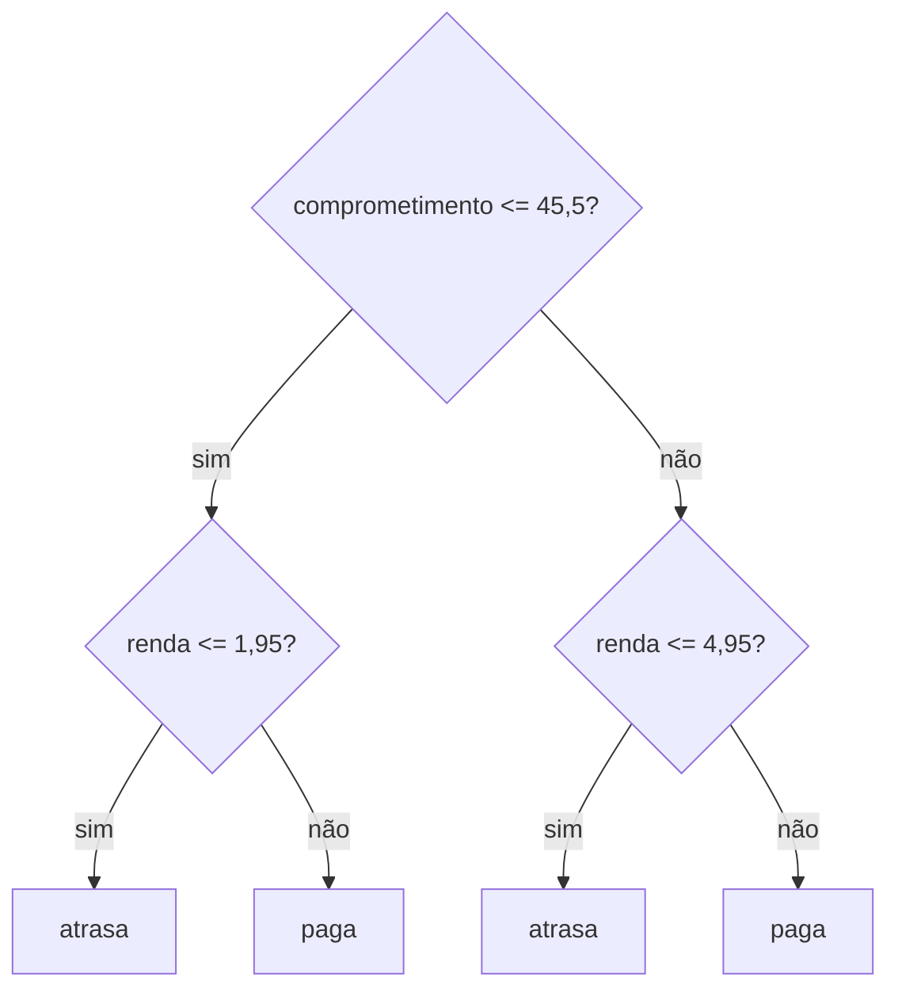

## Passo 1 · Leitura · Perguntas binárias

Uma financeira fictícia quer prever quais clientes vão atrasar a fatura. Uma analista experiente faria perguntas em sequência: "o cliente compromete mais de 45 % da renda com dívidas?" e, conforme a resposta, "a renda mensal passa de R\$ 4 950?". Uma **árvore de decisão** aprende essa sequência de perguntas binárias a partir dos dados. Cada nó interno compara um atributo com um limiar (`x[j] <= t`), cada resposta leva a outra pergunta, e cada **folha** responde com a classe mais frequente entre os exemplos de treino que chegaram até ela. A árvore abaixo foi aprendida de 300 clientes gerados com `default_rng`; renda em milhares de reais e comprometimento em porcentagem.



Para escolher cada pergunta, a árvore mede quão misturado está um nó. Com $p_k$ a fração de exemplos da classe $k$ no nó, as duas medidas usuais são a **impureza de Gini** e a **entropia** (em bits):

$$
G = 1 - \sum_k p_k^2 \qquad\qquad H = -\sum_k p_k \log_2 p_k
$$

O Gini é a chance de errar quando se rotula um exemplo sorteado do nó com um rótulo sorteado da distribuição do próprio nó; a entropia é o número médio de bits para dizer a classe de um exemplo. As duas valem 0 num nó puro, com uma classe só, e chegam ao máximo quando as classes empatam: com duas classes, $G = 0{,}5$ e $H = 1$. Classes ausentes do nó não entram na soma ($0 \log 0$ vale 0 por convenção). Na prática as duas escolhem quase sempre a mesma divisão; o `DecisionTreeClassifier` usa o Gini por padrão e aceita `criterion="entropy"`.

```python
rotulos = np.array(["paga", "paga", "atrasa", "paga"])
_, contagens = np.unique(rotulos, return_counts=True)
p = contagens / len(rotulos)        # [0.25, 0.75]
gini = 1 - np.sum(p ** 2)           # 0.375
```

A árvore cresce de cima para baixo: escolhe a melhor pergunta para todos os dados, divide-os em dois grupos e repete a busca dentro de cada grupo. As próximas leituras mostram como medir a "melhor" pergunta e quando parar. Uma vantagem já aparece aqui: a árvore não faz contas com os valores dos atributos, só os compara com limiares, então dispensa a padronização que a regressão logística e o KNN do módulo 3 exigiam.

## Passo 2 · Previsão · Gini de três nós

O programa calcula as duas impurezas de três nós com rótulos de clientes. Leia sem executar e digite o que ele imprime.

### Código
```python
import numpy as np


def impurezas(rotulos):
    _, contagens = np.unique(rotulos, return_counts=True)
    p = contagens / len(rotulos)
    gini = 1 - np.sum(p ** 2)
    entropia = np.sum(p * np.log2(1 / p))
    return round(float(gini), 4), round(float(entropia), 4)


nos = {
    "A": ["paga"] * 8,
    "B": ["paga"] * 4 + ["atrasa"] * 4,
    "C": ["paga"] * 6 + ["atrasa"] * 2,
}
for nome, rotulos in nos.items():
    print(nome, *impurezas(rotulos))
```

### Dicas
1. Um nó com uma classe só tem $p = [1]$: as duas medidas dão zero.
2. Com duas classes meio a meio, $p = [0{,}5;\ 0{,}5]$: o Gini é o máximo para duas classes e a entropia vale exatamente 1 bit.
3. No nó C, $p = [0{,}25;\ 0{,}75]$; $\log_2 4 = 2$ e $\log_2(4/3) \approx 0{,}415$.

### Saída esperada
```text
A 0.0 0.0
B 0.5 1.0
C 0.375 0.8113
```

## Passo 3 · Exercício · Impurezas
modo: lacunas

Complete as lacunas (`___`) das duas medidas de impureza de um nó.

### Instruções
1. `gini(y)` devolve $1 - \sum_k p_k^2$ como `float`, com $p_k$ a fração de cada rótulo distinto de `y` (números ou textos).
2. `entropia(y)` devolve $-\sum_k p_k \log_2 p_k$ como `float`, em bits.
3. Um nó vazio (`y` sem elementos) tem impureza `0.0` nas duas medidas.

### Código inicial
```python
import numpy as np


def gini(y):
    y = np.asarray(y)
    if ___:
        return 0.0
    _, contagens = np.unique(y, return_counts=True)
    p = contagens / len(y)
    return float(1 - ___)


def entropia(y):
    y = np.asarray(y)
    if len(y) == 0:
        return 0.0
    _, contagens = np.unique(y, return_counts=True)
    p = contagens / ___
    return float(-np.sum(___))
```

### Solução
```python
import numpy as np


def gini(y):
    y = np.asarray(y)
    if len(y) == 0:
        return 0.0
    _, contagens = np.unique(y, return_counts=True)
    p = contagens / len(y)
    return float(1 - np.sum(p ** 2))


def entropia(y):
    y = np.asarray(y)
    if len(y) == 0:
        return 0.0
    _, contagens = np.unique(y, return_counts=True)
    p = contagens / len(y)
    return float(-np.sum(p * np.log2(p)))
```

### Dicas
1. Um array do numpy com vários elementos não vira `True` ou `False` sozinho: teste o tamanho dele.
2. As frações dividem cada contagem pelo número de exemplos do nó, não pelo número de classes.
3. Cada termo da entropia é a fração vezes o log na base 2 da fração; o `np.unique` só devolve rótulos que aparecem, então nenhuma fração é zero.

### Verificação
```json
[
  { "id": "gini-vazio", "checkpoint": 3, "kind": "call", "function": "gini", "args": [[]], "expected": 0.0, "tolerance": 1e-9,
    "name": "gini de um nó vazio é 0.0", "hint": "Sem exemplos não há mistura: devolva 0.0 antes de dividir." },
  { "id": "gini-puro", "checkpoint": 1, "kind": "call", "function": "gini", "args": [["paga", "paga", "paga"]], "expected": 0.0, "tolerance": 1e-9,
    "name": "gini de um nó puro é 0.0" },
  { "id": "gini-meio-a-meio", "checkpoint": 1, "kind": "call", "function": "gini", "args": [[0, 0, 1, 1]], "expected": 0.5, "tolerance": 1e-9,
    "name": "gini com duas classes empatadas é 0.5" },
  { "id": "gini-um-em-quatro", "checkpoint": 1, "kind": "call", "function": "gini", "args": [["sim", "nao", "sim", "sim"]], "expected": 0.375, "tolerance": 1e-9,
    "name": "gini com frações 1/4 e 3/4 é 0.375",
    "hint": "Some o quadrado de todas as frações, não só o da classe mais frequente." },
  { "id": "gini-tres-classes", "checkpoint": 1, "kind": "call", "function": "gini", "args": [[0, 1, 2]], "expected": 0.6666666666666667, "tolerance": 1e-9,
    "name": "gini com três classes empatadas é 2/3" },
  { "id": "entropia-meio-a-meio", "checkpoint": 2, "kind": "call", "function": "entropia", "args": [[0, 0, 1, 1]], "expected": 1.0, "tolerance": 1e-9,
    "name": "entropia com duas classes empatadas é 1 bit",
    "hint": "Divida as contagens pelo número de exemplos e use o logaritmo na base 2 (np.log2); com o natural, o resultado sai em nats." },
  { "id": "entropia-quatro-classes", "checkpoint": 2, "kind": "call", "function": "entropia", "args": [[0, 1, 2, 3]], "expected": 2.0, "tolerance": 1e-9,
    "name": "entropia com quatro classes empatadas é 2 bits" },
  { "id": "entropia-um-em-quatro", "checkpoint": 2, "kind": "call", "function": "entropia", "args": [["a", "a", "a", "b"]], "expected": 0.8112781244591328, "tolerance": 1e-9,
    "name": "entropia com frações 1/4 e 3/4 é 0.8113 bit",
    "hint": "Cada termo é a fração vezes o log da fração; o sinal de menos deixa o total positivo." },
  { "id": "entropia-puro", "checkpoint": 2, "kind": "call", "function": "entropia", "args": [[7, 7, 7]], "expected": 0.0, "tolerance": 1e-9,
    "name": "entropia de um nó puro é 0.0" },
  { "id": "entropia-vazio", "checkpoint": 3, "kind": "call", "function": "entropia", "args": [[]], "expected": 0.0, "tolerance": 1e-9,
    "name": "entropia de um nó vazio é 0.0" },
  { "id": "tipos", "checkpoint": 1, "kind": "expr", "expr": "[type(gini([0, 1])).__name__, type(entropia([0, 1])).__name__]", "expected": ["float", "float"],
    "name": "As duas funções devolvem float" }
]
```

### Soluções erradas
```python name="testa o array como booleano"
import numpy as np


def gini(y):
    y = np.asarray(y)
    if not y:
        return 0.0
    _, contagens = np.unique(y, return_counts=True)
    p = contagens / len(y)
    return float(1 - np.sum(p ** 2))


def entropia(y):
    y = np.asarray(y)
    if len(y) == 0:
        return 0.0
    _, contagens = np.unique(y, return_counts=True)
    p = contagens / len(y)
    return float(-np.sum(p * np.log2(p)))
```
```python name="trata como vazio o nó de um elemento"
import numpy as np


def gini(y):
    y = np.asarray(y)
    if len(y) == 1:
        return 0.0
    _, contagens = np.unique(y, return_counts=True)
    p = contagens / len(y)
    return float(1 - np.sum(p ** 2))


def entropia(y):
    y = np.asarray(y)
    if len(y) == 0:
        return 0.0
    _, contagens = np.unique(y, return_counts=True)
    p = contagens / len(y)
    return float(-np.sum(p * np.log2(p)))
```
```python name="erro de classificação no lugar do Gini"
import numpy as np


def gini(y):
    y = np.asarray(y)
    if len(y) == 0:
        return 0.0
    _, contagens = np.unique(y, return_counts=True)
    p = contagens / len(y)
    return float(1 - np.max(p))


def entropia(y):
    y = np.asarray(y)
    if len(y) == 0:
        return 0.0
    _, contagens = np.unique(y, return_counts=True)
    p = contagens / len(y)
    return float(-np.sum(p * np.log2(p)))
```
```python name="frações divididas pelo número de classes"
import numpy as np


def gini(y):
    y = np.asarray(y)
    if len(y) == 0:
        return 0.0
    _, contagens = np.unique(y, return_counts=True)
    p = contagens / len(y)
    return float(1 - np.sum(p ** 2))


def entropia(y):
    y = np.asarray(y)
    if len(y) == 0:
        return 0.0
    _, contagens = np.unique(y, return_counts=True)
    p = contagens / len(contagens)
    return float(-np.sum(p * np.log2(p)))
```
```python name="entropia em nats"
import numpy as np


def gini(y):
    y = np.asarray(y)
    if len(y) == 0:
        return 0.0
    _, contagens = np.unique(y, return_counts=True)
    p = contagens / len(y)
    return float(1 - np.sum(p ** 2))


def entropia(y):
    y = np.asarray(y)
    if len(y) == 0:
        return 0.0
    _, contagens = np.unique(y, return_counts=True)
    p = contagens / len(y)
    return float(-np.sum(p * np.log(p)))
```
```python name="entropia sem ponderar pelas frações"
import numpy as np


def gini(y):
    y = np.asarray(y)
    if len(y) == 0:
        return 0.0
    _, contagens = np.unique(y, return_counts=True)
    p = contagens / len(y)
    return float(1 - np.sum(p ** 2))


def entropia(y):
    y = np.asarray(y)
    if len(y) == 0:
        return 0.0
    _, contagens = np.unique(y, return_counts=True)
    p = contagens / len(y)
    return float(-np.sum(np.log2(p)))
```

## Passo 4 · Leitura · A melhor divisão

Num nó com $n$ exemplos, cada pergunta `x[j] <= t` separa os exemplos num filho esquerdo, com $n_E$ deles, e num direito, com $n_D$. O **ganho** da pergunta é quanto a impureza cai, com a impureza de cada filho **ponderada pelo tamanho dele**:

$$
\text{ganho} = G(\text{nó}) - \left( \frac{n_E}{n}\, G(E) + \frac{n_D}{n}\, G(D) \right)
$$

Com a entropia no lugar de $G$, o mesmo número se chama **ganho de informação**. A ponderação evita uma armadilha: isolar um único exemplo deixa um filho puro, com Gini 0, e a média simples dos dois filhos faria essa divisão parecer ótima. Ponderada, a pureza de um exemplo em cem quase não conta, e o filho grande, ainda misturado, pesa o que deve pesar.

Quais limiares testar? Entre dois valores observados consecutivos, qualquer limiar separa o treino do mesmo jeito, então basta um candidato por intervalo. A convenção é o **ponto médio**: com os valores distintos do atributo em ordem crescente, $v_1 < v_2 < \dots < v_m$, os candidatos são $(v_i + v_{i+1})/2$. Usar o próprio valor observado, $t = v_i$, dá a mesma partição e o mesmo ganho no treino, mas encosta a fronteira num dos lados: um cliente novo com valor entre $v_i$ e $v_{i+1}$ cai sempre à direita. Os candidatos só fazem sentido com os valores **ordenados**; pontos médios de vizinhos na ordem das linhas pulam intervalos.

```python
valores = np.unique(X[:, j])                       # distintos, em ordem crescente
candidatos = (valores[:-1] + valores[1:]) / 2      # pontos médios
esquerda = X[:, j] <= t                            # máscara do filho esquerdo
```

A busca é exaustiva: todos os atributos e todos os candidatos de cada um. Quando duas perguntas empatam no ganho, esta lição fica com o menor atributo e, nele, com o menor limiar, o que basta para percorrer tudo em ordem e só trocar a melhor quando o ganho for **estritamente** maior. Um nó em que nenhuma pergunta tem ganho positivo (puro, ou com todos os atributos constantes) não se divide.

O scikit-learn faz a mesma conta, com dois detalhes. Ele percorre os atributos numa ordem sorteada pelo `random_state`, então um empate pode sair de outro jeito: os casos que comparam com ele usam dados sem empates. E ele converte `X` para `float32`, por isso o limiar da raiz, em `modelo.tree_.threshold[0]`, aparece como `0.8149999976158142` onde a conta em `float64` dá `0.815`.

## Passo 5 · Exercício · Melhor divisão

Escreva a busca da melhor pergunta de um nó, como a raiz de uma árvore de profundidade 1. A função `gini` já vem pronta.

### Instruções
1. `melhor_divisao(X, y)` percorre cada atributo `j` (coluna de `X`) e, nele, os limiares candidatos: os pontos médios entre valores distintos consecutivos, em ordem crescente.
2. Cada limiar `t` manda para a esquerda as linhas com `X[:, j] <= t`; o ganho é o Gini do nó menos o Gini dos dois filhos ponderado pelo tamanho de cada um.
3. Devolve a tupla `(atributo, limiar, ganho)` da pergunta de maior ganho, com `limiar` e `ganho` `float`; empates ficam com o menor atributo e, nele, o menor limiar.
4. Se nenhuma pergunta tem ganho positivo, devolve `(None, None, 0.0)`.

### Código inicial
```python
import numpy as np


def gini(y):
    y = np.asarray(y)
    if len(y) == 0:
        return 0.0
    _, contagens = np.unique(y, return_counts=True)
    p = contagens / len(y)
    return float(1 - np.sum(p ** 2))


def melhor_divisao(X, y):
    pass
```

### Solução
```python
import numpy as np


def gini(y):
    y = np.asarray(y)
    if len(y) == 0:
        return 0.0
    _, contagens = np.unique(y, return_counts=True)
    p = contagens / len(y)
    return float(1 - np.sum(p ** 2))


def melhor_divisao(X, y):
    X = np.asarray(X, dtype=float)
    y = np.asarray(y)
    n = len(y)
    impureza_no = gini(y)
    melhor = (None, None, 0.0)
    for j in range(X.shape[1]):
        valores = np.unique(X[:, j])
        for limiar in (valores[:-1] + valores[1:]) / 2:
            esquerda = X[:, j] <= limiar
            n_esq = int(esquerda.sum())
            filhos = (n_esq * gini(y[esquerda]) + (n - n_esq) * gini(y[~esquerda])) / n
            ganho = impureza_no - filhos
            if ganho > melhor[2]:
                melhor = (j, float(limiar), float(ganho))
    return melhor
```

### Dicas
1. O `np.unique` de uma coluna já devolve os valores distintos em ordem crescente; os pontos médios saem de somar o array sem o último com o array sem o primeiro.
2. Pondere cada filho pelo número de exemplos dele dividido pelo total do nó; a máscara `~esquerda` dá o filho direito.
3. Comece a melhor resposta em `(None, None, 0.0)` e troque só quando o ganho for estritamente maior: isso resolve os empates e o caso sem divisão útil de uma vez.

### Verificação
```json
[
  { "id": "quatro-pontos", "checkpoint": 3, "kind": "call", "function": "melhor_divisao", "args": [[[1], [2], [3], [4]], [0, 0, 1, 1]],
    "expected": [0, 2.5, 0.5], "tolerance": 1e-9,
    "name": "Quatro pontos separáveis: atributo 0, limiar 2.5, ganho 0.5" },
  { "id": "ponto-medio", "checkpoint": 1, "kind": "call", "function": "melhor_divisao", "args": [[[1], [5], [6], [10]], [0, 0, 1, 1]],
    "expected": [0, 5.5, 0.5], "tolerance": 1e-9,
    "name": "O limiar é o ponto médio entre 5 e 6, não um valor observado",
    "hint": "Teste os pontos médios entre valores distintos consecutivos." },
  { "id": "linhas-fora-de-ordem", "checkpoint": 1, "kind": "call", "function": "melhor_divisao", "args": [[[4], [9], [1], [8], [2], [7]], [0, 1, 0, 1, 0, 1]],
    "expected": [0, 5.5, 0.5], "tolerance": 1e-9,
    "name": "Com as linhas fora de ordem, os candidatos vêm dos valores ordenados",
    "hint": "Os vizinhos que definem os pontos médios são os vizinhos em ordem crescente, não na ordem das linhas." },
  { "id": "ponderado", "checkpoint": 2, "kind": "call", "function": "melhor_divisao", "args": [[[1], [2], [3], [4], [5], [6], [7], [8]], [0, 1, 1, 1, 0, 1, 1, 1]],
    "expected": [0, 1.5, 0.1607142857142857], "tolerance": 1e-9,
    "name": "O ganho pondera cada filho pelo seu tamanho",
    "hint": "Um filho com 1 exemplo pesa 1/8 na impureza dos filhos, não 1/2." },
  { "id": "empate-limiar", "checkpoint": 3, "kind": "call", "function": "melhor_divisao", "args": [[[1], [2], [3], [4]], [0, 1, 1, 0]],
    "expected": [0, 1.5, 0.16666666666666669], "tolerance": 1e-9,
    "name": "Empate entre 1.5 e 3.5 fica com o menor limiar",
    "hint": "Só troque a melhor divisão quando o ganho for estritamente maior." },
  { "id": "empate-atributo", "checkpoint": 3, "kind": "call", "function": "melhor_divisao", "args": [[[1, 1], [2, 2], [3, 3], [4, 4]], [0, 0, 1, 1]],
    "expected": [0, 2.5, 0.5], "tolerance": 1e-9,
    "name": "Duas colunas iguais: o empate fica com o menor atributo" },
  { "id": "coluna-constante", "checkpoint": 1, "kind": "call", "function": "melhor_divisao", "args": [[[5, 1], [5, 2], [5, 3], [5, 4]], [0, 0, 1, 1]],
    "expected": [1, 2.5, 0.5], "tolerance": 1e-9,
    "name": "Uma coluna constante não tem candidatos; a divisão vem da outra" },
  { "id": "no-puro", "checkpoint": 4, "kind": "call", "function": "melhor_divisao", "args": [[[1, 3], [2, 1], [3, 2]], ["paga", "paga", "paga"]],
    "expected": [null, null, 0.0],
    "name": "Nó puro: nenhuma pergunta tem ganho positivo",
    "hint": "Sem ganho estritamente positivo, devolva (None, None, 0.0)." },
  { "id": "raiz-do-sklearn", "checkpoint": 3, "kind": "expr",
    "setup": "import numpy as np\nfrom sklearn.tree import DecisionTreeClassifier\nrng = np.random.default_rng(4)\nX = rng.normal(0, 1, size=(40, 3)).round(2)\ny = ((0.5 * X[:, 0] - X[:, 2] + rng.normal(0, 0.7, 40)) > 0.2).astype(int)\nraiz = DecisionTreeClassifier(max_depth=1, random_state=0).fit(X, y).tree_\nr = melhor_divisao(X, y)",
    "expr": "[bool(r[0] == raiz.feature[0]), bool(abs(r[1] - raiz.threshold[0]) < 1e-6)]", "expected": [true, true],
    "name": "Em 40 linhas sorteadas, o mesmo atributo e o mesmo limiar da raiz do DecisionTreeClassifier",
    "hint": "Compara-se [atributo igual, limiar igual a 1e-6] com a raiz de uma árvore de profundidade 1." },
  { "id": "ganho-do-sklearn", "checkpoint": 2, "kind": "expr",
    "setup": "import numpy as np\nfrom sklearn.tree import DecisionTreeClassifier\nrng = np.random.default_rng(4)\nX = rng.normal(0, 1, size=(40, 3)).round(2)\ny = ((0.5 * X[:, 0] - X[:, 2] + rng.normal(0, 0.7, 40)) > 0.2).astype(int)\nt = DecisionTreeClassifier(max_depth=1, random_state=0).fit(X, y).tree_\nganho = t.impurity[0] - (t.n_node_samples[1] * t.impurity[1] + t.n_node_samples[2] * t.impurity[2]) / t.n_node_samples[0]\nr = melhor_divisao(X, y)",
    "expr": "bool(abs(r[2] - ganho) < 1e-9)", "expected": true,
    "name": "O ganho é o mesmo que a raiz do DecisionTreeClassifier obteve",
    "hint": "Compara-se com a impureza da raiz menos a impureza ponderada dos dois filhos." },
  { "id": "tipos", "checkpoint": 3, "kind": "expr", "setup": "r = melhor_divisao([[1], [2], [3], [4]], [0, 0, 1, 1])",
    "expr": "[type(r).__name__, type(r[1]).__name__, type(r[2]).__name__]", "expected": ["tuple", "float", "float"],
    "name": "Devolve uma tupla com limiar e ganho float" }
]
```

### Soluções erradas
```python name="limiar no valor observado"
import numpy as np


def gini(y):
    y = np.asarray(y)
    if len(y) == 0:
        return 0.0
    _, contagens = np.unique(y, return_counts=True)
    p = contagens / len(y)
    return float(1 - np.sum(p ** 2))


def melhor_divisao(X, y):
    X = np.asarray(X, dtype=float)
    y = np.asarray(y)
    n = len(y)
    impureza_no = gini(y)
    melhor = (None, None, 0.0)
    for j in range(X.shape[1]):
        valores = np.unique(X[:, j])
        for limiar in valores[:-1]:
            esquerda = X[:, j] <= limiar
            n_esq = int(esquerda.sum())
            filhos = (n_esq * gini(y[esquerda]) + (n - n_esq) * gini(y[~esquerda])) / n
            ganho = impureza_no - filhos
            if ganho > melhor[2]:
                melhor = (j, float(limiar), float(ganho))
    return melhor
```
```python name="ganho sem ponderar os filhos"
import numpy as np


def gini(y):
    y = np.asarray(y)
    if len(y) == 0:
        return 0.0
    _, contagens = np.unique(y, return_counts=True)
    p = contagens / len(y)
    return float(1 - np.sum(p ** 2))


def melhor_divisao(X, y):
    X = np.asarray(X, dtype=float)
    y = np.asarray(y)
    impureza_no = gini(y)
    melhor = (None, None, 0.0)
    for j in range(X.shape[1]):
        valores = np.unique(X[:, j])
        for limiar in (valores[:-1] + valores[1:]) / 2:
            esquerda = X[:, j] <= limiar
            filhos = (gini(y[esquerda]) + gini(y[~esquerda])) / 2
            ganho = impureza_no - filhos
            if ganho > melhor[2]:
                melhor = (j, float(limiar), float(ganho))
    return melhor
```
```python name="pontos médios sem ordenar"
import numpy as np


def gini(y):
    y = np.asarray(y)
    if len(y) == 0:
        return 0.0
    _, contagens = np.unique(y, return_counts=True)
    p = contagens / len(y)
    return float(1 - np.sum(p ** 2))


def melhor_divisao(X, y):
    X = np.asarray(X, dtype=float)
    y = np.asarray(y)
    n = len(y)
    impureza_no = gini(y)
    melhor = (None, None, 0.0)
    for j in range(X.shape[1]):
        valores = X[:, j]
        for limiar in (valores[:-1] + valores[1:]) / 2:
            esquerda = X[:, j] <= limiar
            n_esq = int(esquerda.sum())
            filhos = (n_esq * gini(y[esquerda]) + (n - n_esq) * gini(y[~esquerda])) / n
            ganho = impureza_no - filhos
            if ganho > melhor[2]:
                melhor = (j, float(limiar), float(ganho))
    return melhor
```
```python name="empate fica com a última divisão"
import numpy as np


def gini(y):
    y = np.asarray(y)
    if len(y) == 0:
        return 0.0
    _, contagens = np.unique(y, return_counts=True)
    p = contagens / len(y)
    return float(1 - np.sum(p ** 2))


def melhor_divisao(X, y):
    X = np.asarray(X, dtype=float)
    y = np.asarray(y)
    n = len(y)
    impureza_no = gini(y)
    melhor = (None, None, 0.0)
    for j in range(X.shape[1]):
        valores = np.unique(X[:, j])
        for limiar in (valores[:-1] + valores[1:]) / 2:
            esquerda = X[:, j] <= limiar
            n_esq = int(esquerda.sum())
            filhos = (n_esq * gini(y[esquerda]) + (n - n_esq) * gini(y[~esquerda])) / n
            ganho = impureza_no - filhos
            if ganho > 0 and ganho >= melhor[2]:
                melhor = (j, float(limiar), float(ganho))
    return melhor
```
```python name="devolve a impureza dos filhos no lugar do ganho"
import numpy as np


def gini(y):
    y = np.asarray(y)
    if len(y) == 0:
        return 0.0
    _, contagens = np.unique(y, return_counts=True)
    p = contagens / len(y)
    return float(1 - np.sum(p ** 2))


def melhor_divisao(X, y):
    X = np.asarray(X, dtype=float)
    y = np.asarray(y)
    n = len(y)
    impureza_no = gini(y)
    melhor = (None, None, 0.0)
    melhor_ganho = 0.0
    for j in range(X.shape[1]):
        valores = np.unique(X[:, j])
        for limiar in (valores[:-1] + valores[1:]) / 2:
            esquerda = X[:, j] <= limiar
            n_esq = int(esquerda.sum())
            filhos = (n_esq * gini(y[esquerda]) + (n - n_esq) * gini(y[~esquerda])) / n
            if impureza_no - filhos > melhor_ganho:
                melhor_ganho = impureza_no - filhos
                melhor = (j, float(limiar), float(filhos))
    return melhor
```
```python name="divide mesmo sem ganho"
import numpy as np


def gini(y):
    y = np.asarray(y)
    if len(y) == 0:
        return 0.0
    _, contagens = np.unique(y, return_counts=True)
    p = contagens / len(y)
    return float(1 - np.sum(p ** 2))


def melhor_divisao(X, y):
    X = np.asarray(X, dtype=float)
    y = np.asarray(y)
    n = len(y)
    impureza_no = gini(y)
    melhor = (None, None, -1.0)
    for j in range(X.shape[1]):
        valores = np.unique(X[:, j])
        for limiar in (valores[:-1] + valores[1:]) / 2:
            esquerda = X[:, j] <= limiar
            n_esq = int(esquerda.sum())
            filhos = (n_esq * gini(y[esquerda]) + (n - n_esq) * gini(y[~esquerda])) / n
            ganho = impureza_no - filhos
            if ganho > melhor[2]:
                melhor = (j, float(limiar), float(ganho))
    return melhor
```

## Passo 6 · Leitura · Recursão, parada e poda

Com a melhor divisão em mãos, a árvore inteira é uma recursão: no nó atual, procure a melhor pergunta; se ela existe, divida os exemplos e construa cada filho do mesmo jeito; se não existe, o nó vira folha com a classe mais frequente. Sem outro freio, a recursão só para quando os nós ficam puros, e a árvore **decora o treino**. Nos 300 clientes da leitura 1, que têm 15 % dos rótulos trocados de propósito para imitar o ruído de dados reais, com 100 clientes de validação:

| árvore | folhas | acurácia no treino | acurácia na validação |
|---|---|---|---|
| `max_depth=2` | 4 | 0,873 | 0,86 |
| `max_depth=5` | 23 | 0,91 | 0,84 |
| sem limite | 68 | 1,0 | 0,76 |

A árvore sem limite cria folhas só para isolar clientes de rótulo trocado, e cada uma delas erra os clientes novos que caem ali. Acurácia 1,0 no treino não é mérito: é a variância alta do módulo 4.

Os freios do `DecisionTreeClassifier` são hiperparâmetros: `max_depth` (a raiz tem profundidade 0; `max_depth=0` dá `InvalidParameterError: The 'max_depth' parameter of DecisionTreeClassifier must be an int in the range [1, inf) or None. Got 0 instead.`), `min_samples_leaf` (mínimo de exemplos por folha; com 10, a árvore fica com 19 folhas e 0,86 na validação) e a **poda por custo-complexidade**, `ccp_alpha`. A poda cresce a árvore inteira e depois corta os ramos que não pagam o próprio tamanho, minimizando

$$
R_\alpha(T) = R(T) + \alpha\,|T|
$$

com $R(T)$ a impureza ponderada das folhas e $|T|$ o número de folhas. Com `ccp_alpha=0.005`, sobram 8 folhas; com `0.01`, as mesmas 4 da `max_depth=2`. Como todo hiperparâmetro, o valor sai da validação cruzada, nunca da acurácia no treino.

Para ler a árvore aprendida, o `export_text` imprime as perguntas:

```python
modelo = DecisionTreeClassifier(max_depth=2, random_state=0).fit(X_treino, y_treino)
print(export_text(modelo, feature_names=["renda", "comprometimento", "idade"]))
```

```text
|--- comprometimento <= 45.50
|   |--- renda <= 1.95
|   |   |--- class: atrasa
|   |--- renda >  1.95
|   |   |--- class: paga
|--- comprometimento >  45.50
|   |--- renda <= 4.95
|   |   |--- class: atrasa
|   |--- renda >  4.95
|   |   |--- class: paga
```

Duas propriedades fecham o assunto. A árvore é **invariante à escala**: com a renda em reais em vez de milhares, só os limiares mudam, e as previsões ficam idênticas. E ela é **instável**: treinada em cinco reamostragens dos mesmos 300 clientes, a raiz oscilou entre 45,0 e 46,5 de comprometimento e o corte de renda baixa, entre 1,80 e 2,05. Numa árvore funda, cada folha depende de poucos clientes, e a instabilidade cresce. A próxima lição transforma esse defeito em vantagem: muitas árvores instáveis, combinadas, erram menos que uma.

## Passo 7 · Exercício · Uma árvore do zero

Junte as peças numa árvore de classificação recursiva e escolha a profundidade de uma árvore do scikit-learn pela validação cruzada. As funções `gini` e `melhor_divisao` do passo 5 já vêm prontas.

### Instruções
1. `ArvoreSimples(max_depth=None)` guarda o hiperparâmetro com esse nome; `fit(X, y)` constrói a árvore recursivamente a partir da raiz, que tem profundidade 0, e devolve o próprio objeto.
2. Um nó vira folha quando chega à profundidade `max_depth` ou quando `melhor_divisao` não acha pergunta com ganho positivo; senão, as linhas com `X[:, atributo] <= limiar` vão para o filho esquerdo, o resto para o direito, e cada filho é construído do mesmo jeito, com profundidade uma unidade maior.
3. Cada folha responde com a classe mais frequente dos exemplos que chegaram a ela; um empate fica com o menor rótulo.
4. `predict(X)` devolve um array do numpy com o rótulo de cada linha, descendo da raiz até uma folha.
5. `profundidade_por_cv(X, y, profundidades, semente)` devolve a profundidade da lista com a maior acurácia média em `cross_val_score(DecisionTreeClassifier(max_depth=p, random_state=semente), X, y, cv=5)`; um empate fica com a que aparece primeiro na lista.

### Código inicial
```python
import numpy as np
from sklearn.model_selection import cross_val_score
from sklearn.tree import DecisionTreeClassifier


def gini(y):
    y = np.asarray(y)
    if len(y) == 0:
        return 0.0
    _, contagens = np.unique(y, return_counts=True)
    p = contagens / len(y)
    return float(1 - np.sum(p ** 2))


def melhor_divisao(X, y):
    n = len(y)
    impureza_no = gini(y)
    melhor = (None, None, 0.0)
    for j in range(X.shape[1]):
        valores = np.unique(X[:, j])
        for limiar in (valores[:-1] + valores[1:]) / 2:
            esquerda = X[:, j] <= limiar
            n_esq = int(esquerda.sum())
            filhos = (n_esq * gini(y[esquerda]) + (n - n_esq) * gini(y[~esquerda])) / n
            ganho = impureza_no - filhos
            if ganho > melhor[2]:
                melhor = (j, float(limiar), float(ganho))
    return melhor


class ArvoreSimples:
    def __init__(self, max_depth=None):
        pass

    def fit(self, X, y):
        pass

    def predict(self, X):
        pass


def profundidade_por_cv(X, y, profundidades, semente):
    pass
```

### Solução
```python
import numpy as np
from sklearn.model_selection import cross_val_score
from sklearn.tree import DecisionTreeClassifier


def gini(y):
    y = np.asarray(y)
    if len(y) == 0:
        return 0.0
    _, contagens = np.unique(y, return_counts=True)
    p = contagens / len(y)
    return float(1 - np.sum(p ** 2))


def melhor_divisao(X, y):
    n = len(y)
    impureza_no = gini(y)
    melhor = (None, None, 0.0)
    for j in range(X.shape[1]):
        valores = np.unique(X[:, j])
        for limiar in (valores[:-1] + valores[1:]) / 2:
            esquerda = X[:, j] <= limiar
            n_esq = int(esquerda.sum())
            filhos = (n_esq * gini(y[esquerda]) + (n - n_esq) * gini(y[~esquerda])) / n
            ganho = impureza_no - filhos
            if ganho > melhor[2]:
                melhor = (j, float(limiar), float(ganho))
    return melhor


class ArvoreSimples:
    def __init__(self, max_depth=None):
        self.max_depth = max_depth

    def fit(self, X, y):
        self.raiz_ = self._construir(np.asarray(X, dtype=float), np.asarray(y), 0)
        return self

    def _construir(self, X, y, profundidade):
        classes, contagens = np.unique(y, return_counts=True)
        folha = {"classe": classes[np.argmax(contagens)]}
        if self.max_depth is not None and profundidade >= self.max_depth:
            return folha
        atributo, limiar, _ = melhor_divisao(X, y)
        if atributo is None:
            return folha
        esquerda = X[:, atributo] <= limiar
        return {
            "atributo": atributo,
            "limiar": limiar,
            "esquerda": self._construir(X[esquerda], y[esquerda], profundidade + 1),
            "direita": self._construir(X[~esquerda], y[~esquerda], profundidade + 1),
        }

    def _prever_linha(self, x):
        no = self.raiz_
        while "classe" not in no:
            no = no["esquerda"] if x[no["atributo"]] <= no["limiar"] else no["direita"]
        return no["classe"]

    def predict(self, X):
        X = np.asarray(X, dtype=float)
        return np.array([self._prever_linha(x) for x in X])


def profundidade_por_cv(X, y, profundidades, semente):
    medias = [
        cross_val_score(DecisionTreeClassifier(max_depth=p, random_state=semente), X, y, cv=5).mean()
        for p in profundidades
    ]
    return profundidades[int(np.argmax(medias))]
```

### Dicas
1. Guarde a árvore como dicionários aninhados: uma folha tem só a chave `"classe"`; um nó interno guarda `"atributo"`, `"limiar"` e os dois filhos. Um método auxiliar `_construir(X, y, profundidade)` chama a si mesmo para cada filho.
2. O `np.unique(y, return_counts=True)` devolve os rótulos em ordem crescente com as contagens; o `argmax` das contagens pega o primeiro máximo, que é o menor rótulo num empate.
3. Na `profundidade_por_cv`, a acurácia que decide é a média da validação cruzada; a do treino sempre prefere a árvore mais funda.

### Verificação
```json
[
  { "id": "fit-devolve-self", "checkpoint": 1, "kind": "expr",
    "setup": "m = ArvoreSimples(max_depth=2)\nr = m.fit([[1.0], [2.0], [3.0], [4.0]], [0, 0, 1, 1])",
    "expr": "r is m", "expected": true, "name": "fit devolve o próprio objeto", "hint": "Termine o fit com return self." },
  { "id": "folha-majoritaria", "checkpoint": 3, "kind": "expr",
    "setup": "m = ArvoreSimples(max_depth=1).fit([[1.0], [2.0], [3.0], [4.0], [5.0], [6.0]], ['nao', 'nao', 'sim', 'sim', 'sim', 'nao'])",
    "expr": "m.predict([[0.0], [10.0]]).tolist()", "expected": ["nao", "sim"],
    "name": "A folha da direita (sim, sim, sim, nao) responde a classe mais frequente",
    "hint": "A folha usa a classe com mais exemplos, não a primeira em ordem alfabética." },
  { "id": "profundidade-1", "checkpoint": 2, "kind": "expr",
    "setup": "import numpy as np\nfrom sklearn.tree import DecisionTreeClassifier\nrng = np.random.default_rng(0)\nX = rng.normal(0, 1, size=(80, 3)).round(2)\ny = ((X[:, 0] + 0.5 * X[:, 1] + rng.normal(0, 0.7, 80)) > 0.3).astype(int)\nXt = np.random.default_rng(100).normal(0, 1.2, size=(50, 3)).round(3)\nref = DecisionTreeClassifier(max_depth=1, random_state=0).fit(X, y)",
    "expr": "ArvoreSimples(max_depth=1).fit(X, y).predict(Xt).tolist() == ref.predict(Xt).tolist()", "expected": true,
    "name": "max_depth=1: as mesmas previsões do DecisionTreeClassifier em 50 pontos novos",
    "hint": "Compara-se a lista de previsões com a de um DecisionTreeClassifier de mesma profundidade. A raiz tem profundidade 0." },
  { "id": "profundidade-2", "checkpoint": 2, "kind": "expr",
    "setup": "import numpy as np\nfrom sklearn.tree import DecisionTreeClassifier\nrng = np.random.default_rng(0)\nX = rng.normal(0, 1, size=(80, 3)).round(2)\ny = ((X[:, 0] + 0.5 * X[:, 1] + rng.normal(0, 0.7, 80)) > 0.3).astype(int)\nXt = np.random.default_rng(100).normal(0, 1.2, size=(50, 3)).round(3)\nref = DecisionTreeClassifier(max_depth=2, random_state=0).fit(X, y)",
    "expr": "ArvoreSimples(max_depth=2).fit(X, y).predict(Xt).tolist() == ref.predict(Xt).tolist()", "expected": true,
    "name": "max_depth=2: as mesmas previsões do DecisionTreeClassifier",
    "hint": "Compara-se a lista de previsões com a de um DecisionTreeClassifier de mesma profundidade. Confira o lado de cada ramo: <= vai para a esquerda." },
  { "id": "profundidade-3", "checkpoint": 2, "kind": "expr",
    "setup": "import numpy as np\nfrom sklearn.tree import DecisionTreeClassifier\nrng = np.random.default_rng(2)\nX = rng.normal(0, 1, size=(80, 3)).round(2)\ny = ((X[:, 0] + 0.5 * X[:, 1] + rng.normal(0, 0.7, 80)) > 0.3).astype(int)\nXt = np.random.default_rng(102).normal(0, 1.2, size=(50, 3)).round(3)\nref = DecisionTreeClassifier(max_depth=3, random_state=0).fit(X, y)",
    "expr": "ArvoreSimples(max_depth=3).fit(X, y).predict(Xt).tolist() == ref.predict(Xt).tolist()", "expected": true,
    "name": "max_depth=3 em outros dados: as mesmas previsões do DecisionTreeClassifier",
    "hint": "Compara-se a lista de previsões com a de um DecisionTreeClassifier de mesma profundidade." },
  { "id": "sem-limite-decora", "checkpoint": 2, "kind": "expr",
    "setup": "import numpy as np\nrng = np.random.default_rng(1)\nX = rng.normal(0, 1, size=(80, 3)).round(2)\ny = ((X[:, 0] + 0.5 * X[:, 1] + rng.normal(0, 0.7, 80)) > 0.3).astype(int)",
    "expr": "ArvoreSimples().fit(X, y).predict(X).tolist() == y.tolist()", "expected": true,
    "name": "Sem max_depth, a árvore cresce até decorar o treino (acurácia 1.0 no treino)",
    "hint": "Com max_depth=None, só a falta de ganho positivo encerra a recursão." },
  { "id": "tipo-predict", "checkpoint": 4, "kind": "expr",
    "expr": "type(ArvoreSimples(max_depth=1).fit([[1.0], [2.0], [3.0], [4.0]], ['a', 'a', 'b', 'b']).predict([[0.0], [5.0]])).__name__",
    "expected": "ndarray", "name": "predict devolve um array do numpy" },
  { "id": "cv-escolhe", "checkpoint": 5, "kind": "expr",
    "setup": "import numpy as np\nrng = np.random.default_rng(1)\nrenda = rng.normal(4.0, 1.5, 300).clip(0.8).round(1)\ncomp = rng.uniform(5, 70, 300).round(0)\nidade = rng.integers(20, 70, 300)\natrasa = (comp > 45) & (renda < 5.0) | (renda < 2.0)\ntroca = rng.random(300) < 0.15\nX = np.column_stack([renda, comp, idade])\ny = np.where(atrasa ^ troca, 'atrasa', 'paga')",
    "expr": "profundidade_por_cv(X, y, [1, 2, 3, 4, 6, 10], 0)", "expected": 2,
    "name": "300 clientes com 15 % de rótulos trocados: a validação cruzada escolhe max_depth=2",
    "hint": "No treino a árvore mais funda sempre ganha; a escolha usa a média do cross_val_score com cv=5." },
  { "id": "cv-devolve-profundidade", "checkpoint": 5, "kind": "expr",
    "setup": "import numpy as np\nrng = np.random.default_rng(1)\nrenda = rng.normal(4.0, 1.5, 300).clip(0.8).round(1)\ncomp = rng.uniform(5, 70, 300).round(0)\nidade = rng.integers(20, 70, 300)\natrasa = (comp > 45) & (renda < 5.0) | (renda < 2.0)\ntroca = rng.random(300) < 0.15\nX = np.column_stack([renda, comp, idade])\ny = np.where(atrasa ^ troca, 'atrasa', 'paga')",
    "expr": "profundidade_por_cv(X, y, [10, 6, 2, 1], 0)", "expected": 2,
    "name": "Devolve a profundidade escolhida, não a posição dela na lista" }
]
```

### Soluções erradas
```python name="folha com o menor rótulo"
import numpy as np
from sklearn.model_selection import cross_val_score
from sklearn.tree import DecisionTreeClassifier


def gini(y):
    y = np.asarray(y)
    if len(y) == 0:
        return 0.0
    _, contagens = np.unique(y, return_counts=True)
    p = contagens / len(y)
    return float(1 - np.sum(p ** 2))


def melhor_divisao(X, y):
    n = len(y)
    impureza_no = gini(y)
    melhor = (None, None, 0.0)
    for j in range(X.shape[1]):
        valores = np.unique(X[:, j])
        for limiar in (valores[:-1] + valores[1:]) / 2:
            esquerda = X[:, j] <= limiar
            n_esq = int(esquerda.sum())
            filhos = (n_esq * gini(y[esquerda]) + (n - n_esq) * gini(y[~esquerda])) / n
            ganho = impureza_no - filhos
            if ganho > melhor[2]:
                melhor = (j, float(limiar), float(ganho))
    return melhor


class ArvoreSimples:
    def __init__(self, max_depth=None):
        self.max_depth = max_depth

    def fit(self, X, y):
        self.raiz_ = self._construir(np.asarray(X, dtype=float), np.asarray(y), 0)
        return self

    def _construir(self, X, y, profundidade):
        classes = np.unique(y)
        folha = {"classe": classes[0]}
        if self.max_depth is not None and profundidade >= self.max_depth:
            return folha
        atributo, limiar, _ = melhor_divisao(X, y)
        if atributo is None:
            return folha
        esquerda = X[:, atributo] <= limiar
        return {
            "atributo": atributo,
            "limiar": limiar,
            "esquerda": self._construir(X[esquerda], y[esquerda], profundidade + 1),
            "direita": self._construir(X[~esquerda], y[~esquerda], profundidade + 1),
        }

    def _prever_linha(self, x):
        no = self.raiz_
        while "classe" not in no:
            no = no["esquerda"] if x[no["atributo"]] <= no["limiar"] else no["direita"]
        return no["classe"]

    def predict(self, X):
        X = np.asarray(X, dtype=float)
        return np.array([self._prever_linha(x) for x in X])


def profundidade_por_cv(X, y, profundidades, semente):
    medias = [
        cross_val_score(DecisionTreeClassifier(max_depth=p, random_state=semente), X, y, cv=5).mean()
        for p in profundidades
    ]
    return profundidades[int(np.argmax(medias))]
```
```python name="ignora max_depth"
import numpy as np
from sklearn.model_selection import cross_val_score
from sklearn.tree import DecisionTreeClassifier


def gini(y):
    y = np.asarray(y)
    if len(y) == 0:
        return 0.0
    _, contagens = np.unique(y, return_counts=True)
    p = contagens / len(y)
    return float(1 - np.sum(p ** 2))


def melhor_divisao(X, y):
    n = len(y)
    impureza_no = gini(y)
    melhor = (None, None, 0.0)
    for j in range(X.shape[1]):
        valores = np.unique(X[:, j])
        for limiar in (valores[:-1] + valores[1:]) / 2:
            esquerda = X[:, j] <= limiar
            n_esq = int(esquerda.sum())
            filhos = (n_esq * gini(y[esquerda]) + (n - n_esq) * gini(y[~esquerda])) / n
            ganho = impureza_no - filhos
            if ganho > melhor[2]:
                melhor = (j, float(limiar), float(ganho))
    return melhor


class ArvoreSimples:
    def __init__(self, max_depth=None):
        self.max_depth = max_depth

    def fit(self, X, y):
        self.raiz_ = self._construir(np.asarray(X, dtype=float), np.asarray(y), 0)
        return self

    def _construir(self, X, y, profundidade):
        classes, contagens = np.unique(y, return_counts=True)
        folha = {"classe": classes[np.argmax(contagens)]}
        atributo, limiar, _ = melhor_divisao(X, y)
        if atributo is None:
            return folha
        esquerda = X[:, atributo] <= limiar
        return {
            "atributo": atributo,
            "limiar": limiar,
            "esquerda": self._construir(X[esquerda], y[esquerda], profundidade + 1),
            "direita": self._construir(X[~esquerda], y[~esquerda], profundidade + 1),
        }

    def _prever_linha(self, x):
        no = self.raiz_
        while "classe" not in no:
            no = no["esquerda"] if x[no["atributo"]] <= no["limiar"] else no["direita"]
        return no["classe"]

    def predict(self, X):
        X = np.asarray(X, dtype=float)
        return np.array([self._prever_linha(x) for x in X])


def profundidade_por_cv(X, y, profundidades, semente):
    medias = [
        cross_val_score(DecisionTreeClassifier(max_depth=p, random_state=semente), X, y, cv=5).mean()
        for p in profundidades
    ]
    return profundidades[int(np.argmax(medias))]
```
```python name="um nível a mais"
import numpy as np
from sklearn.model_selection import cross_val_score
from sklearn.tree import DecisionTreeClassifier


def gini(y):
    y = np.asarray(y)
    if len(y) == 0:
        return 0.0
    _, contagens = np.unique(y, return_counts=True)
    p = contagens / len(y)
    return float(1 - np.sum(p ** 2))


def melhor_divisao(X, y):
    n = len(y)
    impureza_no = gini(y)
    melhor = (None, None, 0.0)
    for j in range(X.shape[1]):
        valores = np.unique(X[:, j])
        for limiar in (valores[:-1] + valores[1:]) / 2:
            esquerda = X[:, j] <= limiar
            n_esq = int(esquerda.sum())
            filhos = (n_esq * gini(y[esquerda]) + (n - n_esq) * gini(y[~esquerda])) / n
            ganho = impureza_no - filhos
            if ganho > melhor[2]:
                melhor = (j, float(limiar), float(ganho))
    return melhor


class ArvoreSimples:
    def __init__(self, max_depth=None):
        self.max_depth = max_depth

    def fit(self, X, y):
        self.raiz_ = self._construir(np.asarray(X, dtype=float), np.asarray(y), 0)
        return self

    def _construir(self, X, y, profundidade):
        classes, contagens = np.unique(y, return_counts=True)
        folha = {"classe": classes[np.argmax(contagens)]}
        if self.max_depth is not None and profundidade > self.max_depth:
            return folha
        atributo, limiar, _ = melhor_divisao(X, y)
        if atributo is None:
            return folha
        esquerda = X[:, atributo] <= limiar
        return {
            "atributo": atributo,
            "limiar": limiar,
            "esquerda": self._construir(X[esquerda], y[esquerda], profundidade + 1),
            "direita": self._construir(X[~esquerda], y[~esquerda], profundidade + 1),
        }

    def _prever_linha(self, x):
        no = self.raiz_
        while "classe" not in no:
            no = no["esquerda"] if x[no["atributo"]] <= no["limiar"] else no["direita"]
        return no["classe"]

    def predict(self, X):
        X = np.asarray(X, dtype=float)
        return np.array([self._prever_linha(x) for x in X])


def profundidade_por_cv(X, y, profundidades, semente):
    medias = [
        cross_val_score(DecisionTreeClassifier(max_depth=p, random_state=semente), X, y, cv=5).mean()
        for p in profundidades
    ]
    return profundidades[int(np.argmax(medias))]
```
```python name="ramos trocados no predict"
import numpy as np
from sklearn.model_selection import cross_val_score
from sklearn.tree import DecisionTreeClassifier


def gini(y):
    y = np.asarray(y)
    if len(y) == 0:
        return 0.0
    _, contagens = np.unique(y, return_counts=True)
    p = contagens / len(y)
    return float(1 - np.sum(p ** 2))


def melhor_divisao(X, y):
    n = len(y)
    impureza_no = gini(y)
    melhor = (None, None, 0.0)
    for j in range(X.shape[1]):
        valores = np.unique(X[:, j])
        for limiar in (valores[:-1] + valores[1:]) / 2:
            esquerda = X[:, j] <= limiar
            n_esq = int(esquerda.sum())
            filhos = (n_esq * gini(y[esquerda]) + (n - n_esq) * gini(y[~esquerda])) / n
            ganho = impureza_no - filhos
            if ganho > melhor[2]:
                melhor = (j, float(limiar), float(ganho))
    return melhor


class ArvoreSimples:
    def __init__(self, max_depth=None):
        self.max_depth = max_depth

    def fit(self, X, y):
        self.raiz_ = self._construir(np.asarray(X, dtype=float), np.asarray(y), 0)
        return self

    def _construir(self, X, y, profundidade):
        classes, contagens = np.unique(y, return_counts=True)
        folha = {"classe": classes[np.argmax(contagens)]}
        if self.max_depth is not None and profundidade >= self.max_depth:
            return folha
        atributo, limiar, _ = melhor_divisao(X, y)
        if atributo is None:
            return folha
        esquerda = X[:, atributo] <= limiar
        return {
            "atributo": atributo,
            "limiar": limiar,
            "esquerda": self._construir(X[esquerda], y[esquerda], profundidade + 1),
            "direita": self._construir(X[~esquerda], y[~esquerda], profundidade + 1),
        }

    def _prever_linha(self, x):
        no = self.raiz_
        while "classe" not in no:
            no = no["direita"] if x[no["atributo"]] <= no["limiar"] else no["esquerda"]
        return no["classe"]

    def predict(self, X):
        X = np.asarray(X, dtype=float)
        return np.array([self._prever_linha(x) for x in X])


def profundidade_por_cv(X, y, profundidades, semente):
    medias = [
        cross_val_score(DecisionTreeClassifier(max_depth=p, random_state=semente), X, y, cv=5).mean()
        for p in profundidades
    ]
    return profundidades[int(np.argmax(medias))]
```
```python name="profundidade escolhida pelo treino"
import numpy as np
from sklearn.model_selection import cross_val_score
from sklearn.tree import DecisionTreeClassifier


def gini(y):
    y = np.asarray(y)
    if len(y) == 0:
        return 0.0
    _, contagens = np.unique(y, return_counts=True)
    p = contagens / len(y)
    return float(1 - np.sum(p ** 2))


def melhor_divisao(X, y):
    n = len(y)
    impureza_no = gini(y)
    melhor = (None, None, 0.0)
    for j in range(X.shape[1]):
        valores = np.unique(X[:, j])
        for limiar in (valores[:-1] + valores[1:]) / 2:
            esquerda = X[:, j] <= limiar
            n_esq = int(esquerda.sum())
            filhos = (n_esq * gini(y[esquerda]) + (n - n_esq) * gini(y[~esquerda])) / n
            ganho = impureza_no - filhos
            if ganho > melhor[2]:
                melhor = (j, float(limiar), float(ganho))
    return melhor


class ArvoreSimples:
    def __init__(self, max_depth=None):
        self.max_depth = max_depth

    def fit(self, X, y):
        self.raiz_ = self._construir(np.asarray(X, dtype=float), np.asarray(y), 0)
        return self

    def _construir(self, X, y, profundidade):
        classes, contagens = np.unique(y, return_counts=True)
        folha = {"classe": classes[np.argmax(contagens)]}
        if self.max_depth is not None and profundidade >= self.max_depth:
            return folha
        atributo, limiar, _ = melhor_divisao(X, y)
        if atributo is None:
            return folha
        esquerda = X[:, atributo] <= limiar
        return {
            "atributo": atributo,
            "limiar": limiar,
            "esquerda": self._construir(X[esquerda], y[esquerda], profundidade + 1),
            "direita": self._construir(X[~esquerda], y[~esquerda], profundidade + 1),
        }

    def _prever_linha(self, x):
        no = self.raiz_
        while "classe" not in no:
            no = no["esquerda"] if x[no["atributo"]] <= no["limiar"] else no["direita"]
        return no["classe"]

    def predict(self, X):
        X = np.asarray(X, dtype=float)
        return np.array([self._prever_linha(x) for x in X])


def profundidade_por_cv(X, y, profundidades, semente):
    medias = [
        DecisionTreeClassifier(max_depth=p, random_state=semente).fit(X, y).score(X, y)
        for p in profundidades
    ]
    return profundidades[int(np.argmax(medias))]
```
```python name="devolve a posição da profundidade"
import numpy as np
from sklearn.model_selection import cross_val_score
from sklearn.tree import DecisionTreeClassifier


def gini(y):
    y = np.asarray(y)
    if len(y) == 0:
        return 0.0
    _, contagens = np.unique(y, return_counts=True)
    p = contagens / len(y)
    return float(1 - np.sum(p ** 2))


def melhor_divisao(X, y):
    n = len(y)
    impureza_no = gini(y)
    melhor = (None, None, 0.0)
    for j in range(X.shape[1]):
        valores = np.unique(X[:, j])
        for limiar in (valores[:-1] + valores[1:]) / 2:
            esquerda = X[:, j] <= limiar
            n_esq = int(esquerda.sum())
            filhos = (n_esq * gini(y[esquerda]) + (n - n_esq) * gini(y[~esquerda])) / n
            ganho = impureza_no - filhos
            if ganho > melhor[2]:
                melhor = (j, float(limiar), float(ganho))
    return melhor


class ArvoreSimples:
    def __init__(self, max_depth=None):
        self.max_depth = max_depth

    def fit(self, X, y):
        self.raiz_ = self._construir(np.asarray(X, dtype=float), np.asarray(y), 0)
        return self

    def _construir(self, X, y, profundidade):
        classes, contagens = np.unique(y, return_counts=True)
        folha = {"classe": classes[np.argmax(contagens)]}
        if self.max_depth is not None and profundidade >= self.max_depth:
            return folha
        atributo, limiar, _ = melhor_divisao(X, y)
        if atributo is None:
            return folha
        esquerda = X[:, atributo] <= limiar
        return {
            "atributo": atributo,
            "limiar": limiar,
            "esquerda": self._construir(X[esquerda], y[esquerda], profundidade + 1),
            "direita": self._construir(X[~esquerda], y[~esquerda], profundidade + 1),
        }

    def _prever_linha(self, x):
        no = self.raiz_
        while "classe" not in no:
            no = no["esquerda"] if x[no["atributo"]] <= no["limiar"] else no["direita"]
        return no["classe"]

    def predict(self, X):
        X = np.asarray(X, dtype=float)
        return np.array([self._prever_linha(x) for x in X])


def profundidade_por_cv(X, y, profundidades, semente):
    medias = [
        cross_val_score(DecisionTreeClassifier(max_depth=p, random_state=semente), X, y, cv=5).mean()
        for p in profundidades
    ]
    return int(np.argmax(medias))
```

## Passo 8 · Quiz · Gini, entropia e escala

### Pergunta
Um nó tem 100 clientes e Gini 0,48. Duas perguntas candidatas:

- A: separa 2 clientes (filho puro, Gini 0) de 98 (Gini 0,47);
- B: separa 50 clientes (Gini 0,30) de 50 (Gini 0,30).

Qual a árvore escolhe?
- [ ] A, porque a média dos filhos, $(0 + 0{,}47)/2 = 0{,}235$, é menor que $0{,}30$
- [x] B: a impureza ponderada dos filhos é $0{,}30$ contra $0{,}02 \cdot 0 + 0{,}98 \cdot 0{,}47 \approx 0{,}46$, e o ganho de B ($0{,}18$) é muito maior que o de A ($\approx 0{,}02$)
- [ ] A, porque um filho puro sempre vale mais que dois filhos misturados
- [ ] Nenhuma: as duas têm o mesmo ganho, porque o nó pai é o mesmo
> O ganho pondera cada filho pelo seu tamanho. A média simples dá a 2 clientes o mesmo peso que a 98 e faz A parecer ótima; ponderada, a pureza de 2 clientes quase não conta, e o filho de 98 continua quase tão misturado quanto o pai. Um filho puro não vale por si só, e o ganho depende dos filhos, não só do pai.

### Pergunta
Uma colega treina `DecisionTreeClassifier()` sem nenhum freio e obtém acurácia 1,0 no treino e 0,74 na validação. Com `max_depth=3`, obtém 0,86 no treino e 0,83 na validação. O que fazer?
- [ ] Ficar com a árvore sem limite, que acertou todo o treino
- [ ] Trocar para `criterion="entropy"`, que não sobreajusta
- [x] Escolher a profundidade (ou `min_samples_leaf`, ou `ccp_alpha`) pela validação cruzada; a árvore sem limite decorou o treino, inclusive o ruído
- [ ] Padronizar os atributos com `StandardScaler` antes da árvore, para que ela pare de sobreajustar
> Acurácia 1,0 no treino com 0,74 na validação é sobreajuste: a árvore cresceu até isolar cada exemplo. O Gini e a entropia escolhem quase sempre as mesmas divisões, e trocar o critério não põe freio nenhum. A padronização não muda nada numa árvore, que só compara cada atributo com limiares. Os freios são hiperparâmetros e se escolhem pela validação.

### Pergunta
Num conjunto de clientes, a renda está em reais (de 800 a 15 000) e a idade em anos. Um colega propõe padronizar as duas colunas antes de treinar uma árvore "para a renda não dominar". O que acontece com as previsões da árvore?
- [x] Ficam as mesmas: a padronização é crescente e preserva a ordem dos valores, então as partições possíveis são as mesmas; só os limiares mudam de escala
- [ ] Melhoram, porque a renda deixa de ser escolhida em todas as divisões
- [ ] Pioram, porque a árvore perde a informação da unidade original
- [ ] Mudam ao acaso, porque o Gini depende da escala dos atributos
> A árvore só pergunta "valor ≤ limiar?". Uma transformação crescente, como a padronização, leva cada limiar a outro limiar que separa exatamente os mesmos exemplos, com o mesmo Gini. O Gini é calculado sobre os rótulos dos filhos, não sobre os valores dos atributos. Escala importa na regressão logística e no KNN, não na árvore.
