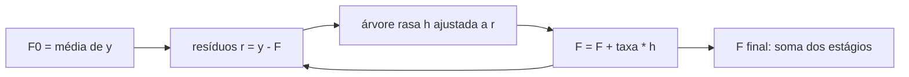

## Passo 1 · Leitura · Ajustar aos resíduos

A floresta treina muitas árvores fundas **ao mesmo tempo**, cada uma sem saber das outras, e tira a média para baixar a variância. O **boosting** faz o contrário: treina árvores **rasas**, uma depois da outra, e cada nova árvore tenta corrigir o que as anteriores ainda erram. Uma árvore rasa sozinha tem viés alto; a soma de centenas delas, cada uma consertando um pedaço do erro, chega a modelos muito precisos.

Na regressão com erro quadrático, a receita cabe em três linhas. Comece com uma previsão constante, a média do alvo, $F_0 = \bar{y}$. Em cada estágio $m$, calcule os **resíduos** $r_i = y_i - F_{m-1}(x_i)$, ajuste uma árvore rasa $h_m$ aos resíduos (não ao alvo) e some uma fração dela ao modelo:

$$
F_m(x) = F_{m-1}(x) + \nu\, h_m(x)
$$

A fração $\nu$, entre 0 e 1, é a **taxa de aprendizado** (`learning_rate`). O nome "gradiente" vem de uma conta do módulo 1: com a perda $L = \tfrac{1}{2}(y - F)^2$, a derivada em relação à previsão é $\partial L / \partial F = -(y - F)$. O resíduo é o **gradiente negativo** da perda, e cada estágio é um passo de descida do gradiente, dado no espaço das funções em vez de no espaço dos pesos. Trocando a perda, troca-se o gradiente, e a mesma receita serve para classificação (com a perda logística do módulo 3) ou para regressão robusta.



```python
F = np.full(len(y), y.mean())                     # estágio 0
for _ in range(n_estagios):
    residuos = y - F                              # o que ainda falta explicar
    arvore = DecisionTreeRegressor(max_depth=2).fit(X, residuos)
    F = F + taxa * arvore.predict(X)
```

Dois erros comuns aparecem nesse laço. Ajustar a nova árvore a `y` em vez de aos resíduos faz cada estágio somar de novo uma cópia do alvo, e as previsões crescem sem parar. E calcular os resíduos uma vez só, antes do laço, faz todas as árvores corrigirem o mesmo erro inicial: o modelo passa do ponto em vez de convergir. O `GradientBoostingRegressor` do scikit-learn faz exatamente essa conta (com `n_estimators`, `learning_rate` e `max_depth`), e o exercício do passo 5 reproduz as previsões dele.

## Passo 2 · Previsão · Os resíduos depois do primeiro estágio

O programa dá um estágio de boosting à mão em seis pontos, com um toco (árvore de profundidade 1) e taxa 0,5. Leia sem executar e digite o que ele imprime.

### Código
```python
import numpy as np
from sklearn.tree import DecisionTreeRegressor

X = np.array([[1], [2], [3], [4], [5], [6]])
y = np.array([1.0, 1.5, 2.0, 6.0, 6.5, 7.0])
f0 = np.full(len(y), y.mean())
r0 = y - f0
print(f0[0], r0.tolist())
toco = DecisionTreeRegressor(max_depth=1).fit(X, r0)
print(toco.predict(X).tolist())
f1 = f0 + 0.5 * toco.predict(X)
print(f1.tolist())
print((y - f1).tolist())
print(round(float(np.mean(r0 ** 2)), 4), round(float(np.mean((y - f1) ** 2)), 4))
```

### Dicas
1. A média de `y` é 4,0, e os resíduos são as distâncias de cada ponto até ela.
2. O toco separa os três primeiros pontos dos três últimos e prevê, em cada lado, a média dos resíduos daquele lado.
3. Com taxa 0,5, a previsão anda só metade do caminho: cada resíduo novo é o antigo menos metade da média do seu lado.

### Saída esperada
```text
4.0 [-3.0, -2.5, -2.0, 2.0, 2.5, 3.0]
[-2.5, -2.5, -2.5, 2.5, 2.5, 2.5]
[2.75, 2.75, 2.75, 5.25, 5.25, 5.25]
[-1.75, -1.25, -0.75, 0.75, 1.25, 1.75]
6.4167 1.7292
```

## Passo 3 · Exercício · Um estágio
modo: lacunas

Complete as lacunas (`___`) do primeiro estágio de um boosting de regressão.

### Instruções
1. A previsão inicial `f0` é constante e igual à média de `y`.
2. Os resíduos são `y` menos a previsão inicial, e a árvore de regressão é ajustada **aos resíduos**.
3. A previsão do estágio é `f0` mais a `taxa` vezes a previsão da árvore.
4. `primeiro_estagio(X, y, profundidade, taxa)` devolve a tupla `(previsoes, residuos)`, com os resíduos que sobram depois do estágio.

### Código inicial
```python
import numpy as np
from sklearn.tree import DecisionTreeRegressor


def primeiro_estagio(X, y, profundidade, taxa):
    y = np.asarray(y, dtype=float)
    f0 = np.full(len(y), ___)
    residuos = ___
    arvore = DecisionTreeRegressor(max_depth=profundidade, random_state=0)
    arvore.fit(X, ___)
    previsoes = f0 + ___
    return previsoes, y - previsoes
```

### Solução
```python
import numpy as np
from sklearn.tree import DecisionTreeRegressor


def primeiro_estagio(X, y, profundidade, taxa):
    y = np.asarray(y, dtype=float)
    f0 = np.full(len(y), y.mean())
    residuos = y - f0
    arvore = DecisionTreeRegressor(max_depth=profundidade, random_state=0)
    arvore.fit(X, residuos)
    previsoes = f0 + taxa * arvore.predict(X)
    return previsoes, y - previsoes
```

### Dicas
1. O estágio 0 não olha `X`: é a mesma constante para todas as linhas, a que minimiza o erro quadrático.
2. A árvore aprende o que ainda falta explicar, e não o alvo.
3. A taxa encolhe a correção da árvore antes de somá-la.

### Verificação
```json
[
  {"id": "seis-previsoes", "checkpoint": 4, "kind": "expr", "setup": "X = [[1], [2], [3], [4], [5], [6]]\ny = [1.0, 1.5, 2.0, 6.0, 6.5, 7.0]\np, r = primeiro_estagio(X, y, 1, 0.5)", "expr": "p.tolist()", "expected": [2.75, 2.75, 2.75, 5.25, 5.25, 5.25], "tolerance": 1e-09, "name": "Seis pontos, toco e taxa 0.5: as previsões do primeiro estágio", "hint": "Previsão = média de y + taxa vezes a previsão da árvore ajustada aos resíduos."},
  {"id": "seis-residuos", "checkpoint": 4, "kind": "expr", "setup": "X = [[1], [2], [3], [4], [5], [6]]\ny = [1.0, 1.5, 2.0, 6.0, 6.5, 7.0]\np, r = primeiro_estagio(X, y, 1, 0.5)", "expr": "r.tolist()", "expected": [-1.75, -1.25, -0.75, 0.75, 1.25, 1.75], "tolerance": 1e-09, "name": "Os resíduos depois do primeiro estágio"},
  {"id": "taxa-um", "checkpoint": 4, "kind": "expr", "setup": "X = [[1], [2], [3], [4], [5], [6]]\ny = [1.0, 1.5, 2.0, 6.0, 6.5, 7.0]\np, r = primeiro_estagio(X, y, 1, 1.0)", "expr": "p.tolist()", "expected": [1.5, 1.5, 1.5, 6.5, 6.5, 6.5], "tolerance": 1e-09, "name": "Com taxa 1.0, o estágio dá o passo inteiro até a média de cada lado"},
  {"id": "taxa-zero", "checkpoint": 1, "kind": "expr", "setup": "X = [[1], [2], [3], [4], [5], [6]]\ny = [1.0, 1.5, 2.0, 6.0, 6.5, 7.0]\np, r = primeiro_estagio(X, y, 1, 0.0)", "expr": "p.tolist()", "expected": [4.0, 4.0, 4.0, 4.0, 4.0, 4.0], "tolerance": 1e-09, "name": "Com taxa 0, sobra a previsão inicial: a média de y", "hint": "O estágio 0 é constante e igual à média do alvo."},
  {"id": "residuos-somam-zero", "checkpoint": 2, "kind": "expr", "setup": "import numpy as np\nrng = np.random.default_rng(0)\nX = rng.uniform(0, 10, size=(120, 4)).round(2)\ny = 3 * np.sin(X[:, 0]) + 0.5 * X[:, 1] * (X[:, 2] > 5) + rng.normal(0, 1.0, 120)\np, r = primeiro_estagio(X, y, 2, 0.3)", "expr": "round(float(r.sum()), 9)", "expected": 0.0, "tolerance": 1e-06, "name": "Partindo da média e somando médias de resíduos, os resíduos continuam somando zero", "hint": "Os resíduos do estágio 0 são y menos a média de y, e a árvore é ajustada a eles."},
  {"id": "igual-ao-sklearn", "checkpoint": 3, "kind": "expr", "setup": "import numpy as np\nrng = np.random.default_rng(0)\nX = rng.uniform(0, 10, size=(120, 4)).round(2)\ny = 3 * np.sin(X[:, 0]) + 0.5 * X[:, 1] * (X[:, 2] > 5) + rng.normal(0, 1.0, 120)\nfrom sklearn.ensemble import GradientBoostingRegressor\nref = GradientBoostingRegressor(n_estimators=1, learning_rate=0.3, max_depth=2, random_state=0).fit(X, y)\np, r = primeiro_estagio(X, y, 2, 0.3)", "expr": "bool(np.allclose(p, ref.predict(X), atol=1e-6))", "expected": true, "name": "Em 120 linhas sorteadas, as mesmas previsões de um GradientBoostingRegressor de 1 estágio", "hint": "Compara-se com GradientBoostingRegressor(n_estimators=1, learning_rate=taxa, max_depth=profundidade). A árvore é ajustada aos resíduos, não ao alvo."},
  {"id": "mse-cai", "checkpoint": 4, "kind": "expr", "setup": "import numpy as np\nrng = np.random.default_rng(0)\nX = rng.uniform(0, 10, size=(120, 4)).round(2)\ny = 3 * np.sin(X[:, 0]) + 0.5 * X[:, 1] * (X[:, 2] > 5) + rng.normal(0, 1.0, 120)\np, r = primeiro_estagio(X, y, 2, 0.3)", "expr": "bool(np.mean(r ** 2) < np.mean((y - y.mean()) ** 2))", "expected": true, "name": "O erro quadrático médio depois do estágio é menor que o da média"}
]
```

### Soluções erradas
```python name="previsão inicial zero"
import numpy as np
from sklearn.tree import DecisionTreeRegressor


def primeiro_estagio(X, y, profundidade, taxa):
    y = np.asarray(y, dtype=float)
    f0 = np.full(len(y), 0.0)
    residuos = y - f0
    arvore = DecisionTreeRegressor(max_depth=profundidade, random_state=0)
    arvore.fit(X, residuos)
    previsoes = f0 + taxa * arvore.predict(X)
    return previsoes, y - previsoes
```
```python name="previsão inicial pela mediana"
import numpy as np
from sklearn.tree import DecisionTreeRegressor


def primeiro_estagio(X, y, profundidade, taxa):
    y = np.asarray(y, dtype=float)
    f0 = np.full(len(y), np.median(y))
    residuos = y - f0
    arvore = DecisionTreeRegressor(max_depth=profundidade, random_state=0)
    arvore.fit(X, residuos)
    previsoes = f0 + taxa * arvore.predict(X)
    return previsoes, y - previsoes
```
```python name="resíduo com o sinal trocado"
import numpy as np
from sklearn.tree import DecisionTreeRegressor


def primeiro_estagio(X, y, profundidade, taxa):
    y = np.asarray(y, dtype=float)
    f0 = np.full(len(y), y.mean())
    residuos = f0 - y
    arvore = DecisionTreeRegressor(max_depth=profundidade, random_state=0)
    arvore.fit(X, residuos)
    previsoes = f0 + taxa * arvore.predict(X)
    return previsoes, y - previsoes
```
```python name="árvore ajustada ao alvo"
import numpy as np
from sklearn.tree import DecisionTreeRegressor


def primeiro_estagio(X, y, profundidade, taxa):
    y = np.asarray(y, dtype=float)
    f0 = np.full(len(y), y.mean())
    residuos = y - f0
    arvore = DecisionTreeRegressor(max_depth=profundidade, random_state=0)
    arvore.fit(X, y)
    previsoes = f0 + taxa * arvore.predict(X)
    return previsoes, y - previsoes
```
```python name="soma a árvore sem a taxa"
import numpy as np
from sklearn.tree import DecisionTreeRegressor


def primeiro_estagio(X, y, profundidade, taxa):
    y = np.asarray(y, dtype=float)
    f0 = np.full(len(y), y.mean())
    residuos = y - f0
    arvore = DecisionTreeRegressor(max_depth=profundidade, random_state=0)
    arvore.fit(X, residuos)
    previsoes = f0 + arvore.predict(X)
    return previsoes, y - previsoes
```

## Passo 4 · Leitura · Taxa e número de estágios

Depois de $M$ estágios, o modelo é a média do alvo mais uma soma de árvores encolhidas:

$$
F_M(x) = \bar{y} + \nu \sum_{m=1}^{M} h_m(x)
$$

A taxa $\nu$ e o número de estágios $M$ trocam entre si: com $\nu$ menor, cada árvore corrige menos, e são precisos mais estágios para chegar ao mesmo erro de treino. Em troca, os passos curtos deixam as árvores seguintes dividirem o trabalho, e o modelo generaliza melhor. Num conjunto de consumo de energia fictício (600 linhas de treino e 200 de validação, árvores de profundidade 3):

| taxa | melhor estágio na validação | erro de validação no melhor estágio | erro de validação com 500 estágios | erro de treino com 500 estágios |
|---|---|---|---|---|
| 1,0 | 5 | 2,008 | 3,053 | 0,000 |
| 0,3 | 37 | 1,261 | 1,505 | 0,003 |
| 0,1 | 69 | 1,267 | 1,401 | 0,103 |

Os erros são quadráticos médios. Com taxa 1,0, o modelo zera o erro de treino e passa do ponto em poucos estágios: depois de 500, a validação está 50 % pior que no estágio 5. Com taxas menores, o mínimo fica mais baixo e mais largo, e sobrar estágios custa pouco. Diferente da floresta, **mais estágios podem piorar** o boosting: cada árvore nova ajusta mais um pedaço do ruído do treino.

Por isso o número de estágios se escolhe pela **curva de validação**: o erro numa validação depois de cada estágio. O `staged_predict` do `GradientBoostingRegressor` devolve as previsões estágio a estágio, e a **parada antecipada** (*early stopping*) interrompe o treino quando a validação passa alguns estágios seguidos sem melhorar. Dois cuidados. A curva oscila: numa delas, com taxa 0,5, o erro subiu do estágio 4 para o 5 (de 1,769 para 1,777) e o mínimo veio só no estágio 7; parar no primeiro aumento é cedo demais, e a regra usual é esperar alguns estágios (`n_iter_no_change`). E a validação sai do **treino**: escolher o estágio pela curva do teste transforma o teste numa validação, e a nota final fica otimista.

```python
modelo = GradientBoostingRegressor(n_estimators=500, learning_rate=0.1, max_depth=3, random_state=0)
modelo.fit(X_treino, y_treino)
erros = [np.mean((y_valid - p) ** 2) for p in modelo.staged_predict(X_valid)]
```

As bibliotecas XGBoost, LightGBM e CatBoost implementam a mesma ideia com regularização nas folhas, amostragem de linhas e colunas e muito cuidado com velocidade; elas não estão instaladas no executor, e o scikit-learn tem a sua versão rápida, do passo 6.

## Passo 5 · Exercício · Boosting do zero

Escreva o gradient boosting de regressão com erro quadrático e a escolha do número de estágios por uma curva de validação.

### Instruções
1. `boosting_regressao(X, y, n_estagios, taxa, profundidade)` começa com a média de `y` e, em cada estágio, ajusta uma `DecisionTreeRegressor(max_depth=profundidade, random_state=0)` aos resíduos do momento e soma `taxa` vezes a previsão dela.
2. Devolve a tupla `(previsoes, historico)`: as previsões finais no treino (array) e uma lista com o erro quadrático médio do treino **depois** de cada estágio (`float`, uma entrada por estágio).
3. `estagios_otimos(historico_validacao)` recebe a lista de erros de validação, um por estágio, e devolve o número do estágio de menor erro, contando a partir de 1; um empate fica com o estágio mais cedo.

### Código inicial
```python
import numpy as np
from sklearn.tree import DecisionTreeRegressor


def boosting_regressao(X, y, n_estagios, taxa, profundidade):
    pass


def estagios_otimos(historico_validacao):
    pass
```

### Solução
```python
import numpy as np
from sklearn.tree import DecisionTreeRegressor


def boosting_regressao(X, y, n_estagios, taxa, profundidade):
    y = np.asarray(y, dtype=float)
    previsoes = np.full(len(y), y.mean())
    historico = []
    for _ in range(n_estagios):
        residuos = y - previsoes
        arvore = DecisionTreeRegressor(max_depth=profundidade, random_state=0)
        arvore.fit(X, residuos)
        previsoes = previsoes + taxa * arvore.predict(X)
        historico.append(float(np.mean((y - previsoes) ** 2)))
    return previsoes, historico


def estagios_otimos(historico_validacao):
    return int(np.argmin(historico_validacao)) + 1
```

### Dicas
1. Os resíduos mudam a cada estágio: calcule-os dentro do laço, a partir das previsões atuais.
2. Anote o erro no histórico depois de somar a árvore às previsões.
3. O `np.argmin` devolve a primeira posição do menor valor, contando de 0.

### Verificação
```json
[
  {"id": "igual-ao-sklearn", "checkpoint": 1, "kind": "expr", "setup": "import numpy as np\nrng = np.random.default_rng(0)\nX = rng.uniform(0, 10, size=(120, 4)).round(2)\ny = 3 * np.sin(X[:, 0]) + 0.5 * X[:, 1] * (X[:, 2] > 5) + rng.normal(0, 1.0, 120)\nfrom sklearn.ensemble import GradientBoostingRegressor\nref = GradientBoostingRegressor(n_estimators=30, learning_rate=0.1, max_depth=2, random_state=0).fit(X, y)\np, h = boosting_regressao(X, y, 30, 0.1, 2)", "expr": "bool(np.allclose(p, ref.predict(X), atol=1e-6))", "expected": true, "name": "30 estágios, taxa 0.1, profundidade 2: as previsões do GradientBoostingRegressor", "hint": "Compara-se com GradientBoostingRegressor(n_estimators, learning_rate, max_depth) a 1e-6. Recalcule os resíduos a cada estágio."},
  {"id": "outra-config", "checkpoint": 1, "kind": "expr", "setup": "import numpy as np\nrng = np.random.default_rng(0)\nX = rng.uniform(0, 10, size=(120, 4)).round(2)\ny = 3 * np.sin(X[:, 0]) + 0.5 * X[:, 1] * (X[:, 2] > 5) + rng.normal(0, 1.0, 120)\nfrom sklearn.ensemble import GradientBoostingRegressor\nref = GradientBoostingRegressor(n_estimators=8, learning_rate=0.5, max_depth=3, random_state=0).fit(X, y)\np, h = boosting_regressao(X, y, 8, 0.5, 3)", "expr": "bool(np.allclose(p, ref.predict(X), atol=1e-6))", "expected": true, "name": "8 estágios, taxa 0.5, profundidade 3: as previsões do GradientBoostingRegressor"},
  {"id": "historico-igual", "checkpoint": 2, "kind": "expr", "setup": "import numpy as np\nrng = np.random.default_rng(0)\nX = rng.uniform(0, 10, size=(120, 4)).round(2)\ny = 3 * np.sin(X[:, 0]) + 0.5 * X[:, 1] * (X[:, 2] > 5) + rng.normal(0, 1.0, 120)\nfrom sklearn.ensemble import GradientBoostingRegressor\nref = GradientBoostingRegressor(n_estimators=30, learning_rate=0.1, max_depth=2, random_state=0).fit(X, y)\nesperado = [float(np.mean((y - q) ** 2)) for q in ref.staged_predict(X)]\np, h = boosting_regressao(X, y, 30, 0.1, 2)", "expr": "bool(len(h) == 30 and np.allclose(h, esperado, atol=1e-6))", "expected": true, "name": "O histórico tem o erro quadrático médio do treino depois de cada um dos 30 estágios", "hint": "Compara-se com o MSE das previsões de cada estágio do staged_predict. Anote o erro depois de atualizar as previsões."},
  {"id": "seis-pontos", "checkpoint": 2, "kind": "expr", "setup": "p, h = boosting_regressao([[1], [2], [3], [4], [5], [6]], [1.0, 1.5, 2.0, 6.0, 6.5, 7.0], 2, 0.5, 1)", "expr": "[round(v, 6) for v in h]", "expected": [1.729167, 0.557292], "tolerance": 1e-09, "name": "Seis pontos, 2 estágios de toco com taxa 0.5: o MSE cai de 1.729167 para 0.557292"},
  {"id": "historico-decresce", "checkpoint": 2, "kind": "expr", "setup": "import numpy as np\nrng = np.random.default_rng(0)\nX = rng.uniform(0, 10, size=(120, 4)).round(2)\ny = 3 * np.sin(X[:, 0]) + 0.5 * X[:, 1] * (X[:, 2] > 5) + rng.normal(0, 1.0, 120)\np, h = boosting_regressao(X, y, 40, 0.2, 2)", "expr": "bool(all(b <= a + 1e-12 for a, b in zip(h, h[1:])))", "expected": true, "name": "No treino, o erro nunca sobe de um estágio para o outro"},
  {"id": "otimo-simples", "checkpoint": 3, "kind": "call", "function": "estagios_otimos", "args": [[5.0, 4.0, 3.0, 3.5, 2.5, 2.6, 2.7]], "expected": 5, "name": "O mínimo da validação está no estágio 5, depois de uma subida no 4", "hint": "Procure o menor erro de toda a curva, não o primeiro aumento; os estágios contam a partir de 1."},
  {"id": "otimo-empate", "checkpoint": 3, "kind": "call", "function": "estagios_otimos", "args": [[3.0, 2.0, 2.0, 2.5]], "expected": 2, "name": "Empate no mínimo: fica o estágio mais cedo"},
  {"id": "otimo-um", "checkpoint": 3, "kind": "call", "function": "estagios_otimos", "args": [[1.0]], "expected": 1, "name": "Com um estágio só, a resposta é 1"},
  {"id": "otimo-gbr", "checkpoint": 3, "kind": "expr", "setup": "import numpy as np\nrng = np.random.default_rng(0)\nX = rng.uniform(0, 10, size=(120, 4)).round(2)\ny = 3 * np.sin(X[:, 0]) + 0.5 * X[:, 1] * (X[:, 2] > 5) + rng.normal(0, 1.0, 120)\nfrom sklearn.ensemble import GradientBoostingRegressor\nrv = np.random.default_rng(9)\nXv = rv.uniform(0, 10, size=(80, 4)).round(2)\nyv = 3 * np.sin(Xv[:, 0]) + 0.5 * Xv[:, 1] * (Xv[:, 2] > 5) + rv.normal(0, 1.0, 80)\nref = GradientBoostingRegressor(n_estimators=150, learning_rate=0.5, max_depth=3, random_state=0).fit(X, y)\nval = [float(np.mean((yv - q) ** 2)) for q in ref.staged_predict(Xv)]", "expr": "estagios_otimos(val)", "expected": 7, "name": "Na curva de validação de 150 estágios com taxa 0.5, o melhor estágio"}
]
```

### Soluções erradas
```python name="árvore ajustada ao alvo"
import numpy as np
from sklearn.tree import DecisionTreeRegressor


def boosting_regressao(X, y, n_estagios, taxa, profundidade):
    y = np.asarray(y, dtype=float)
    previsoes = np.full(len(y), y.mean())
    historico = []
    for _ in range(n_estagios):
        residuos = y - previsoes
        arvore = DecisionTreeRegressor(max_depth=profundidade, random_state=0)
        arvore.fit(X, y)
        previsoes = previsoes + taxa * arvore.predict(X)
        historico.append(float(np.mean((y - previsoes) ** 2)))
    return previsoes, historico


def estagios_otimos(historico_validacao):
    return int(np.argmin(historico_validacao)) + 1
```
```python name="resíduos calculados uma vez só"
import numpy as np
from sklearn.tree import DecisionTreeRegressor


def boosting_regressao(X, y, n_estagios, taxa, profundidade):
    y = np.asarray(y, dtype=float)
    previsoes = np.full(len(y), y.mean())
    historico = []
    residuos = y - previsoes
    for _ in range(n_estagios):
        arvore = DecisionTreeRegressor(max_depth=profundidade, random_state=0)
        arvore.fit(X, residuos)
        previsoes = previsoes + taxa * arvore.predict(X)
        historico.append(float(np.mean((y - previsoes) ** 2)))
    return previsoes, historico


def estagios_otimos(historico_validacao):
    return int(np.argmin(historico_validacao)) + 1
```
```python name="previsão inicial zero"
import numpy as np
from sklearn.tree import DecisionTreeRegressor


def boosting_regressao(X, y, n_estagios, taxa, profundidade):
    y = np.asarray(y, dtype=float)
    previsoes = np.zeros(len(y))
    historico = []
    for _ in range(n_estagios):
        residuos = y - previsoes
        arvore = DecisionTreeRegressor(max_depth=profundidade, random_state=0)
        arvore.fit(X, residuos)
        previsoes = previsoes + taxa * arvore.predict(X)
        historico.append(float(np.mean((y - previsoes) ** 2)))
    return previsoes, historico


def estagios_otimos(historico_validacao):
    return int(np.argmin(historico_validacao)) + 1
```
```python name="ignora a taxa"
import numpy as np
from sklearn.tree import DecisionTreeRegressor


def boosting_regressao(X, y, n_estagios, taxa, profundidade):
    y = np.asarray(y, dtype=float)
    previsoes = np.full(len(y), y.mean())
    historico = []
    for _ in range(n_estagios):
        residuos = y - previsoes
        arvore = DecisionTreeRegressor(max_depth=profundidade, random_state=0)
        arvore.fit(X, residuos)
        previsoes = previsoes + arvore.predict(X)
        historico.append(float(np.mean((y - previsoes) ** 2)))
    return previsoes, historico


def estagios_otimos(historico_validacao):
    return int(np.argmin(historico_validacao)) + 1
```
```python name="histórico anotado antes de atualizar"
import numpy as np
from sklearn.tree import DecisionTreeRegressor


def boosting_regressao(X, y, n_estagios, taxa, profundidade):
    y = np.asarray(y, dtype=float)
    previsoes = np.full(len(y), y.mean())
    historico = []
    for _ in range(n_estagios):
        residuos = y - previsoes
        historico.append(float(np.mean(residuos ** 2)))
        arvore = DecisionTreeRegressor(max_depth=profundidade, random_state=0)
        arvore.fit(X, residuos)
        previsoes = previsoes + taxa * arvore.predict(X)
    return previsoes, historico


def estagios_otimos(historico_validacao):
    return int(np.argmin(historico_validacao)) + 1
```
```python name="estágio contado a partir de zero"
import numpy as np
from sklearn.tree import DecisionTreeRegressor


def boosting_regressao(X, y, n_estagios, taxa, profundidade):
    y = np.asarray(y, dtype=float)
    previsoes = np.full(len(y), y.mean())
    historico = []
    for _ in range(n_estagios):
        residuos = y - previsoes
        arvore = DecisionTreeRegressor(max_depth=profundidade, random_state=0)
        arvore.fit(X, residuos)
        previsoes = previsoes + taxa * arvore.predict(X)
        historico.append(float(np.mean((y - previsoes) ** 2)))
    return previsoes, historico


def estagios_otimos(historico_validacao):
    return int(np.argmin(historico_validacao))
```
```python name="para no primeiro aumento da validação"
import numpy as np
from sklearn.tree import DecisionTreeRegressor


def boosting_regressao(X, y, n_estagios, taxa, profundidade):
    y = np.asarray(y, dtype=float)
    previsoes = np.full(len(y), y.mean())
    historico = []
    for _ in range(n_estagios):
        residuos = y - previsoes
        arvore = DecisionTreeRegressor(max_depth=profundidade, random_state=0)
        arvore.fit(X, residuos)
        previsoes = previsoes + taxa * arvore.predict(X)
        historico.append(float(np.mean((y - previsoes) ** 2)))
    return previsoes, historico


def estagios_otimos(historico_validacao):
    for m in range(1, len(historico_validacao)):
        if historico_validacao[m] > historico_validacao[m - 1]:
            return m
    return len(historico_validacao)
```

## Passo 6 · Leitura · HistGradientBoosting

O `GradientBoostingRegressor` procura cada divisão entre todos os valores distintos de cada atributo, como a árvore da primeira lição, e fica lento com dezenas de milhares de linhas. O `HistGradientBoostingRegressor` (e o `HistGradientBoostingClassifier`) primeiro **agrupa** cada atributo em no máximo 255 faixas por quantis (`max_bins=255`) e depois só testa cortes entre faixas: o custo de procurar uma divisão deixa de depender do número de linhas. Ele também aceita **valores ausentes** sem imputação: no treino, cada nó aprende para que lado mandar o `NaN`. O `GradientBoostingRegressor` recusa o mesmo `X` com `ValueError: Input X contains NaN.`, seguido da sugestão de usar o `HistGradientBoosting` ou um imputador.

A parada antecipada é o detalhe que mais engana. O padrão é `early_stopping="auto"`, que **só liga com mais de 10 000 linhas**. Ligada, ela separa uma fatia do treino como validação (`validation_fraction=0.1`, sorteada com o `random_state`) e para quando a pontuação nessa fatia passa `n_iter_no_change=10` iterações sem melhorar. No conjunto de consumo do passo 4, com 600 linhas de treino:

```python
modelo = HistGradientBoostingRegressor(max_iter=300, early_stopping=True, random_state=0)
modelo.fit(X_treino, y_treino)
modelo.n_iter_              # 56
modelo.score(X_teste, y_teste)   # 0.803
```

Sem `early_stopping=True`, o modelo roda as 300 iterações (`n_iter_` = 300) e acerta 0,800 do teste. Sem `random_state`, a fatia de validação muda a cada ajuste, e três ajustes seguidos pararam em 38, 67 e 36 iterações. No scikit-learn 1.8, o `fit` também aceita uma validação externa, `fit(X, y, X_val=..., y_val=...)`; ela precisa sair do treino, nunca do teste. A curva da validação usada fica em `modelo.validation_score_`, uma pontuação antes da primeira iteração e uma depois de cada iteração (a perda com o sinal trocado: maior é melhor).

Floresta ou boosting? Nos padrões, a floresta é difícil de estragar: mais árvores nunca atrapalham, e quase não há o que ajustar. O boosting costuma ir mais longe, mas depende de taxa, profundidade e número de estágios escolhidos pela validação. Comparar os dois exige as **mesmas partições** da validação cruzada e hiperparâmetros razoáveis para os dois; numa amostra de 300 linhas de consumo, com 3 partições embaralhadas, o $R^2$ médio foi 0,774 para uma floresta de 30 árvores e 0,802 para o `HistGradientBoostingRegressor` padrão.

## Passo 7 · Exercício · Parada antecipada

Use o `HistGradientBoostingRegressor` com parada antecipada honesta e compare floresta e boosting nas mesmas partições. O arquivo `consumo.py` gera os dados fictícios de consumo de energia; os casos o usam.

### Instruções
1. `hgb_com_parada(X_treino, y_treino, X_teste, y_teste, semente)` treina um `HistGradientBoostingRegressor(max_iter=300, early_stopping=True, random_state=semente)` **só com o treino**; a validação da parada é a fatia interna do próprio treino.
2. Devolve o dicionário `{"n_iter": ..., "r2_teste": ...}`: o número de iterações feitas (`int`) e o $R^2$ no teste (`float`).
3. `comparar_floresta_boosting(X, y, semente)` calcula o $R^2$ médio de `cross_val_score` de um `RandomForestRegressor(n_estimators=30, random_state=semente)` e de um `HistGradientBoostingRegressor(random_state=semente)`, os dois com as mesmas partições `KFold(n_splits=3, shuffle=True, random_state=semente)`.
4. Devolve o dicionário `{"floresta": ..., "boosting": ...}` com as duas médias como `float`.

### Código inicial
```python
from sklearn.ensemble import HistGradientBoostingRegressor, RandomForestRegressor
from sklearn.model_selection import KFold, cross_val_score


def hgb_com_parada(X_treino, y_treino, X_teste, y_teste, semente):
    pass


def comparar_floresta_boosting(X, y, semente):
    pass
```
```text path=consumo.py
import numpy as np


def gerar_consumo(n, semente):
    rng = np.random.default_rng(semente)
    X = rng.uniform(0, 10, size=(n, 4)).round(2)
    y = 3 * np.sin(X[:, 0]) + 0.5 * X[:, 1] * (X[:, 2] > 5) + rng.normal(0, 1.0, n)
    return X, y
```

### Solução
```python
from sklearn.ensemble import HistGradientBoostingRegressor, RandomForestRegressor
from sklearn.model_selection import KFold, cross_val_score


def hgb_com_parada(X_treino, y_treino, X_teste, y_teste, semente):
    modelo = HistGradientBoostingRegressor(max_iter=300, early_stopping=True, random_state=semente)
    modelo.fit(X_treino, y_treino)
    return {"n_iter": int(modelo.n_iter_), "r2_teste": float(modelo.score(X_teste, y_teste))}


def comparar_floresta_boosting(X, y, semente):
    divisao = KFold(n_splits=3, shuffle=True, random_state=semente)
    floresta = RandomForestRegressor(n_estimators=30, random_state=semente)
    boosting = HistGradientBoostingRegressor(random_state=semente)
    return {
        "floresta": float(cross_val_score(floresta, X, y, cv=divisao).mean()),
        "boosting": float(cross_val_score(boosting, X, y, cv=divisao).mean()),
    }
```
```text path=consumo.py
import numpy as np


def gerar_consumo(n, semente):
    rng = np.random.default_rng(semente)
    X = rng.uniform(0, 10, size=(n, 4)).round(2)
    y = 3 * np.sin(X[:, 0]) + 0.5 * X[:, 1] * (X[:, 2] > 5) + rng.normal(0, 1.0, n)
    return X, y
```

### Dicas
1. Com menos de 10 000 linhas, a parada antecipada só acontece se você pedir `early_stopping=True`; o número de iterações feitas fica em `n_iter_`.
2. O teste entra só no `score`, depois do `fit`.
3. Crie o `KFold` uma vez e passe o mesmo objeto como `cv` nas duas chamadas de `cross_val_score`; o resultado é um array, e a média sai com `.mean()`.

### Verificação
```json
[
  {"id": "n-iter", "checkpoint": 1, "kind": "expr", "setup": "from sklearn.model_selection import train_test_split\nfrom consumo import gerar_consumo\nX, y = gerar_consumo(800, 0)\nXtr, Xte, ytr, yte = train_test_split(X, y, test_size=0.25, random_state=0)\nr = hgb_com_parada(Xtr, ytr, Xte, yte, 0)", "expr": "r['n_iter']", "expected": 56, "name": "Com parada antecipada, o modelo para antes do máximo", "hint": "Com 600 linhas, o early_stopping='auto' fica desligado: ligue-o com early_stopping=True e fixe o random_state."},
  {"id": "abaixo-do-maximo", "checkpoint": 1, "kind": "expr", "setup": "from sklearn.model_selection import train_test_split\nfrom consumo import gerar_consumo\nX, y = gerar_consumo(800, 0)\nXtr, Xte, ytr, yte = train_test_split(X, y, test_size=0.25, random_state=0)\nr = hgb_com_parada(Xtr, ytr, Xte, yte, 0)", "expr": "bool(r['n_iter'] < 300)", "expected": true, "name": "n_iter fica abaixo de max_iter=300"},
  {"id": "r2-teste", "checkpoint": 2, "kind": "expr", "setup": "from sklearn.model_selection import train_test_split\nfrom consumo import gerar_consumo\nX, y = gerar_consumo(800, 0)\nXtr, Xte, ytr, yte = train_test_split(X, y, test_size=0.25, random_state=0)\nr = hgb_com_parada(Xtr, ytr, Xte, yte, 0)", "expr": "r['r2_teste']", "expected": 0.8030708276938355, "tolerance": 1e-09, "name": "O R² é medido no teste, que o modelo não viu", "hint": "O fit usa só o treino; o score usa o teste."},
  {"id": "teste-nao-decide", "checkpoint": 2, "kind": "expr", "setup": "from sklearn.model_selection import train_test_split\nfrom consumo import gerar_consumo\nX, y = gerar_consumo(800, 0)\nXtr, Xte, ytr, yte = train_test_split(X, y, test_size=0.25, random_state=0)\n", "expr": "hgb_com_parada(Xtr, ytr, Xte, yte, 0)['n_iter'] == hgb_com_parada(Xtr, ytr, Xte, yte[::-1].copy(), 0)['n_iter']", "expected": true, "name": "Embaralhar as respostas do teste não muda onde o modelo para", "hint": "A validação da parada antecipada sai do treino (validation_fraction), nunca do teste."},
  {"id": "reprodutivel", "checkpoint": 1, "kind": "expr", "setup": "from sklearn.model_selection import train_test_split\nfrom consumo import gerar_consumo\nX, y = gerar_consumo(800, 0)\nXtr, Xte, ytr, yte = train_test_split(X, y, test_size=0.25, random_state=0)\n", "expr": "hgb_com_parada(Xtr, ytr, Xte, yte, 3) == hgb_com_parada(Xtr, ytr, Xte, yte, 3)", "expected": true, "name": "A mesma semente dá o mesmo resultado", "hint": "A fatia de validação é sorteada: passe a semente no random_state."},
  {"id": "tipos", "checkpoint": 2, "kind": "expr", "setup": "from sklearn.model_selection import train_test_split\nfrom consumo import gerar_consumo\nX, y = gerar_consumo(800, 0)\nXtr, Xte, ytr, yte = train_test_split(X, y, test_size=0.25, random_state=0)\nr = hgb_com_parada(Xtr, ytr, Xte, yte, 0)", "expr": "[type(r['n_iter']).__name__, type(r['r2_teste']).__name__]", "expected": ["int", "float"], "name": "n_iter é int e r2_teste é float"},
  {"id": "comparar", "checkpoint": 3, "kind": "expr", "setup": "from consumo import gerar_consumo\nX, y = gerar_consumo(300, 1)\nr = comparar_floresta_boosting(X, y, 0)", "expr": "[round(r['floresta'], 6), round(r['boosting'], 6)]", "expected": [0.773798, 0.801924], "tolerance": 1e-09, "name": "R² médio das duas famílias nas mesmas 3 partições embaralhadas", "hint": "Os dois modelos usam o mesmo KFold(n_splits=3, shuffle=True, random_state=semente)."},
  {"id": "comparar-tipos", "checkpoint": 3, "kind": "expr", "setup": "from consumo import gerar_consumo\nX, y = gerar_consumo(150, 2)\nr = comparar_floresta_boosting(X, y, 1)", "expr": "[sorted(r), type(r['floresta']).__name__, type(r['boosting']).__name__]", "expected": [["boosting", "floresta"], "float", "float"], "name": "Devolve um dicionário com as médias, como float"}
]
```

### Soluções erradas
```python name="parada antecipada deixada no automático"
from sklearn.ensemble import HistGradientBoostingRegressor, RandomForestRegressor
from sklearn.model_selection import KFold, cross_val_score


def hgb_com_parada(X_treino, y_treino, X_teste, y_teste, semente):
    modelo = HistGradientBoostingRegressor(max_iter=300, random_state=semente)
    modelo.fit(X_treino, y_treino)
    return {"n_iter": int(modelo.n_iter_), "r2_teste": float(modelo.score(X_teste, y_teste))}


def comparar_floresta_boosting(X, y, semente):
    divisao = KFold(n_splits=3, shuffle=True, random_state=semente)
    floresta = RandomForestRegressor(n_estimators=30, random_state=semente)
    boosting = HistGradientBoostingRegressor(random_state=semente)
    return {
        "floresta": float(cross_val_score(floresta, X, y, cv=divisao).mean()),
        "boosting": float(cross_val_score(boosting, X, y, cv=divisao).mean()),
    }
```
```python name="parada antecipada com o teste"
from sklearn.ensemble import HistGradientBoostingRegressor, RandomForestRegressor
from sklearn.model_selection import KFold, cross_val_score


def hgb_com_parada(X_treino, y_treino, X_teste, y_teste, semente):
    modelo = HistGradientBoostingRegressor(max_iter=300, early_stopping=True, random_state=semente)
    modelo.fit(X_treino, y_treino, X_val=X_teste, y_val=y_teste)
    return {"n_iter": int(modelo.n_iter_), "r2_teste": float(modelo.score(X_teste, y_teste))}


def comparar_floresta_boosting(X, y, semente):
    divisao = KFold(n_splits=3, shuffle=True, random_state=semente)
    floresta = RandomForestRegressor(n_estimators=30, random_state=semente)
    boosting = HistGradientBoostingRegressor(random_state=semente)
    return {
        "floresta": float(cross_val_score(floresta, X, y, cv=divisao).mean()),
        "boosting": float(cross_val_score(boosting, X, y, cv=divisao).mean()),
    }
```
```python name="validação sem semente"
from sklearn.ensemble import HistGradientBoostingRegressor, RandomForestRegressor
from sklearn.model_selection import KFold, cross_val_score


def hgb_com_parada(X_treino, y_treino, X_teste, y_teste, semente):
    modelo = HistGradientBoostingRegressor(max_iter=300, early_stopping=True)
    modelo.fit(X_treino, y_treino)
    return {"n_iter": int(modelo.n_iter_), "r2_teste": float(modelo.score(X_teste, y_teste))}


def comparar_floresta_boosting(X, y, semente):
    divisao = KFold(n_splits=3, shuffle=True, random_state=semente)
    floresta = RandomForestRegressor(n_estimators=30, random_state=semente)
    boosting = HistGradientBoostingRegressor(random_state=semente)
    return {
        "floresta": float(cross_val_score(floresta, X, y, cv=divisao).mean()),
        "boosting": float(cross_val_score(boosting, X, y, cv=divisao).mean()),
    }
```
```python name="R² medido no treino"
from sklearn.ensemble import HistGradientBoostingRegressor, RandomForestRegressor
from sklearn.model_selection import KFold, cross_val_score


def hgb_com_parada(X_treino, y_treino, X_teste, y_teste, semente):
    modelo = HistGradientBoostingRegressor(max_iter=300, early_stopping=True, random_state=semente)
    modelo.fit(X_treino, y_treino)
    return {"n_iter": int(modelo.n_iter_), "r2_teste": float(modelo.score(X_treino, y_treino))}


def comparar_floresta_boosting(X, y, semente):
    divisao = KFold(n_splits=3, shuffle=True, random_state=semente)
    floresta = RandomForestRegressor(n_estimators=30, random_state=semente)
    boosting = HistGradientBoostingRegressor(random_state=semente)
    return {
        "floresta": float(cross_val_score(floresta, X, y, cv=divisao).mean()),
        "boosting": float(cross_val_score(boosting, X, y, cv=divisao).mean()),
    }
```
```python name="partições sem embaralhar"
from sklearn.ensemble import HistGradientBoostingRegressor, RandomForestRegressor
from sklearn.model_selection import KFold, cross_val_score


def hgb_com_parada(X_treino, y_treino, X_teste, y_teste, semente):
    modelo = HistGradientBoostingRegressor(max_iter=300, early_stopping=True, random_state=semente)
    modelo.fit(X_treino, y_treino)
    return {"n_iter": int(modelo.n_iter_), "r2_teste": float(modelo.score(X_teste, y_teste))}


def comparar_floresta_boosting(X, y, semente):
    divisao = KFold(n_splits=3)
    floresta = RandomForestRegressor(n_estimators=30, random_state=semente)
    boosting = HistGradientBoostingRegressor(random_state=semente)
    return {
        "floresta": float(cross_val_score(floresta, X, y, cv=divisao).mean()),
        "boosting": float(cross_val_score(boosting, X, y, cv=divisao).mean()),
    }
```
```python name="devolve a nota da primeira partição"
from sklearn.ensemble import HistGradientBoostingRegressor, RandomForestRegressor
from sklearn.model_selection import KFold, cross_val_score


def hgb_com_parada(X_treino, y_treino, X_teste, y_teste, semente):
    modelo = HistGradientBoostingRegressor(max_iter=300, early_stopping=True, random_state=semente)
    modelo.fit(X_treino, y_treino)
    return {"n_iter": int(modelo.n_iter_), "r2_teste": float(modelo.score(X_teste, y_teste))}


def comparar_floresta_boosting(X, y, semente):
    divisao = KFold(n_splits=3, shuffle=True, random_state=semente)
    floresta = RandomForestRegressor(n_estimators=30, random_state=semente)
    boosting = HistGradientBoostingRegressor(random_state=semente)
    return {
        "floresta": float(cross_val_score(floresta, X, y, cv=divisao)[0]),
        "boosting": float(cross_val_score(boosting, X, y, cv=divisao)[0]),
    }
```

## Passo 8 · Quiz · Taxa contra estágios

### Pergunta
Um colega treina `GradientBoostingRegressor(learning_rate=1.0, n_estimators=2000)`. O erro de treino chega a zero, e o erro de validação fica pior que o de um modelo com 50 estágios. O que fazer?
- [ ] Aumentar para 5 000 estágios: o boosting melhora sempre com mais árvores, como a floresta
- [x] Baixar a taxa (por exemplo, para 0,1) e escolher o número de estágios pela curva de validação, com parada antecipada
- [ ] Aumentar `max_depth`, para que cada estágio corrija mais de uma vez
- [ ] Manter a taxa 1,0, que converge mais rápido, e só trocar a validação por outra amostra
> Cada estágio do boosting ajusta mais um pedaço dos resíduos, inclusive o ruído: depois do mínimo, mais estágios pioram a validação, ao contrário da floresta. Com taxa 1,0 o modelo passa do ponto em poucos estágios; uma taxa menor encolhe cada correção, e a parada antecipada escolhe onde parar. Árvores mais fundas aceleram o sobreajuste, e trocar a amostra de validação não muda o problema.

### Pergunta
Para escolher onde parar, uma analista passa o conjunto de teste como validação: `modelo.fit(X_treino, y_treino, X_val=X_teste, y_val=y_teste)`. Em seguida, relata `modelo.score(X_teste, y_teste)`. O que está errado?
- [ ] Nada: a validação só escolhe o número de iterações, e o modelo continua treinado só com o treino
- [x] O teste ajudou a escolher o número de iterações, então o $R^2$ no teste fica otimista; a validação da parada precisa sair do treino (por exemplo, com `validation_fraction`)
- [ ] O `fit` levanta erro: o `HistGradientBoostingRegressor` não aceita `X_val`
- [ ] O problema é só o `score`: bastaria relatar o erro quadrático médio no lugar do $R^2$
> Escolher qualquer coisa olhando o teste, mesmo só o número de iterações, faz o modelo final depender do teste, e a nota medida nele deixa de ser uma estimativa honesta. No scikit-learn 1.8, o `fit` aceita `X_val` e `y_val` sem erro; a métrica relatada não muda o vazamento.

### Pergunta
Num boosting do zero, o laço ficou assim, com `F` começando na média de `y` e `taxa = 0.1`:

```python
for _ in range(200):
    arvore = DecisionTreeRegressor(max_depth=2).fit(X, y)
    F = F + taxa * arvore.predict(X)
```

O que acontece com as previsões ao longo dos 200 estágios?
- [ ] Nada de diferente: ajustar a `y` ou aos resíduos dá a mesma árvore
- [ ] Convergem para `y`, só que mais devagar
- [x] Todas as árvores são a mesma, uma aproximação de `y`, e cada estágio soma mais 10 % dela: depois de 200 estágios, a média inicial recebeu 20 cópias dessa aproximação, e o erro de treino explode
- [ ] O código levanta erro, porque a árvore precisa receber os resíduos
> A árvore precisa ser ajustada aos resíduos `y - F`, que encolhem conforme o modelo melhora. Ajustada a `y`, ela prevê sempre a mesma aproximação do alvo, e 200 estágios somam $200 \times 0{,}1 = 20$ cópias dela à média inicial. Nenhum erro é levantado: o código roda e devolve números absurdos.
