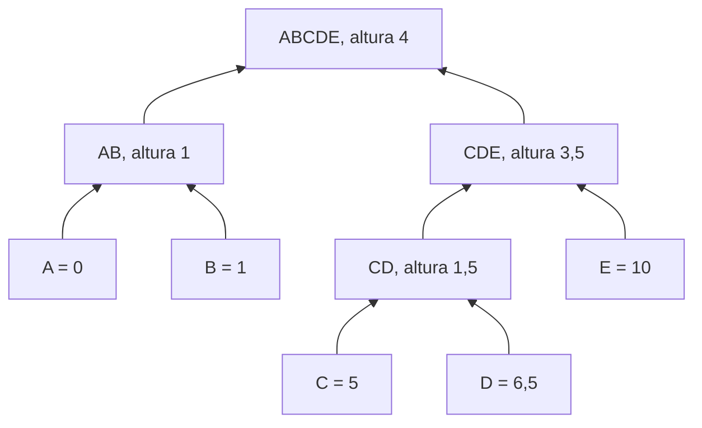

## Passo 1 · Leitura · Juntar os mais próximos

O k-means pede $k$ antes de começar e devolve uma partição só. O **clustering aglomerativo** constrói todas as partições de uma vez: começa com cada ponto num grupo próprio e, a cada passo, junta os dois grupos mais próximos, até sobrar um grupo só. A sequência de fusões forma uma árvore, o **dendrograma**, e cortar a árvore numa altura dá uma partição. Com cinco medições fictícias de um sensor, $A = 0$, $B = 1$, $C = 5$, $D = 6{,}5$ e $E = 10$:



O que muda entre os métodos é a **ligação**, a regra que mede a distância entre dois grupos $G$ e $H$:

$$
d_{\text{simples}} = \min_{a \in G,\, b \in H} \lVert a - b \rVert
\qquad
d_{\text{completa}} = \max_{a \in G,\, b \in H} \lVert a - b \rVert
\qquad
d_{\text{média}} = \frac{1}{|G|\,|H|} \sum_{a \in G} \sum_{b \in H} \lVert a - b \rVert
$$

A ligação **simples** (`single`) olha o par mais próximo, segue formas alongadas e sofre de **encadeamento**: uma fileira de pontos intermediários faz dois grupos distintos virarem um. A **completa** (`complete`) olha o par mais distante e prefere grupos compactos; a **média** (`average`) fica entre as duas. A de **Ward** junta o par de grupos que menos aumenta a inércia do k-means e tende a grupos redondos do mesmo tamanho; é o padrão do `AgglomerativeClustering`.

No scipy, `linkage(X, method="single")` devolve a matriz `Z` com uma linha por fusão: os dois grupos juntados, a altura (a distância da ligação) e o tamanho do grupo novo. O `fcluster` corta a árvore: `criterion="distance"` com uma altura `t`, ou `criterion="maxclust"` com o número de grupos. Os rótulos do `fcluster` começam em 1; os do scikit-learn, em 0.

```python
from scipy.cluster.hierarchy import fcluster, linkage

Z = linkage(X, method="ward")
rotulos = fcluster(Z, t=3, criterion="maxclust")   # 3 grupos, rótulos 1, 2 e 3
```

Passar a matriz de distâncias quadrada no lugar dos pontos é um erro comum: o `linkage` trata cada linha dela como um ponto e avisa `ClusterWarning: The symmetric non-negative hollow observation matrix looks suspiciously like an uncondensed distance matrix`.

## Passo 2 · Previsão · Cortar por distância

O programa monta a árvore dos cinco pontos do passo 1 e corta em quatro alturas. Leia sem executar e digite o que ele imprime.

### Código
```python
import numpy as np
from scipy.cluster.hierarchy import fcluster, linkage

P = np.array([[0.0, 0.0], [1.0, 0.0], [5.0, 0.0], [6.5, 0.0], [10.0, 0.0]])
Z = linkage(P, method="single")
print(Z[:, 2].tolist())
print(Z[:, 3].astype(int).tolist())
for t in [1.2, 3.0, 3.8, 5.0]:
    print(t, len(set(fcluster(Z, t=t, criterion="distance").tolist())))
print(linkage(P, method="complete")[:, 2].tolist())
```

### Dicas
1. A terceira coluna de `Z` tem as alturas das fusões do diagrama; a quarta, o tamanho do grupo criado em cada fusão.
2. Cortar na altura `t` desfaz todas as fusões acima de `t`: conte quantos grupos sobram.
3. Na ligação completa, a distância entre $\{C, D\}$ e $E$ é a do par mais distante, $10 - 5$; e a distância entre $\{A, B\}$ e $\{C, D, E\}$ é $10 - 0$.

### Saída esperada
```text
[1.0, 1.5, 3.5, 4.0]
[2, 2, 3, 5]
1.2 4
3.0 3
3.8 2
5.0 1
[1.0, 1.5, 5.0, 10.0]
```

## Passo 3 · Exercício · Aglomerativo
modo: lacunas

Complete as lacunas (`___`) das duas funções, que usam o `scipy.cluster.hierarchy`.

### Instruções
1. As duas funções montam a árvore com `linkage`, usando a ligação recebida (`"single"`, `"complete"`, `"average"` ou `"ward"`).
2. `aglomerativo(X, k, ligacao)` corta a árvore em exatamente `k` grupos com o critério `"maxclust"` do `fcluster`.
3. Os rótulos devolvidos vão de 0 a `k - 1`, como os do scikit-learn.
4. `alturas_das_fusoes(X, ligacao)` devolve a lista das alturas das $n - 1$ fusões, na ordem em que aconteceram.

### Código inicial
```python
import numpy as np
from scipy.cluster.hierarchy import fcluster, linkage


def aglomerativo(X, k, ligacao):
    Z = linkage(np.asarray(X, dtype=float), method=___)
    rotulos = fcluster(Z, t=___, criterion=___)
    return rotulos - ___


def alturas_das_fusoes(X, ligacao):
    Z = linkage(np.asarray(X, dtype=float), method=ligacao)
    return Z[:, ___].tolist()
```
```text path=formas.py
import numpy as np


def gerar_luas(n, ruido, semente):
    rng = np.random.default_rng(semente)
    metade = n // 2
    t1 = rng.uniform(0, np.pi, metade)
    t2 = rng.uniform(0, np.pi, n - metade)
    cima = np.column_stack([np.cos(t1), np.sin(t1)])
    baixo = np.column_stack([1 - np.cos(t2), 0.5 - np.sin(t2)])
    X = np.vstack([cima, baixo]) + rng.normal(0, ruido, size=(n, 2))
    return X.round(4), np.repeat([0, 1], [metade, n - metade])


def gerar_aneis(n, ruido, semente):
    rng = np.random.default_rng(semente)
    metade = n // 2
    raio = np.repeat([1.0, 3.0], [metade, n - metade])
    angulo = rng.uniform(0, 2 * np.pi, n)
    X = np.column_stack([raio * np.cos(angulo), raio * np.sin(angulo)]) + rng.normal(0, ruido, size=(n, 2))
    return X.round(4), np.repeat([0, 1], [metade, n - metade])


def gerar_com_ruido(n_por_grupo, n_ruido, semente):
    rng = np.random.default_rng(semente)
    centros = np.array([[0.0, 0.0], [5.0, 0.0], [2.5, 4.0]])
    nuvens = np.vstack([rng.normal(c, 0.5, size=(n_por_grupo, 2)) for c in centros])
    ruido = rng.uniform(-3, 8, size=(n_ruido, 2))
    X = np.vstack([nuvens, ruido])
    return X.round(4), np.concatenate([np.repeat([0, 1, 2], n_por_grupo), np.full(n_ruido, -1)])
```

### Solução
```python
import numpy as np
from scipy.cluster.hierarchy import fcluster, linkage


def aglomerativo(X, k, ligacao):
    Z = linkage(np.asarray(X, dtype=float), method=ligacao)
    rotulos = fcluster(Z, t=k, criterion="maxclust")
    return rotulos - 1


def alturas_das_fusoes(X, ligacao):
    Z = linkage(np.asarray(X, dtype=float), method=ligacao)
    return Z[:, 2].tolist()
```
```text path=formas.py
import numpy as np


def gerar_luas(n, ruido, semente):
    rng = np.random.default_rng(semente)
    metade = n // 2
    t1 = rng.uniform(0, np.pi, metade)
    t2 = rng.uniform(0, np.pi, n - metade)
    cima = np.column_stack([np.cos(t1), np.sin(t1)])
    baixo = np.column_stack([1 - np.cos(t2), 0.5 - np.sin(t2)])
    X = np.vstack([cima, baixo]) + rng.normal(0, ruido, size=(n, 2))
    return X.round(4), np.repeat([0, 1], [metade, n - metade])


def gerar_aneis(n, ruido, semente):
    rng = np.random.default_rng(semente)
    metade = n // 2
    raio = np.repeat([1.0, 3.0], [metade, n - metade])
    angulo = rng.uniform(0, 2 * np.pi, n)
    X = np.column_stack([raio * np.cos(angulo), raio * np.sin(angulo)]) + rng.normal(0, ruido, size=(n, 2))
    return X.round(4), np.repeat([0, 1], [metade, n - metade])


def gerar_com_ruido(n_por_grupo, n_ruido, semente):
    rng = np.random.default_rng(semente)
    centros = np.array([[0.0, 0.0], [5.0, 0.0], [2.5, 4.0]])
    nuvens = np.vstack([rng.normal(c, 0.5, size=(n_por_grupo, 2)) for c in centros])
    ruido = rng.uniform(-3, 8, size=(n_ruido, 2))
    X = np.vstack([nuvens, ruido])
    return X.round(4), np.concatenate([np.repeat([0, 1, 2], n_por_grupo), np.full(n_ruido, -1)])
```

### Dicas
1. O `method` do `linkage` recebe o nome da ligação.
2. O `criterion="maxclust"` recebe em `t` o número máximo de grupos.
3. Cada linha de `Z` é `[grupo1, grupo2, altura, tamanho]`.

### Verificação
```json
[
  {"id": "cinco-single", "checkpoint": 2, "kind": "expr", "setup": "import numpy as np\nP = np.array([[0.0, 0.0], [1.0, 0.0], [5.0, 0.0], [6.5, 0.0], [10.0, 0.0]])\nr = aglomerativo(P, 3, 'single')", "expr": "r.tolist()", "expected": [0, 0, 1, 1, 2], "name": "Os cinco pontos da Previsão em 3 grupos, ligação simples", "hint": "linkage(X, method=ligacao) e fcluster(Z, t=k, criterion='maxclust'), que corta a árvore na altura que deixa no máximo k grupos."},
  {"id": "rotulos-de-zero", "checkpoint": 3, "kind": "expr", "setup": "import numpy as np\nP = np.array([[0.0, 0.0], [1.0, 0.0], [5.0, 0.0], [6.5, 0.0], [10.0, 0.0]])\nr = aglomerativo(P, 2, 'average')", "expr": "sorted(set(r.tolist()))", "expected": [0, 1], "name": "Os rótulos vão de 0 a k - 1, como no scikit-learn", "hint": "O fcluster numera os grupos a partir de 1."},
  {"id": "ari-single", "checkpoint": 2, "kind": "expr", "setup": "import numpy as np\nfrom sklearn.cluster import AgglomerativeClustering\nfrom sklearn.metrics import adjusted_rand_score\nfrom formas import gerar_luas, gerar_com_ruido\nX, g = gerar_luas(80, 0.05, 0)\nref = AgglomerativeClustering(n_clusters=2, linkage='single').fit(X)\nr = aglomerativo(X, 2, 'single')\n", "expr": "adjusted_rand_score(r, ref.labels_)", "expected": 1.0, "tolerance": 1e-09, "name": "Duas luas, ligação simples: a mesma partição do AgglomerativeClustering", "hint": "Compara-se com AgglomerativeClustering(n_clusters=k, linkage=ligacao) pelo ARI. Use a ligação recebida, sem fixar uma."},
  {"id": "ari-complete", "checkpoint": 2, "kind": "expr", "setup": "import numpy as np\nfrom sklearn.cluster import AgglomerativeClustering\nfrom sklearn.metrics import adjusted_rand_score\nfrom formas import gerar_luas, gerar_com_ruido\nX, g = gerar_luas(80, 0.05, 0)\nref = AgglomerativeClustering(n_clusters=2, linkage='complete').fit(X)\nr = aglomerativo(X, 2, 'complete')\n", "expr": "adjusted_rand_score(r, ref.labels_)", "expected": 1.0, "tolerance": 1e-09, "name": "Duas luas, ligação completa: a mesma partição do AgglomerativeClustering"},
  {"id": "ari-average", "checkpoint": 2, "kind": "expr", "setup": "import numpy as np\nfrom sklearn.cluster import AgglomerativeClustering\nfrom sklearn.metrics import adjusted_rand_score\nfrom formas import gerar_luas, gerar_com_ruido\nX, g = gerar_com_ruido(20, 0, 1)\nref = AgglomerativeClustering(n_clusters=3, linkage='average').fit(X)\nr = aglomerativo(X, 3, 'average')\n", "expr": "adjusted_rand_score(r, ref.labels_)", "expected": 1.0, "tolerance": 1e-09, "name": "Três nuvens, ligação média: a mesma partição do AgglomerativeClustering"},
  {"id": "ari-ward", "checkpoint": 2, "kind": "expr", "setup": "import numpy as np\nfrom sklearn.cluster import AgglomerativeClustering\nfrom sklearn.metrics import adjusted_rand_score\nfrom formas import gerar_luas, gerar_com_ruido\nX, g = gerar_luas(90, 0.05, 2)\nref = AgglomerativeClustering(n_clusters=3, linkage='ward').fit(X)\nr = aglomerativo(X, 3, 'ward')\n", "expr": "adjusted_rand_score(r, ref.labels_)", "expected": 1.0, "tolerance": 1e-09, "name": "Duas luas cortadas em 3, ligação de Ward: a mesma partição do AgglomerativeClustering"},
  {"id": "k-grupos", "checkpoint": 2, "kind": "expr", "setup": "from formas import gerar_luas\nX, g = gerar_luas(60, 0.1, 3)\n", "expr": "[len(set(aglomerativo(X, k, 'ward').tolist())) for k in [1, 2, 4, 7]]", "expected": [1, 2, 4, 7], "name": "Pedindo k grupos, saem exatamente k grupos", "hint": "O critério 'maxclust' recebe o número de grupos; o critério 'distance' recebe uma altura."},
  {"id": "alturas-cinco", "checkpoint": 4, "kind": "expr", "setup": "import numpy as np\nP = np.array([[0.0, 0.0], [1.0, 0.0], [5.0, 0.0], [6.5, 0.0], [10.0, 0.0]])\n", "expr": "alturas_das_fusoes(P, 'single')", "expected": [1.0, 1.5, 3.5, 4.0], "tolerance": 1e-09, "name": "As alturas das quatro fusões dos cinco pontos, ligação simples", "hint": "Cada linha de Z é uma fusão: os dois grupos, a distância entre eles e o tamanho do grupo novo. A altura é a terceira coluna."},
  {"id": "alturas-complete", "checkpoint": 4, "kind": "expr", "setup": "import numpy as np\nP = np.array([[0.0, 0.0], [1.0, 0.0], [5.0, 0.0], [6.5, 0.0], [10.0, 0.0]])\n", "expr": "alturas_das_fusoes(P, 'complete')", "expected": [1.0, 1.5, 5.0, 10.0], "tolerance": 1e-09, "name": "Com ligação completa, as alturas crescem mais depressa"}
]
```

### Soluções erradas
```python name="ligação fixa em ward"
import numpy as np
from scipy.cluster.hierarchy import fcluster, linkage


def aglomerativo(X, k, ligacao):
    Z = linkage(np.asarray(X, dtype=float), method="ward")
    rotulos = fcluster(Z, t=k, criterion="maxclust")
    return rotulos - 1


def alturas_das_fusoes(X, ligacao):
    Z = linkage(np.asarray(X, dtype=float), method=ligacao)
    return Z[:, 2].tolist()
```
```python name="corte por distância com t = k"
import numpy as np
from scipy.cluster.hierarchy import fcluster, linkage


def aglomerativo(X, k, ligacao):
    Z = linkage(np.asarray(X, dtype=float), method=ligacao)
    rotulos = fcluster(Z, t=k, criterion="distance")
    return rotulos - 1


def alturas_das_fusoes(X, ligacao):
    Z = linkage(np.asarray(X, dtype=float), method=ligacao)
    return Z[:, 2].tolist()
```
```python name="rótulos começando em 1"
import numpy as np
from scipy.cluster.hierarchy import fcluster, linkage


def aglomerativo(X, k, ligacao):
    Z = linkage(np.asarray(X, dtype=float), method=ligacao)
    rotulos = fcluster(Z, t=k, criterion="maxclust")
    return rotulos - 0


def alturas_das_fusoes(X, ligacao):
    Z = linkage(np.asarray(X, dtype=float), method=ligacao)
    return Z[:, 2].tolist()
```
```python name="tamanho do grupo no lugar da altura"
import numpy as np
from scipy.cluster.hierarchy import fcluster, linkage


def aglomerativo(X, k, ligacao):
    Z = linkage(np.asarray(X, dtype=float), method=ligacao)
    rotulos = fcluster(Z, t=k, criterion="maxclust")
    return rotulos - 1


def alturas_das_fusoes(X, ligacao):
    Z = linkage(np.asarray(X, dtype=float), method=ligacao)
    return Z[:, 3].tolist()
```
```python name="índice do grupo no lugar da altura"
import numpy as np
from scipy.cluster.hierarchy import fcluster, linkage


def aglomerativo(X, k, ligacao):
    Z = linkage(np.asarray(X, dtype=float), method=ligacao)
    rotulos = fcluster(Z, t=k, criterion="maxclust")
    return rotulos - 1


def alturas_das_fusoes(X, ligacao):
    Z = linkage(np.asarray(X, dtype=float), method=ligacao)
    return Z[:, 0].tolist()
```

## Passo 4 · Leitura · DBSCAN

O k-means e o aglomerativo põem **todo** ponto em algum grupo. Em dados de sensores, de transações ou de localização, há pontos que não pertencem a grupo nenhum, e forçá-los num grupo desloca o centróide e borra a fronteira. O **DBSCAN** (*density-based spatial clustering of applications with noise*) define grupo como uma região densa e deixa de fora o que está em regiões vazias. A vizinhança de raio $\varepsilon$ de um ponto é

$$
N_\varepsilon(x) = \{\, x' : \lVert x - x' \rVert \le \varepsilon \,\}
$$

e ela inclui o próprio $x$. Com isso, cada ponto é de um de três tipos:

- **núcleo**: tem pelo menos `min_samples` pontos na vizinhança, contando ele mesmo;
- **borda**: não é núcleo, mas está na vizinhança de algum núcleo;
- **ruído**: nem uma coisa nem outra; recebe o rótulo $-1$.

Um grupo nasce num núcleo e cresce em cadeia: os vizinhos de um núcleo entram no grupo, e os vizinhos que também são núcleos espalham o grupo para os vizinhos deles. Um ponto de borda entra no grupo, mas **não espalha**: se ele espalhasse, uma fileira de pontos esparsos ligaria dois grupos densos. Um ponto de borda alcançado por dois grupos fica com o primeiro que o alcançar.

```python
from sklearn.cluster import DBSCAN

modelo = DBSCAN(eps=0.6, min_samples=5).fit(X)
modelo.labels_                  # rótulos 0, 1, 2… e -1 para ruído
modelo.core_sample_indices_     # índices dos núcleos
```

O DBSCAN não pede o número de grupos, mas pede `eps`, e `eps` está **nas unidades de** `X`. Em três nuvens fictícias com 20 pontos soltos (140 pontos), `eps=0.6` e `min_samples=5` acham os três grupos e marcam 18 pontos como ruído; multiplicando uma coluna por 1 000 (metros no lugar de quilômetros), o mesmo `eps` marca os 140 pontos como ruído. Padronize antes e escolha `eps` olhando as **k-distâncias**: para cada ponto, a distância ao seu $k$-ésimo vizinho, com $k$ = `min_samples` − 1. Ordenadas, elas ficam baixas e quase planas dentro dos grupos e sobem nos pontos isolados: nas três nuvens, 80 % das 4-distâncias estão abaixo de 0,58, e a maior chega a 4,32. Um `eps` no **joelho** da curva, onde ela deixa de ser plana, separa as duas populações.

Ao contar os grupos, cuidado: `len(set(labels_))` conta o −1 como mais um grupo.

## Passo 5 · Exercício · DBSCAN do zero

Escreva o DBSCAN sem o do scikit-learn. O arquivo `formas.py` gera os dados fictícios dos casos.

### Instruções
1. A vizinhança de cada ponto são os pontos a distância euclidiana **menor ou igual** a `eps`, incluindo ele mesmo.
2. Um ponto é núcleo quando a vizinhança tem pelo menos `min_samples` pontos.
3. Percorra os pontos na ordem das linhas; cada núcleo ainda sem grupo abre um grupo novo (0, 1, 2…), que cresce pelos vizinhos: todo vizinho sem grupo entra, e só os vizinhos núcleo continuam espalhando.
4. `dbscan(X, eps, min_samples)` devolve um array de `int` com o grupo de cada ponto e `-1` para o ruído.

### Código inicial
```python
import numpy as np


def dbscan(X, eps, min_samples):
    pass
```
```text path=formas.py
import numpy as np


def gerar_luas(n, ruido, semente):
    rng = np.random.default_rng(semente)
    metade = n // 2
    t1 = rng.uniform(0, np.pi, metade)
    t2 = rng.uniform(0, np.pi, n - metade)
    cima = np.column_stack([np.cos(t1), np.sin(t1)])
    baixo = np.column_stack([1 - np.cos(t2), 0.5 - np.sin(t2)])
    X = np.vstack([cima, baixo]) + rng.normal(0, ruido, size=(n, 2))
    return X.round(4), np.repeat([0, 1], [metade, n - metade])


def gerar_aneis(n, ruido, semente):
    rng = np.random.default_rng(semente)
    metade = n // 2
    raio = np.repeat([1.0, 3.0], [metade, n - metade])
    angulo = rng.uniform(0, 2 * np.pi, n)
    X = np.column_stack([raio * np.cos(angulo), raio * np.sin(angulo)]) + rng.normal(0, ruido, size=(n, 2))
    return X.round(4), np.repeat([0, 1], [metade, n - metade])


def gerar_com_ruido(n_por_grupo, n_ruido, semente):
    rng = np.random.default_rng(semente)
    centros = np.array([[0.0, 0.0], [5.0, 0.0], [2.5, 4.0]])
    nuvens = np.vstack([rng.normal(c, 0.5, size=(n_por_grupo, 2)) for c in centros])
    ruido = rng.uniform(-3, 8, size=(n_ruido, 2))
    X = np.vstack([nuvens, ruido])
    return X.round(4), np.concatenate([np.repeat([0, 1, 2], n_por_grupo), np.full(n_ruido, -1)])
```

### Solução
```python
import numpy as np


def dbscan(X, eps, min_samples):
    X = np.asarray(X, dtype=float)
    n = len(X)
    distancias = np.sqrt(((X[:, None, :] - X[None, :, :]) ** 2).sum(axis=2))
    vizinhos = [np.flatnonzero(distancias[i] <= eps) for i in range(n)]
    nucleo = np.array([len(v) >= min_samples for v in vizinhos])
    rotulos = np.full(n, -1)
    grupo = 0
    for i in range(n):
        if not nucleo[i] or rotulos[i] != -1:
            continue
        rotulos[i] = grupo
        pilha = [i]
        while pilha:
            atual = pilha.pop()
            for j in vizinhos[atual]:
                if rotulos[j] == -1:
                    rotulos[j] = grupo
                    if nucleo[j]:
                        pilha.append(j)
        grupo += 1
    return rotulos
```
```text path=formas.py
import numpy as np


def gerar_luas(n, ruido, semente):
    rng = np.random.default_rng(semente)
    metade = n // 2
    t1 = rng.uniform(0, np.pi, metade)
    t2 = rng.uniform(0, np.pi, n - metade)
    cima = np.column_stack([np.cos(t1), np.sin(t1)])
    baixo = np.column_stack([1 - np.cos(t2), 0.5 - np.sin(t2)])
    X = np.vstack([cima, baixo]) + rng.normal(0, ruido, size=(n, 2))
    return X.round(4), np.repeat([0, 1], [metade, n - metade])


def gerar_aneis(n, ruido, semente):
    rng = np.random.default_rng(semente)
    metade = n // 2
    raio = np.repeat([1.0, 3.0], [metade, n - metade])
    angulo = rng.uniform(0, 2 * np.pi, n)
    X = np.column_stack([raio * np.cos(angulo), raio * np.sin(angulo)]) + rng.normal(0, ruido, size=(n, 2))
    return X.round(4), np.repeat([0, 1], [metade, n - metade])


def gerar_com_ruido(n_por_grupo, n_ruido, semente):
    rng = np.random.default_rng(semente)
    centros = np.array([[0.0, 0.0], [5.0, 0.0], [2.5, 4.0]])
    nuvens = np.vstack([rng.normal(c, 0.5, size=(n_por_grupo, 2)) for c in centros])
    ruido = rng.uniform(-3, 8, size=(n_ruido, 2))
    X = np.vstack([nuvens, ruido])
    return X.round(4), np.concatenate([np.repeat([0, 1, 2], n_por_grupo), np.full(n_ruido, -1)])
```

### Dicas
1. Calcule a matriz de distâncias uma vez, por broadcasting, e guarde a lista de vizinhos de cada ponto com `np.flatnonzero`.
2. Comece todos os rótulos com `-1`: assim "sem grupo" e "ruído" são o mesmo estado até o fim.
3. Uma pilha (lista com `append` e `pop`) guarda os núcleos cujos vizinhos ainda precisam ser visitados.

### Verificação
```json
[
  {"id": "ari-nuvens", "checkpoint": 3, "kind": "expr", "setup": "import numpy as np\nfrom sklearn.cluster import DBSCAN\nfrom sklearn.metrics import adjusted_rand_score\nfrom formas import gerar_luas, gerar_com_ruido\nX, g = gerar_com_ruido(30, 15, 0)\nref = DBSCAN(eps=0.6, min_samples=5).fit(X)\nr = dbscan(X, 0.6, 5)\n", "expr": "adjusted_rand_score(r, ref.labels_)", "expected": 1.0, "tolerance": 1e-09, "name": "Três nuvens e 15 pontos soltos: a mesma partição do DBSCAN(eps=0.6, min_samples=5)", "hint": "Compara-se com o labels_ do DBSCAN pelo ARI. Confira: vizinhança com distância <= eps, o próprio ponto conta para min_samples, e só núcleos espalham o grupo."},
  {"id": "ruido-nuvens", "checkpoint": 4, "kind": "expr", "setup": "import numpy as np\nfrom sklearn.cluster import DBSCAN\nfrom sklearn.metrics import adjusted_rand_score\nfrom formas import gerar_luas, gerar_com_ruido\nX, g = gerar_com_ruido(30, 15, 0)\nref = DBSCAN(eps=0.6, min_samples=5).fit(X)\nr = dbscan(X, 0.6, 5)\n", "expr": "(r == -1).tolist() == (ref.labels_ == -1).tolist()", "expected": true, "name": "Os mesmos pontos marcados como ruído (-1) que o DBSCAN", "hint": "Ruído é o ponto que não é núcleo e não está a eps de nenhum núcleo; ele fica com -1."},
  {"id": "ari-luas", "checkpoint": 3, "kind": "expr", "setup": "import numpy as np\nfrom sklearn.cluster import DBSCAN\nfrom sklearn.metrics import adjusted_rand_score\nfrom formas import gerar_luas, gerar_com_ruido\nX, g = gerar_luas(100, 0.06, 1)\nref = DBSCAN(eps=0.25, min_samples=4).fit(X)\nr = dbscan(X, 0.25, 4)\n", "expr": "[adjusted_rand_score(r, ref.labels_), (r == -1).tolist() == (ref.labels_ == -1).tolist()]", "expected": [1.0, true], "name": "Duas luas: a mesma partição e o mesmo ruído do DBSCAN(eps=0.25, min_samples=4)"},
  {"id": "eps-inclusivo", "checkpoint": 1, "kind": "expr", "setup": "r = dbscan([[0.0], [1.0], [2.0]], 1.0, 2)", "expr": "r.tolist()", "expected": [0, 0, 0], "name": "Pontos a exatamente eps de distância são vizinhos (<=, como no scikit-learn)", "hint": "A vizinhança inclui a borda: distância menor ou igual a eps."},
  {"id": "conta-o-proprio", "checkpoint": 2, "kind": "expr", "setup": "r = dbscan([[0.0], [1.0], [5.0]], 1.0, 2)", "expr": "r.tolist()", "expected": [0, 0, -1], "name": "min_samples conta o próprio ponto: com min_samples = 2, um vizinho basta", "hint": "Cada ponto está na própria vizinhança (distância 0)."},
  {"id": "borda-nao-espalha", "checkpoint": 3, "kind": "expr", "setup": "import numpy as np\nx = np.array([0.0, 0.25, 0.5, 0.75, 1.0, 2.0, 3.0, 3.25, 3.5, 3.75, 4.0])\nX = np.column_stack([x, np.zeros(11)])\nr = dbscan(X, 1.0, 4)\n", "expr": "r.tolist()", "expected": [0, 0, 0, 0, 0, 0, 1, 1, 1, 1, 1], "name": "Um ponto de borda entre dois grupos entra no primeiro e não junta os dois", "hint": "O ponto (2, 0) tem só 3 pontos na vizinhança (contando ele) e não é núcleo: ele recebe o grupo de quem o alcança primeiro, mas não alcança ninguém."},
  {"id": "tudo-ruido", "checkpoint": 4, "kind": "expr", "setup": "r = dbscan([[0.0, 0.0], [3.0, 0.0], [0.0, 3.0]], 1.0, 2)", "expr": "r.tolist()", "expected": [-1, -1, -1], "name": "Sem nenhum núcleo, todos os pontos são ruído"},
  {"id": "numeracao", "checkpoint": 3, "kind": "expr", "setup": "import numpy as np\nfrom sklearn.cluster import DBSCAN\nfrom sklearn.metrics import adjusted_rand_score\nfrom formas import gerar_luas, gerar_com_ruido\nX, g = gerar_com_ruido(25, 10, 4)\nref = DBSCAN(eps=0.6, min_samples=5).fit(X)\nr = dbscan(X, 0.6, 5)\n", "expr": "sorted(set(r.tolist()))", "expected": [-1, 0, 1, 2], "name": "Os grupos são numerados 0, 1, 2… e o ruído é -1", "hint": "Abra um grupo novo a cada núcleo ainda sem grupo, na ordem das linhas."},
  {"id": "tipo", "checkpoint": 4, "kind": "expr", "setup": "import numpy as np\nx = np.array([0.0, 0.25, 0.5, 0.75, 1.0, 2.0, 3.0, 3.25, 3.5, 3.75, 4.0])\nX = np.column_stack([x, np.zeros(11)])\nr = dbscan(X, 1.0, 4)\n", "expr": "[type(r).__name__, len(r)]", "expected": ["ndarray", 11], "name": "Devolve um array com um rótulo por linha"},
  {"id": "sem-dbscan", "checkpoint": 3, "kind": "source", "rule": {"type": "not_calls", "name": "DBSCAN"}, "name": "Implementa sem o DBSCAN do scikit-learn"}
]
```

### Soluções erradas
```python name="ponto de borda tratado como núcleo"
import numpy as np


def dbscan(X, eps, min_samples):
    X = np.asarray(X, dtype=float)
    n = len(X)
    distancias = np.sqrt(((X[:, None, :] - X[None, :, :]) ** 2).sum(axis=2))
    vizinhos = [np.flatnonzero(distancias[i] <= eps) for i in range(n)]
    nucleo = np.array([len(v) >= min_samples for v in vizinhos])
    rotulos = np.full(n, -1)
    grupo = 0
    for i in range(n):
        if not nucleo[i] or rotulos[i] != -1:
            continue
        rotulos[i] = grupo
        pilha = [i]
        while pilha:
            atual = pilha.pop()
            for j in vizinhos[atual]:
                if rotulos[j] == -1:
                    rotulos[j] = grupo
                    pilha.append(j)
        grupo += 1
    return rotulos
```
```python name="vizinhança com < eps"
import numpy as np


def dbscan(X, eps, min_samples):
    X = np.asarray(X, dtype=float)
    n = len(X)
    distancias = np.sqrt(((X[:, None, :] - X[None, :, :]) ** 2).sum(axis=2))
    vizinhos = [np.flatnonzero(distancias[i] < eps) for i in range(n)]
    nucleo = np.array([len(v) >= min_samples for v in vizinhos])
    rotulos = np.full(n, -1)
    grupo = 0
    for i in range(n):
        if not nucleo[i] or rotulos[i] != -1:
            continue
        rotulos[i] = grupo
        pilha = [i]
        while pilha:
            atual = pilha.pop()
            for j in vizinhos[atual]:
                if rotulos[j] == -1:
                    rotulos[j] = grupo
                    if nucleo[j]:
                        pilha.append(j)
        grupo += 1
    return rotulos
```
```python name="min_samples sem contar o próprio ponto"
import numpy as np


def dbscan(X, eps, min_samples):
    X = np.asarray(X, dtype=float)
    n = len(X)
    distancias = np.sqrt(((X[:, None, :] - X[None, :, :]) ** 2).sum(axis=2))
    vizinhos = [np.flatnonzero(distancias[i] <= eps) for i in range(n)]
    nucleo = np.array([len(v) - 1 >= min_samples for v in vizinhos])
    rotulos = np.full(n, -1)
    grupo = 0
    for i in range(n):
        if not nucleo[i] or rotulos[i] != -1:
            continue
        rotulos[i] = grupo
        pilha = [i]
        while pilha:
            atual = pilha.pop()
            for j in vizinhos[atual]:
                if rotulos[j] == -1:
                    rotulos[j] = grupo
                    if nucleo[j]:
                        pilha.append(j)
        grupo += 1
    return rotulos
```
```python name="ruído contado como um grupo"
import numpy as np


def dbscan(X, eps, min_samples):
    X = np.asarray(X, dtype=float)
    n = len(X)
    distancias = np.sqrt(((X[:, None, :] - X[None, :, :]) ** 2).sum(axis=2))
    vizinhos = [np.flatnonzero(distancias[i] <= eps) for i in range(n)]
    nucleo = np.array([len(v) >= min_samples for v in vizinhos])
    rotulos = np.full(n, -1)
    grupo = 0
    for i in range(n):
        if not nucleo[i] or rotulos[i] != -1:
            continue
        rotulos[i] = grupo
        pilha = [i]
        while pilha:
            atual = pilha.pop()
            for j in vizinhos[atual]:
                if rotulos[j] == -1:
                    rotulos[j] = grupo
                    if nucleo[j]:
                        pilha.append(j)
        grupo += 1
    rotulos[rotulos == -1] = grupo
    return rotulos
```
```python name="sem expansão a partir dos vizinhos núcleo"
import numpy as np


def dbscan(X, eps, min_samples):
    X = np.asarray(X, dtype=float)
    n = len(X)
    distancias = np.sqrt(((X[:, None, :] - X[None, :, :]) ** 2).sum(axis=2))
    vizinhos = [np.flatnonzero(distancias[i] <= eps) for i in range(n)]
    nucleo = np.array([len(v) >= min_samples for v in vizinhos])
    rotulos = np.full(n, -1)
    grupo = 0
    for i in range(n):
        if not nucleo[i] or rotulos[i] != -1:
            continue
        rotulos[i] = grupo
        pilha = [i]
        while pilha:
            atual = pilha.pop()
            for j in vizinhos[atual]:
                if rotulos[j] == -1:
                    rotulos[j] = grupo
        grupo += 1
    return rotulos
```
```python name="rótulos iniciados com 0"
import numpy as np


def dbscan(X, eps, min_samples):
    X = np.asarray(X, dtype=float)
    n = len(X)
    distancias = np.sqrt(((X[:, None, :] - X[None, :, :]) ** 2).sum(axis=2))
    vizinhos = [np.flatnonzero(distancias[i] <= eps) for i in range(n)]
    nucleo = np.array([len(v) >= min_samples for v in vizinhos])
    rotulos = np.zeros(n, dtype=int)
    grupo = 0
    for i in range(n):
        if not nucleo[i] or rotulos[i] != -1:
            continue
        rotulos[i] = grupo
        pilha = [i]
        while pilha:
            atual = pilha.pop()
            for j in vizinhos[atual]:
                if rotulos[j] == -1:
                    rotulos[j] = grupo
                    if nucleo[j]:
                        pilha.append(j)
        grupo += 1
    return rotulos
```

## Passo 6 · Leitura · Qual método para qual forma

Quatro conjuntos fictícios gerados na lição, e o ARI de cada método contra os grupos que geraram os dados (1 é perfeito; perto de 0, nenhuma relação). O k-means e os aglomerativos recebem o número certo de grupos; o DBSCAN recebe os dados padronizados, `min_samples=5` e o `eps` indicado:

| conjunto | k-means | Ward | ligação simples | DBSCAN (`eps`) |
|---|---|---|---|---|
| três nuvens e 20 pontos soltos | 0,78 | 0,78 | 0,42 | 0,95 (0,3) |
| duas luas | 0,31 | 0,42 | 1,00 | 0,99 (0,3) |
| dois anéis concêntricos | 0,00 | 0,18 | 1,00 | 1,00 (0,5) |
| uma nuvem densa e uma esparsa | 0,79 | 0,93 | 0,00 | 0,74 (0,5) |

**Ruído.** Nas nuvens com pontos soltos, o k-means e o Ward são obrigados a pôr cada ponto solto em algum grupo, e a ligação simples encadeia nuvens diferentes por meio dos pontos soltos que ficam entre elas. Só o DBSCAN tem onde guardar o que não pertence a nada: o rótulo −1.

**Forma.** Luas e anéis não são redondos. O k-means e o Ward atribuem pela distância a um centro e cortam as formas ao meio. A ligação simples e o DBSCAN seguem a forma por vizinhança: funcionam porque há um vão entre as formas maior que a distância entre pontos vizinhos da mesma forma. O DBSCAN depende do `eps`: nos anéis padronizados, `eps=0.3` partiu os anéis em 7 grupos com 15 pontos de ruído, e o joelho das 4-distâncias sugeriu 0,23, ainda pequeno. A sugestão automática é um ponto de partida; confira o resultado e ajuste.

**Densidade.** Com uma nuvem densa (desvio 0,3) ao lado de uma esparsa (desvio 1,5), nenhum `eps` serve para as duas: `eps=0.2` acha só a densa e marca 79 pontos, quase toda a esparsa, como ruído; `eps=0.5` acha dois grupos, mas ainda deixa 17 pontos de fora e erra a fronteira. Aqui o Ward, que não olha densidade, é o melhor dos quatro, e a ligação simples deixa quase tudo num grupo só.

Na prática: grupos redondos e sem ruído pedem k-means ou Ward; formas arbitrárias, ruído e número desconhecido de grupos pedem DBSCAN, com os dados padronizados. A silhueta da lição anterior favorece grupos redondos e engana em luas e anéis; olhe também os tamanhos dos grupos e o ruído.

## Passo 7 · Exercício · eps sugerido e contagem

Automatize a leitura das k-distâncias e resuma o resultado de um DBSCAN sem contar o ruído como grupo.

### Instruções
1. A $k$-distância de um ponto é a distância ao seu $k$-ésimo vizinho mais próximo, **sem contar o próprio ponto** (com `NearestNeighbors`, consultando os próprios pontos do ajuste, o primeiro vizinho de cada ponto é ele mesmo).
2. `eps_sugerido(X, k)` ordena as $k$-distâncias em ordem crescente, acha o maior salto entre dois valores consecutivos e devolve, como `float`, o valor **antes** do salto.
3. `resumo_clusters(rotulos)` devolve `{"grupos": ..., "ruido": ..., "maior": ...}`: o número de grupos sem contar o `-1`, quantos pontos são ruído e o tamanho do maior grupo (0 se não houver grupo), todos `int`.

### Código inicial
```python
import numpy as np
from sklearn.neighbors import NearestNeighbors


def eps_sugerido(X, k):
    pass


def resumo_clusters(rotulos):
    pass
```
```text path=formas.py
import numpy as np


def gerar_luas(n, ruido, semente):
    rng = np.random.default_rng(semente)
    metade = n // 2
    t1 = rng.uniform(0, np.pi, metade)
    t2 = rng.uniform(0, np.pi, n - metade)
    cima = np.column_stack([np.cos(t1), np.sin(t1)])
    baixo = np.column_stack([1 - np.cos(t2), 0.5 - np.sin(t2)])
    X = np.vstack([cima, baixo]) + rng.normal(0, ruido, size=(n, 2))
    return X.round(4), np.repeat([0, 1], [metade, n - metade])


def gerar_aneis(n, ruido, semente):
    rng = np.random.default_rng(semente)
    metade = n // 2
    raio = np.repeat([1.0, 3.0], [metade, n - metade])
    angulo = rng.uniform(0, 2 * np.pi, n)
    X = np.column_stack([raio * np.cos(angulo), raio * np.sin(angulo)]) + rng.normal(0, ruido, size=(n, 2))
    return X.round(4), np.repeat([0, 1], [metade, n - metade])


def gerar_com_ruido(n_por_grupo, n_ruido, semente):
    rng = np.random.default_rng(semente)
    centros = np.array([[0.0, 0.0], [5.0, 0.0], [2.5, 4.0]])
    nuvens = np.vstack([rng.normal(c, 0.5, size=(n_por_grupo, 2)) for c in centros])
    ruido = rng.uniform(-3, 8, size=(n_ruido, 2))
    X = np.vstack([nuvens, ruido])
    return X.round(4), np.concatenate([np.repeat([0, 1, 2], n_por_grupo), np.full(n_ruido, -1)])
```

### Solução
```python
import numpy as np
from sklearn.neighbors import NearestNeighbors


def eps_sugerido(X, k):
    X = np.asarray(X, dtype=float)
    distancias, _ = NearestNeighbors(n_neighbors=k + 1).fit(X).kneighbors(X)
    k_dist = np.sort(distancias[:, k])
    if k_dist[-1] == k_dist[0]:
        return float(k_dist[0])
    x = np.linspace(0.0, 1.0, len(k_dist))
    y = (k_dist - k_dist[0]) / (k_dist[-1] - k_dist[0])
    return float(k_dist[np.argmax(x - y)])


def resumo_clusters(rotulos):
    rotulos = np.asarray(rotulos)
    grupos = rotulos[rotulos != -1]
    tamanhos = np.bincount(grupos) if len(grupos) else np.array([], dtype=int)
    return {"grupos": int(len(np.unique(grupos))), "ruido": int(np.sum(rotulos == -1)),
            "maior": int(tamanhos.max()) if len(tamanhos) else 0}
```
```text path=formas.py
import numpy as np


def gerar_luas(n, ruido, semente):
    rng = np.random.default_rng(semente)
    metade = n // 2
    t1 = rng.uniform(0, np.pi, metade)
    t2 = rng.uniform(0, np.pi, n - metade)
    cima = np.column_stack([np.cos(t1), np.sin(t1)])
    baixo = np.column_stack([1 - np.cos(t2), 0.5 - np.sin(t2)])
    X = np.vstack([cima, baixo]) + rng.normal(0, ruido, size=(n, 2))
    return X.round(4), np.repeat([0, 1], [metade, n - metade])


def gerar_aneis(n, ruido, semente):
    rng = np.random.default_rng(semente)
    metade = n // 2
    raio = np.repeat([1.0, 3.0], [metade, n - metade])
    angulo = rng.uniform(0, 2 * np.pi, n)
    X = np.column_stack([raio * np.cos(angulo), raio * np.sin(angulo)]) + rng.normal(0, ruido, size=(n, 2))
    return X.round(4), np.repeat([0, 1], [metade, n - metade])


def gerar_com_ruido(n_por_grupo, n_ruido, semente):
    rng = np.random.default_rng(semente)
    centros = np.array([[0.0, 0.0], [5.0, 0.0], [2.5, 4.0]])
    nuvens = np.vstack([rng.normal(c, 0.5, size=(n_por_grupo, 2)) for c in centros])
    ruido = rng.uniform(-3, 8, size=(n_ruido, 2))
    X = np.vstack([nuvens, ruido])
    return X.round(4), np.concatenate([np.repeat([0, 1, 2], n_por_grupo), np.full(n_ruido, -1)])
```

### Dicas
1. Peça `n_neighbors=k + 1` e pegue a coluna `k` das distâncias.
2. `np.diff` dá os saltos entre valores consecutivos, e `np.argmax` a posição do maior.
3. Filtre o `-1` antes de contar grupos e tamanhos; `np.bincount` conta quantos pontos tem cada rótulo.

### Verificação
```json
[
  {"id": "eps-linha", "checkpoint": 1, "kind": "expr", "setup": "import numpy as np\nX = np.array([[0.0], [1.0], [2.0], [3.0], [4.0], [10.0], [20.0]])", "expr": "eps_sugerido(X, 1)", "expected": 1.0, "tolerance": 1e-09, "name": "Pontos espaçados de 1 e dois isolados: as 1-distâncias ordenadas são [1, 1, 1, 1, 1, 6, 10], e o joelho fica em 1", "hint": "k-distância = distância ao k-ésimo vizinho SEM contar o próprio ponto. Ordene, normalize posição e valor para [0, 1] e pegue o ponto em que posição - valor é máximo."},
  {"id": "eps-nuvens", "checkpoint": 2, "kind": "expr", "setup": "from formas import gerar_com_ruido\nX, g = gerar_com_ruido(40, 12, 2)", "expr": "round(eps_sugerido(X, 4), 6)", "expected": 0.703494, "tolerance": 1e-09, "name": "Três nuvens e 12 pontos soltos, k = 4: o eps sugerido"},
  {"id": "eps-funciona", "checkpoint": 2, "kind": "expr", "setup": "from sklearn.cluster import DBSCAN\nfrom formas import gerar_com_ruido\nX, g = gerar_com_ruido(40, 20, 0)\nr = DBSCAN(eps=eps_sugerido(X, 4), min_samples=5).fit_predict(X)", "expr": "len(set(r.tolist()) - {-1})", "expected": 3, "name": "Com o eps sugerido (k = 4) e min_samples = 5, o DBSCAN acha as três nuvens apesar dos 20 pontos soltos", "hint": "O joelho fica onde a curva das k-distâncias deixa de ser plana; o maior salto entre dois valores vizinhos costuma cair entre dois pontos de ruído e dá um eps grande demais."},
  {"id": "eps-k2", "checkpoint": 1, "kind": "expr", "setup": "import numpy as np\nX = np.array([[0.0], [1.0], [3.0], [4.0], [6.0], [7.0], [30.0], [31.0]])", "expr": "eps_sugerido(X, 2)", "expected": 3.0, "tolerance": 1e-09, "name": "k = 2 conta o segundo vizinho, não o primeiro"},
  {"id": "eps-iguais", "checkpoint": 2, "kind": "expr", "setup": "import numpy as np\nX = np.array([[0.0], [1.0], [2.0], [3.0]])", "expr": "eps_sugerido(X, 1)", "expected": 1.0, "tolerance": 1e-09, "name": "Todas as k-distâncias iguais: o eps sugerido é esse valor (sem dividir por zero)"},
  {"id": "eps-tipo", "checkpoint": 2, "kind": "expr", "setup": "import numpy as np\nX = np.array([[0.0], [1.0], [2.0], [9.0]])", "expr": "type(eps_sugerido(X, 1)).__name__", "expected": "float", "name": "Devolve um float"},
  {"id": "resumo", "checkpoint": 2, "kind": "call", "function": "resumo_clusters", "args": [[0, 0, 1, -1, 1, 1, 2, -1]], "expected": {"grupos": 3, "ruido": 2, "maior": 3}, "name": "Três grupos, dois pontos de ruído, maior grupo com 3", "hint": "O -1 é ruído: ele não conta como grupo nem entra no tamanho dos grupos."},
  {"id": "resumo-muito-ruido", "checkpoint": 2, "kind": "call", "function": "resumo_clusters", "args": [[-1, -1, -1, 0, -1, 0]], "expected": {"grupos": 1, "ruido": 4, "maior": 2}, "name": "Com mais ruído que pontos agrupados, o maior grupo continua sendo o dos rótulos 0"},
  {"id": "resumo-so-ruido", "checkpoint": 2, "kind": "call", "function": "resumo_clusters", "args": [[-1, -1]], "expected": {"grupos": 0, "ruido": 2, "maior": 0}, "name": "Só ruído: nenhum grupo"},
  {"id": "resumo-sem-ruido", "checkpoint": 2, "kind": "call", "function": "resumo_clusters", "args": [[1, 1, 0, 2, 2, 2, 2]], "expected": {"grupos": 3, "ruido": 0, "maior": 4}, "name": "Sem ruído"},
  {"id": "resumo-dbscan", "checkpoint": 2, "kind": "expr", "setup": "from sklearn.cluster import DBSCAN\nfrom formas import gerar_com_ruido\nX, g = gerar_com_ruido(30, 15, 0)\nr = resumo_clusters(DBSCAN(eps=0.6, min_samples=5).fit(X).labels_)", "expr": "r", "expected": {"grupos": 3, "ruido": 14, "maior": 31}, "name": "O resumo de um DBSCAN nas três nuvens com ruído"}
]
```

### Soluções erradas
```python name="k-distância contando o próprio ponto"
import numpy as np
from sklearn.neighbors import NearestNeighbors


def eps_sugerido(X, k):
    X = np.asarray(X, dtype=float)
    distancias, _ = NearestNeighbors(n_neighbors=k).fit(X).kneighbors(X)
    k_dist = np.sort(distancias[:, k - 1])
    if k_dist[-1] == k_dist[0]:
        return float(k_dist[0])
    x = np.linspace(0.0, 1.0, len(k_dist))
    y = (k_dist - k_dist[0]) / (k_dist[-1] - k_dist[0])
    return float(k_dist[np.argmax(x - y)])


def resumo_clusters(rotulos):
    rotulos = np.asarray(rotulos)
    grupos = rotulos[rotulos != -1]
    tamanhos = np.bincount(grupos) if len(grupos) else np.array([], dtype=int)
    return {"grupos": int(len(np.unique(grupos))), "ruido": int(np.sum(rotulos == -1)),
            "maior": int(tamanhos.max()) if len(tamanhos) else 0}
```
```python name="eps pelo maior salto"
import numpy as np
from sklearn.neighbors import NearestNeighbors


def eps_sugerido(X, k):
    X = np.asarray(X, dtype=float)
    distancias, _ = NearestNeighbors(n_neighbors=k + 1).fit(X).kneighbors(X)
    k_dist = np.sort(distancias[:, k])
    if k_dist[-1] == k_dist[0]:
        return float(k_dist[0])
    return float(k_dist[np.argmax(np.diff(k_dist))])


def resumo_clusters(rotulos):
    rotulos = np.asarray(rotulos)
    grupos = rotulos[rotulos != -1]
    tamanhos = np.bincount(grupos) if len(grupos) else np.array([], dtype=int)
    return {"grupos": int(len(np.unique(grupos))), "ruido": int(np.sum(rotulos == -1)),
            "maior": int(tamanhos.max()) if len(tamanhos) else 0}
```
```python name="k-distâncias sem ordenar"
import numpy as np
from sklearn.neighbors import NearestNeighbors


def eps_sugerido(X, k):
    X = np.asarray(X, dtype=float)
    distancias, _ = NearestNeighbors(n_neighbors=k + 1).fit(X).kneighbors(X)
    k_dist = distancias[:, k]
    if k_dist[-1] == k_dist[0]:
        return float(k_dist[0])
    x = np.linspace(0.0, 1.0, len(k_dist))
    y = (k_dist - k_dist[0]) / (k_dist[-1] - k_dist[0])
    return float(k_dist[np.argmax(x - y)])


def resumo_clusters(rotulos):
    rotulos = np.asarray(rotulos)
    grupos = rotulos[rotulos != -1]
    tamanhos = np.bincount(grupos) if len(grupos) else np.array([], dtype=int)
    return {"grupos": int(len(np.unique(grupos))), "ruido": int(np.sum(rotulos == -1)),
            "maior": int(tamanhos.max()) if len(tamanhos) else 0}
```
```python name="sinal da diferença trocado"
import numpy as np
from sklearn.neighbors import NearestNeighbors


def eps_sugerido(X, k):
    X = np.asarray(X, dtype=float)
    distancias, _ = NearestNeighbors(n_neighbors=k + 1).fit(X).kneighbors(X)
    k_dist = np.sort(distancias[:, k])
    if k_dist[-1] == k_dist[0]:
        return float(k_dist[0])
    x = np.linspace(0.0, 1.0, len(k_dist))
    y = (k_dist - k_dist[0]) / (k_dist[-1] - k_dist[0])
    return float(k_dist[np.argmax(y - x)])


def resumo_clusters(rotulos):
    rotulos = np.asarray(rotulos)
    grupos = rotulos[rotulos != -1]
    tamanhos = np.bincount(grupos) if len(grupos) else np.array([], dtype=int)
    return {"grupos": int(len(np.unique(grupos))), "ruido": int(np.sum(rotulos == -1)),
            "maior": int(tamanhos.max()) if len(tamanhos) else 0}
```
```python name="ruído contado como grupo"
import numpy as np
from sklearn.neighbors import NearestNeighbors


def eps_sugerido(X, k):
    X = np.asarray(X, dtype=float)
    distancias, _ = NearestNeighbors(n_neighbors=k + 1).fit(X).kneighbors(X)
    k_dist = np.sort(distancias[:, k])
    if k_dist[-1] == k_dist[0]:
        return float(k_dist[0])
    x = np.linspace(0.0, 1.0, len(k_dist))
    y = (k_dist - k_dist[0]) / (k_dist[-1] - k_dist[0])
    return float(k_dist[np.argmax(x - y)])


def resumo_clusters(rotulos):
    rotulos = np.asarray(rotulos)
    grupos = rotulos[rotulos != -1]
    tamanhos = np.bincount(grupos) if len(grupos) else np.array([], dtype=int)
    return {"grupos": int(len(np.unique(rotulos))), "ruido": int(np.sum(rotulos == -1)),
            "maior": int(tamanhos.max()) if len(tamanhos) else 0}
```
```python name="maior grupo contando o ruído"
import numpy as np
from sklearn.neighbors import NearestNeighbors


def eps_sugerido(X, k):
    X = np.asarray(X, dtype=float)
    distancias, _ = NearestNeighbors(n_neighbors=k + 1).fit(X).kneighbors(X)
    k_dist = np.sort(distancias[:, k])
    if k_dist[-1] == k_dist[0]:
        return float(k_dist[0])
    x = np.linspace(0.0, 1.0, len(k_dist))
    y = (k_dist - k_dist[0]) / (k_dist[-1] - k_dist[0])
    return float(k_dist[np.argmax(x - y)])


def resumo_clusters(rotulos):
    rotulos = np.asarray(rotulos)
    grupos = rotulos[rotulos != -1]
    contagens = np.unique(rotulos, return_counts=True)[1]
    tamanhos = np.bincount(grupos) if len(grupos) else np.array([], dtype=int)
    return {"grupos": int(len(np.unique(grupos))), "ruido": int(np.sum(rotulos == -1)),
            "maior": int(contagens.max()) if len(grupos) else 0}
```

## Passo 8 · Quiz · Escolher o método

### Pergunta
Uma transportadora fictícia tem as coordenadas (em km) de 5 000 entregas: alguns bairros concentram muitas entregas, com formatos irregulares que seguem as ruas, e há entregas espalhadas pela zona rural. Ela não sabe quantos bairros existem e não quer que as entregas rurais distorçam os grupos. Qual método usar primeiro?
- [ ] k-means com $k$ escolhido pela menor inércia
- [ ] Aglomerativo com ligação de Ward cortado em 10 grupos
- [x] DBSCAN, com `eps` escolhido pelas k-distâncias: acha grupos de forma irregular sem pedir o número deles e marca as entregas isoladas como ruído (−1)
- [ ] Aglomerativo com ligação simples, que segue as ruas
> O k-means e o Ward supõem grupos redondos, pedem o número de grupos e põem cada entrega rural em algum bairro, puxando os centróides. A ligação simples segue formas alongadas, mas também põe todo ponto num grupo e encadeia bairros vizinhos por meio das entregas espalhadas entre eles. O DBSCAN foi feito para esse caso: densidade define o grupo, e o resto é ruído.

### Pergunta
Num conjunto com duas nuvens densas ligadas por uma fileira estreita de pontos, `AgglomerativeClustering(n_clusters=2, linkage="single")` devolve um grupo com quase todos os pontos e outro com um único ponto. O que aconteceu?
- [ ] Faltou padronizar: com escala certa, a ligação simples separa as nuvens
- [x] Encadeamento: na ligação simples, a distância entre grupos é a do par mais próximo, e a fileira junta as duas nuvens antes de um ponto isolado distante; ligação de Ward ou completa (ou o DBSCAN, com `min_samples` que a fileira não alcança) separam as nuvens
- [ ] O `n_clusters=2` está errado: com ligação simples, o número de grupos sempre sai diferente do pedido
- [ ] O aglomerativo precisa de `random_state` para não cair num mínimo local
> A fileira cria uma corrente de distâncias pequenas, e a ligação simples só olha o par mais próximo: as duas nuvens viram um grupo cedo, e a última fusão é a de um ponto isolado. A padronização não desfaz a corrente. O aglomerativo é determinístico (não sorteia nada) e devolve exatamente o número de grupos pedido.

### Pergunta
Um analista roda `DBSCAN(eps=0.5, min_samples=5)` em clientes fictícios descritos por renda mensal (em R\$) e idade (em anos) e obtém 98 % dos pontos com rótulo −1. O que fazer?
- [ ] Concluir que os clientes não formam grupos
- [ ] Aumentar `min_samples` para 50, para os grupos ficarem maiores
- [ ] Trocar os −1 por um grupo próprio, para não perder os clientes
- [x] Padronizar as colunas e escolher `eps` olhando as k-distâncias ordenadas dos dados padronizados: `eps=0.5` em reais quase nunca alcança outro cliente
> O `eps` está nas unidades de `X`: com a renda em reais, dois clientes quase nunca ficam a menos de R\$ 0,50 de distância, e quase ninguém vira núcleo. Aumentar `min_samples` exige ainda mais vizinhos e piora o problema. Juntar o ruído num grupo esconde o defeito em vez de corrigir.
