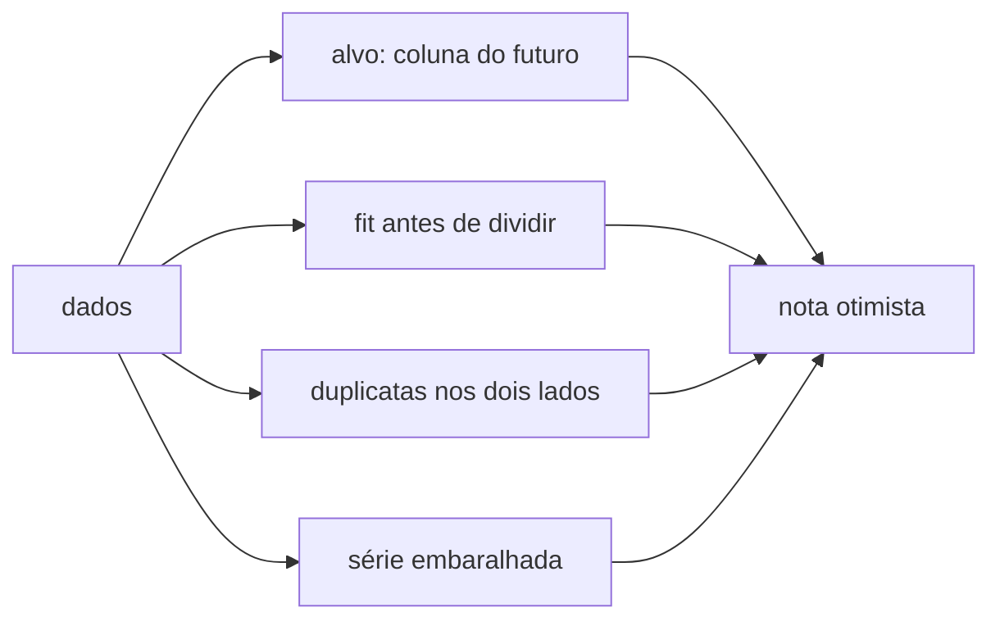

## Passo 1 · Leitura · Quatro vazamentos

Um serviço de assinaturas fictício quer prever quem vai cancelar no mês seguinte. O primeiro modelo da equipe sai da validação cruzada com AUC 0,99 e, em produção, acerta pouco mais que um sorteio. O código do modelo estava certo; errado estava o que ele pôde ver durante a avaliação. Esse defeito tem nome: **vazamento de dados** (*data leakage*). Uma informação que não existiria no momento da previsão entra no treino ou na avaliação, e a nota medida deixa de representar clientes novos.

Quatro formas aparecem quase sempre:

- **Vazamento de alvo:** uma coluna que só é preenchida depois do desfecho. Na tabela de assinantes, `dias_desde_cancelamento` vale zero para quem ficou e um número positivo para quem saiu: é o próprio alvo com outro nome. O motivo do cancelamento e o valor da multa rescisória são do mesmo tipo.
- **Pré-processamento antes de dividir:** padronizar, imputar ou selecionar atributos com a tabela inteira e só depois validar. As linhas de validação ajudaram a calcular médias, medianas e escolhas.
- **Duplicatas e entidades repetidas:** a mesma linha, ou o mesmo cliente em várias linhas, dos dois lados da divisão. O modelo reconhece em vez de prever.
- **Tempo:** embaralhar uma série e treinar com o futuro para prever o passado.



A pergunta que separa uma coluna legítima de uma coluna do futuro é uma só: *este valor já existe no instante em que a previsão será feita?* Para a renovação do mês que vem, os meses de casa e as reclamações até hoje existem; a data do cancelamento, não.

```python
colunas_ok = ["meses", "reclamacoes", "uso_semanal"]           # sabidas antes da decisão
colunas_do_futuro = ["dias_desde_cancelamento", "motivo_saida"]  # só existem depois
```

Desempenho bom demais é o principal sinal de alerta. Uma AUC de 0,99 num problema de comportamento humano raramente é mérito do modelo: é motivo para procurar o vazamento antes de comemorar. A defesa estrutural você já conhece do módulo 4: tudo o que aprende com os dados (escala, imputação, seleção, o próprio modelo) fica dentro de um `Pipeline`, e o `cross_val_score` ajusta o pipeline de novo em cada partição, só com as linhas de treino daquela partição.

## Passo 2 · Previsão · AUC com e sem a coluna do futuro

O programa gera 400 assinantes fictícios e cria a coluna `dias_desde_cancelamento`, preenchida só para quem cancelou. O `roc_auc_score(y, score)` mede a fração de pares (um positivo, um negativo) em que o positivo recebe o score maior, contando empate como meio acerto. Leia sem executar e digite o que o programa imprime.

### Código
```python
import numpy as np
from sklearn.metrics import roc_auc_score

rng = np.random.default_rng(3)
n = 400
meses = rng.integers(1, 60, n)
reclamacoes = rng.poisson(1.0, n)
uso = rng.normal(10, 3, n).round(1)
z = -0.5 - 0.04 * meses + 0.7 * reclamacoes - 0.2 * (uso - 10)
cancelou = (rng.random(n) < 1 / (1 + np.exp(-z))).astype(int)
dias_desde_cancelamento = np.where(cancelou == 1, rng.integers(1, 30, n), 0)

print(bool(((dias_desde_cancelamento > 0) == (cancelou == 1)).all()))
print(roc_auc_score(cancelou, dias_desde_cancelamento))
print(roc_auc_score(cancelou, np.zeros(n)))
print(bool(roc_auc_score(cancelou, meses) < 0.5))
```

### Dicas
1. Os sorteios de `integers(1, 30)` nunca dão zero.
2. Com a coluna do futuro como score, todo positivo tem score maior que todo negativo. Com um score constante, todo par empata.
3. No gerador, mais meses de casa diminuem a chance de cancelar.

### Saída esperada
```text
True
1.0
0.5
True
```

## Passo 3 · Exercício · O fluxo honesto
modo: lacunas

Complete as lacunas (`___`) do fluxo que mede a AUC de uma regressão logística com validação cruzada sem nenhum vazamento de pré-processamento. O arquivo `assinantes.py` gera assinantes fictícios para você testar: `X, y = gerar_assinantes(200, 1)`.

### Instruções
1. O `escalador` recebido (ou um `StandardScaler()` novo, se ele for `None`) é a etapa `"escala"` de um `Pipeline`, antes da etapa `"modelo"`, uma `LogisticRegression()`. Ele só pode ser ajustado dentro da validação cruzada.
2. As partições são de um `StratifiedKFold` com 5 partes, embaralhado com `random_state=semente`.
3. O `cross_val_score` avalia o pipeline inteiro com `scoring="roc_auc"`, e a função devolve `{"media": média das notas (float), "notas": as 5 notas (lista)}`.

### Código inicial
```python
from sklearn.linear_model import LogisticRegression
from sklearn.model_selection import KFold, StratifiedKFold, cross_val_score
from sklearn.pipeline import Pipeline
from sklearn.preprocessing import StandardScaler


def fluxo_honesto(X, y, semente, escalador=None):
    if escalador is None:
        escalador = StandardScaler()
    modelo = Pipeline([("escala", ___), ("modelo", LogisticRegression())])
    cv = ___(n_splits=5, shuffle=True, random_state=___)
    notas = cross_val_score(___, ___, y, cv=cv, scoring=___)
    return {"media": float(notas.mean()), "notas": notas.tolist()}
```
```python path=assinantes.py
import numpy as np


def gerar_assinantes(n, semente):
    rng = np.random.default_rng(semente)
    meses = rng.integers(1, 60, n)
    reclamacoes = rng.poisson(1.0, n)
    uso = rng.normal(10, 3, n).round(1)
    z = -0.5 - 0.04 * meses + 0.7 * reclamacoes - 0.2 * (uso - 10)
    cancelou = (rng.random(n) < 1 / (1 + np.exp(-z))).astype(int)
    X = np.column_stack([meses, reclamacoes, uso]).astype(float)
    return X, cancelou
```

### Solução
```python
from sklearn.linear_model import LogisticRegression
from sklearn.model_selection import KFold, StratifiedKFold, cross_val_score
from sklearn.pipeline import Pipeline
from sklearn.preprocessing import StandardScaler


def fluxo_honesto(X, y, semente, escalador=None):
    if escalador is None:
        escalador = StandardScaler()
    modelo = Pipeline([("escala", escalador), ("modelo", LogisticRegression())])
    cv = StratifiedKFold(n_splits=5, shuffle=True, random_state=semente)
    notas = cross_val_score(modelo, X, y, cv=cv, scoring="roc_auc")
    return {"media": float(notas.mean()), "notas": notas.tolist()}
```
```python path=assinantes.py
import numpy as np


def gerar_assinantes(n, semente):
    rng = np.random.default_rng(semente)
    meses = rng.integers(1, 60, n)
    reclamacoes = rng.poisson(1.0, n)
    uso = rng.normal(10, 3, n).round(1)
    z = -0.5 - 0.04 * meses + 0.7 * reclamacoes - 0.2 * (uso - 10)
    cancelou = (rng.random(n) < 1 / (1 + np.exp(-z))).astype(int)
    X = np.column_stack([meses, reclamacoes, uso]).astype(float)
    return X, cancelou
```

### Dicas
1. O `cross_val_score` recebe o objeto que deve ser ajustado de novo em cada partição: o pipeline, com o escalador dentro.
2. Nada deve passar por `fit` ou `fit_transform` antes da validação cruzada.
3. A AUC mede a ordenação dos scores; a acurácia mede acertos com o limiar 0,5. O nome da métrica vai como texto.

### Verificação
```json
[
  {"id": "espiao", "checkpoint": 1, "kind": "expr", "setup": "import numpy as np\nfrom assinantes import gerar_assinantes\nX, y = gerar_assinantes(200, 1)\nfrom sklearn.preprocessing import StandardScaler\nchamadas = []\nclass Espiao(StandardScaler):\n    def fit(self, X, y=None, sample_weight=None):\n        chamadas.append(len(X))\n        return super().fit(X, y, sample_weight)\nr = fluxo_honesto(X, y, 0, Espiao())", "expr": "chamadas", "expected": [160, 160, 160, 160, 160], "name": "O escalador é ajustado 5 vezes, cada uma só com as 160 linhas de treino da partição", "hint": "O escalador recebido vai dentro do pipeline; nada é ajustado com as 200 linhas antes da validação cruzada."},
  {"id": "media", "checkpoint": 3, "kind": "expr", "setup": "import numpy as np\nfrom assinantes import gerar_assinantes\nX, y = gerar_assinantes(200, 1)\nr = fluxo_honesto(X, y, 0)", "expr": "r['media']", "expected": 0.7368655769517838, "tolerance": 1e-09, "name": "200 assinantes, semente 0: a AUC média das 5 partições", "hint": "A métrica é a AUC (scoring=\"roc_auc\"), com partições estratificadas e embaralhadas pela semente."},
  {"id": "notas", "checkpoint": 2, "kind": "expr", "setup": "import numpy as np\nfrom assinantes import gerar_assinantes\nX, y = gerar_assinantes(200, 1)\nr = fluxo_honesto(X, y, 0)", "expr": "r['notas']", "expected": [0.6865203761755486, 0.761755485893417, 0.7460815047021944, 0.7429467084639498, 0.7470238095238094], "tolerance": 1e-09, "name": "As 5 notas, uma por partição estratificada", "hint": "StratifiedKFold mantém a proporção de cancelamentos em cada partição; KFold não."},
  {"id": "outra-semente", "checkpoint": 2, "kind": "expr", "setup": "import numpy as np\nfrom assinantes import gerar_assinantes\nX, y = gerar_assinantes(200, 1)\nr = fluxo_honesto(X, y, 7)", "expr": "r['notas']", "expected": [0.7210031347962382, 0.6959247648902821, 0.7805642633228841, 0.8025078369905956, 0.7976190476190477], "tolerance": 1e-09, "name": "Com a semente 7, as partições (e as notas) são outras", "hint": "O embaralhamento das partições usa a semente recebida."},
  {"id": "reprodutivel", "checkpoint": 2, "kind": "expr", "setup": "import numpy as np\nfrom assinantes import gerar_assinantes\nX, y = gerar_assinantes(200, 1)\n", "expr": "fluxo_honesto(X, y, 3) == fluxo_honesto(X, y, 3)", "expected": true, "name": "A mesma semente dá o mesmo resultado"},
  {"id": "minmax", "checkpoint": 1, "kind": "expr", "setup": "import numpy as np\nfrom assinantes import gerar_assinantes\nX, y = gerar_assinantes(200, 1)\nfrom sklearn.preprocessing import MinMaxScaler\nr = fluxo_honesto(X, y, 0, MinMaxScaler())", "expr": "r['media']", "expected": 0.7462699656665173, "tolerance": 1e-09, "name": "Com um MinMaxScaler recebido, o pipeline usa esse escalador", "hint": "Use o transformador recebido, seja ele qual for."},
  {"id": "outros-dados", "checkpoint": 3, "kind": "expr", "setup": "from assinantes import gerar_assinantes\nX, y = gerar_assinantes(150, 4)\nr = fluxo_honesto(X, y, 2)", "expr": "round(r['media'], 9)", "expected": 0.75215311, "tolerance": 1e-09, "name": "150 assinantes de outra semente, partições da semente 2"},
  {"id": "tipos", "checkpoint": 3, "kind": "expr", "setup": "import numpy as np\nfrom assinantes import gerar_assinantes\nX, y = gerar_assinantes(200, 1)\nr = fluxo_honesto(X, y, 0)", "expr": "[sorted(r), type(r['media']).__name__, type(r['notas']).__name__, len(r['notas'])]", "expected": [["media", "notas"], "float", "list", 5], "name": "Devolve {\"media\": float, \"notas\": lista com 5 notas}"}
]
```

### Soluções erradas
```python name="escala antes da validação cruzada"
from sklearn.linear_model import LogisticRegression
from sklearn.model_selection import KFold, StratifiedKFold, cross_val_score
from sklearn.pipeline import Pipeline
from sklearn.preprocessing import StandardScaler


def fluxo_honesto(X, y, semente, escalador=None):
    if escalador is None:
        escalador = StandardScaler()
    modelo = Pipeline([("escala", escalador), ("modelo", LogisticRegression())])
    cv = StratifiedKFold(n_splits=5, shuffle=True, random_state=semente)
    notas = cross_val_score(LogisticRegression(), escalador.fit_transform(X), y, cv=cv, scoring="roc_auc")
    return {"media": float(notas.mean()), "notas": notas.tolist()}
```
```python name="ignora o escalador recebido"
from sklearn.linear_model import LogisticRegression
from sklearn.model_selection import KFold, StratifiedKFold, cross_val_score
from sklearn.pipeline import Pipeline
from sklearn.preprocessing import StandardScaler


def fluxo_honesto(X, y, semente, escalador=None):
    if escalador is None:
        escalador = StandardScaler()
    modelo = Pipeline([("escala", StandardScaler()), ("modelo", LogisticRegression())])
    cv = StratifiedKFold(n_splits=5, shuffle=True, random_state=semente)
    notas = cross_val_score(modelo, X, y, cv=cv, scoring="roc_auc")
    return {"media": float(notas.mean()), "notas": notas.tolist()}
```
```python name="modelo sem a escala"
from sklearn.linear_model import LogisticRegression
from sklearn.model_selection import KFold, StratifiedKFold, cross_val_score
from sklearn.pipeline import Pipeline
from sklearn.preprocessing import StandardScaler


def fluxo_honesto(X, y, semente, escalador=None):
    if escalador is None:
        escalador = StandardScaler()
    modelo = Pipeline([("escala", escalador), ("modelo", LogisticRegression())])
    cv = StratifiedKFold(n_splits=5, shuffle=True, random_state=semente)
    notas = cross_val_score(LogisticRegression(), X, y, cv=cv, scoring="roc_auc")
    return {"media": float(notas.mean()), "notas": notas.tolist()}
```
```python name="partições sem estratificar"
from sklearn.linear_model import LogisticRegression
from sklearn.model_selection import KFold, StratifiedKFold, cross_val_score
from sklearn.pipeline import Pipeline
from sklearn.preprocessing import StandardScaler


def fluxo_honesto(X, y, semente, escalador=None):
    if escalador is None:
        escalador = StandardScaler()
    modelo = Pipeline([("escala", escalador), ("modelo", LogisticRegression())])
    cv = KFold(n_splits=5, shuffle=True, random_state=semente)
    notas = cross_val_score(modelo, X, y, cv=cv, scoring="roc_auc")
    return {"media": float(notas.mean()), "notas": notas.tolist()}
```
```python name="semente fixa nas partições"
from sklearn.linear_model import LogisticRegression
from sklearn.model_selection import KFold, StratifiedKFold, cross_val_score
from sklearn.pipeline import Pipeline
from sklearn.preprocessing import StandardScaler


def fluxo_honesto(X, y, semente, escalador=None):
    if escalador is None:
        escalador = StandardScaler()
    modelo = Pipeline([("escala", escalador), ("modelo", LogisticRegression())])
    cv = StratifiedKFold(n_splits=5, shuffle=True, random_state=0)
    notas = cross_val_score(modelo, X, y, cv=cv, scoring="roc_auc")
    return {"media": float(notas.mean()), "notas": notas.tolist()}
```
```python name="acurácia no lugar da AUC"
from sklearn.linear_model import LogisticRegression
from sklearn.model_selection import KFold, StratifiedKFold, cross_val_score
from sklearn.pipeline import Pipeline
from sklearn.preprocessing import StandardScaler


def fluxo_honesto(X, y, semente, escalador=None):
    if escalador is None:
        escalador = StandardScaler()
    modelo = Pipeline([("escala", escalador), ("modelo", LogisticRegression())])
    cv = StratifiedKFold(n_splits=5, shuffle=True, random_state=semente)
    notas = cross_val_score(modelo, X, y, cv=cv, scoring="accuracy")
    return {"media": float(notas.mean()), "notas": notas.tolist()}
```

## Passo 4 · Leitura · Pré-processamento e seleção antes da divisão

Nos 400 assinantes da Previsão, a mesma logística com escala tem AUC média de 0,76 na validação cruzada sem a coluna do futuro e 0,99 com ela. A coluna era detectável sozinha: a AUC dela como score era 1,0. Um teste automático simples, rodado antes de qualquer modelo, pega esse caso: calcular a correlação de cada coluna com o alvo e desconfiar das quase perfeitas. É a função `atributos_suspeitos` do próximo exercício.

O vazamento de pré-processamento é mais discreto, porque nenhuma coluna parece suspeita. Com um `StandardScaler` ajustado na tabela inteira, a média e o desvio incluem as linhas de validação; o efeito costuma ser pequeno, mas a medição já não é honesta. Com a **seleção de atributos pelo alvo**, o efeito é enorme. Veja um experimento com 60 linhas, 1 000 colunas de ruído puro e um alvo sorteado, sem relação nenhuma com as colunas:

```python
X = rng.normal(size=(60, 1000))
y = np.repeat([0, 1], 30)
X_sel = SelectKBest(f_classif, k=20).fit_transform(X, y)        # escolhe com as 60 linhas
cross_val_score(LogisticRegression(), X_sel, y, cv=cv, scoring="roc_auc").mean()      # 0.961

pipe = make_pipeline(SelectKBest(f_classif, k=20), LogisticRegression())
cross_val_score(pipe, X, y, cv=cv, scoring="roc_auc").mean()                          # 0.522
```

Ruído puro com AUC 0,96. O motivo é contagem: com $d$ colunas de ruído e $n$ linhas, a maior correlação amostral com o alvo fica, por acaso, perto de

$$
\max_j |r_j| \approx \sqrt{\frac{2 \ln d}{n}} = \sqrt{\frac{2 \ln 1000}{60}} \approx 0{,}48
$$

O `SelectKBest` escolheu as 20 colunas que mais coincidiram com o alvo **nessas 60 linhas**, inclusive nas que depois fizeram papel de validação. Dentro do pipeline, a seleção é refeita em cada partição só com o treino, e o acaso de uma partição não se repete na outra: a AUC volta para perto de 0,5, que é a verdade. Repetido com as sementes 1 e 2, o fluxo com vazamento deu 0,989 e 0,928; o honesto, 0,500 e 0,411.

A regra vale para qualquer passo que olhe os dados: imputação, escala, codificação, seleção, redução de dimensão e escolha de hiperparâmetros. Se o passo tem `fit`, ele vai para dentro do pipeline. Fora do pipeline ficam só as transformações que não aprendem nada, como trocar texto por data ou calcular uma razão entre duas colunas da mesma linha.

## Passo 5 · Exercício · Corrigir o fluxo

Um colega mediu um modelo assim e comemorou a AUC:

```python
X_sel = SelectKBest(f_classif, k=20).fit_transform(X, y)
cross_val_score(LogisticRegression(), X_sel, y, cv=cv, scoring="roc_auc").mean()
```

Escreva a versão honesta e o teste automático que procura colunas do futuro.

### Instruções
1. `corrigir_fluxo(X, y, k_atributos, semente, seletor=None)` usa o `seletor` recebido ou, se ele for `None`, um `SelectKBest(f_classif, k=k_atributos)`. O seletor é a etapa `"selecao"` de um `Pipeline` antes da etapa `"modelo"`, uma `LogisticRegression()`, e o pipeline é avaliado pelo `cross_val_score` com `StratifiedKFold(n_splits=5, shuffle=True, random_state=semente)` e `scoring="roc_auc"`. Devolve a média das notas como `float`.
2. `atributos_suspeitos(df, alvo, limiar)` calcula a correlação de Pearson de cada coluna **numérica** do `df` (menos o próprio `alvo`) com a coluna `alvo` e devolve a lista dos nomes cuja correlação, em valor absoluto, é maior ou igual ao `limiar`, da maior para a menor em valor absoluto. Colunas de texto são ignoradas.

### Código inicial
```python
from sklearn.feature_selection import SelectKBest, f_classif
from sklearn.linear_model import LogisticRegression
from sklearn.model_selection import StratifiedKFold, cross_val_score
from sklearn.pipeline import Pipeline


def corrigir_fluxo(X, y, k_atributos, semente, seletor=None):
    pass


def atributos_suspeitos(df, alvo, limiar):
    pass
```

### Solução
```python
from sklearn.feature_selection import SelectKBest, f_classif
from sklearn.linear_model import LogisticRegression
from sklearn.model_selection import StratifiedKFold, cross_val_score
from sklearn.pipeline import Pipeline


def corrigir_fluxo(X, y, k_atributos, semente, seletor=None):
    if seletor is None:
        seletor = SelectKBest(f_classif, k=k_atributos)
    modelo = Pipeline([("selecao", seletor), ("modelo", LogisticRegression())])
    cv = StratifiedKFold(n_splits=5, shuffle=True, random_state=semente)
    return float(cross_val_score(modelo, X, y, cv=cv, scoring="roc_auc").mean())


def atributos_suspeitos(df, alvo, limiar):
    numericas = df.select_dtypes("number").drop(columns=alvo)
    correlacoes = numericas.corrwith(df[alvo]).abs()
    suspeitas = correlacoes[correlacoes >= limiar].sort_values(ascending=False)
    return suspeitas.index.tolist()
```

### Dicas
1. Tudo que tem `fit` vai para dentro do pipeline; o `cross_val_score` recebe o pipeline e o `X` original.
2. O `df.select_dtypes("number")` separa as colunas numéricas, e o `corrwith(serie)` calcula a correlação de cada coluna com uma série.
3. Uma correlação fortemente negativa denuncia uma coluna do futuro tanto quanto uma positiva.

### Verificação
```json
[
  {"id": "ruido-honesto", "checkpoint": 1, "kind": "expr", "setup": "import numpy as np\nrng = np.random.default_rng(4)\nX = rng.normal(size=(60, 500))\ny = rng.permutation(np.repeat([0, 1], 30))\nr = corrigir_fluxo(X, y, 20, 0)", "expr": "r", "expected": 0.42222222222222233, "tolerance": 1e-09, "name": "500 colunas de ruído, k = 20, semente 0: a AUC honesta", "hint": "A seleção vai dentro do pipeline, e o pipeline é que passa pelo cross_val_score."},
  {"id": "abaixo-do-vazado", "checkpoint": 1, "kind": "expr", "setup": "import numpy as np\nrng = np.random.default_rng(4)\nX = rng.normal(size=(60, 500))\ny = rng.permutation(np.repeat([0, 1], 30))\nfrom sklearn.feature_selection import SelectKBest, f_classif\nfrom sklearn.linear_model import LogisticRegression\nfrom sklearn.model_selection import StratifiedKFold, cross_val_score\nXs = SelectKBest(f_classif, k=20).fit_transform(X, y)\nvazado = cross_val_score(LogisticRegression(), Xs, y, cv=StratifiedKFold(5, shuffle=True, random_state=0), scoring='roc_auc').mean()\nr = corrigir_fluxo(X, y, 20, 0)", "expr": "bool(r < vazado - 0.25)", "expected": true, "name": "A AUC honesta fica bem abaixo da AUC do fluxo que seleciona antes de dividir", "hint": "Compara-se com a seleção feita nas 60 linhas antes da validação: o fluxo corrigido não pode herdar esse otimismo."},
  {"id": "espiao", "checkpoint": 1, "kind": "expr", "setup": "import numpy as np\nrng = np.random.default_rng(4)\nX = rng.normal(size=(60, 500))\ny = rng.permutation(np.repeat([0, 1], 30))\nfrom sklearn.feature_selection import SelectKBest, f_classif\nchamadas = []\nclass Espiao(SelectKBest):\n    def fit(self, X, y=None):\n        chamadas.append(len(X))\n        return super().fit(X, y)\nr = corrigir_fluxo(X, y, 20, 0, Espiao(f_classif, k=20))", "expr": "chamadas", "expected": [48, 48, 48, 48, 48], "name": "O seletor recebido é ajustado 5 vezes, cada uma com as 48 linhas de treino da partição", "hint": "Cada fit do seletor conta. Ele só pode ver as linhas de treino de cada partição."},
  {"id": "k-importa", "checkpoint": 1, "kind": "expr", "setup": "import numpy as np\nrng = np.random.default_rng(4)\nX = rng.normal(size=(60, 500))\ny = rng.permutation(np.repeat([0, 1], 30))\nr = corrigir_fluxo(X, y, 5, 0)", "expr": "r", "expected": 0.4666666666666667, "tolerance": 1e-09, "name": "Com k = 5, a seleção guarda 5 colunas", "hint": "Sem seletor recebido, crie o SelectKBest com o k pedido."},
  {"id": "sinal-de-verdade", "checkpoint": 1, "kind": "expr", "setup": "import numpy as np\nrng = np.random.default_rng(4)\nX = rng.normal(size=(60, 500))\ny = rng.permutation(np.repeat([0, 1], 30))\nX[:, :3] += 2.0 * y[:, None]\nr = corrigir_fluxo(X, y, 10, 1)", "expr": "r", "expected": 0.9722222222222221, "tolerance": 1e-09, "name": "Com 3 colunas de sinal de verdade, a AUC honesta fica alta"},
  {"id": "suspeitos", "checkpoint": 2, "kind": "expr", "setup": "import numpy as np\nimport pandas as pd\nrng = np.random.default_rng(2)\nn = 200\ncancelou = (rng.random(n) < 0.3).astype(int)\ndf = pd.DataFrame({\"meses\": rng.integers(1, 60, n) - 10 * cancelou, \"reclamacoes\": rng.poisson(1.0, n) + cancelou, \"dias_desde_cancelamento\": np.where(cancelou == 1, rng.integers(1, 30, n), 0), \"saldo_final\": np.where(cancelou == 1, 0.0, rng.uniform(50, 100, n)).round(2), \"plano\": rng.choice([\"basico\", \"plus\"], n), \"cancelou\": cancelou})\n", "expr": "atributos_suspeitos(df, 'cancelou', 0.8)", "expected": ["saldo_final", "dias_desde_cancelamento"], "name": "Limiar 0.8: as duas colunas do futuro, a de correlação negativa inclusive", "hint": "Uma correlação de -0.95 é tão suspeita quanto uma de 0.95."},
  {"id": "ordem", "checkpoint": 2, "kind": "expr", "setup": "import numpy as np\nimport pandas as pd\nrng = np.random.default_rng(2)\nn = 200\ncancelou = (rng.random(n) < 0.3).astype(int)\ndf = pd.DataFrame({\"meses\": rng.integers(1, 60, n) - 10 * cancelou, \"reclamacoes\": rng.poisson(1.0, n) + cancelou, \"dias_desde_cancelamento\": np.where(cancelou == 1, rng.integers(1, 30, n), 0), \"saldo_final\": np.where(cancelou == 1, 0.0, rng.uniform(50, 100, n)).round(2), \"plano\": rng.choice([\"basico\", \"plus\"], n), \"cancelou\": cancelou})\n", "expr": "atributos_suspeitos(df, 'cancelou', 0.3)", "expected": ["saldo_final", "dias_desde_cancelamento", "reclamacoes", "meses"], "name": "Limiar 0.3: mais colunas, da maior para a menor correlação em valor absoluto", "hint": "Ordene pelo valor absoluto da correlação, do maior para o menor."},
  {"id": "sem-o-alvo", "checkpoint": 2, "kind": "expr", "setup": "import numpy as np\nimport pandas as pd\nrng = np.random.default_rng(2)\nn = 200\ncancelou = (rng.random(n) < 0.3).astype(int)\ndf = pd.DataFrame({\"meses\": rng.integers(1, 60, n) - 10 * cancelou, \"reclamacoes\": rng.poisson(1.0, n) + cancelou, \"dias_desde_cancelamento\": np.where(cancelou == 1, rng.integers(1, 30, n), 0), \"saldo_final\": np.where(cancelou == 1, 0.0, rng.uniform(50, 100, n)).round(2), \"plano\": rng.choice([\"basico\", \"plus\"], n), \"cancelou\": cancelou})\n", "expr": "'cancelou' in atributos_suspeitos(df, 'cancelou', 0.0)", "expected": false, "name": "O próprio alvo nunca aparece na lista", "hint": "O alvo tem correlação 1 consigo mesmo: tire-o antes de comparar."},
  {"id": "nenhum", "checkpoint": 2, "kind": "expr", "setup": "import numpy as np\nimport pandas as pd\nrng = np.random.default_rng(2)\nn = 200\ncancelou = (rng.random(n) < 0.3).astype(int)\ndf = pd.DataFrame({\"meses\": rng.integers(1, 60, n) - 10 * cancelou, \"reclamacoes\": rng.poisson(1.0, n) + cancelou, \"dias_desde_cancelamento\": np.where(cancelou == 1, rng.integers(1, 30, n), 0), \"saldo_final\": np.where(cancelou == 1, 0.0, rng.uniform(50, 100, n)).round(2), \"plano\": rng.choice([\"basico\", \"plus\"], n), \"cancelou\": cancelou})\n", "expr": "atributos_suspeitos(df.drop(columns=['dias_desde_cancelamento', 'saldo_final']), 'cancelou', 0.8)", "expected": [], "name": "Sem colunas do futuro, a lista sai vazia"},
  {"id": "tipos", "checkpoint": 2, "kind": "expr", "setup": "import numpy as np\nimport pandas as pd\nrng = np.random.default_rng(2)\nn = 200\ncancelou = (rng.random(n) < 0.3).astype(int)\ndf = pd.DataFrame({\"meses\": rng.integers(1, 60, n) - 10 * cancelou, \"reclamacoes\": rng.poisson(1.0, n) + cancelou, \"dias_desde_cancelamento\": np.where(cancelou == 1, rng.integers(1, 30, n), 0), \"saldo_final\": np.where(cancelou == 1, 0.0, rng.uniform(50, 100, n)).round(2), \"plano\": rng.choice([\"basico\", \"plus\"], n), \"cancelou\": cancelou})\n", "expr": "[type(corrigir_fluxo(np.random.default_rng(0).normal(size=(40, 30)), np.repeat([0, 1], 20), 5, 0)).__name__, type(atributos_suspeitos(df, 'cancelou', 0.8)).__name__]", "expected": ["float", "list"], "name": "corrigir_fluxo devolve float e atributos_suspeitos, lista"}
]
```

### Soluções erradas
```python name="seleciona antes de dividir"
from sklearn.feature_selection import SelectKBest, f_classif
from sklearn.linear_model import LogisticRegression
from sklearn.model_selection import StratifiedKFold, cross_val_score
from sklearn.pipeline import Pipeline


def corrigir_fluxo(X, y, k_atributos, semente, seletor=None):
    if seletor is None:
        seletor = SelectKBest(f_classif, k=k_atributos)
    X_sel = seletor.fit_transform(X, y)
    cv = StratifiedKFold(n_splits=5, shuffle=True, random_state=semente)
    return float(cross_val_score(LogisticRegression(), X_sel, y, cv=cv, scoring="roc_auc").mean())


def atributos_suspeitos(df, alvo, limiar):
    numericas = df.select_dtypes("number").drop(columns=alvo)
    correlacoes = numericas.corrwith(df[alvo]).abs()
    suspeitas = correlacoes[correlacoes >= limiar].sort_values(ascending=False)
    return suspeitas.index.tolist()
```
```python name="ignora o seletor recebido"
from sklearn.feature_selection import SelectKBest, f_classif
from sklearn.linear_model import LogisticRegression
from sklearn.model_selection import StratifiedKFold, cross_val_score
from sklearn.pipeline import Pipeline


def corrigir_fluxo(X, y, k_atributos, semente, seletor=None):
    seletor = SelectKBest(f_classif, k=k_atributos)
    modelo = Pipeline([("selecao", seletor), ("modelo", LogisticRegression())])
    cv = StratifiedKFold(n_splits=5, shuffle=True, random_state=semente)
    return float(cross_val_score(modelo, X, y, cv=cv, scoring="roc_auc").mean())


def atributos_suspeitos(df, alvo, limiar):
    numericas = df.select_dtypes("number").drop(columns=alvo)
    correlacoes = numericas.corrwith(df[alvo]).abs()
    suspeitas = correlacoes[correlacoes >= limiar].sort_values(ascending=False)
    return suspeitas.index.tolist()
```
```python name="k padrão do SelectKBest"
from sklearn.feature_selection import SelectKBest, f_classif
from sklearn.linear_model import LogisticRegression
from sklearn.model_selection import StratifiedKFold, cross_val_score
from sklearn.pipeline import Pipeline


def corrigir_fluxo(X, y, k_atributos, semente, seletor=None):
    if seletor is None:
        seletor = SelectKBest(f_classif)
    modelo = Pipeline([("selecao", seletor), ("modelo", LogisticRegression())])
    cv = StratifiedKFold(n_splits=5, shuffle=True, random_state=semente)
    return float(cross_val_score(modelo, X, y, cv=cv, scoring="roc_auc").mean())


def atributos_suspeitos(df, alvo, limiar):
    numericas = df.select_dtypes("number").drop(columns=alvo)
    correlacoes = numericas.corrwith(df[alvo]).abs()
    suspeitas = correlacoes[correlacoes >= limiar].sort_values(ascending=False)
    return suspeitas.index.tolist()
```
```python name="correlação sem valor absoluto"
from sklearn.feature_selection import SelectKBest, f_classif
from sklearn.linear_model import LogisticRegression
from sklearn.model_selection import StratifiedKFold, cross_val_score
from sklearn.pipeline import Pipeline


def corrigir_fluxo(X, y, k_atributos, semente, seletor=None):
    if seletor is None:
        seletor = SelectKBest(f_classif, k=k_atributos)
    modelo = Pipeline([("selecao", seletor), ("modelo", LogisticRegression())])
    cv = StratifiedKFold(n_splits=5, shuffle=True, random_state=semente)
    return float(cross_val_score(modelo, X, y, cv=cv, scoring="roc_auc").mean())


def atributos_suspeitos(df, alvo, limiar):
    numericas = df.select_dtypes("number").drop(columns=alvo)
    correlacoes = numericas.corrwith(df[alvo])
    suspeitas = correlacoes[correlacoes >= limiar].sort_values(ascending=False)
    return suspeitas.index.tolist()
```
```python name="inclui o próprio alvo"
from sklearn.feature_selection import SelectKBest, f_classif
from sklearn.linear_model import LogisticRegression
from sklearn.model_selection import StratifiedKFold, cross_val_score
from sklearn.pipeline import Pipeline


def corrigir_fluxo(X, y, k_atributos, semente, seletor=None):
    if seletor is None:
        seletor = SelectKBest(f_classif, k=k_atributos)
    modelo = Pipeline([("selecao", seletor), ("modelo", LogisticRegression())])
    cv = StratifiedKFold(n_splits=5, shuffle=True, random_state=semente)
    return float(cross_val_score(modelo, X, y, cv=cv, scoring="roc_auc").mean())


def atributos_suspeitos(df, alvo, limiar):
    numericas = df.select_dtypes("number")
    correlacoes = numericas.corrwith(df[alvo]).abs()
    suspeitas = correlacoes[correlacoes >= limiar].sort_values(ascending=False)
    return suspeitas.index.tolist()
```
```python name="correlação com as colunas de texto"
from sklearn.feature_selection import SelectKBest, f_classif
from sklearn.linear_model import LogisticRegression
from sklearn.model_selection import StratifiedKFold, cross_val_score
from sklearn.pipeline import Pipeline


def corrigir_fluxo(X, y, k_atributos, semente, seletor=None):
    if seletor is None:
        seletor = SelectKBest(f_classif, k=k_atributos)
    modelo = Pipeline([("selecao", seletor), ("modelo", LogisticRegression())])
    cv = StratifiedKFold(n_splits=5, shuffle=True, random_state=semente)
    return float(cross_val_score(modelo, X, y, cv=cv, scoring="roc_auc").mean())


def atributos_suspeitos(df, alvo, limiar):
    numericas = df.drop(columns=alvo)
    correlacoes = numericas.corrwith(df[alvo]).abs()
    suspeitas = correlacoes[correlacoes >= limiar].sort_values(ascending=False)
    return suspeitas.index.tolist()
```
```python name="ordem alfabética"
from sklearn.feature_selection import SelectKBest, f_classif
from sklearn.linear_model import LogisticRegression
from sklearn.model_selection import StratifiedKFold, cross_val_score
from sklearn.pipeline import Pipeline


def corrigir_fluxo(X, y, k_atributos, semente, seletor=None):
    if seletor is None:
        seletor = SelectKBest(f_classif, k=k_atributos)
    modelo = Pipeline([("selecao", seletor), ("modelo", LogisticRegression())])
    cv = StratifiedKFold(n_splits=5, shuffle=True, random_state=semente)
    return float(cross_val_score(modelo, X, y, cv=cv, scoring="roc_auc").mean())


def atributos_suspeitos(df, alvo, limiar):
    numericas = df.select_dtypes("number").drop(columns=alvo)
    correlacoes = numericas.corrwith(df[alvo]).abs()
    suspeitas = correlacoes[correlacoes >= limiar].sort_index()
    return suspeitas.index.tolist()
```

## Passo 6 · Leitura · Duplicatas e tempo

**Duplicatas.** Tabelas reais repetem linhas: um cadastro enviado duas vezes, uma junção que multiplicou registros, um exportador que salvou o mesmo lote em dois arquivos. Se uma cópia cai no treino e a outra no teste, o modelo não precisa generalizar para acertar: basta lembrar. Um modelo que decora, como uma árvore sem limite ou um kNN com um vizinho, é o que mais se beneficia, e a comparação entre modelos sai torta a favor dele. A verificação é por **valores**, não pelo índice: depois de um `train_test_split`, as duas cópias têm rótulos de índice diferentes, e é justamente a igualdade das colunas que denuncia o problema.

```python
df.duplicated().sum()                     # linhas repetidas dentro de uma mesma tabela
df = df.drop_duplicates()                 # antes de dividir, quando a repetição é um defeito
```

Um caso mais sutil é a **mesma entidade em várias linhas**: o mesmo cliente com um registro por mês, o mesmo paciente fictício com várias consultas. As linhas não são idênticas, mas compartilham hábitos que o modelo aprende a reconhecer. A divisão certa é por grupo, com o `GroupKFold` do módulo 4: todas as linhas de um cliente ficam do mesmo lado.

**Tempo.** Num problema em que o modelo vai prever o futuro (vendas da semana que vem, cancelamentos do mês que vem), a avaliação precisa imitar isso: treinar com o passado e testar com um período **posterior**. Embaralhar as linhas antes de dividir põe dias de março no treino e dias de fevereiro no teste, e o modelo interpola entre vizinhos no tempo, uma tarefa muito mais fácil do que a de produção. A divisão temporal ordena pela data e corta: as primeiras linhas formam o treino e as últimas, o teste. Para validação cruzada, o `TimeSeriesSplit` do módulo 4 faz o mesmo em janelas crescentes.

```python
ordenado = df.sort_values("data", kind="stable")
corte = len(df) - round(len(df) * 0.2)
treino, teste = ordenado.iloc[:corte], ordenado.iloc[corte:]
```

Atributos calculados também precisam respeitar o relógio: uma "média de vendas da semana" calculada com a semana inteira já inclui o dia que se quer prever. Médias móveis usam só os dias anteriores. A pergunta do passo 1 vale para cada coluna nova: o valor existiria no instante da previsão?

## Passo 7 · Exercício · Duplicatas e divisão temporal

Escreva as duas verificações que evitam o vazamento por repetição e por tempo.

### Instruções
1. `duplicatas_entre_conjuntos(X_treino, X_teste)` recebe dois `DataFrame` com as mesmas colunas e devolve a lista dos rótulos do índice de `X_teste` cujas linhas aparecem **com os mesmos valores em todas as colunas** em `X_treino`, na ordem em que estão no teste.
2. `divisao_temporal(df, coluna_data, fracao_teste)` ordena as linhas pela `coluna_data` e devolve `(treino, teste)`: o teste são as `round(len(df) * fracao_teste)` linhas mais recentes, e o treino, as anteriores, os dois em ordem de data e com os rótulos de índice originais. O `df` recebido não muda.

### Código inicial
```python
import pandas as pd


def duplicatas_entre_conjuntos(X_treino, X_teste):
    pass


def divisao_temporal(df, coluna_data, fracao_teste):
    pass
```

### Solução
```python
import pandas as pd


def duplicatas_entre_conjuntos(X_treino, X_teste):
    linhas_treino = set(map(tuple, X_treino.to_numpy().tolist()))
    linhas_teste = map(tuple, X_teste.to_numpy().tolist())
    return [rotulo for rotulo, linha in zip(X_teste.index.tolist(), linhas_teste) if linha in linhas_treino]


def divisao_temporal(df, coluna_data, fracao_teste):
    ordenado = df.sort_values(coluna_data, kind="stable")
    corte = len(df) - round(len(df) * fracao_teste)
    return ordenado.iloc[:corte], ordenado.iloc[corte:]
```

### Dicas
1. O `to_numpy().tolist()` transforma cada linha numa lista; tuplas dessas listas podem entrar num `set`.
2. O índice de um `DataFrame` não diz nada sobre o conteúdo da linha: depois de uma divisão, duas cópias têm rótulos diferentes.
3. O `sort_values` devolve uma tabela nova; o `iloc` corta por posição, sem olhar os rótulos.

### Verificação
```json
[
  {"id": "duplicatas", "checkpoint": 1, "kind": "expr", "setup": "import pandas as pd\ntr = pd.DataFrame({'meses': [3, 10, 25, 7], 'reclamacoes': [0, 2, 1, 0], 'plano': ['basico', 'plus', 'plus', 'basico']})\nte = pd.DataFrame({'meses': [10, 3, 25, 8, 7], 'reclamacoes': [2, 1, 1, 0, 0], 'plano': ['plus', 'basico', 'basico', 'basico', 'basico']}, index=[100, 101, 102, 103, 104])\n", "expr": "duplicatas_entre_conjuntos(tr, te)", "expected": [100, 104], "name": "As linhas 100 e 104 do teste repetem linhas do treino", "hint": "Compare as linhas pelos valores de todas as colunas e devolva os rótulos do índice do teste."},
  {"id": "mesmo-indice", "checkpoint": 1, "kind": "expr", "setup": "import pandas as pd\ntr = pd.DataFrame({'meses': [3, 10, 25, 7], 'reclamacoes': [0, 2, 1, 0], 'plano': ['basico', 'plus', 'plus', 'basico']})\nte = pd.DataFrame({'meses': [10, 3, 25, 8, 7], 'reclamacoes': [2, 1, 1, 0, 0], 'plano': ['plus', 'basico', 'basico', 'basico', 'basico']}, index=[100, 101, 102, 103, 104])\nte2 = pd.DataFrame({'meses': [4, 11], 'reclamacoes': [0, 2], 'plano': ['basico', 'plus']}, index=[0, 1])", "expr": "duplicatas_entre_conjuntos(tr, te2)", "expected": [], "name": "Mesmo rótulo de índice com valores diferentes não é duplicata", "hint": "O índice é só um rótulo de posição; a duplicata é a mesma combinação de valores."},
  {"id": "uma-coluna-diferente", "checkpoint": 1, "kind": "expr", "setup": "import pandas as pd\ntr = pd.DataFrame({'meses': [3, 10, 25, 7], 'reclamacoes': [0, 2, 1, 0], 'plano': ['basico', 'plus', 'plus', 'basico']})\nte = pd.DataFrame({'meses': [10, 3, 25, 8, 7], 'reclamacoes': [2, 1, 1, 0, 0], 'plano': ['plus', 'basico', 'basico', 'basico', 'basico']}, index=[100, 101, 102, 103, 104])\n", "expr": "duplicatas_entre_conjuntos(tr, te.loc[[101, 102]])", "expected": [], "name": "Linhas que diferem do treino em uma coluna não são duplicatas", "hint": "Todas as colunas precisam coincidir, não só a primeira."},
  {"id": "repetidas-no-teste", "checkpoint": 1, "kind": "expr", "setup": "import pandas as pd\ntr = pd.DataFrame({'meses': [3, 10, 25, 7], 'reclamacoes': [0, 2, 1, 0], 'plano': ['basico', 'plus', 'plus', 'basico']})\nte = pd.DataFrame({'meses': [10, 3, 25, 8, 7], 'reclamacoes': [2, 1, 1, 0, 0], 'plano': ['plus', 'basico', 'basico', 'basico', 'basico']}, index=[100, 101, 102, 103, 104])\nte3 = pd.DataFrame({'meses': [50, 50], 'reclamacoes': [4, 4], 'plano': ['plus', 'plus']}, index=[7, 8])", "expr": "duplicatas_entre_conjuntos(tr, te3)", "expected": [], "name": "Duas linhas iguais só dentro do teste não contam", "hint": "A pergunta é se a linha do teste aparece no treino."},
  {"id": "tipos-dup", "checkpoint": 1, "kind": "expr", "setup": "import pandas as pd\ntr = pd.DataFrame({'meses': [3, 10, 25, 7], 'reclamacoes': [0, 2, 1, 0], 'plano': ['basico', 'plus', 'plus', 'basico']})\nte = pd.DataFrame({'meses': [10, 3, 25, 8, 7], 'reclamacoes': [2, 1, 1, 0, 0], 'plano': ['plus', 'basico', 'basico', 'basico', 'basico']}, index=[100, 101, 102, 103, 104])\n", "expr": "[type(duplicatas_entre_conjuntos(tr, te)).__name__] + [type(i).__name__ for i in duplicatas_entre_conjuntos(tr, te)]", "expected": ["list", "int", "int"], "name": "Devolve uma lista de inteiros"},
  {"id": "temporal-teste", "checkpoint": 2, "kind": "expr", "setup": "import pandas as pd\ndf = pd.DataFrame({'data': pd.to_datetime(['2024-03-05', '2024-01-10', '2024-02-20', '2024-01-02', '2024-03-01', '2024-02-01', '2024-01-25', '2024-02-11', '2024-03-20', '2024-01-15']), 'vendas': [31, 12, 25, 9, 30, 18, 15, 22, 35, 13]})\ntr, te = divisao_temporal(df, 'data', 0.3)", "expr": "te.index.tolist()", "expected": [4, 0, 8], "name": "Fração 0.3 de 10 linhas: o teste são as 3 datas mais recentes, em ordem de data", "hint": "Ordene pela coluna de data e corte; as últimas linhas formam o teste."},
  {"id": "temporal-treino", "checkpoint": 2, "kind": "expr", "setup": "import pandas as pd\ndf = pd.DataFrame({'data': pd.to_datetime(['2024-03-05', '2024-01-10', '2024-02-20', '2024-01-02', '2024-03-01', '2024-02-01', '2024-01-25', '2024-02-11', '2024-03-20', '2024-01-15']), 'vendas': [31, 12, 25, 9, 30, 18, 15, 22, 35, 13]})\ntr, te = divisao_temporal(df, 'data', 0.3)", "expr": "tr.index.tolist()", "expected": [3, 1, 9, 6, 5, 7, 2], "name": "O treino são as 7 datas mais antigas, em ordem de data"},
  {"id": "antes-depois", "checkpoint": 2, "kind": "expr", "setup": "import pandas as pd\ndf = pd.DataFrame({'data': pd.to_datetime(['2024-03-05', '2024-01-10', '2024-02-20', '2024-01-02', '2024-03-01', '2024-02-01', '2024-01-25', '2024-02-11', '2024-03-20', '2024-01-15']), 'vendas': [31, 12, 25, 9, 30, 18, 15, 22, 35, 13]})\ntr, te = divisao_temporal(df, 'data', 0.2)", "expr": "[len(tr), len(te), bool(tr['data'].max() < te['data'].min())]", "expected": [8, 2, true], "name": "Fração 0.2: 8 linhas de treino, 2 de teste, e todo o treino antes do teste"},
  {"id": "df-intacto", "checkpoint": 2, "kind": "expr", "setup": "import pandas as pd\ndf = pd.DataFrame({'data': pd.to_datetime(['2024-03-05', '2024-01-10', '2024-02-20', '2024-01-02', '2024-03-01', '2024-02-01', '2024-01-25', '2024-02-11', '2024-03-20', '2024-01-15']), 'vendas': [31, 12, 25, 9, 30, 18, 15, 22, 35, 13]})\nantes = df.copy()\ntr, te = divisao_temporal(df, 'data', 0.3)", "expr": "bool(df.equals(antes) and df.index.tolist() == antes.index.tolist())", "expected": true, "name": "O df recebido não muda", "hint": "Ordene numa tabela nova, sem inplace."}
]
```

### Soluções erradas
```python name="compara pelo índice"
import pandas as pd


def duplicatas_entre_conjuntos(X_treino, X_teste):
    return [rotulo for rotulo in X_teste.index.tolist() if rotulo in X_treino.index]


def divisao_temporal(df, coluna_data, fracao_teste):
    ordenado = df.sort_values(coluna_data, kind="stable")
    corte = len(df) - round(len(df) * fracao_teste)
    return ordenado.iloc[:corte], ordenado.iloc[corte:]
```
```python name="compara só a primeira coluna"
import pandas as pd


def duplicatas_entre_conjuntos(X_treino, X_teste):
    linhas_treino = set(X_treino.iloc[:, 0].tolist())
    linhas_teste = X_teste.iloc[:, 0].tolist()
    return [rotulo for rotulo, linha in zip(X_teste.index.tolist(), linhas_teste) if linha in linhas_treino]


def divisao_temporal(df, coluna_data, fracao_teste):
    ordenado = df.sort_values(coluna_data, kind="stable")
    corte = len(df) - round(len(df) * fracao_teste)
    return ordenado.iloc[:corte], ordenado.iloc[corte:]
```
```python name="devolve as posições"
import pandas as pd


def duplicatas_entre_conjuntos(X_treino, X_teste):
    linhas_treino = set(map(tuple, X_treino.to_numpy().tolist()))
    linhas_teste = map(tuple, X_teste.to_numpy().tolist())
    return [rotulo for rotulo, linha in enumerate(linhas_teste) if linha in linhas_treino]


def divisao_temporal(df, coluna_data, fracao_teste):
    ordenado = df.sort_values(coluna_data, kind="stable")
    corte = len(df) - round(len(df) * fracao_teste)
    return ordenado.iloc[:corte], ordenado.iloc[corte:]
```
```python name="conta repetidas dentro do teste"
import pandas as pd


def duplicatas_entre_conjuntos(X_treino, X_teste):
    juntos = pd.concat([X_treino, X_teste])
    repetida = juntos.duplicated(keep=False).to_numpy()[len(X_treino):]
    return [rotulo for rotulo, r in zip(X_teste.index.tolist(), repetida) if r]


def divisao_temporal(df, coluna_data, fracao_teste):
    ordenado = df.sort_values(coluna_data, kind="stable")
    corte = len(df) - round(len(df) * fracao_teste)
    return ordenado.iloc[:corte], ordenado.iloc[corte:]
```
```python name="divisão embaralhada"
import pandas as pd


def duplicatas_entre_conjuntos(X_treino, X_teste):
    linhas_treino = set(map(tuple, X_treino.to_numpy().tolist()))
    linhas_teste = map(tuple, X_teste.to_numpy().tolist())
    return [rotulo for rotulo, linha in zip(X_teste.index.tolist(), linhas_teste) if linha in linhas_treino]


def divisao_temporal(df, coluna_data, fracao_teste):
    from sklearn.model_selection import train_test_split
    return train_test_split(df, test_size=fracao_teste, random_state=0)
```
```python name="não ordena pela data"
import pandas as pd


def duplicatas_entre_conjuntos(X_treino, X_teste):
    linhas_treino = set(map(tuple, X_treino.to_numpy().tolist()))
    linhas_teste = map(tuple, X_teste.to_numpy().tolist())
    return [rotulo for rotulo, linha in zip(X_teste.index.tolist(), linhas_teste) if linha in linhas_treino]


def divisao_temporal(df, coluna_data, fracao_teste):
    ordenado = df
    corte = len(df) - round(len(df) * fracao_teste)
    return ordenado.iloc[:corte], ordenado.iloc[corte:]
```
```python name="teste com as datas mais antigas"
import pandas as pd


def duplicatas_entre_conjuntos(X_treino, X_teste):
    linhas_treino = set(map(tuple, X_treino.to_numpy().tolist()))
    linhas_teste = map(tuple, X_teste.to_numpy().tolist())
    return [rotulo for rotulo, linha in zip(X_teste.index.tolist(), linhas_teste) if linha in linhas_treino]


def divisao_temporal(df, coluna_data, fracao_teste):
    ordenado = df.sort_values(coluna_data, kind="stable")
    corte = round(len(df) * fracao_teste)
    return ordenado.iloc[corte:], ordenado.iloc[:corte]
```
```python name="ordena o df recebido"
import pandas as pd


def duplicatas_entre_conjuntos(X_treino, X_teste):
    linhas_treino = set(map(tuple, X_treino.to_numpy().tolist()))
    linhas_teste = map(tuple, X_teste.to_numpy().tolist())
    return [rotulo for rotulo, linha in zip(X_teste.index.tolist(), linhas_teste) if linha in linhas_treino]


def divisao_temporal(df, coluna_data, fracao_teste):
    df.sort_values(coluna_data, kind="stable", inplace=True)
    ordenado = df
    corte = len(df) - round(len(df) * fracao_teste)
    return ordenado.iloc[:corte], ordenado.iloc[corte:]
```

## Passo 8 · Quiz · Onde está o vazamento

### Pergunta
Para prever quem vai cancelar no mês seguinte, uma equipe treina com estas colunas e obtém AUC 0,98 na validação cruzada:

```python
colunas = ["meses", "reclamacoes", "uso_semanal", "ligacoes_ao_suporte_no_mes_do_cancelamento"]
```

Qual é o diagnóstico mais provável?
- [ ] A validação cruzada com 5 partições é pouca: com 10 partições a AUC cairia para um valor realista
- [x] A última coluna só existe depois que o cliente decidiu sair; no momento da previsão ela não está disponível, e é ela que produz a AUC alta
- [ ] Faltou padronizar as colunas antes da validação cruzada
- [ ] A AUC é otimista por natureza; o certo é relatar a acurácia
> A coluna descreve o mês do cancelamento, que ainda não aconteceu quando o modelo precisa prever: é vazamento de alvo. Mais partições não mudam o que as colunas contam; padronizar antes da validação cruzada seria outro vazamento (pequeno), e não a causa; e trocar de métrica não corrige uma coluna do futuro.

### Pergunta
Qual destes fluxos mede o modelo sem vazamento?

```python
# A
X_imp = SimpleImputer().fit_transform(X)
cross_val_score(make_pipeline(StandardScaler(), LogisticRegression()), X_imp, y, cv=5)
# B
cross_val_score(make_pipeline(SimpleImputer(), StandardScaler(), LogisticRegression()), X, y, cv=5)
# C
X_tr, X_te, y_tr, y_te = train_test_split(StandardScaler().fit_transform(X), y)
```

- [ ] A, porque o escalador está dentro do pipeline
- [x] B, porque imputador, escalador e modelo são ajustados de novo em cada partição, só com o treino
- [ ] C, porque o teste fica separado antes do modelo
- [ ] Os três, porque imputar e escalar não usam o alvo
> Em A, as médias do imputador foram calculadas com todas as linhas, inclusive as que depois servem de validação; em C, a média e o desvio do escalador também. Não usar o alvo não basta: qualquer estatística calculada com as linhas de validação as torna menos "novas". Só em B todo `fit` acontece dentro de cada partição.

### Pergunta
Uma loja fictícia tem 3 anos de vendas diárias e quer prever as vendas da semana seguinte. Um analista faz `train_test_split(df, test_size=0.2, random_state=0)` e relata um erro médio de 3 %. Em produção, o erro fica perto de 11 %. O que explica a diferença?
- [ ] O `random_state` fixo: com outra semente o erro de teste seria realista
- [ ] O teste de 20 % é pequeno demais para três anos de dados
- [x] A divisão embaralhada põe dias posteriores no treino e cerca cada dia do teste de vizinhos conhecidos; a avaliação certa treina com o passado e testa num período posterior
- [ ] Faltou estratificar a divisão pelo alvo
> Com as linhas embaralhadas, o modelo interpola entre o dia anterior e o seguinte, que estão no treino; em produção ele precisa extrapolar para a frente. A semente só escolhe outra divisão igualmente embaralhada, o tamanho do teste não é o problema, e estratificar não se aplica a um alvo contínuo nem resolve a ordem no tempo.
