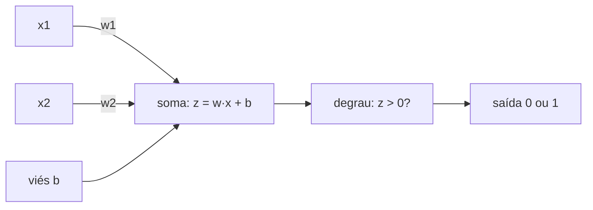

## Passo 1 · Leitura · Um neurônio que decide

Um neurônio do cérebro recebe sinais de outros neurônios pelas sinapses, algumas mais fortes e outras mais fracas, e dispara quando a soma do que chega passa de um limiar. A biologia real é muito mais complicada do que isso, e as redes deste nível não imitam o cérebro; só herdaram dele uma ideia: **somar entradas com pesos e decidir**.

Em 1943, Warren McCulloch e Walter Pitts descreveram um neurônio lógico: entradas binárias, um limiar e uma saída binária, com pesos escolhidos à mão. Em 1958, Frank Rosenblatt propôs o **perceptron**, um neurônio do mesmo tipo que **aprende** os pesos a partir de exemplos rotulados. É desse passo, de pesos escritos à mão para pesos aprendidos com dados, que este nível inteiro sai.

O neurônio artificial recebe um vetor de entradas $x = (x_1, \dots, x_d)$, multiplica cada uma por um peso, soma tudo com um **viés** $b$ e passa o resultado por uma **ativação**. No perceptron, a ativação é o degrau:

$$
z = w \cdot x + b = \sum_{j=1}^{d} w_j x_j + b, \qquad
\hat y = \begin{cases} 1 & \text{se } z > 0 \\ 0 & \text{se } z \le 0 \end{cases}
$$



O peso diz quanto cada entrada importa e em que direção: peso negativo faz a entrada empurrar para o 0. O viés desloca o limiar: com $b = -1{,}5$, a soma ponderada precisa passar de 1,5 para o neurônio disparar. Quem já pensou em "limiar" $\theta$ escreve $w \cdot x > \theta$, que é o mesmo que $b = -\theta$; confundir os dois sinais é um erro comum.

Com numpy, um lote inteiro de exemplos é calculado de uma vez: `X` tem uma linha por exemplo, e `X @ w + b` dá um $z$ por linha.

```python
import numpy as np

X = np.array([[0.0, 0.0], [0.0, 1.0], [1.0, 0.0], [1.0, 1.0]])
w = np.array([1.0, 1.0])
z = X @ w - 1.5          # um z por exemplo
saida = (z > 0).astype(int)
```

O caso de fronteira importa: quando $z$ é exatamente 0, a convenção desta lição é responder 0. Com `>=` no lugar de `>` a mesma rede responde outra coisa nos pontos sobre o limiar.

## Passo 2 · Previsão · As saídas de um perceptron

O programa calcula a soma ponderada e a saída do perceptron nas quatro entradas de duas variáveis binárias, com dois viéses diferentes. Leia sem executar e digite o que ele imprime.

### Código
```python
import numpy as np

X = np.array([[0.0, 0.0], [0.0, 1.0], [1.0, 0.0], [1.0, 1.0]])
w = np.array([1.0, 1.0])

z = X @ w - 1.5
print(z.tolist())
print((z > 0).astype(int).tolist())

z = X @ w - 1.0
print(z.tolist())
print((z > 0).astype(int).tolist())
print((z >= 0).astype(int).tolist())
```

### Dicas
1. `X @ w` soma as duas colunas de cada linha, porque os dois pesos valem 1.
2. Com viés -1,0, duas entradas dão z exatamente 0.
3. `>` e `>=` só discordam onde z é 0.

### Saída esperada
```text
[-1.5, -0.5, -0.5, 0.5]
[0, 0, 0, 1]
[-1.0, 0.0, 0.0, 1.0]
[0, 0, 0, 1]
[0, 1, 1, 1]
```

## Passo 3 · Exercício · Prever com o perceptron
modo: lacunas

Complete as lacunas (`___`) das duas funções. `X` tem uma linha por exemplo e uma coluna por entrada; `w` tem um peso por coluna; `b` é um número.

### Instruções
1. `soma_ponderada(X, w, b)` devolve um array com um $z = w \cdot x + b$ por linha de `X`.
2. `perceptron_prever(X, w, b)` devolve um array de inteiros, 1 onde $z > 0$ e 0 nas outras linhas.
3. Quando $z$ é exatamente 0, a previsão é 0.

### Código inicial
```python
import numpy as np


def soma_ponderada(X, w, b):
    X = np.asarray(X, dtype=float)
    w = np.asarray(w, dtype=float)
    return ___


def perceptron_prever(X, w, b):
    z = soma_ponderada(X, w, b)
    return (___).astype(int)
```

### Solução
```python
import numpy as np


def soma_ponderada(X, w, b):
    X = np.asarray(X, dtype=float)
    w = np.asarray(w, dtype=float)
    return X @ w + b


def perceptron_prever(X, w, b):
    z = soma_ponderada(X, w, b)
    return (z > 0).astype(int)
```

### Dicas
1. O produto de uma matriz `(n, d)` por um vetor `(d,)` dá um vetor `(n,)`: é o operador `@`, com `X` à esquerda.
2. O viés entra somado, com o sinal que tem.
3. A comparação devolve booleanos; `.astype(int)` os transforma em 0 e 1.

### Verificação
```json
[
  {"id": "soma-and", "checkpoint": 1, "kind": "expr", "setup": "X = [[0, 0], [0, 1], [1, 0], [1, 1]]\n", "expr": "soma_ponderada(X, [1.0, 1.0], -1.5).tolist()", "expected": [-1.5, -0.5, -0.5, 0.5], "tolerance": 1e-12, "name": "soma_ponderada nas 4 entradas do AND com w = [1, 1] e b = -1,5", "hint": "Cada linha de X vira um número: o produto escalar com w, mais o viés."},
  {"id": "soma-tres-entradas", "checkpoint": 1, "kind": "expr", "expr": "soma_ponderada([[1.0, 2.0, 3.0], [-1.0, 0.0, 2.0]], [0.5, -1.0, 2.0], 0.25).tolist()", "expected": [4.75, 3.75], "tolerance": 1e-12, "name": "Três entradas, pesos negativos e viés positivo", "hint": "O viés é somado, com o sinal que ele tem."},
  {"id": "soma-forma", "checkpoint": 1, "kind": "expr", "setup": "import numpy as np\nz = soma_ponderada(np.ones((5, 3)), np.ones(3), 0.0)", "expr": "[type(z).__name__, list(z.shape)]", "expected": ["ndarray", [5]], "name": "Um número por exemplo: 5 exemplos de 3 entradas dão um array de forma (5,)", "hint": "Produto de matriz por vetor, não multiplicação elemento a elemento."},
  {"id": "prever-and", "checkpoint": 2, "kind": "expr", "setup": "X = [[0, 0], [0, 1], [1, 0], [1, 1]]\n", "expr": "perceptron_prever(X, [1.0, 1.0], -1.5).tolist()", "expected": [0, 0, 0, 1], "name": "Com w = [1, 1] e b = -1,5, o perceptron calcula o AND"},
  {"id": "prever-or", "checkpoint": 2, "kind": "expr", "setup": "X = [[0, 0], [0, 1], [1, 0], [1, 1]]\n", "expr": "perceptron_prever(X, [1.0, 1.0], -0.5).tolist()", "expected": [0, 1, 1, 1], "name": "Com w = [1, 1] e b = -0,5, o perceptron calcula o OR"},
  {"id": "prever-not", "checkpoint": 2, "kind": "expr", "expr": "perceptron_prever([[0.0], [1.0]], [-1.0], 0.5).tolist()", "expected": [1, 0], "name": "Uma entrada com peso negativo: o NOT", "hint": "Saída 1 quando z é positivo, 0 caso contrário; z pode ser negativo."},
  {"id": "prever-z-zero", "checkpoint": 3, "kind": "expr", "setup": "X = [[0, 0], [0, 1], [1, 0], [1, 1]]\n", "expr": "perceptron_prever(X, [1.0, 1.0], -1.0).tolist()", "expected": [0, 0, 0, 1], "name": "Quando z é exatamente 0, a saída é 0", "hint": "A convenção da lição é estrita: só z maior que zero dá 1."},
  {"id": "prever-tipo", "checkpoint": 3, "kind": "expr", "setup": "import numpy as np\np = perceptron_prever(np.array([[2.0, -1.0], [-3.0, 0.5], [0.0, 0.0]]), np.array([1.0, 1.0]), 0.0)", "expr": "[p.dtype.kind, p.tolist()]", "expected": ["i", [1, 0, 0]], "name": "Devolve inteiros 0 e 1, não booleanos nem -1", "hint": "Converta o resultado da comparação para inteiros."}
]
```

### Soluções erradas
```python name="degrau com z >= 0"
import numpy as np


def soma_ponderada(X, w, b):
    X = np.asarray(X, dtype=float)
    w = np.asarray(w, dtype=float)
    return X @ w + b


def perceptron_prever(X, w, b):
    z = soma_ponderada(X, w, b)
    return (z >= 0).astype(int)
```
```python name="esquece o viés"
import numpy as np


def soma_ponderada(X, w, b):
    X = np.asarray(X, dtype=float)
    w = np.asarray(w, dtype=float)
    return X @ w


def perceptron_prever(X, w, b):
    z = soma_ponderada(X, w, b)
    return (z > 0).astype(int)
```
```python name="viés como limiar (subtrai b)"
import numpy as np


def soma_ponderada(X, w, b):
    X = np.asarray(X, dtype=float)
    w = np.asarray(w, dtype=float)
    return X @ w - b


def perceptron_prever(X, w, b):
    z = soma_ponderada(X, w, b)
    return (z > 0).astype(int)
```
```python name="multiplica elemento a elemento"
import numpy as np


def soma_ponderada(X, w, b):
    X = np.asarray(X, dtype=float)
    w = np.asarray(w, dtype=float)
    return X * w + b


def perceptron_prever(X, w, b):
    z = soma_ponderada(X, w, b)
    return (z > 0).astype(int)
```
```python name="ordem do produto trocada (w @ X)"
import numpy as np


def soma_ponderada(X, w, b):
    X = np.asarray(X, dtype=float)
    w = np.asarray(w, dtype=float)
    return w @ X + b


def perceptron_prever(X, w, b):
    z = soma_ponderada(X, w, b)
    return (z > 0).astype(int)
```
```python name="saída com o sinal de z (-1, 0, 1)"
import numpy as np


def soma_ponderada(X, w, b):
    X = np.asarray(X, dtype=float)
    w = np.asarray(w, dtype=float)
    return X @ w + b


def perceptron_prever(X, w, b):
    z = soma_ponderada(X, w, b)
    return (np.sign(z)).astype(int)
```

## Passo 4 · Leitura · A regra de aprendizado

O perceptron aprende olhando um exemplo de cada vez. Se acerta, não muda nada. Se erra, corrige os pesos na direção do exemplo, com a **taxa de aprendizado** $\eta$ controlando o tamanho do passo:

$$
w \leftarrow w + \eta\,(y - \hat y)\,x, \qquad b \leftarrow b + \eta\,(y - \hat y)
$$

Com rótulos 0 e 1, o erro $y - \hat y$ só tem três valores. Se a resposta certa era 1 e o perceptron disse 0, o erro é $+1$ e os pesos ganham $\eta x$: da próxima vez, $w \cdot x$ fica maior em $\eta \lVert x \rVert^2$, mais perto de passar do limiar. Se a resposta certa era 0 e ele disse 1, o erro é $-1$ e os pesos perdem $\eta x$. Se acertou, o erro é 0 e nada muda.

Geometricamente, $w \cdot x + b = 0$ é uma reta no plano das entradas (um plano, com mais entradas), e cada correção gira e desloca essa reta para o lado do exemplo que estava do lado errado. Uma **época** é uma passada por todos os exemplos, na ordem.

Rode o visualizador e acompanhe duas épocas no AND, começando com pesos e viés em zero:

```python visualizar
X = [(0, 0), (0, 1), (1, 0), (1, 1)]
y = [0, 0, 0, 1]
w = [0.0, 0.0]
b = 0.0
taxa = 1.0
for epoca in range(1, 3):
    for (x1, x2), alvo in zip(X, y):
        z = w[0] * x1 + w[1] * x2 + b
        previsto = 1 if z > 0 else 0
        erro = alvo - previsto
        if erro != 0:
            w[0] += taxa * erro * x1
            w[1] += taxa * erro * x2
            b += taxa * erro
            print(f"época {epoca}, x = ({x1}, {x2}): previu {previsto}, alvo {alvo} -> w = {w}, b = {b}")
```

Na primeira época só o $(1, 1)$ erra; na segunda, a correção exagerou e três exemplos erram. O processo oscila antes de acertar, e mesmo assim termina: se existe alguma reta que separa os rótulos, o **teorema de convergência do perceptron** garante que a regra chega a uma delas em um número finito de correções, qualquer que seja a ordem dos exemplos. A lição não demonstra o teorema, mas os exercícios mostram as duas faces dele: no AND e no OR o treino para numa época sem erro; num conjunto que nenhuma reta separa, nunca para sozinho.

## Passo 5 · Exercício · Treinar o perceptron

Escreva o algoritmo de Rosenblatt para rótulos 0 e 1.

### Instruções
1. `treinar_perceptron(X, y, epocas, taxa=1.0)` começa com os pesos `w` (um por coluna de `X`) e o viés `b` em zero, e não altera `X`.
2. Em cada época, percorre os exemplos na ordem dada; para cada um, calcula a previsão com os pesos **atuais** (1 se $z > 0$, senão 0) e, se ela erra, aplica a regra de atualização com a `taxa` nos pesos e no viés.
3. Conta os erros de cada época numa lista `erros_por_epoca` e para logo depois de uma época sem nenhum erro.
4. Roda no máximo `epocas` épocas e devolve a tupla `(w, b, erros_por_epoca)`, com `w` um array numpy.

### Código inicial
```python
import numpy as np


def treinar_perceptron(X, y, epocas, taxa=1.0):
    pass
```

### Solução
```python
import numpy as np


def treinar_perceptron(X, y, epocas, taxa=1.0):
    X = np.asarray(X, dtype=float)
    y = np.asarray(y)
    w = np.zeros(X.shape[1])
    b = 0.0
    erros_por_epoca = []
    for _ in range(epocas):
        erros = 0
        for xi, yi in zip(X, y):
            y_hat = 1 if xi @ w + b > 0 else 0
            erro = yi - y_hat
            if erro != 0:
                w = w + taxa * erro * xi
                b = b + taxa * erro
                erros += 1
        erros_por_epoca.append(erros)
        if erros == 0:
            break
    return w, b, erros_por_epoca
```

### Dicas
1. Dois laços: o de fora conta as épocas, o de dentro percorre os pares `(xi, yi)` com `zip`.
2. O contador de erros recomeça em zero a cada época; a lista ganha um número por época.
3. Com rótulos 0 e 1, a correção usa `y - ŷ`, que vale 0 quando o exemplo foi acertado.

### Verificação
```json
[
  {"id": "and-converge", "checkpoint": 3, "kind": "expr", "setup": "import numpy as np\n_prev = lambda X, w, b: (np.asarray(X, dtype=float) @ w + b > 0).astype(int).tolist()\nX = [[0, 0], [0, 1], [1, 0], [1, 1]]\nw, b, erros = treinar_perceptron(X, [0, 0, 0, 1], 20)", "expr": "[_prev(X, w, b), erros[-1]]", "expected": [[0, 0, 0, 1], 0], "name": "No AND, termina com uma época sem erro e os pesos finais acertam as 4 entradas", "hint": "O primeiro número é a previsão com os pesos devolvidos; o segundo, os erros da última época."},
  {"id": "and-passo-a-passo", "checkpoint": 2, "kind": "expr", "setup": "X = [[0, 0], [0, 1], [1, 0], [1, 1]]\nw, b, erros = treinar_perceptron(X, [0, 0, 0, 1], 20)", "expr": "[[float(v) for v in w], float(b), [int(e) for e in erros]]", "expected": [[2.0, 1.0], -2.0, [1, 3, 3, 2, 1, 0]], "name": "AND com taxa 1: pesos, viés e erros por época iguais aos da regra aplicada à mão", "hint": "Pesos e viés começam em zero; os exemplos vão na ordem dada; só se atualiza quando a previsão erra, com o erro y - ŷ."},
  {"id": "or-converge", "checkpoint": 3, "kind": "expr", "setup": "import numpy as np\n_prev = lambda X, w, b: (np.asarray(X, dtype=float) @ w + b > 0).astype(int).tolist()\nX = [[0, 0], [0, 1], [1, 0], [1, 1]]\nw, b, erros = treinar_perceptron(X, [0, 1, 1, 1], 20)", "expr": "[_prev(X, w, b), [int(e) for e in erros]]", "expected": [[0, 1, 1, 1], [1, 2, 1, 0]], "name": "No OR, converge em 4 épocas e acerta as 4 entradas"},
  {"id": "nand", "checkpoint": 2, "kind": "expr", "setup": "import numpy as np\n_prev = lambda X, w, b: (np.asarray(X, dtype=float) @ w + b > 0).astype(int).tolist()\nX = [[0, 0], [0, 1], [1, 0], [1, 1]]\nw, b, erros = treinar_perceptron(X, [1, 1, 1, 0], 20)", "expr": "[_prev(X, w, b), [int(e) for e in erros]]", "expected": [[1, 1, 1, 0], [2, 3, 3, 2, 1, 0]], "name": "No NAND, converge e acerta", "hint": "Quando a previsão é 1 e o rótulo é 0, o erro é -1 e os pesos diminuem."},
  {"id": "maioria-tres-entradas", "checkpoint": 3, "kind": "expr", "setup": "import numpy as np\n_prev = lambda X, w, b: (np.asarray(X, dtype=float) @ w + b > 0).astype(int).tolist()\nX = [[0, 0, 0], [0, 0, 1], [0, 1, 0], [0, 1, 1], [1, 0, 0], [1, 0, 1], [1, 1, 0], [1, 1, 1]]\ny = [0, 0, 0, 1, 0, 1, 1, 1]\nw, b, erros = treinar_perceptron(X, y, 50)", "expr": "[list(w.shape), _prev(X, w, b) == y, erros[-1]]", "expected": [[3], true, 0], "name": "Maioria de 3 bits: um peso por entrada e convergência", "hint": "O vetor de pesos tem uma posição por coluna de X."},
  {"id": "xor-nao-converge", "checkpoint": 4, "kind": "expr", "setup": "X = [[0, 0], [0, 1], [1, 0], [1, 1]]\nw, b, erros = treinar_perceptron(X, [0, 1, 1, 0], 20)", "expr": "[len(erros), min(erros) > 0]", "expected": [20, true], "name": "No XOR, roda as 20 épocas e nenhuma termina sem erro", "hint": "erros_por_epoca tem um número por época executada."},
  {"id": "para-sem-erro", "checkpoint": 3, "kind": "expr", "setup": "X = [[0, 0], [0, 1], [1, 0], [1, 1]]\nw, b, erros = treinar_perceptron(X, [0, 0, 0, 0], 10)", "expr": "[[float(v) for v in w], float(b), [int(e) for e in erros]]", "expected": [[0.0, 0.0], 0.0, [0]], "name": "Se a primeira época não erra, para nela com os pesos em zero", "hint": "Depois de cada época, confira se ela teve zero erros."},
  {"id": "taxa", "checkpoint": 2, "kind": "expr", "setup": "X = [[0, 0], [0, 1], [1, 0], [1, 1]]\nw, b, erros = treinar_perceptron(X, [0, 0, 0, 1], 20, taxa=0.5)", "expr": "[[float(v) for v in w], float(b), [int(e) for e in erros]]", "expected": [[1.0, 0.5], -1.0, [1, 3, 3, 2, 1, 0]], "name": "Com taxa 0,5, os mesmos erros e pesos pela metade", "hint": "A taxa multiplica a correção dos pesos e a do viés."},
  {"id": "nao-altera-x", "checkpoint": 1, "kind": "expr", "setup": "import numpy as np\nX = np.array([[0.0, 0.0], [0.0, 1.0], [1.0, 0.0], [1.0, 1.0]])\ntreinar_perceptron(X, np.array([0, 0, 0, 1]), 20)", "expr": "X.tolist()", "expected": [[0.0, 0.0], [0.0, 1.0], [1.0, 0.0], [1.0, 1.0]], "name": "O X recebido não muda"}
]
```

### Soluções erradas
```python name="regra para rótulos ±1 (taxa * y * x)"
import numpy as np


def treinar_perceptron(X, y, epocas, taxa=1.0):
    X = np.asarray(X, dtype=float)
    y = np.asarray(y)
    w = np.zeros(X.shape[1])
    b = 0.0
    erros_por_epoca = []
    for _ in range(epocas):
        erros = 0
        for xi, yi in zip(X, y):
            y_hat = 1 if xi @ w + b > 0 else 0
            erro = yi - y_hat
            if erro != 0:
                w = w + taxa * yi * xi
                b = b + taxa * yi
                erros += 1
        erros_por_epoca.append(erros)
        if erros == 0:
            break
    return w, b, erros_por_epoca
```
```python name="viés nunca atualizado"
import numpy as np


def treinar_perceptron(X, y, epocas, taxa=1.0):
    X = np.asarray(X, dtype=float)
    y = np.asarray(y)
    w = np.zeros(X.shape[1])
    b = 0.0
    erros_por_epoca = []
    for _ in range(epocas):
        erros = 0
        for xi, yi in zip(X, y):
            y_hat = 1 if xi @ w + b > 0 else 0
            erro = yi - y_hat
            if erro != 0:
                w = w + taxa * erro * xi
                erros += 1
        erros_por_epoca.append(erros)
        if erros == 0:
            break
    return w, b, erros_por_epoca
```
```python name="degrau com z >= 0"
import numpy as np


def treinar_perceptron(X, y, epocas, taxa=1.0):
    X = np.asarray(X, dtype=float)
    y = np.asarray(y)
    w = np.zeros(X.shape[1])
    b = 0.0
    erros_por_epoca = []
    for _ in range(epocas):
        erros = 0
        for xi, yi in zip(X, y):
            y_hat = 1 if xi @ w + b >= 0 else 0
            erro = yi - y_hat
            if erro != 0:
                w = w + taxa * erro * xi
                b = b + taxa * erro
                erros += 1
        erros_por_epoca.append(erros)
        if erros == 0:
            break
    return w, b, erros_por_epoca
```
```python name="para na primeira época"
import numpy as np


def treinar_perceptron(X, y, epocas, taxa=1.0):
    X = np.asarray(X, dtype=float)
    y = np.asarray(y)
    w = np.zeros(X.shape[1])
    b = 0.0
    erros_por_epoca = []
    for _ in range(epocas):
        erros = 0
        for xi, yi in zip(X, y):
            y_hat = 1 if xi @ w + b > 0 else 0
            erro = yi - y_hat
            if erro != 0:
                w = w + taxa * erro * xi
                b = b + taxa * erro
                erros += 1
        erros_por_epoca.append(erros)
        break
    return w, b, erros_por_epoca
```
```python name="não para quando a época não erra"
import numpy as np


def treinar_perceptron(X, y, epocas, taxa=1.0):
    X = np.asarray(X, dtype=float)
    y = np.asarray(y)
    w = np.zeros(X.shape[1])
    b = 0.0
    erros_por_epoca = []
    for _ in range(epocas):
        erros = 0
        for xi, yi in zip(X, y):
            y_hat = 1 if xi @ w + b > 0 else 0
            erro = yi - y_hat
            if erro != 0:
                w = w + taxa * erro * xi
                b = b + taxa * erro
                erros += 1
        erros_por_epoca.append(erros)
    return w, b, erros_por_epoca
```
```python name="contador de erros fora do laço das épocas"
import numpy as np


def treinar_perceptron(X, y, epocas, taxa=1.0):
    X = np.asarray(X, dtype=float)
    y = np.asarray(y)
    w = np.zeros(X.shape[1])
    b = 0.0
    erros_por_epoca = []
    erros = 0
    for _ in range(epocas):
        for xi, yi in zip(X, y):
            y_hat = 1 if xi @ w + b > 0 else 0
            erro = yi - y_hat
            if erro != 0:
                w = w + taxa * erro * xi
                b = b + taxa * erro
                erros += 1
        erros_por_epoca.append(erros)
        if erros == 0:
            break
    return w, b, erros_por_epoca
```
```python name="ignora a taxa"
import numpy as np


def treinar_perceptron(X, y, epocas, taxa=1.0):
    X = np.asarray(X, dtype=float)
    y = np.asarray(y)
    w = np.zeros(X.shape[1])
    b = 0.0
    erros_por_epoca = []
    for _ in range(epocas):
        erros = 0
        for xi, yi in zip(X, y):
            y_hat = 1 if xi @ w + b > 0 else 0
            erro = yi - y_hat
            if erro != 0:
                w = w + erro * xi
                b = b + erro
                erros += 1
        erros_por_epoca.append(erros)
        if erros == 0:
            break
    return w, b, erros_por_epoca
```
```python name="previsões da época calculadas antes de atualizar"
import numpy as np


def treinar_perceptron(X, y, epocas, taxa=1.0):
    X = np.asarray(X, dtype=float)
    y = np.asarray(y)
    w = np.zeros(X.shape[1])
    b = 0.0
    erros_por_epoca = []
    for _ in range(epocas):
        erros = 0
        previsoes = (X @ w + b > 0).astype(int)
        for xi, yi, y_hat in zip(X, y, previsoes):
            erro = yi - y_hat
            if erro != 0:
                w = w + taxa * erro * xi
                b = b + taxa * erro
                erros += 1
        erros_por_epoca.append(erros)
        if erros == 0:
            break
    return w, b, erros_por_epoca
```

## Passo 6 · Leitura · Perceptron, logística e a fronteira

O perceptron aprende, mas não por gradiente. O degrau é constante dos dois lados do zero: a derivada dele é 0 em todo ponto onde existe. Uma perda calculada sobre $\hat y$ não diz para que lado mexer em $w$, e é por isso que a regra do perceptron é uma receita própria, e não uma descida de gradiente.

A regressão logística do Nível 5 troca o degrau por uma versão suave, a sigmoide $\sigma(z) = \frac{1}{1 + e^{-z}}$, que vai de 0 a 1 sem salto e tem derivada em todo ponto. Com a entropia cruzada, o gradiente da perda de **um** exemplo é $(\sigma(z) - y)\,x$, e um passo de descida fica:

$$
w \leftarrow w + \eta\,\bigl(y - \sigma(z)\bigr)\,x
$$

É a regra do perceptron com a probabilidade $\sigma(z)$ no lugar da previsão $\hat y$. A diferença é que a logística corrige **sempre**, um pouco mais quando erra feio e um pouco menos quando acerta com folga, e a perda dela tem um mínimo bem definido mesmo quando os dados não são separáveis. As redes dos próximos módulos são feitas de neurônios desse tipo, com ativações deriváveis, para que o gradiente passe por elas.

Nos dois modelos, a **fronteira de decisão** é o conjunto de pontos onde $z = 0$. Com duas entradas, é a reta

$$
w_1 x_1 + w_2 x_2 + b = 0 \quad\Longrightarrow\quad x_2 = -\frac{w_1 x_1 + b}{w_2}
$$

desde que $w_2 \neq 0$. Se $w_2 = 0$, a reta é vertical ($x_1 = -b / w_1$) e não pode ser escrita como função de $x_1$. Cuidado com o numpy: com `w` em `float64`, dividir por `w[1] == 0.0` não levanta erro, devolve `inf` ou `nan` em silêncio.

```python
w, b = np.array([2.0, 1.0]), -2.0      # pesos do AND treinado
x1 = np.array([0.0, 2.0])
x2 = -(w[0] * x1 + b) / w[1]           # [2.0, -2.0]
```

Os pontos com $z > 0$ ficam de um lado da reta e são previstos como 1; os outros, incluindo os que estão exatamente sobre ela, são previstos como 0. Um conjunto é **separável** quando existe uma reta que deixa todos os exemplos de rótulo 1 do lado positivo e todos os de rótulo 0 do outro.

## Passo 7 · Exercício · A fronteira de decisão

Escreva duas funções sobre a reta de um perceptron de duas entradas.

### Instruções
1. `fronteira(w, b, x_min, x_max)` devolve dois pontos `((x_min, y_min), (x_max, y_max))` da reta $w_1 x_1 + w_2 x_2 + b = 0$, com as coordenadas como `float`.
2. Se `w[1]` é zero, levanta `ValueError` (a reta seria vertical).
3. `separa(w, b, X, y)` devolve `True` se o perceptron de pesos `w` e viés `b` acerta todos os exemplos de `X` (rótulos 0 e 1 em `y`), com a convenção de que $z = 0$ é previsto como 0; senão, `False`.

### Código inicial
```python
import numpy as np


def fronteira(w, b, x_min, x_max):
    pass


def separa(w, b, X, y):
    pass
```

### Solução
```python
import numpy as np


def fronteira(w, b, x_min, x_max):
    if w[1] == 0:
        raise ValueError("w[1] é zero: a fronteira é uma reta vertical")
    y_min = -(w[0] * x_min + b) / w[1]
    y_max = -(w[0] * x_max + b) / w[1]
    return (float(x_min), float(y_min)), (float(x_max), float(y_max))


def separa(w, b, X, y):
    X = np.asarray(X, dtype=float)
    previstos = (X @ np.asarray(w, dtype=float) + b > 0).astype(int)
    return bool(np.all(previstos == np.asarray(y)))
```

### Dicas
1. Isole $x_2$ na equação da reta e calcule nos dois valores de $x_1$.
2. Confira `w[1]` antes de dividir: o numpy não reclama da divisão por zero.
3. Para `separa`, calcule as previsões como no passo 3 e compare com `y` em todos os exemplos.

### Verificação
```json
[
  {"id": "fronteira-and", "checkpoint": 1, "kind": "expr", "expr": "[[float(v) for v in p] for p in fronteira([2.0, 1.0], -2.0, 0.0, 2.0)]", "expected": [[0.0, 2.0], [2.0, -2.0]], "tolerance": 1e-12, "name": "A reta 2·x1 + x2 - 2 = 0 (o AND treinado) entre x1 = 0 e x1 = 2", "hint": "Isole x2 na equação w[0]·x1 + w[1]·x2 + b = 0."},
  {"id": "fronteira-negativo", "checkpoint": 1, "kind": "expr", "expr": "[[float(v) for v in p] for p in fronteira([1.0, -2.0], 1.0, -1.0, 3.0)]", "expected": [[-1.0, 0.0], [3.0, 2.0]], "tolerance": 1e-12, "name": "Peso negativo em x2 e viés positivo", "hint": "Confira o sinal: com w[1] negativo, a divisão inverte a inclinação."},
  {"id": "fronteira-horizontal", "checkpoint": 1, "kind": "expr", "expr": "[[float(v) for v in p] for p in fronteira([0.0, 2.0], -1.0, -5.0, 5.0)]", "expected": [[-5.0, 0.5], [5.0, 0.5]], "tolerance": 1e-12, "name": "Com w[0] = 0 a reta é horizontal"},
  {"id": "pontos-na-reta", "checkpoint": 1, "kind": "expr", "setup": "import numpy as np\nw, b = np.array([0.7, -1.3]), 0.4\np, q = fronteira(w, b, -2.0, 3.0)", "expr": "[bool(abs(w[0] * p[0] + w[1] * p[1] + b) < 1e-12), bool(abs(w[0] * q[0] + w[1] * q[1] + b) < 1e-12), float(p[0]), float(q[0])]", "expected": [true, true, -2.0, 3.0], "name": "Os dois pontos devolvidos satisfazem w·x + b = 0 e começam em x_min e x_max", "hint": "Substitua cada ponto na equação da fronteira: o resultado precisa ser 0."},
  {"id": "vertical", "checkpoint": 2, "kind": "expr", "setup": "import numpy as np", "expr": "fronteira(np.array([1.0, 0.0]), -0.5, 0.0, 1.0)", "raises": "ValueError", "name": "w[1] = 0 levanta ValueError", "hint": "Com w[1] em float64 do numpy, dividir por zero não levanta erro: dá inf. Confira antes de dividir."},
  {"id": "separa-and", "checkpoint": 3, "kind": "expr", "setup": "X = [[0, 0], [0, 1], [1, 0], [1, 1]]\n", "expr": "separa([2.0, 1.0], -2.0, X, [0, 0, 0, 1])", "expected": true, "name": "Os pesos treinados no AND separam o AND"},
  {"id": "separa-errado", "checkpoint": 3, "kind": "expr", "setup": "X = [[0, 0], [0, 1], [1, 0], [1, 1]]\n", "expr": "separa([1.0, 1.0], -0.5, X, [0, 0, 0, 1])", "expected": false, "name": "Os pesos do OR não separam o AND", "hint": "Todos os exemplos precisam ficar do lado certo, não só a maioria."},
  {"id": "separa-xor", "checkpoint": 3, "kind": "expr", "setup": "X = [[0, 0], [0, 1], [1, 0], [1, 1]]\n", "expr": "separa([1.0, 1.0], -1.5, X, [0, 1, 1, 0])", "expected": false, "name": "No XOR, os pesos do AND erram 2 dos 4: não separa"},
  {"id": "separa-sobre-a-reta", "checkpoint": 3, "kind": "expr", "expr": "separa([1.0, 0.0], -1.0, [[1.0, 5.0], [2.0, 0.0]], [1, 1])", "expected": false, "name": "Um exemplo de rótulo 1 exatamente sobre a reta não está do lado certo", "hint": "Use a mesma convenção do perceptron: sobre a reta (z = 0) a previsão é 0."},
  {"id": "separa-negativos", "checkpoint": 3, "kind": "expr", "expr": "separa([1.0, 0.0], -1.0, [[0.0, 5.0], [3.0, 0.0]], [0, 1])", "expected": true, "name": "Separa quando cada exemplo está do seu lado"}
]
```

### Soluções erradas
```python name="sinal do viés trocado"
import numpy as np


def fronteira(w, b, x_min, x_max):
    if w[1] == 0:
        raise ValueError("w[1] é zero: a fronteira é uma reta vertical")
    y_min = -(w[0] * x_min - b) / w[1]
    y_max = -(w[0] * x_max - b) / w[1]
    return (float(x_min), float(y_min)), (float(x_max), float(y_max))


def separa(w, b, X, y):
    X = np.asarray(X, dtype=float)
    previstos = (X @ np.asarray(w, dtype=float) + b > 0).astype(int)
    return bool(np.all(previstos == np.asarray(y)))
```
```python name="esquece o sinal de menos ao isolar x2"
import numpy as np


def fronteira(w, b, x_min, x_max):
    if w[1] == 0:
        raise ValueError("w[1] é zero: a fronteira é uma reta vertical")
    y_min = (w[0] * x_min + b) / w[1]
    y_max = (w[0] * x_max + b) / w[1]
    return (float(x_min), float(y_min)), (float(x_max), float(y_max))


def separa(w, b, X, y):
    X = np.asarray(X, dtype=float)
    previstos = (X @ np.asarray(w, dtype=float) + b > 0).astype(int)
    return bool(np.all(previstos == np.asarray(y)))
```
```python name="divide por w[0] em vez de w[1]"
import numpy as np


def fronteira(w, b, x_min, x_max):
    if w[1] == 0:
        raise ValueError("w[1] é zero: a fronteira é uma reta vertical")
    y_min = -(w[1] * x_min + b) / w[0]
    y_max = -(w[1] * x_max + b) / w[0]
    return (float(x_min), float(y_min)), (float(x_max), float(y_max))


def separa(w, b, X, y):
    X = np.asarray(X, dtype=float)
    previstos = (X @ np.asarray(w, dtype=float) + b > 0).astype(int)
    return bool(np.all(previstos == np.asarray(y)))
```
```python name="não confere w[1] == 0"
import numpy as np


def fronteira(w, b, x_min, x_max):
    y_min = -(w[0] * x_min + b) / w[1]
    y_max = -(w[0] * x_max + b) / w[1]
    return (float(x_min), float(y_min)), (float(x_max), float(y_max))


def separa(w, b, X, y):
    X = np.asarray(X, dtype=float)
    previstos = (X @ np.asarray(w, dtype=float) + b > 0).astype(int)
    return bool(np.all(previstos == np.asarray(y)))
```
```python name="separa com z >= 0"
import numpy as np


def fronteira(w, b, x_min, x_max):
    if w[1] == 0:
        raise ValueError("w[1] é zero: a fronteira é uma reta vertical")
    y_min = -(w[0] * x_min + b) / w[1]
    y_max = -(w[0] * x_max + b) / w[1]
    return (float(x_min), float(y_min)), (float(x_max), float(y_max))


def separa(w, b, X, y):
    X = np.asarray(X, dtype=float)
    previstos = (X @ np.asarray(w, dtype=float) + b >= 0).astype(int)
    return bool(np.all(previstos == np.asarray(y)))
```
```python name="separa basta um acerto (np.any)"
import numpy as np


def fronteira(w, b, x_min, x_max):
    if w[1] == 0:
        raise ValueError("w[1] é zero: a fronteira é uma reta vertical")
    y_min = -(w[0] * x_min + b) / w[1]
    y_max = -(w[0] * x_max + b) / w[1]
    return (float(x_min), float(y_min)), (float(x_max), float(y_max))


def separa(w, b, X, y):
    X = np.asarray(X, dtype=float)
    previstos = (X @ np.asarray(w, dtype=float) + b > 0).astype(int)
    return bool(np.any(previstos == np.asarray(y)))
```
```python name="separa só confere os positivos"
import numpy as np


def fronteira(w, b, x_min, x_max):
    if w[1] == 0:
        raise ValueError("w[1] é zero: a fronteira é uma reta vertical")
    y_min = -(w[0] * x_min + b) / w[1]
    y_max = -(w[0] * x_max + b) / w[1]
    return (float(x_min), float(y_min)), (float(x_max), float(y_max))


def separa(w, b, X, y):
    X = np.asarray(X, dtype=float)
    previstos = (X @ np.asarray(w, dtype=float) + b > 0).astype(int)
    return bool(np.all(previstos[np.asarray(y) == 1] == 1))
```

## Passo 8 · Quiz · A regra do perceptron

### Pergunta
Um perceptron tem `w = [1.0, 1.0]` e `b = 0.0`. Ele recebe o exemplo `x = (1, 2)` com rótulo `y = 0`, e a taxa é 0,5. Como ficam os pesos e o viés depois desse exemplo?
- [ ] `w = [1.5, 2.0]`, `b = 0.5`
- [x] `w = [0.5, 0.0]`, `b = -0.5`
- [ ] `w = [1.0, 1.0]`, `b = 0.0`, porque o rótulo é 0
- [ ] `w = [0.5, 0.5]`, `b = -0.5`
> $z = 1 + 2 + 0 = 3 > 0$, então $\hat y = 1$ e o erro é $y - \hat y = -1$: os pesos perdem $0{,}5 \cdot x = (0{,}5;\ 1{,}0)$ e o viés perde 0,5. Somar a correção é usar o erro com o sinal trocado. Não mexer em nada é o que faz a regra dos rótulos ±1 (`w += taxa * y * x`) com $y = 0$. Tirar 0,5 de cada peso esquece de multiplicar pela entrada.

### Pergunta
O treino do perceptron nas quatro entradas do XOR (rótulos `[0, 1, 1, 0]`) com 20 épocas devolve:

```text
erros_por_epoca = [2, 3, 4, 4, 4, 4, 4, 4, 4, 4, 4, 4, 4, 4, 4, 4, 4, 4, 4, 4]
```

O que acontece com 1 000 épocas?
- [ ] Converge: a garantia do perceptron vale para qualquer conjunto, só demora mais
- [ ] Converge se a taxa for reduzida para 0,1
- [x] Não converge: nenhuma reta separa o XOR, e a garantia de convergência só vale para dados separáveis
- [ ] Converge se os exemplos forem embaralhados a cada época
> O teorema de convergência pressupõe que exista uma reta separadora; no XOR ela não existe (a próxima lição prova isso), então sempre sobra exemplo errado e o perceptron fica oscilando. Com pesos começando em zero, mudar a taxa só muda a escala de $w$ e $b$, e as previsões são as mesmas. Embaralhar muda a ordem das oscilações, não a existência da reta.

### Pergunta
Alguém escreve a atualização como `w = w + taxa * y * x` e `b = b + taxa * y`, aplicada só quando a previsão erra, com rótulos 0 e 1. No AND, `erros_por_epoca` fica `[1, 3, 3, 3, ...]` até o fim. Por quê?
- [ ] A taxa 1,0 é grande demais para essa regra
- [x] Essa é a regra para rótulos −1 e +1: com $y = 0$, os exemplos negativos que o perceptron erra nunca mudam os pesos
- [ ] O viés deveria ser atualizado com o sinal contrário
- [ ] O AND não é separável
> Com rótulos ±1, a correção $y\,x$ empurra para o lado certo nos dois casos. Com rótulos 0 e 1, $y = 0$ zera a correção justamente nos exemplos de rótulo 0 previstos como 1, e eles continuam errados para sempre. A regra certa para 0 e 1 usa o erro $y - \hat y$, que vale $-1$ nesses exemplos. A taxa não muda isso (todos os pesos só crescem), o sinal do viés é o mesmo dos pesos e o AND é separável (o treino correto converge em 6 épocas).
