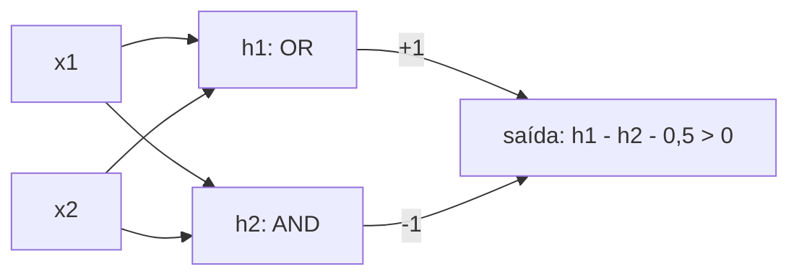

## Passo 1 · Leitura · Quatro pontos que nenhuma reta separa

Na lição anterior, o perceptron aprendeu o AND e o OR e ficou oscilando no XOR, o "ou exclusivo": a saída é 1 quando exatamente uma das duas entradas é 1. A culpa não é do algoritmo de treino. O que falta é uma reta.

| $x_1$ | $x_2$ | AND | OR | XOR |
|---|---|---|---|---|
| 0 | 0 | 0 | 0 | 0 |
| 0 | 1 | 0 | 1 | 1 |
| 1 | 0 | 0 | 1 | 1 |
| 1 | 1 | 1 | 1 | 0 |

Um conjunto é **linearmente separável** quando existe uma reta (um hiperplano, com mais entradas) que deixa todos os exemplos de rótulo 1 de um lado e todos os de rótulo 0 do outro. No AND, a reta $x_1 + x_2 = 1{,}5$ isola o canto $(1, 1)$. No XOR, os dois pontos de rótulo 1 estão numa diagonal do quadrado e os dois de rótulo 0 na outra; qualquer reta que separa um par de cantos opostos deixa os outros dois misturados.

A prova não precisa de desenho. Um perceptron com pesos $w_1, w_2$ e viés $b$ acertaria o XOR se as quatro condições valessem ao mesmo tempo:

$$
\begin{aligned}
(0, 0) \to 0 &: \quad b \le 0 \\
(1, 1) \to 0 &: \quad w_1 + w_2 + b \le 0 \\
(0, 1) \to 1 &: \quad w_2 + b > 0 \\
(1, 0) \to 1 &: \quad w_1 + b > 0
\end{aligned}
$$

Somando as duas primeiras, $w_1 + w_2 + 2b \le 0$. Somando as duas últimas, $w_1 + w_2 + 2b > 0$. A mesma quantidade não pode ser as duas coisas, então **nenhum** perceptron acerta os quatro pontos, quaisquer que sejam os pesos. O treino da lição anterior oscilava porque procurava algo que não existe.

```python
X = [(0, 0), (0, 1), (1, 0), (1, 1)]
y = [0, 1, 1, 0]
# qualquer (w1, w2, b) erra pelo menos um dos quatro pontos
```

O XOR não é uma curiosidade de lógica. Ele é o exemplo mínimo de uma situação comum: a resposta depende de uma **combinação** das entradas ("uma ou outra, mas não as duas"), e não de cada entrada empurrando sempre para o mesmo lado. Paridade de bits, "a temperatura está fora da faixa" e "as duas coordenadas têm o mesmo sinal" são casos do mesmo tipo. A saída desta lição é mudar as coordenadas antes de traçar a reta, com uma camada de neurônios no meio.

## Passo 2 · Previsão · O melhor perceptron no XOR

O programa conta os erros de alguns perceptrons no XOR e depois testa todas as combinações de pesos e viés inteiros de −2 a 2. Leia sem executar e digite o que ele imprime.

### Código
```python
import itertools

X = [(0, 0), (0, 1), (1, 0), (1, 1)]
y = [0, 1, 1, 0]


def erros(w1, w2, b):
    previstos = [1 if w1 * x1 + w2 * x2 + b > 0 else 0 for x1, x2 in X]
    return sum(p != alvo for p, alvo in zip(previstos, y))


print(erros(1, 1, -1.5), erros(1, 1, -0.5), erros(0, 0, 0))
grade = [-2, -1, 0, 1, 2]
todos = [erros(w1, w2, b) for w1, w2, b in itertools.product(grade, grade, grade)]
print(len(todos))
print(min(todos), max(todos))
print(sorted(set(todos)))
```

### Dicas
1. Os pesos `(1, 1, -1.5)` calculam o AND e `(1, 1, -0.5)`, o OR; compare cada um com o XOR. Com tudo zero, a previsão é sempre 0.
2. Pela leitura, zero erros é impossível. O argumento das quatro desigualdades, com os sinais trocados, também diz se dá para errar os quatro.
3. Errar os quatro exigiria prever 1 em `(0, 0)` e `(1, 1)` e 0 nos outros dois: some as desigualdades de novo.

### Saída esperada
```text
3 1 2
125
1 3
[1, 2, 3]
```

## Passo 3 · Exercício · Uma rede que resolve o XOR
modo: lacunas

A rede tem uma **camada escondida** de dois neurônios com degrau e um neurônio de saída, também com degrau. Os pesos já estão no código: as colunas de `W1` são os dois neurônios escondidos (o primeiro dispara quando $x_1 + x_2 > 0{,}5$, o segundo quando $x_1 + x_2 > 1{,}5$), e a saída calcula $h_1 - h_2 - 0{,}5$. Complete as lacunas (`___`) com as operações.

### Instruções
1. `camada_escondida(X)` devolve `H`, de forma `(n, 2)`: o degrau de $X W_1 + b_1$.
2. `rede_xor(X)` devolve um array com o XOR de cada linha de `X`, calculado a partir de `H` com `w2` e `b2`.
3. A saída também passa pelo degrau: inteiros 0 e 1, um por exemplo.

### Código inicial
```python
import numpy as np

W1 = np.array([[1.0, 1.0], [1.0, 1.0]])
b1 = np.array([-0.5, -1.5])
w2 = np.array([1.0, -1.0])
b2 = -0.5


def degrau(z):
    return (z > 0).astype(int)


def camada_escondida(X):
    X = np.asarray(X, dtype=float)
    return ___


def rede_xor(X):
    H = camada_escondida(X)
    return ___
```

### Solução
```python
import numpy as np

W1 = np.array([[1.0, 1.0], [1.0, 1.0]])
b1 = np.array([-0.5, -1.5])
w2 = np.array([1.0, -1.0])
b2 = -0.5


def degrau(z):
    return (z > 0).astype(int)


def camada_escondida(X):
    X = np.asarray(X, dtype=float)
    return degrau(X @ W1 + b1)


def rede_xor(X):
    H = camada_escondida(X)
    return degrau(H @ w2 + b2)
```

### Dicas
1. Uma camada é sempre produto de matriz, mais viés, e depois a ativação.
2. A saída enxerga só `H`, não as entradas originais.
3. `H @ w2` é uma matriz `(n, 2)` vezes um vetor `(2,)`: um número por exemplo.

### Verificação
```json
[
  {"id": "xor", "checkpoint": 2, "kind": "expr", "setup": "X = [[0, 0], [0, 1], [1, 0], [1, 1]]\n", "expr": "rede_xor(X).tolist()", "expected": [0, 1, 1, 0], "name": "rede_xor nas 4 entradas dá o XOR", "hint": "A saída é o degrau de H @ w2 + b2, onde H é a saída da camada escondida."},
  {"id": "escondida", "checkpoint": 1, "kind": "expr", "setup": "X = [[0, 0], [0, 1], [1, 0], [1, 1]]\n", "expr": "camada_escondida(X).tolist()", "expected": [[0, 0], [1, 0], [1, 0], [1, 1]], "name": "A camada escondida leva as 4 entradas para (0, 0), (1, 0), (1, 0) e (1, 1)", "hint": "Cada coluna de W1 é um neurônio: some X @ W1 com b1 e aplique o degrau."},
  {"id": "escondida-forma", "checkpoint": 1, "kind": "expr", "setup": "import numpy as np\nH = camada_escondida(np.zeros((6, 2)))", "expr": "[list(H.shape), H.dtype.kind]", "expected": [[6, 2], "i"], "name": "Seis exemplos dão H de forma (6, 2), com inteiros 0 e 1"},
  {"id": "outra-ordem", "checkpoint": 2, "kind": "expr", "expr": "rede_xor([[1, 1], [0, 0], [1, 0], [1, 0], [0, 1]]).tolist()", "expected": [0, 0, 1, 1, 1], "name": "Entradas repetidas e fora de ordem"},
  {"id": "um-exemplo", "checkpoint": 2, "kind": "expr", "expr": "rede_xor([[1, 0]]).tolist()", "expected": [1], "name": "Um lote com um exemplo só"},
  {"id": "entradas-reais", "checkpoint": 2, "kind": "expr", "expr": "rede_xor([[0.3, 0.3], [2.0, 2.0], [0.2, 0.1], [0.9, 0.0]]).tolist()", "expected": [1, 0, 0, 1], "name": "Entradas não binárias: soma entre 0,5 e 1,5 dá 1, fora dessa faixa dá 0", "hint": "O primeiro neurônio escondido dispara com soma acima de 0,5 e o segundo com soma acima de 1,5."},
  {"id": "saida-tipo", "checkpoint": 3, "kind": "expr", "setup": "X = [[0, 0], [0, 1], [1, 0], [1, 1]]\ns = rede_xor(X)", "expr": "[list(s.shape), s.dtype.kind]", "expected": [[4], "i"], "name": "A saída tem um inteiro 0 ou 1 por exemplo", "hint": "A saída também passa pelo degrau."}
]
```

### Soluções erradas
```python name="sem não linearidade na camada escondida"
import numpy as np

W1 = np.array([[1.0, 1.0], [1.0, 1.0]])
b1 = np.array([-0.5, -1.5])
w2 = np.array([1.0, -1.0])
b2 = -0.5


def degrau(z):
    return (z > 0).astype(int)


def camada_escondida(X):
    X = np.asarray(X, dtype=float)
    return X @ W1 + b1


def rede_xor(X):
    H = camada_escondida(X)
    return degrau(H @ w2 + b2)
```
```python name="viés da camada escondida com o sinal trocado"
import numpy as np

W1 = np.array([[1.0, 1.0], [1.0, 1.0]])
b1 = np.array([-0.5, -1.5])
w2 = np.array([1.0, -1.0])
b2 = -0.5


def degrau(z):
    return (z > 0).astype(int)


def camada_escondida(X):
    X = np.asarray(X, dtype=float)
    return degrau(X @ W1 - b1)


def rede_xor(X):
    H = camada_escondida(X)
    return degrau(H @ w2 + b2)
```
```python name="pula a camada escondida"
import numpy as np

W1 = np.array([[1.0, 1.0], [1.0, 1.0]])
b1 = np.array([-0.5, -1.5])
w2 = np.array([1.0, -1.0])
b2 = -0.5


def degrau(z):
    return (z > 0).astype(int)


def camada_escondida(X):
    X = np.asarray(X, dtype=float)
    return degrau(X @ W1 + b1)


def rede_xor(X):
    H = camada_escondida(X)
    return degrau(X @ w2 + b2)
```
```python name="pesos da saída com o sinal trocado"
import numpy as np

W1 = np.array([[1.0, 1.0], [1.0, 1.0]])
b1 = np.array([-0.5, -1.5])
w2 = np.array([1.0, -1.0])
b2 = -0.5


def degrau(z):
    return (z > 0).astype(int)


def camada_escondida(X):
    X = np.asarray(X, dtype=float)
    return degrau(X @ W1 + b1)


def rede_xor(X):
    H = camada_escondida(X)
    return degrau(H @ -w2 + b2)
```
```python name="viés da saída com o sinal trocado"
import numpy as np

W1 = np.array([[1.0, 1.0], [1.0, 1.0]])
b1 = np.array([-0.5, -1.5])
w2 = np.array([1.0, -1.0])
b2 = -0.5


def degrau(z):
    return (z > 0).astype(int)


def camada_escondida(X):
    X = np.asarray(X, dtype=float)
    return degrau(X @ W1 + b1)


def rede_xor(X):
    H = camada_escondida(X)
    return degrau(H @ w2 - b2)
```
```python name="esquece o degrau da saída"
import numpy as np

W1 = np.array([[1.0, 1.0], [1.0, 1.0]])
b1 = np.array([-0.5, -1.5])
w2 = np.array([1.0, -1.0])
b2 = -0.5


def degrau(z):
    return (z > 0).astype(int)


def camada_escondida(X):
    X = np.asarray(X, dtype=float)
    return degrau(X @ W1 + b1)


def rede_xor(X):
    H = camada_escondida(X)
    return H @ w2 + b2
```

## Passo 4 · Leitura · A camada escondida muda as coordenadas

Olhe o que a camada escondida do passo anterior faz com os quatro pontos. O primeiro neurônio calcula o OR das entradas; o segundo, o AND. Cada ponto $(x_1, x_2)$ vira um ponto novo $(h_1, h_2)$:

| $(x_1, x_2)$ | $h_1$ (OR) | $h_2$ (AND) | XOR |
|---|---|---|---|
| (0, 0) | 0 | 0 | 0 |
| (0, 1) | 1 | 0 | 1 |
| (1, 0) | 1 | 0 | 1 |
| (1, 1) | 1 | 1 | 0 |

Nas coordenadas novas, os dois pontos de rótulo 1 caíram no **mesmo** lugar, $(1, 0)$, e os de rótulo 0 ficaram em $(0, 0)$ e $(1, 1)$. Agora uma reta separa: $h_1 - h_2 - 0{,}5 = 0$ deixa $(1, 0)$ do lado positivo e os outros dois do negativo. O neurônio de saída é um perceptron comum; o que mudou foi o espaço em que ele traça a reta.



Essa é a ideia central de uma rede neural: cada camada transforma a representação dos dados para que a próxima tenha um problema mais fácil. Aqui os pesos foram escolhidos à mão; nos próximos módulos, o treino por gradiente vai encontrar pesos assim sozinho, inclusive representações que ninguém saberia escrever.

O ingrediente indispensável é a **não linearidade** entre as camadas. Sem o degrau, a camada escondida devolveria $X W_1 + b_1$, e a saída seria

$$
(X W_1 + b_1)\, W_2 + b_2 = X\,(W_1 W_2) + (b_1 W_2 + b_2)
$$

que é uma camada linear só, com pesos $W = W_1 W_2$ e viés $b = b_1 W_2 + b_2$. Empilhar camadas lineares não aumenta o que a rede consegue representar: dez camadas lineares calculam o mesmo que uma, e uma não resolve o XOR. É por isso que toda rede tem uma função de ativação entre as camadas. O degrau serviu para pesos escritos à mão; para treinar por gradiente, a próxima lição troca o degrau por funções com derivada útil, como a ReLU, $\max(0, z)$.

## Passo 5 · Exercício · Duas camadas lineares são uma

Confirme com numpy que duas camadas lineares colapsam em uma, e que basta uma ReLU no meio para isso deixar de valer. A convenção é a do nível: `X` tem forma `(n, d_in)`, `W1` é `(d_in, d_h)`, `b1` é `(d_h,)`, `W2` é `(d_h, d_out)` e `b2` é `(d_out,)`.

### Instruções
1. `composicao_linear(W1, b1, W2, b2)` devolve `(W, b)` tais que `X @ W + b` é igual a `(X @ W1 + b1) @ W2 + b2` para qualquer `X`, sem alterar os parâmetros recebidos.
2. `com_relu_difere(W1, b1, W2, b2, X)` devolve `True` se a rede com ReLU na camada escondida, `np.maximum(X @ W1 + b1, 0) @ W2 + b2`, dá uma saída diferente da rede sem ReLU, comparando com `np.allclose`; senão, `False`.

### Código inicial
```python
import numpy as np


def composicao_linear(W1, b1, W2, b2):
    pass


def com_relu_difere(W1, b1, W2, b2, X):
    pass
```

### Solução
```python
import numpy as np


def composicao_linear(W1, b1, W2, b2):
    W1, b1, W2, b2 = (np.asarray(a, dtype=float) for a in (W1, b1, W2, b2))
    W = W1 @ W2
    b = b1 @ W2 + b2
    return W, b


def com_relu_difere(W1, b1, W2, b2, X):
    X = np.asarray(X, dtype=float)
    W, b = composicao_linear(W1, b1, W2, b2)
    linear = X @ W + b
    com_relu = np.maximum(X @ W1 + b1, 0.0) @ W2 + b2
    return not np.allclose(com_relu, linear)
```

### Dicas
1. Expanda `(X @ W1 + b1) @ W2 + b2` pela distributiva: o que multiplica `X` é o novo `W`, o resto é o novo `b`.
2. O viés `b1` também atravessa a segunda camada.
3. Duas contas iguais por caminhos diferentes podem diferir no último dígito: compare com tolerância.

### Verificação
```json
[
  {"id": "valores", "checkpoint": 1, "kind": "expr", "setup": "W, b = composicao_linear([[1.0, 2.0], [0.0, 1.0]], [1.0, -1.0], [[2.0], [1.0]], [0.5])", "expr": "[W.tolist(), b.tolist()]", "expected": [[[4.0], [1.0]], [1.5]], "tolerance": 1e-12, "name": "Rede 2 → 2 → 1 escrita à mão: W = W1 @ W2 e o viés combinado", "hint": "Expanda (X @ W1 + b1) @ W2 + b2 e junte o que multiplica X e o que não multiplica."},
  {"id": "formas", "checkpoint": 1, "kind": "expr", "setup": "import numpy as np\nr = np.random.default_rng(1)\nW1, b1 = r.normal(size=(3, 5)), r.normal(size=5)\nW2, b2 = r.normal(size=(5, 2)), r.normal(size=2)\nX = r.normal(size=(6, 3))\nW, b = composicao_linear(W1, b1, W2, b2)", "expr": "[list(W.shape), list(b.shape)]", "expected": [[3, 2], [2]], "name": "Rede 3 → 5 → 2: W tem forma (3, 2) e b, (2,)", "hint": "A camada única vai direto da entrada (3) para a saída (2)."},
  {"id": "mesma-saida", "checkpoint": 1, "kind": "expr", "setup": "import numpy as np\nr = np.random.default_rng(2)\nW1, b1 = r.normal(size=(3, 5)), r.normal(size=5)\nW2, b2 = r.normal(size=(5, 2)), r.normal(size=2)\nX = r.normal(size=(6, 3))\nW, b = composicao_linear(W1, b1, W2, b2)", "expr": "bool(np.allclose(X @ W + b, (X @ W1 + b1) @ W2 + b2, atol=1e-12))", "expected": true, "name": "X @ W + b coincide com as duas camadas lineares em 6 exemplos sorteados", "hint": "Compara-se X @ W + b com (X @ W1 + b1) @ W2 + b2."},
  {"id": "vies-propagado", "checkpoint": 1, "kind": "expr", "setup": "W, b = composicao_linear([[1.0, 0.0], [0.0, 1.0]], [2.0, 3.0], [[1.0, -1.0], [2.0, 1.0]], [0.0, 0.0])", "expr": "b.tolist()", "expected": [8.0, 1.0], "tolerance": 1e-12, "name": "Com b2 = 0, o viés da primeira camada chega à saída multiplicado por W2", "hint": "b1 também passa pela segunda camada."},
  {"id": "nao-altera", "checkpoint": 1, "kind": "expr", "setup": "import numpy as np\nr = np.random.default_rng(3)\nW1, b1 = r.normal(size=(3, 5)), r.normal(size=5)\nW2, b2 = r.normal(size=(5, 2)), r.normal(size=2)\nX = r.normal(size=(6, 3))\ncopias = [a.copy() for a in (W1, b1, W2, b2)]\ncomposicao_linear(W1, b1, W2, b2)", "expr": "all(np.array_equal(a, c) for a, c in zip((W1, b1, W2, b2), copias))", "expected": true, "name": "Os parâmetros recebidos não mudam"},
  {"id": "relu-difere", "checkpoint": 2, "kind": "expr", "setup": "import numpy as np\nr = np.random.default_rng(5)\nW1, b1 = r.normal(size=(3, 5)), r.normal(size=5)\nW2, b2 = r.normal(size=(5, 2)), r.normal(size=2)\nX = r.normal(size=(6, 3))\n", "expr": "com_relu_difere(W1, b1, W2, b2, X)", "expected": true, "name": "Com pesos e entradas sorteados de uma normal, a ReLU muda a saída"},
  {"id": "relu-nao-difere", "checkpoint": 2, "kind": "expr", "setup": "import numpy as np\nr = np.random.default_rng(4)\nW1, b1 = r.uniform(0.1, 1.0, (3, 4)), r.uniform(0.1, 1.0, 4)\nW2, b2 = r.normal(size=(4, 2)), r.normal(size=2)\nX = r.uniform(0.1, 1.0, (5, 3))\n", "expr": "com_relu_difere(W1, b1, W2, b2, X)", "expected": false, "name": "Com todas as pré-ativações positivas, a ReLU não muda nada", "hint": "As duas saídas podem diferir no último dígito por arredondamento: compare com tolerância (np.allclose)."},
  {"id": "relu-so-na-escondida", "checkpoint": 2, "kind": "expr", "expr": "com_relu_difere([[1.0, -1.0]], [0.0, 0.0], [[1.0], [1.0]], [5.0], [[1.0], [2.0]])", "expected": true, "name": "A ReLU vai na camada escondida, mesmo quando a saída é positiva", "hint": "Aqui a saída linear é sempre 5, mas a segunda pré-ativação escondida é negativa."},
  {"id": "relu-tipo", "checkpoint": 2, "kind": "expr", "setup": "import numpy as np\nr = np.random.default_rng(6)\nW1, b1 = r.normal(size=(3, 5)), r.normal(size=5)\nW2, b2 = r.normal(size=(5, 2)), r.normal(size=2)\nX = r.normal(size=(6, 3))\n", "expr": "type(com_relu_difere(W1, b1, W2, b2, X)).__name__", "expected": "bool", "name": "com_relu_difere devolve um bool do Python"}
]
```

### Soluções erradas
```python name="W2 @ W1 (ordem trocada)"
import numpy as np


def composicao_linear(W1, b1, W2, b2):
    W1, b1, W2, b2 = (np.asarray(a, dtype=float) for a in (W1, b1, W2, b2))
    W = W2 @ W1
    b = b1 @ W2 + b2
    return W, b


def com_relu_difere(W1, b1, W2, b2, X):
    X = np.asarray(X, dtype=float)
    W, b = composicao_linear(W1, b1, W2, b2)
    linear = X @ W + b
    com_relu = np.maximum(X @ W1 + b1, 0.0) @ W2 + b2
    return not np.allclose(com_relu, linear)
```
```python name="viés sem passar por W2 (b1 + b2)"
import numpy as np


def composicao_linear(W1, b1, W2, b2):
    W1, b1, W2, b2 = (np.asarray(a, dtype=float) for a in (W1, b1, W2, b2))
    W = W1 @ W2
    b = b1 + b2
    return W, b


def com_relu_difere(W1, b1, W2, b2, X):
    X = np.asarray(X, dtype=float)
    W, b = composicao_linear(W1, b1, W2, b2)
    linear = X @ W + b
    com_relu = np.maximum(X @ W1 + b1, 0.0) @ W2 + b2
    return not np.allclose(com_relu, linear)
```
```python name="esquece o b1"
import numpy as np


def composicao_linear(W1, b1, W2, b2):
    W1, b1, W2, b2 = (np.asarray(a, dtype=float) for a in (W1, b1, W2, b2))
    W = W1 @ W2
    b = b2
    return W, b


def com_relu_difere(W1, b1, W2, b2, X):
    X = np.asarray(X, dtype=float)
    W, b = composicao_linear(W1, b1, W2, b2)
    linear = X @ W + b
    com_relu = np.maximum(X @ W1 + b1, 0.0) @ W2 + b2
    return not np.allclose(com_relu, linear)
```
```python name="esquece o b2"
import numpy as np


def composicao_linear(W1, b1, W2, b2):
    W1, b1, W2, b2 = (np.asarray(a, dtype=float) for a in (W1, b1, W2, b2))
    W = W1 @ W2
    b = b1 @ W2
    return W, b


def com_relu_difere(W1, b1, W2, b2, X):
    X = np.asarray(X, dtype=float)
    W, b = composicao_linear(W1, b1, W2, b2)
    linear = X @ W + b
    com_relu = np.maximum(X @ W1 + b1, 0.0) @ W2 + b2
    return not np.allclose(com_relu, linear)
```
```python name="compara com igualdade exata"
import numpy as np


def composicao_linear(W1, b1, W2, b2):
    W1, b1, W2, b2 = (np.asarray(a, dtype=float) for a in (W1, b1, W2, b2))
    W = W1 @ W2
    b = b1 @ W2 + b2
    return W, b


def com_relu_difere(W1, b1, W2, b2, X):
    X = np.asarray(X, dtype=float)
    W, b = composicao_linear(W1, b1, W2, b2)
    linear = X @ W + b
    com_relu = np.maximum(X @ W1 + b1, 0.0) @ W2 + b2
    return not np.array_equal(com_relu, linear)
```
```python name="ReLU na saída em vez da camada escondida"
import numpy as np


def composicao_linear(W1, b1, W2, b2):
    W1, b1, W2, b2 = (np.asarray(a, dtype=float) for a in (W1, b1, W2, b2))
    W = W1 @ W2
    b = b1 @ W2 + b2
    return W, b


def com_relu_difere(W1, b1, W2, b2, X):
    X = np.asarray(X, dtype=float)
    W, b = composicao_linear(W1, b1, W2, b2)
    linear = X @ W + b
    com_relu = np.maximum((X @ W1 + b1) @ W2 + b2, 0.0)
    return not np.allclose(com_relu, linear)
```
```python name="resposta invertida"
import numpy as np


def composicao_linear(W1, b1, W2, b2):
    W1, b1, W2, b2 = (np.asarray(a, dtype=float) for a in (W1, b1, W2, b2))
    W = W1 @ W2
    b = b1 @ W2 + b2
    return W, b


def com_relu_difere(W1, b1, W2, b2, X):
    X = np.asarray(X, dtype=float)
    W, b = composicao_linear(W1, b1, W2, b2)
    linear = X @ W + b
    com_relu = np.maximum(X @ W1 + b1, 0.0) @ W2 + b2
    return np.allclose(com_relu, linear)
```

## Passo 6 · Leitura · Aproximação universal, em uma página

Uma ReLU deslocada, $\max(0, x - c)$, é zero até $c$ e depois sobe com inclinação 1. Multiplicada por $a$, ela muda a inclinação de uma função em $a$ a partir do ponto $c$. Somando várias, com uma constante, dá para montar qualquer função **linear por partes**:

$$
f(x) \approx k + \sum_{i} a_i \max(0,\ x - c_i)
$$

Se a curva passa pelos nós $(c_0, y_0), (c_1, y_1), \dots$, a constante é $k = y_0$, o primeiro coeficiente é a inclinação do primeiro trecho e cada coeficiente seguinte é a **mudança** de inclinação naquele nó. Essa soma é exatamente uma rede com uma camada escondida de ReLUs (pesos 1 e vieses $-c_i$) e uma saída linear com pesos $a_i$.

Com mais nós, a aproximação melhora. Medido no executor, interpolando $\sin x$ em $[0, 2\pi]$ com nós igualmente espaçados:

| nós | 4 | 8 | 16 | 32 |
|---|---|---|---|---|
| erro máximo | 0,437 | 0,097 | 0,022 | 0,005 |

O **teorema da aproximação universal** diz, informalmente, que uma rede com uma camada escondida e neurônios suficientes aproxima qualquer função contínua num intervalo limitado com o erro que se quiser. A tabela mostra o mecanismo para uma variável. O teorema é uma garantia de **existência** e diz menos do que parece:

- não diz quantos neurônios são necessários, e esse número pode ser enorme;
- não diz que o gradiente descendente vai **encontrar** esses pesos: "pode aproximar" não é "vai aprender";
- não fala de exemplos fora do intervalo: a soma de 16 ReLUs que aproxima o seno com erro 0,022 em $[0, 2\pi]$ segue uma reta depois do último nó e vale cerca de 6,1 em $x = 4\pi$, onde o seno vale 0.

Na prática, redes **profundas** costumam precisar de muito menos neurônios do que uma camada larga: cada camada compõe as dobras da anterior, e o número de trechos lineares pode crescer muito mais depressa com a profundidade do que com a largura. É um dos motivos de o nível falar em "deep" learning.

## Passo 7 · Exercício · Aproximar com ReLUs

Escreva a interpolação linear por partes como soma de ReLUs, sem `np.interp`.

### Instruções
1. `interpolar_relu(x, nos_x, nos_y)` recebe os nós em ordem crescente de `nos_x` (pelo menos dois, não necessariamente igualmente espaçados) e devolve $y_0 + \sum_{k=0}^{m-2} a_k \max(0,\ x - x_k)$, onde $s_k = \frac{y_{k+1} - y_k}{x_{k+1} - x_k}$, $a_0 = s_0$ e $a_k = s_k - s_{k-1}$. Nos nós, devolve os valores dados; entre eles, a reta que os liga.
2. À esquerda do primeiro nó, a função vale $y_0$; à direita do último, continua com a última inclinação (é o que a fórmula dá).
3. `x` pode ser um número ou um array de qualquer tamanho; a saída tem a forma de `x`.

### Código inicial
```python
import numpy as np


def interpolar_relu(x, nos_x, nos_y):
    pass
```

### Solução
```python
import numpy as np


def interpolar_relu(x, nos_x, nos_y):
    x = np.asarray(x, dtype=float)
    nos_x = np.asarray(nos_x, dtype=float)
    nos_y = np.asarray(nos_y, dtype=float)
    inclinacoes = np.diff(nos_y) / np.diff(nos_x)
    a = np.diff(inclinacoes, prepend=0.0)
    relus = np.maximum(0.0, x[..., None] - nos_x[:-1])
    return nos_y[0] + relus @ a
```

### Dicas
1. `np.diff` dá as diferenças consecutivas: das inclinações saem as mudanças de inclinação (a primeira mudança é a própria primeira inclinação).
2. `x[..., None] - nos_x[:-1]` compara cada valor de `x` com cada nó de uma vez, para escalar ou array.
3. Depois da ReLU, um produto pelos coeficientes soma as contribuições de todos os nós.

### Verificação
```json
[
  {"id": "nos", "checkpoint": 1, "kind": "expr", "setup": "nx, ny = [0.0, 1.0, 3.0, 4.0], [1.0, 3.0, -1.0, 0.0]\n", "expr": "interpolar_relu(nx, nx, ny).tolist()", "expected": [1.0, 3.0, -1.0, 0.0], "tolerance": 1e-12, "name": "Nos próprios nós (espaçados de forma desigual), devolve os valores dados", "hint": "Os coeficientes são mudanças de inclinação, e as inclinações dividem pela distância entre os nós."},
  {"id": "entre-nos", "checkpoint": 1, "kind": "expr", "setup": "nx, ny = [0.0, 1.0, 3.0, 4.0], [1.0, 3.0, -1.0, 0.0]\n", "expr": "interpolar_relu([0.5, 2.0, 3.5], nx, ny).tolist()", "expected": [2.0, 1.0, -0.5], "tolerance": 1e-12, "name": "Entre dois nós, a reta que os liga"},
  {"id": "a-esquerda", "checkpoint": 2, "kind": "expr", "setup": "nx, ny = [0.0, 1.0, 3.0, 4.0], [1.0, 3.0, -1.0, 0.0]\n", "expr": "interpolar_relu([-1.0, -10.0], nx, ny).tolist()", "expected": [1.0, 1.0], "tolerance": 1e-12, "name": "À esquerda do primeiro nó, vale a constante (o primeiro valor)", "hint": "Antes do primeiro nó todas as ReLUs são zero."},
  {"id": "a-direita", "checkpoint": 2, "kind": "expr", "setup": "nx, ny = [0.0, 1.0, 3.0, 4.0], [1.0, 3.0, -1.0, 0.0]\n", "expr": "interpolar_relu([5.0, 6.0], nx, ny).tolist()", "expected": [1.0, 2.0], "tolerance": 1e-12, "name": "À direita do último nó, continua com a última inclinação"},
  {"id": "dois-nos", "checkpoint": 1, "kind": "expr", "expr": "interpolar_relu([0.0, 1.0, 2.0, 4.0], [0.0, 2.0], [1.0, 5.0]).tolist()", "expected": [1.0, 3.0, 5.0, 9.0], "tolerance": 1e-12, "name": "Com dois nós, é uma reta só"},
  {"id": "escalar", "checkpoint": 3, "kind": "expr", "setup": "nx, ny = [0.0, 1.0, 3.0, 4.0], [1.0, 3.0, -1.0, 0.0]\n", "expr": "float(interpolar_relu(2.0, nx, ny))", "expected": 1.0, "tolerance": 1e-12, "name": "Aceita um número só no lugar do array x"},
  {"id": "forma", "checkpoint": 3, "kind": "expr", "setup": "import numpy as np\nnx, ny = [0.0, 1.0, 3.0, 4.0], [1.0, 3.0, -1.0, 0.0]\ns = interpolar_relu(np.linspace(-1, 5, 7), nx, ny)", "expr": "[type(s).__name__, list(s.shape)]", "expected": ["ndarray", [7]], "name": "Um valor por posição de x"},
  {"id": "seno", "checkpoint": 1, "kind": "expr", "setup": "import numpy as np\ng = np.linspace(0, 2 * np.pi, 1001)\ndef _erro(m):\n    nx = np.linspace(0, 2 * np.pi, m)\n    return float(np.abs(interpolar_relu(g, nx, np.sin(nx)) - np.sin(g)).max())\n", "expr": "[round(_erro(4), 4), round(_erro(8), 4), round(_erro(16), 4)]", "expected": [0.4373, 0.0966, 0.0217], "tolerance": 0.0001, "name": "Erro máximo no seno em [0, 2π] com 4, 8 e 16 nós igualmente espaçados", "hint": "Compara-se o maior erro absoluto contra np.sin em 1 001 pontos; ele cai quando os nós dobram."},
  {"id": "sem-interp", "checkpoint": 1, "kind": "source", "rule": {"type": "not_calls", "name": "interp"}, "name": "Escreve a soma de ReLUs, sem np.interp"}
]
```

### Soluções erradas
```python name="coeficientes como diferença de valores"
import numpy as np


def interpolar_relu(x, nos_x, nos_y):
    x = np.asarray(x, dtype=float)
    nos_x = np.asarray(nos_x, dtype=float)
    nos_y = np.asarray(nos_y, dtype=float)
    inclinacoes = np.diff(nos_y)
    a = np.diff(inclinacoes, prepend=0.0)
    relus = np.maximum(0.0, x[..., None] - nos_x[:-1])
    return nos_y[0] + relus @ a
```
```python name="coeficientes iguais às inclinações"
import numpy as np


def interpolar_relu(x, nos_x, nos_y):
    x = np.asarray(x, dtype=float)
    nos_x = np.asarray(nos_x, dtype=float)
    nos_y = np.asarray(nos_y, dtype=float)
    inclinacoes = np.diff(nos_y) / np.diff(nos_x)
    a = inclinacoes
    relus = np.maximum(0.0, x[..., None] - nos_x[:-1])
    return nos_y[0] + relus @ a
```
```python name="ReLU virada (max(0, c - x))"
import numpy as np


def interpolar_relu(x, nos_x, nos_y):
    x = np.asarray(x, dtype=float)
    nos_x = np.asarray(nos_x, dtype=float)
    nos_y = np.asarray(nos_y, dtype=float)
    inclinacoes = np.diff(nos_y) / np.diff(nos_x)
    a = np.diff(inclinacoes, prepend=0.0)
    relus = np.maximum(0.0, nos_x[:-1] - x[..., None])
    return nos_y[0] + relus @ a
```
```python name="esquece a constante"
import numpy as np


def interpolar_relu(x, nos_x, nos_y):
    x = np.asarray(x, dtype=float)
    nos_x = np.asarray(nos_x, dtype=float)
    nos_y = np.asarray(nos_y, dtype=float)
    inclinacoes = np.diff(nos_y) / np.diff(nos_x)
    a = np.diff(inclinacoes, prepend=0.0)
    relus = np.maximum(0.0, x[..., None] - nos_x[:-1])
    return relus @ a
```
```python name="ReLUs a partir do segundo nó"
import numpy as np


def interpolar_relu(x, nos_x, nos_y):
    x = np.asarray(x, dtype=float)
    nos_x = np.asarray(nos_x, dtype=float)
    nos_y = np.asarray(nos_y, dtype=float)
    inclinacoes = np.diff(nos_y) / np.diff(nos_x)
    a = np.diff(inclinacoes, prepend=0.0)
    relus = np.maximum(0.0, x[..., None] - nos_x[1:])
    return nos_y[0] + relus @ a
```
```python name="usa np.interp"
import numpy as np


def interpolar_relu(x, nos_x, nos_y):
    x = np.asarray(x, dtype=float)
    nos_x = np.asarray(nos_x, dtype=float)
    nos_y = np.asarray(nos_y, dtype=float)
    return np.interp(x, nos_x, nos_y)
```

## Passo 8 · Quiz · Camadas e não linearidade

### Pergunta
Uma rede 2 → 16 → 16 → 1 **sem nenhuma ativação** é treinada no XOR com erro quadrático até a perda parar de cair. Quanto ela prevê nas quatro entradas?
- [ ] 0, 1, 1, 0: com 16 neurônios por camada sobra capacidade
- [ ] 0, 1, 1, 0, desde que o treino use mais épocas
- [x] 0,5 nas quatro: a rede inteira é uma única camada linear, e a melhor reta para o XOR em erro quadrático é a constante 0,5
- [ ] 0, 0, 0, 0, porque os pesos começam pequenos
> Sem ativação, $(XW_1 + b_1)W_2 + \dots$ colapsa em $XW + b$, um modelo linear com três números livres; largura e profundidade não mudam isso. O ajuste linear de mínimos quadrados do XOR dá $w = (0, 0)$ e $b = 0{,}5$ (medido no executor), ou seja, 0,5 em todas as entradas. Mais épocas só aproximam esse mesmo ótimo, e a inicialização pequena não muda para onde o treino converge.

### Pergunta
Ao juntar uma rede 3 → 5 → 2 sem ativações numa camada só, alguém escreve `b = b1 + b2` e recebe:

```text
ValueError: operands could not be broadcast together with shapes (5,) (2,)
```

Qual é o viés certo da camada equivalente?
- [ ] `b = b2`, porque o viés da primeira camada é absorvido pelos pesos
- [ ] `b = b1[:2] + b2`, para casar as formas
- [x] `b = b1 @ W2 + b2`: o viés da camada escondida também passa pela segunda camada
- [ ] `b = W2 @ b1 + b2`
> Expandindo, $(XW_1 + b_1)W_2 + b_2 = XW_1W_2 + (b_1 W_2 + b_2)$. O $b_1$ não some (só sumiria se fosse zero), e cortá-lo para caber faz a conta passar com números errados. `W2 @ b1` é $(5, 2)$ vezes $(5,)$ e dá o erro do `matmul`: o vetor fica à esquerda, como uma linha de $X$.

### Pergunta
Uma soma de 16 ReLUs aproxima $\sin x$ em $[0, 2\pi]$ com erro máximo 0,022. Qual afirmação está correta?
- [ ] O erro fica em torno de 0,022 para qualquer $x$, porque a rede aproxima o seno
- [x] Fora de $[0, 2\pi]$ a aproximação segue a última reta e se afasta do seno (vale cerca de 6,1 em $x = 4\pi$)
- [ ] Com 16 ReLUs o gradiente descendente sempre encontra esses mesmos coeficientes
- [ ] Para reduzir o erro à metade basta dobrar a constante $k$
> A aproximação universal vale num intervalo limitado; depois do último nó, todas as ReLUs crescem juntas e a função vira uma reta (6,1 em $4\pi$, medido). O teorema garante que os pesos existem, não que o treino os encontra. A constante só desloca a curva inteira; o erro cai com mais nós (0,097 com 8, 0,022 com 16).
