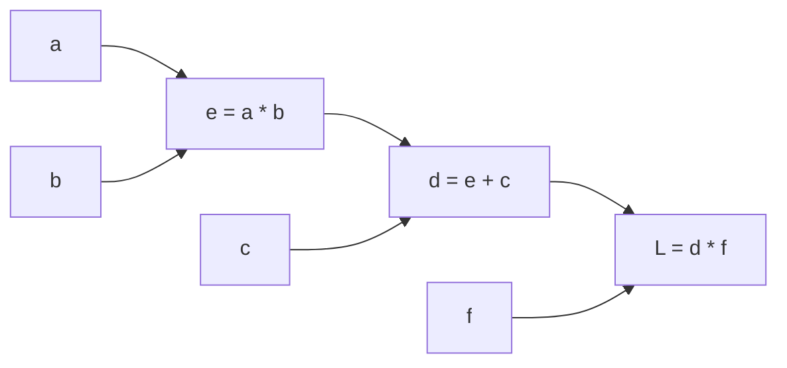

## Passo 1 · Leitura · Toda conta é um grafo

Treinar uma rede é ajustar milhares de números para que uma perda diminua, e para isso é preciso saber, para cada número, quanto a perda muda quando ele muda um pouco: a derivada da perda em relação a ele. No Nível 5 você derivou à mão a perda da regressão logística. Numa rede com várias camadas isso não escala, e o que as bibliotecas de deep learning fazem é decompor a conta em operações pequenas, cada uma com uma derivada fácil.

Veja a expressão $L = (a b + c) f$. O computador a calcula em três operações, e cada resultado intermediário ganha um nome:



Esse desenho é o **grafo computacional**. Percorrê-lo da esquerda para a direita, calculando os valores, é o **forward**. Cada nó conhece só a sua **derivada local**, a derivada da saída dele em relação a cada entrada:

$$
\frac{\partial (x + y)}{\partial x} = 1, \qquad
\frac{\partial (x \cdot y)}{\partial x} = y, \qquad
\frac{d \tanh(x)}{dx} = 1 - \tanh^2(x)
$$

Na soma, as duas entradas recebem 1; no produto, cada entrada recebe o **valor da outra**; na tanh, a derivada sai da própria saída $t$, como $1 - t^2$.

O **backward** percorre o grafo de trás para frente com a regra da cadeia. Começa em $\frac{\partial L}{\partial L} = 1$ e, em cada nó, multiplica o gradiente que chegou de cima pela derivada local:

$$
\frac{\partial L}{\partial a} = \frac{\partial L}{\partial e} \cdot \frac{\partial e}{\partial a} = \frac{\partial L}{\partial e} \cdot b
$$

Cada valor do grafo acaba com um número a mais, o **gradiente** (`grad`): quanto $L$ muda por unidade de mudança naquele valor. Se `grad` de $a$ vale 6, aumentar $a$ em 0,001 aumenta $L$ em cerca de 0,006.

Neste módulo você vai automatizar exatamente isso, numa classe `Valor` que guarda o número, o gradiente e de onde ele veio. Nesta lição o trabalho é à mão, para que cada passo do algoritmo fique visível antes de virar código.

## Passo 2 · Previsão · Os números do grafo

O programa faz o forward e o backward de $L = (a b + c) f$ com $a = 2$, $b = -3$, $c = 10$ e $f = -2$, e depois confere uma das derivadas mexendo em $a$. Leia sem executar e digite o que ele imprime.

### Código
```python
a, b, c, f = 2.0, -3.0, 10.0, -2.0
e = a * b
d = e + c
L = d * f
print(e, d, L)

dL_dd = f
dL_df = d
dL_de = dL_dd
dL_dc = dL_dd
dL_da = dL_de * b
dL_db = dL_de * a
print(dL_dd, dL_df)
print(dL_dc, dL_de)
print(dL_da, dL_db)

L_novo = ((a + 0.001) * b + c) * f
print(round(L_novo - L, 6))
```

### Dicas
1. No produto `L = d * f`, a derivada em relação a `d` é o outro fator, `f`.
2. A soma repassa o gradiente de `d` sem mudar para `e` e para `c`.
3. A última linha mede a mudança de `L` quando `a` sobe 0,001: compare com `dL_da`.

### Saída esperada
```text
-6.0 4.0 -8.0
-2.0 4.0
-2.0 -2.0
6.0 -4.0
0.006
```

## Passo 3 · Exercício · Retropropagação à mão
modo: ordenar

Arraste as linhas para montar `backprop_manual(a, b, c, f)`, que faz o forward e o backward de $L = (a b + c) f$, e ajuste a indentação. Três linhas estão sobrando.

### Instruções
1. Calcule o forward na ordem do grafo: `e = a * b`, `d = e + c` e `L = d * f`.
2. Comece o backward pelo último nó: `dL_dd` e `dL_df` são as derivadas locais do produto `d * f`.
3. A soma `d = e + c` repassa `dL_dd` para `dL_de` e para `dL_dc`.
4. O produto `e = a * b` dá `dL_da` e `dL_db`, cada um com o gradiente de cima vezes o outro fator. Devolva a tupla `(L, dL_da, dL_db, dL_dc, dL_df)`.

### Solução
```python
def backprop_manual(a, b, c, f):
    e = a * b
    d = e + c
    L = d * f
    dL_dd = f
    dL_df = d
    dL_de = dL_dd
    dL_dc = dL_dd
    dL_da = dL_de * b
    dL_db = dL_de * a
    return L, dL_da, dL_db, dL_dc, dL_df
```

### Distratores
```python
dL_da = dL_de + b
dL_db = dL_de * b
dL_df = f
```

### Dicas
1. Uma linha do backward só pode vir depois das linhas que calculam o que ela usa.
2. No produto, a derivada em relação a um fator é o **outro** fator.
3. O gradiente de cima multiplica a derivada local; ele nunca é somado a ela.

### Verificação
```json
[
  {"id": "exemplo", "checkpoint": 4, "kind": "call", "function": "backprop_manual", "args": [2.0, -3.0, 10.0, -2.0], "expected": [-8.0, 6.0, -4.0, -2.0, 4.0], "type": "tuple", "tolerance": 1e-12, "name": "a = 2, b = -3, c = 10, f = -2: (L, dL_da, dL_db, dL_dc, dL_df)", "hint": "Devolva a tupla na ordem (L, dL_da, dL_db, dL_dc, dL_df)."},
  {"id": "forward", "checkpoint": 1, "kind": "expr", "expr": "backprop_manual(1.0, 2.0, 3.0, 4.0)[0]", "expected": 20.0, "tolerance": 1e-12, "name": "O forward: L = (1 * 2 + 3) * 4"},
  {"id": "df", "checkpoint": 2, "kind": "expr", "expr": "backprop_manual(1.0, 2.0, 3.0, 4.0)[4]", "expected": 5.0, "tolerance": 1e-12, "name": "dL_df é o outro fator do produto, d = 5", "hint": "Em L = d * f, a derivada em relação a f é o outro operando."},
  {"id": "dc", "checkpoint": 3, "kind": "expr", "expr": "backprop_manual(1.0, 2.0, 3.0, 4.0)[3]", "expected": 4.0, "tolerance": 1e-12, "name": "dL_dc: a soma repassa o gradiente que chega em d", "hint": "A derivada local da soma é 1, mas ela multiplica o gradiente que vem de cima."},
  {"id": "da-db", "checkpoint": 4, "kind": "expr", "expr": "list(backprop_manual(1.0, 2.0, 3.0, 4.0)[1:3])", "expected": [8.0, 4.0], "tolerance": 1e-12, "name": "dL_da e dL_db com a = 1, b = 2, f = 4", "hint": "Cada fator do produto recebe o gradiente de cima vezes o outro fator."},
  {"id": "f-zero", "checkpoint": 4, "kind": "call", "function": "backprop_manual", "args": [5.0, 7.0, 1.0, 0.0], "expected": [0.0, 0.0, 0.0, 0.0, 36.0], "tolerance": 1e-12, "name": "Com f = 0, só dL_df não é zero"},
  {"id": "a-zero", "checkpoint": 4, "kind": "call", "function": "backprop_manual", "args": [0.0, 5.0, 1.0, 3.0], "expected": [3.0, 15.0, 0.0, 3.0, 1.0], "tolerance": 1e-12, "name": "Com a = 0, dL_db é zero e dL_da não"},
  {"id": "negativos", "checkpoint": 4, "kind": "call", "function": "backprop_manual", "args": [-1.5, 2.0, 0.5, -4.0], "expected": [10.0, -8.0, 6.0, -4.0, -2.5], "tolerance": 1e-12, "name": "a = -1.5, b = 2, c = 0.5, f = -4"}
]
```

### Soluções erradas
```python name="soma no lugar de multiplicar pelo gradiente de cima"
def backprop_manual(a, b, c, f):
    e = a * b
    d = e + c
    L = d * f
    dL_dd = f
    dL_df = d
    dL_de = dL_dd
    dL_dc = dL_dd
    dL_da = dL_de + b
    dL_db = dL_de * a
    return L, dL_da, dL_db, dL_dc, dL_df
```
```python name="operando trocado em dL_db"
def backprop_manual(a, b, c, f):
    e = a * b
    d = e + c
    L = d * f
    dL_dd = f
    dL_df = d
    dL_de = dL_dd
    dL_dc = dL_dd
    dL_da = dL_de * b
    dL_db = dL_de * b
    return L, dL_da, dL_db, dL_dc, dL_df
```
```python name="dL_df com o próprio f"
def backprop_manual(a, b, c, f):
    e = a * b
    d = e + c
    L = d * f
    dL_dd = f
    dL_df = f
    dL_de = dL_dd
    dL_dc = dL_dd
    dL_da = dL_de * b
    dL_db = dL_de * a
    return L, dL_da, dL_db, dL_dc, dL_df
```
```python name="dL_dc sem o gradiente de cima"
def backprop_manual(a, b, c, f):
    e = a * b
    d = e + c
    L = d * f
    dL_dd = f
    dL_df = d
    dL_de = dL_dd
    dL_dc = 1.0
    dL_da = dL_de * b
    dL_db = dL_de * a
    return L, dL_da, dL_db, dL_dc, dL_df
```
```python name="dL_da só com a derivada local"
def backprop_manual(a, b, c, f):
    e = a * b
    d = e + c
    L = d * f
    dL_dd = f
    dL_df = d
    dL_de = dL_dd
    dL_dc = dL_dd
    dL_da = b
    dL_db = dL_de * a
    return L, dL_da, dL_db, dL_dc, dL_df
```
```python name="dL_dd com o próprio d"
def backprop_manual(a, b, c, f):
    e = a * b
    d = e + c
    L = d * f
    dL_dd = d
    dL_df = d
    dL_de = dL_dd
    dL_dc = dL_dd
    dL_da = dL_de * b
    dL_db = dL_de * a
    return L, dL_da, dL_db, dL_dc, dL_df
```

## Passo 4 · Leitura · Uma variável em dois lugares

Até aqui cada valor entrou numa conta só. Na prática, o mesmo peso de uma rede é usado por todos os exemplos de um lote, e uma ativação alimenta vários neurônios da camada seguinte. O que acontece com o gradiente quando um valor aparece em mais de um lugar?

Considere $y = x \cdot x + 3x$. O grafo tem $u = x \cdot x$, $v = 3x$ e $y = u + v$, e o nó $x$ aparece em **três** entradas: os dois fatores do produto e o fator de $v$. Mudar $x$ um pouco muda $y$ pelos três caminhos ao mesmo tempo, e as mudanças se somam. É a regra da cadeia com várias variáveis:

$$
\frac{dy}{dx} = \sum_{\text{caminhos}} \frac{\partial y}{\partial (\text{entrada})} \cdot \frac{\partial (\text{entrada})}{\partial x}
= \underbrace{1 \cdot x}_{\text{1.º fator}} + \underbrace{1 \cdot x}_{\text{2.º fator}} + \underbrace{1 \cdot 3}_{v} = 2x + 3
$$

O resultado bate com a derivada de $x^2 + 3x$ que você conhece. Em código, o gradiente de $x$ precisa **acumular** as contribuições. O erro mais comum é sobrescrever:

```python
grad_x = 0.0
grad_x = dy_du * x      # primeiro fator de x * x
grad_x = dy_du * x      # segundo fator: apagou o primeiro
grad_x = dy_dv * 3      # apagou tudo: sobra 3, e não 2x + 3
```

Com `+=` no lugar de `=`, o resultado com $x = 2$ é 7, o certo. Com `=`, é 3, e nada avisa: o número tem a forma certa e o sinal certo.

Esse é o motivo de toda biblioteca de autograd **somar** nos gradientes (`grad += ...`) em vez de atribuir, e de começar todos eles em zero. A consequência também importa: se você calcular o backward duas vezes sem zerar, os gradientes dobram. A lição 3 do módulo volta a isso.

As derivadas locais das quatro operações básicas cabem numa tabela: na subtração $a - b$, $b$ recebe $-1$; na divisão $a / b$, $a$ recebe $1/b$ e $b$ recebe $-a/b^2$.

## Passo 5 · Exercício · Derivadas locais e caminhos

Escreva as derivadas locais das quatro operações e use-as para derivar uma expressão em que a variável aparece mais de uma vez.

### Instruções
1. `derivadas_locais(op, a, b)` devolve a tupla `(d_da, d_db)` com as derivadas de `a op b` em relação a `a` e a `b`, para `op` igual a `"+"`, `"-"`, `"*"` ou `"/"`.
2. Para qualquer outra operação, levanta `ValueError`.
3. `gradiente_dois_caminhos(x)` devolve a tupla `(y, dy_dx)` para $y = x \cdot x + 3x$, calculando `dy_dx` pelo grafo ($u = x \cdot x$, $v = 3x$, $y = u + v$): some a contribuição de cada lugar onde `x` aparece, usando `derivadas_locais`.

### Código inicial
```python
def derivadas_locais(op, a, b):
    pass


def gradiente_dois_caminhos(x):
    pass
```

### Solução
```python
def derivadas_locais(op, a, b):
    if op == "+":
        return 1.0, 1.0
    if op == "-":
        return 1.0, -1.0
    if op == "*":
        return b, a
    if op == "/":
        return 1 / b, -a / b ** 2
    raise ValueError(f"operação desconhecida: {op}")


def gradiente_dois_caminhos(x):
    u = x * x
    v = 3 * x
    y = u + v
    dy_du, dy_dv = derivadas_locais("+", u, v)
    du_dx_1, du_dx_2 = derivadas_locais("*", x, x)
    dv_d3, dv_dx = derivadas_locais("*", 3, x)
    dy_dx = 0.0
    dy_dx += dy_du * du_dx_1
    dy_dx += dy_du * du_dx_2
    dy_dx += dy_dv * dv_dx
    return y, dy_dx
```

### Dicas
1. Na divisão, pense em $a \cdot b^{-1}$: a derivada em relação a $b$ tem o sinal negativo e $b$ ao quadrado.
2. Em `x * x`, a operação recebe `x` como `a` e como `b`: as duas derivadas locais contam.
3. Comece o gradiente de `x` em zero e acumule com `+=`.

### Verificação
```json
[
  {"id": "soma", "checkpoint": 1, "kind": "call", "function": "derivadas_locais", "args": ["+", 2.0, 5.0], "expected": [1.0, 1.0], "tolerance": 1e-12, "name": "Soma: as duas derivadas valem 1"},
  {"id": "subtracao", "checkpoint": 1, "kind": "call", "function": "derivadas_locais", "args": ["-", 2.0, 5.0], "expected": [1.0, -1.0], "tolerance": 1e-12, "name": "Subtração: 1 para a, -1 para b", "hint": "Aumentar b diminui a - b."},
  {"id": "produto", "checkpoint": 1, "kind": "call", "function": "derivadas_locais", "args": ["*", 2.0, 5.0], "expected": [5.0, 2.0], "tolerance": 1e-12, "name": "Produto com a = 2 e b = 5", "hint": "Cada operando recebe o valor do outro."},
  {"id": "divisao", "checkpoint": 1, "kind": "call", "function": "derivadas_locais", "args": ["/", 3.0, 2.0], "expected": [0.5, -0.75], "tolerance": 1e-12, "name": "Divisão 3 / 2: 1/b e -a/b²"},
  {"id": "divisao-negativo", "checkpoint": 1, "kind": "call", "function": "derivadas_locais", "args": ["/", -1.0, 4.0], "expected": [0.25, 0.0625], "tolerance": 1e-12, "name": "Divisão -1 / 4: a derivada em b fica positiva quando a é negativo", "hint": "d(a/b)/db = -a/b²."},
  {"id": "tupla", "checkpoint": 1, "kind": "expr", "expr": "type(derivadas_locais('*', 2.0, 5.0)).__name__", "expected": "tuple", "name": "Devolve uma tupla (d_da, d_db)"},
  {"id": "desconhecida", "checkpoint": 2, "kind": "expr", "expr": "derivadas_locais('**', 2.0, 3.0)", "raises": "ValueError", "name": "Operação desconhecida levanta ValueError", "hint": "Depois de testar as quatro operações, levante ValueError."},
  {"id": "dois-caminhos-2", "checkpoint": 3, "kind": "call", "function": "gradiente_dois_caminhos", "args": [2.0], "expected": [10.0, 7.0], "tolerance": 1e-12, "name": "x = 2: y = 10 e dy/dx = 2x + 3 = 7", "hint": "x aparece em três lugares: os dois fatores de x * x e o 3 * x. Some as três contribuições."},
  {"id": "dois-caminhos-zero", "checkpoint": 3, "kind": "call", "function": "gradiente_dois_caminhos", "args": [-1.5], "expected": [-2.25, 0.0], "tolerance": 1e-12, "name": "x = -1.5: o mínimo da parábola, derivada zero"},
  {"id": "dois-caminhos-meio", "checkpoint": 3, "kind": "call", "function": "gradiente_dois_caminhos", "args": [0.5], "expected": [1.75, 4.0], "tolerance": 1e-12, "name": "x = 0.5: y = 1.75 e dy/dx = 4"}
]
```

### Soluções erradas
```python name="produto com o próprio operando"
def derivadas_locais(op, a, b):
    if op == "+":
        return 1.0, 1.0
    if op == "-":
        return 1.0, -1.0
    if op == "*":
        return a, b
    if op == "/":
        return 1 / b, -a / b ** 2
    raise ValueError(f"operação desconhecida: {op}")


def gradiente_dois_caminhos(x):
    u = x * x
    v = 3 * x
    y = u + v
    dy_du, dy_dv = derivadas_locais("+", u, v)
    du_dx_1, du_dx_2 = derivadas_locais("*", x, x)
    dv_d3, dv_dx = derivadas_locais("*", 3, x)
    dy_dx = 0.0
    dy_dx += dy_du * du_dx_1
    dy_dx += dy_du * du_dx_2
    dy_dx += dy_dv * dv_dx
    return y, dy_dx
```
```python name="subtração com as duas derivadas 1"
def derivadas_locais(op, a, b):
    if op == "+":
        return 1.0, 1.0
    if op == "-":
        return 1.0, 1.0
    if op == "*":
        return b, a
    if op == "/":
        return 1 / b, -a / b ** 2
    raise ValueError(f"operação desconhecida: {op}")


def gradiente_dois_caminhos(x):
    u = x * x
    v = 3 * x
    y = u + v
    dy_du, dy_dv = derivadas_locais("+", u, v)
    du_dx_1, du_dx_2 = derivadas_locais("*", x, x)
    dv_d3, dv_dx = derivadas_locais("*", 3, x)
    dy_dx = 0.0
    dy_dx += dy_du * du_dx_1
    dy_dx += dy_du * du_dx_2
    dy_dx += dy_dv * dv_dx
    return y, dy_dx
```
```python name="divisão com o sinal de d_db trocado"
def derivadas_locais(op, a, b):
    if op == "+":
        return 1.0, 1.0
    if op == "-":
        return 1.0, -1.0
    if op == "*":
        return b, a
    if op == "/":
        return 1 / b, a / b ** 2
    raise ValueError(f"operação desconhecida: {op}")


def gradiente_dois_caminhos(x):
    u = x * x
    v = 3 * x
    y = u + v
    dy_du, dy_dv = derivadas_locais("+", u, v)
    du_dx_1, du_dx_2 = derivadas_locais("*", x, x)
    dv_d3, dv_dx = derivadas_locais("*", 3, x)
    dy_dx = 0.0
    dy_dx += dy_du * du_dx_1
    dy_dx += dy_du * du_dx_2
    dy_dx += dy_dv * dv_dx
    return y, dy_dx
```
```python name="divisão sem o quadrado em d_db"
def derivadas_locais(op, a, b):
    if op == "+":
        return 1.0, 1.0
    if op == "-":
        return 1.0, -1.0
    if op == "*":
        return b, a
    if op == "/":
        return 1 / b, -a / b
    raise ValueError(f"operação desconhecida: {op}")


def gradiente_dois_caminhos(x):
    u = x * x
    v = 3 * x
    y = u + v
    dy_du, dy_dv = derivadas_locais("+", u, v)
    du_dx_1, du_dx_2 = derivadas_locais("*", x, x)
    dv_d3, dv_dx = derivadas_locais("*", 3, x)
    dy_dx = 0.0
    dy_dx += dy_du * du_dx_1
    dy_dx += dy_du * du_dx_2
    dy_dx += dy_dv * dv_dx
    return y, dy_dx
```
```python name="operação desconhecida devolve None"
def derivadas_locais(op, a, b):
    if op == "+":
        return 1.0, 1.0
    if op == "-":
        return 1.0, -1.0
    if op == "*":
        return b, a
    if op == "/":
        return 1 / b, -a / b ** 2
    return None


def gradiente_dois_caminhos(x):
    u = x * x
    v = 3 * x
    y = u + v
    dy_du, dy_dv = derivadas_locais("+", u, v)
    du_dx_1, du_dx_2 = derivadas_locais("*", x, x)
    dv_d3, dv_dx = derivadas_locais("*", 3, x)
    dy_dx = 0.0
    dy_dx += dy_du * du_dx_1
    dy_dx += dy_du * du_dx_2
    dy_dx += dy_dv * dv_dx
    return y, dy_dx
```
```python name="sobrescreve o gradiente em vez de somar"
def derivadas_locais(op, a, b):
    if op == "+":
        return 1.0, 1.0
    if op == "-":
        return 1.0, -1.0
    if op == "*":
        return b, a
    if op == "/":
        return 1 / b, -a / b ** 2
    raise ValueError(f"operação desconhecida: {op}")


def gradiente_dois_caminhos(x):
    u = x * x
    v = 3 * x
    y = u + v
    dy_du, dy_dv = derivadas_locais("+", u, v)
    du_dx_1, du_dx_2 = derivadas_locais("*", x, x)
    dv_d3, dv_dx = derivadas_locais("*", 3, x)
    dy_dx = 0.0
    dy_dx = dy_du * du_dx_1
    dy_dx = dy_du * du_dx_2
    dy_dx = dy_dv * dv_dx
    return y, dy_dx
```
```python name="conta um caminho só de x * x"
def derivadas_locais(op, a, b):
    if op == "+":
        return 1.0, 1.0
    if op == "-":
        return 1.0, -1.0
    if op == "*":
        return b, a
    if op == "/":
        return 1 / b, -a / b ** 2
    raise ValueError(f"operação desconhecida: {op}")


def gradiente_dois_caminhos(x):
    u = x * x
    v = 3 * x
    y = u + v
    dy_du, dy_dv = derivadas_locais("+", u, v)
    du_dx_1, du_dx_2 = derivadas_locais("*", x, x)
    dv_d3, dv_dx = derivadas_locais("*", 3, x)
    dy_dx = 0.0
    dy_dx += dy_du * du_dx_1
    dy_dx += dy_dv * dv_dx
    return y, dy_dx
```

## Passo 6 · Leitura · Conferir com diferenças finitas

Um backward escrito à mão pode ter um sinal trocado ou um fator esquecido, e o número errado parece tão plausível quanto o certo. A defesa é a mesma do Nível 5: comparar com a derivada **numérica**, calculada só com o forward. Para cada variável, mexa nela um pouco para cima e para baixo, sem tocar nas outras:

$$
\frac{\partial L}{\partial x_i} \approx \frac{L(x_i + h) - L(x_i - h)}{2h}
$$

Essa é a **diferença central**. A diferença para frente, $\frac{L(x_i + h) - L(x_i)}{h}$, erra por um termo proporcional a $h$ (meia curvatura vezes $h$); a central cancela esse termo e erra só por $h^2$. Medido para $\tanh$ em $x = 0{,}5$ (erro relativo):

| $h$ | para frente | central |
|---|---|---|
| $10^{-2}$ | $4{,}6 \cdot 10^{-3}$ | $1{,}2 \cdot 10^{-5}$ |
| $10^{-4}$ | $4{,}6 \cdot 10^{-5}$ | $1{,}2 \cdot 10^{-9}$ |
| $10^{-6}$ | $4{,}6 \cdot 10^{-7}$ | $1{,}9 \cdot 10^{-12}$ |
| $10^{-10}$ | $5{,}0 \cdot 10^{-7}$ | $1{,}5 \cdot 10^{-7}$ |

Diminuir $h$ ajuda até um ponto; com $h = 10^{-10}$, a subtração $L(x + h) - L(x - h)$ cancela quase todos os dígitos do `float` e o erro volta a crescer. Para funções de poucas variáveis, $h = 10^{-6}$ é um bom meio-termo.

Para comparar o gradiente analítico $a$ com o numérico $n$, use o **erro relativo**, com as normas dos vetores:

$$
\text{erro} = \frac{\lVert a - n \rVert}{\max\left(\lVert a \rVert + \lVert n \rVert,\ 10^{-8}\right)}
$$

O erro absoluto engana nos dois sentidos. Com gradientes da ordem de $10^7$, o arredondamento sozinho dá diferenças da ordem de 1, e um gradiente certo seria reprovado; com gradientes da ordem de $10^{-9}$, um gradiente com metade do valor certo difere só $10^{-9}$ e seria aprovado. O piso $10^{-8}$ evita a divisão por zero quando os dois gradientes são zero, como num mínimo.

```python
mais = list(ponto)        # uma cópia: o ponto do chamador não muda
mais[i] += h
```

## Passo 7 · Exercício · Verificador numérico

Escreva um verificador que confere um gradiente calculado à mão contra a diferença central.

### Instruções
1. `verificar_numericamente(f, ponto, grad, h=1e-6, tol=1e-6)` recebe uma função `f` que aceita uma lista de números e devolve um número, o `ponto` (lista) e o gradiente analítico `grad` (lista do mesmo tamanho). Calcule o gradiente numérico pela diferença central, mudando uma coordenada por vez, sem alterar a lista `ponto`.
2. Compare os dois pelo erro relativo com as normas: `‖grad − numérico‖ / max(‖grad‖ + ‖numérico‖, 1e-8)`.
3. Devolva `True` se o erro relativo for menor que `tol`, e `False` senão (um `bool`).

### Código inicial
```python
import math


def verificar_numericamente(f, ponto, grad, h=1e-6, tol=1e-6):
    pass
```

### Solução
```python
import math


def verificar_numericamente(f, ponto, grad, h=1e-6, tol=1e-6):
    numerico = []
    for i in range(len(ponto)):
        mais = list(ponto)
        menos = list(ponto)
        mais[i] += h
        menos[i] -= h
        numerico.append((f(mais) - f(menos)) / (2 * h))
    diferenca = math.sqrt(sum((a - n) ** 2 for a, n in zip(grad, numerico)))
    escala = math.sqrt(sum(a * a for a in grad)) + math.sqrt(sum(n * n for n in numerico))
    return diferenca / max(escala, 1e-8) < tol
```

### Dicas
1. Para a coordenada `i`, monte duas cópias do ponto, uma com `+h` e outra com `-h` só naquela posição.
2. A norma de uma lista é a raiz da soma dos quadrados (`math.sqrt`).
3. O piso de `1e-8` entra no denominador, com `max`.

### Verificação
```json
[
  {"id": "grafo-correto", "checkpoint": 1, "kind": "expr", "setup": "def f(p):\n    a, b, c, d = p\n    return (a * b + c) * d\n", "expr": "verificar_numericamente(f, [2.0, -3.0, 10.0, -2.0], [6.0, -4.0, -2.0, 4.0])", "expected": true, "type": "bool", "name": "Os gradientes certos de L = (a * b + c) * f passam", "hint": "Para cada coordenada, (f(ponto com +h) - f(ponto com -h)) / (2h), mudando só aquela coordenada."},
  {"id": "grafo-trocado", "checkpoint": 3, "kind": "expr", "setup": "def f(p):\n    a, b, c, d = p\n    return (a * b + c) * d\n", "expr": "verificar_numericamente(f, [2.0, -3.0, 10.0, -2.0], [-4.0, 6.0, -2.0, 4.0])", "expected": false, "type": "bool", "name": "dL_da e dL_db trocados não passam"},
  {"id": "erro-pequeno", "checkpoint": 3, "kind": "expr", "setup": "def f(p):\n    a, b, c, d = p\n    return (a * b + c) * d\n", "expr": "verificar_numericamente(f, [2.0, -3.0, 10.0, -2.0], [6.0, -4.0, -2.0, 4.01])", "expected": false, "type": "bool", "name": "Um gradiente errado em 0,01 não passa"},
  {"id": "escala-grande", "checkpoint": 2, "kind": "expr", "setup": "def g(p):\n    return 1e6 * p[0] ** 2 * p[1]\n", "expr": "verificar_numericamente(g, [3.0, 2.0], [1.2e7, 9e6])", "expected": true, "type": "bool", "name": "Gradientes da ordem de 10⁷ certos passam", "hint": "Com números grandes, a diferença absoluta entre analítico e numérico é grande mesmo quando o gradiente está certo: divida pela escala."},
  {"id": "escala-pequena", "checkpoint": 2, "kind": "expr", "setup": "def g(p):\n    return 1e-9 * p[0] ** 3\n", "expr": "verificar_numericamente(g, [1.0], [1.5e-9])", "expected": false, "type": "bool", "name": "Um gradiente da ordem de 10⁻⁹ com metade do valor certo não passa", "hint": "Uma diferença absoluta minúscula pode ser um erro de 50 %: compare relativamente."},
  {"id": "zeros", "checkpoint": 2, "kind": "expr", "setup": "def g(p):\n    return p[0] ** 2 + p[1] ** 2\n", "expr": "verificar_numericamente(g, [0.0, 0.0], [0.0, 0.0])", "expected": true, "type": "bool", "name": "Gradiente zero no mínimo: os dois zeros passam", "hint": "Com os dois gradientes zero, o denominador é zero: use o piso de 1e-8."},
  {"id": "curvatura", "checkpoint": 1, "kind": "expr", "setup": "def g(p):\n    return p[0] ** 2\n", "expr": "verificar_numericamente(g, [0.001], [0.002])", "expected": true, "type": "bool", "name": "x² em x = 0,001: a diferença central acerta onde a curvatura pesa", "hint": "A diferença para frente erra por h/2 vezes a segunda derivada; a central cancela esse termo."},
  {"id": "ponto-intacto", "checkpoint": 1, "kind": "expr", "setup": "def f(p):\n    a, b, c, d = p\n    return (a * b + c) * d\np = [2.0, -3.0, 10.0, -2.0]\nverificar_numericamente(f, p, [6.0, -4.0, -2.0, 4.0])", "expr": "p", "expected": [2.0, -3.0, 10.0, -2.0], "name": "A lista ponto não muda", "hint": "Perturbe uma cópia, ou devolva o valor original depois de cada conta."},
  {"id": "tolerancia", "checkpoint": 3, "kind": "expr", "setup": "def f(p):\n    a, b, c, d = p\n    return (a * b + c) * d\n", "expr": "[verificar_numericamente(f, [2.0, -3.0, 10.0, -2.0], [6.0, -4.0, -2.0, 4.001], tol=1e-3), verificar_numericamente(f, [2.0, -3.0, 10.0, -2.0], [6.0, -4.0, -2.0, 4.001])]", "expected": [true, false], "name": "O parâmetro tol é respeitado: erro de 10⁻⁴ passa com tol = 1e-3 e não com o padrão"}
]
```

### Soluções erradas
```python name="diferença para frente"
import math


def verificar_numericamente(f, ponto, grad, h=1e-6, tol=1e-6):
    numerico = []
    for i in range(len(ponto)):
        mais = list(ponto)
        menos = list(ponto)
        mais[i] += h
        menos[i] -= h
        numerico.append((f(mais) - f(list(ponto))) / h)
    diferenca = math.sqrt(sum((a - n) ** 2 for a, n in zip(grad, numerico)))
    escala = math.sqrt(sum(a * a for a in grad)) + math.sqrt(sum(n * n for n in numerico))
    return diferenca / max(escala, 1e-8) < tol
```
```python name="divide por h e não por 2h"
import math


def verificar_numericamente(f, ponto, grad, h=1e-6, tol=1e-6):
    numerico = []
    for i in range(len(ponto)):
        mais = list(ponto)
        menos = list(ponto)
        mais[i] += h
        menos[i] -= h
        numerico.append((f(mais) - f(menos)) / h)
    diferenca = math.sqrt(sum((a - n) ** 2 for a, n in zip(grad, numerico)))
    escala = math.sqrt(sum(a * a for a in grad)) + math.sqrt(sum(n * n for n in numerico))
    return diferenca / max(escala, 1e-8) < tol
```
```python name="erro absoluto"
import math


def verificar_numericamente(f, ponto, grad, h=1e-6, tol=1e-6):
    numerico = []
    for i in range(len(ponto)):
        mais = list(ponto)
        menos = list(ponto)
        mais[i] += h
        menos[i] -= h
        numerico.append((f(mais) - f(menos)) / (2 * h))
    diferenca = math.sqrt(sum((a - n) ** 2 for a, n in zip(grad, numerico)))
    escala = math.sqrt(sum(a * a for a in grad)) + math.sqrt(sum(n * n for n in numerico))
    return diferenca < tol
```
```python name="erro relativo sem o piso"
import math


def verificar_numericamente(f, ponto, grad, h=1e-6, tol=1e-6):
    numerico = []
    for i in range(len(ponto)):
        mais = list(ponto)
        menos = list(ponto)
        mais[i] += h
        menos[i] -= h
        numerico.append((f(mais) - f(menos)) / (2 * h))
    diferenca = math.sqrt(sum((a - n) ** 2 for a, n in zip(grad, numerico)))
    escala = math.sqrt(sum(a * a for a in grad)) + math.sqrt(sum(n * n for n in numerico))
    return diferenca / escala < tol
```
```python name="perturba todas as coordenadas de uma vez"
import math


def verificar_numericamente(f, ponto, grad, h=1e-6, tol=1e-6):
    numerico = []
    for i in range(len(ponto)):
        mais = [p + h for p in ponto]
        menos = [p - h for p in ponto]
        numerico.append((f(mais) - f(menos)) / (2 * h))
    diferenca = math.sqrt(sum((a - n) ** 2 for a, n in zip(grad, numerico)))
    escala = math.sqrt(sum(a * a for a in grad)) + math.sqrt(sum(n * n for n in numerico))
    return diferenca / max(escala, 1e-8) < tol
```
```python name="perturba o próprio ponto sem restaurar"
import math


def verificar_numericamente(f, ponto, grad, h=1e-6, tol=1e-6):
    numerico = []
    for i in range(len(ponto)):
        ponto[i] += h
        acima = f(ponto)
        ponto[i] -= 2 * h
        abaixo = f(ponto)
        numerico.append((acima - abaixo) / (2 * h))
    diferenca = math.sqrt(sum((a - n) ** 2 for a, n in zip(grad, numerico)))
    escala = math.sqrt(sum(a * a for a in grad)) + math.sqrt(sum(n * n for n in numerico))
    return diferenca / max(escala, 1e-8) < tol
```

## Passo 8 · Quiz · Acumulação

### Pergunta
Para $y = x \cdot x + x$ em $x = 3$, alguém propaga os gradientes assim:

```python
grad_x = 1.0 * x      # primeiro fator de x * x
grad_x = 1.0 * x      # segundo fator de x * x
grad_x = 1.0          # o x somado no fim
```

e obtém `grad_x = 1.0`. Qual é o gradiente certo e por quê?
- [ ] 1, porque o último caminho é o que vale para o `x` somado no fim
- [ ] 6, porque só o produto `x * x` depende de `x` de verdade
- [x] 7, porque as três contribuições ($3 + 3 + 1$) se somam
- [ ] 9, porque o gradiente de `x * x` é `x * x`
> `x` aparece em três entradas e a mudança de $y$ é a soma das três: $2x + 1 = 7$. Ficar com 1 é o efeito de sobrescrever com `=`. Contar só o produto (6) esquece o termo somado. O gradiente do produto em relação a um fator é o outro fator ($x$), não o produto.

### Pergunta
Num grafo, o nó `t = tanh(z)` vale $t = 0{,}8$, e o gradiente que chega de cima é $\frac{\partial L}{\partial t} = 2$. Quanto vale $\frac{\partial L}{\partial z}$?
- [ ] $2 \cdot 0{,}8 = 1{,}6$
- [ ] $2 + (1 - 0{,}8^2) = 2{,}36$
- [x] $2 \cdot (1 - 0{,}8^2) = 0{,}72$
- [ ] $1 - 0{,}8^2 = 0{,}36$
> A regra da cadeia multiplica o gradiente de cima pela derivada local, $1 - t^2 = 0{,}36$: o resultado é $0{,}72$. Usar $t$ como derivada é confundir a tanh com a função identidade escalada; somar no lugar de multiplicar não é a regra da cadeia; e $0{,}36$ sozinho esquece o gradiente que veio de cima.

### Pergunta
Um verificador compara o gradiente analítico com o numérico pela diferença **absoluta**, com limite $10^{-6}$. Numa perda com gradientes da ordem de $10^{-9}$, o analítico vale $1{,}5 \cdot 10^{-9}$ e o numérico, $3{,}0 \cdot 10^{-9}$. O que acontece?
- [ ] O verificador reprova, porque a diferença é maior que o limite
- [x] O verificador aprova um gradiente com metade do valor certo, porque $1{,}5 \cdot 10^{-9}$ é menor que $10^{-6}$; o erro relativo, $1/3$, reprovaria
- [ ] O verificador aprova, e está certo: diferenças tão pequenas são arredondamento
- [ ] O verificador dá divisão por zero, porque os gradientes são quase zero
> A diferença absoluta não sabe a escala dos números: $1{,}5 \cdot 10^{-9}$ é minúsculo em absoluto, mas é metade do valor. O erro relativo, $\frac{1{,}5}{1{,}5 + 3} = 0{,}33$, mostra o defeito. Arredondamento daria um erro relativo perto de $10^{-10}$. Não há divisão aqui; no erro relativo, o piso $10^{-8}$ evita a divisão por zero.
