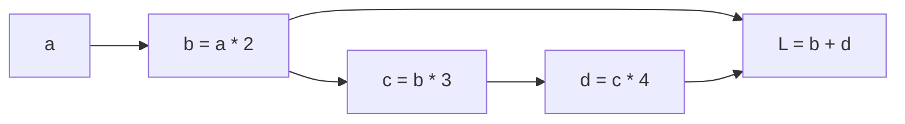

## Passo 1 · Leitura · A ordem importa

Na lição anterior, cada operação ganhou um `_backward` que repassa o gradiente da saída aos anteriores. Falta decidir **em que ordem** chamá-los. Na m2-02, a expressão $L = (ab + c)f$ foi resolvida chamando `L._backward()`, depois `d._backward()`, depois `e._backward()`, à mão. Num grafo qualquer, a regra é: um nó só pode repassar o gradiente depois de **receber todas as contribuições** de quem o usa. Se repassar antes, os anteriores dele recebem um gradiente incompleto, e o que chegar depois não é repassado nunca.

Veja o grafo de $L = b + d$, com $b = 2a$, $c = 3b$ e $d = 4c$:



O nó `b` é usado por dois caminhos de tamanhos diferentes: direto pela soma e, através de três produtos, por `d`. O gradiente dele é $1 + 4 \cdot 3 = 13$. Se `b` repassar assim que a soma lhe entregar o 1, `a` recebe $2 \cdot 1 = 2$ e não $2 \cdot 13 = 26$.

Uma ordem em que cada nó aparece **depois** de todos os seus anteriores é uma **ordem topológica**, a do Nível 3. Lida de trás para frente, ela garante exatamente o que o backward precisa: quando chega a vez de um nó, todos os que o usam já passaram. A busca em profundidade a produz se cada nó for acrescentado à lista **ao sair** da visita, depois de visitar todos os anteriores (pós-ordem):

```python
def visitar(v):
    if v not in visitados:
        visitados.add(v)
        for anterior in v._anteriores:
            visitar(anterior)
        ordem.append(v)          # só depois dos anteriores
```

Na lista final, as folhas vêm primeiro e a saída por último. O backward percorre essa lista invertida.

Uma busca em **largura** a partir da saída, que parece natural ("primeiro os vizinhos da saída, depois os vizinhos deles"), não serve: ela visita `b` logo depois de `L`, porque `b` está a um passo da saída, antes de `c`, que está a dois. É a distância até a saída que ela respeita, e não a dependência.

## Passo 2 · Previsão · Uma ordem topológica

O grafo está num dicionário: cada nó aponta para a lista dos seus anteriores. O programa faz a busca em profundidade com pós-ordem e, para comparar, uma busca em largura. Leia sem executar e digite o que ele imprime.

### Código
```python
grafo = {
    "y": ["w", "u"],
    "w": ["v"],
    "v": ["u", "x"],
    "u": ["x"],
    "x": [],
}

ordem = []
visitados = set()


def visitar(no):
    if no in visitados:
        return
    visitados.add(no)
    for anterior in grafo[no]:
        visitar(anterior)
    ordem.append(no)


visitar("y")
print(ordem)
print(ordem[::-1])

fila = ["y"]
vistos = {"y"}
largura = []
while fila:
    no = fila.pop(0)
    largura.append(no)
    for anterior in grafo[no]:
        if anterior not in vistos:
            vistos.add(anterior)
            fila.append(anterior)
print(largura)
print(largura.index("u") < largura.index("v"))
```

### Dicas
1. A busca desce primeiro por `"w"`, o primeiro anterior de `"y"`, e só acrescenta um nó depois de visitar todos os anteriores dele.
2. Quando a busca volta a `"y"` e tenta `"u"`, ele já foi visitado.
3. Na largura, `"u"` está a um passo de `"y"`, e `"v"`, a dois.

### Saída esperada
```text
['x', 'u', 'v', 'w', 'y']
['y', 'w', 'v', 'u', 'x']
['y', 'w', 'u', 'v', 'x']
True
```

## Passo 3 · Exercício · `ordem_topologica(raiz)`
modo: lacunas

O arquivo `valor.py` traz o `Valor` da lição anterior, com a aritmética completa. Complete as lacunas (`___`) da ordem topológica.

### Instruções
1. Marque cada nó como visitado assim que entrar nele, pelo próprio objeto.
2. Visite os anteriores do nó atual (não só os da raiz).
3. Acrescente o nó à lista depois de visitar todos os anteriores dele; a função devolve a lista de objetos `Valor`, com cada nó alcançável uma vez, todo nó depois dos seus anteriores e a raiz no fim.

### Código inicial
```python
from valor import Valor


def ordem_topologica(raiz):
    ordem = []
    visitados = set()

    def visitar(v):
        if v not in visitados:
            ___
            for anterior in ___:
                visitar(anterior)
            ___

    visitar(raiz)
    return ordem
```
```text path=valor.py
class Valor:
    def __init__(self, dado, _anteriores=(), _op=""):
        self.dado = dado
        self.grad = 0.0
        self._anteriores = set(_anteriores)
        self._op = _op
        self._backward = lambda: None

    def __add__(self, outro):
        outro = outro if isinstance(outro, Valor) else Valor(outro)
        saida = Valor(self.dado + outro.dado, (self, outro), "+")

        def _backward():
            self.grad += saida.grad
            outro.grad += saida.grad

        saida._backward = _backward
        return saida

    def __mul__(self, outro):
        outro = outro if isinstance(outro, Valor) else Valor(outro)
        saida = Valor(self.dado * outro.dado, (self, outro), "*")

        def _backward():
            self.grad += outro.dado * saida.grad
            outro.grad += self.dado * saida.grad

        saida._backward = _backward
        return saida

    def __radd__(self, outro):
        return self + outro

    def __rmul__(self, outro):
        return self * outro

    def __neg__(self):
        return self * -1

    def __sub__(self, outro):
        return self + (-outro)

    def __rsub__(self, outro):
        return (-self) + outro

    def __repr__(self):
        return f"Valor(dado={self.dado}, grad={self.grad})"
```

### Solução
```python
from valor import Valor


def ordem_topologica(raiz):
    ordem = []
    visitados = set()

    def visitar(v):
        if v not in visitados:
            visitados.add(v)
            for anterior in v._anteriores:
                visitar(anterior)
            ordem.append(v)

    visitar(raiz)
    return ordem
```
```text path=valor.py
class Valor:
    def __init__(self, dado, _anteriores=(), _op=""):
        self.dado = dado
        self.grad = 0.0
        self._anteriores = set(_anteriores)
        self._op = _op
        self._backward = lambda: None

    def __add__(self, outro):
        outro = outro if isinstance(outro, Valor) else Valor(outro)
        saida = Valor(self.dado + outro.dado, (self, outro), "+")

        def _backward():
            self.grad += saida.grad
            outro.grad += saida.grad

        saida._backward = _backward
        return saida

    def __mul__(self, outro):
        outro = outro if isinstance(outro, Valor) else Valor(outro)
        saida = Valor(self.dado * outro.dado, (self, outro), "*")

        def _backward():
            self.grad += outro.dado * saida.grad
            outro.grad += self.dado * saida.grad

        saida._backward = _backward
        return saida

    def __radd__(self, outro):
        return self + outro

    def __rmul__(self, outro):
        return self * outro

    def __neg__(self):
        return self * -1

    def __sub__(self, outro):
        return self + (-outro)

    def __rsub__(self, outro):
        return (-self) + outro

    def __repr__(self):
        return f"Valor(dado={self.dado}, grad={self.grad})"
```

### Dicas
1. O conjunto `visitados` guarda os nós; o teste do `if` usa o mesmo conjunto.
2. Os anteriores de um nó estão em `_anteriores` daquele nó.
3. Pós-ordem: o nó entra na lista na saída da visita, não na entrada.

### Verificação
```json
[
  {"id": "expressao", "checkpoint": 3, "kind": "expr", "setup": "def _valida(ordem, raiz):\n    pos = {id(v): i for i, v in enumerate(ordem)}\n    todos, pilha = {}, [raiz]\n    while pilha:\n        v = pilha.pop()\n        if id(v) not in todos:\n            todos[id(v)] = v\n            pilha.extend(v._anteriores)\n    return [len(ordem) == len(pos), set(pos) == set(todos),\n            all(pos.get(id(a), len(ordem)) < pos.get(id(v), -1) for v in todos.values() for a in v._anteriores),\n            len(ordem) > 0 and ordem[-1] is raiz]\na, b, c, f = Valor(2.0), Valor(-3.0), Valor(10.0), Valor(-2.0)\nL = (a * b + c) * f\nordem = ordem_topologica(L)", "expr": "_valida(ordem, L)", "expected": [true, true, true, true], "name": "L = (a * b + c) * f: sem repetição, todos os nós, anteriores antes, raiz por último", "hint": "A lista diz, na ordem: nenhum nó repetido; todos os nós alcançáveis presentes; cada nó depois dos anteriores dele; a raiz no fim."},
  {"id": "tamanho", "checkpoint": 2, "kind": "expr", "setup": "a, b, c, f = Valor(2.0), Valor(-3.0), Valor(10.0), Valor(-2.0)\nL = (a * b + c) * f\nordem = ordem_topologica(L)", "expr": "len(ordem)", "expected": 7, "name": "L = (a * b + c) * f tem 7 nós", "hint": "A busca precisa descer pelos anteriores de cada nó visitado, não só pelos da raiz."},
  {"id": "tipo", "checkpoint": 3, "kind": "expr", "setup": "a, b, c, f = Valor(2.0), Valor(-3.0), Valor(10.0), Valor(-2.0)\nL = (a * b + c) * f\nordem = ordem_topologica(L)", "expr": "[type(ordem).__name__, all(isinstance(v, Valor) for v in ordem)]", "expected": ["list", true], "name": "Devolve uma lista de objetos Valor (os nós, não os dados)"},
  {"id": "folha", "checkpoint": 3, "kind": "expr", "setup": "v = Valor(3.0)\nordem = ordem_topologica(v)", "expr": "[len(ordem), ordem[0] is v]", "expected": [1, true], "name": "Um Valor sozinho: a ordem é só ele"},
  {"id": "compartilhado", "checkpoint": 1, "kind": "expr", "setup": "def _valida(ordem, raiz):\n    pos = {id(v): i for i, v in enumerate(ordem)}\n    todos, pilha = {}, [raiz]\n    while pilha:\n        v = pilha.pop()\n        if id(v) not in todos:\n            todos[id(v)] = v\n            pilha.extend(v._anteriores)\n    return [len(ordem) == len(pos), set(pos) == set(todos),\n            all(pos.get(id(a), len(ordem)) < pos.get(id(v), -1) for v in todos.values() for a in v._anteriores),\n            len(ordem) > 0 and ordem[-1] is raiz]\na = Valor(2.0)\ne = a * 3.0\ny = e + e * a\nordem = ordem_topologica(y)", "expr": "_valida(ordem, y)", "expected": [true, true, true, true], "name": "Nó usado duas vezes (y = e + e * a): aparece uma vez, antes de quem o usa", "hint": "Marque o nó como visitado ao entrar nele, pelo próprio objeto."},
  {"id": "caminhos-diferentes", "checkpoint": 3, "kind": "expr", "setup": "def _valida(ordem, raiz):\n    pos = {id(v): i for i, v in enumerate(ordem)}\n    todos, pilha = {}, [raiz]\n    while pilha:\n        v = pilha.pop()\n        if id(v) not in todos:\n            todos[id(v)] = v\n            pilha.extend(v._anteriores)\n    return [len(ordem) == len(pos), set(pos) == set(todos),\n            all(pos.get(id(a), len(ordem)) < pos.get(id(v), -1) for v in todos.values() for a in v._anteriores),\n            len(ordem) > 0 and ordem[-1] is raiz]\na = Valor(0.5)\nb = a * 2\nc = b * 3\nd = c * 4\nL = b + d\nordem = ordem_topologica(L)", "expr": "_valida(ordem, L)", "expected": [true, true, true, true], "name": "b alcançado por um caminho curto (L = b + d) e por um longo (d = c * 4, c = b * 3)", "hint": "Um nó só entra na lista depois de todos os seus anteriores: acrescente-o ao sair da visita."},
  {"id": "v-vezes-v", "checkpoint": 1, "kind": "expr", "setup": "v = Valor(3.0)\nordem = ordem_topologica(v * v)", "expr": "len(ordem)", "expected": 2, "name": "v * v: 2 nós"},
  {"id": "iguais", "checkpoint": 1, "kind": "expr", "setup": "ordem = ordem_topologica(Valor(1.0) + Valor(1.0))", "expr": "len(ordem)", "expected": 3, "name": "Valor(1.0) + Valor(1.0): 3 nós, dois deles com o mesmo dado"},
  {"id": "cadeia-300", "checkpoint": 3, "kind": "expr", "setup": "def _valida(ordem, raiz):\n    pos = {id(v): i for i, v in enumerate(ordem)}\n    todos, pilha = {}, [raiz]\n    while pilha:\n        v = pilha.pop()\n        if id(v) not in todos:\n            todos[id(v)] = v\n            pilha.extend(v._anteriores)\n    return [len(ordem) == len(pos), set(pos) == set(todos),\n            all(pos.get(id(a), len(ordem)) < pos.get(id(v), -1) for v in todos.values() for a in v._anteriores),\n            len(ordem) > 0 and ordem[-1] is raiz]\nx = Valor(1.0)\ns = x\nfor _ in range(300):\n    s = s + 1.0\nordem = ordem_topologica(s)", "expr": "[len(ordem)] + _valida(ordem, s)", "expected": [601, true, true, true, true], "name": "Cadeia de 300 somas: 601 nós em ordem topológica"}
]
```

### Soluções erradas
```python name="pré-ordem: acrescenta o nó antes dos anteriores"
from valor import Valor


def ordem_topologica(raiz):
    ordem = []
    visitados = set()

    def visitar(v):
        if v not in visitados:
            ordem.append(v)
            for anterior in v._anteriores:
                visitar(anterior)
            visitados.add(v)

    visitar(raiz)
    return ordem
```
```python name="visitados pelo dado"
from valor import Valor


def ordem_topologica(raiz):
    ordem = []
    visitados = set()

    def visitar(v):
        if v not in visitados:
            visitados.add(v.dado)
            for anterior in v._anteriores:
                visitar(anterior)
            ordem.append(v)

    visitar(raiz)
    return ordem
```
```python name="percorre só os anteriores da raiz"
from valor import Valor


def ordem_topologica(raiz):
    ordem = []
    visitados = set()

    def visitar(v):
        if v not in visitados:
            visitados.add(v)
            for anterior in raiz._anteriores:
                visitar(anterior)
            ordem.append(v)

    visitar(raiz)
    return ordem
```
```python name="insere cada nó no começo da lista"
from valor import Valor


def ordem_topologica(raiz):
    ordem = []
    visitados = set()

    def visitar(v):
        if v not in visitados:
            visitados.add(v)
            for anterior in v._anteriores:
                visitar(anterior)
            ordem.insert(0, v)

    visitar(raiz)
    return ordem
```
```python name="guarda os dados no lugar dos nós"
from valor import Valor


def ordem_topologica(raiz):
    ordem = []
    visitados = set()

    def visitar(v):
        if v not in visitados:
            visitados.add(v)
            for anterior in v._anteriores:
                visitar(anterior)
            ordem.append(v.dado)

    visitar(raiz)
    return ordem
```

## Passo 4 · Leitura · O backward completo

Com a ordem topológica, o método `backward` da classe fica curto:

```python
def backward(self):
    ordem = ordem_topologica(self)    # folhas primeiro, self por último
    self.grad = 1.0                   # dL/dL = 1
    for v in reversed(ordem):         # da saída para as folhas
        v._backward()
```

Três detalhes decidem se ele funciona. O primeiro é o **ponto de partida**: o `grad` de todo `Valor` começa em 0, e se a saída continuar com 0 cada `_backward` multiplica por zero, e todos os gradientes saem zero, sem erro nenhum. O segundo é a **ordem invertida**: na ordem direta, as folhas chamam o `_backward` delas primeiro (que não faz nada), e cada nó repassa antes de receber; só os anteriores diretos da saída acabam com algum gradiente. O terceiro é chamar o `_backward` de **todos** os nós, e não só o da saída: o `_backward` de um nó só sabe repassar para os anteriores imediatos.

Siga a busca em profundidade num grafo de 4 nós, $L = d \cdot f$ com $d = a + f$. Clique em "Visualizar" e acompanhe a pilha de chamadas: cada `visitar` que entra empilha um nó, e o nó só entra na ordem quando a chamada dele termina.

```python visualizar
grafo = {"L": ["d", "f"], "d": ["a", "f"], "a": [], "f": []}
ordem = []
visitados = set()
chamadas = []


def visitar(no):
    chamadas.append(no)
    print("entra", no, "| pilha:", chamadas)
    if no not in visitados:
        visitados.add(no)
        for anterior in grafo[no]:
            visitar(anterior)
        ordem.append(no)
        print("sai  ", no, "| ordem:", ordem)
    chamadas.pop()


visitar("L")
print("backward nesta ordem:", ordem[::-1])
```

O nó `f` é visitado uma vez, a partir de `d`; quando a busca volta a `L` e tenta `f` de novo, a chamada entra e sai sem acrescentar nada. A ordem final é `a, f, d, L`, e o backward roda `L, d, f, a`: quando chega a vez de `f`, ele já recebeu as duas contribuições, a de `L` e a de `d`.

Para conferir o `backward` em qualquer expressão, use a diferença central da m2-01: crie os `Valor` com cada entrada mexida em $\pm h$, calcule o `dado` da saída e compare com os `grad`. É o que os casos do próximo exercício fazem.

## Passo 5 · Exercício · `Valor.backward()`

O código inicial traz o `Valor` completo da lição anterior. Escreva o método `backward`.

### Instruções
1. `backward()` monta uma ordem topológica de todos os nós alcançáveis a partir de `self`, com cada nó uma vez (busca em profundidade com visitados e pós-ordem).
2. Põe `self.grad = 1.0`.
3. Chama o `_backward()` de cada nó, na ordem inversa (da saída para as folhas). O método não zera nenhum gradiente.

### Código inicial
```python
class Valor:
    def __init__(self, dado, _anteriores=(), _op=""):
        self.dado = dado
        self.grad = 0.0
        self._anteriores = set(_anteriores)
        self._op = _op
        self._backward = lambda: None

    def __add__(self, outro):
        outro = outro if isinstance(outro, Valor) else Valor(outro)
        saida = Valor(self.dado + outro.dado, (self, outro), "+")

        def _backward():
            self.grad += saida.grad
            outro.grad += saida.grad

        saida._backward = _backward
        return saida

    def __mul__(self, outro):
        outro = outro if isinstance(outro, Valor) else Valor(outro)
        saida = Valor(self.dado * outro.dado, (self, outro), "*")

        def _backward():
            self.grad += outro.dado * saida.grad
            outro.grad += self.dado * saida.grad

        saida._backward = _backward
        return saida

    def __radd__(self, outro):
        return self + outro

    def __rmul__(self, outro):
        return self * outro

    def __neg__(self):
        return self * -1

    def __sub__(self, outro):
        return self + (-outro)

    def __rsub__(self, outro):
        return (-self) + outro

    def __repr__(self):
        return f"Valor(dado={self.dado}, grad={self.grad})"

    def backward(self):
        pass
```

### Solução
```python
class Valor:
    def __init__(self, dado, _anteriores=(), _op=""):
        self.dado = dado
        self.grad = 0.0
        self._anteriores = set(_anteriores)
        self._op = _op
        self._backward = lambda: None

    def __add__(self, outro):
        outro = outro if isinstance(outro, Valor) else Valor(outro)
        saida = Valor(self.dado + outro.dado, (self, outro), "+")

        def _backward():
            self.grad += saida.grad
            outro.grad += saida.grad

        saida._backward = _backward
        return saida

    def __mul__(self, outro):
        outro = outro if isinstance(outro, Valor) else Valor(outro)
        saida = Valor(self.dado * outro.dado, (self, outro), "*")

        def _backward():
            self.grad += outro.dado * saida.grad
            outro.grad += self.dado * saida.grad

        saida._backward = _backward
        return saida

    def __radd__(self, outro):
        return self + outro

    def __rmul__(self, outro):
        return self * outro

    def __neg__(self):
        return self * -1

    def __sub__(self, outro):
        return self + (-outro)

    def __rsub__(self, outro):
        return (-self) + outro

    def __repr__(self):
        return f"Valor(dado={self.dado}, grad={self.grad})"

    def backward(self):
        ordem = []
        visitados = set()

        def visitar(v):
            if v not in visitados:
                visitados.add(v)
                for anterior in v._anteriores:
                    visitar(anterior)
                ordem.append(v)

        visitar(self)
        self.grad = 1.0
        for v in reversed(ordem):
            v._backward()
```

### Dicas
1. Uma função interna `visitar`, como a do passo 3, pode usar a lista e o conjunto definidos no `backward`.
2. Sem o `grad` da saída em 1.0, todos os produtos da regra da cadeia dão zero.
3. `reversed(ordem)` percorre da saída para as folhas.

### Verificação
```json
[
  {"id": "expressao", "checkpoint": 3, "kind": "expr", "setup": "def _num(f, xs, h=1e-6):\n    out = []\n    for i in range(len(xs)):\n        mais, menos = list(xs), list(xs)\n        mais[i] += h\n        menos[i] -= h\n        out.append((f(*[Valor(x) for x in mais]).dado - f(*[Valor(x) for x in menos]).dado) / (2 * h))\n    return out\ndef _confere(f, xs):\n    vs = [Valor(x) for x in xs]\n    f(*vs).backward()\n    return [abs(v.grad - n) < 1e-6 * max(1.0, abs(n)) for v, n in zip(vs, _num(f, xs))]\ndef f(a, b, c, d):\n    return (a * b + c) * d\n", "expr": "_confere(f, [2.0, -3.0, 10.0, -2.0])", "expected": [true, true, true, true], "name": "L = (a * b + c) * f: os quatro grad batem com a diferença central", "hint": "A lista diz, para cada entrada, se o grad bateu com a derivada numérica."},
  {"id": "literal", "checkpoint": 3, "kind": "expr", "setup": "a, b, c, f = Valor(2.0), Valor(-3.0), Valor(10.0), Valor(-2.0)\nL = (a * b + c) * f\nL.backward()", "expr": "[a.grad, b.grad, c.grad, f.grad]", "expected": [6.0, -4.0, -2.0, 4.0], "tolerance": 1e-12, "name": "Os grad de a, b, c e f com a = 2, b = -3, c = 10, f = -2"},
  {"id": "saida", "checkpoint": 2, "kind": "expr", "setup": "a, b = Valor(2.0), Valor(5.0)\ny = a * b\ny.backward()", "expr": "[y.grad, a.grad, b.grad]", "expected": [1.0, 5.0, 2.0], "tolerance": 1e-12, "name": "A saída fica com grad 1.0 e propaga a partir daí", "hint": "O backward começa com dL/dL = 1 na própria saída."},
  {"id": "folha", "checkpoint": 2, "kind": "expr", "setup": "v = Valor(3.0)\nv.backward()", "expr": "v.grad", "expected": 1.0, "tolerance": 1e-12, "name": "backward() num Valor sozinho: grad 1.0"},
  {"id": "repetida", "checkpoint": 3, "kind": "expr", "setup": "def _num(f, xs, h=1e-6):\n    out = []\n    for i in range(len(xs)):\n        mais, menos = list(xs), list(xs)\n        mais[i] += h\n        menos[i] -= h\n        out.append((f(*[Valor(x) for x in mais]).dado - f(*[Valor(x) for x in menos]).dado) / (2 * h))\n    return out\ndef _confere(f, xs):\n    vs = [Valor(x) for x in xs]\n    f(*vs).backward()\n    return [abs(v.grad - n) < 1e-6 * max(1.0, abs(n)) for v, n in zip(vs, _num(f, xs))]\ndef f(x):\n    return x * x * x + 2 * x - x * x\n", "expr": "_confere(f, [1.5])", "expected": [true], "name": "y = x³ + 2x - x² (x em vários lugares) bate com a diferença central"},
  {"id": "compartilhado", "checkpoint": 1, "kind": "expr", "setup": "def _num(f, xs, h=1e-6):\n    out = []\n    for i in range(len(xs)):\n        mais, menos = list(xs), list(xs)\n        mais[i] += h\n        menos[i] -= h\n        out.append((f(*[Valor(x) for x in mais]).dado - f(*[Valor(x) for x in menos]).dado) / (2 * h))\n    return out\ndef _confere(f, xs):\n    vs = [Valor(x) for x in xs]\n    f(*vs).backward()\n    return [abs(v.grad - n) < 1e-6 * max(1.0, abs(n)) for v, n in zip(vs, _num(f, xs))]\ndef f(a, x):\n    e = a * x\n    return e * e + e * 3 - a\n", "expr": "_confere(f, [0.7, -1.2])", "expected": [true, true], "name": "Nó intermediário usado três vezes (e * e + e * 3): bate com a diferença central", "hint": "Cada nó precisa aparecer uma vez só na ordem; senão o _backward dele roda duas vezes."},
  {"id": "caminhos-diferentes", "checkpoint": 3, "kind": "expr", "setup": "a = Valor(0.5)\nb = a * 2\nc = b * 3\nd = c * 4\nL = b + d\nL.backward()", "expr": "[a.grad, b.grad]", "expected": [26.0, 13.0], "tolerance": 1e-12, "name": "b usado em L = b + d e, por três produtos, em d: grad de b = 1 + 12", "hint": "Um nó só pode chamar o _backward depois de receber a contribuição de todos os caminhos: ordem topológica invertida."},
  {"id": "cadeia-300", "checkpoint": 1, "kind": "expr", "setup": "x = Valor(1.0)\ns = x\nfor _ in range(300):\n    s = s + x\ns.backward()", "expr": "x.grad", "expected": 301.0, "tolerance": 1e-09, "name": "Cadeia de 300 somas s = s + x: grad de x = 301"},
  {"id": "cadeia-produtos", "checkpoint": 3, "kind": "expr", "setup": "x = Valor(1.0)\ns = x\nfor _ in range(100):\n    s = s * 1.01\ns.backward()", "expr": "x.grad", "expected": 2.7048138294215285, "tolerance": 1e-09, "name": "Cadeia de 100 produtos por 1.01: grad de x = 1.01¹⁰⁰"}
]
```

### Soluções erradas
```python name="_backward na ordem direta"
class Valor:
    def __init__(self, dado, _anteriores=(), _op=""):
        self.dado = dado
        self.grad = 0.0
        self._anteriores = set(_anteriores)
        self._op = _op
        self._backward = lambda: None

    def __add__(self, outro):
        outro = outro if isinstance(outro, Valor) else Valor(outro)
        saida = Valor(self.dado + outro.dado, (self, outro), "+")

        def _backward():
            self.grad += saida.grad
            outro.grad += saida.grad

        saida._backward = _backward
        return saida

    def __mul__(self, outro):
        outro = outro if isinstance(outro, Valor) else Valor(outro)
        saida = Valor(self.dado * outro.dado, (self, outro), "*")

        def _backward():
            self.grad += outro.dado * saida.grad
            outro.grad += self.dado * saida.grad

        saida._backward = _backward
        return saida

    def __radd__(self, outro):
        return self + outro

    def __rmul__(self, outro):
        return self * outro

    def __neg__(self):
        return self * -1

    def __sub__(self, outro):
        return self + (-outro)

    def __rsub__(self, outro):
        return (-self) + outro

    def __repr__(self):
        return f"Valor(dado={self.dado}, grad={self.grad})"

    def backward(self):
        ordem = []
        visitados = set()

        def visitar(v):
            if v not in visitados:
                visitados.add(v)
                for anterior in v._anteriores:
                    visitar(anterior)
                ordem.append(v)

        visitar(self)
        self.grad = 1.0
        for v in ordem:
            v._backward()
```
```python name="busca em largura a partir da saída"
class Valor:
    def __init__(self, dado, _anteriores=(), _op=""):
        self.dado = dado
        self.grad = 0.0
        self._anteriores = set(_anteriores)
        self._op = _op
        self._backward = lambda: None

    def __add__(self, outro):
        outro = outro if isinstance(outro, Valor) else Valor(outro)
        saida = Valor(self.dado + outro.dado, (self, outro), "+")

        def _backward():
            self.grad += saida.grad
            outro.grad += saida.grad

        saida._backward = _backward
        return saida

    def __mul__(self, outro):
        outro = outro if isinstance(outro, Valor) else Valor(outro)
        saida = Valor(self.dado * outro.dado, (self, outro), "*")

        def _backward():
            self.grad += outro.dado * saida.grad
            outro.grad += self.dado * saida.grad

        saida._backward = _backward
        return saida

    def __radd__(self, outro):
        return self + outro

    def __rmul__(self, outro):
        return self * outro

    def __neg__(self):
        return self * -1

    def __sub__(self, outro):
        return self + (-outro)

    def __rsub__(self, outro):
        return (-self) + outro

    def __repr__(self):
        return f"Valor(dado={self.dado}, grad={self.grad})"

    def backward(self):
        ordem = []
        visitados = {self}
        fila = [self]
        while fila:
            v = fila.pop(0)
            ordem.append(v)
            for anterior in v._anteriores:
                if anterior not in visitados:
                    visitados.add(anterior)
                    fila.append(anterior)
        self.grad = 1.0
        for v in ordem:
            v._backward()
```
```python name="grad da saída esquecido em 0"
class Valor:
    def __init__(self, dado, _anteriores=(), _op=""):
        self.dado = dado
        self.grad = 0.0
        self._anteriores = set(_anteriores)
        self._op = _op
        self._backward = lambda: None

    def __add__(self, outro):
        outro = outro if isinstance(outro, Valor) else Valor(outro)
        saida = Valor(self.dado + outro.dado, (self, outro), "+")

        def _backward():
            self.grad += saida.grad
            outro.grad += saida.grad

        saida._backward = _backward
        return saida

    def __mul__(self, outro):
        outro = outro if isinstance(outro, Valor) else Valor(outro)
        saida = Valor(self.dado * outro.dado, (self, outro), "*")

        def _backward():
            self.grad += outro.dado * saida.grad
            outro.grad += self.dado * saida.grad

        saida._backward = _backward
        return saida

    def __radd__(self, outro):
        return self + outro

    def __rmul__(self, outro):
        return self * outro

    def __neg__(self):
        return self * -1

    def __sub__(self, outro):
        return self + (-outro)

    def __rsub__(self, outro):
        return (-self) + outro

    def __repr__(self):
        return f"Valor(dado={self.dado}, grad={self.grad})"

    def backward(self):
        ordem = []
        visitados = set()

        def visitar(v):
            if v not in visitados:
                visitados.add(v)
                for anterior in v._anteriores:
                    visitar(anterior)
                ordem.append(v)

        visitar(self)
        for v in reversed(ordem):
            v._backward()
```
```python name="sem conjunto de visitados"
class Valor:
    def __init__(self, dado, _anteriores=(), _op=""):
        self.dado = dado
        self.grad = 0.0
        self._anteriores = set(_anteriores)
        self._op = _op
        self._backward = lambda: None

    def __add__(self, outro):
        outro = outro if isinstance(outro, Valor) else Valor(outro)
        saida = Valor(self.dado + outro.dado, (self, outro), "+")

        def _backward():
            self.grad += saida.grad
            outro.grad += saida.grad

        saida._backward = _backward
        return saida

    def __mul__(self, outro):
        outro = outro if isinstance(outro, Valor) else Valor(outro)
        saida = Valor(self.dado * outro.dado, (self, outro), "*")

        def _backward():
            self.grad += outro.dado * saida.grad
            outro.grad += self.dado * saida.grad

        saida._backward = _backward
        return saida

    def __radd__(self, outro):
        return self + outro

    def __rmul__(self, outro):
        return self * outro

    def __neg__(self):
        return self * -1

    def __sub__(self, outro):
        return self + (-outro)

    def __rsub__(self, outro):
        return (-self) + outro

    def __repr__(self):
        return f"Valor(dado={self.dado}, grad={self.grad})"

    def backward(self):
        ordem = []
        visitados = set()

        def visitar(v):
            for anterior in v._anteriores:
                visitar(anterior)
            ordem.append(v)

        visitar(self)
        self.grad = 1.0
        for v in reversed(ordem):
            v._backward()
```
```python name="chama só o _backward da saída"
class Valor:
    def __init__(self, dado, _anteriores=(), _op=""):
        self.dado = dado
        self.grad = 0.0
        self._anteriores = set(_anteriores)
        self._op = _op
        self._backward = lambda: None

    def __add__(self, outro):
        outro = outro if isinstance(outro, Valor) else Valor(outro)
        saida = Valor(self.dado + outro.dado, (self, outro), "+")

        def _backward():
            self.grad += saida.grad
            outro.grad += saida.grad

        saida._backward = _backward
        return saida

    def __mul__(self, outro):
        outro = outro if isinstance(outro, Valor) else Valor(outro)
        saida = Valor(self.dado * outro.dado, (self, outro), "*")

        def _backward():
            self.grad += outro.dado * saida.grad
            outro.grad += self.dado * saida.grad

        saida._backward = _backward
        return saida

    def __radd__(self, outro):
        return self + outro

    def __rmul__(self, outro):
        return self * outro

    def __neg__(self):
        return self * -1

    def __sub__(self, outro):
        return self + (-outro)

    def __rsub__(self, outro):
        return (-self) + outro

    def __repr__(self):
        return f"Valor(dado={self.dado}, grad={self.grad})"

    def backward(self):
        ordem = []
        visitados = set()

        def visitar(v):
            if v not in visitados:
                visitados.add(v)
                for anterior in v._anteriores:
                    visitar(anterior)
                ordem.append(v)

        visitar(self)
        self.grad = 1.0
        self._backward()
```

## Passo 6 · Leitura · Acúmulo e limites

Os `_backward` somam com `+=`, e o `backward` não zera nada. Chamar `backward` duas vezes na mesma expressão **dobra** os gradientes:

```python
a, b = Valor(2.0), Valor(-3.0)
y = a * b
y.backward()
y.backward()
print(a.grad)      # -6.0, e não -3.0
```

Com nós intermediários, fica pior que o dobro. Na segunda chamada, o `grad` da saída volta a 1.0 (é uma atribuição), mas cada nó intermediário soma o que já tinha ao que recebe de novo e repassa o total. Em $L = (ab + c)f$, depois de dois `backward`, `a.grad` vale 24, quatro vezes o certo. Num laço de treino, em que a cada passo um forward novo cria um grafo novo mas os **parâmetros** são os mesmos objetos, os gradientes dos parâmetros acumulam de um passo para o outro, e o treino diverge. Por isso todo laço de treino zera os gradientes antes de cada `backward` (é o `zero_grad` das bibliotecas), e zerar só as folhas não basta quando o mesmo grafo é reaproveitado.

O segundo limite é a recursão. A `visitar` chama a si mesma uma vez por nível do grafo, e o Python limita as chamadas aninhadas: `sys.getrecursionlimit()` vale 1 000 no executor. Uma cadeia de 900 somas passa; com 2 000:

```text
RecursionError: maximum recursion depth exceeded
```

Uma rede não costuma ter 1 000 camadas, mas um grafo de `Valor` fica fundo depressa: um `sum` de 2 000 termos é uma cadeia de 2 000 somas. Aumentar o limite com `sys.setrecursionlimit` empurra o problema para grafos maiores e, num interpretador com pilha pequena, como o WebAssembly do executor, pode derrubar o processo em vez de levantar uma exceção. A saída limpa é trocar a recursão por uma **pilha explícita**, uma lista. A pós-ordem precisa de um cuidado: o nó só entra na ordem depois dos anteriores, então ele é empilhado de novo, marcado, antes deles:

```python
pilha = [(raiz, False)]
while pilha:
    v, expandido = pilha.pop()
    if expandido:
        ordem.append(v)                  # os anteriores já saíram da pilha
    elif v not in visitados:
        visitados.add(v)
        pilha.append((v, True))          # volta depois dos anteriores
        ...                              # empilha os anteriores
```

## Passo 7 · Exercício · Zerar e iterar

O arquivo `valor.py` traz o `Valor` com o `backward` do passo 5. Escreva as duas funções no `main.py`.

### Instruções
1. `zerar_gradientes(raiz)` põe `grad = 0.0` em todos os nós alcançáveis a partir de `raiz`, inclusive nela e nos nós intermediários, sem mudar nenhum `dado`.
2. `ordem_topologica_iterativa(raiz)` devolve a mesma espécie de lista do passo 3 (cada nó uma vez, todo nó depois dos seus anteriores, a raiz no fim), **sem recursão**, com uma lista como pilha.
3. As duas funções funcionam numa cadeia de 2 000 somas, que estoura o limite de recursão.

### Código inicial
```python
from valor import Valor


def ordem_topologica_iterativa(raiz):
    pass


def zerar_gradientes(raiz):
    pass
```
```text path=valor.py
class Valor:
    def __init__(self, dado, _anteriores=(), _op=""):
        self.dado = dado
        self.grad = 0.0
        self._anteriores = set(_anteriores)
        self._op = _op
        self._backward = lambda: None

    def __add__(self, outro):
        outro = outro if isinstance(outro, Valor) else Valor(outro)
        saida = Valor(self.dado + outro.dado, (self, outro), "+")

        def _backward():
            self.grad += saida.grad
            outro.grad += saida.grad

        saida._backward = _backward
        return saida

    def __mul__(self, outro):
        outro = outro if isinstance(outro, Valor) else Valor(outro)
        saida = Valor(self.dado * outro.dado, (self, outro), "*")

        def _backward():
            self.grad += outro.dado * saida.grad
            outro.grad += self.dado * saida.grad

        saida._backward = _backward
        return saida

    def __radd__(self, outro):
        return self + outro

    def __rmul__(self, outro):
        return self * outro

    def __neg__(self):
        return self * -1

    def __sub__(self, outro):
        return self + (-outro)

    def __rsub__(self, outro):
        return (-self) + outro

    def __repr__(self):
        return f"Valor(dado={self.dado}, grad={self.grad})"

    def backward(self):
        ordem = []
        visitados = set()

        def visitar(v):
            if v not in visitados:
                visitados.add(v)
                for anterior in v._anteriores:
                    visitar(anterior)
                ordem.append(v)

        visitar(self)
        self.grad = 1.0
        for v in reversed(ordem):
            v._backward()
```

### Solução
```python
from valor import Valor


def ordem_topologica_iterativa(raiz):
    ordem, visitados = [], set()
    pilha = [(raiz, False)]
    while pilha:
        v, expandido = pilha.pop()
        if expandido:
            ordem.append(v)
        elif v not in visitados:
            visitados.add(v)
            pilha.append((v, True))
            for anterior in v._anteriores:
                pilha.append((anterior, False))
    return ordem


def zerar_gradientes(raiz):
    for v in ordem_topologica_iterativa(raiz):
        v.grad = 0.0
```
```text path=valor.py
class Valor:
    def __init__(self, dado, _anteriores=(), _op=""):
        self.dado = dado
        self.grad = 0.0
        self._anteriores = set(_anteriores)
        self._op = _op
        self._backward = lambda: None

    def __add__(self, outro):
        outro = outro if isinstance(outro, Valor) else Valor(outro)
        saida = Valor(self.dado + outro.dado, (self, outro), "+")

        def _backward():
            self.grad += saida.grad
            outro.grad += saida.grad

        saida._backward = _backward
        return saida

    def __mul__(self, outro):
        outro = outro if isinstance(outro, Valor) else Valor(outro)
        saida = Valor(self.dado * outro.dado, (self, outro), "*")

        def _backward():
            self.grad += outro.dado * saida.grad
            outro.grad += self.dado * saida.grad

        saida._backward = _backward
        return saida

    def __radd__(self, outro):
        return self + outro

    def __rmul__(self, outro):
        return self * outro

    def __neg__(self):
        return self * -1

    def __sub__(self, outro):
        return self + (-outro)

    def __rsub__(self, outro):
        return (-self) + outro

    def __repr__(self):
        return f"Valor(dado={self.dado}, grad={self.grad})"

    def backward(self):
        ordem = []
        visitados = set()

        def visitar(v):
            if v not in visitados:
                visitados.add(v)
                for anterior in v._anteriores:
                    visitar(anterior)
                ordem.append(v)

        visitar(self)
        self.grad = 1.0
        for v in reversed(ordem):
            v._backward()
```

### Dicas
1. Empilhe pares `(no, expandido)`: na primeira vez que um nó sai da pilha, ele volta marcado e os anteriores vão por cima dele.
2. Um nó marcado que sai da pilha já teve todos os anteriores acrescentados à ordem.
3. Para zerar, percorra a ordem iterativa: ela tem todos os nós e não usa recursão.

### Verificação
```json
[
  {"id": "acumulo", "checkpoint": 1, "kind": "expr", "setup": "a, b, c, f = Valor(2.0), Valor(-3.0), Valor(10.0), Valor(-2.0)\nL = (a * b + c) * f\nL.backward()\nzerar_gradientes(L)\nL.backward()", "expr": "[a.grad, b.grad, c.grad, f.grad]", "expected": [6.0, -4.0, -2.0, 4.0], "tolerance": 1e-12, "name": "backward, zerar e backward de novo: os grad não dobram", "hint": "Os nós intermediários também guardam grad, e ele entra na conta do backward seguinte."},
  {"id": "zera-todos", "checkpoint": 1, "kind": "expr", "setup": "def _todos(raiz):\n    vistos, pilha = {}, [raiz]\n    while pilha:\n        v = pilha.pop()\n        if id(v) not in vistos:\n            vistos[id(v)] = v\n            pilha.extend(v._anteriores)\n    return list(vistos.values())\na, b, c, f = Valor(2.0), Valor(-3.0), Valor(10.0), Valor(-2.0)\nL = (a * b + c) * f\nL.backward()\nzerar_gradientes(L)", "expr": "[len(_todos(L)), all(v.grad == 0.0 for v in _todos(L))]", "expected": [7, true], "name": "Depois de zerar, os 7 nós (folhas, intermediários e raiz) têm grad 0.0"},
  {"id": "dados-intactos", "checkpoint": 1, "kind": "expr", "setup": "a, b, c, f = Valor(2.0), Valor(-3.0), Valor(10.0), Valor(-2.0)\nL = (a * b + c) * f\nL.backward()\nzerar_gradientes(L)", "expr": "[a.dado, b.dado, c.dado, f.dado, L.dado]", "expected": [2.0, -3.0, 10.0, -2.0, -8.0], "name": "Zerar não muda os dados"},
  {"id": "iterativa-expressao", "checkpoint": 2, "kind": "expr", "setup": "def _valida(ordem, raiz):\n    pos = {id(v): i for i, v in enumerate(ordem)}\n    todos, pilha = {}, [raiz]\n    while pilha:\n        v = pilha.pop()\n        if id(v) not in todos:\n            todos[id(v)] = v\n            pilha.extend(v._anteriores)\n    return [len(ordem) == len(pos), set(pos) == set(todos),\n            all(pos.get(id(a), len(ordem)) < pos.get(id(v), -1) for v in todos.values() for a in v._anteriores),\n            len(ordem) > 0 and ordem[-1] is raiz]\na, b, c, f = Valor(2.0), Valor(-3.0), Valor(10.0), Valor(-2.0)\nL = (a * b + c) * f\nordem = ordem_topologica_iterativa(L)", "expr": "_valida(ordem, L)", "expected": [true, true, true, true], "name": "Ordem iterativa de L = (a * b + c) * f: sem repetição, todos os nós, anteriores antes, raiz por último", "hint": "A lista diz, na ordem: nenhum nó repetido; todos os nós presentes; cada nó depois dos anteriores; a raiz no fim."},
  {"id": "iterativa-compartilhado", "checkpoint": 2, "kind": "expr", "setup": "def _valida(ordem, raiz):\n    pos = {id(v): i for i, v in enumerate(ordem)}\n    todos, pilha = {}, [raiz]\n    while pilha:\n        v = pilha.pop()\n        if id(v) not in todos:\n            todos[id(v)] = v\n            pilha.extend(v._anteriores)\n    return [len(ordem) == len(pos), set(pos) == set(todos),\n            all(pos.get(id(a), len(ordem)) < pos.get(id(v), -1) for v in todos.values() for a in v._anteriores),\n            len(ordem) > 0 and ordem[-1] is raiz]\na = Valor(2.0)\ne = a * 3.0\ny = e + e * a\nordem = ordem_topologica_iterativa(y)", "expr": "_valida(ordem, y)", "expected": [true, true, true, true], "name": "Ordem iterativa com um nó usado duas vezes", "hint": "Um nó alcançado por dois caminhos entra uma vez só."},
  {"id": "iterativa-caminhos", "checkpoint": 2, "kind": "expr", "setup": "def _valida(ordem, raiz):\n    pos = {id(v): i for i, v in enumerate(ordem)}\n    todos, pilha = {}, [raiz]\n    while pilha:\n        v = pilha.pop()\n        if id(v) not in todos:\n            todos[id(v)] = v\n            pilha.extend(v._anteriores)\n    return [len(ordem) == len(pos), set(pos) == set(todos),\n            all(pos.get(id(a), len(ordem)) < pos.get(id(v), -1) for v in todos.values() for a in v._anteriores),\n            len(ordem) > 0 and ordem[-1] is raiz]\na = Valor(0.5)\nb = a * 2\nc = b * 3\nd = c * 4\nL = b + d\nordem = ordem_topologica_iterativa(L)", "expr": "_valida(ordem, L)", "expected": [true, true, true, true], "name": "Ordem iterativa com caminhos de tamanhos diferentes"},
  {"id": "iterativa-folha", "checkpoint": 2, "kind": "expr", "setup": "v = Valor(4.0)\nordem = ordem_topologica_iterativa(v)", "expr": "[len(ordem), ordem[0] is v]", "expected": [1, true], "name": "Um Valor sozinho: a ordem é só ele"},
  {"id": "cadeia-2000", "checkpoint": 3, "kind": "expr", "setup": "def _valida(ordem, raiz):\n    pos = {id(v): i for i, v in enumerate(ordem)}\n    todos, pilha = {}, [raiz]\n    while pilha:\n        v = pilha.pop()\n        if id(v) not in todos:\n            todos[id(v)] = v\n            pilha.extend(v._anteriores)\n    return [len(ordem) == len(pos), set(pos) == set(todos),\n            all(pos.get(id(a), len(ordem)) < pos.get(id(v), -1) for v in todos.values() for a in v._anteriores),\n            len(ordem) > 0 and ordem[-1] is raiz]\nx = Valor(1.0)\ns = x\nfor _ in range(2000):\n    s = s + x\nordem = ordem_topologica_iterativa(s)", "expr": "[len(ordem)] + _valida(ordem, s)", "expected": [2001, true, true, true, true], "name": "Cadeia de 2 000 somas: 2 001 nós em ordem topológica, sem RecursionError", "hint": "Sem recursão: uma lista como pilha, com cada nó empilhado de novo, marcado, para ser acrescentado depois dos anteriores."},
  {"id": "cadeia-2000-backward", "checkpoint": 3, "kind": "expr", "setup": "x = Valor(1.0)\ns = x\nfor _ in range(2000):\n    s = s + x\ns.grad = 1.0\nfor v in reversed(ordem_topologica_iterativa(s)):\n    v._backward()", "expr": "x.grad", "expected": 2001.0, "tolerance": 1e-09, "name": "O backward da cadeia de 2 000 somas pela sua ordem: grad de x = 2001"},
  {"id": "zerar-cadeia-2000", "checkpoint": 3, "kind": "expr", "setup": "def _todos(raiz):\n    vistos, pilha = {}, [raiz]\n    while pilha:\n        v = pilha.pop()\n        if id(v) not in vistos:\n            vistos[id(v)] = v\n            pilha.extend(v._anteriores)\n    return list(vistos.values())\nx = Valor(1.0)\ns = x\nfor _ in range(2000):\n    s = s + x\nx.grad, s.grad = 5.0, 7.0\nzerar_gradientes(s)", "expr": "all(v.grad == 0.0 for v in _todos(s))", "expected": true, "name": "zerar_gradientes também funciona na cadeia de 2 000 somas", "hint": "Percorra o grafo sem recursão: a sua ordem iterativa serve."}
]
```

### Soluções erradas
```python name="zera só as folhas"
from valor import Valor


def ordem_topologica_iterativa(raiz):
    ordem, visitados = [], set()
    pilha = [(raiz, False)]
    while pilha:
        v, expandido = pilha.pop()
        if expandido:
            ordem.append(v)
        elif v not in visitados:
            visitados.add(v)
            pilha.append((v, True))
            for anterior in v._anteriores:
                pilha.append((anterior, False))
    return ordem


def zerar_gradientes(raiz):
    for v in ordem_topologica_iterativa(raiz):
        if not v._anteriores:
            v.grad = 0.0
```
```python name="zera só a raiz"
from valor import Valor


def ordem_topologica_iterativa(raiz):
    ordem, visitados = [], set()
    pilha = [(raiz, False)]
    while pilha:
        v, expandido = pilha.pop()
        if expandido:
            ordem.append(v)
        elif v not in visitados:
            visitados.add(v)
            pilha.append((v, True))
            for anterior in v._anteriores:
                pilha.append((anterior, False))
    return ordem


def zerar_gradientes(raiz):
    raiz.grad = 0.0
```
```python name="acrescenta o nó na primeira visita"
from valor import Valor


def ordem_topologica_iterativa(raiz):
    ordem, visitados = [], set()
    pilha = [raiz]
    while pilha:
        v = pilha.pop()
        if v not in visitados:
            visitados.add(v)
            ordem.append(v)
            for anterior in v._anteriores:
                pilha.append(anterior)
    return ordem


def zerar_gradientes(raiz):
    for v in ordem_topologica_iterativa(raiz):
        v.grad = 0.0
```
```python name="sem conjunto de visitados"
from valor import Valor


def ordem_topologica_iterativa(raiz):
    ordem, visitados = [], set()
    pilha = [(raiz, False)]
    while pilha:
        v, expandido = pilha.pop()
        if expandido:
            ordem.append(v)
        else:
            pilha.append((v, True))
            for anterior in v._anteriores:
                pilha.append((anterior, False))
    return ordem


def zerar_gradientes(raiz):
    for v in ordem_topologica_iterativa(raiz):
        v.grad = 0.0
```
```python name="ordem recursiva"
from valor import Valor


def ordem_topologica_iterativa(raiz):
    ordem, visitados = [], set()

    def visitar(v):
        if v not in visitados:
            visitados.add(v)
            for anterior in v._anteriores:
                visitar(anterior)
            ordem.append(v)

    visitar(raiz)
    return ordem


def zerar_gradientes(raiz):
    for v in ordem_topologica_iterativa(raiz):
        v.grad = 0.0
```
```python name="zerar recursivo"
from valor import Valor


def ordem_topologica_iterativa(raiz):
    ordem, visitados = [], set()
    pilha = [(raiz, False)]
    while pilha:
        v, expandido = pilha.pop()
        if expandido:
            ordem.append(v)
        elif v not in visitados:
            visitados.add(v)
            pilha.append((v, True))
            for anterior in v._anteriores:
                pilha.append((anterior, False))
    return ordem


def zerar_gradientes(raiz):
    raiz.grad = 0.0
    for anterior in raiz._anteriores:
        zerar_gradientes(anterior)
```

## Passo 8 · Quiz · A ordem do backward

### Pergunta
Para $L = b + d$, com $b = 2a$, $c = 3b$, $d = 4c$ e $a = 0{,}5$, um `backward` que percorre o grafo em **largura** a partir de `L`, chamando `_backward` na ordem da fila, deixa `a.grad = 2.0` e `b.grad = 13.0`. Por que `a` ficou errado?
- [ ] Porque `b.grad` está errado: o certo seria 1
- [x] Porque `b` repassou para `a` quando só tinha recebido a parte da soma (1); os 12 que vieram por `c` chegaram depois
- [ ] Porque a busca em largura visita `a` duas vezes
- [ ] Porque falta `self.grad = 1.0` na saída
> `b` está a um passo de `L` e `c` a dois, então a largura chama `b._backward()` antes de `c._backward()`. Quando `c` entrega 12, `b` já tinha repassado $2 \cdot 1$ para `a`; o `b.grad` final, 13, está certo, mas chegou tarde. Na ordem topológica invertida, `b` só repassa depois de `c`, e `a` recebe $2 \cdot 13 = 26$. Com o `grad` da saída em 0, tudo seria zero.

### Pergunta
Num laço, alguém chama `perda.backward()` uma vez para imprimir os gradientes e outra para atualizar os pesos, sem zerar nada entre as duas. A atualização usa:
- [ ] os gradientes certos, porque o `backward` recalcula tudo do zero
- [ ] gradientes zerados, porque o segundo `backward` cancela o primeiro
- [ ] exatamente o dobro dos gradientes certos em todos os pesos
- [x] gradientes maiores que os certos: os `_backward` somam com `+=` nos mesmos objetos, e os nós intermediários repassam o que acumularam
> O `backward` não zera nada, e a segunda chamada soma de novo. Um peso ligado direto à saída fica com o dobro; abaixo de nós intermediários é pior, porque eles somam o que tinham ao que recebem e repassam o total (em $L = (ab + c)f$, `a.grad` fica com 4 vezes o certo). Nada é recalculado do zero nem cancelado.

### Pergunta
Um `sum` de 2 000 termos `Valor` seguido de `backward()` levanta `RecursionError: maximum recursion depth exceeded`. Qual é a correção mais segura?
- [ ] `sys.setrecursionlimit(1_000_000)` no começo do programa
- [ ] Trocar o conjunto de visitados por uma lista
- [x] Montar a ordem topológica com uma pilha explícita, sem recursão
- [ ] Chamar `backward()` em cada termo do `sum` separadamente
> Cada termo do `sum` é uma soma encadeada, e a busca recursiva desce 2 000 níveis, acima do limite de 1 000. A pilha explícita não depende do limite. Aumentar o limite só adia o problema e, num interpretador de pilha pequena, pode derrubar o processo. Uma lista de visitados não muda a profundidade. `backward` em cada termo não propaga pela cadeia e acumula gradientes errados.
