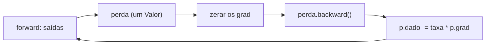

## Passo 1 · Leitura · Do neurônio ao MLP

O `Valor` já deriva qualquer expressão escrita com as suas operações. Falta escrever, com ele, a expressão de uma rede. Um **neurônio** é a conta do módulo 1, agora com `Valor` no lugar dos números:

$$
a = \tanh\Big(\sum_i w_i x_i + b\Big)
$$

Os pesos $w_i$ e o viés $b$ são objetos `Valor` que o neurônio guarda. As entradas podem ser números comuns: `p * xi` converte o número, e o resultado entra no grafo.

```python
class Neuronio:
    def __init__(self, n_entradas, rng):
        self.pesos = [Valor(rng.uniform(-1, 1)) for _ in range(n_entradas)]
        self.vies = Valor(0.0)

    def __call__(self, x):
        soma = sum((p * xi for p, xi in zip(self.pesos, x)), self.vies)
        return soma.tanh()

    def parametros(self):
        return self.pesos + [self.vies]
```

O `__call__` faz o objeto ser chamado como função: `n([2.0, 1.0])`. O segundo argumento do `sum` é o valor inicial da soma, e pôr o viés ali já o inclui na conta.

Uma **camada** é uma lista de neurônios que recebem a mesma entrada, e devolve a lista das saídas. Um **MLP** é uma lista de camadas em que a saída de uma é a entrada da seguinte. `MLP(3, [4, 4, 1], semente)` tem 3 entradas, duas camadas ocultas de 4 neurônios e 1 neurônio de saída. Como no micrograd, a tanh também fica na saída: a rede responde entre $-1$ e $1$, e os alvos dos exemplos são $-1$ e $1$.

O método `parametros()` existe nos três níveis e devolve uma lista **achatada** com os próprios objetos `Valor`, e não cópias deles: o neurônio devolve os pesos e depois o viés; a camada junta os de cada neurônio, na ordem; o MLP junta os de cada camada. É por essa lista que o treino vai zerar gradientes e atualizar a rede.

Os pesos iniciais são sorteados. Para o sorteio ser repetível, o MLP cria um gerador `random.Random(semente)` e o entrega às camadas, que o entregam aos neurônios. A ordem do sorteio é fixa: camada por camada, neurônio por neurônio, peso por peso. Com a mesma semente, dois MLPs nascem com os mesmos pesos, e todo o treino se repete número por número. O viés nasce em 0 e não consome sorteio.

Quantos parâmetros a rede tem? Um neurônio com $d$ entradas tem $d + 1$. Uma camada de $m$ neurônios com $d$ entradas tem $(d + 1) \cdot m$.

## Passo 2 · Previsão · Quantos parâmetros

A função conta os parâmetros de um MLP a partir da lista de tamanhos, com a entrada na primeira posição. Leia sem executar e digite o que o programa imprime.

### Código
```python
def contar(dims):
    total = 0
    for d_in, d_out in zip(dims, dims[1:]):
        total += (d_in + 1) * d_out
    return total


print(contar([3, 4, 4, 1]))
print(contar([2, 8, 1]))
print(contar([64, 32, 16, 10]))
```

### Dicas
1. `zip(dims, dims[1:])` dá os pares (entradas, neurônios) de cada camada: para `[3, 4, 4, 1]`, são `(3, 4)`, `(4, 4)` e `(4, 1)`.
2. Cada neurônio tem um peso por entrada e mais um viés.
3. Na última rede, as camadas têm $65 \cdot 32$, $33 \cdot 16$ e $17 \cdot 10$ parâmetros.

### Saída esperada
```text
41
33
2778
```

## Passo 3 · Exercício · As três classes
modo: lacunas

Complete as lacunas (`___`) de `Neuronio`, `Camada` e `MLP`. O `Valor` da lição anterior está em `valor.py`.

### Instruções
1. `Neuronio(n_entradas, rng)` sorteia cada peso com `rng.uniform(-1, 1)`, na ordem, e cria o viés como `Valor(0.0)`. Chamado com uma lista de entradas, devolve o `Valor` $\tanh(\sum_i w_i x_i + b)$. `parametros()` devolve a lista com os pesos e, por último, o viés.
2. `Camada(n_entradas, n_saidas, rng)` cria `n_saidas` neurônios, um depois do outro, com o mesmo `rng`. Chamada com uma lista, devolve a lista das saídas. `parametros()` junta os parâmetros dos neurônios, na ordem.
3. `MLP(n_entradas, tamanhos, semente)` cria `rng = random.Random(semente)` e uma camada por item de `tamanhos`, cada uma com tantas entradas quantas saídas tem a anterior. Chamado com uma lista, passa por todas as camadas e devolve um `Valor` quando a última camada tem um neurônio só (senão, a lista). `parametros()` junta os parâmetros das camadas: os mesmos objetos `Valor` que a rede usa.

### Código inicial
```python
import random
from valor import Valor


class Neuronio:
    def __init__(self, n_entradas, rng):
        self.pesos = [Valor(___) for _ in range(n_entradas)]
        self.vies = ___

    def __call__(self, x):
        soma = sum((p * xi for p, xi in zip(self.pesos, x)), ___)
        return ___

    def parametros(self):
        return self.pesos + ___


class Camada:
    def __init__(self, n_entradas, n_saidas, rng):
        self.neuronios = [Neuronio(n_entradas, rng) for _ in range(n_saidas)]

    def __call__(self, x):
        return [n(x) for n in self.neuronios]

    def parametros(self):
        return [p for n in self.neuronios for p in ___]


class MLP:
    def __init__(self, n_entradas, tamanhos, semente):
        rng = random.Random(semente)
        dims = [n_entradas] + tamanhos
        self.camadas = [Camada(___, ___, rng) for i in range(len(tamanhos))]

    def __call__(self, x):
        for camada in self.camadas:
            x = camada(x)
        return x[0] if len(x) == 1 else x

    def parametros(self):
        return [p for camada in self.camadas for p in camada.parametros()]
```
```text path=valor.py
import math


class Valor:
    def __init__(self, dado, _anteriores=(), _op=""):
        self.dado = dado
        self.grad = 0.0
        self._anteriores = set(_anteriores)
        self._op = _op
        self._backward = lambda: None

    def __add__(self, outro):
        outro = outro if isinstance(outro, Valor) else Valor(outro)
        saida = Valor(self.dado + outro.dado, (self, outro), "+")

        def _backward():
            self.grad += saida.grad
            outro.grad += saida.grad

        saida._backward = _backward
        return saida

    def __mul__(self, outro):
        outro = outro if isinstance(outro, Valor) else Valor(outro)
        saida = Valor(self.dado * outro.dado, (self, outro), "*")

        def _backward():
            self.grad += outro.dado * saida.grad
            outro.grad += self.dado * saida.grad

        saida._backward = _backward
        return saida

    def __radd__(self, outro):
        return self + outro

    def __rmul__(self, outro):
        return self * outro

    def __neg__(self):
        return self * -1

    def __sub__(self, outro):
        return self + (-outro)

    def __rsub__(self, outro):
        return (-self) + outro

    def __repr__(self):
        return f"Valor(dado={self.dado}, grad={self.grad})"

    def backward(self):
        ordem = []
        visitados = set()

        def visitar(v):
            if v not in visitados:
                visitados.add(v)
                for anterior in v._anteriores:
                    visitar(anterior)
                ordem.append(v)

        visitar(self)
        self.grad = 1.0
        for v in reversed(ordem):
            v._backward()

    def tanh(self):
        t = math.tanh(self.dado)
        saida = Valor(t, (self,), "tanh")

        def _backward():
            self.grad += (1 - t ** 2) * saida.grad

        saida._backward = _backward
        return saida

    def exp(self):
        saida = Valor(math.exp(self.dado), (self,), "exp")

        def _backward():
            self.grad += saida.dado * saida.grad

        saida._backward = _backward
        return saida

    def __pow__(self, k):
        if not isinstance(k, (int, float)):
            raise TypeError("o expoente precisa ser um número (int ou float)")
        saida = Valor(self.dado ** k, (self,), f"**{k}")

        def _backward():
            self.grad += k * self.dado ** (k - 1) * saida.grad

        saida._backward = _backward
        return saida

    def relu(self):
        saida = Valor(self.dado if self.dado > 0 else 0.0, (self,), "relu")

        def _backward():
            self.grad += (saida.dado > 0) * saida.grad

        saida._backward = _backward
        return saida

    def __truediv__(self, outro):
        return self * outro ** -1

    def __rtruediv__(self, outro):
        return outro * self ** -1

    def log(self):
        saida = Valor(math.log(self.dado), (self,), "log")

        def _backward():
            self.grad += (1 / self.dado) * saida.grad

        saida._backward = _backward
        return saida
```

### Solução
```python
import random
from valor import Valor


class Neuronio:
    def __init__(self, n_entradas, rng):
        self.pesos = [Valor(rng.uniform(-1, 1)) for _ in range(n_entradas)]
        self.vies = Valor(0.0)

    def __call__(self, x):
        soma = sum((p * xi for p, xi in zip(self.pesos, x)), self.vies)
        return soma.tanh()

    def parametros(self):
        return self.pesos + [self.vies]


class Camada:
    def __init__(self, n_entradas, n_saidas, rng):
        self.neuronios = [Neuronio(n_entradas, rng) for _ in range(n_saidas)]

    def __call__(self, x):
        return [n(x) for n in self.neuronios]

    def parametros(self):
        return [p for n in self.neuronios for p in n.parametros()]


class MLP:
    def __init__(self, n_entradas, tamanhos, semente):
        rng = random.Random(semente)
        dims = [n_entradas] + tamanhos
        self.camadas = [Camada(dims[i], dims[i + 1], rng) for i in range(len(tamanhos))]

    def __call__(self, x):
        for camada in self.camadas:
            x = camada(x)
        return x[0] if len(x) == 1 else x

    def parametros(self):
        return [p for camada in self.camadas for p in camada.parametros()]
```
```text path=valor.py
import math


class Valor:
    def __init__(self, dado, _anteriores=(), _op=""):
        self.dado = dado
        self.grad = 0.0
        self._anteriores = set(_anteriores)
        self._op = _op
        self._backward = lambda: None

    def __add__(self, outro):
        outro = outro if isinstance(outro, Valor) else Valor(outro)
        saida = Valor(self.dado + outro.dado, (self, outro), "+")

        def _backward():
            self.grad += saida.grad
            outro.grad += saida.grad

        saida._backward = _backward
        return saida

    def __mul__(self, outro):
        outro = outro if isinstance(outro, Valor) else Valor(outro)
        saida = Valor(self.dado * outro.dado, (self, outro), "*")

        def _backward():
            self.grad += outro.dado * saida.grad
            outro.grad += self.dado * saida.grad

        saida._backward = _backward
        return saida

    def __radd__(self, outro):
        return self + outro

    def __rmul__(self, outro):
        return self * outro

    def __neg__(self):
        return self * -1

    def __sub__(self, outro):
        return self + (-outro)

    def __rsub__(self, outro):
        return (-self) + outro

    def __repr__(self):
        return f"Valor(dado={self.dado}, grad={self.grad})"

    def backward(self):
        ordem = []
        visitados = set()

        def visitar(v):
            if v not in visitados:
                visitados.add(v)
                for anterior in v._anteriores:
                    visitar(anterior)
                ordem.append(v)

        visitar(self)
        self.grad = 1.0
        for v in reversed(ordem):
            v._backward()

    def tanh(self):
        t = math.tanh(self.dado)
        saida = Valor(t, (self,), "tanh")

        def _backward():
            self.grad += (1 - t ** 2) * saida.grad

        saida._backward = _backward
        return saida

    def exp(self):
        saida = Valor(math.exp(self.dado), (self,), "exp")

        def _backward():
            self.grad += saida.dado * saida.grad

        saida._backward = _backward
        return saida

    def __pow__(self, k):
        if not isinstance(k, (int, float)):
            raise TypeError("o expoente precisa ser um número (int ou float)")
        saida = Valor(self.dado ** k, (self,), f"**{k}")

        def _backward():
            self.grad += k * self.dado ** (k - 1) * saida.grad

        saida._backward = _backward
        return saida

    def relu(self):
        saida = Valor(self.dado if self.dado > 0 else 0.0, (self,), "relu")

        def _backward():
            self.grad += (saida.dado > 0) * saida.grad

        saida._backward = _backward
        return saida

    def __truediv__(self, outro):
        return self * outro ** -1

    def __rtruediv__(self, outro):
        return outro * self ** -1

    def log(self):
        saida = Valor(math.log(self.dado), (self,), "log")

        def _backward():
            self.grad += (1 / self.dado) * saida.grad

        saida._backward = _backward
        return saida
```

### Dicas
1. O valor inicial do `sum` é o lugar do viés; a ativação é um método do `Valor` que a soma devolve.
2. `self.pesos` é uma lista: para juntar o viés a ela, ele precisa estar numa lista também.
3. `dims` tem a entrada e depois os tamanhos: a camada `i` liga `dims[i]` a `dims[i + 1]`.

### Verificação
```json
[
  {"id": "neuronio-parametros", "checkpoint": 1, "kind": "expr", "setup": "import random\nn = Neuronio(3, random.Random(5))", "expr": "[len(n.parametros()), n.parametros()[-1].dado, type(n.parametros()[0]).__name__]", "expected": [4, 0.0, "Valor"], "name": "Neurônio de 3 entradas: 4 parâmetros Valor, e o último é o viés, que nasce em 0", "hint": "parametros() devolve os pesos e, no fim, o viés."},
  {"id": "pesos-sorteio", "checkpoint": 1, "kind": "expr", "setup": "import random", "expr": "[p.dado for p in Neuronio(3, random.Random(5)).parametros()]", "expected": [0.24580338977940386, 0.4835739785214588, 0.5903871311313933, 0.0], "tolerance": 1e-12, "name": "Os pesos saem de rng.uniform(-1, 1), na ordem do sorteio", "hint": "Um sorteio por peso, com rng.uniform(-1, 1); o viés não consome sorteio."},
  {"id": "neuronio-saida", "checkpoint": 1, "kind": "expr", "setup": "import random\nn = Neuronio(2, random.Random(1))\nps = n.parametros()\nps[0].dado = 0.5\nps[1].dado = -1.0\nps[2].dado = 0.25", "expr": "n([2.0, 1.0]).dado", "expected": 0.24491866240370913, "tolerance": 1e-12, "name": "Com pesos 0.5 e -1.0 e viés 0.25, a saída em [2, 1] é tanh(0.25)", "hint": "A saída é a tanh da soma dos produtos mais o viés."},
  {"id": "camada", "checkpoint": 2, "kind": "expr", "setup": "import random\nc = Camada(3, 4, random.Random(2))\ns = c([1.0, 2.0, 3.0])", "expr": "[len(s), type(s[0]).__name__, len(c.parametros())]", "expected": [4, "Valor", 16], "name": "Camada de 3 entradas e 4 neurônios: 4 saídas Valor e 16 parâmetros"},
  {"id": "mlp-41", "checkpoint": 3, "kind": "expr", "expr": "[len(MLP(3, [4, 4, 1], 0).parametros()), len(MLP(2, [8, 1], 0).parametros()), len(MLP(5, [3, 2], 0).parametros())]", "expected": [41, 33, 26], "name": "MLP(3, [4, 4, 1]) tem 41 parâmetros; MLP(2, [8, 1]), 33; MLP(5, [3, 2]), 26", "hint": "Cada camada tem (entradas + 1) parâmetros por neurônio; as entradas de uma camada são as saídas da anterior."},
  {"id": "mlp-ordem-sorteio", "checkpoint": 3, "kind": "expr", "expr": "[p.dado for p in MLP(2, [2, 1], 7).parametros()]", "expected": [-0.35233447033367526, -0.6983016521509962, 0.0, 0.3018689460797075, -0.8551274266649145, 0.0, 0.0717640086133784, -0.2686221661748289, 0.0], "tolerance": 1e-12, "name": "MLP(2, [2, 1], 7): parâmetros na ordem camada, neurônio, pesos e viés, com um só random.Random(7)", "hint": "O mesmo gerador passa por todas as camadas e neurônios, na ordem."},
  {"id": "mlp-saida", "checkpoint": 3, "kind": "expr", "setup": "a = MLP(3, [4, 4, 1], 0)([1.0, 2.0, -1.0])\nb = MLP(3, [4, 2], 0)([1.0, 2.0, -1.0])", "expr": "[type(a).__name__, a.dado, type(b).__name__, len(b)]", "expected": ["Valor", 0.38351219629700906, "list", 2], "tolerance": 1e-12, "name": "Com um neurônio de saída o MLP devolve um Valor; com dois, uma lista"},
  {"id": "mesmos-objetos", "checkpoint": 3, "kind": "expr", "setup": "m = MLP(2, [3, 1], 1)\nantes = m([1.0, -2.0]).dado\nfor p in m.parametros():\n    p.dado = 0.0", "expr": "[antes != 0.0, m([1.0, -2.0]).dado]", "expected": [true, 0.0], "name": "Zerar o dado de cada item de parametros() zera a saída da rede", "hint": "parametros() devolve os próprios objetos Valor da rede, não cópias."},
  {"id": "gradiente-chega", "checkpoint": 3, "kind": "expr", "setup": "m = MLP(3, [4, 4, 1], 3)\nm([1.0, 2.0, -1.0]).backward()", "expr": "sum(p.grad != 0.0 for p in m.parametros())", "expected": 41, "name": "Depois do backward da saída, os 41 parâmetros têm gradiente", "hint": "Todo parâmetro precisa participar da conta da saída, inclusive os vieses."},
  {"id": "semente", "checkpoint": 3, "kind": "expr", "setup": "def _dados(semente):\n    return [p.dado for p in MLP(2, [3, 1], semente).parametros()]", "expr": "[_dados(4) == _dados(4), _dados(4) != _dados(5)]", "expected": [true, true], "name": "A mesma semente repete os pesos; outra semente dá outros"}
]
```

### Soluções erradas
```python name="viés fora de parametros()"
import random
from valor import Valor


class Neuronio:
    def __init__(self, n_entradas, rng):
        self.pesos = [Valor(rng.uniform(-1, 1)) for _ in range(n_entradas)]
        self.vies = Valor(0.0)

    def __call__(self, x):
        soma = sum((p * xi for p, xi in zip(self.pesos, x)), self.vies)
        return soma.tanh()

    def parametros(self):
        return self.pesos + []


class Camada:
    def __init__(self, n_entradas, n_saidas, rng):
        self.neuronios = [Neuronio(n_entradas, rng) for _ in range(n_saidas)]

    def __call__(self, x):
        return [n(x) for n in self.neuronios]

    def parametros(self):
        return [p for n in self.neuronios for p in n.parametros()]


class MLP:
    def __init__(self, n_entradas, tamanhos, semente):
        rng = random.Random(semente)
        dims = [n_entradas] + tamanhos
        self.camadas = [Camada(dims[i], dims[i + 1], rng) for i in range(len(tamanhos))]

    def __call__(self, x):
        for camada in self.camadas:
            x = camada(x)
        return x[0] if len(x) == 1 else x

    def parametros(self):
        return [p for camada in self.camadas for p in camada.parametros()]
```
```python name="viés fora da soma"
import random
from valor import Valor


class Neuronio:
    def __init__(self, n_entradas, rng):
        self.pesos = [Valor(rng.uniform(-1, 1)) for _ in range(n_entradas)]
        self.vies = Valor(0.0)

    def __call__(self, x):
        soma = sum((p * xi for p, xi in zip(self.pesos, x)), Valor(0.0))
        return soma.tanh()

    def parametros(self):
        return self.pesos + [self.vies]


class Camada:
    def __init__(self, n_entradas, n_saidas, rng):
        self.neuronios = [Neuronio(n_entradas, rng) for _ in range(n_saidas)]

    def __call__(self, x):
        return [n(x) for n in self.neuronios]

    def parametros(self):
        return [p for n in self.neuronios for p in n.parametros()]


class MLP:
    def __init__(self, n_entradas, tamanhos, semente):
        rng = random.Random(semente)
        dims = [n_entradas] + tamanhos
        self.camadas = [Camada(dims[i], dims[i + 1], rng) for i in range(len(tamanhos))]

    def __call__(self, x):
        for camada in self.camadas:
            x = camada(x)
        return x[0] if len(x) == 1 else x

    def parametros(self):
        return [p for camada in self.camadas for p in camada.parametros()]
```
```python name="sem a tanh"
import random
from valor import Valor


class Neuronio:
    def __init__(self, n_entradas, rng):
        self.pesos = [Valor(rng.uniform(-1, 1)) for _ in range(n_entradas)]
        self.vies = Valor(0.0)

    def __call__(self, x):
        soma = sum((p * xi for p, xi in zip(self.pesos, x)), self.vies)
        return soma

    def parametros(self):
        return self.pesos + [self.vies]


class Camada:
    def __init__(self, n_entradas, n_saidas, rng):
        self.neuronios = [Neuronio(n_entradas, rng) for _ in range(n_saidas)]

    def __call__(self, x):
        return [n(x) for n in self.neuronios]

    def parametros(self):
        return [p for n in self.neuronios for p in n.parametros()]


class MLP:
    def __init__(self, n_entradas, tamanhos, semente):
        rng = random.Random(semente)
        dims = [n_entradas] + tamanhos
        self.camadas = [Camada(dims[i], dims[i + 1], rng) for i in range(len(tamanhos))]

    def __call__(self, x):
        for camada in self.camadas:
            x = camada(x)
        return x[0] if len(x) == 1 else x

    def parametros(self):
        return [p for camada in self.camadas for p in camada.parametros()]
```
```python name="pesos sorteados entre 0 e 1"
import random
from valor import Valor


class Neuronio:
    def __init__(self, n_entradas, rng):
        self.pesos = [Valor(rng.uniform(0, 1)) for _ in range(n_entradas)]
        self.vies = Valor(0.0)

    def __call__(self, x):
        soma = sum((p * xi for p, xi in zip(self.pesos, x)), self.vies)
        return soma.tanh()

    def parametros(self):
        return self.pesos + [self.vies]


class Camada:
    def __init__(self, n_entradas, n_saidas, rng):
        self.neuronios = [Neuronio(n_entradas, rng) for _ in range(n_saidas)]

    def __call__(self, x):
        return [n(x) for n in self.neuronios]

    def parametros(self):
        return [p for n in self.neuronios for p in n.parametros()]


class MLP:
    def __init__(self, n_entradas, tamanhos, semente):
        rng = random.Random(semente)
        dims = [n_entradas] + tamanhos
        self.camadas = [Camada(dims[i], dims[i + 1], rng) for i in range(len(tamanhos))]

    def __call__(self, x):
        for camada in self.camadas:
            x = camada(x)
        return x[0] if len(x) == 1 else x

    def parametros(self):
        return [p for camada in self.camadas for p in camada.parametros()]
```
```python name="viés sorteado em vez de 0"
import random
from valor import Valor


class Neuronio:
    def __init__(self, n_entradas, rng):
        self.pesos = [Valor(rng.uniform(-1, 1)) for _ in range(n_entradas)]
        self.vies = Valor(rng.uniform(-1, 1))

    def __call__(self, x):
        soma = sum((p * xi for p, xi in zip(self.pesos, x)), self.vies)
        return soma.tanh()

    def parametros(self):
        return self.pesos + [self.vies]


class Camada:
    def __init__(self, n_entradas, n_saidas, rng):
        self.neuronios = [Neuronio(n_entradas, rng) for _ in range(n_saidas)]

    def __call__(self, x):
        return [n(x) for n in self.neuronios]

    def parametros(self):
        return [p for n in self.neuronios for p in n.parametros()]


class MLP:
    def __init__(self, n_entradas, tamanhos, semente):
        rng = random.Random(semente)
        dims = [n_entradas] + tamanhos
        self.camadas = [Camada(dims[i], dims[i + 1], rng) for i in range(len(tamanhos))]

    def __call__(self, x):
        for camada in self.camadas:
            x = camada(x)
        return x[0] if len(x) == 1 else x

    def parametros(self):
        return [p for camada in self.camadas for p in camada.parametros()]
```
```python name="parametros() da camada devolve cópias"
import random
from valor import Valor


class Neuronio:
    def __init__(self, n_entradas, rng):
        self.pesos = [Valor(rng.uniform(-1, 1)) for _ in range(n_entradas)]
        self.vies = Valor(0.0)

    def __call__(self, x):
        soma = sum((p * xi for p, xi in zip(self.pesos, x)), self.vies)
        return soma.tanh()

    def parametros(self):
        return self.pesos + [self.vies]


class Camada:
    def __init__(self, n_entradas, n_saidas, rng):
        self.neuronios = [Neuronio(n_entradas, rng) for _ in range(n_saidas)]

    def __call__(self, x):
        return [n(x) for n in self.neuronios]

    def parametros(self):
        return [p for n in self.neuronios for p in [Valor(q.dado) for q in n.parametros()]]


class MLP:
    def __init__(self, n_entradas, tamanhos, semente):
        rng = random.Random(semente)
        dims = [n_entradas] + tamanhos
        self.camadas = [Camada(dims[i], dims[i + 1], rng) for i in range(len(tamanhos))]

    def __call__(self, x):
        for camada in self.camadas:
            x = camada(x)
        return x[0] if len(x) == 1 else x

    def parametros(self):
        return [p for camada in self.camadas for p in camada.parametros()]
```
```python name="entradas e saídas da camada trocadas"
import random
from valor import Valor


class Neuronio:
    def __init__(self, n_entradas, rng):
        self.pesos = [Valor(rng.uniform(-1, 1)) for _ in range(n_entradas)]
        self.vies = Valor(0.0)

    def __call__(self, x):
        soma = sum((p * xi for p, xi in zip(self.pesos, x)), self.vies)
        return soma.tanh()

    def parametros(self):
        return self.pesos + [self.vies]


class Camada:
    def __init__(self, n_entradas, n_saidas, rng):
        self.neuronios = [Neuronio(n_entradas, rng) for _ in range(n_saidas)]

    def __call__(self, x):
        return [n(x) for n in self.neuronios]

    def parametros(self):
        return [p for n in self.neuronios for p in n.parametros()]


class MLP:
    def __init__(self, n_entradas, tamanhos, semente):
        rng = random.Random(semente)
        dims = [n_entradas] + tamanhos
        self.camadas = [Camada(dims[i + 1], dims[i], rng) for i in range(len(tamanhos))]

    def __call__(self, x):
        for camada in self.camadas:
            x = camada(x)
        return x[0] if len(x) == 1 else x

    def parametros(self):
        return [p for camada in self.camadas for p in camada.parametros()]
```

## Passo 4 · Leitura · O laço de treino

Com a rede e o `backward`, o treino é o laço do Nível 5, só que o gradiente agora sai do grafo. Cada passo tem cinco etapas, sempre nesta ordem:



O conjunto de treino são quatro exemplos de três entradas, com alvos $-1$ e $1$:

```python
X = [[1.0, 2.0, -1.0], [2.0, -1.0, 0.5], [0.5, 1.0, 1.5], [-1.0, 0.5, -1.0]]
y = [1.0, -1.0, -1.0, 1.0]

saidas = [mlp(x) for x in X]
perda = sum((s - alvo) ** 2 for s, alvo in zip(saidas, y)) / len(y)
```

A perda é o erro quadrático médio, $L = \frac{1}{n} \sum_i (s_i - y_i)^2$, e é **um** `Valor`: a raiz de um grafo que contém os quatro forwards. Nesta rede, o grafo de um passo tem 400 nós, e os 41 parâmetros aparecem nele como folhas compartilhadas pelos quatro exemplos. Um único `perda.backward()` deixa em cada `p.grad` a derivada da perda média em relação àquele parâmetro.

Antes do `backward` vem o zerar. Os `_backward` somam com `+=`, que é o que faz um parâmetro usado em quatro exemplos receber as quatro contribuições. O mesmo `+=` faz o gradiente de um passo se somar ao do passo anterior, se ninguém o apagar:

```python
for p in mlp.parametros():
    p.grad = 0.0
perda.backward()
for p in mlp.parametros():
    p.dado -= taxa * p.grad
```

A atualização mexe em `p.dado` diretamente, sem criar nós: ela não faz parte da conta que se deriva. O sinal é de menos, porque o gradiente aponta para onde a perda cresce. E o grafo é descartado: no passo seguinte, o forward monta outro, com os `dado` novos.

Medido no executor, com `MLP(3, [4, 4, 1], 0)` e taxa 0,1:

| Passo | 1 | 6 | 20 | 50 | 100 |
|---|---|---|---|---|---|
| Perda | 0,945 | 0,150 | 0,030 | 0,0088 | 0,0036 |

Os 100 passos levam cerca de 70 ms, e as saídas terminam em 0,93, −0,95, −0,93 e 0,96, com os sinais dos alvos. Como o sorteio vem de `random.Random(0)` e tudo o mais é conta em Python puro, esses números se repetem até o último dígito em qualquer execução.

## Passo 5 · Exercício · Treinar com Valor

As três classes estão em `mlp.py` e o `Valor`, em `valor.py`. Escreva o laço de treino no `main.py`.

### Instruções
1. `treinar(mlp, X, y, taxa, passos)` repete `passos` vezes: calcula a saída de cada exemplo e a perda $\frac{1}{n} \sum_i (s_i - y_i)^2$, com $n$ = `len(y)`, como um `Valor`.
2. Em cada passo, zera o `grad` de todos os parâmetros, chama `backward()` na perda e atualiza cada parâmetro com `p.dado -= taxa * p.grad`.
3. Devolve o histórico: uma lista com o `dado` da perda de cada passo (um `float`), calculada antes da atualização daquele passo. A rede recebida sai treinada.

### Código inicial
```python
from valor import Valor
from mlp import MLP


def treinar(mlp, X, y, taxa, passos):
    pass
```
```text path=valor.py
import math


class Valor:
    def __init__(self, dado, _anteriores=(), _op=""):
        self.dado = dado
        self.grad = 0.0
        self._anteriores = set(_anteriores)
        self._op = _op
        self._backward = lambda: None

    def __add__(self, outro):
        outro = outro if isinstance(outro, Valor) else Valor(outro)
        saida = Valor(self.dado + outro.dado, (self, outro), "+")

        def _backward():
            self.grad += saida.grad
            outro.grad += saida.grad

        saida._backward = _backward
        return saida

    def __mul__(self, outro):
        outro = outro if isinstance(outro, Valor) else Valor(outro)
        saida = Valor(self.dado * outro.dado, (self, outro), "*")

        def _backward():
            self.grad += outro.dado * saida.grad
            outro.grad += self.dado * saida.grad

        saida._backward = _backward
        return saida

    def __radd__(self, outro):
        return self + outro

    def __rmul__(self, outro):
        return self * outro

    def __neg__(self):
        return self * -1

    def __sub__(self, outro):
        return self + (-outro)

    def __rsub__(self, outro):
        return (-self) + outro

    def __repr__(self):
        return f"Valor(dado={self.dado}, grad={self.grad})"

    def backward(self):
        ordem = []
        visitados = set()

        def visitar(v):
            if v not in visitados:
                visitados.add(v)
                for anterior in v._anteriores:
                    visitar(anterior)
                ordem.append(v)

        visitar(self)
        self.grad = 1.0
        for v in reversed(ordem):
            v._backward()

    def tanh(self):
        t = math.tanh(self.dado)
        saida = Valor(t, (self,), "tanh")

        def _backward():
            self.grad += (1 - t ** 2) * saida.grad

        saida._backward = _backward
        return saida

    def exp(self):
        saida = Valor(math.exp(self.dado), (self,), "exp")

        def _backward():
            self.grad += saida.dado * saida.grad

        saida._backward = _backward
        return saida

    def __pow__(self, k):
        if not isinstance(k, (int, float)):
            raise TypeError("o expoente precisa ser um número (int ou float)")
        saida = Valor(self.dado ** k, (self,), f"**{k}")

        def _backward():
            self.grad += k * self.dado ** (k - 1) * saida.grad

        saida._backward = _backward
        return saida

    def relu(self):
        saida = Valor(self.dado if self.dado > 0 else 0.0, (self,), "relu")

        def _backward():
            self.grad += (saida.dado > 0) * saida.grad

        saida._backward = _backward
        return saida

    def __truediv__(self, outro):
        return self * outro ** -1

    def __rtruediv__(self, outro):
        return outro * self ** -1

    def log(self):
        saida = Valor(math.log(self.dado), (self,), "log")

        def _backward():
            self.grad += (1 / self.dado) * saida.grad

        saida._backward = _backward
        return saida
```
```text path=mlp.py
import random
from valor import Valor


class Neuronio:
    def __init__(self, n_entradas, rng):
        self.pesos = [Valor(rng.uniform(-1, 1)) for _ in range(n_entradas)]
        self.vies = Valor(0.0)

    def __call__(self, x):
        soma = sum((p * xi for p, xi in zip(self.pesos, x)), self.vies)
        return soma.tanh()

    def parametros(self):
        return self.pesos + [self.vies]


class Camada:
    def __init__(self, n_entradas, n_saidas, rng):
        self.neuronios = [Neuronio(n_entradas, rng) for _ in range(n_saidas)]

    def __call__(self, x):
        return [n(x) for n in self.neuronios]

    def parametros(self):
        return [p for n in self.neuronios for p in n.parametros()]


class MLP:
    def __init__(self, n_entradas, tamanhos, semente):
        rng = random.Random(semente)
        dims = [n_entradas] + tamanhos
        self.camadas = [Camada(dims[i], dims[i + 1], rng) for i in range(len(tamanhos))]

    def __call__(self, x):
        for camada in self.camadas:
            x = camada(x)
        return x[0] if len(x) == 1 else x

    def parametros(self):
        return [p for camada in self.camadas for p in camada.parametros()]
```

### Solução
```python
from valor import Valor
from mlp import MLP


def treinar(mlp, X, y, taxa, passos):
    historico = []
    for _ in range(passos):
        saidas = [mlp(x) for x in X]
        perda = sum((s - alvo) ** 2 for s, alvo in zip(saidas, y)) / len(y)
        for p in mlp.parametros():
            p.grad = 0.0
        perda.backward()
        for p in mlp.parametros():
            p.dado -= taxa * p.grad
        historico.append(perda.dado)
    return historico
```
```text path=valor.py
import math


class Valor:
    def __init__(self, dado, _anteriores=(), _op=""):
        self.dado = dado
        self.grad = 0.0
        self._anteriores = set(_anteriores)
        self._op = _op
        self._backward = lambda: None

    def __add__(self, outro):
        outro = outro if isinstance(outro, Valor) else Valor(outro)
        saida = Valor(self.dado + outro.dado, (self, outro), "+")

        def _backward():
            self.grad += saida.grad
            outro.grad += saida.grad

        saida._backward = _backward
        return saida

    def __mul__(self, outro):
        outro = outro if isinstance(outro, Valor) else Valor(outro)
        saida = Valor(self.dado * outro.dado, (self, outro), "*")

        def _backward():
            self.grad += outro.dado * saida.grad
            outro.grad += self.dado * saida.grad

        saida._backward = _backward
        return saida

    def __radd__(self, outro):
        return self + outro

    def __rmul__(self, outro):
        return self * outro

    def __neg__(self):
        return self * -1

    def __sub__(self, outro):
        return self + (-outro)

    def __rsub__(self, outro):
        return (-self) + outro

    def __repr__(self):
        return f"Valor(dado={self.dado}, grad={self.grad})"

    def backward(self):
        ordem = []
        visitados = set()

        def visitar(v):
            if v not in visitados:
                visitados.add(v)
                for anterior in v._anteriores:
                    visitar(anterior)
                ordem.append(v)

        visitar(self)
        self.grad = 1.0
        for v in reversed(ordem):
            v._backward()

    def tanh(self):
        t = math.tanh(self.dado)
        saida = Valor(t, (self,), "tanh")

        def _backward():
            self.grad += (1 - t ** 2) * saida.grad

        saida._backward = _backward
        return saida

    def exp(self):
        saida = Valor(math.exp(self.dado), (self,), "exp")

        def _backward():
            self.grad += saida.dado * saida.grad

        saida._backward = _backward
        return saida

    def __pow__(self, k):
        if not isinstance(k, (int, float)):
            raise TypeError("o expoente precisa ser um número (int ou float)")
        saida = Valor(self.dado ** k, (self,), f"**{k}")

        def _backward():
            self.grad += k * self.dado ** (k - 1) * saida.grad

        saida._backward = _backward
        return saida

    def relu(self):
        saida = Valor(self.dado if self.dado > 0 else 0.0, (self,), "relu")

        def _backward():
            self.grad += (saida.dado > 0) * saida.grad

        saida._backward = _backward
        return saida

    def __truediv__(self, outro):
        return self * outro ** -1

    def __rtruediv__(self, outro):
        return outro * self ** -1

    def log(self):
        saida = Valor(math.log(self.dado), (self,), "log")

        def _backward():
            self.grad += (1 / self.dado) * saida.grad

        saida._backward = _backward
        return saida
```
```text path=mlp.py
import random
from valor import Valor


class Neuronio:
    def __init__(self, n_entradas, rng):
        self.pesos = [Valor(rng.uniform(-1, 1)) for _ in range(n_entradas)]
        self.vies = Valor(0.0)

    def __call__(self, x):
        soma = sum((p * xi for p, xi in zip(self.pesos, x)), self.vies)
        return soma.tanh()

    def parametros(self):
        return self.pesos + [self.vies]


class Camada:
    def __init__(self, n_entradas, n_saidas, rng):
        self.neuronios = [Neuronio(n_entradas, rng) for _ in range(n_saidas)]

    def __call__(self, x):
        return [n(x) for n in self.neuronios]

    def parametros(self):
        return [p for n in self.neuronios for p in n.parametros()]


class MLP:
    def __init__(self, n_entradas, tamanhos, semente):
        rng = random.Random(semente)
        dims = [n_entradas] + tamanhos
        self.camadas = [Camada(dims[i], dims[i + 1], rng) for i in range(len(tamanhos))]

    def __call__(self, x):
        for camada in self.camadas:
            x = camada(x)
        return x[0] if len(x) == 1 else x

    def parametros(self):
        return [p for camada in self.camadas for p in camada.parametros()]
```

### Dicas
1. `sum` de objetos `Valor` funciona por causa do `__radd__`; dividir por `len(y)` usa o `__truediv__`.
2. Zere os gradientes antes do `backward`, e não depois: depois, a atualização usaria zeros.
3. O histórico guarda `perda.dado`, um número, e não o `Valor`.

### Verificação
```json
[
  {"id": "tamanho-e-tipo", "checkpoint": 3, "kind": "expr", "setup": "from mlp import MLP\nX = [[1.0, 2.0, -1.0], [2.0, -1.0, 0.5], [0.5, 1.0, 1.5], [-1.0, 0.5, -1.0]]\ny = [1.0, -1.0, -1.0, 1.0]\nh = treinar(MLP(3, [4, 4, 1], 0), X, y, 0.1, 5)", "expr": "[type(h).__name__, len(h), all(type(v).__name__ == 'float' for v in h)]", "expected": ["list", 5, true], "name": "5 passos: uma lista com 5 perdas float", "hint": "Guarde o dado da perda, não o Valor."},
  {"id": "primeira-perda", "checkpoint": 1, "kind": "expr", "setup": "from mlp import MLP\nX = [[1.0, 2.0, -1.0], [2.0, -1.0, 0.5], [0.5, 1.0, 1.5], [-1.0, 0.5, -1.0]]\ny = [1.0, -1.0, -1.0, 1.0]\nh = treinar(MLP(3, [4, 4, 1], 0), X, y, 0.1, 1)", "expr": "h[0]", "expected": 0.9451721692791171, "tolerance": 1e-9, "name": "A primeira perda é a da rede recém-criada: 0.9452", "hint": "A perda é a média dos quadrados dos erros, registrada antes de atualizar."},
  {"id": "tres-passos", "checkpoint": 2, "kind": "expr", "setup": "from mlp import MLP\nX = [[1.0, 2.0, -1.0], [2.0, -1.0, 0.5], [0.5, 1.0, 1.5], [-1.0, 0.5, -1.0]]\ny = [1.0, -1.0, -1.0, 1.0]\nh = treinar(MLP(3, [4, 4, 1], 0), X, y, 0.1, 3)", "expr": "h", "expected": [0.9451721692791171, 0.47536115565545806, 0.3255041172464345], "tolerance": 1e-9, "name": "Três passos com taxa 0.1: 0.9452, 0.4754 e 0.3255", "hint": "Cada passo zera os gradientes, faz o backward e subtrai taxa * grad de cada parâmetro."},
  {"id": "vinte-passos", "checkpoint": 2, "kind": "expr", "setup": "from mlp import MLP\nX = [[1.0, 2.0, -1.0], [2.0, -1.0, 0.5], [0.5, 1.0, 1.5], [-1.0, 0.5, -1.0]]\ny = [1.0, -1.0, -1.0, 1.0]\nh = treinar(MLP(3, [4, 4, 1], 0), X, y, 0.1, 20)", "expr": "h[19]", "expected": 0.029936209153486975, "tolerance": 1e-9, "name": "A perda do passo 20 é 0.02994", "hint": "Se os gradientes não são zerados a cada passo, o valor sai diferente a partir do segundo passo."},
  {"id": "cem-passos", "checkpoint": 2, "kind": "expr", "setup": "from mlp import MLP\nX = [[1.0, 2.0, -1.0], [2.0, -1.0, 0.5], [0.5, 1.0, 1.5], [-1.0, 0.5, -1.0]]\ny = [1.0, -1.0, -1.0, 1.0]\nh = treinar(MLP(3, [4, 4, 1], 0), X, y, 0.1, 100)", "expr": "[h[-1] < 0.05, all(b < a for a, b in zip(h, h[1:]))]", "expected": [true, true], "name": "Em 100 passos a perda fica abaixo de 0.05 e cai a cada passo"},
  {"id": "rede-treinada", "checkpoint": 3, "kind": "expr", "setup": "from mlp import MLP\nX = [[1.0, 2.0, -1.0], [2.0, -1.0, 0.5], [0.5, 1.0, 1.5], [-1.0, 0.5, -1.0]]\ny = [1.0, -1.0, -1.0, 1.0]\nm = MLP(3, [4, 4, 1], 0)\ntreinar(m, X, y, 0.1, 100)", "expr": "[m(x).dado > 0 for x in X]", "expected": [true, false, false, true], "name": "Depois do treino, as saídas da rede recebida têm os sinais dos alvos", "hint": "A atualização é feita nos parâmetros da própria rede."},
  {"id": "continua", "checkpoint": 3, "kind": "expr", "setup": "from mlp import MLP\nX = [[1.0, 2.0, -1.0], [2.0, -1.0, 0.5], [0.5, 1.0, 1.5], [-1.0, 0.5, -1.0]]\ny = [1.0, -1.0, -1.0, 1.0]\nm = MLP(3, [4, 4, 1], 0)\nh1 = treinar(m, X, y, 0.1, 10)\nh2 = treinar(m, X, y, 0.1, 10)", "expr": "[len(h2), h2[0]]", "expected": [10, 0.06768864751225889], "tolerance": 1e-9, "name": "Uma segunda chamada continua de onde a primeira parou", "hint": "O treino não recria a rede: usa a que recebeu."},
  {"id": "outros-dados", "checkpoint": 1, "kind": "expr", "setup": "from mlp import MLP\nh = treinar(MLP(2, [2, 1], 1), [[1.0, -1.0], [0.5, 2.0]], [1.0, -1.0], 0.5, 3)", "expr": "h", "expected": [1.1283036149598826, 0.04042230925020583, 0.023360508462763836], "tolerance": 1e-9, "name": "Dois exemplos, MLP(2, [2, 1], 1) e taxa 0.5: três perdas", "hint": "A média divide pelo número de exemplos recebidos."},
  {"id": "zero-passos", "checkpoint": 3, "kind": "expr", "setup": "from mlp import MLP\nX = [[1.0, 2.0, -1.0], [2.0, -1.0, 0.5], [0.5, 1.0, 1.5], [-1.0, 0.5, -1.0]]\ny = [1.0, -1.0, -1.0, 1.0]\nm = MLP(3, [4, 4, 1], 0)\nantes = [p.dado for p in m.parametros()]\nh = treinar(m, X, y, 0.1, 0)", "expr": "[h, antes == [p.dado for p in m.parametros()]]", "expected": [[], true], "name": "Com 0 passos, histórico vazio e rede intacta"}
]
```

### Soluções erradas
```python name="sem zerar os gradientes"
from valor import Valor
from mlp import MLP


def treinar(mlp, X, y, taxa, passos):
    historico = []
    for _ in range(passos):
        saidas = [mlp(x) for x in X]
        perda = sum((s - alvo) ** 2 for s, alvo in zip(saidas, y)) / len(y)
        perda.backward()
        for p in mlp.parametros():
            p.dado -= taxa * p.grad
        historico.append(perda.dado)
    return historico
```
```python name="atualiza com +"
from valor import Valor
from mlp import MLP


def treinar(mlp, X, y, taxa, passos):
    historico = []
    for _ in range(passos):
        saidas = [mlp(x) for x in X]
        perda = sum((s - alvo) ** 2 for s, alvo in zip(saidas, y)) / len(y)
        for p in mlp.parametros():
            p.grad = 0.0
        perda.backward()
        for p in mlp.parametros():
            p.dado += taxa * p.grad
        historico.append(perda.dado)
    return historico
```
```python name="zera depois do backward"
from valor import Valor
from mlp import MLP


def treinar(mlp, X, y, taxa, passos):
    historico = []
    for _ in range(passos):
        saidas = [mlp(x) for x in X]
        perda = sum((s - alvo) ** 2 for s, alvo in zip(saidas, y)) / len(y)
        perda.backward()
        for p in mlp.parametros():
            p.grad = 0.0
        for p in mlp.parametros():
            p.dado -= taxa * p.grad
        historico.append(perda.dado)
    return historico
```
```python name="histórico guarda o Valor"
from valor import Valor
from mlp import MLP


def treinar(mlp, X, y, taxa, passos):
    historico = []
    for _ in range(passos):
        saidas = [mlp(x) for x in X]
        perda = sum((s - alvo) ** 2 for s, alvo in zip(saidas, y)) / len(y)
        for p in mlp.parametros():
            p.grad = 0.0
        perda.backward()
        for p in mlp.parametros():
            p.dado -= taxa * p.grad
        historico.append(perda)
    return historico
```
```python name="soma dos erros, sem a média"
from valor import Valor
from mlp import MLP


def treinar(mlp, X, y, taxa, passos):
    historico = []
    for _ in range(passos):
        saidas = [mlp(x) for x in X]
        perda = sum((s - alvo) ** 2 for s, alvo in zip(saidas, y))
        for p in mlp.parametros():
            p.grad = 0.0
        perda.backward()
        for p in mlp.parametros():
            p.dado -= taxa * p.grad
        historico.append(perda.dado)
    return historico
```
```python name="erro sem o quadrado"
from valor import Valor
from mlp import MLP


def treinar(mlp, X, y, taxa, passos):
    historico = []
    for _ in range(passos):
        saidas = [mlp(x) for x in X]
        perda = sum((s - alvo) for s, alvo in zip(saidas, y)) / len(y)
        for p in mlp.parametros():
            p.grad = 0.0
        perda.backward()
        for p in mlp.parametros():
            p.dado -= taxa * p.grad
        historico.append(perda.dado)
    return historico
```
```python name="treina uma rede nova, não a recebida"
from valor import Valor
from mlp import MLP


def treinar(mlp, X, y, taxa, passos):
    mlp = MLP(3, [4, 4, 1], 0)
    historico = []
    for _ in range(passos):
        saidas = [mlp(x) for x in X]
        perda = sum((s - alvo) ** 2 for s, alvo in zip(saidas, y)) / len(y)
        for p in mlp.parametros():
            p.grad = 0.0
        perda.backward()
        for p in mlp.parametros():
            p.dado -= taxa * p.grad
        historico.append(perda.dado)
    return historico
```

## Passo 6 · Leitura · Diagnóstico

O histórico de perdas é o primeiro lugar onde um treino mostra que algo vai mal. Três defeitos têm assinaturas diferentes, e todos foram medidos nesta rede.

**Taxa alta demais.** Com taxa 0,1 a perda cai em todos os passos. Com taxa 3,0 e semente 1, os primeiros valores são 0,742, 0,899, 1,000, 1,000, e a perda fica parada em 1,0 até o fim. O passo grande jogou as pré-ativações para longe de zero, a tanh saturou em $\pm 1$, e a derivada $1 - t^2$ virou praticamente zero: sem gradiente, nada mais muda. Com a semente 0 e a mesma taxa, a perda sobe para 1,73 no segundo passo e depois despenca. Subidas no começo e resultado que depende da semente são sinais de taxa alta.

**Gradientes não zerados.** Sem o laço que zera, cada `backward` soma por cima do anterior, e o passo usa a soma de todos os gradientes desde o início. Com a semente 2 e taxa 0,1, a perda sobe em 17 das 99 transições (com o zerar, em nenhuma): desce rápido, passa do ponto e volta, porque continua andando numa direção antiga. O acúmulo se parece com uma taxa que cresce a cada passo.

**Parâmetros que não são os da rede.** Se `parametros()` devolve cópias, como em

```python
def parametros(self):
    return [Valor(p.dado) for p in self.pesos] + [Valor(self.vies.dado)]
```

o laço roda sem erro, zera e atualiza as cópias, e a rede nunca muda: a perda é a mesma em todos os passos, até o último dígito. Um histórico constante quase nunca é "taxa pequena"; é atualização que não chega aos parâmetros. Zerar os gradientes **depois** do `backward` dá o mesmo desenho.

A regra prática é olhar o histórico inteiro, e não só o último valor. Um treino que terminou em 0,02 depois de subir várias vezes pelo caminho está instável, e outra semente pode acabar em 1,0.

Um último diagnóstico é de custo. Cada passo desta rede cria 400 objetos `Valor` para 4 exemplos e 41 parâmetros. Uma rede 64 → 32 → 16 → 10, pequena para imagens de 8 × 8, com 8 exemplos, monta cerca de 47 mil nós por passo e leva 68 ms num forward e backward. A matemática é a mesma; o que pesa é ter um objeto Python por número. O módulo 4 troca os escalares por matrizes do numpy e faz essa mesma conta em 0,06 ms.

## Passo 7 · Exercício · Diagnosticar e prever

Escreva duas funções de apoio ao treino. O histórico tem sempre pelo menos dois valores.

### Instruções
1. `diagnosticar(historico)` devolve `"diverge"` se algum valor não é finito (`nan` ou `inf`) ou se o último valor é maior que o primeiro.
2. Senão, devolve `"oscila"` se a perda subiu (valor maior que o anterior) em pelo menos um quarto das transições; um histórico de $k$ valores tem $k - 1$ transições.
3. Senão, devolve `"lento"` se o último valor é maior que a metade do primeiro, e `"ok"` no caso que sobra.
4. `prever(mlp, X)` devolve a lista com o `dado` da saída da rede para cada exemplo de `X` (uma lista de `float`s).

### Código inicial
```python
import math
from valor import Valor
from mlp import MLP


def diagnosticar(historico):
    pass


def prever(mlp, X):
    pass
```
```text path=valor.py
import math


class Valor:
    def __init__(self, dado, _anteriores=(), _op=""):
        self.dado = dado
        self.grad = 0.0
        self._anteriores = set(_anteriores)
        self._op = _op
        self._backward = lambda: None

    def __add__(self, outro):
        outro = outro if isinstance(outro, Valor) else Valor(outro)
        saida = Valor(self.dado + outro.dado, (self, outro), "+")

        def _backward():
            self.grad += saida.grad
            outro.grad += saida.grad

        saida._backward = _backward
        return saida

    def __mul__(self, outro):
        outro = outro if isinstance(outro, Valor) else Valor(outro)
        saida = Valor(self.dado * outro.dado, (self, outro), "*")

        def _backward():
            self.grad += outro.dado * saida.grad
            outro.grad += self.dado * saida.grad

        saida._backward = _backward
        return saida

    def __radd__(self, outro):
        return self + outro

    def __rmul__(self, outro):
        return self * outro

    def __neg__(self):
        return self * -1

    def __sub__(self, outro):
        return self + (-outro)

    def __rsub__(self, outro):
        return (-self) + outro

    def __repr__(self):
        return f"Valor(dado={self.dado}, grad={self.grad})"

    def backward(self):
        ordem = []
        visitados = set()

        def visitar(v):
            if v not in visitados:
                visitados.add(v)
                for anterior in v._anteriores:
                    visitar(anterior)
                ordem.append(v)

        visitar(self)
        self.grad = 1.0
        for v in reversed(ordem):
            v._backward()

    def tanh(self):
        t = math.tanh(self.dado)
        saida = Valor(t, (self,), "tanh")

        def _backward():
            self.grad += (1 - t ** 2) * saida.grad

        saida._backward = _backward
        return saida

    def exp(self):
        saida = Valor(math.exp(self.dado), (self,), "exp")

        def _backward():
            self.grad += saida.dado * saida.grad

        saida._backward = _backward
        return saida

    def __pow__(self, k):
        if not isinstance(k, (int, float)):
            raise TypeError("o expoente precisa ser um número (int ou float)")
        saida = Valor(self.dado ** k, (self,), f"**{k}")

        def _backward():
            self.grad += k * self.dado ** (k - 1) * saida.grad

        saida._backward = _backward
        return saida

    def relu(self):
        saida = Valor(self.dado if self.dado > 0 else 0.0, (self,), "relu")

        def _backward():
            self.grad += (saida.dado > 0) * saida.grad

        saida._backward = _backward
        return saida

    def __truediv__(self, outro):
        return self * outro ** -1

    def __rtruediv__(self, outro):
        return outro * self ** -1

    def log(self):
        saida = Valor(math.log(self.dado), (self,), "log")

        def _backward():
            self.grad += (1 / self.dado) * saida.grad

        saida._backward = _backward
        return saida
```
```text path=mlp.py
import random
from valor import Valor


class Neuronio:
    def __init__(self, n_entradas, rng):
        self.pesos = [Valor(rng.uniform(-1, 1)) for _ in range(n_entradas)]
        self.vies = Valor(0.0)

    def __call__(self, x):
        soma = sum((p * xi for p, xi in zip(self.pesos, x)), self.vies)
        return soma.tanh()

    def parametros(self):
        return self.pesos + [self.vies]


class Camada:
    def __init__(self, n_entradas, n_saidas, rng):
        self.neuronios = [Neuronio(n_entradas, rng) for _ in range(n_saidas)]

    def __call__(self, x):
        return [n(x) for n in self.neuronios]

    def parametros(self):
        return [p for n in self.neuronios for p in n.parametros()]


class MLP:
    def __init__(self, n_entradas, tamanhos, semente):
        rng = random.Random(semente)
        dims = [n_entradas] + tamanhos
        self.camadas = [Camada(dims[i], dims[i + 1], rng) for i in range(len(tamanhos))]

    def __call__(self, x):
        for camada in self.camadas:
            x = camada(x)
        return x[0] if len(x) == 1 else x

    def parametros(self):
        return [p for camada in self.camadas for p in camada.parametros()]
```

### Solução
```python
import math
from valor import Valor
from mlp import MLP


def diagnosticar(historico):
    if not all(math.isfinite(v) for v in historico) or historico[-1] > historico[0]:
        return "diverge"
    subidas = sum(1 for a, b in zip(historico, historico[1:]) if b > a)
    if 4 * subidas >= len(historico) - 1:
        return "oscila"
    if historico[-1] > historico[0] / 2:
        return "lento"
    return "ok"


def prever(mlp, X):
    return [mlp(x).dado for x in X]
```
```text path=valor.py
import math


class Valor:
    def __init__(self, dado, _anteriores=(), _op=""):
        self.dado = dado
        self.grad = 0.0
        self._anteriores = set(_anteriores)
        self._op = _op
        self._backward = lambda: None

    def __add__(self, outro):
        outro = outro if isinstance(outro, Valor) else Valor(outro)
        saida = Valor(self.dado + outro.dado, (self, outro), "+")

        def _backward():
            self.grad += saida.grad
            outro.grad += saida.grad

        saida._backward = _backward
        return saida

    def __mul__(self, outro):
        outro = outro if isinstance(outro, Valor) else Valor(outro)
        saida = Valor(self.dado * outro.dado, (self, outro), "*")

        def _backward():
            self.grad += outro.dado * saida.grad
            outro.grad += self.dado * saida.grad

        saida._backward = _backward
        return saida

    def __radd__(self, outro):
        return self + outro

    def __rmul__(self, outro):
        return self * outro

    def __neg__(self):
        return self * -1

    def __sub__(self, outro):
        return self + (-outro)

    def __rsub__(self, outro):
        return (-self) + outro

    def __repr__(self):
        return f"Valor(dado={self.dado}, grad={self.grad})"

    def backward(self):
        ordem = []
        visitados = set()

        def visitar(v):
            if v not in visitados:
                visitados.add(v)
                for anterior in v._anteriores:
                    visitar(anterior)
                ordem.append(v)

        visitar(self)
        self.grad = 1.0
        for v in reversed(ordem):
            v._backward()

    def tanh(self):
        t = math.tanh(self.dado)
        saida = Valor(t, (self,), "tanh")

        def _backward():
            self.grad += (1 - t ** 2) * saida.grad

        saida._backward = _backward
        return saida

    def exp(self):
        saida = Valor(math.exp(self.dado), (self,), "exp")

        def _backward():
            self.grad += saida.dado * saida.grad

        saida._backward = _backward
        return saida

    def __pow__(self, k):
        if not isinstance(k, (int, float)):
            raise TypeError("o expoente precisa ser um número (int ou float)")
        saida = Valor(self.dado ** k, (self,), f"**{k}")

        def _backward():
            self.grad += k * self.dado ** (k - 1) * saida.grad

        saida._backward = _backward
        return saida

    def relu(self):
        saida = Valor(self.dado if self.dado > 0 else 0.0, (self,), "relu")

        def _backward():
            self.grad += (saida.dado > 0) * saida.grad

        saida._backward = _backward
        return saida

    def __truediv__(self, outro):
        return self * outro ** -1

    def __rtruediv__(self, outro):
        return outro * self ** -1

    def log(self):
        saida = Valor(math.log(self.dado), (self,), "log")

        def _backward():
            self.grad += (1 / self.dado) * saida.grad

        saida._backward = _backward
        return saida
```
```text path=mlp.py
import random
from valor import Valor


class Neuronio:
    def __init__(self, n_entradas, rng):
        self.pesos = [Valor(rng.uniform(-1, 1)) for _ in range(n_entradas)]
        self.vies = Valor(0.0)

    def __call__(self, x):
        soma = sum((p * xi for p, xi in zip(self.pesos, x)), self.vies)
        return soma.tanh()

    def parametros(self):
        return self.pesos + [self.vies]


class Camada:
    def __init__(self, n_entradas, n_saidas, rng):
        self.neuronios = [Neuronio(n_entradas, rng) for _ in range(n_saidas)]

    def __call__(self, x):
        return [n(x) for n in self.neuronios]

    def parametros(self):
        return [p for n in self.neuronios for p in n.parametros()]


class MLP:
    def __init__(self, n_entradas, tamanhos, semente):
        rng = random.Random(semente)
        dims = [n_entradas] + tamanhos
        self.camadas = [Camada(dims[i], dims[i + 1], rng) for i in range(len(tamanhos))]

    def __call__(self, x):
        for camada in self.camadas:
            x = camada(x)
        return x[0] if len(x) == 1 else x

    def parametros(self):
        return [p for camada in self.camadas for p in camada.parametros()]
```

### Dicas
1. `math.isfinite(v)` é `False` para `nan` e para `inf`; uma comparação com `nan` é sempre `False`, então teste os valores antes de comparar.
2. `zip(historico, historico[1:])` dá os pares (anterior, seguinte) de cada transição.
3. A ordem das regras importa: um histórico pode oscilar e também terminar acima da metade.

### Verificação
```json
[
  {"id": "ok", "checkpoint": 3, "kind": "call", "function": "diagnosticar", "args": [[1.0, 0.6, 0.3, 0.1]], "expected": "ok", "name": "Perda que cai sempre e termina abaixo da metade: ok"},
  {"id": "diverge-sobe", "checkpoint": 1, "kind": "call", "function": "diagnosticar", "args": [[1.0, 0.8, 1.5]], "expected": "diverge", "name": "Último valor maior que o primeiro: diverge", "hint": "A regra do diverge vem antes da regra do oscila."},
  {"id": "diverge-pico", "checkpoint": 1, "kind": "call", "function": "diagnosticar", "args": [[1.0, 3.0, 2.0]], "expected": "diverge", "name": "[1.0, 3.0, 2.0] termina acima do começo: diverge", "hint": "Compare o último valor com o primeiro, não com o penúltimo."},
  {"id": "diverge-nan", "checkpoint": 1, "kind": "expr", "expr": "diagnosticar([1.0, 0.5, float('nan')])", "expected": "diverge", "name": "Um nan no fim: diverge", "hint": "nan > x é False; use math.isfinite."},
  {"id": "diverge-inf-no-meio", "checkpoint": 1, "kind": "expr", "expr": "diagnosticar([1.0, float('inf'), 0.2, 0.1, 0.05, 0.02])", "expected": "diverge", "name": "Um inf no meio do histórico: diverge", "hint": "Todos os valores são conferidos, não só o último."},
  {"id": "oscila", "checkpoint": 2, "kind": "call", "function": "diagnosticar", "args": [[1.0, 0.4, 0.7, 0.3, 0.5, 0.2]], "expected": "oscila", "name": "Duas subidas em 5 transições, terminando em 0.2: oscila", "hint": "O último valor é baixo, mas o caminho teve subidas."},
  {"id": "oscila-limite", "checkpoint": 2, "kind": "call", "function": "diagnosticar", "args": [[1.0, 0.8, 0.9, 0.6, 0.3]], "expected": "oscila", "name": "Uma subida em 4 transições é exatamente um quarto: oscila", "hint": "Pelo menos um quarto inclui o quarto exato."},
  {"id": "uma-subida-em-oito", "checkpoint": 2, "kind": "call", "function": "diagnosticar", "args": [[1.0, 0.9, 0.8, 0.85, 0.6, 0.5, 0.4, 0.3, 0.2]], "expected": "ok", "name": "Uma subida em 8 transições não chega a um quarto: ok"},
  {"id": "oscila-antes-de-lento", "checkpoint": 2, "kind": "call", "function": "diagnosticar", "args": [[1.0, 0.9, 0.95, 0.8, 0.9, 0.7]], "expected": "oscila", "name": "Oscila e termina acima da metade: a resposta é oscila", "hint": "A regra do oscila vem antes da regra do lento."},
  {"id": "lento", "checkpoint": 3, "kind": "call", "function": "diagnosticar", "args": [[1.0, 0.95, 0.9, 0.85]], "expected": "lento", "name": "Cai sempre, mas termina em 85 % do começo: lento"},
  {"id": "dois-valores", "checkpoint": 3, "kind": "call", "function": "diagnosticar", "args": [[2.0, 0.5]], "expected": "ok", "name": "Dois valores, de 2.0 para 0.5: ok"},
  {"id": "metade-exata", "checkpoint": 3, "kind": "call", "function": "diagnosticar", "args": [[1.0, 0.7, 0.5]], "expected": "ok", "name": "Terminar exatamente na metade do começo não é lento: ok", "hint": "Lento é terminar acima da metade."},
  {"id": "prever-valores", "checkpoint": 4, "kind": "expr", "setup": "from mlp import MLP\nX = [[1.0, 2.0, -1.0], [2.0, -1.0, 0.5], [0.5, 1.0, 1.5], [-1.0, 0.5, -1.0]]\nr = prever(MLP(3, [4, 4, 1], 0), X)", "expr": "[r, all(type(v).__name__ == 'float' for v in r)]", "expected": [[0.38351219629700906, 0.03661380241294773, 0.19077573271759632, 0.047048561562671995], true], "tolerance": 1e-12, "name": "prever devolve o dado da saída de cada exemplo, como float", "hint": "A rede devolve um Valor; a previsão é o dado dele."}
]
```

### Soluções erradas
```python name="olha só o último valor"
import math
from valor import Valor
from mlp import MLP


def diagnosticar(historico):
    if not math.isfinite(historico[-1]) or historico[-1] > historico[0]:
        return "diverge"
    if historico[-1] > historico[0] / 2:
        return "lento"
    return "ok"


def prever(mlp, X):
    return [mlp(x).dado for x in X]
```
```python name="nan não tratado"
import math
from valor import Valor
from mlp import MLP


def diagnosticar(historico):
    if historico[-1] > historico[0]:
        return "diverge"
    subidas = sum(1 for a, b in zip(historico, historico[1:]) if b > a)
    if 4 * subidas >= len(historico) - 1:
        return "oscila"
    if historico[-1] > historico[0] / 2:
        return "lento"
    return "ok"


def prever(mlp, X):
    return [mlp(x).dado for x in X]
```
```python name="lento testado antes de oscila"
import math
from valor import Valor
from mlp import MLP


def diagnosticar(historico):
    if not all(math.isfinite(v) for v in historico) or historico[-1] > historico[0]:
        return "diverge"
    if historico[-1] > historico[0] / 2:
        return "lento"
    subidas = sum(1 for a, b in zip(historico, historico[1:]) if b > a)
    if 4 * subidas >= len(historico) - 1:
        return "oscila"
    return "ok"


def prever(mlp, X):
    return [mlp(x).dado for x in X]
```
```python name="um quarto exato não conta como oscila"
import math
from valor import Valor
from mlp import MLP


def diagnosticar(historico):
    if not all(math.isfinite(v) for v in historico) or historico[-1] > historico[0]:
        return "diverge"
    subidas = sum(1 for a, b in zip(historico, historico[1:]) if b > a)
    if 4 * subidas > len(historico) - 1:
        return "oscila"
    if historico[-1] > historico[0] / 2:
        return "lento"
    return "ok"


def prever(mlp, X):
    return [mlp(x).dado for x in X]
```
```python name="diverge comparando com o penúltimo"
import math
from valor import Valor
from mlp import MLP


def diagnosticar(historico):
    if not all(math.isfinite(v) for v in historico) or historico[-1] > historico[-2]:
        return "diverge"
    subidas = sum(1 for a, b in zip(historico, historico[1:]) if b > a)
    if 4 * subidas >= len(historico) - 1:
        return "oscila"
    if historico[-1] > historico[0] / 2:
        return "lento"
    return "ok"


def prever(mlp, X):
    return [mlp(x).dado for x in X]
```
```python name="oscila divide pelo número de valores"
import math
from valor import Valor
from mlp import MLP


def diagnosticar(historico):
    if not all(math.isfinite(v) for v in historico) or historico[-1] > historico[0]:
        return "diverge"
    subidas = sum(1 for a, b in zip(historico, historico[1:]) if b > a)
    if 4 * subidas >= len(historico):
        return "oscila"
    if historico[-1] > historico[0] / 2:
        return "lento"
    return "ok"


def prever(mlp, X):
    return [mlp(x).dado for x in X]
```
```python name="prever devolve os Valor"
import math
from valor import Valor
from mlp import MLP


def diagnosticar(historico):
    if not all(math.isfinite(v) for v in historico) or historico[-1] > historico[0]:
        return "diverge"
    subidas = sum(1 for a, b in zip(historico, historico[1:]) if b > a)
    if 4 * subidas >= len(historico) - 1:
        return "oscila"
    if historico[-1] > historico[0] / 2:
        return "lento"
    return "ok"


def prever(mlp, X):
    return [mlp(x) for x in X]
```

## Passo 8 · Quiz · Zerar e taxa

### Pergunta
Um laço de treino com `Valor` faz, em cada passo, forward, perda, `perda.backward()` e `p.dado -= 0.1 * p.grad`, sem nenhuma linha que zere os gradientes. O que o segundo passo usa como gradiente?
- [ ] Só o gradiente do segundo passo, porque o forward cria um grafo novo
- [ ] Zero, porque o `backward` apaga os `grad` quando termina
- [x] A soma do gradiente do primeiro passo com o do segundo, porque os parâmetros são os mesmos objetos e o `_backward` usa `+=`
- [ ] O gradiente do primeiro passo, porque o `grad` só é escrito uma vez
> O grafo é novo a cada forward, mas as folhas (os parâmetros) são os mesmos objetos, e o `grad` deles continua lá. Cada `_backward` soma com `+=`, então o segundo `backward` acumula sobre o primeiro. Nada no `backward` apaga gradientes, e nada impede que sejam escritos de novo.

### Pergunta
Dois treinos da mesma rede, mudando só a taxa. O primeiro registra 0,74, 0,35, 0,18, 0,09, 0,05. O segundo registra 0,74, 0,90, 1,00, 1,00, 1,00 e não sai mais de 1,00. Qual é a leitura mais provável do segundo?
- [ ] A taxa é pequena demais, e a rede ainda não começou a aprender
- [x] A taxa é alta demais: o primeiro passo saturou as tanh, e com derivada quase zero os parâmetros pararam de mudar
- [ ] O `backward` está sendo chamado duas vezes por passo
- [ ] A perda 1,00 é o mínimo possível para alvos $-1$ e $1$
> Uma taxa pequena faria a perda cair devagar, e não subir e travar. A subida logo no começo seguida de um valor constante é a tanh saturada: $1 - t^2 \approx 0$, e nenhum gradiente passa. Dois `backward` por passo dobrariam o gradiente, o que não trava em 1,00 por si só. O mínimo da perda é 0, que o primeiro treino está alcançando.

### Pergunta
O histórico de um treino de 50 passos é o mesmo número, 0,9452, repetido 50 vezes, sem nenhum erro na execução. Qual destas causas explica o histórico?
- [ ] Os gradientes não foram zerados entre os passos
- [ ] A atualização foi feita com `+` no lugar de `-`
- [ ] A perda foi somada em vez de tirada a média
- [x] `parametros()` devolve objetos novos com `Valor(p.dado)`, e o laço atualiza as cópias
> Uma perda idêntica até o último dígito diz que a rede não mudou. Com cópias, o laço zera e atualiza objetos que a rede não usa. Sem zerar, a perda muda (os gradientes acumulados são grandes); com `+`, ela sobe; e a soma no lugar da média só multiplica a perda e o gradiente por $n$.
