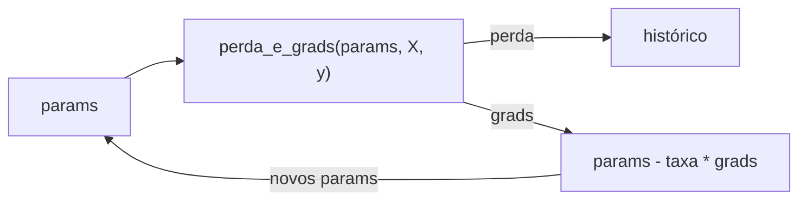

## Passo 1 · Leitura · O laço como contrato

Todo treino de rede, do perceptron de duas entradas ao modelo de linguagem do módulo 7, é o mesmo laço: calcular a perda e os gradientes com os parâmetros atuais, dar um passo contra o gradiente, registrar o que aconteceu e repetir.



Este módulo escreve o laço como **funções puras** com um contrato fixo. Os parâmetros são uma lista de pares `(W, b)`, um por camada. Uma função `perda_e_grads(params, X, y)` devolve `(perda, grads)`, com `grads` na mesma forma de `params`, e não altera nada. Quem treina **recebe** essa função como argumento, e assim o mesmo laço treina qualquer modelo que cumpra o contrato:

$$
W \leftarrow W - \eta\, \frac{\partial L}{\partial W}, \qquad b \leftarrow b - \eta\, \frac{\partial L}{\partial b}
$$

O modelo das próximas lições está no arquivo `rede.py`, entregue pronto: um MLP com ReLU entre as camadas e softmax com entropia cruzada no fim.

```python
from rede import espiral, inicializar, perda_e_grads, acuracia

X, y = espiral(100, 3, 0)            # 300 pontos 2D em 3 braços de espiral
params = inicializar([2, 32, 3], 0)  # 2 entradas, 32 escondidos, 3 classes
perda, grads = perda_e_grads(params, X, y)
print(round(perda, 3))               # 1.256
```

Por dentro, `perda_e_grads` faz o backward camada a camada. Você ainda não o escreveu: por enquanto ele é uma **caixa fechada**, e o que importa é a interface. A lição de backprop vetorizado do módulo 4 abre a caixa e reconstrói cada linha. Com uma camada só, `inicializar([2, 3], 0)`, a mesma função é a regressão softmax do Nível 5, com o gradiente $\frac{1}{n}X^\top(P - Y)$ que você já conhece.

Os números dão a medida. Com a rede `[2, 32, 3]`, taxa 1,0 e 300 épocas de descida em lote cheio, a perda de treino cai de 1,256 para 0,125, e a rede acerta 98 % do treino e 97 % de uma validação sorteada com outra semente, em 0,09 s no executor. A regressão softmax, sem camada escondida, para em 54 %: uma espiral não se separa com retas. Com taxa 10, a perda sobe para 1,47 na décima época e a rede termina chutando uma classe só (33 %).

O laço não decide nada sobre o modelo, e é por isso que ele é testável: dá para passar a ele uma função de perda escrita à mão, com resultado calculável no papel, e conferir cada número do histórico.

## Passo 2 · Previsão · Três épocas à mão

Um modelo de um parâmetro, $\hat y = w\,x$, com o erro quadrático médio e descida em lote cheio. Leia sem executar e digite o que o programa imprime.

### Código
```python
import numpy as np

x = np.array([1.0, 2.0])
y = np.array([2.0, 4.0])
w = 0.0
taxa = 0.1
for epoca in range(3):
    erro = w * x - y
    perda = float((erro ** 2).mean())
    grad = float((2 * erro * x).mean())
    w = w - taxa * grad
    print(epoca, round(perda, 4), round(w, 4))
```

### Dicas
1. Na primeira época, `erro` é `[-2, -4]`: a perda é a média de 4 e 16.
2. O gradiente é a média de `2 * erro * x`, ou seja, de -4 e -16.
3. O $w$ certo é 2; cada passo anda metade do que falta, e a perda cai para um quarto.

### Saída esperada
```text
0 10.0 1.0
1 2.5 1.5
2 0.625 1.75
```

## Passo 3 · Exercício · Uma época depois da outra
modo: ordenar

Arraste as linhas para montar `treinar(perda_e_grads, params, X, y, epocas, taxa)`, o laço de descida em lote cheio, e ajuste a indentação. Duas linhas estão sobrando.

### Instruções
1. Comece um histórico vazio e repita `epocas` vezes.
2. Em cada época, chame `perda_e_grads(params, X, y)` uma vez e registre a perda dos parâmetros do começo da época.
3. Atualize cada par com `W - taxa * dW` e `b - taxa * db`, criando arrays novos (os de `params` recebidos não mudam).
4. No fim, devolva a tupla `(params, historico)`.

### Solução
```python
def treinar(perda_e_grads, params, X, y, epocas, taxa):
    historico = []
    for epoca in range(epocas):
        perda, grads = perda_e_grads(params, X, y)
        historico.append(perda)
        params = [(W - taxa * dW, b - taxa * db) for (W, b), (dW, db) in zip(params, grads)]
    return params, historico
```

### Distratores
```python
params = [(W + taxa * dW, b + taxa * db) for (W, b), (dW, db) in zip(params, grads)]
historico.append(perda_e_grads(params, X, y)[0])
```

### Verificação
```json
[
  { "id": "devolve-par", "checkpoint": 4, "kind": "expr",
    "setup": "import numpy as np\ndef _mse(params, X, y):\n    (W, b), = params\n    erro = (X @ W + b)[:, 0] - y\n    d = (2 * erro / len(y))[:, None]\n    return float((erro ** 2).mean()), [(X.T @ d, d.sum(axis=0))]\nr = treinar(_mse, [(np.zeros((1, 1)), np.zeros(1))], np.array([[1.0], [2.0]]), np.array([2.0, 4.0]), 3, 0.1)",
    "expr": "[type(r).__name__, len(r), len(r[1])]", "expected": ["tuple", 2, 3],
    "name": "Devolve a tupla (params, historico), com uma perda por época" },
  { "id": "historico-mse", "checkpoint": 2, "kind": "expr",
    "setup": "import numpy as np\ndef _mse(params, X, y):\n    (W, b), = params\n    erro = (X @ W + b)[:, 0] - y\n    d = (2 * erro / len(y))[:, None]\n    return float((erro ** 2).mean()), [(X.T @ d, d.sum(axis=0))]\nparams, historico = treinar(_mse, [(np.zeros((1, 1)), np.zeros(1))], np.array([[1.0], [2.0]]), np.array([2.0, 4.0]), 3, 0.1)",
    "expr": "historico", "expected": [10.0, 1.0599999999999998, 0.17320000000000005], "tolerance": 1e-12,
    "name": "Histórico de 3 épocas do modelo w · x + b com o erro quadrático",
    "hint": "A primeira perda é a dos parâmetros iniciais, antes de qualquer atualização." },
  { "id": "params-mse", "checkpoint": 3, "kind": "expr",
    "setup": "import numpy as np\ndef _mse(params, X, y):\n    (W, b), = params\n    erro = (X @ W + b)[:, 0] - y\n    d = (2 * erro / len(y))[:, None]\n    return float((erro ** 2).mean()), [(X.T @ d, d.sum(axis=0))]\nparams, historico = treinar(_mse, [(np.zeros((1, 1)), np.zeros(1))], np.array([[1.0], [2.0]]), np.array([2.0, 4.0]), 3, 0.1)",
    "expr": "[params[0][0].tolist(), params[0][1].tolist()]", "expected": [[[1.4260000000000002]], [0.8280000000000001]], "tolerance": 1e-12,
    "name": "W e b depois de 3 épocas com taxa 0,1",
    "hint": "O passo vai contra o gradiente." },
  { "id": "primeira-perda", "checkpoint": 2, "kind": "expr",
    "setup": "import numpy as np\nr = np.random.default_rng(0)\nX, y = r.normal(size=(12, 2)), np.array([0, 1, 2] * 4)\nparams0 = [(r.normal(size=(2, 3)), np.zeros(3))]\ndef _softmax_pg(params, X, y):\n    (W, b), = params\n    Z = X @ W + b\n    Z = Z - Z.max(axis=1, keepdims=True)\n    P = np.exp(Z) / np.exp(Z).sum(axis=1, keepdims=True)\n    n = len(y)\n    perda = float(-np.log(P[np.arange(n), y]).mean())\n    P[np.arange(n), y] -= 1.0\n    return perda, [(X.T @ P / n, P.sum(axis=0) / n)]\nparams, historico = treinar(_softmax_pg, params0, X, y, 4, 0.5)",
    "expr": "[historico[0] == _softmax_pg(params0, X, y)[0], all(type(p).__name__ == 'float' for p in historico)]", "expected": [true, true],
    "name": "Regressão softmax: a primeira perda registrada é a dos parâmetros iniciais",
    "hint": "Registre a perda que perda_e_grads devolveu, antes de atualizar." },
  { "id": "perda-cai", "checkpoint": 3, "kind": "expr",
    "setup": "import numpy as np\nr = np.random.default_rng(1)\nX = r.normal(size=(30, 2))\ny = (X[:, 0] > 0).astype(np.intp) + (X[:, 1] > 0.5).astype(np.intp)\nparams0 = [(np.zeros((2, 3)), np.zeros(3))]\ndef _softmax_pg(params, X, y):\n    (W, b), = params\n    Z = X @ W + b\n    Z = Z - Z.max(axis=1, keepdims=True)\n    P = np.exp(Z) / np.exp(Z).sum(axis=1, keepdims=True)\n    n = len(y)\n    perda = float(-np.log(P[np.arange(n), y]).mean())\n    P[np.arange(n), y] -= 1.0\n    return perda, [(X.T @ P / n, P.sum(axis=0) / n)]\nparams, historico = treinar(_softmax_pg, params0, X, y, 50, 1.0)",
    "expr": "bool(historico[-1] < 0.5 * historico[0])", "expected": true,
    "name": "Em 50 épocas de regressão softmax, a perda cai a menos da metade" },
  { "id": "zero-epocas", "checkpoint": 1, "kind": "expr",
    "setup": "import numpy as np\ndef _mse(params, X, y):\n    (W, b), = params\n    erro = (X @ W + b)[:, 0] - y\n    d = (2 * erro / len(y))[:, None]\n    return float((erro ** 2).mean()), [(X.T @ d, d.sum(axis=0))]\nparams, historico = treinar(_mse, [(np.array([[0.5]]), np.array([0.25]))], np.array([[1.0], [2.0]]), np.array([2.0, 4.0]), 0, 0.1)",
    "expr": "[historico, params[0][0].tolist(), params[0][1].tolist()]", "expected": [[], [[0.5]], [0.25]],
    "name": "Com 0 épocas, histórico vazio e parâmetros iguais aos do início" },
  { "id": "originais-intactos", "checkpoint": 3, "kind": "expr",
    "setup": "import numpy as np\ndef _mse(params, X, y):\n    (W, b), = params\n    erro = (X @ W + b)[:, 0] - y\n    d = (2 * erro / len(y))[:, None]\n    return float((erro ** 2).mean()), [(X.T @ d, d.sum(axis=0))]\nW0, b0 = np.array([[0.5]]), np.array([0.25])\ntreinar(_mse, [(W0, b0)], np.array([[1.0], [2.0]]), np.array([2.0, 4.0]), 2, 0.1)",
    "expr": "[W0.tolist(), b0.tolist()]", "expected": [[[0.5]], [0.25]],
    "name": "Os arrays recebidos em params não mudam",
    "hint": "Crie arrays novos com W - taxa * dW, em vez de alterar W no lugar." },
  { "id": "uma-chamada-por-epoca", "checkpoint": 2, "kind": "expr",
    "setup": "import numpy as np\nchamadas = []\ndef _mse(params, X, y):\n    chamadas.append(1)\n    (W, b), = params\n    erro = (X @ W + b)[:, 0] - y\n    d = (2 * erro / len(y))[:, None]\n    return float((erro ** 2).mean()), [(X.T @ d, d.sum(axis=0))]\ntreinar(_mse, [(np.zeros((1, 1)), np.zeros(1))], np.array([[1.0], [2.0]]), np.array([2.0, 4.0]), 5, 0.1)",
    "expr": "len(chamadas)", "expected": 5,
    "name": "perda_e_grads é chamada uma vez por época",
    "hint": "A perda e os gradientes saem da mesma chamada." }
]
```

### Soluções erradas
```python name="atualiza a favor do gradiente"
def treinar(perda_e_grads, params, X, y, epocas, taxa):
    historico = []
    for epoca in range(epocas):
        perda, grads = perda_e_grads(params, X, y)
        historico.append(perda)
        params = [(W + taxa * dW, b + taxa * db) for (W, b), (dW, db) in zip(params, grads)]
    return params, historico
```
```python name="registra a perda depois de atualizar"
def treinar(perda_e_grads, params, X, y, epocas, taxa):
    historico = []
    for epoca in range(epocas):
        perda, grads = perda_e_grads(params, X, y)
        params = [(W - taxa * dW, b - taxa * db) for (W, b), (dW, db) in zip(params, grads)]
        historico.append(perda_e_grads(params, X, y)[0])
    return params, historico
```
```python name="return dentro do laço"
def treinar(perda_e_grads, params, X, y, epocas, taxa):
    historico = []
    for epoca in range(epocas):
        perda, grads = perda_e_grads(params, X, y)
        historico.append(perda)
        params = [(W - taxa * dW, b - taxa * db) for (W, b), (dW, db) in zip(params, grads)]
        return params, historico
```
```python name="gradiente calculado uma vez, antes do laço"
def treinar(perda_e_grads, params, X, y, epocas, taxa):
    historico = []
    perda, grads = perda_e_grads(params, X, y)
    for epoca in range(epocas):
        historico.append(perda)
        params = [(W - taxa * dW, b - taxa * db) for (W, b), (dW, db) in zip(params, grads)]
    return params, historico
```
```python name="devolve só o histórico"
def treinar(perda_e_grads, params, X, y, epocas, taxa):
    historico = []
    for epoca in range(epocas):
        perda, grads = perda_e_grads(params, X, y)
        historico.append(perda)
        params = [(W - taxa * dW, b - taxa * db) for (W, b), (dW, db) in zip(params, grads)]
    return historico
```
```python name="altera os arrays recebidos"
def treinar(perda_e_grads, params, X, y, epocas, taxa):
    historico = []
    for epoca in range(epocas):
        perda, grads = perda_e_grads(params, X, y)
        historico.append(perda)
        for (W, b), (dW, db) in zip(params, grads):
            W -= taxa * dW
            b -= taxa * db
    return params, historico
```

## Passo 4 · Leitura · Testes de sanidade

Um treino com defeito raramente quebra: ele roda, a perda cai um pouco, e o resultado é só ruim. Antes de gastar tempo treinando de verdade, três testes baratos pegam a maior parte dos defeitos. Eles vêm da prática de quem treina redes, e o curso CS231n os popularizou.

**1. A perda inicial.** Com $k$ classes e logits pequenos, a perda do primeiro lote deve ficar perto de $\ln k$, a perda de chute da lição anterior. A rede `[2, 32, 3]` da `rede.py` começa em 1,256, perto de $\ln 3 \approx 1{,}099$. Um valor muito acima indica logits grandes demais; um valor **abaixo** de $\ln k$ sem treino nenhum é suspeito de vazamento: a rede já sabe alguma coisa que não deveria.

**2. Decorar um lote minúsculo.** Pegue 10 exemplos e treine só neles, muitas vezes. Uma rede com dezenas de parâmetros por exemplo **tem** de decorá-los, levando a perda perto de zero. Medido no executor, com taxa 1,0 e 200 passos nos 10 primeiros pontos da espiral:

| Rede | Perda depois de 200 passos |
|---|---|
| `[2, 32, 3]` | 0,108 |
| `[2, 64, 3]` | 0,085 |
| `[2, 64, 64, 3]` | 0,004 |

Se a perda empaca em 0,9, o defeito está no gradiente, na atualização ou nos dados (rótulos embaralhados, por exemplo), e treinar no conjunto inteiro só vai esconder isso.

```python
def sobreajustar(perda_e_grads, params, X, y, passos, taxa):
    ...                                     # o exercício a seguir
print(sobreajustar(perda_e_grads, inicializar([2, 64, 3], 0), X[:10], y[:10], 200, 1.0))
```

**3. Conferir o gradiente.** Comparar o backward com a diferença central, como no Nível 5. A `rede.py` passa (erro relativo de $6 \cdot 10^{-11}$ numa rede pequena), e a checagem completa fica para a lição de backprop do módulo 4, onde o backward passa a ser seu.

Durante o treino, a perda de **validação** é registrada ao lado da de treino, com os mesmos parâmetros do começo da época, e nunca entra no gradiente: se entrasse, ela deixaria de medir a generalização, exatamente como o vazamento do Nível 5. E a semente fica fixa: com `default_rng(semente)` na inicialização, dois treinos com o mesmo código dão os mesmos números, o que torna uma mudança no código comparável com a versão anterior.

$$
\text{teste 1: } L_0 \approx \ln k \qquad \text{teste 2: } L_\text{10 exemplos} \to 0
$$

## Passo 5 · Exercício · O laço com histórico

O arquivo `rede.py` traz o MLP pronto, para você experimentar no "Executar"; as suas funções recebem a perda como argumento e funcionam com qualquer modelo que cumpra o contrato.

### Instruções
1. `loop_de_treino(perda_e_grads, params, treino, validacao, epocas, taxa)` recebe `treino` e `validacao` como pares `(X, y)` e devolve um dicionário com as listas `"treino"` e `"validacao"`, uma perda (`float`) por época, e a chave `"params"` com os parâmetros finais.
2. Em cada época, as duas perdas são as dos parâmetros do começo da época: a de treino sai da chamada com os dados de treino, e a de validação, de `perda_e_grads(params, Xv, yv)[0]`.
3. Só o gradiente do treino atualiza os parâmetros, com arrays novos (os recebidos não mudam).
4. `sobreajustar(perda_e_grads, params, X, y, passos, taxa)` dá `passos` passos de descida em `(X, y)` e devolve, como `float`, a perda dos parâmetros **depois** do último passo.

### Código inicial
```python
import numpy as np


def loop_de_treino(perda_e_grads, params, treino, validacao, epocas, taxa):
    pass


def sobreajustar(perda_e_grads, params, X, y, passos, taxa):
    pass
```
```python path=rede.py
import numpy as np


def espiral(n_por_classe, classes, semente):
    rng = np.random.default_rng(semente)
    X = np.zeros((n_por_classe * classes, 2))
    y = np.repeat(np.arange(classes), n_por_classe)
    r = np.linspace(0.0, 1.0, n_por_classe)
    for c in range(classes):
        t = np.linspace(4.0 * c, 4.0 * (c + 1), n_por_classe) + rng.normal(0.0, 0.2, n_por_classe)
        X[c * n_por_classe:(c + 1) * n_por_classe] = np.column_stack([r * np.sin(t), r * np.cos(t)])
    return X, y


def inicializar(dims, semente):
    rng = np.random.default_rng(semente)
    params = []
    for d_in, d_out in zip(dims[:-1], dims[1:]):
        params.append((rng.normal(0.0, np.sqrt(2.0 / d_in), (d_in, d_out)), np.zeros(d_out)))
    return params


def prever(params, X):
    A = X
    for i, (W, b) in enumerate(params):
        A = A @ W + b
        if i < len(params) - 1:
            A = np.maximum(A, 0.0)
    return A


def perda_e_grads(params, X, y):
    n = len(y)
    entradas, pre = [], []
    A = X
    for i, (W, b) in enumerate(params):
        entradas.append(A)
        Z = A @ W + b
        pre.append(Z)
        A = np.maximum(Z, 0.0) if i < len(params) - 1 else Z
    Z = A - A.max(axis=1, keepdims=True)
    P = np.exp(Z)
    P = P / P.sum(axis=1, keepdims=True)
    perda = float(-np.log(P[np.arange(n), y]).mean())
    d = P.copy()
    d[np.arange(n), y] -= 1.0
    d = d / n
    grads = []
    for i in reversed(range(len(params))):
        if i < len(params) - 1:
            d = d * (pre[i] > 0)
        grads.append((entradas[i].T @ d, d.sum(axis=0)))
        d = d @ params[i][0].T
    return perda, grads[::-1]


def acuracia(params, X, y):
    return float((prever(params, X).argmax(axis=1) == y).mean())
```

### Solução
```python
import numpy as np


def loop_de_treino(perda_e_grads, params, treino, validacao, epocas, taxa):
    X, y = treino
    Xv, yv = validacao
    historico = {"treino": [], "validacao": []}
    for epoca in range(epocas):
        perda, grads = perda_e_grads(params, X, y)
        historico["treino"].append(perda)
        historico["validacao"].append(perda_e_grads(params, Xv, yv)[0])
        params = [(W - taxa * dW, b - taxa * db) for (W, b), (dW, db) in zip(params, grads)]
    historico["params"] = params
    return historico


def sobreajustar(perda_e_grads, params, X, y, passos, taxa):
    for passo in range(passos):
        perda, grads = perda_e_grads(params, X, y)
        params = [(W - taxa * dW, b - taxa * db) for (W, b), (dW, db) in zip(params, grads)]
    return perda_e_grads(params, X, y)[0]
```
```python path=rede.py
import numpy as np


def espiral(n_por_classe, classes, semente):
    rng = np.random.default_rng(semente)
    X = np.zeros((n_por_classe * classes, 2))
    y = np.repeat(np.arange(classes), n_por_classe)
    r = np.linspace(0.0, 1.0, n_por_classe)
    for c in range(classes):
        t = np.linspace(4.0 * c, 4.0 * (c + 1), n_por_classe) + rng.normal(0.0, 0.2, n_por_classe)
        X[c * n_por_classe:(c + 1) * n_por_classe] = np.column_stack([r * np.sin(t), r * np.cos(t)])
    return X, y


def inicializar(dims, semente):
    rng = np.random.default_rng(semente)
    params = []
    for d_in, d_out in zip(dims[:-1], dims[1:]):
        params.append((rng.normal(0.0, np.sqrt(2.0 / d_in), (d_in, d_out)), np.zeros(d_out)))
    return params


def prever(params, X):
    A = X
    for i, (W, b) in enumerate(params):
        A = A @ W + b
        if i < len(params) - 1:
            A = np.maximum(A, 0.0)
    return A


def perda_e_grads(params, X, y):
    n = len(y)
    entradas, pre = [], []
    A = X
    for i, (W, b) in enumerate(params):
        entradas.append(A)
        Z = A @ W + b
        pre.append(Z)
        A = np.maximum(Z, 0.0) if i < len(params) - 1 else Z
    Z = A - A.max(axis=1, keepdims=True)
    P = np.exp(Z)
    P = P / P.sum(axis=1, keepdims=True)
    perda = float(-np.log(P[np.arange(n), y]).mean())
    d = P.copy()
    d[np.arange(n), y] -= 1.0
    d = d / n
    grads = []
    for i in reversed(range(len(params))):
        if i < len(params) - 1:
            d = d * (pre[i] > 0)
        grads.append((entradas[i].T @ d, d.sum(axis=0)))
        d = d @ params[i][0].T
    return perda, grads[::-1]


def acuracia(params, X, y):
    return float((prever(params, X).argmax(axis=1) == y).mean())
```

### Dicas
1. Desempacote `treino` e `validacao` no começo: `X, y = treino`.
2. Calcule a perda de validação antes de atualizar os parâmetros, e ignore os gradientes que ela devolve.
3. Em `sobreajustar`, a perda que interessa é a dos parâmetros finais: chame `perda_e_grads` mais uma vez depois do laço.

### Verificação
```json
[
  { "id": "chaves", "checkpoint": 1, "kind": "expr",
    "setup": "import numpy as np\nfrom rede import espiral, inicializar, perda_e_grads\nX, y = espiral(20, 3, 0)\nXv, yv = espiral(10, 3, 1)\nh = loop_de_treino(perda_e_grads, inicializar([2, 8, 3], 0), (X, y), (Xv, yv), 4, 0.5)",
    "expr": "[sorted(h), len(h['treino']), len(h['validacao']), [type(p).__name__ for p in h['treino'] + h['validacao']] == ['float'] * 8]", "expected": [["params", "treino", "validacao"], 4, 4, true],
    "name": "Dicionário com \"treino\", \"validacao\" e \"params\", uma perda float por época" },
  { "id": "valores-mse", "checkpoint": 2, "kind": "expr",
    "setup": "import numpy as np\ndef _mse(params, X, y):\n    (W, b), = params\n    erro = (X @ W + b)[:, 0] - y\n    d = (2 * erro / len(y))[:, None]\n    return float((erro ** 2).mean()), [(X.T @ d, d.sum(axis=0))]\nh = loop_de_treino(_mse, [(np.zeros((1, 1)), np.zeros(1))], (np.array([[1.0], [2.0]]), np.array([2.0, 4.0])), (np.array([[3.0]]), np.array([5.0])), 2, 0.1)",
    "expr": "[h['treino'], h['validacao']]", "expected": [[10.0, 1.0599999999999998], [25.0, 1.9599999999999997]], "tolerance": 1e-12,
    "name": "w · x + b com o erro quadrático: 2 épocas de treino e de validação",
    "hint": "As duas perdas de uma época usam os parâmetros do começo dela." },
  { "id": "validacao-com-dados-de-validacao", "checkpoint": 2, "kind": "expr",
    "setup": "import numpy as np\nfrom rede import espiral, inicializar, perda_e_grads\ntamanhos = []\ndef _espia(params, X, y):\n    tamanhos.append(len(X))\n    return perda_e_grads(params, X, y)\nX, y = espiral(20, 3, 0)\nXv, yv = espiral(5, 3, 1)\nloop_de_treino(_espia, inicializar([2, 8, 3], 0), (X, y), (Xv, yv), 3, 0.5)",
    "expr": "[tamanhos.count(60), tamanhos.count(15)]", "expected": [3, 3],
    "name": "Por época, uma chamada com os 60 exemplos de treino e uma com os 15 de validação",
    "hint": "A lista diz quantas vezes a perda foi chamada com os dados de treino e com os de validação." },
  { "id": "validacao-antes-de-atualizar", "checkpoint": 2, "kind": "expr",
    "setup": "import numpy as np\nfrom rede import espiral, inicializar, perda_e_grads\nX, y = espiral(20, 3, 0)\nXv, yv = espiral(10, 3, 1)\nparams0 = inicializar([2, 8, 3], 2)\nh = loop_de_treino(perda_e_grads, params0, (X, y), (Xv, yv), 3, 0.5)",
    "expr": "[h['validacao'][0] == perda_e_grads(params0, Xv, yv)[0], h['treino'][0] == perda_e_grads(params0, X, y)[0]]", "expected": [true, true],
    "name": "As primeiras perdas de treino e de validação são as dos parâmetros iniciais" },
  { "id": "validacao-nao-treina", "checkpoint": 3, "kind": "expr",
    "setup": "import numpy as np\nfrom rede import espiral, inicializar, perda_e_grads\nX, y = espiral(20, 3, 0)\nh1 = loop_de_treino(perda_e_grads, inicializar([2, 8, 3], 0), (X, y), espiral(10, 3, 1), 5, 0.5)\nh2 = loop_de_treino(perda_e_grads, inicializar([2, 8, 3], 0), (X, y), espiral(10, 3, 7), 5, 0.5)",
    "expr": "[h1['treino'] == h2['treino'], all(np.array_equal(a, c) for p, q in zip(h1['params'], h2['params']) for a, c in zip(p, q))]", "expected": [true, true],
    "name": "Trocar os dados de validação não muda o treino nem os parâmetros finais",
    "hint": "Os gradientes da validação não podem entrar na atualização." },
  { "id": "rede-espiral", "checkpoint": 3, "kind": "expr",
    "setup": "import numpy as np\nfrom rede import espiral, inicializar, perda_e_grads\nh = loop_de_treino(perda_e_grads, inicializar([2, 32, 3], 0), espiral(100, 3, 0), espiral(50, 3, 1), 100, 1.0)",
    "expr": "[bool(h['treino'][-1] < 0.5 * h['treino'][0]), bool(h['validacao'][-1] < 0.5 * h['validacao'][0])]", "expected": [true, true],
    "name": "Rede [2, 32, 3] na espiral, 100 épocas com taxa 1,0: as duas perdas caem a menos da metade" },
  { "id": "params-intactos", "checkpoint": 3, "kind": "expr",
    "setup": "import numpy as np\nfrom rede import espiral, inicializar, perda_e_grads\nparams0 = inicializar([2, 8, 3], 0)\ncopias = [(W.copy(), b.copy()) for W, b in params0]\nloop_de_treino(perda_e_grads, params0, espiral(20, 3, 0), espiral(10, 3, 1), 3, 0.5)\nsobreajustar(perda_e_grads, params0, *espiral(5, 3, 0), 3, 0.5)",
    "expr": "all(np.array_equal(W, W0) and np.array_equal(b, b0) for (W, b), (W0, b0) in zip(params0, copias))", "expected": true,
    "name": "Os arrays de params recebidos não mudam",
    "hint": "Atualize criando arrays novos, como no passo 3." },
  { "id": "sobreajustar-mse", "checkpoint": 4, "kind": "expr",
    "setup": "import numpy as np\ndef _mse(params, X, y):\n    (W, b), = params\n    erro = (X @ W + b)[:, 0] - y\n    d = (2 * erro / len(y))[:, None]\n    return float((erro ** 2).mean()), [(X.T @ d, d.sum(axis=0))]",
    "expr": "sobreajustar(_mse, [(np.zeros((1, 1)), np.zeros(1))], np.array([[1.0], [2.0]]), np.array([2.0, 4.0]), 3, 0.1)", "expected": 0.08345799999999992, "type": "float", "tolerance": 1e-12,
    "name": "Perda do w · x + b depois de 3 passos",
    "hint": "A perda devolvida é a dos parâmetros depois do último passo, e não a de antes dele." },
  { "id": "sobreajustar-zero", "checkpoint": 4, "kind": "expr",
    "setup": "import numpy as np\ndef _mse(params, X, y):\n    (W, b), = params\n    erro = (X @ W + b)[:, 0] - y\n    d = (2 * erro / len(y))[:, None]\n    return float((erro ** 2).mean()), [(X.T @ d, d.sum(axis=0))]",
    "expr": "sobreajustar(_mse, [(np.zeros((1, 1)), np.zeros(1))], np.array([[1.0], [2.0]]), np.array([2.0, 4.0]), 0, 0.1)", "expected": 10.0, "type": "float", "tolerance": 1e-12,
    "name": "Com 0 passos, devolve a perda dos parâmetros iniciais" },
  { "id": "sobreajustar-10-exemplos", "checkpoint": 4, "kind": "expr",
    "setup": "import numpy as np\nfrom rede import espiral, inicializar, perda_e_grads\nX, y = espiral(100, 3, 0)\nperda = sobreajustar(perda_e_grads, inicializar([2, 64, 3], 0), X[::30], y[::30], 200, 1.0)",
    "expr": "[type(perda).__name__, bool(perda < 0.15)]", "expected": ["float", true],
    "name": "A rede [2, 64, 3] decora 10 pontos da espiral em 200 passos (perda abaixo de 0,15)" }
]
```

### Soluções erradas
```python name="validação com os dados de treino"
import numpy as np


def loop_de_treino(perda_e_grads, params, treino, validacao, epocas, taxa):
    X, y = treino
    Xv, yv = validacao
    historico = {"treino": [], "validacao": []}
    for epoca in range(epocas):
        perda, grads = perda_e_grads(params, X, y)
        historico["treino"].append(perda)
        historico["validacao"].append(perda_e_grads(params, X, y)[0])
        params = [(W - taxa * dW, b - taxa * db) for (W, b), (dW, db) in zip(params, grads)]
    historico["params"] = params
    return historico


def sobreajustar(perda_e_grads, params, X, y, passos, taxa):
    for passo in range(passos):
        perda, grads = perda_e_grads(params, X, y)
        params = [(W - taxa * dW, b - taxa * db) for (W, b), (dW, db) in zip(params, grads)]
    return perda_e_grads(params, X, y)[0]
```
```python name="validação medida depois de atualizar"
import numpy as np


def loop_de_treino(perda_e_grads, params, treino, validacao, epocas, taxa):
    X, y = treino
    Xv, yv = validacao
    historico = {"treino": [], "validacao": []}
    for epoca in range(epocas):
        perda, grads = perda_e_grads(params, X, y)
        historico["treino"].append(perda)
        params = [(W - taxa * dW, b - taxa * db) for (W, b), (dW, db) in zip(params, grads)]
        historico["validacao"].append(perda_e_grads(params, Xv, yv)[0])
    historico["params"] = params
    return historico


def sobreajustar(perda_e_grads, params, X, y, passos, taxa):
    for passo in range(passos):
        perda, grads = perda_e_grads(params, X, y)
        params = [(W - taxa * dW, b - taxa * db) for (W, b), (dW, db) in zip(params, grads)]
    return perda_e_grads(params, X, y)[0]
```
```python name="treina também com o gradiente da validação"
import numpy as np


def loop_de_treino(perda_e_grads, params, treino, validacao, epocas, taxa):
    X, y = treino
    Xv, yv = validacao
    historico = {"treino": [], "validacao": []}
    for epoca in range(epocas):
        perda, grads = perda_e_grads(params, X, y)
        perda_v, grads_v = perda_e_grads(params, Xv, yv)
        historico["treino"].append(perda)
        historico["validacao"].append(perda_v)
        params = [(W - taxa * (dW + dWv), b - taxa * (db + dbv)) for (W, b), (dW, db), (dWv, dbv) in zip(params, grads, grads_v)]
    historico["params"] = params
    return historico


def sobreajustar(perda_e_grads, params, X, y, passos, taxa):
    for passo in range(passos):
        perda, grads = perda_e_grads(params, X, y)
        params = [(W - taxa * dW, b - taxa * db) for (W, b), (dW, db) in zip(params, grads)]
    return perda_e_grads(params, X, y)[0]
```
```python name="altera os arrays recebidos"
import numpy as np


def loop_de_treino(perda_e_grads, params, treino, validacao, epocas, taxa):
    X, y = treino
    Xv, yv = validacao
    historico = {"treino": [], "validacao": []}
    for epoca in range(epocas):
        perda, grads = perda_e_grads(params, X, y)
        historico["treino"].append(perda)
        historico["validacao"].append(perda_e_grads(params, Xv, yv)[0])
        for (W, b), (dW, db) in zip(params, grads):
            W -= taxa * dW
            b -= taxa * db
    historico["params"] = params
    return historico


def sobreajustar(perda_e_grads, params, X, y, passos, taxa):
    for passo in range(passos):
        perda, grads = perda_e_grads(params, X, y)
        params = [(W - taxa * dW, b - taxa * db) for (W, b), (dW, db) in zip(params, grads)]
    return perda_e_grads(params, X, y)[0]
```
```python name="sobreajustar devolve a perda de antes do último passo"
import numpy as np


def loop_de_treino(perda_e_grads, params, treino, validacao, epocas, taxa):
    X, y = treino
    Xv, yv = validacao
    historico = {"treino": [], "validacao": []}
    for epoca in range(epocas):
        perda, grads = perda_e_grads(params, X, y)
        historico["treino"].append(perda)
        historico["validacao"].append(perda_e_grads(params, Xv, yv)[0])
        params = [(W - taxa * dW, b - taxa * db) for (W, b), (dW, db) in zip(params, grads)]
    historico["params"] = params
    return historico


def sobreajustar(perda_e_grads, params, X, y, passos, taxa):
    perda = perda_e_grads(params, X, y)[0]
    for passo in range(passos):
        perda, grads = perda_e_grads(params, X, y)
        params = [(W - taxa * dW, b - taxa * db) for (W, b), (dW, db) in zip(params, grads)]
    return perda
```
```python name="registra a perda de treino depois de atualizar"
import numpy as np


def loop_de_treino(perda_e_grads, params, treino, validacao, epocas, taxa):
    X, y = treino
    Xv, yv = validacao
    historico = {"treino": [], "validacao": []}
    for epoca in range(epocas):
        perda, grads = perda_e_grads(params, X, y)
        historico["validacao"].append(perda_e_grads(params, Xv, yv)[0])
        params = [(W - taxa * dW, b - taxa * db) for (W, b), (dW, db) in zip(params, grads)]
        historico["treino"].append(perda_e_grads(params, X, y)[0])
    historico["params"] = params
    return historico


def sobreajustar(perda_e_grads, params, X, y, passos, taxa):
    for passo in range(passos):
        perda, grads = perda_e_grads(params, X, y)
        params = [(W - taxa * dW, b - taxa * db) for (W, b), (dW, db) in zip(params, grads)]
    return perda_e_grads(params, X, y)[0]
```

## Passo 6 · Leitura · Guardar o melhor estado

A perda de validação costuma cair, chegar a um mínimo e voltar a subir quando a rede começa a decorar o treino. O melhor modelo não é o da última época, e sim o da época com a menor perda de validação. Para devolvê-lo no fim, o laço precisa **guardar** os parâmetros daquela época, e é aqui que mora uma armadilha de Python que o Nível 2 já mostrou com listas.

O laço deste módulo cria arrays novos a cada passo (`W - taxa * dW`), então guardar a lista antiga funcionaria por acaso. Mas os otimizadores da lição 4 atualizam os arrays **no lugar**, com `W -= taxa * dW`, para não alocar memória a cada passo. Aí guardar a referência não guarda nada:

```python
import numpy as np

params = [(np.array([1.0, 2.0]), np.array([0.0]))]
melhor = params                  # mesma lista
rasa = list(params)              # lista nova, mesmos arrays
W, b = params[0]
W -= 0.5                         # atualização no lugar
print(melhor[0][0].tolist())     # [0.5, 1.5]
print(rasa[0][0].tolist())       # [0.5, 1.5]
```

`list(params)` cria uma lista nova, mas os pares dentro dela apontam para os **mesmos** arrays: é uma cópia rasa. A atualização no lugar muda o array, e as duas "cópias" mudam junto. Para guardar de verdade, cada array precisa ser copiado:

```python
copia = [(W.copy(), b.copy()) for W, b in params]
```

Esquecer um dos dois, por exemplo copiar `W` e guardar `b` por referência, produz um modelo "melhor" com os pesos de uma época e os vieses de outra, que nenhuma época teve.

Na hora de escolher, o critério é a **menor** perda de validação, e em caso de empate fica a época **mais cedo**: com a mesma perda, o modelo que treinou menos tende a ser o menos sobreajustado, e a regra fica determinística. Em termos de índice:

$$
e^* = \min \{\, e : L_\text{val}(e) = \min_{j} L_\text{val}(j) \,\}
$$

`np.argmin` já devolve a primeira posição do mínimo. O índice que ele devolve é um `np.int64`; para guardar num JSON ou num relatório, converta com `int()`.

Guardar uma cópia por época custa memória: uma rede de 1 milhão de parâmetros em `float64` ocupa 8 MB, e 100 épocas, 800 MB. Na prática, o laço guarda só a melhor até agora, substituindo quando a validação melhora, que é a parada antecipada da lição de regularização do módulo 4.

## Passo 7 · Exercício · Melhor estado

### Instruções
1. `copiar_params(params)` devolve uma lista nova de pares `(W, b)` com cópias dos arrays: mudar a cópia no lugar não muda o original, e vice-versa.
2. `melhor_estado(historico_val, estados)` recebe a lista de perdas de validação e a lista de estados (um `params` por época) e devolve a tupla `(indice, copia)`: o índice (`int` do Python) da menor perda e uma cópia independente do estado daquela época.
3. Em caso de empate, vale a época mais cedo.

### Código inicial
```python
import numpy as np


def copiar_params(params):
    pass


def melhor_estado(historico_val, estados):
    pass
```

### Solução
```python
import numpy as np


def copiar_params(params):
    return [(W.copy(), b.copy()) for W, b in params]


def melhor_estado(historico_val, estados):
    indice = int(np.argmin(historico_val))
    return indice, copiar_params(estados[indice])
```

### Dicas
1. Uma compreensão de lista sobre os pares, chamando `.copy()` em cada array.
2. `np.argmin` devolve a primeira posição do menor valor.
3. Devolva a cópia do estado escolhido, e não o próprio estado da lista.

### Verificação
```json
[
  { "id": "copia-valores", "checkpoint": 1, "kind": "expr",
    "setup": "import numpy as np\nparams = [(np.array([[1.0, 2.0]]), np.array([0.5])), (np.array([[3.0], [4.0]]), np.array([-1.0]))]\nc = copiar_params(params)",
    "expr": "[[W.tolist(), b.tolist()] for W, b in c]", "expected": [[[[1.0, 2.0]], [0.5]], [[[3.0], [4.0]], [-1.0]]],
    "name": "A cópia tem os mesmos valores, camada por camada" },
  { "id": "copia-independente", "checkpoint": 1, "kind": "expr",
    "setup": "import numpy as np\nparams = [(np.array([[1.0, 2.0]]), np.array([0.5]))]\nc = copiar_params(params)\nW, b = c[0]\nW -= 10.0\nb += 1.0",
    "expr": "[params[0][0].tolist(), params[0][1].tolist()]", "expected": [[[1.0, 2.0]], [0.5]],
    "name": "Mudar a cópia no lugar não muda o original",
    "hint": "Uma lista nova com os mesmos arrays não é uma cópia: copie cada array." },
  { "id": "original-independente", "checkpoint": 1, "kind": "expr",
    "setup": "import numpy as np\nparams = [(np.array([[1.0, 2.0]]), np.array([0.5])), (np.array([[3.0]]), np.array([2.0]))]\nc = copiar_params(params)\nfor W, b in params:\n    W *= 0.0\n    b *= 0.0",
    "expr": "[[W.tolist(), b.tolist()] for W, b in c]", "expected": [[[[1.0, 2.0]], [0.5]], [[[3.0]], [2.0]]],
    "name": "Uma atualização no lugar do original (W e b) não muda a cópia",
    "hint": "Os vieses também precisam ser copiados." },
  { "id": "copia-estrutura", "checkpoint": 1, "kind": "expr",
    "setup": "import numpy as np\nparams = [(np.ones((2, 2)), np.zeros(2))]\nc = copiar_params(params)",
    "expr": "[type(c).__name__, c is not params, len(c[0]), c[0][0] is not params[0][0]]", "expected": ["list", true, 2, true],
    "name": "Devolve uma lista nova de pares com arrays novos" },
  { "id": "melhor-indice", "checkpoint": 2, "kind": "expr",
    "setup": "import numpy as np\nestados = [[(np.array([float(e)]), np.array([0.0]))] for e in range(4)]\ni, c = melhor_estado([0.9, 0.5, 0.7, 0.6], estados)",
    "expr": "[i, c[0][0].tolist()]", "expected": [1, [1.0]],
    "name": "A menor perda de validação (0,5) está na época 1",
    "hint": "O melhor estado é o de menor perda de validação." },
  { "id": "melhor-tipo", "checkpoint": 2, "kind": "expr",
    "setup": "import numpy as np\nestados = [[(np.array([float(e)]), np.array([0.0]))] for e in range(3)]",
    "expr": "type(melhor_estado(np.array([0.3, 0.2, 0.4]), estados)[0]).__name__", "expected": "int",
    "name": "O índice é um int do Python, mesmo com o histórico num array",
    "hint": "Converta o índice com int()." },
  { "id": "melhor-empate", "checkpoint": 3, "kind": "expr",
    "setup": "import numpy as np\nestados = [[(np.array([float(e)]), np.array([0.0]))] for e in range(4)]",
    "expr": "melhor_estado([0.9, 0.4, 0.6, 0.4], estados)[0]", "expected": 1,
    "name": "Empate entre as épocas 1 e 3: vale a mais cedo",
    "hint": "Com perdas iguais, fique com a primeira época." },
  { "id": "melhor-copia", "checkpoint": 2, "kind": "expr",
    "setup": "import numpy as np\nestados = [[(np.array([float(e)]), np.array([10.0 * e]))] for e in range(3)]\ni, c = melhor_estado([0.5, 0.2, 0.3], estados)\nW, b = estados[1][0]\nW += 100.0\nb += 100.0",
    "expr": "[c[0][0].tolist(), c[0][1].tolist()]", "expected": [[1.0], [10.0]],
    "name": "O estado devolvido não muda se o estado da lista for alterado depois",
    "hint": "Devolva uma cópia, e não o próprio estado guardado na lista." },
  { "id": "treino-no-lugar", "checkpoint": 1, "kind": "expr",
    "setup": "import numpy as np\nparams = [(np.array([[2.0]]), np.array([1.0]))]\nestados = []\nfor epoca in range(4):\n    estados.append(copiar_params(params))\n    W, b = params[0]\n    W -= 0.5\n    b -= 0.25",
    "expr": "[[e[0][0][0, 0], e[0][1][0]] for e in estados]", "expected": [[2.0, 1.0], [1.5, 0.75], [1.0, 0.5], [0.5, 0.25]],
    "name": "Guardando uma cópia por época de um treino no lugar, cada época fica com os seus valores" }
]
```

### Soluções erradas
```python name="cópia rasa com list(params)"
import numpy as np


def copiar_params(params):
    return list(params)


def melhor_estado(historico_val, estados):
    indice = int(np.argmin(historico_val))
    return indice, copiar_params(estados[indice])
```
```python name="copia W e esquece b"
import numpy as np


def copiar_params(params):
    return [(W.copy(), b) for W, b in params]


def melhor_estado(historico_val, estados):
    indice = int(np.argmin(historico_val))
    return indice, copiar_params(estados[indice])
```
```python name="maior perda de validação"
import numpy as np


def copiar_params(params):
    return [(W.copy(), b.copy()) for W, b in params]


def melhor_estado(historico_val, estados):
    indice = int(np.argmax(historico_val))
    return indice, copiar_params(estados[indice])
```
```python name="empate fica com a última época"
import numpy as np


def copiar_params(params):
    return [(W.copy(), b.copy()) for W, b in params]


def melhor_estado(historico_val, estados):
    indice = 0
    for i, perda in enumerate(historico_val):
        if perda <= historico_val[indice]:
            indice = i
    return indice, copiar_params(estados[indice])
```
```python name="devolve o estado sem copiar"
import numpy as np


def copiar_params(params):
    return [(W.copy(), b.copy()) for W, b in params]


def melhor_estado(historico_val, estados):
    indice = int(np.argmin(historico_val))
    return indice, estados[indice]
```

## Passo 8 · Quiz · Sanidade antes de treinar

### Pergunta
Uma rede nova para 3 classes começa com perda 1,12. No teste de decorar 10 exemplos, depois de 500 passos com taxa 1,0, a perda está em 0,93 e não desce mais. O que fazer?
- [ ] Treinar no conjunto inteiro, porque 10 exemplos são poucos para a rede aprender
- [x] Procurar o defeito antes de seguir: uma rede com dezenas de parâmetros por exemplo tem de decorar 10 exemplos
- [ ] Aumentar o número de passos para 5 000, porque a perda ainda pode cair
- [ ] Nada: a perda inicial perto de $\ln 3$ mostra que a rede está certa
> Decorar um lote minúsculo é o teste mais fácil que existe para uma rede: se ela não consegue, há defeito no gradiente, na atualização ou nos rótulos, e treinar no conjunto inteiro só esconde o problema atrás de uma perda "razoável". Uma perda parada em 0,93 por centenas de passos não é lentidão. A perda inicial certa só mostra que a inicialização e a perda estão sãs; não diz nada do backward.

### Pergunta
O histórico de um treino mostra, época a época, a perda de treino e a de validação **exatamente iguais**: `0.981, 0.733, 0.512, ...` nas duas listas. Qual é a explicação mais provável?
- [ ] O modelo generaliza perfeitamente
- [ ] A validação foi sorteada com a mesma semente do treino, o que é o certo
- [x] A perda de validação está sendo calculada com os dados de treino
- [ ] A taxa de aprendizado é pequena demais para separar as curvas
> Dois conjuntos diferentes não dão a mesma perda até a última casa, época após época; a explicação é que a mesma chamada foi feita duas vezes, com `X, y` no lugar de `Xv, yv`. Um modelo que generaliza bem tem as curvas próximas, não idênticas. Validação sorteada com a mesma semente e o mesmo gerador do treino é outro defeito (os dados coincidem), e não "o certo". A taxa muda a velocidade das duas curvas, mas não as torna iguais.

### Pergunta
Um laço com um otimizador que atualiza os pesos no lugar guarda o melhor estado com `melhor = list(params)` quando a validação melhora. A melhor validação foi na época 12 de 50, mas o modelo "melhor" tem exatamente o desempenho da época 50. Por quê?
- [x] `list(params)` é uma cópia rasa: os arrays guardados são os mesmos que o otimizador continuou alterando até a época 50
- [ ] A validação da época 12 foi um acaso, e o modelo da época 50 é de fato o melhor
- [ ] O otimizador zera o melhor estado ao fim do treino
- [ ] `list` copia só a primeira camada
> `list(params)` cria uma lista nova, mas os pares dentro dela apontam para os mesmos arrays, e `W -= taxa * dW` altera esses arrays: o "melhor" acompanha o treino até o fim. A correção é copiar cada array, `[(W.copy(), b.copy()) for W, b in params]`. A coincidência exata com a época 50 descarta o acaso. Nenhum otimizador mexe numa variável que não recebeu, e `list` não copia camada nenhuma, só a lista de referências.
