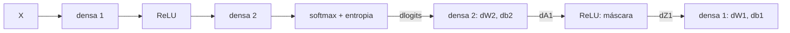

## Passo 1 · Leitura · Da regra da cadeia às matrizes

No módulo 2, a classe `Valor` treinou um MLP número a número, com um objeto para cada multiplicação e cada soma. Isso não escala: um MLP `[64, 32, 16, 10]` com 8 exemplos cria cerca de 47 mil objetos, e um forward com backward levou 68 ms no executor. Com matrizes, o mesmo cálculo levou 0,06 ms, porque cada camada vira uma multiplicação de matrizes.

Uma camada densa recebe um lote $X$ de forma $(n, d_\text{in})$, uma matriz de pesos $W$ de forma $(d_\text{in}, d_\text{out})$ e um viés $b$ de tamanho $d_\text{out}$, e calcula $Z = XW + b$, de forma $(n, d_\text{out})$. No backward, chega de cima o gradiente $\frac{\partial L}{\partial Z}$, com a forma de $Z$. A regra da cadeia dá três fórmulas:

$$
\frac{\partial L}{\partial W} = X^\top \frac{\partial L}{\partial Z}, \qquad
\frac{\partial L}{\partial b} = \sum_{i=1}^{n} \frac{\partial L}{\partial Z_{i}}, \qquad
\frac{\partial L}{\partial X} = \frac{\partial L}{\partial Z}\, W^\top
$$

A regra que resolve quase todo backward é a das **formas**: o gradiente de uma coisa tem a forma da coisa. `dW` precisa ser $(d_\text{in}, d_\text{out})$, e com $X$ e `dZ` em mãos só um produto dá essa forma: $X^\top$, que é $(d_\text{in}, n)$, vezes `dZ`, que é $(n, d_\text{out})$. O $n$ some na multiplicação, somando os exemplos do lote. O viés foi copiado para todas as linhas, então o gradiente dele soma as linhas de `dZ`. E `dX`, de forma $(n, d_\text{in})$, só sai de `dZ` vezes $W^\top$.

```python
dW = X.T @ dZ          # (d_in, n) @ (n, d_out) -> (d_in, d_out)
db = dZ.sum(axis=0)    # (d_out,)
dX = dZ @ W.T          # (n, d_out) @ (d_out, d_in) -> (n, d_in)
```

Errar a transposta costuma dar erro na hora. Com `X` de forma `(4, 3)` e `dZ` de forma `(4, 2)`, `X @ dZ` levanta `ValueError: matmul: Input operand 1 has a mismatch in its core dimension 0, with gufunc signature (n?,k),(k,m?)->(n?,m?) (size 4 is different from 3)`. O perigo é quando as formas coincidem por acaso: com $W$ quadrada, `dZ @ W` roda sem erro e dá números errados. Por isso a lição termina conferindo tudo numericamente.

A ReLU, $A = \max(Z, 0)$, deixa passar o gradiente onde $Z > 0$ e o zera no resto: `dZ = dA * (Z > 0)`. Em $Z = 0$ a derivada não existe, e a convenção é usar 0.

## Passo 2 · Previsão · As formas do backward

O programa aplica as fórmulas a uma camada pequena, com o gradiente que chega de cima igual à identidade. Leia sem executar e digite o que ele imprime.

### Código
```python
import numpy as np

X = np.array([[1.0, 2.0], [3.0, 4.0], [5.0, 6.0]])
W = np.array([[1.0, 0.0, -1.0], [2.0, 1.0, 0.0]])
dZ = np.eye(3)
dW = X.T @ dZ
print(dW.shape)
print(dW.tolist())
print(dZ.sum(axis=0).tolist())
print((dZ @ W.T).shape)
try:
    X @ dZ
except ValueError:
    print("ValueError")
```

### Dicas
1. Multiplicar pela identidade não muda a outra matriz.
2. `X.T` tem forma `(2, 3)`; `dZ @ W.T` é `(3, 3) @ (3, 2)`.
3. Em `X @ dZ`, as dimensões internas são 2 e 3.

### Saída esperada
```text
(2, 3)
[[1.0, 3.0, 5.0], [2.0, 4.0, 6.0]]
[1.0, 1.0, 1.0]
(3, 2)
ValueError
```

## Passo 3 · Exercício · O backward da camada densa e da ReLU
modo: lacunas

Complete as lacunas (`___`) do backward. O forward de cada camada devolve a saída e um **cache**, com o que o backward vai precisar: a densa guarda `(X, W)` e a ReLU guarda a pré-ativação `Z`.

### Instruções
1. `densa_backward(dZ, cache)` devolve `dW` com a forma de `W`, igual a $X^\top \cdot$ `dZ`.
2. Devolve `db` com a forma de `b`: a soma de `dZ` sobre os exemplos do lote (sem dividir por $n$).
3. Devolve `dX` com a forma de `X`, igual a `dZ` $\cdot\, W^\top$. A função devolve a tupla `(dX, dW, db)`.
4. `relu_backward(dA, cache)` devolve o gradiente que chega (`dA`) onde a pré-ativação `Z` é positiva e 0 onde ela é negativa ou zero.

### Código inicial
```python
import numpy as np


def densa_forward(X, W, b):
    Z = X @ W + b
    return Z, (X, W)


def densa_backward(dZ, cache):
    X, W = cache
    dW = ___
    db = ___
    dX = ___
    return dX, dW, db


def relu_forward(Z):
    return np.maximum(Z, 0.0), Z


def relu_backward(dA, cache):
    Z = cache
    return dA * (___)
```

### Solução
```python
import numpy as np


def densa_forward(X, W, b):
    Z = X @ W + b
    return Z, (X, W)


def densa_backward(dZ, cache):
    X, W = cache
    dW = X.T @ dZ
    db = dZ.sum(axis=0)
    dX = dZ @ W.T
    return dX, dW, db


def relu_forward(Z):
    return np.maximum(Z, 0.0), Z


def relu_backward(dA, cache):
    Z = cache
    return dA * (Z > 0)
```

### Dicas
1. Escreva a forma de cada matriz ao lado dela: só um produto entre `X` e `dZ` dá a forma de `W`.
2. O viés foi somado a todas as linhas; o gradiente dele junta as linhas de `dZ`.
3. A máscara da ReLU vem da pré-ativação guardada no cache, não do gradiente que chega.

### Verificação
```json
[
  { "id": "dw-valores", "checkpoint": 1, "kind": "expr",
    "setup": "import numpy as np\nX = np.array([[1.0, 2.0], [3.0, 4.0], [5.0, 6.0]])\nW = np.array([[1.0, 0.0, -1.0], [2.0, 1.0, 0.0]])\ndZ = np.array([[1.0, 0.0, 2.0], [0.0, 1.0, 1.0], [1.0, -1.0, 0.0]])\ndX, dW, db = densa_backward(dZ, densa_forward(X, W, np.zeros(3))[1])",
    "expr": "dW.tolist()", "expected": [[6.0, -2.0, 5.0], [8.0, -2.0, 8.0]], "tolerance": 1e-12,
    "name": "dW de uma camada 2 → 3 com 3 exemplos",
    "hint": "dW tem a forma de W, (2, 3): é a transposta de X vezes dZ." },
  { "id": "db-valores", "checkpoint": 2, "kind": "expr",
    "setup": "import numpy as np\nX = np.array([[1.0, 2.0], [3.0, 4.0], [5.0, 6.0]])\nW = np.array([[1.0, 0.0, -1.0], [2.0, 1.0, 0.0]])\ndZ = np.array([[1.0, 0.0, 2.0], [0.0, 1.0, 1.0], [1.0, -1.0, 0.0]])\ndX, dW, db = densa_backward(dZ, densa_forward(X, W, np.zeros(3))[1])",
    "expr": "db.tolist()", "expected": [2.0, 0.0, 3.0], "tolerance": 1e-12,
    "name": "db soma as linhas de dZ",
    "hint": "Some sobre os exemplos (eixo 0), sem dividir pelo tamanho do lote." },
  { "id": "dx-valores", "checkpoint": 3, "kind": "expr",
    "setup": "import numpy as np\nX = np.array([[1.0, 2.0], [3.0, 4.0], [5.0, 6.0]])\nW = np.array([[1.0, 0.0, -1.0], [2.0, 1.0, 0.0]])\ndZ = np.array([[1.0, 0.0, 2.0], [0.0, 1.0, 1.0], [1.0, -1.0, 0.0]])\ndX, dW, db = densa_backward(dZ, densa_forward(X, W, np.zeros(3))[1])",
    "expr": "dX.tolist()", "expected": [[-1.0, 2.0], [-1.0, 1.0], [1.0, 1.0]], "tolerance": 1e-12,
    "name": "dX tem uma linha por exemplo e uma coluna por entrada" },
  { "id": "formas", "checkpoint": 3, "kind": "expr",
    "setup": "import numpy as np\nr = np.random.default_rng(1)\nX, W, b = r.normal(size=(5, 3)), r.normal(size=(3, 4)), r.normal(size=4)\nZ, cache = densa_forward(X, W, b)\nsaida = densa_backward(r.normal(size=(5, 4)), cache)",
    "expr": "[type(saida).__name__, [list(g.shape) for g in saida]]", "expected": ["tuple", [[5, 3], [3, 4], [4]]],
    "name": "Devolve (dX, dW, db) com as formas de X (5 × 3), W (3 × 4) e b (4)",
    "hint": "O gradiente de uma coisa tem a forma da coisa." },
  { "id": "w-quadrada", "checkpoint": 3, "kind": "expr",
    "setup": "import numpy as np\nX = np.array([[1.0, 0.0], [0.0, 1.0]])\nW = np.array([[1.0, 2.0], [3.0, 4.0]])\ndZ = np.array([[1.0, 0.0], [0.0, 1.0]])\ndX, dW, db = densa_backward(dZ, densa_forward(X, W, np.zeros(2))[1])",
    "expr": "dX.tolist()", "expected": [[1.0, 3.0], [2.0, 4.0]], "tolerance": 1e-12,
    "name": "Com W quadrada (2 × 2), dX usa a transposta de W",
    "hint": "Com W quadrada a forma não denuncia o erro: confira se a transposta está no lugar certo." },
  { "id": "checagem-numerica", "checkpoint": 3, "kind": "expr",
    "setup": "import numpy as np\nr = np.random.default_rng(3)\nX, W, b, G = r.normal(size=(4, 3)), r.normal(size=(3, 5)), r.normal(size=5), r.normal(size=(4, 5))\ndef _perda():\n    return float(((X @ W + b) * G).sum())\ndef _numerico(M, h=1e-5):\n    g = np.zeros_like(M)\n    for i in np.ndindex(M.shape):\n        v = M[i]\n        M[i] = v + h\n        a = _perda()\n        M[i] = v - h\n        c = _perda()\n        M[i] = v\n        g[i] = (a - c) / (2 * h)\n    return g\ndef _erro(a, n):\n    return float(np.linalg.norm(a - n) / max(np.linalg.norm(a) + np.linalg.norm(n), 1e-8))\nnX, nW, nb = _numerico(X), _numerico(W), _numerico(b)\ndX, dW, db = densa_backward(G, densa_forward(X, W, b)[1])",
    "expr": "[_erro(dX, nX) < 1e-7, _erro(dW, nW) < 1e-7, _erro(db, nb) < 1e-7]", "expected": [true, true, true],
    "name": "dX, dW e db batem com a diferença central de L = soma(Z · G)",
    "hint": "A lista diz, na ordem, se dX, dW e db passaram na checagem numérica." },
  { "id": "relu-valores", "checkpoint": 4, "kind": "expr",
    "setup": "import numpy as np\nZ = np.array([[-1.0, 2.0], [0.5, -3.0]])\nA, cache = relu_forward(Z)",
    "expr": "relu_backward(np.array([[5.0, 6.0], [7.0, 8.0]]), cache).tolist()", "expected": [[0.0, 6.0], [7.0, 0.0]],
    "name": "Passa o gradiente só onde Z é positivo" },
  { "id": "relu-zero", "checkpoint": 4, "kind": "expr",
    "setup": "import numpy as np\nA, cache = relu_forward(np.array([[0.0, 1.0]]))",
    "expr": "relu_backward(np.array([[2.0, 3.0]]), cache).tolist()", "expected": [[0.0, 3.0]],
    "name": "Em Z = 0 o gradiente é 0 (convenção)",
    "hint": "A comparação com zero é estrita." },
  { "id": "relu-gradiente-negativo", "checkpoint": 4, "kind": "expr",
    "setup": "import numpy as np\nA, cache = relu_forward(np.array([[1.0, 2.0, -1.0]]))",
    "expr": "relu_backward(np.array([[-3.0, 4.0, -5.0]]), cache).tolist()", "expected": [[-3.0, 4.0, 0.0]],
    "name": "Um gradiente negativo passa onde Z é positivo",
    "hint": "A máscara olha Z, e não o sinal do gradiente que chega." },
  { "id": "relu-forma", "checkpoint": 4, "kind": "expr",
    "setup": "import numpy as np\nr = np.random.default_rng(2)\nA, cache = relu_forward(r.normal(size=(6, 4)))\nd = relu_backward(r.normal(size=(6, 4)), cache)",
    "expr": "[list(d.shape), str(d.dtype)]", "expected": [[6, 4], "float64"],
    "name": "Mesma forma do gradiente que chega, em float64" }
]
```

### Soluções erradas
```python name="dW transposto (dZ.T @ X)"
import numpy as np


def densa_forward(X, W, b):
    Z = X @ W + b
    return Z, (X, W)


def densa_backward(dZ, cache):
    X, W = cache
    dW = dZ.T @ X
    db = dZ.sum(axis=0)
    dX = dZ @ W.T
    return dX, dW, db


def relu_forward(Z):
    return np.maximum(Z, 0.0), Z


def relu_backward(dA, cache):
    Z = cache
    return dA * (Z > 0)
```
```python name="divide dW por n (hábito do Nível 5)"
import numpy as np


def densa_forward(X, W, b):
    Z = X @ W + b
    return Z, (X, W)


def densa_backward(dZ, cache):
    X, W = cache
    dW = X.T @ dZ / len(X)
    db = dZ.sum(axis=0)
    dX = dZ @ W.T
    return dX, dW, db


def relu_forward(Z):
    return np.maximum(Z, 0.0), Z


def relu_backward(dA, cache):
    Z = cache
    return dA * (Z > 0)
```
```python name="db com a média"
import numpy as np


def densa_forward(X, W, b):
    Z = X @ W + b
    return Z, (X, W)


def densa_backward(dZ, cache):
    X, W = cache
    dW = X.T @ dZ
    db = dZ.mean(axis=0)
    dX = dZ @ W.T
    return dX, dW, db


def relu_forward(Z):
    return np.maximum(Z, 0.0), Z


def relu_backward(dA, cache):
    Z = cache
    return dA * (Z > 0)
```
```python name="db somado no eixo errado"
import numpy as np


def densa_forward(X, W, b):
    Z = X @ W + b
    return Z, (X, W)


def densa_backward(dZ, cache):
    X, W = cache
    dW = X.T @ dZ
    db = dZ.sum(axis=1)
    dX = dZ @ W.T
    return dX, dW, db


def relu_forward(Z):
    return np.maximum(Z, 0.0), Z


def relu_backward(dA, cache):
    Z = cache
    return dA * (Z > 0)
```
```python name="dX sem transpor W"
import numpy as np


def densa_forward(X, W, b):
    Z = X @ W + b
    return Z, (X, W)


def densa_backward(dZ, cache):
    X, W = cache
    dW = X.T @ dZ
    db = dZ.sum(axis=0)
    dX = dZ @ W
    return dX, dW, db


def relu_forward(Z):
    return np.maximum(Z, 0.0), Z


def relu_backward(dA, cache):
    Z = cache
    return dA * (Z > 0)
```
```python name="ReLU deixa passar em Z = 0"
import numpy as np


def densa_forward(X, W, b):
    Z = X @ W + b
    return Z, (X, W)


def densa_backward(dZ, cache):
    X, W = cache
    dW = X.T @ dZ
    db = dZ.sum(axis=0)
    dX = dZ @ W.T
    return dX, dW, db


def relu_forward(Z):
    return np.maximum(Z, 0.0), Z


def relu_backward(dA, cache):
    Z = cache
    return dA * (Z >= 0)
```
```python name="máscara pelo sinal do gradiente"
import numpy as np


def densa_forward(X, W, b):
    Z = X @ W + b
    return Z, (X, W)


def densa_backward(dZ, cache):
    X, W = cache
    dW = X.T @ dZ
    db = dZ.sum(axis=0)
    dX = dZ @ W.T
    return dX, dW, db


def relu_forward(Z):
    return np.maximum(Z, 0.0), Z


def relu_backward(dA, cache):
    Z = cache
    return dA * (dA > 0)
```

## Passo 4 · Leitura · O MLP inteiro: o forward guarda, o backward volta

Um MLP é uma pilha de camadas densas com ReLU entre elas. Os parâmetros ficam numa lista de pares, `params = [(W1, b1), (W2, b2), ...]`, uma camada por par. O forward percorre a lista do começo ao fim e, em cada camada, guarda o cache; o backward percorre a lista ao contrário, consumindo os caches na ordem inversa.



A **última** camada não tem ReLU: a saída dela são os logits, que podem ser negativos, e a softmax cuida do resto. Uma ReLU ali zera os logits negativos, e a rede não consegue mais dizer "esta classe é improvável".

O gradiente que começa o backward vem da perda. Para softmax com entropia cruzada, é a fórmula do Nível 5, $\frac{1}{n}(P - Y)$, e a função `softmax_entropia(logits, y)` desta lição já o devolve **dividido por $n$**. O $\frac1n X^\top (P - Y)$ do Nível 5 é exatamente $X^\top$ vezes esse gradiente: a divisão por $n$ acontece uma vez, no topo, e as camadas de baixo herdam. Dividir de novo em cada camada é o erro mais comum de quem vem da regressão logística.

Com duas camadas, o backward escrito à mão fica assim:

```python
logits, caches = mlp_forward(params, X)          # caches de cada camada
perda, d = softmax_entropia(logits, y)           # d = (P - Y) / n
d, dW2, db2 = densa_backward(d, cache_densa_2)   # d vira dA1
d = relu_backward(d, cache_relu_1)               # d vira dZ1
d, dW1, db1 = densa_backward(d, cache_densa_1)
grads = [(dW1, db1), (dW2, db2)]                 # mesma ordem de params
```

Duas armadilhas: dentro de cada camada, a ReLU é desfeita **antes** da densa (o contrário da ordem do forward), e a lista de gradientes é montada de trás para frente, então precisa ser invertida no fim para casar com `params`. Uma rede de profundidade qualquer troca as linhas repetidas por um laço sobre os caches invertidos.

Os caches são um contrato entre o forward e o backward da **mesma** implementação: quem chama não precisa saber o que tem dentro deles, só passá-los de volta. Por isso a correção desta lição testa `mlp_backward` só com o que o seu `mlp_forward` devolveu.

## Passo 5 · Exercício · Forward e backward de um MLP de L camadas

O arquivo `camadas.py` traz as funções do passo anterior e a `softmax_entropia(logits, y)`, que devolve `(perda, dlogits)` com o gradiente já dividido por $n$. Escreva o MLP no `main.py`.

### Instruções
1. `mlp_forward(params, X)` recebe `params`, uma lista de pares `(W, b)` na ordem das camadas, e devolve `(saida, caches)`: a saída da última camada densa, **sem ReLU**, com ReLU depois de todas as outras; e os caches que o seu backward vai usar (a estrutura é sua).
2. `mlp_backward(dsaida, caches)` recebe o gradiente da perda em relação à saída e os caches do forward e devolve a lista de pares `(dW, db)`, na mesma ordem e com as mesmas formas de `params`.
3. As duas funções funcionam com qualquer número de camadas, inclusive uma só.
4. `perda_e_gradientes(params, X, y)` devolve `(perda, grads)` usando `softmax_entropia` e não altera `params`.

### Código inicial
```python
import numpy as np
from camadas import densa_forward, densa_backward, relu_forward, relu_backward, softmax_entropia


def mlp_forward(params, X):
    pass


def mlp_backward(dsaida, caches):
    pass


def perda_e_gradientes(params, X, y):
    pass
```
```python path=camadas.py
import numpy as np


def densa_forward(X, W, b):
    Z = X @ W + b
    return Z, (X, W)


def densa_backward(dZ, cache):
    X, W = cache
    dW = X.T @ dZ
    db = dZ.sum(axis=0)
    dX = dZ @ W.T
    return dX, dW, db


def relu_forward(Z):
    return np.maximum(Z, 0.0), Z


def relu_backward(dA, cache):
    Z = cache
    return dA * (Z > 0)


def softmax_entropia(logits, y):
    n = len(y)
    Z = logits - logits.max(axis=1, keepdims=True)
    P = np.exp(Z)
    P = P / P.sum(axis=1, keepdims=True)
    perda = float(-np.log(P[np.arange(n), y]).mean())
    dlogits = P.copy()
    dlogits[np.arange(n), y] -= 1.0
    return perda, dlogits / n
```

### Solução
```python
import numpy as np
from camadas import densa_forward, densa_backward, relu_forward, relu_backward, softmax_entropia


def mlp_forward(params, X):
    caches = []
    A = X
    for i, (W, b) in enumerate(params):
        Z, cache_densa = densa_forward(A, W, b)
        if i < len(params) - 1:
            A, cache_relu = relu_forward(Z)
        else:
            A, cache_relu = Z, None
        caches.append((cache_densa, cache_relu))
    return A, caches


def mlp_backward(dsaida, caches):
    grads = []
    d = dsaida
    for cache_densa, cache_relu in reversed(caches):
        if cache_relu is not None:
            d = relu_backward(d, cache_relu)
        d, dW, db = densa_backward(d, cache_densa)
        grads.append((dW, db))
    return grads[::-1]


def perda_e_gradientes(params, X, y):
    logits, caches = mlp_forward(params, X)
    perda, dlogits = softmax_entropia(logits, y)
    return perda, mlp_backward(dlogits, caches)
```
```python path=camadas.py
import numpy as np


def densa_forward(X, W, b):
    Z = X @ W + b
    return Z, (X, W)


def densa_backward(dZ, cache):
    X, W = cache
    dW = X.T @ dZ
    db = dZ.sum(axis=0)
    dX = dZ @ W.T
    return dX, dW, db


def relu_forward(Z):
    return np.maximum(Z, 0.0), Z


def relu_backward(dA, cache):
    Z = cache
    return dA * (Z > 0)


def softmax_entropia(logits, y):
    n = len(y)
    Z = logits - logits.max(axis=1, keepdims=True)
    P = np.exp(Z)
    P = P / P.sum(axis=1, keepdims=True)
    perda = float(-np.log(P[np.arange(n), y]).mean())
    dlogits = P.copy()
    dlogits[np.arange(n), y] -= 1.0
    return perda, dlogits / n
```

### Dicas
1. Guarde em cada posição de `caches` o par (cache da densa, cache da ReLU), com `None` na última camada, que não tem ReLU.
2. No backward, percorra `reversed(caches)`: desfaça a ReLU (se houver) e depois a densa; o `dX` de uma camada é o gradiente que chega na anterior.
3. Os gradientes saem da última camada para a primeira: inverta a lista antes de devolver.

### Verificação
```json
[
  { "id": "forma-saida", "checkpoint": 1, "kind": "expr",
    "setup": "import numpy as np\nr = np.random.default_rng(4)\nparams = [(r.normal(size=(4, 5)), r.normal(size=5)), (r.normal(size=(5, 3)), r.normal(size=3))]\nsaida, caches = mlp_forward(params, r.normal(size=(6, 4)))",
    "expr": "[type(saida).__name__, list(saida.shape)]", "expected": ["ndarray", [6, 3]],
    "name": "Saída de forma (6, 3) para 6 exemplos e a rede 4 → 5 → 3" },
  { "id": "forward-valores", "checkpoint": 1, "kind": "expr",
    "setup": "import numpy as np\nparams = [(np.array([[1.0, -1.0], [0.5, 2.0]]), np.array([0.0, -1.0])), (np.array([[1.0, -2.0], [-1.0, 1.0]]), np.array([0.0, 0.0]))]\nsaida, caches = mlp_forward(params, np.array([[1.0, 2.0], [-1.0, 0.5]]))",
    "expr": "saida.tolist()", "expected": [[0.0, -2.0], [-1.0, 1.0]], "tolerance": 1e-12,
    "name": "Logits de uma rede 2 → 2 → 2 escrita à mão, com valores negativos",
    "hint": "A ReLU vai entre as camadas; a última camada devolve os logits sem ativação." },
  { "id": "uma-camada", "checkpoint": 3, "kind": "expr",
    "setup": "import numpy as np\nparams = [(np.array([[1.0, 2.0, 0.0], [-1.0, 0.5, 1.0]]), np.array([0.5, 0.0, -0.5]))]\nX = np.array([[2.0, 1.0], [0.0, -1.0]])\nsaida, caches = mlp_forward(params, X)\ngrads = mlp_backward(np.array([[1.0, 0.0, -1.0], [2.0, 1.0, 0.0]]), caches)",
    "expr": "[saida.tolist(), grads[0][0].tolist(), grads[0][1].tolist()]", "expected": [[[1.5, 4.5, 0.5], [1.5, -0.5, -1.5]], [[2.0, 0.0, -2.0], [-1.0, -1.0, -1.0]], [3.0, 1.0, -1.0]], "tolerance": 1e-12,
    "name": "Com uma camada só: saída X @ W + b e os gradientes dela",
    "hint": "Com uma camada, ela é a última: sem ReLU, e a lista de gradientes tem um par." },
  { "id": "formas-dos-gradientes", "checkpoint": 2, "kind": "expr",
    "setup": "import numpy as np\nr = np.random.default_rng(6)\nparams = [(r.normal(size=(5, 4)), r.normal(size=4)), (r.normal(size=(4, 3)), r.normal(size=3))]\nsaida, caches = mlp_forward(params, r.normal(size=(7, 5)))\ngrads = mlp_backward(r.normal(size=(7, 3)), caches)",
    "expr": "[[list(dW.shape), list(db.shape)] for dW, db in grads]", "expected": [[[5, 4], [4]], [[4, 3], [3]]],
    "name": "Um par (dW, db) por camada, na ordem e com as formas de params",
    "hint": "O primeiro par é o da primeira camada." },
  { "id": "referencia-64-32-16-10", "checkpoint": 2, "kind": "expr",
    "setup": "import numpy as np\ndef _ref(params, X, d):\n    As, Zs = [X], []\n    for i, (W, b) in enumerate(params):\n        Z = As[-1] @ W + b\n        Zs.append(Z)\n        As.append(np.maximum(Z, 0.0) if i < len(params) - 1 else Z)\n    gs = []\n    for i in reversed(range(len(params))):\n        if i < len(params) - 1:\n            d = d * (Zs[i] > 0)\n        gs.append((As[i].T @ d, d.sum(axis=0)))\n        d = d @ params[i][0].T\n    return As[-1], gs[::-1]\nr = np.random.default_rng(11)\ndims = [64, 32, 16, 10]\nparams = [(r.normal(0, (2 / a) ** 0.5, (a, c)), r.normal(0, 0.1, c)) for a, c in zip(dims[:-1], dims[1:])]\nX, d = r.normal(size=(8, 64)), r.normal(size=(8, 10))\nsaida, caches = mlp_forward(params, X)\ngrads = mlp_backward(d, caches)\ns_ref, g_ref = _ref(params, X, d)",
    "expr": "[bool(np.allclose(saida, s_ref, atol=1e-12)), len(grads) == 3 and all(np.allclose(a[0], c[0], atol=1e-12) and np.allclose(a[1], c[1], atol=1e-12) for a, c in zip(grads, g_ref))]",
    "expected": [true, true],
    "name": "Rede 64 → 32 → 16 → 10: saída e gradientes iguais aos de uma implementação de referência",
    "hint": "A lista diz se a saída e se os três pares de gradientes batem com a referência." },
  { "id": "quatro-camadas", "checkpoint": 3, "kind": "expr",
    "setup": "import numpy as np\ndef _ref(params, X, d):\n    As, Zs = [X], []\n    for i, (W, b) in enumerate(params):\n        Z = As[-1] @ W + b\n        Zs.append(Z)\n        As.append(np.maximum(Z, 0.0) if i < len(params) - 1 else Z)\n    gs = []\n    for i in reversed(range(len(params))):\n        if i < len(params) - 1:\n            d = d * (Zs[i] > 0)\n        gs.append((As[i].T @ d, d.sum(axis=0)))\n        d = d @ params[i][0].T\n    return As[-1], gs[::-1]\nr = np.random.default_rng(12)\ndims = [6, 5, 4, 3, 2]\nparams = [(r.normal(size=(a, c)), r.normal(size=c)) for a, c in zip(dims[:-1], dims[1:])]\nX, d = r.normal(size=(5, 6)), r.normal(size=(5, 2))\nsaida, caches = mlp_forward(params, X)\ngrads = mlp_backward(d, caches)\ns_ref, g_ref = _ref(params, X, d)",
    "expr": "[bool(np.allclose(saida, s_ref, atol=1e-12)), len(grads) == 4 and all(np.allclose(a[0], c[0], atol=1e-12) and np.allclose(a[1], c[1], atol=1e-12) for a, c in zip(grads, g_ref))]",
    "expected": [true, true],
    "name": "Quatro camadas (6 → 5 → 4 → 3 → 2): saída e gradientes iguais aos da referência",
    "hint": "Percorra todas as camadas num laço; nada de supor duas." },
  { "id": "checagem-numerica", "checkpoint": 4, "kind": "expr",
    "setup": "import numpy as np\nr = np.random.default_rng(7)\nparams = [(r.normal(0, 0.6, (5, 4)), r.normal(0, 0.1, 4)), (r.normal(0, 0.6, (4, 3)), r.normal(0, 0.1, 3))]\nX, y = r.normal(size=(6, 5)), np.array([0, 2, 1, 1, 0, 2])\nperda, grads = perda_e_gradientes(params, X, y)\ndef _numerico(M, h=1e-5):\n    g = np.zeros_like(M)\n    for i in np.ndindex(M.shape):\n        v = M[i]\n        M[i] = v + h\n        a = perda_e_gradientes(params, X, y)[0]\n        M[i] = v - h\n        c = perda_e_gradientes(params, X, y)[0]\n        M[i] = v\n        g[i] = (a - c) / (2 * h)\n    return g\ndef _erro(a, n):\n    return float(np.linalg.norm(a - n) / max(np.linalg.norm(a) + np.linalg.norm(n), 1e-8))",
    "expr": "[[_erro(dW, _numerico(W)) < 1e-7, _erro(db, _numerico(b)) < 1e-7] for (W, b), (dW, db) in zip(params, grads)]",
    "expected": [[true, true], [true, true]],
    "name": "Os gradientes de perda_e_gradientes passam na checagem numérica (rede 5 → 4 → 3)",
    "hint": "Cada par diz se dW e db de uma camada bateram com a diferença central da perda." },
  { "id": "perda-valor", "checkpoint": 4, "kind": "expr",
    "setup": "import numpy as np\nparams = [(np.array([[1.0, -1.0], [0.5, 2.0]]), np.array([0.0, -1.0])), (np.array([[1.0, -2.0], [-1.0, 1.0]]), np.array([0.0, 0.0]))]",
    "expr": "perda_e_gradientes(params, np.array([[1.0, 2.0], [-1.0, 0.5]]), np.array([0, 1]))[0]", "expected": 0.12692801104297263, "type": "float", "tolerance": 1e-12,
    "name": "A perda da rede escrita à mão com rótulos [0, 1]" },
  { "id": "params-intactos", "checkpoint": 4, "kind": "expr",
    "setup": "import numpy as np\nr = np.random.default_rng(8)\nparams = [(r.normal(size=(3, 4)), r.normal(size=4)), (r.normal(size=(4, 2)), r.normal(size=2))]\ncopias = [(W.copy(), b.copy()) for W, b in params]\nperda_e_gradientes(params, r.normal(size=(5, 3)), np.array([0, 1, 1, 0, 1]))",
    "expr": "all(np.array_equal(W, W0) and np.array_equal(b, b0) for (W, b), (W0, b0) in zip(params, copias))", "expected": true,
    "name": "params não muda" },
  { "id": "perda-cai", "checkpoint": 4, "kind": "expr",
    "setup": "import numpy as np\nr = np.random.default_rng(5)\nX = r.normal(size=(30, 4))\ny = (X[:, 0] + X[:, 1] > 0).astype(np.intp) + (X[:, 2] > 1).astype(np.intp)\nparams = [(r.normal(0, 0.7, (4, 8)), np.zeros(8)), (r.normal(0, 0.35, (8, 3)), np.zeros(3))]\nhistorico = []\nfor _ in range(40):\n    perda, grads = perda_e_gradientes(params, X, y)\n    historico.append(perda)\n    params = [(W - 0.5 * dW, b - 0.5 * db) for (W, b), (dW, db) in zip(params, grads)]",
    "expr": "bool(historico[-1] < 0.5 * historico[0])", "expected": true,
    "name": "40 passos de gradiente descendente com os seus gradientes reduzem a perda a menos da metade",
    "hint": "Se a perda quase não cai, confira se o gradiente não foi dividido por n mais de uma vez." }
]
```

### Soluções erradas
```python name="ReLU também na última camada"
import numpy as np
from camadas import densa_forward, densa_backward, relu_forward, relu_backward, softmax_entropia


def mlp_forward(params, X):
    caches = []
    A = X
    for W, b in params:
        Z, cache_densa = densa_forward(A, W, b)
        A, cache_relu = relu_forward(Z)
        caches.append((cache_densa, cache_relu))
    return A, caches


def mlp_backward(dsaida, caches):
    grads = []
    d = dsaida
    for cache_densa, cache_relu in reversed(caches):
        if cache_relu is not None:
            d = relu_backward(d, cache_relu)
        d, dW, db = densa_backward(d, cache_densa)
        grads.append((dW, db))
    return grads[::-1]


def perda_e_gradientes(params, X, y):
    logits, caches = mlp_forward(params, X)
    perda, dlogits = softmax_entropia(logits, y)
    return perda, mlp_backward(dlogits, caches)
```
```python name="divide os gradientes por n de novo"
import numpy as np
from camadas import densa_forward, densa_backward, relu_forward, relu_backward, softmax_entropia


def mlp_forward(params, X):
    caches = []
    A = X
    for i, (W, b) in enumerate(params):
        Z, cache_densa = densa_forward(A, W, b)
        if i < len(params) - 1:
            A, cache_relu = relu_forward(Z)
        else:
            A, cache_relu = Z, None
        caches.append((cache_densa, cache_relu))
    return A, caches


def mlp_backward(dsaida, caches):
    grads = []
    d = dsaida
    n = len(dsaida)
    for cache_densa, cache_relu in reversed(caches):
        if cache_relu is not None:
            d = relu_backward(d, cache_relu)
        d, dW, db = densa_backward(d, cache_densa)
        grads.append((dW / n, db / n))
    return grads[::-1]


def perda_e_gradientes(params, X, y):
    logits, caches = mlp_forward(params, X)
    perda, dlogits = softmax_entropia(logits, y)
    return perda, mlp_backward(dlogits, caches)
```
```python name="não desfaz a ReLU no backward"
import numpy as np
from camadas import densa_forward, densa_backward, relu_forward, relu_backward, softmax_entropia


def mlp_forward(params, X):
    caches = []
    A = X
    for i, (W, b) in enumerate(params):
        Z, cache_densa = densa_forward(A, W, b)
        if i < len(params) - 1:
            A, cache_relu = relu_forward(Z)
        else:
            A, cache_relu = Z, None
        caches.append((cache_densa, cache_relu))
    return A, caches


def mlp_backward(dsaida, caches):
    grads = []
    d = dsaida
    for cache_densa, cache_relu in reversed(caches):
        d, dW, db = densa_backward(d, cache_densa)
        grads.append((dW, db))
    return grads[::-1]


def perda_e_gradientes(params, X, y):
    logits, caches = mlp_forward(params, X)
    perda, dlogits = softmax_entropia(logits, y)
    return perda, mlp_backward(dlogits, caches)
```
```python name="gradientes na ordem do backward"
import numpy as np
from camadas import densa_forward, densa_backward, relu_forward, relu_backward, softmax_entropia


def mlp_forward(params, X):
    caches = []
    A = X
    for i, (W, b) in enumerate(params):
        Z, cache_densa = densa_forward(A, W, b)
        if i < len(params) - 1:
            A, cache_relu = relu_forward(Z)
        else:
            A, cache_relu = Z, None
        caches.append((cache_densa, cache_relu))
    return A, caches


def mlp_backward(dsaida, caches):
    grads = []
    d = dsaida
    for cache_densa, cache_relu in reversed(caches):
        if cache_relu is not None:
            d = relu_backward(d, cache_relu)
        d, dW, db = densa_backward(d, cache_densa)
        grads.append((dW, db))
    return grads


def perda_e_gradientes(params, X, y):
    logits, caches = mlp_forward(params, X)
    perda, dlogits = softmax_entropia(logits, y)
    return perda, mlp_backward(dlogits, caches)
```
```python name="desfaz a ReLU depois da densa"
import numpy as np
from camadas import densa_forward, densa_backward, relu_forward, relu_backward, softmax_entropia


def mlp_forward(params, X):
    caches = []
    A = X
    for i, (W, b) in enumerate(params):
        Z, cache_densa = densa_forward(A, W, b)
        if i < len(params) - 1:
            A, cache_relu = relu_forward(Z)
        else:
            A, cache_relu = Z, None
        caches.append((cache_densa, cache_relu))
    return A, caches


def mlp_backward(dsaida, caches):
    grads = []
    d = dsaida
    for cache_densa, cache_relu in reversed(caches):
        d, dW, db = densa_backward(d, cache_densa)
        if cache_relu is not None:
            d = relu_backward(d, cache_relu)
        grads.append((dW, db))
    return grads[::-1]


def perda_e_gradientes(params, X, y):
    logits, caches = mlp_forward(params, X)
    perda, dlogits = softmax_entropia(logits, y)
    return perda, mlp_backward(dlogits, caches)
```
```python name="só funciona com duas camadas"
import numpy as np
from camadas import densa_forward, densa_backward, relu_forward, relu_backward, softmax_entropia


def mlp_forward(params, X):
    (W1, b1), (W2, b2) = params
    Z1, cache_densa_1 = densa_forward(X, W1, b1)
    A1, cache_relu_1 = relu_forward(Z1)
    Z2, cache_densa_2 = densa_forward(A1, W2, b2)
    return Z2, (cache_densa_1, cache_relu_1, cache_densa_2)


def mlp_backward(dsaida, caches):
    cache_densa_1, cache_relu_1, cache_densa_2 = caches
    d, dW2, db2 = densa_backward(dsaida, cache_densa_2)
    d = relu_backward(d, cache_relu_1)
    d, dW1, db1 = densa_backward(d, cache_densa_1)
    return [(dW1, db1), (dW2, db2)]


def perda_e_gradientes(params, X, y):
    logits, caches = mlp_forward(params, X)
    perda, dlogits = softmax_entropia(logits, y)
    return perda, mlp_backward(dlogits, caches)
```
```python name="passa os logits para o backward"
import numpy as np
from camadas import densa_forward, densa_backward, relu_forward, relu_backward, softmax_entropia


def mlp_forward(params, X):
    caches = []
    A = X
    for i, (W, b) in enumerate(params):
        Z, cache_densa = densa_forward(A, W, b)
        if i < len(params) - 1:
            A, cache_relu = relu_forward(Z)
        else:
            A, cache_relu = Z, None
        caches.append((cache_densa, cache_relu))
    return A, caches


def mlp_backward(dsaida, caches):
    grads = []
    d = dsaida
    for cache_densa, cache_relu in reversed(caches):
        if cache_relu is not None:
            d = relu_backward(d, cache_relu)
        d, dW, db = densa_backward(d, cache_densa)
        grads.append((dW, db))
    return grads[::-1]


def perda_e_gradientes(params, X, y):
    logits, caches = mlp_forward(params, X)
    perda, dlogits = softmax_entropia(logits, y)
    return perda, mlp_backward(logits, caches)
```

## Passo 6 · Leitura · Conferir o gradiente com diferenças finitas

Um backward pode ter as formas certas e os números errados, e o treino não avisa: a perda só cai mais devagar, ou para num valor ruim. A defesa é a mesma do Nível 5: comparar o gradiente analítico com o numérico, a diferença central de cada parâmetro, um número por vez,

$$
\frac{\partial L}{\partial \theta_i} \approx \frac{L(\theta_i + h) - L(\theta_i - h)}{2h}
$$

e medir a distância entre os dois com o **erro relativo**, que não depende da escala dos gradientes:

$$
\text{erro} = \frac{\lVert a - n \rVert}{\max\left(\lVert a \rVert + \lVert n \rVert,\ 10^{-8}\right)}
$$

O piso de $10^{-8}$ evita $0/0$ quando os dois gradientes são zero. A técnica é perturbar o número **no próprio array**, chamar a perda, e devolver o valor original antes de passar para o próximo. A perda é uma função sem argumentos que lê os mesmos arrays:

```python
f = lambda: perda_e_gradientes(params, X, y)[0]
original = W[0, 0]
W[0, 0] = original + h
mais = f()
```

Quanto vale um erro "bom"? Medido no executor, numa rede 5 → 4 → 3 com 6 exemplos e tudo em `float64`:

| Situação | Erro relativo |
|---|---|
| backward correto, $h = 10^{-5}$ | $10^{-11}$ a $10^{-10}$ |
| backward correto, $h = 10^{-3}$ | $2{,}5 \cdot 10^{-7}$ |
| backward correto, $h = 10^{-12}$ | $4 \cdot 10^{-4}$ |
| backward correto, tudo em `float32` | $10^{-2}$ |
| gradiente dividido por $n$ duas vezes | $0{,}714$ em todas as camadas |
| ReLU não desfeita no backward | $0{,}50$ na primeira camada, $0$ na última |

A regra prática: abaixo de $10^{-7}$ está certo; acima de $10^{-2}$ há defeito. Um $h$ grande demais mede a curvatura junto com a inclinação; um $h$ minúsculo perde dígitos no cancelamento $L(\theta + h) - L(\theta - h)$. Em `float32` o mesmo backward correto parece defeituoso, então a checagem roda sempre em `float64`. Os números do defeito também ensinam: $0{,}714$ é $\frac{n-1}{n+1}$ com $n = 6$, a assinatura de um fator $n$ sobrando; e erro só nas camadas de baixo aponta para o caminho de volta, não para a fórmula de `dW`.

A checagem custa duas chamadas da perda por parâmetro. A rede 64 → 32 → 16 → 10 tem 2 778 parâmetros, ou 5 556 forwards, quase meio segundo no executor. Por isso ela roda numa rede pequena, com poucos exemplos: o código do backward é o mesmo para qualquer tamanho.

## Passo 7 · Exercício · A checagem numérica do MLP

O arquivo `mlp.py` traz o MLP do passo 5 (com `perda_e_gradientes`), e `camadas.py`, as camadas. Escreva a checagem no `main.py`.

### Instruções
1. `gradiente_numerico(f, params, h=1e-5)` recebe uma função `f` sem argumentos, que devolve a perda calculada com os valores atuais de `params`, e devolve uma lista de pares `(gW, gb)` com as formas de `params`, cada número pela diferença central, perturbando uma entrada por vez **no próprio array**.
2. Ao terminar, todos os arrays de `params` têm exatamente os valores do início.
3. `erro_relativo(a, n)` devolve, como `float`, a norma de `a - n` dividida pelo maior entre `norma(a) + norma(n)` e `1e-8` (normas por `np.linalg.norm`).
4. `checar_gradientes(perda_e_grads, params, X, y, h=1e-5)` recebe uma função com a mesma interface de `perda_e_gradientes` e devolve uma lista com um par `(erro_W, erro_b)` por camada, comparando os gradientes que ela devolve com os numéricos da perda dela.

### Código inicial
```python
import numpy as np
from mlp import perda_e_gradientes


def gradiente_numerico(f, params, h=1e-5):
    pass


def erro_relativo(a, n):
    pass


def checar_gradientes(perda_e_grads, params, X, y, h=1e-5):
    pass
```
```python path=mlp.py
import numpy as np
from camadas import densa_forward, densa_backward, relu_forward, relu_backward, softmax_entropia


def mlp_forward(params, X):
    caches = []
    A = X
    for i, (W, b) in enumerate(params):
        Z, cache_densa = densa_forward(A, W, b)
        if i < len(params) - 1:
            A, cache_relu = relu_forward(Z)
        else:
            A, cache_relu = Z, None
        caches.append((cache_densa, cache_relu))
    return A, caches


def mlp_backward(dsaida, caches):
    grads = []
    d = dsaida
    for cache_densa, cache_relu in reversed(caches):
        if cache_relu is not None:
            d = relu_backward(d, cache_relu)
        d, dW, db = densa_backward(d, cache_densa)
        grads.append((dW, db))
    return grads[::-1]


def perda_e_gradientes(params, X, y):
    logits, caches = mlp_forward(params, X)
    perda, dlogits = softmax_entropia(logits, y)
    return perda, mlp_backward(dlogits, caches)
```
```python path=camadas.py
import numpy as np


def densa_forward(X, W, b):
    Z = X @ W + b
    return Z, (X, W)


def densa_backward(dZ, cache):
    X, W = cache
    dW = X.T @ dZ
    db = dZ.sum(axis=0)
    dX = dZ @ W.T
    return dX, dW, db


def relu_forward(Z):
    return np.maximum(Z, 0.0), Z


def relu_backward(dA, cache):
    Z = cache
    return dA * (Z > 0)


def softmax_entropia(logits, y):
    n = len(y)
    Z = logits - logits.max(axis=1, keepdims=True)
    P = np.exp(Z)
    P = P / P.sum(axis=1, keepdims=True)
    perda = float(-np.log(P[np.arange(n), y]).mean())
    dlogits = P.copy()
    dlogits[np.arange(n), y] -= 1.0
    return perda, dlogits / n
```

### Solução
```python
import numpy as np
from mlp import perda_e_gradientes


def gradiente_numerico(f, params, h=1e-5):
    grads = []
    for W, b in params:
        par = []
        for M in (W, b):
            G = np.zeros_like(M)
            for i in np.ndindex(M.shape):
                original = M[i]
                M[i] = original + h
                mais = f()
                M[i] = original - h
                menos = f()
                M[i] = original
                G[i] = (mais - menos) / (2 * h)
            par.append(G)
        grads.append(tuple(par))
    return grads


def erro_relativo(a, n):
    return float(np.linalg.norm(a - n) / max(np.linalg.norm(a) + np.linalg.norm(n), 1e-8))


def checar_gradientes(perda_e_grads, params, X, y, h=1e-5):
    _, analiticos = perda_e_grads(params, X, y)
    numericos = gradiente_numerico(lambda: perda_e_grads(params, X, y)[0], params, h)
    return [(erro_relativo(a[0], n[0]), erro_relativo(a[1], n[1])) for a, n in zip(analiticos, numericos)]
```
```python path=mlp.py
import numpy as np
from camadas import densa_forward, densa_backward, relu_forward, relu_backward, softmax_entropia


def mlp_forward(params, X):
    caches = []
    A = X
    for i, (W, b) in enumerate(params):
        Z, cache_densa = densa_forward(A, W, b)
        if i < len(params) - 1:
            A, cache_relu = relu_forward(Z)
        else:
            A, cache_relu = Z, None
        caches.append((cache_densa, cache_relu))
    return A, caches


def mlp_backward(dsaida, caches):
    grads = []
    d = dsaida
    for cache_densa, cache_relu in reversed(caches):
        if cache_relu is not None:
            d = relu_backward(d, cache_relu)
        d, dW, db = densa_backward(d, cache_densa)
        grads.append((dW, db))
    return grads[::-1]


def perda_e_gradientes(params, X, y):
    logits, caches = mlp_forward(params, X)
    perda, dlogits = softmax_entropia(logits, y)
    return perda, mlp_backward(dlogits, caches)
```
```python path=camadas.py
import numpy as np


def densa_forward(X, W, b):
    Z = X @ W + b
    return Z, (X, W)


def densa_backward(dZ, cache):
    X, W = cache
    dW = X.T @ dZ
    db = dZ.sum(axis=0)
    dX = dZ @ W.T
    return dX, dW, db


def relu_forward(Z):
    return np.maximum(Z, 0.0), Z


def relu_backward(dA, cache):
    Z = cache
    return dA * (Z > 0)


def softmax_entropia(logits, y):
    n = len(y)
    Z = logits - logits.max(axis=1, keepdims=True)
    P = np.exp(Z)
    P = P / P.sum(axis=1, keepdims=True)
    perda = float(-np.log(P[np.arange(n), y]).mean())
    dlogits = P.copy()
    dlogits[np.arange(n), y] -= 1.0
    return perda, dlogits / n
```

### Dicas
1. `np.ndindex(M.shape)` percorre todas as posições de um array de qualquer forma; `M[i]` lê e escreve a entrada.
2. Guarde o valor original antes de perturbar e escreva-o de volta depois das duas chamadas de `f`.
3. Em `checar_gradientes`, a perda numérica é `lambda: perda_e_grads(params, X, y)[0]`, porque ela lê os mesmos arrays que você perturba.

### Verificação
```json
[
  { "id": "quadratica", "checkpoint": 1, "kind": "expr",
    "setup": "import numpy as np\nW = np.array([[1.0, -2.0], [0.5, 3.0]])\nb = np.array([0.25, -1.0])\ng = gradiente_numerico(lambda: float((W ** 2).sum() + 3 * b.sum()), [(W, b)])",
    "expr": "[g[0][0].tolist(), g[0][1].tolist()]", "expected": [[[2.0, -4.0], [1.0, 6.0]], [3.0, 3.0]], "tolerance": 1e-6,
    "name": "Gradiente numérico de soma(W²) + 3 · soma(b)",
    "hint": "Perturbe a entrada no próprio array: f lê W e b, e uma cópia perturbada não muda f." },
  { "id": "duas-camadas", "checkpoint": 1, "kind": "expr",
    "setup": "import numpy as np\nW1, b1 = np.array([[1.0, 2.0]]), np.array([0.5, -0.5])\nW2, b2 = np.array([[3.0], [-1.0]]), np.array([2.0])\ng = gradiente_numerico(lambda: float((W1 * W2.T).sum() + b2[0] ** 2), [(W1, b1), (W2, b2)])",
    "expr": "[[gW.tolist(), gb.tolist()] for gW, gb in g]", "expected": [[[[3.0, -1.0]], [0.0, 0.0]], [[[1.0], [2.0]], [4.0]]], "tolerance": 1e-6,
    "name": "Duas camadas: um par por camada, com zeros onde a perda não depende do parâmetro" },
  { "id": "diferenca-central", "checkpoint": 1, "kind": "expr",
    "setup": "import numpy as np\nW, b = np.array([[1.0]]), np.array([0.0])\ng = gradiente_numerico(lambda: float((W ** 3).sum()), [(W, b)], h=1e-3)",
    "expr": "float(g[0][0][0, 0])", "expected": 3.0, "tolerance": 1e-5,
    "name": "Derivada de w³ em w = 1 com h = 0,001: a diferença central erra só em h²",
    "hint": "Use os dois lados, L(θ + h) e L(θ - h), divididos por 2h." },
  { "id": "restaura", "checkpoint": 2, "kind": "expr",
    "setup": "import numpy as np\nr = np.random.default_rng(9)\nW, b = r.normal(size=(3, 2)), r.normal(size=2)\nW0, b0 = W.copy(), b.copy()\ngradiente_numerico(lambda: float((W * W).sum() + np.sin(b).sum()), [(W, b)])",
    "expr": "[bool(np.array_equal(W, W0)), bool(np.array_equal(b, b0))]", "expected": [true, true],
    "name": "W e b voltam exatamente aos valores do início",
    "hint": "Depois das duas chamadas de f, escreva de volta o valor guardado." },
  { "id": "erro-valor", "checkpoint": 3, "kind": "expr",
    "setup": "import numpy as np",
    "expr": "erro_relativo(np.array([3.0, 0.0]), np.array([1.0, 0.0]))", "expected": 0.5, "tolerance": 1e-12,
    "name": "erro_relativo([3, 0], [1, 0]) é 2 / 4 = 0,5" },
  { "id": "erro-matriz", "checkpoint": 3, "kind": "expr",
    "setup": "import numpy as np",
    "expr": "erro_relativo(np.array([[1.0, 2.0], [3.0, 4.0]]), np.array([[1.0, 2.0], [3.0, 5.0]]))", "expected": 0.08530804703852635, "tolerance": 1e-12,
    "name": "Com matrizes, as normas são de todas as entradas" },
  { "id": "erro-zeros", "checkpoint": 3, "kind": "expr",
    "setup": "import numpy as np",
    "expr": "erro_relativo(np.zeros(3), np.zeros(3))", "expected": 0.0, "type": "float",
    "name": "Dois gradientes zero dão erro 0,0, e não nan",
    "hint": "O denominador tem um piso de 1e-8." },
  { "id": "erro-tipo", "checkpoint": 3, "kind": "expr",
    "setup": "import numpy as np",
    "expr": "type(erro_relativo(np.array([1.0, 2.0]), np.array([2.0, 2.0]))).__name__", "expected": "float",
    "name": "Devolve um float do Python" },
  { "id": "checar-correto", "checkpoint": 4, "kind": "expr",
    "setup": "import numpy as np\nr = np.random.default_rng(7)\nparams = [(r.normal(0, 0.6, (5, 4)), r.normal(0, 0.1, 4)), (r.normal(0, 0.6, (4, 3)), r.normal(0, 0.1, 3))]\nX, y = r.normal(size=(6, 5)), np.array([0, 2, 1, 1, 0, 2])\nres = checar_gradientes(perda_e_gradientes, params, X, y)",
    "expr": "[len(res), [[type(e).__name__ for e in par] for par in res], all(e < 1e-7 for par in res for e in par)]",
    "expected": [2, [["float", "float"], ["float", "float"]], true],
    "name": "Com o MLP correto: um par de floats por camada, todos abaixo de 1e-7" },
  { "id": "checar-n-duas-vezes", "checkpoint": 4, "kind": "expr",
    "setup": "import numpy as np\nr = np.random.default_rng(7)\nparams = [(r.normal(0, 0.6, (5, 4)), r.normal(0, 0.1, 4)), (r.normal(0, 0.6, (4, 3)), r.normal(0, 0.1, 3))]\nX, y = r.normal(size=(6, 5)), np.array([0, 2, 1, 1, 0, 2])\ndef com_defeito(params, X, y):\n    perda, grads = perda_e_gradientes(params, X, y)\n    return perda, [(dW / len(X), db / len(X)) for dW, db in grads]\nres = checar_gradientes(com_defeito, params, X, y)",
    "expr": "[[round(e, 3) for e in par] for par in res]", "expected": [[0.714, 0.714], [0.714, 0.714]],
    "name": "Um backward que divide por n duas vezes dá 5/7 = 0,714 em todas as camadas (n = 6)",
    "hint": "Compare os gradientes da função recebida com os numéricos da perda dela, pela fórmula do erro relativo." },
  { "id": "checar-sem-mascara", "checkpoint": 4, "kind": "expr",
    "setup": "import numpy as np\nfrom camadas import densa_backward, softmax_entropia\nfrom mlp import mlp_forward\nr = np.random.default_rng(7)\nparams = [(r.normal(0, 0.6, (5, 4)), r.normal(0, 0.1, 4)), (r.normal(0, 0.6, (4, 3)), r.normal(0, 0.1, 3))]\nX, y = r.normal(size=(6, 5)), np.array([0, 2, 1, 1, 0, 2])\ndef sem_mascara(params, X, y):\n    logits, caches = mlp_forward(params, X)\n    perda, d = softmax_entropia(logits, y)\n    grads = []\n    for cache_densa, cache_relu in reversed(caches):\n        d, dW, db = densa_backward(d, cache_densa)\n        grads.append((dW, db))\n    return perda, grads[::-1]\nres = checar_gradientes(sem_mascara, params, X, y)",
    "expr": "[res[0][0] > 0.1, res[1][0] < 1e-7, res[1][1] < 1e-7]", "expected": [true, true, true],
    "name": "Um backward sem a máscara da ReLU erra na primeira camada e acerta na última",
    "hint": "Cada par da lista é de uma camada, na ordem de params." },
  { "id": "checar-intacto", "checkpoint": 2, "kind": "expr",
    "setup": "import numpy as np\nr = np.random.default_rng(10)\nparams = [(r.normal(size=(3, 4)), r.normal(size=4)), (r.normal(size=(4, 2)), r.normal(size=2))]\ncopias = [(W.copy(), b.copy()) for W, b in params]\nchecar_gradientes(perda_e_gradientes, params, r.normal(size=(4, 3)), np.array([0, 1, 1, 0]))",
    "expr": "all(np.array_equal(W, W0) and np.array_equal(b, b0) for (W, b), (W0, b0) in zip(params, copias))", "expected": true,
    "name": "Depois da checagem, params está como antes" }
]
```

### Soluções erradas
```python name="diferença para frente"
import numpy as np
from mlp import perda_e_gradientes


def gradiente_numerico(f, params, h=1e-5):
    grads = []
    base = f()
    for W, b in params:
        par = []
        for M in (W, b):
            G = np.zeros_like(M)
            for i in np.ndindex(M.shape):
                original = M[i]
                M[i] = original + h
                mais = f()
                M[i] = original
                G[i] = (mais - base) / h
            par.append(G)
        grads.append(tuple(par))
    return grads


def erro_relativo(a, n):
    return float(np.linalg.norm(a - n) / max(np.linalg.norm(a) + np.linalg.norm(n), 1e-8))


def checar_gradientes(perda_e_grads, params, X, y, h=1e-5):
    _, analiticos = perda_e_grads(params, X, y)
    numericos = gradiente_numerico(lambda: perda_e_grads(params, X, y)[0], params, h)
    return [(erro_relativo(a[0], n[0]), erro_relativo(a[1], n[1])) for a, n in zip(analiticos, numericos)]
```
```python name="divide por h, e não por 2h"
import numpy as np
from mlp import perda_e_gradientes


def gradiente_numerico(f, params, h=1e-5):
    grads = []
    for W, b in params:
        par = []
        for M in (W, b):
            G = np.zeros_like(M)
            for i in np.ndindex(M.shape):
                original = M[i]
                M[i] = original + h
                mais = f()
                M[i] = original - h
                menos = f()
                M[i] = original
                G[i] = (mais - menos) / h
            par.append(G)
        grads.append(tuple(par))
    return grads


def erro_relativo(a, n):
    return float(np.linalg.norm(a - n) / max(np.linalg.norm(a) + np.linalg.norm(n), 1e-8))


def checar_gradientes(perda_e_grads, params, X, y, h=1e-5):
    _, analiticos = perda_e_grads(params, X, y)
    numericos = gradiente_numerico(lambda: perda_e_grads(params, X, y)[0], params, h)
    return [(erro_relativo(a[0], n[0]), erro_relativo(a[1], n[1])) for a, n in zip(analiticos, numericos)]
```
```python name="não devolve o valor original"
import numpy as np
from mlp import perda_e_gradientes


def gradiente_numerico(f, params, h=1e-5):
    grads = []
    for W, b in params:
        par = []
        for M in (W, b):
            G = np.zeros_like(M)
            for i in np.ndindex(M.shape):
                original = M[i]
                M[i] = original + h
                mais = f()
                M[i] = original - h
                menos = f()
                G[i] = (mais - menos) / (2 * h)
            par.append(G)
        grads.append(tuple(par))
    return grads


def erro_relativo(a, n):
    return float(np.linalg.norm(a - n) / max(np.linalg.norm(a) + np.linalg.norm(n), 1e-8))


def checar_gradientes(perda_e_grads, params, X, y, h=1e-5):
    _, analiticos = perda_e_grads(params, X, y)
    numericos = gradiente_numerico(lambda: perda_e_grads(params, X, y)[0], params, h)
    return [(erro_relativo(a[0], n[0]), erro_relativo(a[1], n[1])) for a, n in zip(analiticos, numericos)]
```
```python name="perturba uma cópia"
import numpy as np
from mlp import perda_e_gradientes


def gradiente_numerico(f, params, h=1e-5):
    grads = []
    for W, b in params:
        par = []
        for M in (W.copy(), b.copy()):
            G = np.zeros_like(M)
            for i in np.ndindex(M.shape):
                original = M[i]
                M[i] = original + h
                mais = f()
                M[i] = original - h
                menos = f()
                M[i] = original
                G[i] = (mais - menos) / (2 * h)
            par.append(G)
        grads.append(tuple(par))
    return grads


def erro_relativo(a, n):
    return float(np.linalg.norm(a - n) / max(np.linalg.norm(a) + np.linalg.norm(n), 1e-8))


def checar_gradientes(perda_e_grads, params, X, y, h=1e-5):
    _, analiticos = perda_e_grads(params, X, y)
    numericos = gradiente_numerico(lambda: perda_e_grads(params, X, y)[0], params, h)
    return [(erro_relativo(a[0], n[0]), erro_relativo(a[1], n[1])) for a, n in zip(analiticos, numericos)]
```
```python name="erro relativo sem o piso"
import numpy as np
from mlp import perda_e_gradientes


def gradiente_numerico(f, params, h=1e-5):
    grads = []
    for W, b in params:
        par = []
        for M in (W, b):
            G = np.zeros_like(M)
            for i in np.ndindex(M.shape):
                original = M[i]
                M[i] = original + h
                mais = f()
                M[i] = original - h
                menos = f()
                M[i] = original
                G[i] = (mais - menos) / (2 * h)
            par.append(G)
        grads.append(tuple(par))
    return grads


def erro_relativo(a, n):
    return float(np.linalg.norm(a - n) / (np.linalg.norm(a) + np.linalg.norm(n)))


def checar_gradientes(perda_e_grads, params, X, y, h=1e-5):
    _, analiticos = perda_e_grads(params, X, y)
    numericos = gradiente_numerico(lambda: perda_e_grads(params, X, y)[0], params, h)
    return [(erro_relativo(a[0], n[0]), erro_relativo(a[1], n[1])) for a, n in zip(analiticos, numericos)]
```
```python name="erro absoluto"
import numpy as np
from mlp import perda_e_gradientes


def gradiente_numerico(f, params, h=1e-5):
    grads = []
    for W, b in params:
        par = []
        for M in (W, b):
            G = np.zeros_like(M)
            for i in np.ndindex(M.shape):
                original = M[i]
                M[i] = original + h
                mais = f()
                M[i] = original - h
                menos = f()
                M[i] = original
                G[i] = (mais - menos) / (2 * h)
            par.append(G)
        grads.append(tuple(par))
    return grads


def erro_relativo(a, n):
    return float(np.linalg.norm(a - n))


def checar_gradientes(perda_e_grads, params, X, y, h=1e-5):
    _, analiticos = perda_e_grads(params, X, y)
    numericos = gradiente_numerico(lambda: perda_e_grads(params, X, y)[0], params, h)
    return [(erro_relativo(a[0], n[0]), erro_relativo(a[1], n[1])) for a, n in zip(analiticos, numericos)]
```
```python name="passo minúsculo (h = 1e-12)"
import numpy as np
from mlp import perda_e_gradientes


def gradiente_numerico(f, params, h=1e-12):
    grads = []
    for W, b in params:
        par = []
        for M in (W, b):
            G = np.zeros_like(M)
            for i in np.ndindex(M.shape):
                original = M[i]
                M[i] = original + h
                mais = f()
                M[i] = original - h
                menos = f()
                M[i] = original
                G[i] = (mais - menos) / (2 * h)
            par.append(G)
        grads.append(tuple(par))
    return grads


def erro_relativo(a, n):
    return float(np.linalg.norm(a - n) / max(np.linalg.norm(a) + np.linalg.norm(n), 1e-8))


def checar_gradientes(perda_e_grads, params, X, y, h=1e-12):
    _, analiticos = perda_e_grads(params, X, y)
    numericos = gradiente_numerico(lambda: perda_e_grads(params, X, y)[0], params, h)
    return [(erro_relativo(a[0], n[0]), erro_relativo(a[1], n[1])) for a, n in zip(analiticos, numericos)]
```

## Passo 8 · Quiz · Backward na prática

### Pergunta
Numa camada com `X` de forma `(32, 64)` e `W` de forma `(64, 10)`, alguém escreve `dW = X @ dZ` e recebe:

```text
ValueError: matmul: Input operand 1 has a mismatch in its core dimension 0, with gufunc signature (n?,k),(k,m?)->(n?,m?) (size 32 is different from 64)
```

Qual é a correção?
- [ ] `dW = dZ.T @ X`, que roda e tem 640 números, como `W`
- [x] `dW = X.T @ dZ`: $(64, 32)$ vezes $(32, 10)$ dá $(64, 10)$, a forma de `W`, e soma os 32 exemplos
- [ ] `dW = X @ dZ.T`, que deixa as dimensões internas iguais
- [ ] `dW = np.dot(X, dZ)`, porque o `@` não aceita matrizes de formas diferentes
> O gradiente tem a forma do parâmetro, $(64, 10)$. `dZ.T @ X` roda, mas dá $(10, 64)$, a transposta: a atualização `W -= taxa * dW` falha com `operands could not be broadcast together`. `X @ dZ.T` é $(32, 64) @ (10, 32)$ e também não fecha. `np.dot` faz a mesma multiplicação e dá o mesmo erro de formas, com outra mensagem.

### Pergunta
A checagem numérica de um MLP de 3 camadas, com 6 exemplos, devolve:

```text
[(0.714, 0.714), (0.714, 0.714), (0.714, 0.714)]
```

Qual é o defeito mais provável?
- [ ] O passo $h = 10^{-5}$ é grande demais para essa rede
- [ ] A máscara da ReLU foi esquecida no backward
- [x] Os gradientes saem com um fator $n$ a mais na divisão: $\frac{n-1}{n+1} = \frac{5}{7} \approx 0{,}714$
- [ ] A rede está em `float32`
> O mesmo erro em todas as camadas, igual a $\frac{n-1}{n+1}$, é a assinatura de um fator constante $n$ entre o analítico e o numérico: o gradiente da entropia cruzada já vem dividido por $n$, e alguém dividiu de novo. Um $h$ grande demais dá erros perto de $10^{-7}$, não de $0{,}7$. Sem a máscara da ReLU, a última camada continuaria com erro zero. Em `float32`, os erros ficam perto de $10^{-2}$ e variam de camada para camada.

### Pergunta
Num MLP de 2 camadas, a checagem dá $3 \cdot 10^{-11}$ e $10^{-11}$ na segunda camada e $0{,}504$ e $0{,}250$ na primeira. Onde está o defeito?
- [ ] Na fórmula `dW = X.T @ dZ`, que está errada em todas as camadas
- [ ] Na softmax com entropia cruzada, que dá o gradiente que começa o backward
- [x] No caminho de volta da segunda camada para a primeira: o `dX` da densa ou a máscara da ReLU
- [ ] No passo $h$, que precisa ser menor na primeira camada
> A segunda camada recebe o gradiente direto da softmax e passa na checagem: a fórmula de `dW` e o gradiente do topo estão certos. O que só a primeira camada usa é o que vem depois: o `dX` da segunda densa e a máscara da ReLU entre elas. Esquecer a máscara dá exatamente esse quadro (medido: $0{,}504$ e $0{,}250$). O mesmo $h$ serve para todas as camadas.
