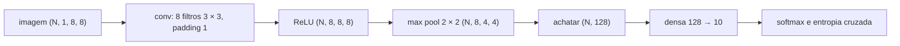

## Passo 1 · Leitura · A arquitetura mínima

As camadas da lição anterior bastam para montar uma rede convolucional completa. A desta lição é a menor que ainda merece o nome: uma convolução, uma ReLU, um max pooling e uma camada densa que produz os dez logits.



Com padding 1, a convolução 3 × 3 mantém o tamanho 8 × 8 e troca o único canal da imagem por 8 mapas de ativação, um por filtro. A ReLU zera o que é negativo, o pooling reduz cada mapa a 4 × 4, e os $8 \cdot 4 \cdot 4 = 128$ números que sobram por imagem entram na densa como um vetor.

A contagem de parâmetros usa a fórmula da lição anterior:

$$\underbrace{3 \cdot 3 \cdot 1 \cdot 8 + 8}_{\text{conv: } 80} + \underbrace{128 \cdot 10 + 10}_{\text{densa: } 1\,290} = 1\,370$$

O MLP 64 → 32 → 10 do módulo 4 tem $64 \cdot 32 + 32 + 32 \cdot 10 + 10 = 2\,410$. A CNN tem 57 % disso, e quase tudo está na densa: os 8 filtros, que olham a imagem inteira, custam 80 números. É o compartilhamento de pesos em ação. O mesmo filtro serve para as 64 posições, enquanto a primeira camada do MLP gasta um peso para cada par de pixel e neurônio.

Os parâmetros ficam num dicionário, com um nome para cada array:

```python
params = {
    "F": ...,    # filtros, (8, 1, 3, 3)
    "bF": ...,   # um viés por filtro, (8,)
    "W": ...,    # pesos da densa, (128, 10)
    "b": ...,    # vieses da densa, (10,)
}
```

A inicialização é a de He, do módulo 3: normal com média zero e desvio $\sqrt{2 / n_\text{entradas}}$, onde $n_\text{entradas}$ (o fan-in) é o número de entradas de **uma** unidade. Na densa, são as 128 entradas. Na convolução, cada posição da saída lê uma janela de $C \cdot k \cdot k = 1 \cdot 3 \cdot 3 = 9$ pixels, e por isso o fan-in é 9, seja qual for o número de filtros ou o tamanho da imagem. Os vieses começam em zero.

## Passo 2 · Previsão · Contar parâmetros

A função conta os parâmetros da arquitetura do passo 1 para outros números de filtros, tamanhos de filtro e lados de imagem, sempre com padding que mantém o tamanho e pooling 2 × 2. Leia sem executar e digite o que o programa imprime.

### Código
```python
def parametros(n_filtros, k, lado, classes):
    conv = k * k * 1 * n_filtros + n_filtros
    densa = n_filtros * (lado // 2) ** 2 * classes + classes
    return conv, densa, conv + densa


print(parametros(8, 3, 8, 10))
print(parametros(16, 3, 8, 10))
print(parametros(8, 5, 8, 10))
print(parametros(8, 3, 16, 10))
```

### Dicas
1. A primeira linha é a rede do passo 1: 80, 1 290 e 1 370.
2. Dobrar os filtros dobra os pesos da convolução e também a entrada da densa.
3. O lado da imagem não entra na conta da convolução, só na da densa: 16 × 16 vira 8 × 8 depois do pooling.

### Saída esperada
```text
(80, 1290, 1370)
(160, 2570, 2730)
(208, 1290, 1498)
(80, 5130, 5210)
```

## Passo 3 · Exercício · Montar a CNN
modo: lacunas

Complete as lacunas (`___`) de `montar_cnn`, que sorteia os parâmetros da rede do passo 1 para imagens 8 × 8 de um canal e 10 classes. O gerador é criado uma vez, e os sorteios acontecem nesta ordem: primeiro `F`, depois `W`.

### Instruções
1. `entrada_densa` é o número de entradas da densa: `n_filtros` mapas de 4 × 4 depois do pooling. `F` tem forma `(n_filtros, 1, 3, 3)` e `W`, `(entrada_densa, 10)`.
2. `bF` tem um zero por filtro (o `b` da densa já está pronto).
3. Os desvios são os de He, $\sqrt{2 / n_\text{entradas}}$: o fan-in dos filtros é o tamanho da janela (9) e o da densa é `entrada_densa`.

### Código inicial
```python
import numpy as np


def montar_cnn(semente, n_filtros=8):
    rng = np.random.default_rng(semente)
    entrada_densa = ___
    return {
        "F": rng.normal(0.0, np.sqrt(___), (___)),
        "bF": ___,
        "W": rng.normal(0.0, np.sqrt(___), (___)),
        "b": np.zeros(10),
    }
```

### Solução
```python
import numpy as np


def montar_cnn(semente, n_filtros=8):
    rng = np.random.default_rng(semente)
    entrada_densa = n_filtros * 4 * 4
    return {
        "F": rng.normal(0.0, np.sqrt(2.0 / 9), (n_filtros, 1, 3, 3)),
        "bF": np.zeros(n_filtros),
        "W": rng.normal(0.0, np.sqrt(2.0 / entrada_densa), (entrada_densa, 10)),
        "b": np.zeros(10),
    }
```

### Dicas
1. O pooling 2 × 2 leva cada mapa 8 × 8 a 4 × 4: a densa recebe `n_filtros * 4 * 4` números por imagem.
2. O terceiro argumento de `rng.normal` é a forma, uma tupla: a dos filtros tem quatro eixos, `(filtros, canais, altura, largura)`.
3. O fan-in da convolução não depende de `n_filtros`: cada saída lê uma janela 3 × 3 de um canal.

### Verificação
```json
[
  {"id": "formas", "checkpoint": 1, "kind": "expr", "setup": "import numpy as np\np = montar_cnn(0)", "expr": "[list(p[k].shape) for k in (\"F\", \"bF\", \"W\", \"b\")]", "expected": [[8, 1, 3, 3], [8], [128, 10], [10]], "name": "Formas de F, bF, W e b com 8 filtros", "hint": "Os filtros têm quatro eixos, e a densa recebe 8 mapas de 4 × 4."},
  {"id": "chaves", "checkpoint": 1, "kind": "expr", "setup": "import numpy as np", "expr": "sorted(montar_cnn(0).keys())", "expected": ["F", "W", "b", "bF"], "name": "O dicionário tem as chaves F, bF, W e b"},
  {"id": "total", "checkpoint": 1, "kind": "expr", "setup": "import numpy as np", "expr": "sum(int(v.size) for v in montar_cnn(0).values())", "expected": 1370, "name": "A rede do passo 1 tem 1 370 parâmetros"},
  {"id": "formas-16-filtros", "checkpoint": 1, "kind": "expr", "setup": "import numpy as np\np = montar_cnn(0, 16)", "expr": "[list(p[k].shape) for k in (\"F\", \"bF\", \"W\", \"b\")]", "expected": [[16, 1, 3, 3], [16], [256, 10], [10]], "name": "Com 16 filtros, a densa recebe 256 entradas", "hint": "A entrada da densa depende de n_filtros."},
  {"id": "total-16-filtros", "checkpoint": 1, "kind": "expr", "setup": "import numpy as np", "expr": "sum(int(v.size) for v in montar_cnn(3, 16).values())", "expected": 2730, "name": "Com 16 filtros são 2 730 parâmetros"},
  {"id": "vieses-zerados", "checkpoint": 2, "kind": "expr", "setup": "import numpy as np\np = montar_cnn(4)", "expr": "[bool(np.all(p['bF'] == 0.0)), bool(np.all(p['b'] == 0.0))]", "expected": [true, true], "name": "Os vieses começam em zero"},
  {"id": "desvio-filtros", "checkpoint": 3, "kind": "expr", "setup": "import numpy as np\np = montar_cnn(1, 64)", "expr": "bool(abs(float(p['F'].std()) - np.sqrt(2.0 / 9)) < 0.07)", "expected": true, "name": "Desvio dos filtros perto de raiz de 2/9 (64 filtros, 5 erros padrão)", "hint": "O fan-in da convolução é o tamanho da janela, 9, e não depende do número de filtros."},
  {"id": "desvio-densa", "checkpoint": 3, "kind": "expr", "setup": "import numpy as np\np = montar_cnn(2)", "expr": "bool(abs(float(p['W'].std()) - np.sqrt(2.0 / 128)) < 0.0125)", "expected": true, "name": "Desvio de W perto de raiz de 2/128 (5 erros padrão)", "hint": "O fan-in da densa é entrada_densa."},
  {"id": "desvio-densa-64-filtros", "checkpoint": 3, "kind": "expr", "setup": "import numpy as np\np = montar_cnn(2, 64)", "expr": "bool(abs(float(p['W'].std()) - np.sqrt(2.0 / 1024)) < 0.0016)", "expected": true, "name": "Com 64 filtros, o desvio de W acompanha as 1 024 entradas"},
  {"id": "medias", "checkpoint": 3, "kind": "expr", "setup": "import numpy as np\np = montar_cnn(6, 64)", "expr": "[bool(abs(float(p['F'].mean())) < 0.1), bool(abs(float(p['W'].mean())) < 0.003)]", "expected": [true, true], "name": "As médias de F e de W ficam perto de zero"},
  {"id": "mesma-semente", "checkpoint": 1, "kind": "expr", "setup": "import numpy as np\np, q = montar_cnn(7), montar_cnn(7)", "expr": "[bool(np.array_equal(p['F'], q['F'])), bool(np.array_equal(p['W'], q['W'])), p['F'] is not q['F']]", "expected": [true, true, true], "name": "A mesma semente dá os mesmos parâmetros, em arrays independentes"},
  {"id": "outra-semente", "checkpoint": 1, "kind": "expr", "setup": "import numpy as np\np, q = montar_cnn(1), montar_cnn(2)", "expr": "bool(not np.array_equal(p['F'], q['F']))", "expected": true, "name": "Sementes diferentes dão filtros diferentes"}
]
```

### Soluções erradas
```python name="desvio dos filtros sem o 2 (raiz de 1 / fan-in)"
import numpy as np


def montar_cnn(semente, n_filtros=8):
    rng = np.random.default_rng(semente)
    entrada_densa = n_filtros * 4 * 4
    return {
        "F": rng.normal(0.0, np.sqrt(1.0 / 9), (n_filtros, 1, 3, 3)),
        "bF": np.zeros(n_filtros),
        "W": rng.normal(0.0, np.sqrt(2.0 / entrada_densa), (entrada_densa, 10)),
        "b": np.zeros(10),
    }
```
```python name="fan-in da convolução contando os filtros"
import numpy as np


def montar_cnn(semente, n_filtros=8):
    rng = np.random.default_rng(semente)
    entrada_densa = n_filtros * 4 * 4
    return {
        "F": rng.normal(0.0, np.sqrt(2.0 / (9 * n_filtros)), (n_filtros, 1, 3, 3)),
        "bF": np.zeros(n_filtros),
        "W": rng.normal(0.0, np.sqrt(2.0 / entrada_densa), (entrada_densa, 10)),
        "b": np.zeros(10),
    }
```
```python name="entrada da densa sem contar o pooling"
import numpy as np


def montar_cnn(semente, n_filtros=8):
    rng = np.random.default_rng(semente)
    entrada_densa = n_filtros * 8 * 8
    return {
        "F": rng.normal(0.0, np.sqrt(2.0 / 9), (n_filtros, 1, 3, 3)),
        "bF": np.zeros(n_filtros),
        "W": rng.normal(0.0, np.sqrt(2.0 / entrada_densa), (entrada_densa, 10)),
        "b": np.zeros(10),
    }
```
```python name="entrada da densa fixa em 128"
import numpy as np


def montar_cnn(semente, n_filtros=8):
    rng = np.random.default_rng(semente)
    entrada_densa = 128
    return {
        "F": rng.normal(0.0, np.sqrt(2.0 / 9), (n_filtros, 1, 3, 3)),
        "bF": np.zeros(n_filtros),
        "W": rng.normal(0.0, np.sqrt(2.0 / entrada_densa), (entrada_densa, 10)),
        "b": np.zeros(10),
    }
```
```python name="vieses dos filtros sorteados"
import numpy as np


def montar_cnn(semente, n_filtros=8):
    rng = np.random.default_rng(semente)
    entrada_densa = n_filtros * 4 * 4
    return {
        "F": rng.normal(0.0, np.sqrt(2.0 / 9), (n_filtros, 1, 3, 3)),
        "bF": rng.normal(0.0, 1.0, n_filtros),
        "W": rng.normal(0.0, np.sqrt(2.0 / entrada_densa), (entrada_densa, 10)),
        "b": np.zeros(10),
    }
```
```python name="pesos da densa transpostos"
import numpy as np


def montar_cnn(semente, n_filtros=8):
    rng = np.random.default_rng(semente)
    entrada_densa = n_filtros * 4 * 4
    return {
        "F": rng.normal(0.0, np.sqrt(2.0 / 9), (n_filtros, 1, 3, 3)),
        "bF": np.zeros(n_filtros),
        "W": rng.normal(0.0, np.sqrt(2.0 / entrada_densa), (10, entrada_densa)),
        "b": np.zeros(10),
    }
```
```python name="filtros sem o eixo do canal"
import numpy as np


def montar_cnn(semente, n_filtros=8):
    rng = np.random.default_rng(semente)
    entrada_densa = n_filtros * 4 * 4
    return {
        "F": rng.normal(0.0, np.sqrt(2.0 / 9), (n_filtros, 3, 3)),
        "bF": np.zeros(n_filtros),
        "W": rng.normal(0.0, np.sqrt(2.0 / entrada_densa), (entrada_densa, 10)),
        "b": np.zeros(10),
    }
```
```python name="desvio da densa com o fan-in da convolução"
import numpy as np


def montar_cnn(semente, n_filtros=8):
    rng = np.random.default_rng(semente)
    entrada_densa = n_filtros * 4 * 4
    return {
        "F": rng.normal(0.0, np.sqrt(2.0 / 9), (n_filtros, 1, 3, 3)),
        "bF": np.zeros(n_filtros),
        "W": rng.normal(0.0, np.sqrt(2.0 / 9), (entrada_densa, 10)),
        "b": np.zeros(10),
    }
```

## Passo 4 · Leitura · Encadear forward e backward

O arquivo `camadas_cnn.py` desta lição reúne as camadas já escritas no curso, cada uma com o seu par de funções: `conv_forward` e `conv_backward` (as duas metades da lição anterior juntas, devolvendo `dX`, `dF` e `db`), `relu_forward` e `relu_backward`, `maxpool_forward` e `maxpool_backward`, `densa_forward` e `densa_backward`, e `softmax_entropia`, que devolve a perda média e `dlogits` já dividido pelo tamanho do lote. Todo forward devolve `(saida, cache)`, e o backward correspondente recebe o gradiente da saída e esse cache.

O forward da rede é uma fila de chamadas, cada uma guardando o seu cache:

```python
Z, cache_conv = conv_forward(X, params["F"], params["bF"], 1)
A, cache_relu = relu_forward(Z)
P, cache_pool = maxpool_forward(A)            # (N, 8, 4, 4)
achatado = P.reshape(len(X), -1)              # (N, 128)
logits, cache_densa = densa_forward(achatado, params["W"], params["b"])
```

A única peça nova é **achatar**. O `reshape` não move nenhum número: lê `P` na ordem dos eixos `(N, F, H, W)` e põe os 128 valores de cada imagem numa linha. A densa não sabe que eles já foram mapas.

O backward percorre a mesma fila de trás para a frente, e cada camada recebe o cache que ela mesma guardou. Achatar também tem backward: o gradiente que sai da densa tem forma `(N, 128)` e precisa voltar à forma de `P` **com a mesma leitura**, `d.reshape(P.shape)`. Desachatar noutra ordem de eixos não dá erro quando os tamanhos coincidem: entrega a cada posição o gradiente de outra, e só a checagem numérica denuncia.

Outros dois enganos aparecem já na primeira execução. Sem o padding 1, os mapas saem 6 × 6, o pooling os leva a 3 × 3 e a densa recebe 72 números onde esperava 128:

```text
ValueError: matmul: Input operand 1 has a mismatch in its core dimension 0, with gufunc signature (n?,k),(k,m?)->(n?,m?) (size 128 is different from 72)
```

E devolver o gradiente ao pooling sem desachatar para em outra mensagem, aqui com 5 imagens:

```text
ValueError: shape mismatch: value array of shape (5,128,1) could not be broadcast to indexing result of shape (5,8,4,4,1)
```

Como a convolução é a primeira camada, o `dX` que ela devolve não é usado por ninguém: a imagem não é um parâmetro. Os gradientes saem num dicionário com as mesmas chaves de `params`, cada um com a forma do seu parâmetro.

## Passo 5 · Exercício · Forward e backward da CNN

Escreva o forward e o backward da rede do passo 1 com as camadas de `camadas_cnn.py`. As formas vêm dos parâmetros: não fixe 8 filtros, 10 classes nem imagens 8 × 8 (a altura e a largura são sempre pares).

### Instruções
1. `cnn_logits(params, X)` recebe `X` de forma `(N, 1, H, W)` e devolve os logits, de forma `(N, classes)`: convolução com padding 1, ReLU, max pooling 2 × 2, achatar na ordem `(N, F, H, W)` e densa.
2. `cnn_perda_e_gradientes(params, X, y)` devolve `(perda, grads)`: `perda` é a entropia cruzada média do lote, um `float`.
3. `grads` é um dicionário com as chaves `"F"`, `"bF"`, `"W"` e `"b"`, cada gradiente com a forma do parâmetro correspondente. Os parâmetros não são alterados.

### Código inicial
```python
import numpy as np
from camadas_cnn import (conv_forward, conv_backward, relu_forward, relu_backward,
                         maxpool_forward, maxpool_backward, densa_forward, densa_backward,
                         softmax_entropia)


def cnn_logits(params, X):
    # Escreva aqui
    pass


def cnn_perda_e_gradientes(params, X, y):
    # Escreva aqui
    pass
```
```python path=camadas_cnn.py
import numpy as np


def im2col(X, k, p):
    """Janelas k × k de X (N, C, H, W) com padding p, uma por linha: (N * Hs * Ws, C * k * k)."""
    N, C = X.shape[:2]
    Xp = np.pad(X, ((0, 0), (0, 0), (p, p), (p, p)))
    janelas = np.lib.stride_tricks.sliding_window_view(Xp, (k, k), axis=(2, 3))
    hs, ws = janelas.shape[2], janelas.shape[3]
    return janelas.transpose(0, 2, 3, 1, 4, 5).reshape(N * hs * ws, C * k * k)


def col2im(dcols, forma, k, p):
    """Devolve as parcelas das janelas para a imagem (N, C, H, W), somando as sobreposições."""
    N, C, H, W = forma
    hs, ws = H + 2 * p - k + 1, W + 2 * p - k + 1
    d = dcols.reshape(N, hs, ws, C, k, k)
    dXp = np.zeros((N, C, H + 2 * p, W + 2 * p))
    for a in range(k):
        for b in range(k):
            dXp[:, :, a:a + hs, b:b + ws] += d[:, :, :, :, a, b].transpose(0, 3, 1, 2)
    return dXp[:, :, p:p + H, p:p + W]


def conv_forward(X, F, b, p):
    """Convolução com stride 1. Devolve a saída (N, F, Hs, Ws) e o cache."""
    N, C, H, W = X.shape
    n_filtros, k = F.shape[0], F.shape[2]
    hs, ws = H + 2 * p - k + 1, W + 2 * p - k + 1
    cols = im2col(X, k, p)
    saida = cols @ F.reshape(n_filtros, C * k * k).T + b
    return saida.reshape(N, hs, ws, n_filtros).transpose(0, 3, 1, 2), (cols, X.shape, F, p)


def conv_backward(dout, cache):
    """Recebe dout (N, F, Hs, Ws). Devolve (dX, dF, db), com as formas de X, F e b."""
    cols, forma_x, F, p = cache
    n_filtros, k = F.shape[0], F.shape[2]
    dmat = dout.transpose(0, 2, 3, 1).reshape(-1, n_filtros)
    dF = (cols.T @ dmat).T.reshape(F.shape)
    db = dmat.sum(axis=0)
    dX = col2im(dmat @ F.reshape(n_filtros, -1), forma_x, k, p)
    return dX, dF, db


def relu_forward(Z):
    return np.maximum(Z, 0.0), Z


def relu_backward(dA, cache):
    Z = cache
    return dA * (Z > 0)


def maxpool_forward(X):
    """Max pooling 2 × 2. Devolve a saída (N, C, H/2, W/2) e o cache."""
    N, C, H, W = X.shape
    blocos = X.reshape(N, C, H // 2, 2, W // 2, 2).transpose(0, 1, 2, 4, 3, 5)
    blocos = blocos.reshape(N, C, H // 2, W // 2, 4)
    return blocos.max(axis=4), (blocos.argmax(axis=4), X.shape)


def maxpool_backward(dout, cache):
    """Recebe dout (N, C, H/2, W/2). Devolve dX (N, C, H, W): o gradiente vai para o máximo."""
    posicao, forma = cache
    N, C, H, W = forma
    dblocos = np.zeros((N, C, H // 2, W // 2, 4))
    np.put_along_axis(dblocos, posicao[..., None], dout[..., None], axis=4)
    dblocos = dblocos.reshape(N, C, H // 2, W // 2, 2, 2).transpose(0, 1, 2, 4, 3, 5)
    return dblocos.reshape(N, C, H, W)


def densa_forward(X, W, b):
    Z = X @ W + b
    return Z, (X, W)


def densa_backward(dZ, cache):
    """Devolve (dX, dW, db)."""
    X, W = cache
    return dZ @ W.T, X.T @ dZ, dZ.sum(axis=0)


def softmax_entropia(logits, y):
    """Devolve a perda média e dlogits, já dividido pelo tamanho do lote."""
    n = len(y)
    Z = logits - logits.max(axis=1, keepdims=True)
    P = np.exp(Z)
    P = P / P.sum(axis=1, keepdims=True)
    perda = float(-np.log(P[np.arange(n), y]).mean())
    dlogits = P.copy()
    dlogits[np.arange(n), y] -= 1.0
    return perda, dlogits / n
```

### Solução
```python
import numpy as np
from camadas_cnn import (conv_forward, conv_backward, relu_forward, relu_backward,
                         maxpool_forward, maxpool_backward, densa_forward, densa_backward,
                         softmax_entropia)


def cnn_forward(params, X):
    Z, cache_conv = conv_forward(X, params["F"], params["bF"], 1)
    A, cache_relu = relu_forward(Z)
    P, cache_pool = maxpool_forward(A)
    achatado = P.reshape(len(X), -1)
    logits, cache_densa = densa_forward(achatado, params["W"], params["b"])
    return logits, (cache_conv, cache_relu, cache_pool, P.shape, cache_densa)


def cnn_logits(params, X):
    return cnn_forward(params, X)[0]


def cnn_perda_e_gradientes(params, X, y):
    logits, (cache_conv, cache_relu, cache_pool, forma, cache_densa) = cnn_forward(params, X)
    perda, dlogits = softmax_entropia(logits, y)
    d, dW, db = densa_backward(dlogits, cache_densa)
    d = d.reshape(forma)
    d = maxpool_backward(d, cache_pool)
    d = relu_backward(d, cache_relu)
    dX, dF, dbF = conv_backward(d, cache_conv)
    return perda, {"F": dF, "bF": dbF, "W": dW, "b": db}
```
```python path=camadas_cnn.py
import numpy as np


def im2col(X, k, p):
    """Janelas k × k de X (N, C, H, W) com padding p, uma por linha: (N * Hs * Ws, C * k * k)."""
    N, C = X.shape[:2]
    Xp = np.pad(X, ((0, 0), (0, 0), (p, p), (p, p)))
    janelas = np.lib.stride_tricks.sliding_window_view(Xp, (k, k), axis=(2, 3))
    hs, ws = janelas.shape[2], janelas.shape[3]
    return janelas.transpose(0, 2, 3, 1, 4, 5).reshape(N * hs * ws, C * k * k)


def col2im(dcols, forma, k, p):
    """Devolve as parcelas das janelas para a imagem (N, C, H, W), somando as sobreposições."""
    N, C, H, W = forma
    hs, ws = H + 2 * p - k + 1, W + 2 * p - k + 1
    d = dcols.reshape(N, hs, ws, C, k, k)
    dXp = np.zeros((N, C, H + 2 * p, W + 2 * p))
    for a in range(k):
        for b in range(k):
            dXp[:, :, a:a + hs, b:b + ws] += d[:, :, :, :, a, b].transpose(0, 3, 1, 2)
    return dXp[:, :, p:p + H, p:p + W]


def conv_forward(X, F, b, p):
    """Convolução com stride 1. Devolve a saída (N, F, Hs, Ws) e o cache."""
    N, C, H, W = X.shape
    n_filtros, k = F.shape[0], F.shape[2]
    hs, ws = H + 2 * p - k + 1, W + 2 * p - k + 1
    cols = im2col(X, k, p)
    saida = cols @ F.reshape(n_filtros, C * k * k).T + b
    return saida.reshape(N, hs, ws, n_filtros).transpose(0, 3, 1, 2), (cols, X.shape, F, p)


def conv_backward(dout, cache):
    """Recebe dout (N, F, Hs, Ws). Devolve (dX, dF, db), com as formas de X, F e b."""
    cols, forma_x, F, p = cache
    n_filtros, k = F.shape[0], F.shape[2]
    dmat = dout.transpose(0, 2, 3, 1).reshape(-1, n_filtros)
    dF = (cols.T @ dmat).T.reshape(F.shape)
    db = dmat.sum(axis=0)
    dX = col2im(dmat @ F.reshape(n_filtros, -1), forma_x, k, p)
    return dX, dF, db


def relu_forward(Z):
    return np.maximum(Z, 0.0), Z


def relu_backward(dA, cache):
    Z = cache
    return dA * (Z > 0)


def maxpool_forward(X):
    """Max pooling 2 × 2. Devolve a saída (N, C, H/2, W/2) e o cache."""
    N, C, H, W = X.shape
    blocos = X.reshape(N, C, H // 2, 2, W // 2, 2).transpose(0, 1, 2, 4, 3, 5)
    blocos = blocos.reshape(N, C, H // 2, W // 2, 4)
    return blocos.max(axis=4), (blocos.argmax(axis=4), X.shape)


def maxpool_backward(dout, cache):
    """Recebe dout (N, C, H/2, W/2). Devolve dX (N, C, H, W): o gradiente vai para o máximo."""
    posicao, forma = cache
    N, C, H, W = forma
    dblocos = np.zeros((N, C, H // 2, W // 2, 4))
    np.put_along_axis(dblocos, posicao[..., None], dout[..., None], axis=4)
    dblocos = dblocos.reshape(N, C, H // 2, W // 2, 2, 2).transpose(0, 1, 2, 4, 3, 5)
    return dblocos.reshape(N, C, H, W)


def densa_forward(X, W, b):
    Z = X @ W + b
    return Z, (X, W)


def densa_backward(dZ, cache):
    """Devolve (dX, dW, db)."""
    X, W = cache
    return dZ @ W.T, X.T @ dZ, dZ.sum(axis=0)


def softmax_entropia(logits, y):
    """Devolve a perda média e dlogits, já dividido pelo tamanho do lote."""
    n = len(y)
    Z = logits - logits.max(axis=1, keepdims=True)
    P = np.exp(Z)
    P = P / P.sum(axis=1, keepdims=True)
    perda = float(-np.log(P[np.arange(n), y]).mean())
    dlogits = P.copy()
    dlogits[np.arange(n), y] -= 1.0
    return perda, dlogits / n
```

### Dicas
1. Escreva uma função auxiliar que faz o forward e devolve os logits junto com os caches; as duas funções pedidas usam a mesma.
2. Guarde a forma de `P` antes de achatar: o backward precisa dela para o `reshape` de volta.
3. No backward, a ordem é a inversa: densa, desachatar, pooling, ReLU, convolução. `densa_backward` devolve `(dX, dW, db)` e `conv_backward`, `(dX, dF, db)`.

### Verificação
```json
[
  {"id": "logits-forma", "checkpoint": 1, "kind": "expr", "setup": "import numpy as np\n_r = np.random.default_rng(11)\n_CH = (\"F\", \"bF\", \"W\", \"b\")\ndef _params(nf, lado, classes):\n    return {\"F\": _r.normal(0.0, 0.5, (nf, 1, 3, 3)), \"bF\": _r.normal(0.0, 0.5, nf), \"W\": _r.normal(0.0, 0.3, (nf * (lado // 2) ** 2, classes)), \"b\": _r.normal(0.0, 0.5, classes)}\ndef _ref_logits(p, X):\n    N, _, H, W = X.shape\n    Xp = np.pad(X, ((0, 0), (0, 0), (1, 1), (1, 1)))\n    Z = np.zeros((N, p[\"F\"].shape[0], H, W))\n    for i in range(H):\n        for j in range(W):\n            Z[:, :, i, j] = np.tensordot(Xp[:, 0, i:i + 3, j:j + 3], p[\"F\"][:, 0], axes=([1, 2], [1, 2])) + p[\"bF\"]\n    A = np.maximum(Z, 0.0)\n    P = np.maximum(np.maximum(A[:, :, 0::2, 0::2], A[:, :, 0::2, 1::2]), np.maximum(A[:, :, 1::2, 0::2], A[:, :, 1::2, 1::2]))\n    return P.reshape(N, -1) @ p[\"W\"] + p[\"b\"]\ndef _ref_perda(p, X, y):\n    L = _ref_logits(p, X)\n    L = L - L.max(axis=1, keepdims=True)\n    return float(-(L[np.arange(len(y)), y] - np.log(np.exp(L).sum(axis=1))).mean())\ndef _num(f, A, h=1e-5):\n    G = np.zeros_like(A)\n    for i in np.ndindex(A.shape):\n        v = A[i]\n        A[i] = v + h\n        mais = f()\n        A[i] = v - h\n        menos = f()\n        A[i] = v\n        G[i] = (mais - menos) / (2 * h)\n    return G\ndef _erro(a, n):\n    if getattr(a, \"shape\", None) != n.shape:\n        return 1.0\n    return float(np.linalg.norm(a - n) / max(np.linalg.norm(a) + np.linalg.norm(n), 1e-8))\np = _params(8, 8, 10)\nX = _r.normal(size=(5, 1, 8, 8))\ny = _r.integers(0, 10, 5)\n", "expr": "list(cnn_logits(p, X).shape)", "expected": [5, 10], "name": "5 imagens 8 × 8 dão logits de forma (5, 10)"},
  {"id": "logits-referencia", "checkpoint": 1, "kind": "expr", "setup": "import numpy as np\n_r = np.random.default_rng(11)\n_CH = (\"F\", \"bF\", \"W\", \"b\")\ndef _params(nf, lado, classes):\n    return {\"F\": _r.normal(0.0, 0.5, (nf, 1, 3, 3)), \"bF\": _r.normal(0.0, 0.5, nf), \"W\": _r.normal(0.0, 0.3, (nf * (lado // 2) ** 2, classes)), \"b\": _r.normal(0.0, 0.5, classes)}\ndef _ref_logits(p, X):\n    N, _, H, W = X.shape\n    Xp = np.pad(X, ((0, 0), (0, 0), (1, 1), (1, 1)))\n    Z = np.zeros((N, p[\"F\"].shape[0], H, W))\n    for i in range(H):\n        for j in range(W):\n            Z[:, :, i, j] = np.tensordot(Xp[:, 0, i:i + 3, j:j + 3], p[\"F\"][:, 0], axes=([1, 2], [1, 2])) + p[\"bF\"]\n    A = np.maximum(Z, 0.0)\n    P = np.maximum(np.maximum(A[:, :, 0::2, 0::2], A[:, :, 0::2, 1::2]), np.maximum(A[:, :, 1::2, 0::2], A[:, :, 1::2, 1::2]))\n    return P.reshape(N, -1) @ p[\"W\"] + p[\"b\"]\ndef _ref_perda(p, X, y):\n    L = _ref_logits(p, X)\n    L = L - L.max(axis=1, keepdims=True)\n    return float(-(L[np.arange(len(y)), y] - np.log(np.exp(L).sum(axis=1))).mean())\ndef _num(f, A, h=1e-5):\n    G = np.zeros_like(A)\n    for i in np.ndindex(A.shape):\n        v = A[i]\n        A[i] = v + h\n        mais = f()\n        A[i] = v - h\n        menos = f()\n        A[i] = v\n        G[i] = (mais - menos) / (2 * h)\n    return G\ndef _erro(a, n):\n    if getattr(a, \"shape\", None) != n.shape:\n        return 1.0\n    return float(np.linalg.norm(a - n) / max(np.linalg.norm(a) + np.linalg.norm(n), 1e-8))\np = _params(8, 8, 10)\nX = _r.normal(size=(16, 1, 8, 8))\ny = _r.integers(0, 10, 16)\n", "expr": "bool(np.allclose(cnn_logits(p, X), _ref_logits(p, X), atol=1e-12))", "expected": true, "name": "Logits iguais aos da referência (8 filtros, 16 imagens 8 × 8)", "hint": "Conferido contra conv com padding 1, ReLU, máximo de cada bloco 2 × 2, achatar na ordem (N, F, H, W) e densa."},
  {"id": "logits-outras-formas", "checkpoint": 1, "kind": "expr", "setup": "import numpy as np\n_r = np.random.default_rng(11)\n_CH = (\"F\", \"bF\", \"W\", \"b\")\ndef _params(nf, lado, classes):\n    return {\"F\": _r.normal(0.0, 0.5, (nf, 1, 3, 3)), \"bF\": _r.normal(0.0, 0.5, nf), \"W\": _r.normal(0.0, 0.3, (nf * (lado // 2) ** 2, classes)), \"b\": _r.normal(0.0, 0.5, classes)}\ndef _ref_logits(p, X):\n    N, _, H, W = X.shape\n    Xp = np.pad(X, ((0, 0), (0, 0), (1, 1), (1, 1)))\n    Z = np.zeros((N, p[\"F\"].shape[0], H, W))\n    for i in range(H):\n        for j in range(W):\n            Z[:, :, i, j] = np.tensordot(Xp[:, 0, i:i + 3, j:j + 3], p[\"F\"][:, 0], axes=([1, 2], [1, 2])) + p[\"bF\"]\n    A = np.maximum(Z, 0.0)\n    P = np.maximum(np.maximum(A[:, :, 0::2, 0::2], A[:, :, 0::2, 1::2]), np.maximum(A[:, :, 1::2, 0::2], A[:, :, 1::2, 1::2]))\n    return P.reshape(N, -1) @ p[\"W\"] + p[\"b\"]\ndef _ref_perda(p, X, y):\n    L = _ref_logits(p, X)\n    L = L - L.max(axis=1, keepdims=True)\n    return float(-(L[np.arange(len(y)), y] - np.log(np.exp(L).sum(axis=1))).mean())\ndef _num(f, A, h=1e-5):\n    G = np.zeros_like(A)\n    for i in np.ndindex(A.shape):\n        v = A[i]\n        A[i] = v + h\n        mais = f()\n        A[i] = v - h\n        menos = f()\n        A[i] = v\n        G[i] = (mais - menos) / (2 * h)\n    return G\ndef _erro(a, n):\n    if getattr(a, \"shape\", None) != n.shape:\n        return 1.0\n    return float(np.linalg.norm(a - n) / max(np.linalg.norm(a) + np.linalg.norm(n), 1e-8))\np = _params(3, 6, 4)\nX = _r.normal(size=(5, 1, 6, 6))\ny = _r.integers(0, 4, 5)\n", "expr": "[list(cnn_logits(p, X).shape), bool(np.allclose(cnn_logits(p, X), _ref_logits(p, X), atol=1e-12))]", "expected": [[5, 4], true], "name": "3 filtros, imagens 6 × 6 e 4 classes: as formas vêm dos parâmetros"},
  {"id": "logits-negativos", "checkpoint": 1, "kind": "expr", "setup": "import numpy as np\n_r = np.random.default_rng(11)\n_CH = (\"F\", \"bF\", \"W\", \"b\")\ndef _params(nf, lado, classes):\n    return {\"F\": _r.normal(0.0, 0.5, (nf, 1, 3, 3)), \"bF\": _r.normal(0.0, 0.5, nf), \"W\": _r.normal(0.0, 0.3, (nf * (lado // 2) ** 2, classes)), \"b\": _r.normal(0.0, 0.5, classes)}\ndef _ref_logits(p, X):\n    N, _, H, W = X.shape\n    Xp = np.pad(X, ((0, 0), (0, 0), (1, 1), (1, 1)))\n    Z = np.zeros((N, p[\"F\"].shape[0], H, W))\n    for i in range(H):\n        for j in range(W):\n            Z[:, :, i, j] = np.tensordot(Xp[:, 0, i:i + 3, j:j + 3], p[\"F\"][:, 0], axes=([1, 2], [1, 2])) + p[\"bF\"]\n    A = np.maximum(Z, 0.0)\n    P = np.maximum(np.maximum(A[:, :, 0::2, 0::2], A[:, :, 0::2, 1::2]), np.maximum(A[:, :, 1::2, 0::2], A[:, :, 1::2, 1::2]))\n    return P.reshape(N, -1) @ p[\"W\"] + p[\"b\"]\ndef _ref_perda(p, X, y):\n    L = _ref_logits(p, X)\n    L = L - L.max(axis=1, keepdims=True)\n    return float(-(L[np.arange(len(y)), y] - np.log(np.exp(L).sum(axis=1))).mean())\ndef _num(f, A, h=1e-5):\n    G = np.zeros_like(A)\n    for i in np.ndindex(A.shape):\n        v = A[i]\n        A[i] = v + h\n        mais = f()\n        A[i] = v - h\n        menos = f()\n        A[i] = v\n        G[i] = (mais - menos) / (2 * h)\n    return G\ndef _erro(a, n):\n    if getattr(a, \"shape\", None) != n.shape:\n        return 1.0\n    return float(np.linalg.norm(a - n) / max(np.linalg.norm(a) + np.linalg.norm(n), 1e-8))\np = _params(8, 8, 10)\nX = _r.normal(size=(16, 1, 8, 8))\ny = _r.integers(0, 10, 16)\n", "expr": "bool(cnn_logits(p, X).min() < 0.0)", "expected": true, "name": "Os logits não passam por ReLU: há valores negativos"},
  {"id": "perda-referencia", "checkpoint": 2, "kind": "expr", "setup": "import numpy as np\n_r = np.random.default_rng(11)\n_CH = (\"F\", \"bF\", \"W\", \"b\")\ndef _params(nf, lado, classes):\n    return {\"F\": _r.normal(0.0, 0.5, (nf, 1, 3, 3)), \"bF\": _r.normal(0.0, 0.5, nf), \"W\": _r.normal(0.0, 0.3, (nf * (lado // 2) ** 2, classes)), \"b\": _r.normal(0.0, 0.5, classes)}\ndef _ref_logits(p, X):\n    N, _, H, W = X.shape\n    Xp = np.pad(X, ((0, 0), (0, 0), (1, 1), (1, 1)))\n    Z = np.zeros((N, p[\"F\"].shape[0], H, W))\n    for i in range(H):\n        for j in range(W):\n            Z[:, :, i, j] = np.tensordot(Xp[:, 0, i:i + 3, j:j + 3], p[\"F\"][:, 0], axes=([1, 2], [1, 2])) + p[\"bF\"]\n    A = np.maximum(Z, 0.0)\n    P = np.maximum(np.maximum(A[:, :, 0::2, 0::2], A[:, :, 0::2, 1::2]), np.maximum(A[:, :, 1::2, 0::2], A[:, :, 1::2, 1::2]))\n    return P.reshape(N, -1) @ p[\"W\"] + p[\"b\"]\ndef _ref_perda(p, X, y):\n    L = _ref_logits(p, X)\n    L = L - L.max(axis=1, keepdims=True)\n    return float(-(L[np.arange(len(y)), y] - np.log(np.exp(L).sum(axis=1))).mean())\ndef _num(f, A, h=1e-5):\n    G = np.zeros_like(A)\n    for i in np.ndindex(A.shape):\n        v = A[i]\n        A[i] = v + h\n        mais = f()\n        A[i] = v - h\n        menos = f()\n        A[i] = v\n        G[i] = (mais - menos) / (2 * h)\n    return G\ndef _erro(a, n):\n    if getattr(a, \"shape\", None) != n.shape:\n        return 1.0\n    return float(np.linalg.norm(a - n) / max(np.linalg.norm(a) + np.linalg.norm(n), 1e-8))\np = _params(8, 8, 10)\nX = _r.normal(size=(16, 1, 8, 8))\ny = _r.integers(0, 10, 16)\nperda, g = cnn_perda_e_gradientes(p, X, y)\n", "expr": "bool(abs(perda - _ref_perda(p, X, y)) < 1e-12)", "expected": true, "name": "A perda é a entropia cruzada média dos logits da referência"},
  {"id": "perda-ln-10", "checkpoint": 2, "kind": "expr", "setup": "import numpy as np\n_r = np.random.default_rng(11)\n_CH = (\"F\", \"bF\", \"W\", \"b\")\ndef _params(nf, lado, classes):\n    return {\"F\": _r.normal(0.0, 0.5, (nf, 1, 3, 3)), \"bF\": _r.normal(0.0, 0.5, nf), \"W\": _r.normal(0.0, 0.3, (nf * (lado // 2) ** 2, classes)), \"b\": _r.normal(0.0, 0.5, classes)}\ndef _ref_logits(p, X):\n    N, _, H, W = X.shape\n    Xp = np.pad(X, ((0, 0), (0, 0), (1, 1), (1, 1)))\n    Z = np.zeros((N, p[\"F\"].shape[0], H, W))\n    for i in range(H):\n        for j in range(W):\n            Z[:, :, i, j] = np.tensordot(Xp[:, 0, i:i + 3, j:j + 3], p[\"F\"][:, 0], axes=([1, 2], [1, 2])) + p[\"bF\"]\n    A = np.maximum(Z, 0.0)\n    P = np.maximum(np.maximum(A[:, :, 0::2, 0::2], A[:, :, 0::2, 1::2]), np.maximum(A[:, :, 1::2, 0::2], A[:, :, 1::2, 1::2]))\n    return P.reshape(N, -1) @ p[\"W\"] + p[\"b\"]\ndef _ref_perda(p, X, y):\n    L = _ref_logits(p, X)\n    L = L - L.max(axis=1, keepdims=True)\n    return float(-(L[np.arange(len(y)), y] - np.log(np.exp(L).sum(axis=1))).mean())\ndef _num(f, A, h=1e-5):\n    G = np.zeros_like(A)\n    for i in np.ndindex(A.shape):\n        v = A[i]\n        A[i] = v + h\n        mais = f()\n        A[i] = v - h\n        menos = f()\n        A[i] = v\n        G[i] = (mais - menos) / (2 * h)\n    return G\ndef _erro(a, n):\n    if getattr(a, \"shape\", None) != n.shape:\n        return 1.0\n    return float(np.linalg.norm(a - n) / max(np.linalg.norm(a) + np.linalg.norm(n), 1e-8))\np = _params(8, 8, 10)\nX = _r.normal(size=(12, 1, 8, 8))\ny = _r.integers(0, 10, 12)\np['W'][:] = 0.0\np['b'][:] = 0.0\nperda, g = cnn_perda_e_gradientes(p, X, y)\n", "expr": "perda", "expected": 2.302585092994046, "tolerance": 1e-12, "name": "Com W e b zerados, a perda é ln 10", "hint": "Logits iguais dão probabilidade 1/10 para cada classe."},
  {"id": "retorno", "checkpoint": 2, "kind": "expr", "setup": "import numpy as np\n_r = np.random.default_rng(11)\n_CH = (\"F\", \"bF\", \"W\", \"b\")\ndef _params(nf, lado, classes):\n    return {\"F\": _r.normal(0.0, 0.5, (nf, 1, 3, 3)), \"bF\": _r.normal(0.0, 0.5, nf), \"W\": _r.normal(0.0, 0.3, (nf * (lado // 2) ** 2, classes)), \"b\": _r.normal(0.0, 0.5, classes)}\ndef _ref_logits(p, X):\n    N, _, H, W = X.shape\n    Xp = np.pad(X, ((0, 0), (0, 0), (1, 1), (1, 1)))\n    Z = np.zeros((N, p[\"F\"].shape[0], H, W))\n    for i in range(H):\n        for j in range(W):\n            Z[:, :, i, j] = np.tensordot(Xp[:, 0, i:i + 3, j:j + 3], p[\"F\"][:, 0], axes=([1, 2], [1, 2])) + p[\"bF\"]\n    A = np.maximum(Z, 0.0)\n    P = np.maximum(np.maximum(A[:, :, 0::2, 0::2], A[:, :, 0::2, 1::2]), np.maximum(A[:, :, 1::2, 0::2], A[:, :, 1::2, 1::2]))\n    return P.reshape(N, -1) @ p[\"W\"] + p[\"b\"]\ndef _ref_perda(p, X, y):\n    L = _ref_logits(p, X)\n    L = L - L.max(axis=1, keepdims=True)\n    return float(-(L[np.arange(len(y)), y] - np.log(np.exp(L).sum(axis=1))).mean())\ndef _num(f, A, h=1e-5):\n    G = np.zeros_like(A)\n    for i in np.ndindex(A.shape):\n        v = A[i]\n        A[i] = v + h\n        mais = f()\n        A[i] = v - h\n        menos = f()\n        A[i] = v\n        G[i] = (mais - menos) / (2 * h)\n    return G\ndef _erro(a, n):\n    if getattr(a, \"shape\", None) != n.shape:\n        return 1.0\n    return float(np.linalg.norm(a - n) / max(np.linalg.norm(a) + np.linalg.norm(n), 1e-8))\np = _params(2, 4, 3)\nX = _r.normal(size=(4, 1, 4, 4))\ny = _r.integers(0, 3, 4)\nperda, g = cnn_perda_e_gradientes(p, X, y)\n", "expr": "[type(perda).__name__, sorted(g.keys())]", "expected": ["float", ["F", "W", "b", "bF"]], "name": "Devolve um float e um dicionário com as chaves F, bF, W e b"},
  {"id": "formas-dos-gradientes", "checkpoint": 3, "kind": "expr", "setup": "import numpy as np\n_r = np.random.default_rng(11)\n_CH = (\"F\", \"bF\", \"W\", \"b\")\ndef _params(nf, lado, classes):\n    return {\"F\": _r.normal(0.0, 0.5, (nf, 1, 3, 3)), \"bF\": _r.normal(0.0, 0.5, nf), \"W\": _r.normal(0.0, 0.3, (nf * (lado // 2) ** 2, classes)), \"b\": _r.normal(0.0, 0.5, classes)}\ndef _ref_logits(p, X):\n    N, _, H, W = X.shape\n    Xp = np.pad(X, ((0, 0), (0, 0), (1, 1), (1, 1)))\n    Z = np.zeros((N, p[\"F\"].shape[0], H, W))\n    for i in range(H):\n        for j in range(W):\n            Z[:, :, i, j] = np.tensordot(Xp[:, 0, i:i + 3, j:j + 3], p[\"F\"][:, 0], axes=([1, 2], [1, 2])) + p[\"bF\"]\n    A = np.maximum(Z, 0.0)\n    P = np.maximum(np.maximum(A[:, :, 0::2, 0::2], A[:, :, 0::2, 1::2]), np.maximum(A[:, :, 1::2, 0::2], A[:, :, 1::2, 1::2]))\n    return P.reshape(N, -1) @ p[\"W\"] + p[\"b\"]\ndef _ref_perda(p, X, y):\n    L = _ref_logits(p, X)\n    L = L - L.max(axis=1, keepdims=True)\n    return float(-(L[np.arange(len(y)), y] - np.log(np.exp(L).sum(axis=1))).mean())\ndef _num(f, A, h=1e-5):\n    G = np.zeros_like(A)\n    for i in np.ndindex(A.shape):\n        v = A[i]\n        A[i] = v + h\n        mais = f()\n        A[i] = v - h\n        menos = f()\n        A[i] = v\n        G[i] = (mais - menos) / (2 * h)\n    return G\ndef _erro(a, n):\n    if getattr(a, \"shape\", None) != n.shape:\n        return 1.0\n    return float(np.linalg.norm(a - n) / max(np.linalg.norm(a) + np.linalg.norm(n), 1e-8))\np = _params(8, 8, 10)\nX = _r.normal(size=(6, 1, 8, 8))\ny = _r.integers(0, 10, 6)\nperda, g = cnn_perda_e_gradientes(p, X, y)\n", "expr": "[list(g[k].shape) for k in _CH]", "expected": [[8, 1, 3, 3], [8], [128, 10], [10]], "name": "Cada gradiente tem a forma do seu parâmetro", "hint": "conv_backward devolve (dX, dF, db), nessa ordem."},
  {"id": "numerico-2-filtros", "checkpoint": 3, "kind": "expr", "setup": "import numpy as np\n_r = np.random.default_rng(11)\n_CH = (\"F\", \"bF\", \"W\", \"b\")\ndef _params(nf, lado, classes):\n    return {\"F\": _r.normal(0.0, 0.5, (nf, 1, 3, 3)), \"bF\": _r.normal(0.0, 0.5, nf), \"W\": _r.normal(0.0, 0.3, (nf * (lado // 2) ** 2, classes)), \"b\": _r.normal(0.0, 0.5, classes)}\ndef _ref_logits(p, X):\n    N, _, H, W = X.shape\n    Xp = np.pad(X, ((0, 0), (0, 0), (1, 1), (1, 1)))\n    Z = np.zeros((N, p[\"F\"].shape[0], H, W))\n    for i in range(H):\n        for j in range(W):\n            Z[:, :, i, j] = np.tensordot(Xp[:, 0, i:i + 3, j:j + 3], p[\"F\"][:, 0], axes=([1, 2], [1, 2])) + p[\"bF\"]\n    A = np.maximum(Z, 0.0)\n    P = np.maximum(np.maximum(A[:, :, 0::2, 0::2], A[:, :, 0::2, 1::2]), np.maximum(A[:, :, 1::2, 0::2], A[:, :, 1::2, 1::2]))\n    return P.reshape(N, -1) @ p[\"W\"] + p[\"b\"]\ndef _ref_perda(p, X, y):\n    L = _ref_logits(p, X)\n    L = L - L.max(axis=1, keepdims=True)\n    return float(-(L[np.arange(len(y)), y] - np.log(np.exp(L).sum(axis=1))).mean())\ndef _num(f, A, h=1e-5):\n    G = np.zeros_like(A)\n    for i in np.ndindex(A.shape):\n        v = A[i]\n        A[i] = v + h\n        mais = f()\n        A[i] = v - h\n        menos = f()\n        A[i] = v\n        G[i] = (mais - menos) / (2 * h)\n    return G\ndef _erro(a, n):\n    if getattr(a, \"shape\", None) != n.shape:\n        return 1.0\n    return float(np.linalg.norm(a - n) / max(np.linalg.norm(a) + np.linalg.norm(n), 1e-8))\np = _params(2, 4, 3)\nX = _r.normal(size=(4, 1, 4, 4))\ny = _r.integers(0, 3, 4)\nperda, g = cnn_perda_e_gradientes(p, X, y)\n", "expr": "[bool(_erro(g[k], _num(lambda: _ref_perda(p, X, y), p[k])) < 1e-7) for k in _CH]", "expected": [true, true, true, true], "name": "Gradientes de F, bF, W e b conferem com a diferença central (2 filtros, imagens 4 × 4)", "hint": "Um False em F e bF com True em W e b aponta para o caminho entre a densa e a convolução: desachatar, pooling e ReLU."},
  {"id": "numerico-3-filtros", "checkpoint": 3, "kind": "expr", "setup": "import numpy as np\n_r = np.random.default_rng(11)\n_CH = (\"F\", \"bF\", \"W\", \"b\")\ndef _params(nf, lado, classes):\n    return {\"F\": _r.normal(0.0, 0.5, (nf, 1, 3, 3)), \"bF\": _r.normal(0.0, 0.5, nf), \"W\": _r.normal(0.0, 0.3, (nf * (lado // 2) ** 2, classes)), \"b\": _r.normal(0.0, 0.5, classes)}\ndef _ref_logits(p, X):\n    N, _, H, W = X.shape\n    Xp = np.pad(X, ((0, 0), (0, 0), (1, 1), (1, 1)))\n    Z = np.zeros((N, p[\"F\"].shape[0], H, W))\n    for i in range(H):\n        for j in range(W):\n            Z[:, :, i, j] = np.tensordot(Xp[:, 0, i:i + 3, j:j + 3], p[\"F\"][:, 0], axes=([1, 2], [1, 2])) + p[\"bF\"]\n    A = np.maximum(Z, 0.0)\n    P = np.maximum(np.maximum(A[:, :, 0::2, 0::2], A[:, :, 0::2, 1::2]), np.maximum(A[:, :, 1::2, 0::2], A[:, :, 1::2, 1::2]))\n    return P.reshape(N, -1) @ p[\"W\"] + p[\"b\"]\ndef _ref_perda(p, X, y):\n    L = _ref_logits(p, X)\n    L = L - L.max(axis=1, keepdims=True)\n    return float(-(L[np.arange(len(y)), y] - np.log(np.exp(L).sum(axis=1))).mean())\ndef _num(f, A, h=1e-5):\n    G = np.zeros_like(A)\n    for i in np.ndindex(A.shape):\n        v = A[i]\n        A[i] = v + h\n        mais = f()\n        A[i] = v - h\n        menos = f()\n        A[i] = v\n        G[i] = (mais - menos) / (2 * h)\n    return G\ndef _erro(a, n):\n    if getattr(a, \"shape\", None) != n.shape:\n        return 1.0\n    return float(np.linalg.norm(a - n) / max(np.linalg.norm(a) + np.linalg.norm(n), 1e-8))\np = _params(3, 6, 3)\nX = _r.normal(size=(5, 1, 6, 6))\ny = _r.integers(0, 3, 5)\nperda, g = cnn_perda_e_gradientes(p, X, y)\n", "expr": "[bool(_erro(g[k], _num(lambda: _ref_perda(p, X, y), p[k])) < 1e-7) for k in _CH]", "expected": [true, true, true, true], "name": "Gradientes conferem com a diferença central (3 filtros, imagens 6 × 6)"},
  {"id": "perda-cai", "checkpoint": 3, "kind": "expr", "setup": "import numpy as np\n_r = np.random.default_rng(11)\n_CH = (\"F\", \"bF\", \"W\", \"b\")\ndef _params(nf, lado, classes):\n    return {\"F\": _r.normal(0.0, 0.5, (nf, 1, 3, 3)), \"bF\": _r.normal(0.0, 0.5, nf), \"W\": _r.normal(0.0, 0.3, (nf * (lado // 2) ** 2, classes)), \"b\": _r.normal(0.0, 0.5, classes)}\ndef _ref_logits(p, X):\n    N, _, H, W = X.shape\n    Xp = np.pad(X, ((0, 0), (0, 0), (1, 1), (1, 1)))\n    Z = np.zeros((N, p[\"F\"].shape[0], H, W))\n    for i in range(H):\n        for j in range(W):\n            Z[:, :, i, j] = np.tensordot(Xp[:, 0, i:i + 3, j:j + 3], p[\"F\"][:, 0], axes=([1, 2], [1, 2])) + p[\"bF\"]\n    A = np.maximum(Z, 0.0)\n    P = np.maximum(np.maximum(A[:, :, 0::2, 0::2], A[:, :, 0::2, 1::2]), np.maximum(A[:, :, 1::2, 0::2], A[:, :, 1::2, 1::2]))\n    return P.reshape(N, -1) @ p[\"W\"] + p[\"b\"]\ndef _ref_perda(p, X, y):\n    L = _ref_logits(p, X)\n    L = L - L.max(axis=1, keepdims=True)\n    return float(-(L[np.arange(len(y)), y] - np.log(np.exp(L).sum(axis=1))).mean())\ndef _num(f, A, h=1e-5):\n    G = np.zeros_like(A)\n    for i in np.ndindex(A.shape):\n        v = A[i]\n        A[i] = v + h\n        mais = f()\n        A[i] = v - h\n        menos = f()\n        A[i] = v\n        G[i] = (mais - menos) / (2 * h)\n    return G\ndef _erro(a, n):\n    if getattr(a, \"shape\", None) != n.shape:\n        return 1.0\n    return float(np.linalg.norm(a - n) / max(np.linalg.norm(a) + np.linalg.norm(n), 1e-8))\np = _params(4, 4, 3)\nX = _r.normal(size=(8, 1, 4, 4))\ny = _r.integers(0, 3, 8)\n_ini = _ref_perda(p, X, y)\nfor _ in range(40):\n    _g = cnn_perda_e_gradientes(p, X, y)[1]\n    for _k in _CH:\n        p[_k] -= 0.1 * _g[_k]\n", "expr": "bool(_ref_perda(p, X, y) < _ini / 2)", "expected": true, "name": "40 passos de descida com os seus gradientes levam a perda a menos da metade"},
  {"id": "parametros-intactos", "checkpoint": 3, "kind": "expr", "setup": "import numpy as np\n_r = np.random.default_rng(11)\n_CH = (\"F\", \"bF\", \"W\", \"b\")\ndef _params(nf, lado, classes):\n    return {\"F\": _r.normal(0.0, 0.5, (nf, 1, 3, 3)), \"bF\": _r.normal(0.0, 0.5, nf), \"W\": _r.normal(0.0, 0.3, (nf * (lado // 2) ** 2, classes)), \"b\": _r.normal(0.0, 0.5, classes)}\ndef _ref_logits(p, X):\n    N, _, H, W = X.shape\n    Xp = np.pad(X, ((0, 0), (0, 0), (1, 1), (1, 1)))\n    Z = np.zeros((N, p[\"F\"].shape[0], H, W))\n    for i in range(H):\n        for j in range(W):\n            Z[:, :, i, j] = np.tensordot(Xp[:, 0, i:i + 3, j:j + 3], p[\"F\"][:, 0], axes=([1, 2], [1, 2])) + p[\"bF\"]\n    A = np.maximum(Z, 0.0)\n    P = np.maximum(np.maximum(A[:, :, 0::2, 0::2], A[:, :, 0::2, 1::2]), np.maximum(A[:, :, 1::2, 0::2], A[:, :, 1::2, 1::2]))\n    return P.reshape(N, -1) @ p[\"W\"] + p[\"b\"]\ndef _ref_perda(p, X, y):\n    L = _ref_logits(p, X)\n    L = L - L.max(axis=1, keepdims=True)\n    return float(-(L[np.arange(len(y)), y] - np.log(np.exp(L).sum(axis=1))).mean())\ndef _num(f, A, h=1e-5):\n    G = np.zeros_like(A)\n    for i in np.ndindex(A.shape):\n        v = A[i]\n        A[i] = v + h\n        mais = f()\n        A[i] = v - h\n        menos = f()\n        A[i] = v\n        G[i] = (mais - menos) / (2 * h)\n    return G\ndef _erro(a, n):\n    if getattr(a, \"shape\", None) != n.shape:\n        return 1.0\n    return float(np.linalg.norm(a - n) / max(np.linalg.norm(a) + np.linalg.norm(n), 1e-8))\np = _params(4, 8, 10)\nX = _r.normal(size=(6, 1, 8, 8))\ny = _r.integers(0, 10, 6)\n_c = {k: v.copy() for k, v in p.items()}\n_Xc = X.copy()\nperda, g = cnn_perda_e_gradientes(p, X, y)\n", "expr": "[all(bool(np.array_equal(p[k], _c[k])) for k in _CH), bool(np.array_equal(X, _Xc))]", "expected": [true, true], "name": "Os parâmetros e as imagens não são alterados"}
]
```

### Soluções erradas
```python name="desachata numa ordem de eixos diferente da do forward"
import numpy as np
from camadas_cnn import (conv_forward, conv_backward, relu_forward, relu_backward,
                         maxpool_forward, maxpool_backward, densa_forward, densa_backward,
                         softmax_entropia)


def cnn_forward(params, X):
    Z, cache_conv = conv_forward(X, params["F"], params["bF"], 1)
    A, cache_relu = relu_forward(Z)
    P, cache_pool = maxpool_forward(A)
    achatado = P.reshape(len(X), -1)
    logits, cache_densa = densa_forward(achatado, params["W"], params["b"])
    return logits, (cache_conv, cache_relu, cache_pool, P.shape, cache_densa)


def cnn_logits(params, X):
    return cnn_forward(params, X)[0]


def cnn_perda_e_gradientes(params, X, y):
    logits, (cache_conv, cache_relu, cache_pool, forma, cache_densa) = cnn_forward(params, X)
    perda, dlogits = softmax_entropia(logits, y)
    d, dW, db = densa_backward(dlogits, cache_densa)
    d = d.reshape(forma[0], forma[2], forma[3], forma[1]).transpose(0, 3, 1, 2)
    d = maxpool_backward(d, cache_pool)
    d = relu_backward(d, cache_relu)
    dX, dF, dbF = conv_backward(d, cache_conv)
    return perda, {"F": dF, "bF": dbF, "W": dW, "b": db}
```
```python name="sem a ReLU entre a convolução e o pooling"
import numpy as np
from camadas_cnn import (conv_forward, conv_backward, relu_forward, relu_backward,
                         maxpool_forward, maxpool_backward, densa_forward, densa_backward,
                         softmax_entropia)


def cnn_forward(params, X):
    Z, cache_conv = conv_forward(X, params["F"], params["bF"], 1)
    A, cache_relu = relu_forward(Z)
    P, cache_pool = maxpool_forward(Z)
    achatado = P.reshape(len(X), -1)
    logits, cache_densa = densa_forward(achatado, params["W"], params["b"])
    return logits, (cache_conv, cache_relu, cache_pool, P.shape, cache_densa)


def cnn_logits(params, X):
    return cnn_forward(params, X)[0]


def cnn_perda_e_gradientes(params, X, y):
    logits, (cache_conv, cache_relu, cache_pool, forma, cache_densa) = cnn_forward(params, X)
    perda, dlogits = softmax_entropia(logits, y)
    d, dW, db = densa_backward(dlogits, cache_densa)
    d = d.reshape(forma)
    d = maxpool_backward(d, cache_pool)
    d = d * 1.0
    dX, dF, dbF = conv_backward(d, cache_conv)
    return perda, {"F": dF, "bF": dbF, "W": dW, "b": db}
```
```python name="backward pula a ReLU"
import numpy as np
from camadas_cnn import (conv_forward, conv_backward, relu_forward, relu_backward,
                         maxpool_forward, maxpool_backward, densa_forward, densa_backward,
                         softmax_entropia)


def cnn_forward(params, X):
    Z, cache_conv = conv_forward(X, params["F"], params["bF"], 1)
    A, cache_relu = relu_forward(Z)
    P, cache_pool = maxpool_forward(A)
    achatado = P.reshape(len(X), -1)
    logits, cache_densa = densa_forward(achatado, params["W"], params["b"])
    return logits, (cache_conv, cache_relu, cache_pool, P.shape, cache_densa)


def cnn_logits(params, X):
    return cnn_forward(params, X)[0]


def cnn_perda_e_gradientes(params, X, y):
    logits, (cache_conv, cache_relu, cache_pool, forma, cache_densa) = cnn_forward(params, X)
    perda, dlogits = softmax_entropia(logits, y)
    d, dW, db = densa_backward(dlogits, cache_densa)
    d = d.reshape(forma)
    d = maxpool_backward(d, cache_pool)
    d = d * 1.0
    dX, dF, dbF = conv_backward(d, cache_conv)
    return perda, {"F": dF, "bF": dbF, "W": dW, "b": db}
```
```python name="gradiente dividido pelo lote outra vez"
import numpy as np
from camadas_cnn import (conv_forward, conv_backward, relu_forward, relu_backward,
                         maxpool_forward, maxpool_backward, densa_forward, densa_backward,
                         softmax_entropia)


def cnn_forward(params, X):
    Z, cache_conv = conv_forward(X, params["F"], params["bF"], 1)
    A, cache_relu = relu_forward(Z)
    P, cache_pool = maxpool_forward(A)
    achatado = P.reshape(len(X), -1)
    logits, cache_densa = densa_forward(achatado, params["W"], params["b"])
    return logits, (cache_conv, cache_relu, cache_pool, P.shape, cache_densa)


def cnn_logits(params, X):
    return cnn_forward(params, X)[0]


def cnn_perda_e_gradientes(params, X, y):
    logits, (cache_conv, cache_relu, cache_pool, forma, cache_densa) = cnn_forward(params, X)
    perda, dlogits = softmax_entropia(logits, y)
    d, dW, db = densa_backward(dlogits / len(X), cache_densa)
    d = d.reshape(forma)
    d = maxpool_backward(d, cache_pool)
    d = relu_backward(d, cache_relu)
    dX, dF, dbF = conv_backward(d, cache_conv)
    return perda, {"F": dF, "bF": dbF, "W": dW, "b": db}
```
```python name="retorno de conv_backward desempacotado na ordem errada"
import numpy as np
from camadas_cnn import (conv_forward, conv_backward, relu_forward, relu_backward,
                         maxpool_forward, maxpool_backward, densa_forward, densa_backward,
                         softmax_entropia)


def cnn_forward(params, X):
    Z, cache_conv = conv_forward(X, params["F"], params["bF"], 1)
    A, cache_relu = relu_forward(Z)
    P, cache_pool = maxpool_forward(A)
    achatado = P.reshape(len(X), -1)
    logits, cache_densa = densa_forward(achatado, params["W"], params["b"])
    return logits, (cache_conv, cache_relu, cache_pool, P.shape, cache_densa)


def cnn_logits(params, X):
    return cnn_forward(params, X)[0]


def cnn_perda_e_gradientes(params, X, y):
    logits, (cache_conv, cache_relu, cache_pool, forma, cache_densa) = cnn_forward(params, X)
    perda, dlogits = softmax_entropia(logits, y)
    d, dW, db = densa_backward(dlogits, cache_densa)
    d = d.reshape(forma)
    d = maxpool_backward(d, cache_pool)
    d = relu_backward(d, cache_relu)
    dF, dbF, dX = conv_backward(d, cache_conv)
    return perda, {"F": dF, "bF": dbF, "W": dW, "b": db}
```
```python name="ReLU aplicada também aos logits"
import numpy as np
from camadas_cnn import (conv_forward, conv_backward, relu_forward, relu_backward,
                         maxpool_forward, maxpool_backward, densa_forward, densa_backward,
                         softmax_entropia)


def cnn_forward(params, X):
    Z, cache_conv = conv_forward(X, params["F"], params["bF"], 1)
    A, cache_relu = relu_forward(Z)
    P, cache_pool = maxpool_forward(A)
    achatado = P.reshape(len(X), -1)
    logits, cache_densa = densa_forward(achatado, params["W"], params["b"])
    return np.maximum(logits, 0.0), (cache_conv, cache_relu, cache_pool, P.shape, cache_densa)


def cnn_logits(params, X):
    return cnn_forward(params, X)[0]


def cnn_perda_e_gradientes(params, X, y):
    logits, (cache_conv, cache_relu, cache_pool, forma, cache_densa) = cnn_forward(params, X)
    perda, dlogits = softmax_entropia(logits, y)
    d, dW, db = densa_backward(dlogits, cache_densa)
    d = d.reshape(forma)
    d = maxpool_backward(d, cache_pool)
    d = relu_backward(d, cache_relu)
    dX, dF, dbF = conv_backward(d, cache_conv)
    return perda, {"F": dF, "bF": dbF, "W": dW, "b": db}
```
```python name="ReLU desfeita antes do pooling no backward"
import numpy as np
from camadas_cnn import (conv_forward, conv_backward, relu_forward, relu_backward,
                         maxpool_forward, maxpool_backward, densa_forward, densa_backward,
                         softmax_entropia)


def cnn_forward(params, X):
    Z, cache_conv = conv_forward(X, params["F"], params["bF"], 1)
    A, cache_relu = relu_forward(Z)
    P, cache_pool = maxpool_forward(A)
    achatado = P.reshape(len(X), -1)
    logits, cache_densa = densa_forward(achatado, params["W"], params["b"])
    return logits, (cache_conv, cache_relu, cache_pool, P.shape, cache_densa)


def cnn_logits(params, X):
    return cnn_forward(params, X)[0]


def cnn_perda_e_gradientes(params, X, y):
    logits, (cache_conv, cache_relu, cache_pool, forma, cache_densa) = cnn_forward(params, X)
    perda, dlogits = softmax_entropia(logits, y)
    d, dW, db = densa_backward(dlogits, cache_densa)
    d = d.reshape(forma)
    d = relu_backward(d, cache_relu)
    d = maxpool_backward(d, cache_pool)
    dX, dF, dbF = conv_backward(d, cache_conv)
    return perda, {"F": dF, "bF": dbF, "W": dW, "b": db}
```
```python name="gradiente dos vieses dos filtros esquecido"
import numpy as np
from camadas_cnn import (conv_forward, conv_backward, relu_forward, relu_backward,
                         maxpool_forward, maxpool_backward, densa_forward, densa_backward,
                         softmax_entropia)


def cnn_forward(params, X):
    Z, cache_conv = conv_forward(X, params["F"], params["bF"], 1)
    A, cache_relu = relu_forward(Z)
    P, cache_pool = maxpool_forward(A)
    achatado = P.reshape(len(X), -1)
    logits, cache_densa = densa_forward(achatado, params["W"], params["b"])
    return logits, (cache_conv, cache_relu, cache_pool, P.shape, cache_densa)


def cnn_logits(params, X):
    return cnn_forward(params, X)[0]


def cnn_perda_e_gradientes(params, X, y):
    logits, (cache_conv, cache_relu, cache_pool, forma, cache_densa) = cnn_forward(params, X)
    perda, dlogits = softmax_entropia(logits, y)
    d, dW, db = densa_backward(dlogits, cache_densa)
    d = d.reshape(forma)
    d = maxpool_backward(d, cache_pool)
    d = relu_backward(d, cache_relu)
    dX, dF, dbF = conv_backward(d, cache_conv)
    return perda, {"F": dF, "bF": np.zeros_like(dbF), "W": dW, "b": db}
```

## Passo 6 · Leitura · Treinar e comparar com o MLP

O laço de treino é o do módulo 4: embaralhar a cada época, cortar em mini-lotes, calcular os gradientes e dar um passo de Adam. Só muda a função que devolve a perda e os gradientes, e os dígitos entram com forma `(N, 1, 8, 8)`.

```python
X, y = gerar_digitos(100, 0)
X = X.reshape(-1, 1, 8, 8)
historico = treinar_cnn(params, X, y, 10, 32, 0.01, 0)
```

Medido no executor, com 1 000 dígitos de treino e 300 de validação gerados com outra semente: a perda média por época vai de 2,09 a 0,09, a acurácia de validação fica em 0,56 depois de 1 época, 0,94 depois de 5 e 0,98 depois de 10, e as 10 épocas levam 0,33 s. O MLP 64 → 32 → 10, com os mesmos dados, a mesma divisão e o mesmo Adam, chega a 0,98 em 0,06 s. As redes empatam, a CNN com 1 370 parâmetros contra 2 410 e cerca de 5 vezes mais tempo: a convolução faz mais contas por parâmetro. A comparação só vale porque a divisão é a mesma; com validações diferentes, a diferença entre as redes se mistura com a diferença entre os conjuntos.

Os filtros aprendidos podem ser lidos como imagens 3 × 3. Um deles ficou assim depois do treino, ao lado do mapa 4 × 4 que ele produz, já com o pooling, para o desenho do dígito 1:

```text
filtro                  mapa de ativação
[ 0.8,  0.5, -0.9]      [0.0, 0.0, 3.4, 0.0]
[ 1.1, -0.1, -0.7]      [0.0, 0.0, 3.4, 0.0]
[ 1.2,  0.4, -1.4]      [0.0, 0.0, 3.4, 0.0]
                        [0.0, 0.0, 2.9, 0.7]
```

Pesos positivos à esquerda e negativos à direita: o filtro responde à borda direita de um traço vertical, parente do Sobel da primeira lição, só que aprendido. O mapa acende numa coluna, a da haste do 1.

Falta a **robustez a deslocamentos**. A convolução é equivariante: deslocar a imagem desloca os mapas. A rede inteira não é invariante, porque a densa dá um peso a cada posição dos mapas. Medido nos dígitos de validação sem deslocamento, com as redes treinadas em dígitos deslocados de até 1 pixel:

| deslocamento | CNN | MLP |
|---|---|---|
| nenhum | 0,99 | 0,98 |
| 1 pixel para a direita | 0,98 | 0,99 |
| 2 pixels para a direita | 0,09 | 0,10 |

Dentro do que o treino mostrou, as duas acertam; fora, caem para o acaso. O pooling 2 × 2 só absorve o deslocamento que não muda o máximo de bloco. A tolerância veio dos dados, e invariância de verdade pede aumento de dados ou um pooling sobre o mapa inteiro.

## Passo 7 · Exercício · Treinar e testar deslocamentos

Escreva o treino da CNN e a medida de robustez. O arquivo `cnn.py` traz `montar_cnn`, `cnn_logits` e `cnn_perda_e_gradientes` dos passos anteriores, e `adam.py`, o `Adam` que você escreveu no módulo 3, cujo `passo(params, grads)` recebe **listas planas** de arrays: `[F, bF, W, b]` e os gradientes na mesma ordem.

O bloco no fim do código inicial é um treino curto, de 4 épocas em 500 dígitos, que mostra a perda por época e a acurácia de validação sem deslocamento e com 1 e 2 pixels: com a solução, 0,87, 0,65 e 0,35. Para chegar aos 0,98 da leitura, troque para `gerar_digitos(100, 0)`, 10 épocas e taxa 0,01 e clique em "Executar" (cerca de 0,3 s). Esse bloco roda de novo a cada caso da correção: volte ao treino curto antes de enviar.

### Instruções
1. `treinar_cnn(params, X, y, epocas, lote, taxa, semente)` cria `rng = np.random.default_rng(semente)` e um `Adam(taxa)` **uma vez**. A cada época, sorteia a ordem com `rng.permutation(len(X))` e percorre os mini-lotes de tamanho `lote` nessa ordem, incluindo o último, que pode ser menor.
2. Cada mini-lote calcula a perda e os gradientes com `cnn_perda_e_gradientes` e dá um passo de Adam, que atualiza os arrays de `params` no lugar. A função devolve `historico`, uma lista com a média das perdas dos mini-lotes de cada época.
3. `robustez(prever, X, y, deslocamentos)` recebe `prever`, uma função que leva imagens `(N, 1, H, W)` às classes previstas, e uma lista de pares `(dy, dx)`. Devolve a lista das acurácias, uma por par: cada uma medida em `X` deslocado `dy` linhas e `dx` colunas com `np.roll`, sempre a partir do `X` original.

### Código inicial
```python
import numpy as np
from adam import Adam
from cnn import montar_cnn, cnn_logits, cnn_perda_e_gradientes
from digitos import gerar_digitos


def treinar_cnn(params, X, y, epocas, lote, taxa, semente):
    # Escreva aqui
    pass


def robustez(prever, X, y, deslocamentos):
    # Escreva aqui
    pass


if __name__ == "__main__":
    X, y = gerar_digitos(50, 0)
    Xv, yv = gerar_digitos(30, 1)
    X, Xv = X.reshape(-1, 1, 8, 8), Xv.reshape(-1, 1, 8, 8)
    params = montar_cnn(0)
    historico = treinar_cnn(params, X, y, 4, 32, 0.02, 0)
    prever = lambda imagens: cnn_logits(params, imagens).argmax(axis=1)
    print("perda por época:", historico)
    print("validação e deslocamentos:", robustez(prever, Xv, yv, [(0, 0), (0, 1), (0, 2)]))
```
```python path=cnn.py
import numpy as np
from camadas_cnn import (conv_forward, conv_backward, relu_forward, relu_backward,
                         maxpool_forward, maxpool_backward, densa_forward, densa_backward,
                         softmax_entropia)


def montar_cnn(semente, n_filtros=8):
    rng = np.random.default_rng(semente)
    entrada_densa = n_filtros * 4 * 4
    return {
        "F": rng.normal(0.0, np.sqrt(2.0 / 9), (n_filtros, 1, 3, 3)),
        "bF": np.zeros(n_filtros),
        "W": rng.normal(0.0, np.sqrt(2.0 / entrada_densa), (entrada_densa, 10)),
        "b": np.zeros(10),
    }


def cnn_forward(params, X):
    Z, cache_conv = conv_forward(X, params["F"], params["bF"], 1)
    A, cache_relu = relu_forward(Z)
    P, cache_pool = maxpool_forward(A)
    logits, cache_densa = densa_forward(P.reshape(len(X), -1), params["W"], params["b"])
    return logits, (cache_conv, cache_relu, cache_pool, P.shape, cache_densa)


def cnn_logits(params, X):
    return cnn_forward(params, X)[0]


def cnn_perda_e_gradientes(params, X, y):
    logits, (cache_conv, cache_relu, cache_pool, forma, cache_densa) = cnn_forward(params, X)
    perda, dlogits = softmax_entropia(logits, y)
    d, dW, db = densa_backward(dlogits, cache_densa)
    d = maxpool_backward(d.reshape(forma), cache_pool)
    d = relu_backward(d, cache_relu)
    _, dF, dbF = conv_backward(d, cache_conv)
    return perda, {"F": dF, "bF": dbF, "W": dW, "b": db}
```
```python path=camadas_cnn.py
import numpy as np


def im2col(X, k, p):
    """Janelas k × k de X (N, C, H, W) com padding p, uma por linha: (N * Hs * Ws, C * k * k)."""
    N, C = X.shape[:2]
    Xp = np.pad(X, ((0, 0), (0, 0), (p, p), (p, p)))
    janelas = np.lib.stride_tricks.sliding_window_view(Xp, (k, k), axis=(2, 3))
    hs, ws = janelas.shape[2], janelas.shape[3]
    return janelas.transpose(0, 2, 3, 1, 4, 5).reshape(N * hs * ws, C * k * k)


def col2im(dcols, forma, k, p):
    """Devolve as parcelas das janelas para a imagem (N, C, H, W), somando as sobreposições."""
    N, C, H, W = forma
    hs, ws = H + 2 * p - k + 1, W + 2 * p - k + 1
    d = dcols.reshape(N, hs, ws, C, k, k)
    dXp = np.zeros((N, C, H + 2 * p, W + 2 * p))
    for a in range(k):
        for b in range(k):
            dXp[:, :, a:a + hs, b:b + ws] += d[:, :, :, :, a, b].transpose(0, 3, 1, 2)
    return dXp[:, :, p:p + H, p:p + W]


def conv_forward(X, F, b, p):
    """Convolução com stride 1. Devolve a saída (N, F, Hs, Ws) e o cache."""
    N, C, H, W = X.shape
    n_filtros, k = F.shape[0], F.shape[2]
    hs, ws = H + 2 * p - k + 1, W + 2 * p - k + 1
    cols = im2col(X, k, p)
    saida = cols @ F.reshape(n_filtros, C * k * k).T + b
    return saida.reshape(N, hs, ws, n_filtros).transpose(0, 3, 1, 2), (cols, X.shape, F, p)


def conv_backward(dout, cache):
    """Recebe dout (N, F, Hs, Ws). Devolve (dX, dF, db), com as formas de X, F e b."""
    cols, forma_x, F, p = cache
    n_filtros, k = F.shape[0], F.shape[2]
    dmat = dout.transpose(0, 2, 3, 1).reshape(-1, n_filtros)
    dF = (cols.T @ dmat).T.reshape(F.shape)
    db = dmat.sum(axis=0)
    dX = col2im(dmat @ F.reshape(n_filtros, -1), forma_x, k, p)
    return dX, dF, db


def relu_forward(Z):
    return np.maximum(Z, 0.0), Z


def relu_backward(dA, cache):
    Z = cache
    return dA * (Z > 0)


def maxpool_forward(X):
    """Max pooling 2 × 2. Devolve a saída (N, C, H/2, W/2) e o cache."""
    N, C, H, W = X.shape
    blocos = X.reshape(N, C, H // 2, 2, W // 2, 2).transpose(0, 1, 2, 4, 3, 5)
    blocos = blocos.reshape(N, C, H // 2, W // 2, 4)
    return blocos.max(axis=4), (blocos.argmax(axis=4), X.shape)


def maxpool_backward(dout, cache):
    """Recebe dout (N, C, H/2, W/2). Devolve dX (N, C, H, W): o gradiente vai para o máximo."""
    posicao, forma = cache
    N, C, H, W = forma
    dblocos = np.zeros((N, C, H // 2, W // 2, 4))
    np.put_along_axis(dblocos, posicao[..., None], dout[..., None], axis=4)
    dblocos = dblocos.reshape(N, C, H // 2, W // 2, 2, 2).transpose(0, 1, 2, 4, 3, 5)
    return dblocos.reshape(N, C, H, W)


def densa_forward(X, W, b):
    Z = X @ W + b
    return Z, (X, W)


def densa_backward(dZ, cache):
    """Devolve (dX, dW, db)."""
    X, W = cache
    return dZ @ W.T, X.T @ dZ, dZ.sum(axis=0)


def softmax_entropia(logits, y):
    """Devolve a perda média e dlogits, já dividido pelo tamanho do lote."""
    n = len(y)
    Z = logits - logits.max(axis=1, keepdims=True)
    P = np.exp(Z)
    P = P / P.sum(axis=1, keepdims=True)
    perda = float(-np.log(P[np.arange(n), y]).mean())
    dlogits = P.copy()
    dlogits[np.arange(n), y] -= 1.0
    return perda, dlogits / n
```
```python path=adam.py
import numpy as np


class Adam:
    """O Adam da lição de otimizadores: params e grads são listas planas de arrays, atualizados no lugar."""

    def __init__(self, taxa=0.001, beta1=0.9, beta2=0.999, eps=1e-8):
        self.taxa = taxa
        self.beta1 = beta1
        self.beta2 = beta2
        self.eps = eps
        self.t = 0
        self.m = None
        self.v = None

    def passo(self, params, grads):
        if self.m is None:
            self.m = [np.zeros_like(p) for p in params]
            self.v = [np.zeros_like(p) for p in params]
        self.t += 1
        for i, (p, g) in enumerate(zip(params, grads)):
            self.m[i] = self.beta1 * self.m[i] + (1 - self.beta1) * g
            self.v[i] = self.beta2 * self.v[i] + (1 - self.beta2) * g * g
            m_c = self.m[i] / (1 - self.beta1 ** self.t)
            v_c = self.v[i] / (1 - self.beta2 ** self.t)
            p -= self.taxa * m_c / (np.sqrt(v_c) + self.eps)
```
```python path=digitos.py
import numpy as np

DESENHOS = [
    "..####.. .##..##. .##..##. .##..##. .##..##. .##..##. .##..##. ..####..",
    "...##... ..###... ...##... ...##... ...##... ...##... ...##... ..####..",
    "..####.. .##..##. .....##. ....##.. ...##... ..##.... .##..... .######.",
    ".#####.. .....##. .....##. ..####.. .....##. .....##. .....##. .#####..",
    "....##.. ...###.. ..####.. .##.##.. .######. ....##.. ....##.. ....##..",
    ".######. .##..... .##..... .#####.. .....##. .....##. .....##. .#####..",
    "..####.. .##..... .##..... .#####.. .##..##. .##..##. .##..##. ..####..",
    ".######. .....##. ....##.. ....##.. ...##... ...##... ..##.... ..##....",
    "..####.. .##..##. .##..##. ..####.. .##..##. .##..##. .##..##. ..####..",
    "..####.. .##..##. .##..##. .##..##. ..#####. .....##. .....##. ..####..",
]


def desenhos():
    """Os dez desenhos como um array (10, 8, 8) de zeros e uns."""
    return np.array([[[1.0 if c == "#" else 0.0 for c in linha] for linha in d.split()] for d in DESENHOS])


def gerar_digitos(n_por_classe, semente, ruido=0.3, deslocar=True):
    """Devolve X de forma (10 * n_por_classe, 64), com valores em [0, 1], e os rótulos y."""
    rng = np.random.default_rng(semente)
    y = np.repeat(np.arange(10), n_por_classe)
    X = desenhos()[y]
    if deslocar:
        passos = rng.integers(-1, 2, size=(len(X), 2))
        for i in range(len(X)):
            X[i] = np.roll(X[i], (int(passos[i, 0]), int(passos[i, 1])), axis=(0, 1))
    X = np.clip(X + rng.normal(0.0, ruido, X.shape), 0.0, 1.0)
    return X.reshape(len(X), 64), y
```

### Solução
```python
import numpy as np
from adam import Adam
from cnn import montar_cnn, cnn_logits, cnn_perda_e_gradientes
from digitos import gerar_digitos


def treinar_cnn(params, X, y, epocas, lote, taxa, semente):
    rng = np.random.default_rng(semente)
    otimizador = Adam(taxa)
    arrays = [params["F"], params["bF"], params["W"], params["b"]]
    historico = []
    for _ in range(epocas):
        ordem = rng.permutation(len(X))
        perdas = []
        for inicio in range(0, len(X), lote):
            idx = ordem[inicio:inicio + lote]
            perda, grads = cnn_perda_e_gradientes(params, X[idx], y[idx])
            otimizador.passo(arrays, [grads["F"], grads["bF"], grads["W"], grads["b"]])
            perdas.append(perda)
        historico.append(float(np.mean(perdas)))
    return historico


def robustez(prever, X, y, deslocamentos):
    acuracias = []
    for dy, dx in deslocamentos:
        deslocado = np.roll(X, (dy, dx), axis=(2, 3))
        acuracias.append(float(np.mean(prever(deslocado) == y)))
    return acuracias


if __name__ == "__main__":
    X, y = gerar_digitos(50, 0)
    Xv, yv = gerar_digitos(30, 1)
    X, Xv = X.reshape(-1, 1, 8, 8), Xv.reshape(-1, 1, 8, 8)
    params = montar_cnn(0)
    historico = treinar_cnn(params, X, y, 4, 32, 0.02, 0)
    prever = lambda imagens: cnn_logits(params, imagens).argmax(axis=1)
    print("perda por época:", historico)
    print("validação e deslocamentos:", robustez(prever, Xv, yv, [(0, 0), (0, 1), (0, 2)]))
```
```python path=cnn.py
import numpy as np
from camadas_cnn import (conv_forward, conv_backward, relu_forward, relu_backward,
                         maxpool_forward, maxpool_backward, densa_forward, densa_backward,
                         softmax_entropia)


def montar_cnn(semente, n_filtros=8):
    rng = np.random.default_rng(semente)
    entrada_densa = n_filtros * 4 * 4
    return {
        "F": rng.normal(0.0, np.sqrt(2.0 / 9), (n_filtros, 1, 3, 3)),
        "bF": np.zeros(n_filtros),
        "W": rng.normal(0.0, np.sqrt(2.0 / entrada_densa), (entrada_densa, 10)),
        "b": np.zeros(10),
    }


def cnn_forward(params, X):
    Z, cache_conv = conv_forward(X, params["F"], params["bF"], 1)
    A, cache_relu = relu_forward(Z)
    P, cache_pool = maxpool_forward(A)
    logits, cache_densa = densa_forward(P.reshape(len(X), -1), params["W"], params["b"])
    return logits, (cache_conv, cache_relu, cache_pool, P.shape, cache_densa)


def cnn_logits(params, X):
    return cnn_forward(params, X)[0]


def cnn_perda_e_gradientes(params, X, y):
    logits, (cache_conv, cache_relu, cache_pool, forma, cache_densa) = cnn_forward(params, X)
    perda, dlogits = softmax_entropia(logits, y)
    d, dW, db = densa_backward(dlogits, cache_densa)
    d = maxpool_backward(d.reshape(forma), cache_pool)
    d = relu_backward(d, cache_relu)
    _, dF, dbF = conv_backward(d, cache_conv)
    return perda, {"F": dF, "bF": dbF, "W": dW, "b": db}
```
```python path=camadas_cnn.py
import numpy as np


def im2col(X, k, p):
    """Janelas k × k de X (N, C, H, W) com padding p, uma por linha: (N * Hs * Ws, C * k * k)."""
    N, C = X.shape[:2]
    Xp = np.pad(X, ((0, 0), (0, 0), (p, p), (p, p)))
    janelas = np.lib.stride_tricks.sliding_window_view(Xp, (k, k), axis=(2, 3))
    hs, ws = janelas.shape[2], janelas.shape[3]
    return janelas.transpose(0, 2, 3, 1, 4, 5).reshape(N * hs * ws, C * k * k)


def col2im(dcols, forma, k, p):
    """Devolve as parcelas das janelas para a imagem (N, C, H, W), somando as sobreposições."""
    N, C, H, W = forma
    hs, ws = H + 2 * p - k + 1, W + 2 * p - k + 1
    d = dcols.reshape(N, hs, ws, C, k, k)
    dXp = np.zeros((N, C, H + 2 * p, W + 2 * p))
    for a in range(k):
        for b in range(k):
            dXp[:, :, a:a + hs, b:b + ws] += d[:, :, :, :, a, b].transpose(0, 3, 1, 2)
    return dXp[:, :, p:p + H, p:p + W]


def conv_forward(X, F, b, p):
    """Convolução com stride 1. Devolve a saída (N, F, Hs, Ws) e o cache."""
    N, C, H, W = X.shape
    n_filtros, k = F.shape[0], F.shape[2]
    hs, ws = H + 2 * p - k + 1, W + 2 * p - k + 1
    cols = im2col(X, k, p)
    saida = cols @ F.reshape(n_filtros, C * k * k).T + b
    return saida.reshape(N, hs, ws, n_filtros).transpose(0, 3, 1, 2), (cols, X.shape, F, p)


def conv_backward(dout, cache):
    """Recebe dout (N, F, Hs, Ws). Devolve (dX, dF, db), com as formas de X, F e b."""
    cols, forma_x, F, p = cache
    n_filtros, k = F.shape[0], F.shape[2]
    dmat = dout.transpose(0, 2, 3, 1).reshape(-1, n_filtros)
    dF = (cols.T @ dmat).T.reshape(F.shape)
    db = dmat.sum(axis=0)
    dX = col2im(dmat @ F.reshape(n_filtros, -1), forma_x, k, p)
    return dX, dF, db


def relu_forward(Z):
    return np.maximum(Z, 0.0), Z


def relu_backward(dA, cache):
    Z = cache
    return dA * (Z > 0)


def maxpool_forward(X):
    """Max pooling 2 × 2. Devolve a saída (N, C, H/2, W/2) e o cache."""
    N, C, H, W = X.shape
    blocos = X.reshape(N, C, H // 2, 2, W // 2, 2).transpose(0, 1, 2, 4, 3, 5)
    blocos = blocos.reshape(N, C, H // 2, W // 2, 4)
    return blocos.max(axis=4), (blocos.argmax(axis=4), X.shape)


def maxpool_backward(dout, cache):
    """Recebe dout (N, C, H/2, W/2). Devolve dX (N, C, H, W): o gradiente vai para o máximo."""
    posicao, forma = cache
    N, C, H, W = forma
    dblocos = np.zeros((N, C, H // 2, W // 2, 4))
    np.put_along_axis(dblocos, posicao[..., None], dout[..., None], axis=4)
    dblocos = dblocos.reshape(N, C, H // 2, W // 2, 2, 2).transpose(0, 1, 2, 4, 3, 5)
    return dblocos.reshape(N, C, H, W)


def densa_forward(X, W, b):
    Z = X @ W + b
    return Z, (X, W)


def densa_backward(dZ, cache):
    """Devolve (dX, dW, db)."""
    X, W = cache
    return dZ @ W.T, X.T @ dZ, dZ.sum(axis=0)


def softmax_entropia(logits, y):
    """Devolve a perda média e dlogits, já dividido pelo tamanho do lote."""
    n = len(y)
    Z = logits - logits.max(axis=1, keepdims=True)
    P = np.exp(Z)
    P = P / P.sum(axis=1, keepdims=True)
    perda = float(-np.log(P[np.arange(n), y]).mean())
    dlogits = P.copy()
    dlogits[np.arange(n), y] -= 1.0
    return perda, dlogits / n
```
```python path=adam.py
import numpy as np


class Adam:
    """O Adam da lição de otimizadores: params e grads são listas planas de arrays, atualizados no lugar."""

    def __init__(self, taxa=0.001, beta1=0.9, beta2=0.999, eps=1e-8):
        self.taxa = taxa
        self.beta1 = beta1
        self.beta2 = beta2
        self.eps = eps
        self.t = 0
        self.m = None
        self.v = None

    def passo(self, params, grads):
        if self.m is None:
            self.m = [np.zeros_like(p) for p in params]
            self.v = [np.zeros_like(p) for p in params]
        self.t += 1
        for i, (p, g) in enumerate(zip(params, grads)):
            self.m[i] = self.beta1 * self.m[i] + (1 - self.beta1) * g
            self.v[i] = self.beta2 * self.v[i] + (1 - self.beta2) * g * g
            m_c = self.m[i] / (1 - self.beta1 ** self.t)
            v_c = self.v[i] / (1 - self.beta2 ** self.t)
            p -= self.taxa * m_c / (np.sqrt(v_c) + self.eps)
```
```python path=digitos.py
import numpy as np

DESENHOS = [
    "..####.. .##..##. .##..##. .##..##. .##..##. .##..##. .##..##. ..####..",
    "...##... ..###... ...##... ...##... ...##... ...##... ...##... ..####..",
    "..####.. .##..##. .....##. ....##.. ...##... ..##.... .##..... .######.",
    ".#####.. .....##. .....##. ..####.. .....##. .....##. .....##. .#####..",
    "....##.. ...###.. ..####.. .##.##.. .######. ....##.. ....##.. ....##..",
    ".######. .##..... .##..... .#####.. .....##. .....##. .....##. .#####..",
    "..####.. .##..... .##..... .#####.. .##..##. .##..##. .##..##. ..####..",
    ".######. .....##. ....##.. ....##.. ...##... ...##... ..##.... ..##....",
    "..####.. .##..##. .##..##. ..####.. .##..##. .##..##. .##..##. ..####..",
    "..####.. .##..##. .##..##. .##..##. ..#####. .....##. .....##. ..####..",
]


def desenhos():
    """Os dez desenhos como um array (10, 8, 8) de zeros e uns."""
    return np.array([[[1.0 if c == "#" else 0.0 for c in linha] for linha in d.split()] for d in DESENHOS])


def gerar_digitos(n_por_classe, semente, ruido=0.3, deslocar=True):
    """Devolve X de forma (10 * n_por_classe, 64), com valores em [0, 1], e os rótulos y."""
    rng = np.random.default_rng(semente)
    y = np.repeat(np.arange(10), n_por_classe)
    X = desenhos()[y]
    if deslocar:
        passos = rng.integers(-1, 2, size=(len(X), 2))
        for i in range(len(X)):
            X[i] = np.roll(X[i], (int(passos[i, 0]), int(passos[i, 1])), axis=(0, 1))
    X = np.clip(X + rng.normal(0.0, ruido, X.shape), 0.0, 1.0)
    return X.reshape(len(X), 64), y
```

### Dicas
1. O Adam guarda os momentos de cada array: crie o otimizador antes do laço das épocas e passe sempre os mesmos arrays, na mesma ordem.
2. `range(0, len(X), lote)` dá o início de cada mini-lote, e a fatia `ordem[inicio:inicio + lote]` já cuida do último, mais curto.
3. Em `X` de forma `(N, 1, H, W)`, as linhas são o eixo 2 e as colunas, o eixo 3: `np.roll(X, (dy, dx), axis=(2, 3))` devolve uma cópia deslocada.

### Verificação
```json
[
  {"id": "historico-tamanho", "checkpoint": 1, "kind": "expr", "setup": "import numpy as np\nfrom adam import Adam as _Adam\nfrom cnn import montar_cnn as _montar, cnn_logits as _logits, cnn_perda_e_gradientes as _pg\nfrom digitos import gerar_digitos as _gerar\n_CH = (\"F\", \"bF\", \"W\", \"b\")\ndef _ref(p, X, y, epocas, lote, taxa, semente):\n    r = np.random.default_rng(semente)\n    o = _Adam(taxa)\n    h = []\n    for _ in range(epocas):\n        ordem = r.permutation(len(X))\n        partes = [ordem[i:i + lote] for i in range(0, len(X), lote)]\n        soma = 0.0\n        for idx in partes:\n            perda, g = _pg(p, X[idx], y[idx])\n            o.passo([p[\"F\"], p[\"bF\"], p[\"W\"], p[\"b\"]], [g[\"F\"], g[\"bF\"], g[\"W\"], g[\"b\"]])\n            soma += perda\n        h.append(soma / len(partes))\n    return h\n_X, _y = _gerar(4, 0)\n_X = _X.reshape(-1, 1, 8, 8)\np, q = _montar(3), _montar(3)\n_c = {k: v.copy() for k, v in p.items()}\n_arrays = [p[k] for k in _CH]\nh = treinar_cnn(p, _X, _y, 3, 16, 0.01, 0)\nhq = _ref(q, _X, _y, 3, 16, 0.01, 0)\n", "expr": "[len(h), all(isinstance(v, float) for v in h)]", "expected": [3, true], "name": "3 épocas devolvem um histórico com 3 floats", "hint": "É uma média por época, não uma perda por mini-lote."},
  {"id": "zero-epocas", "checkpoint": 1, "kind": "expr", "setup": "import numpy as np\nfrom adam import Adam as _Adam\nfrom cnn import montar_cnn as _montar, cnn_logits as _logits, cnn_perda_e_gradientes as _pg\nfrom digitos import gerar_digitos as _gerar\n_CH = (\"F\", \"bF\", \"W\", \"b\")\ndef _ref(p, X, y, epocas, lote, taxa, semente):\n    r = np.random.default_rng(semente)\n    o = _Adam(taxa)\n    h = []\n    for _ in range(epocas):\n        ordem = r.permutation(len(X))\n        partes = [ordem[i:i + lote] for i in range(0, len(X), lote)]\n        soma = 0.0\n        for idx in partes:\n            perda, g = _pg(p, X[idx], y[idx])\n            o.passo([p[\"F\"], p[\"bF\"], p[\"W\"], p[\"b\"]], [g[\"F\"], g[\"bF\"], g[\"W\"], g[\"b\"]])\n            soma += perda\n        h.append(soma / len(partes))\n    return h\n_X, _y = _gerar(4, 0)\n_X = _X.reshape(-1, 1, 8, 8)\np, q = _montar(3), _montar(3)\n_c = {k: v.copy() for k, v in p.items()}\n_arrays = [p[k] for k in _CH]\nh = treinar_cnn(p, _X, _y, 0, 16, 0.01, 0)\nhq = _ref(q, _X, _y, 0, 16, 0.01, 0)\n", "expr": "[h, all(bool(np.array_equal(p[k], _c[k])) for k in _CH)]", "expected": [[], true], "name": "Com 0 épocas, o histórico é vazio e os parâmetros não mudam"},
  {"id": "ultimo-lote-menor", "checkpoint": 1, "kind": "expr", "setup": "import numpy as np\nfrom adam import Adam as _Adam\nfrom cnn import montar_cnn as _montar, cnn_logits as _logits, cnn_perda_e_gradientes as _pg\nfrom digitos import gerar_digitos as _gerar\n_CH = (\"F\", \"bF\", \"W\", \"b\")\ndef _ref(p, X, y, epocas, lote, taxa, semente):\n    r = np.random.default_rng(semente)\n    o = _Adam(taxa)\n    h = []\n    for _ in range(epocas):\n        ordem = r.permutation(len(X))\n        partes = [ordem[i:i + lote] for i in range(0, len(X), lote)]\n        soma = 0.0\n        for idx in partes:\n            perda, g = _pg(p, X[idx], y[idx])\n            o.passo([p[\"F\"], p[\"bF\"], p[\"W\"], p[\"b\"]], [g[\"F\"], g[\"bF\"], g[\"W\"], g[\"b\"]])\n            soma += perda\n        h.append(soma / len(partes))\n    return h\n_X, _y = _gerar(4, 0)\n_X = _X.reshape(-1, 1, 8, 8)\np, q = _montar(3), _montar(3)\n_c = {k: v.copy() for k, v in p.items()}\n_arrays = [p[k] for k in _CH]\nh = treinar_cnn(p, _X, _y, 1, 32, 0.01, 0)\nhq = _ref(q, _X, _y, 1, 32, 0.01, 0)\n", "expr": "[bool(np.allclose(p[k], q[k], atol=1e-10)) for k in _CH]", "expected": [true, true, true, true], "name": "40 dígitos com lote 32: dois passos, o segundo com 8 exemplos, iguais aos da referência", "hint": "A ordem vem de rng.permutation(len(X)), e o último mini-lote, menor, também é usado."},
  {"id": "duas-epocas", "checkpoint": 1, "kind": "expr", "setup": "import numpy as np\nfrom adam import Adam as _Adam\nfrom cnn import montar_cnn as _montar, cnn_logits as _logits, cnn_perda_e_gradientes as _pg\nfrom digitos import gerar_digitos as _gerar\n_CH = (\"F\", \"bF\", \"W\", \"b\")\ndef _ref(p, X, y, epocas, lote, taxa, semente):\n    r = np.random.default_rng(semente)\n    o = _Adam(taxa)\n    h = []\n    for _ in range(epocas):\n        ordem = r.permutation(len(X))\n        partes = [ordem[i:i + lote] for i in range(0, len(X), lote)]\n        soma = 0.0\n        for idx in partes:\n            perda, g = _pg(p, X[idx], y[idx])\n            o.passo([p[\"F\"], p[\"bF\"], p[\"W\"], p[\"b\"]], [g[\"F\"], g[\"bF\"], g[\"W\"], g[\"b\"]])\n            soma += perda\n        h.append(soma / len(partes))\n    return h\n_X, _y = _gerar(4, 0)\n_X = _X.reshape(-1, 1, 8, 8)\np, q = _montar(3), _montar(3)\n_c = {k: v.copy() for k, v in p.items()}\n_arrays = [p[k] for k in _CH]\nh = treinar_cnn(p, _X, _y, 2, 20, 0.01, 5)\nhq = _ref(q, _X, _y, 2, 20, 0.01, 5)\n", "expr": "[bool(np.allclose(p[k], q[k], atol=1e-10)) for k in _CH]", "expected": [true, true, true, true], "name": "2 épocas com lote 20: quatro passos iguais aos da referência", "hint": "Uma permutação nova por época, do mesmo gerador, e um Adam só para o treino inteiro."},
  {"id": "sementes", "checkpoint": 1, "kind": "expr", "setup": "import numpy as np\nfrom adam import Adam as _Adam\nfrom cnn import montar_cnn as _montar, cnn_logits as _logits, cnn_perda_e_gradientes as _pg\nfrom digitos import gerar_digitos as _gerar\n_CH = (\"F\", \"bF\", \"W\", \"b\")\ndef _ref(p, X, y, epocas, lote, taxa, semente):\n    r = np.random.default_rng(semente)\n    o = _Adam(taxa)\n    h = []\n    for _ in range(epocas):\n        ordem = r.permutation(len(X))\n        partes = [ordem[i:i + lote] for i in range(0, len(X), lote)]\n        soma = 0.0\n        for idx in partes:\n            perda, g = _pg(p, X[idx], y[idx])\n            o.passo([p[\"F\"], p[\"bF\"], p[\"W\"], p[\"b\"]], [g[\"F\"], g[\"bF\"], g[\"W\"], g[\"b\"]])\n            soma += perda\n        h.append(soma / len(partes))\n    return h\n_X, _y = _gerar(4, 0)\n_X = _X.reshape(-1, 1, 8, 8)\n_h = [treinar_cnn(_montar(3), _X, _y, 1, 16, 0.01, s) for s in (0, 0, 1)]\n", "expr": "[_h[0] == _h[1], _h[0] != _h[2]]", "expected": [true, true], "name": "A mesma semente repete o treino; outra semente muda a ordem dos mini-lotes"},
  {"id": "lote-cheio", "checkpoint": 2, "kind": "expr", "setup": "import numpy as np\nfrom adam import Adam as _Adam\nfrom cnn import montar_cnn as _montar, cnn_logits as _logits, cnn_perda_e_gradientes as _pg\nfrom digitos import gerar_digitos as _gerar\n_CH = (\"F\", \"bF\", \"W\", \"b\")\ndef _ref(p, X, y, epocas, lote, taxa, semente):\n    r = np.random.default_rng(semente)\n    o = _Adam(taxa)\n    h = []\n    for _ in range(epocas):\n        ordem = r.permutation(len(X))\n        partes = [ordem[i:i + lote] for i in range(0, len(X), lote)]\n        soma = 0.0\n        for idx in partes:\n            perda, g = _pg(p, X[idx], y[idx])\n            o.passo([p[\"F\"], p[\"bF\"], p[\"W\"], p[\"b\"]], [g[\"F\"], g[\"bF\"], g[\"W\"], g[\"b\"]])\n            soma += perda\n        h.append(soma / len(partes))\n    return h\n_X, _y = _gerar(4, 0)\n_X = _X.reshape(-1, 1, 8, 8)\np, q = _montar(3), _montar(3)\n_c = {k: v.copy() for k, v in p.items()}\n_arrays = [p[k] for k in _CH]\nh = treinar_cnn(p, _X, _y, 1, 40, 0.01, 0)\nhq = _ref(q, _X, _y, 1, 40, 0.01, 0)\n", "expr": "[bool(np.allclose(p[k], q[k], atol=1e-10)) for k in _CH]", "expected": [true, true, true, true], "name": "Um passo de Adam em lote cheio é igual ao da referência"},
  {"id": "no-lugar", "checkpoint": 2, "kind": "expr", "setup": "import numpy as np\nfrom adam import Adam as _Adam\nfrom cnn import montar_cnn as _montar, cnn_logits as _logits, cnn_perda_e_gradientes as _pg\nfrom digitos import gerar_digitos as _gerar\n_CH = (\"F\", \"bF\", \"W\", \"b\")\ndef _ref(p, X, y, epocas, lote, taxa, semente):\n    r = np.random.default_rng(semente)\n    o = _Adam(taxa)\n    h = []\n    for _ in range(epocas):\n        ordem = r.permutation(len(X))\n        partes = [ordem[i:i + lote] for i in range(0, len(X), lote)]\n        soma = 0.0\n        for idx in partes:\n            perda, g = _pg(p, X[idx], y[idx])\n            o.passo([p[\"F\"], p[\"bF\"], p[\"W\"], p[\"b\"]], [g[\"F\"], g[\"bF\"], g[\"W\"], g[\"b\"]])\n            soma += perda\n        h.append(soma / len(partes))\n    return h\n_X, _y = _gerar(4, 0)\n_X = _X.reshape(-1, 1, 8, 8)\np, q = _montar(3), _montar(3)\n_c = {k: v.copy() for k, v in p.items()}\n_arrays = [p[k] for k in _CH]\nh = treinar_cnn(p, _X, _y, 1, 16, 0.01, 0)\nhq = _ref(q, _X, _y, 1, 16, 0.01, 0)\n", "expr": "[all(p[k] is a for k, a in zip(_CH, _arrays)), all(bool(not np.array_equal(p[k], _c[k])) for k in _CH)]", "expected": [true, true], "name": "Os quatro arrays de params são atualizados no lugar"},
  {"id": "historico-media", "checkpoint": 2, "kind": "expr", "setup": "import numpy as np\nfrom adam import Adam as _Adam\nfrom cnn import montar_cnn as _montar, cnn_logits as _logits, cnn_perda_e_gradientes as _pg\nfrom digitos import gerar_digitos as _gerar\n_CH = (\"F\", \"bF\", \"W\", \"b\")\ndef _ref(p, X, y, epocas, lote, taxa, semente):\n    r = np.random.default_rng(semente)\n    o = _Adam(taxa)\n    h = []\n    for _ in range(epocas):\n        ordem = r.permutation(len(X))\n        partes = [ordem[i:i + lote] for i in range(0, len(X), lote)]\n        soma = 0.0\n        for idx in partes:\n            perda, g = _pg(p, X[idx], y[idx])\n            o.passo([p[\"F\"], p[\"bF\"], p[\"W\"], p[\"b\"]], [g[\"F\"], g[\"bF\"], g[\"W\"], g[\"b\"]])\n            soma += perda\n        h.append(soma / len(partes))\n    return h\n_X, _y = _gerar(4, 0)\n_X = _X.reshape(-1, 1, 8, 8)\np, q = _montar(3), _montar(3)\n_c = {k: v.copy() for k, v in p.items()}\n_arrays = [p[k] for k in _CH]\nh = treinar_cnn(p, _X, _y, 2, 20, 0.01, 5)\nhq = _ref(q, _X, _y, 2, 20, 0.01, 5)\n", "expr": "bool(len(h) == 2 and np.allclose(h, hq, atol=1e-10))", "expected": true, "name": "Cada entrada do histórico é a média das perdas dos mini-lotes da época"},
  {"id": "acuracia-de-treino", "checkpoint": 2, "kind": "expr", "setup": "import numpy as np\nfrom adam import Adam as _Adam\nfrom cnn import montar_cnn as _montar, cnn_logits as _logits, cnn_perda_e_gradientes as _pg\nfrom digitos import gerar_digitos as _gerar\n_CH = (\"F\", \"bF\", \"W\", \"b\")\ndef _ref(p, X, y, epocas, lote, taxa, semente):\n    r = np.random.default_rng(semente)\n    o = _Adam(taxa)\n    h = []\n    for _ in range(epocas):\n        ordem = r.permutation(len(X))\n        partes = [ordem[i:i + lote] for i in range(0, len(X), lote)]\n        soma = 0.0\n        for idx in partes:\n            perda, g = _pg(p, X[idx], y[idx])\n            o.passo([p[\"F\"], p[\"bF\"], p[\"W\"], p[\"b\"]], [g[\"F\"], g[\"bF\"], g[\"W\"], g[\"b\"]])\n            soma += perda\n        h.append(soma / len(partes))\n    return h\n_X, _y = _gerar(30, 0)\n_X = _X.reshape(-1, 1, 8, 8)\np, q = _montar(5), _montar(5)\n_c = {k: v.copy() for k, v in p.items()}\n_arrays = [p[k] for k in _CH]\nh = treinar_cnn(p, _X, _y, 3, 32, 0.02, 0)\nhq = _ref(q, _X, _y, 3, 32, 0.02, 0)\n", "expr": "bool(float(np.mean(_logits(p, _X).argmax(axis=1) == _y)) >= 0.72)", "expected": true, "name": "300 dígitos, 3 épocas, lote 32 e taxa 0,02: acurácia de treino de pelo menos 0,72", "hint": "Sem os passos do Adam, a rede fica perto de 0,10."},
  {"id": "perda-cai", "checkpoint": 2, "kind": "expr", "setup": "import numpy as np\nfrom adam import Adam as _Adam\nfrom cnn import montar_cnn as _montar, cnn_logits as _logits, cnn_perda_e_gradientes as _pg\nfrom digitos import gerar_digitos as _gerar\n_CH = (\"F\", \"bF\", \"W\", \"b\")\ndef _ref(p, X, y, epocas, lote, taxa, semente):\n    r = np.random.default_rng(semente)\n    o = _Adam(taxa)\n    h = []\n    for _ in range(epocas):\n        ordem = r.permutation(len(X))\n        partes = [ordem[i:i + lote] for i in range(0, len(X), lote)]\n        soma = 0.0\n        for idx in partes:\n            perda, g = _pg(p, X[idx], y[idx])\n            o.passo([p[\"F\"], p[\"bF\"], p[\"W\"], p[\"b\"]], [g[\"F\"], g[\"bF\"], g[\"W\"], g[\"b\"]])\n            soma += perda\n        h.append(soma / len(partes))\n    return h\n_X, _y = _gerar(30, 0)\n_X = _X.reshape(-1, 1, 8, 8)\np, q = _montar(5), _montar(5)\n_c = {k: v.copy() for k, v in p.items()}\n_arrays = [p[k] for k in _CH]\nh = treinar_cnn(p, _X, _y, 3, 32, 0.02, 0)\nhq = _ref(q, _X, _y, 3, 32, 0.02, 0)\n", "expr": "bool(h[-1] < 0.6 * h[0])", "expected": true, "name": "A perda média da terceira época é menor que 60 % da primeira"},
  {"id": "robustez-linhas", "checkpoint": 3, "kind": "expr", "setup": "import numpy as np\nX = np.zeros((4, 1, 8, 8))\nfor _i in range(4):\n    X[_i, 0, _i + 1, 3] = 1.0\n_Xc = X.copy()\n_linha = lambda imagens: imagens.reshape(len(imagens), -1).argmax(axis=1) // 8\n_coluna = lambda imagens: imagens.reshape(len(imagens), -1).argmax(axis=1) % 8\ny = np.array([1, 2, 3, 4])\n", "expr": "robustez(_linha, X, y, [(0, 0), (1, 0), (0, 1), (-1, 0)])", "expected": [1.0, 0.0, 1.0, 0.0], "tolerance": 1e-12, "name": "Um classificador que lê a linha do pixel aceso erra quando dy muda a linha e acerta quando só dx muda", "hint": "dy desloca no eixo 2 (linhas) e dx no eixo 3 (colunas)."},
  {"id": "robustez-colunas", "checkpoint": 3, "kind": "expr", "setup": "import numpy as np\nX = np.zeros((4, 1, 8, 8))\nfor _i in range(4):\n    X[_i, 0, _i + 1, 3] = 1.0\n_Xc = X.copy()\n_linha = lambda imagens: imagens.reshape(len(imagens), -1).argmax(axis=1) // 8\n_coluna = lambda imagens: imagens.reshape(len(imagens), -1).argmax(axis=1) % 8\ny = np.array([1, 2, 3, 4])\n", "expr": "robustez(_coluna, X, np.full(4, 3), [(0, 1), (3, 0), (0, -2), (0, 0)])", "expected": [0.0, 1.0, 0.0, 1.0], "tolerance": 1e-12, "name": "Um classificador que lê a coluna só erra quando dx muda"},
  {"id": "robustez-nao-acumula", "checkpoint": 3, "kind": "expr", "setup": "import numpy as np\nX = np.zeros((4, 1, 8, 8))\nfor _i in range(4):\n    X[_i, 0, _i + 1, 3] = 1.0\n_Xc = X.copy()\n_linha = lambda imagens: imagens.reshape(len(imagens), -1).argmax(axis=1) // 8\n_coluna = lambda imagens: imagens.reshape(len(imagens), -1).argmax(axis=1) % 8\ny = np.array([1, 2, 3, 4])\n", "expr": "robustez(_linha, X, y, [(1, 0), (-1, 0), (0, 0)])", "expected": [0.0, 0.0, 1.0], "tolerance": 1e-12, "name": "Cada deslocamento parte do X original", "hint": "Não reaproveite a imagem deslocada do par anterior."},
  {"id": "robustez-fracao", "checkpoint": 3, "kind": "expr", "setup": "import numpy as np\nX = np.zeros((4, 1, 8, 8))\nfor _i in range(4):\n    X[_i, 0, _i + 1, 3] = 1.0\n_Xc = X.copy()\n_linha = lambda imagens: imagens.reshape(len(imagens), -1).argmax(axis=1) // 8\n_coluna = lambda imagens: imagens.reshape(len(imagens), -1).argmax(axis=1) % 8\ny = np.array([1, 2, 3, 4])\n", "expr": "robustez(lambda imagens: np.zeros(len(imagens), dtype=int), X, np.array([0, 0, 1, 0]), [(0, 0), (2, 2)])", "expected": [0.75, 0.75], "tolerance": 1e-12, "name": "A acurácia é a fração de acertos: 3 de 4 dá 0,75"},
  {"id": "robustez-x-intacto", "checkpoint": 3, "kind": "expr", "setup": "import numpy as np\nX = np.zeros((4, 1, 8, 8))\nfor _i in range(4):\n    X[_i, 0, _i + 1, 3] = 1.0\n_Xc = X.copy()\n_linha = lambda imagens: imagens.reshape(len(imagens), -1).argmax(axis=1) // 8\n_coluna = lambda imagens: imagens.reshape(len(imagens), -1).argmax(axis=1) % 8\ny = np.array([1, 2, 3, 4])\n_a = robustez(_linha, X, y, [(1, 1), (0, 2)])\n", "expr": "[bool(np.array_equal(X, _Xc)), all(isinstance(v, float) for v in _a), len(_a)]", "expected": [true, true, 2], "name": "X não é alterado, e a saída tem um float por deslocamento"},
  {"id": "robustez-lista-vazia", "checkpoint": 3, "kind": "expr", "setup": "import numpy as np\nX = np.zeros((4, 1, 8, 8))\nfor _i in range(4):\n    X[_i, 0, _i + 1, 3] = 1.0\n_Xc = X.copy()\n_linha = lambda imagens: imagens.reshape(len(imagens), -1).argmax(axis=1) // 8\n_coluna = lambda imagens: imagens.reshape(len(imagens), -1).argmax(axis=1) % 8\ny = np.array([1, 2, 3, 4])\n", "expr": "robustez(_linha, X, y, [])", "expected": [], "name": "Sem deslocamentos, a lista de acurácias é vazia"}
]
```

### Soluções erradas
```python name="um Adam novo a cada mini-lote"
import numpy as np
from adam import Adam
from cnn import montar_cnn, cnn_logits, cnn_perda_e_gradientes
from digitos import gerar_digitos


def treinar_cnn(params, X, y, epocas, lote, taxa, semente):
    rng = np.random.default_rng(semente)
    otimizador = Adam(taxa)
    arrays = [params["F"], params["bF"], params["W"], params["b"]]
    historico = []
    for _ in range(epocas):
        ordem = rng.permutation(len(X))
        perdas = []
        for inicio in range(0, len(X), lote):
            idx = ordem[inicio:inicio + lote]
            perda, grads = cnn_perda_e_gradientes(params, X[idx], y[idx])
            Adam(taxa).passo(arrays, [grads["F"], grads["bF"], grads["W"], grads["b"]])
            perdas.append(perda)
        historico.append(float(np.mean(perdas)))
    return historico


def robustez(prever, X, y, deslocamentos):
    acuracias = []
    for dy, dx in deslocamentos:
        deslocado = np.roll(X, (dy, dx), axis=(2, 3))
        acuracias.append(float(np.mean(prever(deslocado) == y)))
    return acuracias


if __name__ == "__main__":
    X, y = gerar_digitos(50, 0)
    Xv, yv = gerar_digitos(30, 1)
    X, Xv = X.reshape(-1, 1, 8, 8), Xv.reshape(-1, 1, 8, 8)
    params = montar_cnn(0)
    historico = treinar_cnn(params, X, y, 4, 32, 0.02, 0)
    prever = lambda imagens: cnn_logits(params, imagens).argmax(axis=1)
    print("perda por época:", historico)
    print("validação e deslocamentos:", robustez(prever, Xv, yv, [(0, 0), (0, 1), (0, 2)]))
```
```python name="último mini-lote incompleto descartado"
import numpy as np
from adam import Adam
from cnn import montar_cnn, cnn_logits, cnn_perda_e_gradientes
from digitos import gerar_digitos


def treinar_cnn(params, X, y, epocas, lote, taxa, semente):
    rng = np.random.default_rng(semente)
    otimizador = Adam(taxa)
    arrays = [params["F"], params["bF"], params["W"], params["b"]]
    historico = []
    for _ in range(epocas):
        ordem = rng.permutation(len(X))
        perdas = []
        for inicio in range(0, len(X) - lote + 1, lote):
            idx = ordem[inicio:inicio + lote]
            perda, grads = cnn_perda_e_gradientes(params, X[idx], y[idx])
            otimizador.passo(arrays, [grads["F"], grads["bF"], grads["W"], grads["b"]])
            perdas.append(perda)
        historico.append(float(np.mean(perdas)))
    return historico


def robustez(prever, X, y, deslocamentos):
    acuracias = []
    for dy, dx in deslocamentos:
        deslocado = np.roll(X, (dy, dx), axis=(2, 3))
        acuracias.append(float(np.mean(prever(deslocado) == y)))
    return acuracias


if __name__ == "__main__":
    X, y = gerar_digitos(50, 0)
    Xv, yv = gerar_digitos(30, 1)
    X, Xv = X.reshape(-1, 1, 8, 8), Xv.reshape(-1, 1, 8, 8)
    params = montar_cnn(0)
    historico = treinar_cnn(params, X, y, 4, 32, 0.02, 0)
    prever = lambda imagens: cnn_logits(params, imagens).argmax(axis=1)
    print("perda por época:", historico)
    print("validação e deslocamentos:", robustez(prever, Xv, yv, [(0, 0), (0, 1), (0, 2)]))
```
```python name="sem embaralhar a cada época"
import numpy as np
from adam import Adam
from cnn import montar_cnn, cnn_logits, cnn_perda_e_gradientes
from digitos import gerar_digitos


def treinar_cnn(params, X, y, epocas, lote, taxa, semente):
    rng = np.random.default_rng(semente)
    otimizador = Adam(taxa)
    arrays = [params["F"], params["bF"], params["W"], params["b"]]
    historico = []
    for _ in range(epocas):
        ordem = np.arange(len(X))
        perdas = []
        for inicio in range(0, len(X), lote):
            idx = ordem[inicio:inicio + lote]
            perda, grads = cnn_perda_e_gradientes(params, X[idx], y[idx])
            otimizador.passo(arrays, [grads["F"], grads["bF"], grads["W"], grads["b"]])
            perdas.append(perda)
        historico.append(float(np.mean(perdas)))
    return historico


def robustez(prever, X, y, deslocamentos):
    acuracias = []
    for dy, dx in deslocamentos:
        deslocado = np.roll(X, (dy, dx), axis=(2, 3))
        acuracias.append(float(np.mean(prever(deslocado) == y)))
    return acuracias


if __name__ == "__main__":
    X, y = gerar_digitos(50, 0)
    Xv, yv = gerar_digitos(30, 1)
    X, Xv = X.reshape(-1, 1, 8, 8), Xv.reshape(-1, 1, 8, 8)
    params = montar_cnn(0)
    historico = treinar_cnn(params, X, y, 4, 32, 0.02, 0)
    prever = lambda imagens: cnn_logits(params, imagens).argmax(axis=1)
    print("perda por época:", historico)
    print("validação e deslocamentos:", robustez(prever, Xv, yv, [(0, 0), (0, 1), (0, 2)]))
```
```python name="mesma ordem em todas as épocas"
import numpy as np
from adam import Adam
from cnn import montar_cnn, cnn_logits, cnn_perda_e_gradientes
from digitos import gerar_digitos


def treinar_cnn(params, X, y, epocas, lote, taxa, semente):
    rng = np.random.default_rng(semente)
    otimizador = Adam(taxa)
    arrays = [params["F"], params["bF"], params["W"], params["b"]]
    historico = []
    ordem = rng.permutation(len(X))
    for _ in range(epocas):
        perdas = []
        for inicio in range(0, len(X), lote):
            idx = ordem[inicio:inicio + lote]
            perda, grads = cnn_perda_e_gradientes(params, X[idx], y[idx])
            otimizador.passo(arrays, [grads["F"], grads["bF"], grads["W"], grads["b"]])
            perdas.append(perda)
        historico.append(float(np.mean(perdas)))
    return historico


def robustez(prever, X, y, deslocamentos):
    acuracias = []
    for dy, dx in deslocamentos:
        deslocado = np.roll(X, (dy, dx), axis=(2, 3))
        acuracias.append(float(np.mean(prever(deslocado) == y)))
    return acuracias


if __name__ == "__main__":
    X, y = gerar_digitos(50, 0)
    Xv, yv = gerar_digitos(30, 1)
    X, Xv = X.reshape(-1, 1, 8, 8), Xv.reshape(-1, 1, 8, 8)
    params = montar_cnn(0)
    historico = treinar_cnn(params, X, y, 4, 32, 0.02, 0)
    prever = lambda imagens: cnn_logits(params, imagens).argmax(axis=1)
    print("perda por época:", historico)
    print("validação e deslocamentos:", robustez(prever, Xv, yv, [(0, 0), (0, 1), (0, 2)]))
```
```python name="histórico com a perda do último mini-lote"
import numpy as np
from adam import Adam
from cnn import montar_cnn, cnn_logits, cnn_perda_e_gradientes
from digitos import gerar_digitos


def treinar_cnn(params, X, y, epocas, lote, taxa, semente):
    rng = np.random.default_rng(semente)
    otimizador = Adam(taxa)
    arrays = [params["F"], params["bF"], params["W"], params["b"]]
    historico = []
    for _ in range(epocas):
        ordem = rng.permutation(len(X))
        perdas = []
        for inicio in range(0, len(X), lote):
            idx = ordem[inicio:inicio + lote]
            perda, grads = cnn_perda_e_gradientes(params, X[idx], y[idx])
            otimizador.passo(arrays, [grads["F"], grads["bF"], grads["W"], grads["b"]])
            perdas.append(perda)
        historico.append(float(perdas[-1]))
    return historico


def robustez(prever, X, y, deslocamentos):
    acuracias = []
    for dy, dx in deslocamentos:
        deslocado = np.roll(X, (dy, dx), axis=(2, 3))
        acuracias.append(float(np.mean(prever(deslocado) == y)))
    return acuracias


if __name__ == "__main__":
    X, y = gerar_digitos(50, 0)
    Xv, yv = gerar_digitos(30, 1)
    X, Xv = X.reshape(-1, 1, 8, 8), Xv.reshape(-1, 1, 8, 8)
    params = montar_cnn(0)
    historico = treinar_cnn(params, X, y, 4, 32, 0.02, 0)
    prever = lambda imagens: cnn_logits(params, imagens).argmax(axis=1)
    print("perda por época:", historico)
    print("validação e deslocamentos:", robustez(prever, Xv, yv, [(0, 0), (0, 1), (0, 2)]))
```
```python name="histórico com uma perda por mini-lote"
import numpy as np
from adam import Adam
from cnn import montar_cnn, cnn_logits, cnn_perda_e_gradientes
from digitos import gerar_digitos


def treinar_cnn(params, X, y, epocas, lote, taxa, semente):
    rng = np.random.default_rng(semente)
    otimizador = Adam(taxa)
    arrays = [params["F"], params["bF"], params["W"], params["b"]]
    historico = []
    for _ in range(epocas):
        ordem = rng.permutation(len(X))
        perdas = []
        for inicio in range(0, len(X), lote):
            idx = ordem[inicio:inicio + lote]
            perda, grads = cnn_perda_e_gradientes(params, X[idx], y[idx])
            otimizador.passo(arrays, [grads["F"], grads["bF"], grads["W"], grads["b"]])
            historico.append(perda)
    return historico


def robustez(prever, X, y, deslocamentos):
    acuracias = []
    for dy, dx in deslocamentos:
        deslocado = np.roll(X, (dy, dx), axis=(2, 3))
        acuracias.append(float(np.mean(prever(deslocado) == y)))
    return acuracias


if __name__ == "__main__":
    X, y = gerar_digitos(50, 0)
    Xv, yv = gerar_digitos(30, 1)
    X, Xv = X.reshape(-1, 1, 8, 8), Xv.reshape(-1, 1, 8, 8)
    params = montar_cnn(0)
    historico = treinar_cnn(params, X, y, 4, 32, 0.02, 0)
    prever = lambda imagens: cnn_logits(params, imagens).argmax(axis=1)
    print("perda por época:", historico)
    print("validação e deslocamentos:", robustez(prever, Xv, yv, [(0, 0), (0, 1), (0, 2)]))
```
```python name="gradientes passados ao Adam fora de ordem"
import numpy as np
from adam import Adam
from cnn import montar_cnn, cnn_logits, cnn_perda_e_gradientes
from digitos import gerar_digitos


def treinar_cnn(params, X, y, epocas, lote, taxa, semente):
    rng = np.random.default_rng(semente)
    otimizador = Adam(taxa)
    arrays = [params["F"], params["bF"], params["W"], params["b"]]
    historico = []
    for _ in range(epocas):
        ordem = rng.permutation(len(X))
        perdas = []
        for inicio in range(0, len(X), lote):
            idx = ordem[inicio:inicio + lote]
            perda, grads = cnn_perda_e_gradientes(params, X[idx], y[idx])
            otimizador.passo(arrays, [grads["W"], grads["b"], grads["F"], grads["bF"]])
            perdas.append(perda)
        historico.append(float(np.mean(perdas)))
    return historico


def robustez(prever, X, y, deslocamentos):
    acuracias = []
    for dy, dx in deslocamentos:
        deslocado = np.roll(X, (dy, dx), axis=(2, 3))
        acuracias.append(float(np.mean(prever(deslocado) == y)))
    return acuracias


if __name__ == "__main__":
    X, y = gerar_digitos(50, 0)
    Xv, yv = gerar_digitos(30, 1)
    X, Xv = X.reshape(-1, 1, 8, 8), Xv.reshape(-1, 1, 8, 8)
    params = montar_cnn(0)
    historico = treinar_cnn(params, X, y, 4, 32, 0.02, 0)
    prever = lambda imagens: cnn_logits(params, imagens).argmax(axis=1)
    print("perda por época:", historico)
    print("validação e deslocamentos:", robustez(prever, Xv, yv, [(0, 0), (0, 1), (0, 2)]))
```
```python name="deslocamento ignorado"
import numpy as np
from adam import Adam
from cnn import montar_cnn, cnn_logits, cnn_perda_e_gradientes
from digitos import gerar_digitos


def treinar_cnn(params, X, y, epocas, lote, taxa, semente):
    rng = np.random.default_rng(semente)
    otimizador = Adam(taxa)
    arrays = [params["F"], params["bF"], params["W"], params["b"]]
    historico = []
    for _ in range(epocas):
        ordem = rng.permutation(len(X))
        perdas = []
        for inicio in range(0, len(X), lote):
            idx = ordem[inicio:inicio + lote]
            perda, grads = cnn_perda_e_gradientes(params, X[idx], y[idx])
            otimizador.passo(arrays, [grads["F"], grads["bF"], grads["W"], grads["b"]])
            perdas.append(perda)
        historico.append(float(np.mean(perdas)))
    return historico


def robustez(prever, X, y, deslocamentos):
    acuracias = []
    for dy, dx in deslocamentos:
        deslocado = X
        acuracias.append(float(np.mean(prever(deslocado) == y)))
    return acuracias


if __name__ == "__main__":
    X, y = gerar_digitos(50, 0)
    Xv, yv = gerar_digitos(30, 1)
    X, Xv = X.reshape(-1, 1, 8, 8), Xv.reshape(-1, 1, 8, 8)
    params = montar_cnn(0)
    historico = treinar_cnn(params, X, y, 4, 32, 0.02, 0)
    prever = lambda imagens: cnn_logits(params, imagens).argmax(axis=1)
    print("perda por época:", historico)
    print("validação e deslocamentos:", robustez(prever, Xv, yv, [(0, 0), (0, 1), (0, 2)]))
```
```python name="deslocamentos acumulados de um par para o outro"
import numpy as np
from adam import Adam
from cnn import montar_cnn, cnn_logits, cnn_perda_e_gradientes
from digitos import gerar_digitos


def treinar_cnn(params, X, y, epocas, lote, taxa, semente):
    rng = np.random.default_rng(semente)
    otimizador = Adam(taxa)
    arrays = [params["F"], params["bF"], params["W"], params["b"]]
    historico = []
    for _ in range(epocas):
        ordem = rng.permutation(len(X))
        perdas = []
        for inicio in range(0, len(X), lote):
            idx = ordem[inicio:inicio + lote]
            perda, grads = cnn_perda_e_gradientes(params, X[idx], y[idx])
            otimizador.passo(arrays, [grads["F"], grads["bF"], grads["W"], grads["b"]])
            perdas.append(perda)
        historico.append(float(np.mean(perdas)))
    return historico


def robustez(prever, X, y, deslocamentos):
    acuracias = []
    for dy, dx in deslocamentos:
        X = np.roll(X, (dy, dx), axis=(2, 3))
        acuracias.append(float(np.mean(prever(X) == y)))
    return acuracias


if __name__ == "__main__":
    X, y = gerar_digitos(50, 0)
    Xv, yv = gerar_digitos(30, 1)
    X, Xv = X.reshape(-1, 1, 8, 8), Xv.reshape(-1, 1, 8, 8)
    params = montar_cnn(0)
    historico = treinar_cnn(params, X, y, 4, 32, 0.02, 0)
    prever = lambda imagens: cnn_logits(params, imagens).argmax(axis=1)
    print("perda por época:", historico)
    print("validação e deslocamentos:", robustez(prever, Xv, yv, [(0, 0), (0, 1), (0, 2)]))
```
```python name="linhas e colunas trocadas no deslocamento"
import numpy as np
from adam import Adam
from cnn import montar_cnn, cnn_logits, cnn_perda_e_gradientes
from digitos import gerar_digitos


def treinar_cnn(params, X, y, epocas, lote, taxa, semente):
    rng = np.random.default_rng(semente)
    otimizador = Adam(taxa)
    arrays = [params["F"], params["bF"], params["W"], params["b"]]
    historico = []
    for _ in range(epocas):
        ordem = rng.permutation(len(X))
        perdas = []
        for inicio in range(0, len(X), lote):
            idx = ordem[inicio:inicio + lote]
            perda, grads = cnn_perda_e_gradientes(params, X[idx], y[idx])
            otimizador.passo(arrays, [grads["F"], grads["bF"], grads["W"], grads["b"]])
            perdas.append(perda)
        historico.append(float(np.mean(perdas)))
    return historico


def robustez(prever, X, y, deslocamentos):
    acuracias = []
    for dy, dx in deslocamentos:
        deslocado = np.roll(X, (dx, dy), axis=(2, 3))
        acuracias.append(float(np.mean(prever(deslocado) == y)))
    return acuracias


if __name__ == "__main__":
    X, y = gerar_digitos(50, 0)
    Xv, yv = gerar_digitos(30, 1)
    X, Xv = X.reshape(-1, 1, 8, 8), Xv.reshape(-1, 1, 8, 8)
    params = montar_cnn(0)
    historico = treinar_cnn(params, X, y, 4, 32, 0.02, 0)
    prever = lambda imagens: cnn_logits(params, imagens).argmax(axis=1)
    print("perda por época:", historico)
    print("validação e deslocamentos:", robustez(prever, Xv, yv, [(0, 0), (0, 1), (0, 2)]))
```
```python name="conta os acertos sem dividir pelo total"
import numpy as np
from adam import Adam
from cnn import montar_cnn, cnn_logits, cnn_perda_e_gradientes
from digitos import gerar_digitos


def treinar_cnn(params, X, y, epocas, lote, taxa, semente):
    rng = np.random.default_rng(semente)
    otimizador = Adam(taxa)
    arrays = [params["F"], params["bF"], params["W"], params["b"]]
    historico = []
    for _ in range(epocas):
        ordem = rng.permutation(len(X))
        perdas = []
        for inicio in range(0, len(X), lote):
            idx = ordem[inicio:inicio + lote]
            perda, grads = cnn_perda_e_gradientes(params, X[idx], y[idx])
            otimizador.passo(arrays, [grads["F"], grads["bF"], grads["W"], grads["b"]])
            perdas.append(perda)
        historico.append(float(np.mean(perdas)))
    return historico


def robustez(prever, X, y, deslocamentos):
    acuracias = []
    for dy, dx in deslocamentos:
        deslocado = np.roll(X, (dy, dx), axis=(2, 3))
        acuracias.append(float(np.sum(prever(deslocado) == y)))
    return acuracias


if __name__ == "__main__":
    X, y = gerar_digitos(50, 0)
    Xv, yv = gerar_digitos(30, 1)
    X, Xv = X.reshape(-1, 1, 8, 8), Xv.reshape(-1, 1, 8, 8)
    params = montar_cnn(0)
    historico = treinar_cnn(params, X, y, 4, 32, 0.02, 0)
    prever = lambda imagens: cnn_logits(params, imagens).argmax(axis=1)
    print("perda por época:", historico)
    print("validação e deslocamentos:", robustez(prever, Xv, yv, [(0, 0), (0, 1), (0, 2)]))
```

## Passo 8 · Quiz · Parâmetros e invariância

### Pergunta
Uma colega troca os 8 filtros 3 × 3 da rede da lição por 8 filtros 5 × 5, com padding 2 para manter o tamanho 8 × 8, e mantém o pooling 2 × 2 e a densa para 10 classes. Quantos parâmetros a rede passa a ter?

- [ ] 1 370, porque o tamanho do filtro não muda a contagem
- [x] 1 498: a convolução vai de 80 para $25 \cdot 8 + 8 = 208$, e a densa continua com 1 290
- [ ] 3 410, porque a densa passa a receber mais números
- [ ] 1 490, porque os vieses dos filtros não mudam e não entram na conta

> A convolução tem $k \cdot k \cdot c_\text{in} \cdot c_\text{out} + c_\text{out}$ parâmetros: com $k = 5$, são 208, e $208 + 1\,290 = 1\,498$. A primeira alternativa ignora o $k^2$; a terceira esquece que o padding manteve os mapas em 8 × 8 e a densa em 128 entradas; a última deixa os 8 vieses de fora da soma.

### Pergunta
Uma CNN e um MLP são treinados nos dígitos 8 × 8 com deslocamentos de até 1 pixel. Na validação sem deslocamento, acertam 0,99 e 0,98. Com as imagens de validação deslocadas 2 pixels para a direita, acertam 0,09 e 0,10. Qual leitura combina com esses números?

- [ ] A CNN tem um defeito no backward, porque redes convolucionais são invariantes a deslocamento
- [ ] O MLP decorou o treino e a CNN generalizou
- [x] A convolução desloca os mapas junto com a imagem, mas a densa dá um peso a cada posição: fora dos deslocamentos vistos no treino, as duas redes erram
- [ ] O pooling 2 × 2 deveria absorver qualquer deslocamento de até 2 pixels, então o treino foi curto demais

> A convolução é equivariante, não invariante, e a densa depois de achatar depende da posição. A primeira alternativa confunde as duas ideias, e um backward com defeito não daria 0,99 de validação. A segunda não se sustenta: as duas redes têm os mesmos números. A última exagera o pooling, que só tolera deslocamentos que mantêm o máximo no mesmo bloco.

### Pergunta
O backward de uma CNN passa na checagem numérica para `W` e `b`, mas reprova para `F` e `bF`. O trecho é este:

```python
d, dW, db = densa_backward(dlogits, cache_densa)
d = d.reshape(N, 4, 4, 8).transpose(0, 3, 1, 2)
d = maxpool_backward(d, cache_pool)
```

O forward achatou com `P.reshape(N, -1)`, com `P` de forma `(N, 8, 4, 4)`. Onde está o defeito?

- [ ] Em `densa_backward`, que devolveu `dW` e `db` errados
- [ ] No `transpose`, que deveria ser `(0, 2, 3, 1)`
- [ ] Em `maxpool_backward`, que precisa receber o gradiente ainda achatado
- [x] No `reshape`: o forward leu os eixos como `(N, 8, 4, 4)`, e o backward precisa da mesma leitura, `d.reshape(N, 8, 4, 4)`, sem `transpose`

> Desachatar é desfazer o `reshape` do forward com a mesma ordem de eixos. Aqui os tamanhos coincidem, nada dá erro e cada posição recebe o gradiente de outra. `dW` e `db` passaram na checagem, então a densa está certa; trocar o `transpose` mantém a leitura errada do `reshape`; e o pooling precisa do gradiente com a forma da saída dele, `(N, 8, 4, 4)`.
