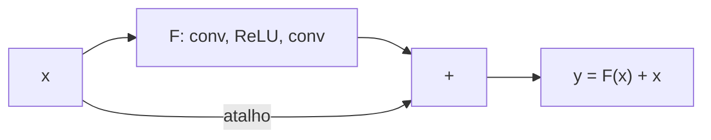

## Passo 1 · Leitura · De LeNet a VGG

A rede da lição anterior é uma miniatura da **LeNet**, dos anos 1990: convolução, pooling, de novo convolução e pooling, e camadas densas no fim, lendo dígitos manuscritos. A receita já estava toda ali. O que faltava era escala, e ela veio em 2012 com a **AlexNet**: a mesma sequência com mais camadas e mais filtros, ReLU no lugar da sigmoide, dropout nas densas, imagens coloridas grandes e treino em placas de vídeo. A partir dela, as redes convolucionais passaram a dominar a classificação de imagens.

A pergunta seguinte foi como crescer com método. A **VGG**, de 2014, respondeu com uma regra só: usar apenas filtros 3 × 3, empilhados em blocos, com um pooling entre os blocos e o número de canais dobrando a cada bloco. Nada de filtros 5 × 5, 7 × 7 ou 11 × 11 como nas antecessoras.

A conta que sustenta a regra é a do campo receptivo da lição anterior. Duas convoluções 3 × 3 seguidas, com stride 1, enxergam $1 + 2 + 2 = 5$ pixels de lado: a mesma região de uma convolução 5 × 5. Com $C$ canais na entrada e na saída, os parâmetros são

$$\underbrace{2\,(9C^2 + C)}_{\text{duas } 3 \times 3} \quad \text{contra} \quad \underbrace{25C^2 + C}_{\text{uma } 5 \times 5}$$

```python
C = 16
duas = 2 * (3 * 3 * C * C + C)    # 4640
uma = 5 * 5 * C * C + C           # 6416
```

A pilha de 3 × 3 cobre a mesma região com 72 % dos pesos ($18C^2$ contra $25C^2$) e ainda ganha uma ReLU no meio, isto é, uma não linearidade a mais. Três convoluções 3 × 3 enxergam 7 × 7 com $27C^2$ pesos no lugar de $49C^2$. Quanto maior o filtro que se quer imitar, maior a economia.

A profundidade virou então o botão principal: as VGG têm 16 ou 19 camadas com pesos. Só que empilhar tem limite. Com algumas dezenas de camadas, as redes desse tipo passaram a treinar **pior** que as mais rasas, e a saída desse impasse é o assunto do passo 4.

## Passo 2 · Previsão · 3 × 3 + 3 × 3 contra 5 × 5

O programa compara pilhas de convoluções 3 × 3 com uma convolução maior, em parâmetros e em campo receptivo, para 16 canais. Leia sem executar e digite o que ele imprime.

### Código
```python
def conv(k, c_in, c_out):
    return k * k * c_in * c_out + c_out


C = 16
print(2 * conv(3, C, C), conv(5, C, C))
print(1 + 2 * (3 - 1), 1 + (5 - 1))
print(3 * conv(3, C, C), conv(7, C, C))
print(1 + 3 * (3 - 1), 1 + (7 - 1))
```

### Dicas
1. `conv(3, 16, 16)` vale $9 \cdot 256 + 16 = 2\,320$.
2. Com stride 1, cada convolução $k \times k$ soma $k - 1$ ao campo receptivo.
3. `conv(7, 16, 16)` vale $49 \cdot 256 + 16$.

### Saída esperada
```text
4640 6416
5 5
6960 12560
7 7
```

## Passo 3 · Exercício · Contar uma pilha VGG
modo: lacunas

Complete as lacunas (`___`) de `parametros_vgg`, que conta os parâmetros de uma pilha de convoluções $k \times k$. A lista `canais` dá o número de canais da entrada e da saída de cada camada: `[3, 16, 16, 32]` descreve três convoluções, 3 → 16, 16 → 16 e 16 → 32.

### Instruções
1. O laço percorre os pares vizinhos da lista: `(canais[0], canais[1])`, `(canais[1], canais[2])` e assim por diante. Uma lista com menos de dois números não tem camada nenhuma, e o total é 0.
2. Cada camada soma os pesos, $k \cdot k \cdot c_\text{in} \cdot c_\text{out}$, e os vieses, um por canal de saída.

### Código inicial
```python
def parametros_vgg(canais, k=3):
    total = 0
    for entrada, saida in zip(___, ___):
        total += ___ + ___
    return total
```

### Solução
```python
def parametros_vgg(canais, k=3):
    total = 0
    for entrada, saida in zip(canais[:-1], canais[1:]):
        total += k * k * entrada * saida + saida
    return total
```

### Dicas
1. `zip(canais[:-1], canais[1:])` emparelha cada número da lista com o seguinte.
2. O filtro é quadrado: são $k \cdot k$ pesos por par de canal de entrada e canal de saída.
3. Há um viés por filtro, e o número de filtros é o de canais de **saída**.

### Verificação
```json
[
  {"id": "uma-camada", "checkpoint": 2, "kind": "call", "function": "parametros_vgg", "args": [[3, 16]], "expected": 448, "name": "Uma convolução 3 × 3 de 3 para 16 canais: 9 · 3 · 16 + 16", "hint": "Pesos k · k · entrada · saída, mais um viés por canal de saída."},
  {"id": "duas-camadas", "checkpoint": 1, "kind": "call", "function": "parametros_vgg", "args": [[3, 16, 16]], "expected": 2768, "name": "Duas camadas: 3 → 16 e 16 → 16", "hint": "Os pares são (3, 16) e (16, 16)."},
  {"id": "tres-camadas", "checkpoint": 1, "kind": "call", "function": "parametros_vgg", "args": [[3, 16, 16, 32]], "expected": 7408, "name": "A lista [3, 16, 16, 32] descreve três convoluções"},
  {"id": "canais-crescentes", "checkpoint": 2, "kind": "call", "function": "parametros_vgg", "args": [[1, 8, 16, 32]], "expected": 5888, "name": "Canais que dobram a cada camada: o viés segue o canal de saída", "hint": "Com entrada 1 e saída 8, são 8 vieses, não 1."},
  {"id": "dois-3x3", "checkpoint": 2, "kind": "call", "function": "parametros_vgg", "args": [[16, 16, 16]], "expected": 4640, "name": "Duas convoluções 3 × 3 com 16 canais: o 4 640 da previsão"},
  {"id": "um-5x5", "checkpoint": 2, "kind": "call", "function": "parametros_vgg", "args": [[16, 16], 5], "expected": 6416, "name": "Uma convolução 5 × 5 com 16 canais: o 6 416 da previsão", "hint": "O filtro tem k · k pesos por par de canais."},
  {"id": "filtro-1x1", "checkpoint": 2, "kind": "call", "function": "parametros_vgg", "args": [[8, 4, 2], 1], "expected": 46, "name": "Com k = 1, cada camada tem entrada · saída + saída parâmetros"},
  {"id": "um-canal-so", "checkpoint": 1, "kind": "call", "function": "parametros_vgg", "args": [[3]], "expected": 0, "name": "Uma lista com um número só não tem camada: 0"},
  {"id": "lista-vazia", "checkpoint": 1, "kind": "call", "function": "parametros_vgg", "args": [[]], "expected": 0, "name": "Lista vazia: 0"},
  {"id": "bloco-largo", "checkpoint": 2, "kind": "call", "function": "parametros_vgg", "args": [[3, 64, 64, 128, 128]], "expected": 260160, "name": "Dois blocos no estilo VGG: 3 → 64 → 64 → 128 → 128"}
]
```

### Soluções erradas
```python name="sem os vieses"
def parametros_vgg(canais, k=3):
    total = 0
    for entrada, saida in zip(canais[:-1], canais[1:]):
        total += k * k * entrada * saida + 0
    return total
```
```python name="k contado uma vez só"
def parametros_vgg(canais, k=3):
    total = 0
    for entrada, saida in zip(canais[:-1], canais[1:]):
        total += k * entrada * saida + saida
    return total
```
```python name="um viés por canal de entrada"
def parametros_vgg(canais, k=3):
    total = 0
    for entrada, saida in zip(canais[:-1], canais[1:]):
        total += k * k * entrada * saida + entrada
    return total
```
```python name="cada canal emparelhado com ele mesmo"
def parametros_vgg(canais, k=3):
    total = 0
    for entrada, saida in zip(canais, canais):
        total += k * k * entrada * saida + saida
    return total
```
```python name="pares pulando uma camada"
def parametros_vgg(canais, k=3):
    total = 0
    for entrada, saida in zip(canais[:-1], canais[2:]):
        total += k * k * entrada * saida + saida
    return total
```
```python name="pesos sem o canal de entrada"
def parametros_vgg(canais, k=3):
    total = 0
    for entrada, saida in zip(canais[:-1], canais[1:]):
        total += k * k * saida + saida
    return total
```

## Passo 4 · Leitura · ResNet: $y = F(x) + x$

Uma rede mais funda deveria ser pelo menos tão boa quanto uma rasa: bastaria às camadas extras copiar a entrada. Na prática, redes convolucionais comuns com dezenas de camadas ficavam piores que as rasas já no conjunto de **treino**. Não era sobreajuste; era a otimização que não chegava lá. Aprender a função identidade com uma pilha de convoluções e ReLUs é difícil, e o gradiente que atravessa muitas camadas é multiplicado tantas vezes que chega fraco às primeiras.

A **ResNet**, de 2015, muda o que cada bloco precisa aprender. A saída do bloco é a entrada somada a uma correção:

$$y = F(x) + x$$



Se a melhor coisa a fazer é não mexer, basta $F$ valer zero, o que os pesos pequenos da inicialização quase já fazem. O efeito sobre o gradiente aparece na derivada do bloco:

$$\frac{\partial y}{\partial x} = \frac{\partial F}{\partial x} + 1$$

O 1 é a derivada do atalho. No backward, o gradiente que chega em $y$ segue por dois caminhos: um passa por $F$ e é multiplicado pela derivada dela; o outro passa direto, multiplicado por 1.

```python
g = ganho * g        # bloco comum: só o caminho de F
g = ganho * g + g    # bloco residual: o caminho de F mais o atalho
```

Suponha blocos lineares que multiplicam o sinal por 0,05, uma $F$ que quase não deixa passar nada. Medido no executor, com um gradiente de norma 2 na saída e 20 blocos: sem o atalho, a norma que chega à entrada é $1{,}9 \cdot 10^{-26}$; com o atalho, 5,31. O atalho é uma estrada sem pedágio para o gradiente, e foi ele que permitiu treinar redes com mais de cem camadas.

A **Inception**, da mesma época, cresceu em outra direção: em vez de escolher um tamanho de filtro, cada bloco aplica ramos em paralelo (1 × 1, 3 × 3, 5 × 5 e pooling) e concatena os mapas no eixo dos canais, com convoluções 1 × 1 antes dos ramos caros para reduzir os canais e a conta.

## Passo 5 · Exercício · O caminho da identidade

Escreva o bloco residual e a função que acompanha a norma do gradiente através de uma pilha de blocos lineares.

### Instruções
1. `bloco_residual(x, F)` recebe um array `x` e uma função `F` e devolve `F(x) + x` num array novo, chamando `F` uma única vez. O `x` recebido não é alterado.
2. `norma_atraves(L, ganho, residual)` começa com o gradiente `g = np.ones(4)` na saída e atravessa `L` blocos de trás para a frente. Sem residual, cada bloco faz `g = ganho * g`.
3. Com `residual=True`, cada bloco soma o caminho do atalho: `g = ganho * g + g`. A função devolve a norma de `g` depois dos `L` blocos, um `float`.

### Código inicial
```python
import numpy as np


def bloco_residual(x, F):
    # Escreva aqui
    pass


def norma_atraves(L, ganho, residual):
    # Escreva aqui
    pass
```

### Solução
```python
import numpy as np


def bloco_residual(x, F):
    return F(x) + x


def norma_atraves(L, ganho, residual):
    g = np.ones(4)
    for _ in range(L):
        if residual:
            g = ganho * g + g
        else:
            g = ganho * g
    return float(np.linalg.norm(g))
```

### Dicas
1. `F(x) + x` cria um array novo; `x += F(x)` mudaria o array de quem chamou.
2. A norma de `np.ones(4)` é 2: com `L = 0`, a função devolve 2.0.
3. `np.linalg.norm(g)` dá a norma; converta com `float`.

### Verificação
```json
[
  {"id": "soma", "checkpoint": 1, "kind": "expr", "setup": "import numpy as np\n_x = np.array([1.0, -2.0, 3.0])\n_c = _x.copy()\n", "expr": "bloco_residual(_x, lambda v: 2.0 * v).tolist()", "expected": [3.0, -6.0, 9.0], "tolerance": 1e-12, "name": "Com F(x) = 2x, a saída é 3x", "hint": "A saída é F(x) + x."},
  {"id": "f-nula", "checkpoint": 1, "kind": "expr", "setup": "import numpy as np\n_x = np.array([1.0, -2.0, 3.0])\n_c = _x.copy()\n", "expr": "bloco_residual(_x, lambda v: np.zeros_like(v)).tolist()", "expected": [1.0, -2.0, 3.0], "tolerance": 1e-12, "name": "Com F nula, o bloco devolve a própria entrada"},
  {"id": "f-quadrado", "checkpoint": 1, "kind": "expr", "setup": "import numpy as np\n_x = np.array([1.0, -2.0, 3.0])\n_c = _x.copy()\n", "expr": "bloco_residual(_x, lambda v: v ** 2).tolist()", "expected": [2.0, 2.0, 12.0], "tolerance": 1e-12, "name": "Com F(x) = x², a saída é x² + x"},
  {"id": "x-intacto", "checkpoint": 1, "kind": "expr", "setup": "import numpy as np\n_x = np.array([1.0, -2.0, 3.0])\n_c = _x.copy()\n_y = bloco_residual(_x, lambda v: 2.0 * v)\n", "expr": "[bool(np.array_equal(_x, _c)), _y is not _x]", "expected": [true, true], "name": "A entrada não é alterada, e a saída é um array novo", "hint": "x += F(x) muda o array de quem chamou."},
  {"id": "uma-chamada", "checkpoint": 1, "kind": "expr", "setup": "import numpy as np\n_x = np.array([1.0, -2.0, 3.0])\n_c = _x.copy()\n_n = []\ndef _F(v):\n    _n.append(1)\n    return 0.5 * v\n_y = bloco_residual(_x, _F)\n", "expr": "len(_n)", "expected": 1, "name": "F é chamada uma única vez"},
  {"id": "matriz", "checkpoint": 1, "kind": "expr", "setup": "import numpy as np\n_m = np.arange(6.0).reshape(2, 3)\n", "expr": "bloco_residual(_m, lambda v: -v + 1.0).tolist()", "expected": [[1.0, 1.0, 1.0], [1.0, 1.0, 1.0]], "tolerance": 1e-12, "name": "Funciona com matrizes: (-x + 1) + x é 1 em toda posição"},
  {"id": "derivada", "checkpoint": 1, "kind": "expr", "setup": "import numpy as np\n_h = 1e-5\n_f = lambda t: float(bloco_residual(np.array([t]), np.tanh)[0])\n_d = (_f(0.3 + _h) - _f(0.3 - _h)) / (2 * _h)\n", "expr": "bool(abs(_d - (1.0 - np.tanh(0.3) ** 2 + 1.0)) < 1e-8)", "expected": true, "name": "A derivada do bloco com F = tanh é a derivada da tanh mais 1", "hint": "O atalho contribui com derivada 1."},
  {"id": "zero-blocos", "checkpoint": 2, "kind": "call", "function": "norma_atraves", "args": [0, 0.5, false], "expected": 2.0, "tolerance": 1e-12, "name": "Sem blocos, a norma é a de np.ones(4): 2.0"},
  {"id": "um-bloco-comum", "checkpoint": 2, "kind": "call", "function": "norma_atraves", "args": [1, 0.5, false], "expected": 1.0, "tolerance": 1e-12, "name": "Um bloco comum com ganho 0,5: norma 1.0"},
  {"id": "tres-blocos-comuns", "checkpoint": 2, "kind": "call", "function": "norma_atraves", "args": [3, 0.5, false], "expected": 0.25, "tolerance": 1e-12, "name": "Três blocos comuns com ganho 0,5: 2 · 0,5³", "hint": "Cada bloco multiplica o gradiente pelo ganho."},
  {"id": "ganho-um", "checkpoint": 2, "kind": "call", "function": "norma_atraves", "args": [10, 1.0, false], "expected": 2.0, "tolerance": 1e-12, "name": "Ganho 1 sem residual: a norma não muda"},
  {"id": "um-bloco-residual", "checkpoint": 3, "kind": "call", "function": "norma_atraves", "args": [1, 0.5, true], "expected": 3.0, "tolerance": 1e-12, "name": "Um bloco residual com ganho 0,5: 2 · 1,5", "hint": "O gradiente soma o caminho de F e o do atalho: ganho * g + g."},
  {"id": "tres-blocos-residuais", "checkpoint": 3, "kind": "call", "function": "norma_atraves", "args": [3, 0.5, true], "expected": 6.75, "tolerance": 1e-12, "name": "Três blocos residuais com ganho 0,5: 2 · 1,5³"},
  {"id": "residual-ganho-zero", "checkpoint": 3, "kind": "call", "function": "norma_atraves", "args": [5, 0.0, true], "expected": 2.0, "tolerance": 1e-12, "name": "Com F nula, o atalho leva o gradiente intacto"},
  {"id": "comum-ganho-zero", "checkpoint": 2, "kind": "call", "function": "norma_atraves", "args": [5, 0.0, false], "expected": 0.0, "tolerance": 1e-12, "name": "Sem atalho e com F nula, nada chega"},
  {"id": "residual-ganho-negativo", "checkpoint": 3, "kind": "call", "function": "norma_atraves", "args": [2, -0.5, true], "expected": 0.5, "tolerance": 1e-12, "name": "Ganho -0,5 com residual: fator 0,5 por bloco"},
  {"id": "vinte-blocos", "checkpoint": 3, "kind": "expr", "setup": "import numpy as np", "expr": "[bool(norma_atraves(20, 0.05, False) < 1e-20), round(norma_atraves(20, 0.05, True), 6)]", "expected": [true, 5.306595], "tolerance": 1e-09, "name": "20 blocos com ganho 0,05: sem atalho o gradiente some; com atalho, chega"},
  {"id": "tipo", "checkpoint": 2, "kind": "expr", "setup": "import numpy as np", "expr": "[type(norma_atraves(2, 0.5, False)).__name__, type(norma_atraves(2, 0.5, True)).__name__]", "expected": ["float", "float"], "name": "A norma é devolvida como float"}
]
```

### Soluções erradas
```python name="F(x) somado duas vezes"
import numpy as np


def bloco_residual(x, F):
    return F(x) + F(x) + x


def norma_atraves(L, ganho, residual):
    g = np.ones(4)
    for _ in range(L):
        if residual:
            g = ganho * g + g
        else:
            g = ganho * g
    return float(np.linalg.norm(g))
```
```python name="bloco sem o atalho"
import numpy as np


def bloco_residual(x, F):
    return F(x)


def norma_atraves(L, ganho, residual):
    g = np.ones(4)
    for _ in range(L):
        if residual:
            g = ganho * g + g
        else:
            g = ganho * g
    return float(np.linalg.norm(g))
```
```python name="atalho multiplicando no lugar de somar"
import numpy as np


def bloco_residual(x, F):
    return F(x) * x


def norma_atraves(L, ganho, residual):
    g = np.ones(4)
    for _ in range(L):
        if residual:
            g = ganho * g + g
        else:
            g = ganho * g
    return float(np.linalg.norm(g))
```
```python name="x alterado no lugar"
import numpy as np


def bloco_residual(x, F):
    x += F(x)
    return x


def norma_atraves(L, ganho, residual):
    g = np.ones(4)
    for _ in range(L):
        if residual:
            g = ganho * g + g
        else:
            g = ganho * g
    return float(np.linalg.norm(g))
```
```python name="sem residual, o ganho não é aplicado"
import numpy as np


def bloco_residual(x, F):
    return F(x) + x


def norma_atraves(L, ganho, residual):
    g = np.ones(4)
    for _ in range(L):
        if residual:
            g = ganho * g + g
        else:
            g = g
    return float(np.linalg.norm(g))
```
```python name="atalho soma 1 no lugar do gradiente"
import numpy as np


def bloco_residual(x, F):
    return F(x) + x


def norma_atraves(L, ganho, residual):
    g = np.ones(4)
    for _ in range(L):
        if residual:
            g = ganho * g + 1.0
        else:
            g = ganho * g
    return float(np.linalg.norm(g))
```
```python name="um bloco a menos"
import numpy as np


def bloco_residual(x, F):
    return F(x) + x


def norma_atraves(L, ganho, residual):
    g = np.ones(4)
    for _ in range(L - 1):
        if residual:
            g = ganho * g + g
        else:
            g = ganho * g
    return float(np.linalg.norm(g))
```
```python name="soma das componentes no lugar da norma"
import numpy as np


def bloco_residual(x, F):
    return F(x) + x


def norma_atraves(L, ganho, residual):
    g = np.ones(4)
    for _ in range(L):
        if residual:
            g = ganho * g + g
        else:
            g = ganho * g
    return float(g.sum())
```
```python name="com residual, o caminho de F é esquecido"
import numpy as np


def bloco_residual(x, F):
    return F(x) + x


def norma_atraves(L, ganho, residual):
    g = np.ones(4)
    for _ in range(L):
        if residual:
            g = g
        else:
            g = ganho * g
    return float(np.linalg.norm(g))
```

## Passo 6 · Leitura · Transfer learning e transformers de visão

Treinar uma rede grande do zero pede muitas imagens rotuladas e muito tempo de máquina. Quase ninguém faz isso: parte-se de uma rede **pré-treinada** numa coleção grande e variada e adapta-se ao problema novo. É o **transfer learning**. Ele funciona porque as camadas aprendem coisas de generalidade diferente. As primeiras detectam bordas, cores e texturas, como os filtros que apareceram na lição anterior, e servem para quase qualquer imagem. As últimas combinam tudo em padrões próprios das classes do treino original.

Daí saem três estratégias, da mais barata à mais cara:

- **só a cabeça:** congelar a rede inteira e treinar apenas uma camada densa nova no fim, para as classes novas;
- **últimas camadas:** além da cabeça, liberar os últimos blocos, com taxa de aprendizado pequena;
- **tudo:** usar os pesos pré-treinados só como inicialização e ajustar a rede inteira.

A escolha depende de quantos exemplos existem e de quão parecidas as imagens novas são com as do treino original. Com poucos exemplos, ajustar tudo sobreajusta: há parâmetros demais para dados de menos. Com imagens muito diferentes, os padrões das últimas camadas servem pouco e vale liberá-las.

```python
for nome in ("bloco1", "bloco2", "bloco3"):
    congelado[nome] = True      # o otimizador pula estes parâmetros
```

Um cuidado silencioso: a entrada precisa da **mesma normalização** da rede base, com a mesma média e o mesmo desvio por canal e a mesma faixa de valores. Com outra normalização, nada dá erro, e os filtros congelados recebem números que nunca viram.

Os **transformers de visão** (ViT) trocam a convolução por atenção: a imagem é cortada em retalhos, cada retalho vira um vetor, e a rede os trata como os tokens do módulo 7. Sem a vizinhança embutida no filtro, precisam de mais dados ou de pré-treino maior, e o transfer learning fica ainda mais central.

Por fim, por que este curso treina em 8 × 8. A convolução da lição anterior faz $64 \cdot 9 \cdot 8 = 4\,608$ multiplicações por imagem. A primeira camada de uma rede para imagens coloridas 224 × 224, com 64 filtros 3 × 3, faz $224^2 \cdot 27 \cdot 64 \approx 87$ milhões: quase 19 mil vezes mais, numa camada só.

## Passo 7 · Exercício · Estratégia de transfer

Escreva `estrategia(n_exemplos, similaridade)`, que escolhe a estratégia de transfer learning pela tabela desta lição:

| exemplos | similaridade `"alta"` | similaridade `"baixa"` |
|---|---|---|
| menos de 1 000 | `"cabeca"` | `"ultimas"` |
| de 1 000 a 99 999 | `"ultimas"` | `"tudo"` |
| 100 000 ou mais | `"tudo"` | `"tudo"` |

### Instruções
1. Com similaridade `"alta"`, devolva `"cabeca"`, `"ultimas"` ou `"tudo"` conforme a faixa de `n_exemplos`; os limites 1 000 e 100 000 pertencem à faixa de cima.
2. Com similaridade `"baixa"`, a estratégia sobe um degrau: `"ultimas"` com menos de 1 000 exemplos e `"tudo"` a partir de 1 000.
3. Levante `ValueError` se `similaridade` não for `"alta"` nem `"baixa"`, ou se `n_exemplos` for menor que 1.

### Código inicial
```python
def estrategia(n_exemplos, similaridade):
    # Escreva aqui
    pass
```

### Solução
```python
def estrategia(n_exemplos, similaridade):
    if similaridade not in ("alta", "baixa"):
        raise ValueError("similaridade deve ser 'alta' ou 'baixa'")
    if n_exemplos < 1:
        raise ValueError("n_exemplos deve ser positivo")
    degraus = ["cabeca", "ultimas", "tudo"]
    if n_exemplos < 1000:
        degrau = 0
    elif n_exemplos < 100000:
        degrau = 1
    else:
        degrau = 2
    if similaridade == "baixa":
        degrau = min(degrau + 1, 2)
    return degraus[degrau]
```

### Dicas
1. Valide os dois argumentos antes de consultar a tabela.
2. As três estratégias formam uma escada; a similaridade baixa sobe um degrau, sem passar do último.
3. Use `<` nos limites: 1 000 exemplos já caem na faixa do meio.

### Verificação
```json
[
  {"id": "poucos-alta", "checkpoint": 1, "kind": "call", "function": "estrategia", "args": [400, "alta"], "expected": "cabeca", "name": "400 exemplos e similaridade alta: só a cabeça"},
  {"id": "medios-alta", "checkpoint": 1, "kind": "call", "function": "estrategia", "args": [5000, "alta"], "expected": "ultimas", "name": "5 000 exemplos e similaridade alta: últimas camadas"},
  {"id": "muitos-alta", "checkpoint": 1, "kind": "call", "function": "estrategia", "args": [250000, "alta"], "expected": "tudo", "name": "250 000 exemplos e similaridade alta: tudo"},
  {"id": "limite-1000", "checkpoint": 1, "kind": "call", "function": "estrategia", "args": [1000, "alta"], "expected": "ultimas", "name": "1 000 exemplos já estão na faixa do meio", "hint": "Use < 1000 para a primeira faixa."},
  {"id": "limite-999", "checkpoint": 1, "kind": "call", "function": "estrategia", "args": [999, "alta"], "expected": "cabeca", "name": "999 exemplos ainda estão na primeira faixa"},
  {"id": "limite-100000", "checkpoint": 1, "kind": "call", "function": "estrategia", "args": [100000, "alta"], "expected": "tudo", "name": "100 000 exemplos já estão na última faixa"},
  {"id": "limite-99999", "checkpoint": 1, "kind": "call", "function": "estrategia", "args": [99999, "alta"], "expected": "ultimas", "name": "99 999 exemplos ainda estão na faixa do meio"},
  {"id": "um-exemplo", "checkpoint": 1, "kind": "call", "function": "estrategia", "args": [1, "alta"], "expected": "cabeca", "name": "1 exemplo é válido: só a cabeça"},
  {"id": "poucos-baixa", "checkpoint": 2, "kind": "call", "function": "estrategia", "args": [400, "baixa"], "expected": "ultimas", "name": "400 exemplos e similaridade baixa: últimas camadas", "hint": "A similaridade baixa sobe um degrau."},
  {"id": "medios-baixa", "checkpoint": 2, "kind": "call", "function": "estrategia", "args": [5000, "baixa"], "expected": "tudo", "name": "5 000 exemplos e similaridade baixa: tudo"},
  {"id": "muitos-baixa", "checkpoint": 2, "kind": "call", "function": "estrategia", "args": [250000, "baixa"], "expected": "tudo", "name": "250 000 exemplos e similaridade baixa: tudo (não há degrau acima)"},
  {"id": "similaridade-invalida", "checkpoint": 3, "kind": "expr", "setup": "", "expr": "estrategia(400, 'media')", "raises": "ValueError", "name": "Similaridade desconhecida levanta ValueError"},
  {"id": "similaridade-invalida-muitos", "checkpoint": 3, "kind": "expr", "setup": "", "expr": "estrategia(250000, 'Alta')", "raises": "ValueError", "name": "'Alta' com maiúscula não é aceita, mesmo com muitos exemplos"},
  {"id": "zero-exemplos", "checkpoint": 3, "kind": "expr", "setup": "", "expr": "estrategia(0, 'alta')", "raises": "ValueError", "name": "0 exemplos levanta ValueError"},
  {"id": "exemplos-negativos", "checkpoint": 3, "kind": "expr", "setup": "", "expr": "estrategia(-5, 'baixa')", "raises": "ValueError", "name": "Número negativo de exemplos levanta ValueError"}
]
```

### Soluções erradas
```python name="faixas invertidas: poucos exemplos ajustam tudo"
def estrategia(n_exemplos, similaridade):
    if similaridade not in ("alta", "baixa"):
        raise ValueError("similaridade deve ser 'alta' ou 'baixa'")
    if n_exemplos < 1:
        raise ValueError("n_exemplos deve ser positivo")
    degraus = ["tudo", "ultimas", "cabeca"]
    if n_exemplos < 1000:
        degrau = 0
    elif n_exemplos < 100000:
        degrau = 1
    else:
        degrau = 2
    if similaridade == "baixa":
        degrau = min(degrau + 1, 2)
    return degraus[degrau]
```
```python name="limite de 1 000 na faixa de baixo"
def estrategia(n_exemplos, similaridade):
    if similaridade not in ("alta", "baixa"):
        raise ValueError("similaridade deve ser 'alta' ou 'baixa'")
    if n_exemplos < 1:
        raise ValueError("n_exemplos deve ser positivo")
    degraus = ["cabeca", "ultimas", "tudo"]
    if n_exemplos <= 1000:
        degrau = 0
    elif n_exemplos < 100000:
        degrau = 1
    else:
        degrau = 2
    if similaridade == "baixa":
        degrau = min(degrau + 1, 2)
    return degraus[degrau]
```
```python name="limite de 100 000 na faixa do meio"
def estrategia(n_exemplos, similaridade):
    if similaridade not in ("alta", "baixa"):
        raise ValueError("similaridade deve ser 'alta' ou 'baixa'")
    if n_exemplos < 1:
        raise ValueError("n_exemplos deve ser positivo")
    degraus = ["cabeca", "ultimas", "tudo"]
    if n_exemplos < 1000:
        degrau = 0
    elif n_exemplos <= 100000:
        degrau = 1
    else:
        degrau = 2
    if similaridade == "baixa":
        degrau = min(degrau + 1, 2)
    return degraus[degrau]
```
```python name="similaridade ignorada"
def estrategia(n_exemplos, similaridade):
    if similaridade not in ("alta", "baixa"):
        raise ValueError("similaridade deve ser 'alta' ou 'baixa'")
    if n_exemplos < 1:
        raise ValueError("n_exemplos deve ser positivo")
    degraus = ["cabeca", "ultimas", "tudo"]
    if n_exemplos < 1000:
        degrau = 0
    elif n_exemplos < 100000:
        degrau = 1
    else:
        degrau = 2
    if similaridade == "nenhuma":
        degrau = min(degrau + 1, 2)
    return degraus[degrau]
```
```python name="alta e baixa trocadas"
def estrategia(n_exemplos, similaridade):
    if similaridade not in ("alta", "baixa"):
        raise ValueError("similaridade deve ser 'alta' ou 'baixa'")
    if n_exemplos < 1:
        raise ValueError("n_exemplos deve ser positivo")
    degraus = ["cabeca", "ultimas", "tudo"]
    if n_exemplos < 1000:
        degrau = 0
    elif n_exemplos < 100000:
        degrau = 1
    else:
        degrau = 2
    if similaridade == "alta":
        degrau = min(degrau + 1, 2)
    return degraus[degrau]
```
```python name="similaridade desconhecida tratada como alta"
def estrategia(n_exemplos, similaridade):
    similaridade = similaridade
    if n_exemplos < 1:
        raise ValueError("n_exemplos deve ser positivo")
    degraus = ["cabeca", "ultimas", "tudo"]
    if n_exemplos < 1000:
        degrau = 0
    elif n_exemplos < 100000:
        degrau = 1
    else:
        degrau = 2
    if similaridade == "baixa":
        degrau = min(degrau + 1, 2)
    return degraus[degrau]
```
```python name="número de exemplos não validado"
def estrategia(n_exemplos, similaridade):
    if similaridade not in ("alta", "baixa"):
        raise ValueError("similaridade deve ser 'alta' ou 'baixa'")
    n_exemplos = n_exemplos
    degraus = ["cabeca", "ultimas", "tudo"]
    if n_exemplos < 1000:
        degrau = 0
    elif n_exemplos < 100000:
        degrau = 1
    else:
        degrau = 2
    if similaridade == "baixa":
        degrau = min(degrau + 1, 2)
    return degraus[degrau]
```
```python name="similaridade baixa passa do último degrau"
def estrategia(n_exemplos, similaridade):
    if similaridade not in ("alta", "baixa"):
        raise ValueError("similaridade deve ser 'alta' ou 'baixa'")
    if n_exemplos < 1:
        raise ValueError("n_exemplos deve ser positivo")
    degraus = ["cabeca", "ultimas", "tudo"]
    if n_exemplos < 1000:
        degrau = 0
    elif n_exemplos < 100000:
        degrau = 1
    else:
        degrau = 2
    if similaridade == "baixa":
        degrau = degrau + 1
    return degraus[degrau]
```

## Passo 8 · Quiz · Profundidade e residual

### Pergunta
Uma pilha de 20 blocos lineares multiplica o sinal por 0,05 em cada bloco. Um gradiente de norma 2 entra pela saída. Sem atalhos, chega à entrada com norma $1{,}9 \cdot 10^{-26}$; com atalhos, 5,31. O que explica a diferença?

- [ ] O atalho aumenta o ganho de cada bloco de 0,05 para 0,5
- [x] Com o atalho, a derivada de cada bloco é $0{,}05 + 1$, e o fator por bloco passa de 0,05 para 1,05
- [ ] O atalho corta a rede pela metade, e o gradiente atravessa só 10 blocos
- [ ] Sem atalhos houve sobreajuste, e o gradiente some quando a rede decora o treino

> A derivada de $y = F(x) + x$ é a de $F$ mais 1: o gradiente é multiplicado por $1{,}05$ em cada bloco, e $2 \cdot 1{,}05^{20}$ dá o valor medido. O ganho de $F$ continua 0,05; nenhum bloco é pulado; e o gradiente que some é um problema de otimização, que aparece já no treino, não de sobreajuste.

### Pergunta
Num bloco residual, `F` leva 16 canais a 32, e a soma falha:

```text
ValueError: operands could not be broadcast together with shapes (2,32,4,4) (2,16,4,4)
```

Qual conserto mantém a ideia do bloco?

- [ ] Tirar o atalho deste bloco e devolver só `F(x)`
- [ ] Trocar a soma por um produto, que aceita formas diferentes
- [ ] Repetir a soma só nos 16 primeiros canais de `F(x)` e descartar os outros
- [x] Passar `x` por uma convolução 1 × 1 de 16 para 32 canais no atalho, para que as duas parcelas tenham a mesma forma

> A soma $F(x) + x$ exige formas iguais; quando o bloco muda o número de canais, o atalho ganha uma projeção 1 × 1 que só ajusta os canais. Tirar o atalho devolve o problema do gradiente; o produto falha com as mesmas formas e não tem derivada 1 pelo atalho; descartar canais joga fora metade do que `F` calculou.

### Pergunta
Uma equipe tem 400 radiografias rotuladas e uma rede pré-treinada em fotos do dia a dia. Pela tabela da lição (poucos exemplos, similaridade baixa), o que fazer, e com que cuidado?

- [x] Treinar a cabeça e liberar as últimas camadas, normalizando as radiografias com a mesma média e o mesmo desvio usados no treino da rede base
- [ ] Ajustar a rede inteira com taxa alta, porque as imagens são diferentes das originais
- [ ] Treinar só a cabeça e normalizar as radiografias com a média delas mesmas, que é mais fiel aos dados
- [ ] Treinar do zero, porque transfer learning só serve para imagens parecidas com as originais

> Com menos de 1 000 exemplos e similaridade baixa, a tabela manda liberar as últimas camadas, e a entrada precisa da normalização da rede base. Ajustar tudo com 400 imagens sobreajusta; trocar a normalização entrega aos filtros congelados números que eles nunca viram; e as primeiras camadas (bordas, texturas) transferem mesmo entre domínios diferentes.
