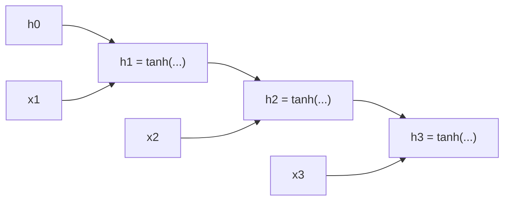

## Passo 1 · Leitura · Um estado que carrega o passado

O MLP de linguagem enxerga exatamente `bloco` caracteres. O que saiu da janela não existe para ele, e aumentar a janela aumenta a primeira camada. Uma **rede recorrente** (RNN) troca a janela por uma memória: um vetor $h$, o **estado escondido**, que é atualizado a cada caractere lido e passado adiante.

A cada passo de tempo $t$, a rede recebe a entrada $x_t$ e o estado anterior $h_{t-1}$, e produz o estado novo:

$$h_t = \tanh(x_t W_{xh} + h_{t-1} W_{hh} + b)$$

São três parâmetros: $W_{xh}$, de forma $(D, H)$, leva a entrada ao estado; $W_{hh}$, de forma $(H, H)$, leva o estado anterior ao novo; e $b$, de forma $(H,)$. Os **mesmos** três são usados em todos os passos. Desenrolada no tempo, a rede parece uma rede profunda com uma camada por caractere, todas com os mesmos pesos:



Duas consequências. O número de parâmetros não depende do comprimento da sequência: com $D = 21$ e $H = 32$ são $21 \cdot 32 + 32 \cdot 32 + 32 = 1\,728$, para 3 caracteres ou para 300. E $h_3$ depende de $x_1$, pelo caminho $h_1 \to h_2 \to h_3$: em princípio, a rede pode usar qualquer coisa que já leu.

Nesta lição, uma sequência em lote é um array com o **tempo no primeiro eixo**:

```python
import numpy as np

T, n, D, H = 5, 2, 3, 4            # passos, exemplos, entrada, estado
X_seq = np.zeros((T, n, D))        # X_seq[t]: as entradas do passo t, forma (n, D)
h0 = np.zeros((n, H))              # um estado inicial por exemplo
# hs terá forma (T, n, H): hs[t] é o estado depois de ler X_seq[t]
print(X_seq[0].shape, h0.shape)    # (2, 3) (2, 4)
```

O estado inicial $h_0$ costuma ser zero: a rede ainda não leu nada. O preço da memória aparece no treino. O gradiente precisa voltar pelo mesmo caminho por onde a informação veio, passo a passo, e esse caminho longo é a origem do problema mais conhecido das RNNs, que você vai medir ainda nesta lição.

## Passo 2 · Previsão · Três passos escalares

Uma RNN de uma unidade só, com pesos escritos à mão: $w_{xh} = 1$, $w_{hh} = 2$, $b = 0$. A entrada é zero em todos os passos, menos no segundo. Para a conta, use $\tanh(0{,}5) \approx 0{,}4621$, $\tanh(0{,}9242) \approx 0{,}7279$ e $\tanh(1{,}4558) \approx 0{,}8968$. Escreva a saída antes de rodar.

### Código

```python
import math

w_xh, w_hh, b = 1.0, 2.0, 0.0
xs = [0.0, 0.5, 0.0, 0.0]

h = 0.0
for t, x in enumerate(xs):
    h = math.tanh(x * w_xh + h * w_hh + b)
    print(t + 1, round(h, 4))
```

### Dicas

1. No primeiro passo, a entrada e o estado anterior são zero.
2. Do terceiro passo em diante a entrada é zero, mas o estado anterior não: ele entra multiplicado por 2.
3. O estado continua mudando depois que a entrada acabou. É a memória da rede.

### Saída esperada

```text
1 0.0
2 0.4621
3 0.7279
4 0.8968
```

## Passo 3 · Exercício · rnn_forward(params, X_seq, h0)

modo: lacunas

Complete o forward da RNN. `params` é um dicionário com `"Wxh"` (forma `(D, H)`), `"Whh"` (`(H, H)`) e `"b"` (`(H,)`); `X_seq` tem forma `(T, n, D)` e `h0`, `(n, H)`. A função devolve `hs`, de forma `(T, n, H)`, e um `cache` com o que o backward vai precisar.

### Instruções

1. Complete a entrada do passo `t`: a fatia de `X_seq` daquele passo, que multiplica `Wxh`.
2. Complete o estado que multiplica `Whh`: o estado do passo anterior, que no primeiro passo é `h0`.
3. Complete o que é guardado em `hs[t]`: o estado novo, depois da tanh.

### Código inicial

```python
import numpy as np


def rnn_forward(params, X_seq, h0):
    Wxh, Whh, b = params["Wxh"], params["Whh"], params["b"]
    T = X_seq.shape[0]
    hs = np.zeros((T,) + h0.shape)
    h = h0
    for t in range(T):
        h = np.tanh(___ @ Wxh + ___ @ Whh + b)
        hs[t] = ___
    cache = (params, X_seq, h0, hs)
    return hs, cache
```

### Solução

```python
import numpy as np


def rnn_forward(params, X_seq, h0):
    Wxh, Whh, b = params["Wxh"], params["Whh"], params["b"]
    T = X_seq.shape[0]
    hs = np.zeros((T,) + h0.shape)
    h = h0
    for t in range(T):
        h = np.tanh(X_seq[t] @ Wxh + h @ Whh + b)
        hs[t] = h
    cache = (params, X_seq, h0, hs)
    return hs, cache
```

### Dicas

1. A variável `h` começa em `h0` e é reatribuída a cada volta do laço: antes da conta, ela ainda guarda o estado anterior.
2. `X_seq[t]` tem forma `(n, D)`, e `X_seq[t] @ Wxh` tem forma `(n, H)`, a mesma de `h @ Whh`.
3. `hs[t]` é o estado **depois** de ler `X_seq[t]`.

### Verificação

```json
[
  {"id": "escalar", "checkpoint": 3, "kind": "expr", "setup": "import numpy as np\n_params = {\"Wxh\": np.array([[1.0]]), \"Whh\": np.array([[2.0]]), \"b\": np.array([0.0])}\n_X = np.array([[[0.0]], [[0.5]], [[0.0]], [[0.0]]])\n_h0 = np.zeros((1, 1))\n_chaves = [\"Wxh\", \"Whh\", \"b\"]\n_hs, _cache = rnn_forward(_params, _X, _h0)", "expr": "_hs.ravel().tolist()", "expected": [0.0, 0.46211715726000974, 0.7278944044432927, 0.8968316027525474], "tolerance": 1e-12, "name": "A RNN de uma unidade do passo anterior: os quatro estados", "hint": "São os valores da Previsão, sem arredondar: 0, tanh(0,5), tanh(2 · h2), tanh(2 · h3)."},
  {"id": "forma", "checkpoint": 3, "kind": "expr", "setup": "import numpy as np\n_rng = np.random.default_rng(0)\n_T, _n, _D, _H = 4, 2, 2, 3\n_params = {\"Wxh\": _rng.normal(0, 1, (_D, _H)), \"Whh\": _rng.normal(0, 1, (_H, _H)), \"b\": _rng.normal(0, 1, _H)}\n_X = _rng.normal(0, 1, (_T, _n, _D))\n_h0 = _rng.normal(0, 1, (_n, _H))\n_chaves = [\"Wxh\", \"Whh\", \"b\"]\n_hs, _cache = rnn_forward(_params, _X, _h0)", "expr": "list(_hs.shape)", "expected": [4, 2, 3], "name": "Com T = 4, n = 2 e H = 3, hs tem forma (T, n, H)"},
  {"id": "primeiro-passo-usa-h0", "checkpoint": 2, "kind": "expr", "setup": "import numpy as np\n_rng = np.random.default_rng(0)\n_T, _n, _D, _H = 4, 2, 2, 3\n_params = {\"Wxh\": _rng.normal(0, 1, (_D, _H)), \"Whh\": _rng.normal(0, 1, (_H, _H)), \"b\": _rng.normal(0, 1, _H)}\n_X = _rng.normal(0, 1, (_T, _n, _D))\n_h0 = _rng.normal(0, 1, (_n, _H))\n_chaves = [\"Wxh\", \"Whh\", \"b\"]\n_hs, _cache = rnn_forward(_params, _X, _h0)", "expr": "bool(np.allclose(_hs[0], np.tanh(_X[0] @ _params['Wxh'] + _h0 @ _params['Whh'] + _params['b']), atol=1e-12))", "expected": true, "name": "Com h0 diferente de zero, o primeiro estado usa h0", "hint": "No passo 0, o estado anterior é h0, não uma linha de hs."},
  {"id": "segundo-passo", "checkpoint": 2, "kind": "expr", "setup": "import numpy as np\n_rng = np.random.default_rng(0)\n_T, _n, _D, _H = 4, 2, 2, 3\n_params = {\"Wxh\": _rng.normal(0, 1, (_D, _H)), \"Whh\": _rng.normal(0, 1, (_H, _H)), \"b\": _rng.normal(0, 1, _H)}\n_X = _rng.normal(0, 1, (_T, _n, _D))\n_h0 = _rng.normal(0, 1, (_n, _H))\n_chaves = [\"Wxh\", \"Whh\", \"b\"]\n_hs, _cache = rnn_forward(_params, _X, _h0)", "expr": "bool(np.allclose(_hs[1], np.tanh(_X[1] @ _params['Wxh'] + _hs[0] @ _params['Whh'] + _params['b']), atol=1e-12))", "expected": true, "name": "O segundo estado usa a entrada do passo 1 e o estado do passo 0", "hint": "Cada passo lê a sua fatia de X_seq e o estado que acabou de ser calculado."},
  {"id": "ultimo-estado", "checkpoint": 3, "kind": "expr", "setup": "import numpy as np\n_rng = np.random.default_rng(0)\n_T, _n, _D, _H = 4, 2, 2, 3\n_params = {\"Wxh\": _rng.normal(0, 1, (_D, _H)), \"Whh\": _rng.normal(0, 1, (_H, _H)), \"b\": _rng.normal(0, 1, _H)}\n_X = _rng.normal(0, 1, (_T, _n, _D))\n_h0 = _rng.normal(0, 1, (_n, _H))\n_chaves = [\"Wxh\", \"Whh\", \"b\"]\n_hs, _cache = rnn_forward(_params, _X, _h0)", "expr": "_hs[-1].tolist()", "expected": [[-0.8344581547594965, 0.04008678367392394, -0.9441414552672556], [0.057757274886983685, -0.9189373309422224, 0.9137287026653891]], "tolerance": 1e-12, "name": "Valores do último estado numa sequência de 4 passos"},
  {"id": "referencia", "checkpoint": 3, "kind": "expr", "setup": "import numpy as np\n_rng = np.random.default_rng(2)\n_T, _n, _D, _H = 5, 3, 4, 4\n_params = {\"Wxh\": _rng.normal(0, 1, (_D, _H)), \"Whh\": _rng.normal(0, 1, (_H, _H)), \"b\": _rng.normal(0, 1, _H)}\n_X = _rng.normal(0, 1, (_T, _n, _D))\n_h0 = _rng.normal(0, 1, (_n, _H))\n_chaves = [\"Wxh\", \"Whh\", \"b\"]\ndef _ref(p, X, h0):\n    T, n = X.shape[0], X.shape[1]\n    S = np.zeros((T, n, h0.shape[1]))\n    for i in range(n):\n        h = h0[i]\n        for t in range(T):\n            h = np.tanh(p[\"Wxh\"].T @ X[t, i] + p[\"Whh\"].T @ h + p[\"b\"])\n            S[t, i] = h\n    return S\n_hs, _cache = rnn_forward(_params, _X, _h0)", "expr": "bool(np.allclose(_hs, _ref(_params, _X, _h0), atol=1e-12))", "expected": true, "name": "T = 5, n = 3, D = H = 4: todos os estados iguais aos da referência", "hint": "A referência processa um exemplo por vez, na ordem do tempo. Com D = H, trocar a entrada pelo estado não dá erro de forma."},
  {"id": "um-passo", "checkpoint": 1, "kind": "expr", "setup": "import numpy as np\n_rng = np.random.default_rng(0)\n_T, _n, _D, _H = 4, 2, 2, 3\n_params = {\"Wxh\": _rng.normal(0, 1, (_D, _H)), \"Whh\": _rng.normal(0, 1, (_H, _H)), \"b\": _rng.normal(0, 1, _H)}\n_X = _rng.normal(0, 1, (_T, _n, _D))\n_h0 = _rng.normal(0, 1, (_n, _H))\n_chaves = [\"Wxh\", \"Whh\", \"b\"]\n_hs, _cache = rnn_forward(_params, _X[:1], _h0)", "expr": "[list(_hs.shape), bool(np.allclose(_hs[0], np.tanh(_X[0] @ _params['Wxh'] + _h0 @ _params['Whh'] + _params['b']), atol=1e-12))]", "expected": [[1, 2, 3], true], "name": "Uma sequência de um passo só"},
  {"id": "ordem-do-tempo", "checkpoint": 1, "kind": "expr", "setup": "import numpy as np\n_rng = np.random.default_rng(0)\n_T, _n, _D, _H = 4, 2, 2, 3\n_params = {\"Wxh\": _rng.normal(0, 1, (_D, _H)), \"Whh\": _rng.normal(0, 1, (_H, _H)), \"b\": _rng.normal(0, 1, _H)}\n_X = _rng.normal(0, 1, (_T, _n, _D))\n_h0 = _rng.normal(0, 1, (_n, _H))\n_chaves = [\"Wxh\", \"Whh\", \"b\"]\n_hs, _cache = rnn_forward(_params, _X, _h0)\n_X2 = _X.copy()\n_X2[-1] = _X2[-1] + 1.0\n_hs2, _c2 = rnn_forward(_params, _X2, _h0)", "expr": "[bool(np.array_equal(_hs2[:-1], _hs[:-1])), bool(not np.allclose(_hs2[-1], _hs[-1]))]", "expected": [true, true], "name": "Mudar a última entrada só muda o último estado", "hint": "O estado do passo t depende das entradas até t, nunca das seguintes."},
  {"id": "memoria", "checkpoint": 2, "kind": "expr", "setup": "import numpy as np\n_rng = np.random.default_rng(0)\n_T, _n, _D, _H = 4, 2, 2, 3\n_params = {\"Wxh\": _rng.normal(0, 1, (_D, _H)), \"Whh\": _rng.normal(0, 1, (_H, _H)), \"b\": _rng.normal(0, 1, _H)}\n_X = _rng.normal(0, 1, (_T, _n, _D))\n_h0 = _rng.normal(0, 1, (_n, _H))\n_chaves = [\"Wxh\", \"Whh\", \"b\"]\n_hs, _cache = rnn_forward(_params, _X, _h0)\n_X2 = _X.copy()\n_X2[0] = _X2[0] + 1.0\n_hs2, _c2 = rnn_forward(_params, _X2, _h0)", "expr": "[bool(not np.allclose(_hs2[t], _hs[t])) for t in range(4)]", "expected": [true, true, true, true], "name": "Mudar a primeira entrada muda todos os estados seguintes", "hint": "A primeira entrada chega ao último estado pelo caminho h1, h2, h3."},
  {"id": "exemplos-independentes", "checkpoint": 3, "kind": "expr", "setup": "import numpy as np\n_rng = np.random.default_rng(0)\n_T, _n, _D, _H = 4, 2, 2, 3\n_params = {\"Wxh\": _rng.normal(0, 1, (_D, _H)), \"Whh\": _rng.normal(0, 1, (_H, _H)), \"b\": _rng.normal(0, 1, _H)}\n_X = _rng.normal(0, 1, (_T, _n, _D))\n_h0 = _rng.normal(0, 1, (_n, _H))\n_chaves = [\"Wxh\", \"Whh\", \"b\"]\n_hs, _cache = rnn_forward(_params, _X, _h0)\n_hs1, _c1 = rnn_forward(_params, _X[:, 1:2], _h0[1:2])", "expr": "bool(np.allclose(_hs1[:, 0], _hs[:, 1], atol=1e-12))", "expected": true, "name": "O segundo exemplo do lote dá o mesmo resultado sozinho"},
  {"id": "entradas-intactas", "checkpoint": 3, "kind": "expr", "setup": "import numpy as np\n_rng = np.random.default_rng(0)\n_T, _n, _D, _H = 4, 2, 2, 3\n_params = {\"Wxh\": _rng.normal(0, 1, (_D, _H)), \"Whh\": _rng.normal(0, 1, (_H, _H)), \"b\": _rng.normal(0, 1, _H)}\n_X = _rng.normal(0, 1, (_T, _n, _D))\n_h0 = _rng.normal(0, 1, (_n, _H))\n_chaves = [\"Wxh\", \"Whh\", \"b\"]\n_copias = {k: v.copy() for k, v in _params.items()}\n_Xc, _h0c = _X.copy(), _h0.copy()\n_hs, _cache = rnn_forward(_params, _X, _h0)", "expr": "[all(bool(np.array_equal(_params[k], _copias[k])) for k in _chaves), bool(np.array_equal(_X, _Xc)), bool(np.array_equal(_h0, _h0c))]", "expected": [true, true, true], "name": "params, X_seq e h0 não são alterados"}
]
```

### Soluções erradas

```python name="entrada sempre do primeiro passo"
import numpy as np


def rnn_forward(params, X_seq, h0):
    Wxh, Whh, b = params["Wxh"], params["Whh"], params["b"]
    T = X_seq.shape[0]
    hs = np.zeros((T,) + h0.shape)
    h = h0
    for t in range(T):
        h = np.tanh(X_seq[0] @ Wxh + h @ Whh + b)
        hs[t] = h
    cache = (params, X_seq, h0, hs)
    return hs, cache
```

```python name="estado anterior sempre h0"
import numpy as np


def rnn_forward(params, X_seq, h0):
    Wxh, Whh, b = params["Wxh"], params["Whh"], params["b"]
    T = X_seq.shape[0]
    hs = np.zeros((T,) + h0.shape)
    h = h0
    for t in range(T):
        h = np.tanh(X_seq[t] @ Wxh + h0 @ Whh + b)
        hs[t] = h
    cache = (params, X_seq, h0, hs)
    return hs, cache
```

```python name="estado anterior lido de hs[t - 1], ignorando h0"
import numpy as np


def rnn_forward(params, X_seq, h0):
    Wxh, Whh, b = params["Wxh"], params["Whh"], params["b"]
    T = X_seq.shape[0]
    hs = np.zeros((T,) + h0.shape)
    h = h0
    for t in range(T):
        h = np.tanh(X_seq[t] @ Wxh + hs[t - 1] @ Whh + b)
        hs[t] = h
    cache = (params, X_seq, h0, hs)
    return hs, cache
```

```python name="sequência percorrida de trás para frente"
import numpy as np


def rnn_forward(params, X_seq, h0):
    Wxh, Whh, b = params["Wxh"], params["Whh"], params["b"]
    T = X_seq.shape[0]
    hs = np.zeros((T,) + h0.shape)
    h = h0
    for t in range(T):
        h = np.tanh(X_seq[T - 1 - t] @ Wxh + h @ Whh + b)
        hs[t] = h
    cache = (params, X_seq, h0, hs)
    return hs, cache
```

```python name="guarda o estado inicial no lugar do estado novo"
import numpy as np


def rnn_forward(params, X_seq, h0):
    Wxh, Whh, b = params["Wxh"], params["Whh"], params["b"]
    T = X_seq.shape[0]
    hs = np.zeros((T,) + h0.shape)
    h = h0
    for t in range(T):
        h = np.tanh(X_seq[t] @ Wxh + h @ Whh + b)
        hs[t] = h0
    cache = (params, X_seq, h0, hs)
    return hs, cache
```

```python name="entrada e estado trocados"
import numpy as np


def rnn_forward(params, X_seq, h0):
    Wxh, Whh, b = params["Wxh"], params["Whh"], params["b"]
    T = X_seq.shape[0]
    hs = np.zeros((T,) + h0.shape)
    h = h0
    for t in range(T):
        h = np.tanh(h @ Wxh + X_seq[t] @ Whh + b)
        hs[t] = h
    cache = (params, X_seq, h0, hs)
    return hs, cache
```

```python name="guarda o estado do passo anterior"
import numpy as np


def rnn_forward(params, X_seq, h0):
    Wxh, Whh, b = params["Wxh"], params["Whh"], params["b"]
    T = X_seq.shape[0]
    hs = np.zeros((T,) + h0.shape)
    h = h0
    for t in range(T):
        h = np.tanh(X_seq[t] @ Wxh + h @ Whh + b)
        hs[t] = hs[t - 1]
    cache = (params, X_seq, h0, hs)
    return hs, cache
```

## Passo 4 · Leitura · Backprop no tempo

O backward de uma RNN é o backprop de sempre aplicado à rede desenrolada, e por isso se chama **backprop no tempo** (BPTT). Duas coisas mudam em relação a uma rede de camadas diferentes.

A primeira: o mesmo peso é usado em todos os passos, e um parâmetro usado várias vezes recebe a soma dos gradientes de cada uso. Com escalares:

```python
# h2 = w * h1, com h1 = w * h0: o mesmo w aparece duas vezes
w, h0 = 3.0, 2.0
h1 = w * h0
h2 = w * h1
dw = h1 + w * h0          # uma parcela por uso de w
print(h2, dw)             # 18.0 12.0
```

A derivada de $w^2 h_0$ em relação a $w$ é $2 w h_0 = 12$: as duas parcelas somadas. Na RNN, $W_{xh}$, $W_{hh}$ e $b$ acumulam uma parcela por passo de tempo.

A segunda: cada estado $h_t$ vai para dois lugares. Ele é a saída do passo $t$, que a camada de cima usa, e é a entrada do passo $t + 1$. O gradiente de $h_t$ é a soma do que volta pelos dois caminhos: `dhs[t]`, que vem de cima, e o que o passo $t + 1$ manda para trás. Por isso o laço anda do último passo para o primeiro. Com $\delta_t$ o gradiente antes da tanh:

$$\delta_t = \left(\text{dhs}_t + \delta_{t+1} W_{hh}^\top\right) \odot (1 - h_t^2)$$

$$dW_{xh} = \sum_t x_t^\top \delta_t, \qquad dW_{hh} = \sum_t h_{t-1}^\top \delta_t, \qquad db = \sum_t \sum_{\text{lote}} \delta_t$$

No último passo não há passo seguinte, e a parcela $\delta_{t+1} W_{hh}^\top$ é zero. No primeiro, o estado anterior é $h_0$. O que sobra depois do primeiro passo, $\delta_1 W_{hh}^\top$, é o gradiente em relação a $h_0$.

Os três defeitos clássicos correspondem a três pedaços das fórmulas: trocar o `+=` por `=` e ficar só com a parcela de um passo; esquecer a parcela que vem do passo seguinte, e a rede passa a aprender como se cada passo fosse isolado; esquecer o $1 - h_t^2$. A checagem numérica pega os três.

O visualizador abaixo mostra o estado de uma RNN de uma unidade lendo uma sequência com dois pulsos. Acompanhe `h` depois de cada pulso: ele decai aos poucos em vez de sumir.

```python visualizar
import math

w_xh, w_hh, b = 1.0, 0.8, 0.0
xs = [1.0, 0.0, 0.0, 0.0, -1.0, 0.0]

h = 0.0
hs = []
for t, x in enumerate(xs):
    a = x * w_xh + h * w_hh + b
    h = math.tanh(a)
    hs.append(round(h, 3))

print(hs)
```

## Passo 5 · Exercício · rnn_backward(dhs, cache)

Escreva o backward da RNN e a função que limita a norma do gradiente. O arquivo `rnn_base.py` traz o `rnn_forward` do passo 3, que devolve `cache = (params, X_seq, h0, hs)`. `dhs` tem a forma de `hs`: `dhs[t]` é o gradiente da perda em relação a `hs[t]` que vem de cima.

### Instruções

1. Escreva `rnn_backward(dhs, cache)`. Comece com `dWxh`, `dWhh` e `db` zerados, nas formas dos parâmetros, e percorra o tempo do último passo para o primeiro.
2. Em cada passo: some a `dhs[t]` o gradiente que veio do passo seguinte (zero no último), multiplique por $1 - h_t^2$, **acumule** as parcelas de `dWxh`, `dWhh` (com o estado anterior, que é `h0` no passo 0) e `db` (soma no lote), e calcule o gradiente que vai para o passo anterior. Devolva `(grads, dh0)`: `grads` é um dicionário com as chaves `"Wxh"`, `"Whh"` e `"b"`, e `dh0` é o gradiente em relação a `h0`, de forma `(n, H)`. Não altere `dhs` nem o que está no `cache`.
3. Escreva `limitar_norma(grads, limite)`: calcule a norma de **todos** os arrays do dicionário juntos (a raiz da soma dos quadrados de todos os números). Se ela passar de `limite`, devolva um dicionário novo com todos os arrays multiplicados pelo mesmo fator, de modo que a norma total fique igual a `limite`; senão, devolva os mesmos valores. Não altere `grads`.

### Código inicial

```python
import numpy as np

from rnn_base import rnn_forward


def rnn_backward(dhs, cache):
    params, X_seq, h0, hs = cache
    pass


def limitar_norma(grads, limite):
    pass
```

```python path=rnn_base.py
import numpy as np


def rnn_forward(params, X_seq, h0):
    Wxh, Whh, b = params["Wxh"], params["Whh"], params["b"]
    T = X_seq.shape[0]
    hs = np.zeros((T,) + h0.shape)
    h = h0
    for t in range(T):
        h = np.tanh(X_seq[t] @ Wxh + h @ Whh + b)
        hs[t] = h
    cache = (params, X_seq, h0, hs)
    return hs, cache
```

### Solução

```python
import numpy as np

from rnn_base import rnn_forward


def rnn_backward(dhs, cache):
    params, X_seq, h0, hs = cache
    Wxh, Whh = params["Wxh"], params["Whh"]
    T = X_seq.shape[0]
    dWxh = np.zeros_like(Wxh)
    dWhh = np.zeros_like(Whh)
    db = np.zeros_like(params["b"])
    dh_seguinte = np.zeros_like(h0)
    for t in reversed(range(T)):
        h_anterior = hs[t - 1] if t > 0 else h0
        dh = dhs[t] + dh_seguinte
        da = dh * (1.0 - hs[t] ** 2)
        dWxh += X_seq[t].T @ da
        dWhh += h_anterior.T @ da
        db += da.sum(axis=0)
        dh_seguinte = da @ Whh.T
    return {"Wxh": dWxh, "Whh": dWhh, "b": db}, dh_seguinte


def limitar_norma(grads, limite):
    norma = float(np.sqrt(sum((g ** 2).sum() for g in grads.values())))
    fator = limite / norma if norma > limite else 1.0
    return {chave: g * fator for chave, g in grads.items()}
```

```python path=rnn_base.py
import numpy as np


def rnn_forward(params, X_seq, h0):
    Wxh, Whh, b = params["Wxh"], params["Whh"], params["b"]
    T = X_seq.shape[0]
    hs = np.zeros((T,) + h0.shape)
    h = h0
    for t in range(T):
        h = np.tanh(X_seq[t] @ Wxh + h @ Whh + b)
        hs[t] = h
    cache = (params, X_seq, h0, hs)
    return hs, cache
```

### Dicas

1. Guarde numa variável o gradiente que vai para o passo anterior; ela começa em zeros com a forma de `h0` e, no fim do laço, é o `dh0`.
2. As formas ajudam: `X_seq[t].T @ da` é `(D, H)`, `h_anterior.T @ da` é `(H, H)` e `da @ Whh.T` é `(n, H)`.
3. No limite da norma, o fator é um só para o dicionário inteiro: `limite / norma`.

### Verificação

```json
[
  {"id": "formas", "checkpoint": 1, "kind": "expr", "setup": "import numpy as np\n_rng = np.random.default_rng(0)\n_T, _n, _D, _H = 4, 2, 2, 3\n_params = {\"Wxh\": _rng.normal(0, 1, (_D, _H)), \"Whh\": _rng.normal(0, 1, (_H, _H)), \"b\": _rng.normal(0, 1, _H)}\n_X = _rng.normal(0, 1, (_T, _n, _D))\n_h0 = _rng.normal(0, 1, (_n, _H))\n_chaves = [\"Wxh\", \"Whh\", \"b\"]\nfrom rnn_base import rnn_forward\n_G = _rng.normal(0, 1, (_T, _n, _H))\n_hs, _cache = rnn_forward(_params, _X, _h0)\n_Gc = _G.copy()\n_grads, _dh0 = rnn_backward(_G, _cache)\ndef _f():\n    return float((rnn_forward(_params, _X, _h0)[0] * _G).sum())\ndef _numerico(A, h=1e-5):\n    N = np.zeros_like(A)\n    for i in np.ndindex(A.shape):\n        v = A[i]\n        A[i] = v + h\n        a = _f()\n        A[i] = v - h\n        b = _f()\n        A[i] = v\n        N[i] = (a - b) / (2 * h)\n    return N\ndef _erro(a, n):\n    return float(np.linalg.norm(a - n) / max(np.linalg.norm(a) + np.linalg.norm(n), 1e-8))", "expr": "[list(_grads[k].shape) for k in _chaves] + [list(_dh0.shape)]", "expected": [[2, 3], [3, 3], [3], [2, 3]], "name": "Formas de dWxh, dWhh, db e dh0 com T = 4, n = 2, D = 2, H = 3"},
  {"id": "numerica-pesos", "checkpoint": 2, "kind": "expr", "setup": "import numpy as np\n_rng = np.random.default_rng(0)\n_T, _n, _D, _H = 4, 2, 2, 3\n_params = {\"Wxh\": _rng.normal(0, 1, (_D, _H)), \"Whh\": _rng.normal(0, 1, (_H, _H)), \"b\": _rng.normal(0, 1, _H)}\n_X = _rng.normal(0, 1, (_T, _n, _D))\n_h0 = _rng.normal(0, 1, (_n, _H))\n_chaves = [\"Wxh\", \"Whh\", \"b\"]\nfrom rnn_base import rnn_forward\n_G = _rng.normal(0, 1, (_T, _n, _H))\n_hs, _cache = rnn_forward(_params, _X, _h0)\n_Gc = _G.copy()\n_grads, _dh0 = rnn_backward(_G, _cache)\ndef _f():\n    return float((rnn_forward(_params, _X, _h0)[0] * _G).sum())\ndef _numerico(A, h=1e-5):\n    N = np.zeros_like(A)\n    for i in np.ndindex(A.shape):\n        v = A[i]\n        A[i] = v + h\n        a = _f()\n        A[i] = v - h\n        b = _f()\n        A[i] = v\n        N[i] = (a - b) / (2 * h)\n    return N\ndef _erro(a, n):\n    return float(np.linalg.norm(a - n) / max(np.linalg.norm(a) + np.linalg.norm(n), 1e-8))", "expr": "[bool(_erro(_grads[k], _numerico(_params[k])) < 1e-7) for k in _chaves]", "expected": [true, true, true], "name": "dWxh, dWhh e db batem com a diferença central (T = 4, H = 3)", "hint": "A perda da checagem é a soma de hs * G, então dhs = G. Cada booleano é um array, na ordem Wxh, Whh, b."},
  {"id": "numerica-h0", "checkpoint": 2, "kind": "expr", "setup": "import numpy as np\n_rng = np.random.default_rng(0)\n_T, _n, _D, _H = 4, 2, 2, 3\n_params = {\"Wxh\": _rng.normal(0, 1, (_D, _H)), \"Whh\": _rng.normal(0, 1, (_H, _H)), \"b\": _rng.normal(0, 1, _H)}\n_X = _rng.normal(0, 1, (_T, _n, _D))\n_h0 = _rng.normal(0, 1, (_n, _H))\n_chaves = [\"Wxh\", \"Whh\", \"b\"]\nfrom rnn_base import rnn_forward\n_G = _rng.normal(0, 1, (_T, _n, _H))\n_hs, _cache = rnn_forward(_params, _X, _h0)\n_Gc = _G.copy()\n_grads, _dh0 = rnn_backward(_G, _cache)\ndef _f():\n    return float((rnn_forward(_params, _X, _h0)[0] * _G).sum())\ndef _numerico(A, h=1e-5):\n    N = np.zeros_like(A)\n    for i in np.ndindex(A.shape):\n        v = A[i]\n        A[i] = v + h\n        a = _f()\n        A[i] = v - h\n        b = _f()\n        A[i] = v\n        N[i] = (a - b) / (2 * h)\n    return N\ndef _erro(a, n):\n    return float(np.linalg.norm(a - n) / max(np.linalg.norm(a) + np.linalg.norm(n), 1e-8))", "expr": "bool(_erro(_dh0, _numerico(_h0)) < 1e-7)", "expected": true, "name": "dh0 bate com a diferença central", "hint": "dh0 é o que o passo 0 manda para trás: da @ Whh.T."},
  {"id": "so-o-ultimo-passo", "checkpoint": 2, "kind": "expr", "setup": "import numpy as np\n_rng = np.random.default_rng(0)\n_T, _n, _D, _H = 4, 2, 2, 3\n_params = {\"Wxh\": _rng.normal(0, 1, (_D, _H)), \"Whh\": _rng.normal(0, 1, (_H, _H)), \"b\": _rng.normal(0, 1, _H)}\n_X = _rng.normal(0, 1, (_T, _n, _D))\n_h0 = _rng.normal(0, 1, (_n, _H))\n_chaves = [\"Wxh\", \"Whh\", \"b\"]\nfrom rnn_base import rnn_forward\n_G = np.zeros((_T, _n, _H))\n_G[-1] = _rng.normal(0, 1, (_n, _H))\n_hs, _cache = rnn_forward(_params, _X, _h0)\n_Gc = _G.copy()\n_grads, _dh0 = rnn_backward(_G, _cache)\ndef _f():\n    return float((rnn_forward(_params, _X, _h0)[0] * _G).sum())\ndef _numerico(A, h=1e-5):\n    N = np.zeros_like(A)\n    for i in np.ndindex(A.shape):\n        v = A[i]\n        A[i] = v + h\n        a = _f()\n        A[i] = v - h\n        b = _f()\n        A[i] = v\n        N[i] = (a - b) / (2 * h)\n    return N\ndef _erro(a, n):\n    return float(np.linalg.norm(a - n) / max(np.linalg.norm(a) + np.linalg.norm(n), 1e-8))", "expr": "[bool(_erro(_grads[k], _numerico(_params[k])) < 1e-7) for k in _chaves] + [bool(_erro(_dh0, _numerico(_h0)) < 1e-7)]", "expected": [true, true, true, true], "name": "Com gradiente só no último passo, todos os passos anteriores ainda contribuem", "hint": "O gradiente do último estado volta até o primeiro passo pelo caminho recorrente."},
  {"id": "escalar", "checkpoint": 2, "kind": "expr", "setup": "import numpy as np\n_params = {\"Wxh\": np.array([[1.0]]), \"Whh\": np.array([[2.0]]), \"b\": np.array([0.0])}\n_X = np.array([[[0.0]], [[0.5]], [[0.0]], [[0.0]]])\n_h0 = np.zeros((1, 1))\n_chaves = [\"Wxh\", \"Whh\", \"b\"]\nfrom rnn_base import rnn_forward\n_G = np.ones((4, 1, 1))\n_hs, _cache = rnn_forward(_params, _X, _h0)\n_Gc = _G.copy()\n_grads, _dh0 = rnn_backward(_G, _cache)\ndef _f():\n    return float((rnn_forward(_params, _X, _h0)[0] * _G).sum())\ndef _numerico(A, h=1e-5):\n    N = np.zeros_like(A)\n    for i in np.ndindex(A.shape):\n        v = A[i]\n        A[i] = v + h\n        a = _f()\n        A[i] = v - h\n        b = _f()\n        A[i] = v\n        N[i] = (a - b) / (2 * h)\n    return N\ndef _erro(a, n):\n    return float(np.linalg.norm(a - n) / max(np.linalg.norm(a) + np.linalg.norm(n), 1e-8))", "expr": "[float(_grads['Wxh'][0, 0]), float(_grads['Whh'][0, 0]), float(_grads['b'][0]), float(_dh0[0, 0])]", "expected": [0.9077082686387281, 0.4447552369924782, 7.296130348155077, 9.261666149109825], "tolerance": 1e-10, "name": "RNN de uma unidade, 4 passos, dhs de uns: dWxh, dWhh, db e dh0", "hint": "Cada passo soma uma parcela a cada gradiente; nenhum é sobrescrito."},
  {"id": "um-passo", "checkpoint": 2, "kind": "expr", "setup": "import numpy as np\n_rng = np.random.default_rng(5)\n_T, _n, _D, _H = 1, 2, 2, 3\n_params = {\"Wxh\": _rng.normal(0, 1, (_D, _H)), \"Whh\": _rng.normal(0, 1, (_H, _H)), \"b\": _rng.normal(0, 1, _H)}\n_X = _rng.normal(0, 1, (_T, _n, _D))\n_h0 = _rng.normal(0, 1, (_n, _H))\n_chaves = [\"Wxh\", \"Whh\", \"b\"]\nfrom rnn_base import rnn_forward\n_G = _rng.normal(0, 1, (_T, _n, _H))\n_hs, _cache = rnn_forward(_params, _X, _h0)\n_Gc = _G.copy()\n_grads, _dh0 = rnn_backward(_G, _cache)\ndef _f():\n    return float((rnn_forward(_params, _X, _h0)[0] * _G).sum())\ndef _numerico(A, h=1e-5):\n    N = np.zeros_like(A)\n    for i in np.ndindex(A.shape):\n        v = A[i]\n        A[i] = v + h\n        a = _f()\n        A[i] = v - h\n        b = _f()\n        A[i] = v\n        N[i] = (a - b) / (2 * h)\n    return N\ndef _erro(a, n):\n    return float(np.linalg.norm(a - n) / max(np.linalg.norm(a) + np.linalg.norm(n), 1e-8))", "expr": "[bool(_erro(_grads[k], _numerico(_params[k])) < 1e-7) for k in _chaves] + [bool(_erro(_dh0, _numerico(_h0)) < 1e-7)]", "expected": [true, true, true, true], "name": "Sequência de um passo, com h0 diferente de zero", "hint": "No passo 0, o estado anterior é h0."},
  {"id": "quadrada", "checkpoint": 2, "kind": "expr", "setup": "import numpy as np\n_rng = np.random.default_rng(2)\n_T, _n, _D, _H = 5, 3, 4, 4\n_params = {\"Wxh\": _rng.normal(0, 1, (_D, _H)), \"Whh\": _rng.normal(0, 1, (_H, _H)), \"b\": _rng.normal(0, 1, _H)}\n_X = _rng.normal(0, 1, (_T, _n, _D))\n_h0 = _rng.normal(0, 1, (_n, _H))\n_chaves = [\"Wxh\", \"Whh\", \"b\"]\nfrom rnn_base import rnn_forward\n_G = _rng.normal(0, 1, (_T, _n, _H))\n_hs, _cache = rnn_forward(_params, _X, _h0)\n_Gc = _G.copy()\n_grads, _dh0 = rnn_backward(_G, _cache)\ndef _f():\n    return float((rnn_forward(_params, _X, _h0)[0] * _G).sum())\ndef _numerico(A, h=1e-5):\n    N = np.zeros_like(A)\n    for i in np.ndindex(A.shape):\n        v = A[i]\n        A[i] = v + h\n        a = _f()\n        A[i] = v - h\n        b = _f()\n        A[i] = v\n        N[i] = (a - b) / (2 * h)\n    return N\ndef _erro(a, n):\n    return float(np.linalg.norm(a - n) / max(np.linalg.norm(a) + np.linalg.norm(n), 1e-8))", "expr": "[bool(_erro(_grads[k], _numerico(_params[k])) < 1e-7) for k in _chaves] + [bool(_erro(_dh0, _numerico(_h0)) < 1e-7)]", "expected": [true, true, true, true], "name": "T = 5, n = 3, D = H = 4: os quatro gradientes batem com a diferença central"},
  {"id": "entradas-intactas", "checkpoint": 2, "kind": "expr", "setup": "import numpy as np\n_rng = np.random.default_rng(0)\n_T, _n, _D, _H = 4, 2, 2, 3\n_params = {\"Wxh\": _rng.normal(0, 1, (_D, _H)), \"Whh\": _rng.normal(0, 1, (_H, _H)), \"b\": _rng.normal(0, 1, _H)}\n_X = _rng.normal(0, 1, (_T, _n, _D))\n_h0 = _rng.normal(0, 1, (_n, _H))\n_chaves = [\"Wxh\", \"Whh\", \"b\"]\n_copias = {k: v.copy() for k, v in _params.items()}\n_Xc, _h0c = _X.copy(), _h0.copy()\nfrom rnn_base import rnn_forward\n_G = _rng.normal(0, 1, (_T, _n, _H))\n_hs, _cache = rnn_forward(_params, _X, _h0)\n_Gc = _G.copy()\n_grads, _dh0 = rnn_backward(_G, _cache)\ndef _f():\n    return float((rnn_forward(_params, _X, _h0)[0] * _G).sum())\ndef _numerico(A, h=1e-5):\n    N = np.zeros_like(A)\n    for i in np.ndindex(A.shape):\n        v = A[i]\n        A[i] = v + h\n        a = _f()\n        A[i] = v - h\n        b = _f()\n        A[i] = v\n        N[i] = (a - b) / (2 * h)\n    return N\ndef _erro(a, n):\n    return float(np.linalg.norm(a - n) / max(np.linalg.norm(a) + np.linalg.norm(n), 1e-8))", "expr": "[bool(np.array_equal(_G, _Gc)), all(bool(np.array_equal(_params[k], _copias[k])) for k in _chaves), bool(np.array_equal(_h0, _h0c)), bool(np.array_equal(_X, _Xc))]", "expected": [true, true, true, true], "name": "dhs, params, h0 e X_seq não são alterados"},
  {"id": "limite-acima", "checkpoint": 3, "kind": "expr", "setup": "import numpy as np\n_g = {\"a\": np.array([3.0, 0.0]), \"b\": np.array([[0.0, 4.0]])}\n_gc = {k: v.copy() for k, v in _g.items()}\n_novo = limitar_norma(_g, 1.0)", "expr": "[_novo['a'].tolist(), _novo['b'].tolist()]", "expected": [[0.6000000000000001, 0.0], [[0.0, 0.8]]], "tolerance": 1e-12, "name": "Norma 5 com limite 1: todos os números divididos por 5", "hint": "A norma é a do dicionário inteiro: a raiz de 3² + 4². Cada array sozinho não diz nada."},
  {"id": "limite-abaixo", "checkpoint": 3, "kind": "expr", "setup": "import numpy as np\n_g = {\"a\": np.array([3.0, 0.0]), \"b\": np.array([[0.0, 4.0]])}\n_gc = {k: v.copy() for k, v in _g.items()}\n_novo = limitar_norma(_g, 10.0)", "expr": "[_novo['a'].tolist(), _novo['b'].tolist()]", "expected": [[3.0, 0.0], [[0.0, 4.0]]], "tolerance": 1e-12, "name": "Norma 5 com limite 10: os valores não mudam", "hint": "Abaixo do limite, o fator é 1."},
  {"id": "limite-norma-total", "checkpoint": 3, "kind": "expr", "setup": "import numpy as np\n_rng = np.random.default_rng(1)\n_g = {\"Wxh\": _rng.normal(0, 3, (2, 3)), \"Whh\": _rng.normal(0, 0.1, (3, 3)), \"b\": _rng.normal(0, 1, 3)}\n_antes = float(np.sqrt(sum((v ** 2).sum() for v in _g.values())))\n_novo = limitar_norma(_g, 2.0)\n_depois = float(np.sqrt(sum((v ** 2).sum() for v in _novo.values())))", "expr": "[bool(_antes > 2.0), round(_depois, 10), bool(np.allclose(_novo['Whh'] * _antes, _g['Whh'] * 2.0, atol=1e-12))]", "expected": [true, 2.0, true], "name": "Três arrays de tamanhos diferentes: a norma total passa a ser o limite e a direção se mantém", "hint": "Todos os arrays são multiplicados pelo mesmo fator, inclusive os que já são pequenos."},
  {"id": "limite-nao-altera", "checkpoint": 3, "kind": "expr", "setup": "import numpy as np\n_g = {\"a\": np.array([3.0, 0.0]), \"b\": np.array([[0.0, 4.0]])}\n_gc = {k: v.copy() for k, v in _g.items()}\n_novo = limitar_norma(_g, 1.0)", "expr": "[all(bool(np.array_equal(_g[k], _gc[k])) for k in _g), sorted(_novo), _novo['a'] is not _g['a']]", "expected": [true, ["a", "b"], true], "name": "grads não é alterado e o resultado tem as mesmas chaves"}
]
```

### Soluções erradas

```python name="dWhh não acumula ao longo do tempo"
import numpy as np

from rnn_base import rnn_forward


def rnn_backward(dhs, cache):
    params, X_seq, h0, hs = cache
    Wxh, Whh = params["Wxh"], params["Whh"]
    T = X_seq.shape[0]
    dWxh = np.zeros_like(Wxh)
    dWhh = np.zeros_like(Whh)
    db = np.zeros_like(params["b"])
    dh_seguinte = np.zeros_like(h0)
    for t in reversed(range(T)):
        h_anterior = hs[t - 1] if t > 0 else h0
        dh = dhs[t] + dh_seguinte
        da = dh * (1.0 - hs[t] ** 2)
        dWxh += X_seq[t].T @ da
        dWhh = h_anterior.T @ da
        db += da.sum(axis=0)
        dh_seguinte = da @ Whh.T
    return {"Wxh": dWxh, "Whh": dWhh, "b": db}, dh_seguinte


def limitar_norma(grads, limite):
    norma = float(np.sqrt(sum((g ** 2).sum() for g in grads.values())))
    fator = limite / norma if norma > limite else 1.0
    return {chave: g * fator for chave, g in grads.items()}
```

```python name="perde o gradiente que vem do passo seguinte"
import numpy as np

from rnn_base import rnn_forward


def rnn_backward(dhs, cache):
    params, X_seq, h0, hs = cache
    Wxh, Whh = params["Wxh"], params["Whh"]
    T = X_seq.shape[0]
    dWxh = np.zeros_like(Wxh)
    dWhh = np.zeros_like(Whh)
    db = np.zeros_like(params["b"])
    dh_seguinte = np.zeros_like(h0)
    for t in reversed(range(T)):
        h_anterior = hs[t - 1] if t > 0 else h0
        dh = dhs[t]
        da = dh * (1.0 - hs[t] ** 2)
        dWxh += X_seq[t].T @ da
        dWhh += h_anterior.T @ da
        db += da.sum(axis=0)
        dh_seguinte = da @ Whh.T
    return {"Wxh": dWxh, "Whh": dWhh, "b": db}, dh_seguinte


def limitar_norma(grads, limite):
    norma = float(np.sqrt(sum((g ** 2).sum() for g in grads.values())))
    fator = limite / norma if norma > limite else 1.0
    return {chave: g * fator for chave, g in grads.items()}
```

```python name="sem a derivada da tanh"
import numpy as np

from rnn_base import rnn_forward


def rnn_backward(dhs, cache):
    params, X_seq, h0, hs = cache
    Wxh, Whh = params["Wxh"], params["Whh"]
    T = X_seq.shape[0]
    dWxh = np.zeros_like(Wxh)
    dWhh = np.zeros_like(Whh)
    db = np.zeros_like(params["b"])
    dh_seguinte = np.zeros_like(h0)
    for t in reversed(range(T)):
        h_anterior = hs[t - 1] if t > 0 else h0
        dh = dhs[t] + dh_seguinte
        da = dh
        dWxh += X_seq[t].T @ da
        dWhh += h_anterior.T @ da
        db += da.sum(axis=0)
        dh_seguinte = da @ Whh.T
    return {"Wxh": dWxh, "Whh": dWhh, "b": db}, dh_seguinte


def limitar_norma(grads, limite):
    norma = float(np.sqrt(sum((g ** 2).sum() for g in grads.values())))
    fator = limite / norma if norma > limite else 1.0
    return {chave: g * fator for chave, g in grads.items()}
```

```python name="dWhh com o estado do próprio passo"
import numpy as np

from rnn_base import rnn_forward


def rnn_backward(dhs, cache):
    params, X_seq, h0, hs = cache
    Wxh, Whh = params["Wxh"], params["Whh"]
    T = X_seq.shape[0]
    dWxh = np.zeros_like(Wxh)
    dWhh = np.zeros_like(Whh)
    db = np.zeros_like(params["b"])
    dh_seguinte = np.zeros_like(h0)
    for t in reversed(range(T)):
        h_anterior = hs[t - 1] if t > 0 else h0
        dh = dhs[t] + dh_seguinte
        da = dh * (1.0 - hs[t] ** 2)
        dWxh += X_seq[t].T @ da
        dWhh += hs[t].T @ da
        db += da.sum(axis=0)
        dh_seguinte = da @ Whh.T
    return {"Wxh": dWxh, "Whh": dWhh, "b": db}, dh_seguinte


def limitar_norma(grads, limite):
    norma = float(np.sqrt(sum((g ** 2).sum() for g in grads.values())))
    fator = limite / norma if norma > limite else 1.0
    return {chave: g * fator for chave, g in grads.items()}
```

```python name="no primeiro passo usa hs[-1] no lugar de h0"
import numpy as np

from rnn_base import rnn_forward


def rnn_backward(dhs, cache):
    params, X_seq, h0, hs = cache
    Wxh, Whh = params["Wxh"], params["Whh"]
    T = X_seq.shape[0]
    dWxh = np.zeros_like(Wxh)
    dWhh = np.zeros_like(Whh)
    db = np.zeros_like(params["b"])
    dh_seguinte = np.zeros_like(h0)
    for t in reversed(range(T)):
        h_anterior = hs[t - 1]
        dh = dhs[t] + dh_seguinte
        da = dh * (1.0 - hs[t] ** 2)
        dWxh += X_seq[t].T @ da
        dWhh += h_anterior.T @ da
        db += da.sum(axis=0)
        dh_seguinte = da @ Whh.T
    return {"Wxh": dWxh, "Whh": dWhh, "b": db}, dh_seguinte


def limitar_norma(grads, limite):
    norma = float(np.sqrt(sum((g ** 2).sum() for g in grads.values())))
    fator = limite / norma if norma > limite else 1.0
    return {chave: g * fator for chave, g in grads.items()}
```

```python name="gradiente volta por Whh sem transpor"
import numpy as np

from rnn_base import rnn_forward


def rnn_backward(dhs, cache):
    params, X_seq, h0, hs = cache
    Wxh, Whh = params["Wxh"], params["Whh"]
    T = X_seq.shape[0]
    dWxh = np.zeros_like(Wxh)
    dWhh = np.zeros_like(Whh)
    db = np.zeros_like(params["b"])
    dh_seguinte = np.zeros_like(h0)
    for t in reversed(range(T)):
        h_anterior = hs[t - 1] if t > 0 else h0
        dh = dhs[t] + dh_seguinte
        da = dh * (1.0 - hs[t] ** 2)
        dWxh += X_seq[t].T @ da
        dWhh += h_anterior.T @ da
        db += da.sum(axis=0)
        dh_seguinte = da @ Whh
    return {"Wxh": dWxh, "Whh": dWhh, "b": db}, dh_seguinte


def limitar_norma(grads, limite):
    norma = float(np.sqrt(sum((g ** 2).sum() for g in grads.values())))
    fator = limite / norma if norma > limite else 1.0
    return {chave: g * fator for chave, g in grads.items()}
```

```python name="percorre o tempo para frente"
import numpy as np

from rnn_base import rnn_forward


def rnn_backward(dhs, cache):
    params, X_seq, h0, hs = cache
    Wxh, Whh = params["Wxh"], params["Whh"]
    T = X_seq.shape[0]
    dWxh = np.zeros_like(Wxh)
    dWhh = np.zeros_like(Whh)
    db = np.zeros_like(params["b"])
    dh_seguinte = np.zeros_like(h0)
    for t in range(T):
        h_anterior = hs[t - 1] if t > 0 else h0
        dh = dhs[t] + dh_seguinte
        da = dh * (1.0 - hs[t] ** 2)
        dWxh += X_seq[t].T @ da
        dWhh += h_anterior.T @ da
        db += da.sum(axis=0)
        dh_seguinte = da @ Whh.T
    return {"Wxh": dWxh, "Whh": dWhh, "b": db}, dh_seguinte


def limitar_norma(grads, limite):
    norma = float(np.sqrt(sum((g ** 2).sum() for g in grads.values())))
    fator = limite / norma if norma > limite else 1.0
    return {chave: g * fator for chave, g in grads.items()}
```

```python name="limita cada array separadamente"
import numpy as np

from rnn_base import rnn_forward


def rnn_backward(dhs, cache):
    params, X_seq, h0, hs = cache
    Wxh, Whh = params["Wxh"], params["Whh"]
    T = X_seq.shape[0]
    dWxh = np.zeros_like(Wxh)
    dWhh = np.zeros_like(Whh)
    db = np.zeros_like(params["b"])
    dh_seguinte = np.zeros_like(h0)
    for t in reversed(range(T)):
        h_anterior = hs[t - 1] if t > 0 else h0
        dh = dhs[t] + dh_seguinte
        da = dh * (1.0 - hs[t] ** 2)
        dWxh += X_seq[t].T @ da
        dWhh += h_anterior.T @ da
        db += da.sum(axis=0)
        dh_seguinte = da @ Whh.T
    return {"Wxh": dWxh, "Whh": dWhh, "b": db}, dh_seguinte


def limitar_norma(grads, limite):
    limitados = {}
    for chave, g in grads.items():
        norma = float(np.sqrt((g ** 2).sum()))
        limitados[chave] = g * (limite / norma if norma > limite else 1.0)
    return limitados
```

```python name="corta cada elemento em vez da norma"
import numpy as np

from rnn_base import rnn_forward


def rnn_backward(dhs, cache):
    params, X_seq, h0, hs = cache
    Wxh, Whh = params["Wxh"], params["Whh"]
    T = X_seq.shape[0]
    dWxh = np.zeros_like(Wxh)
    dWhh = np.zeros_like(Whh)
    db = np.zeros_like(params["b"])
    dh_seguinte = np.zeros_like(h0)
    for t in reversed(range(T)):
        h_anterior = hs[t - 1] if t > 0 else h0
        dh = dhs[t] + dh_seguinte
        da = dh * (1.0 - hs[t] ** 2)
        dWxh += X_seq[t].T @ da
        dWhh += h_anterior.T @ da
        db += da.sum(axis=0)
        dh_seguinte = da @ Whh.T
    return {"Wxh": dWxh, "Whh": dWhh, "b": db}, dh_seguinte


def limitar_norma(grads, limite):
    return {chave: np.clip(g, -limite, limite) for chave, g in grads.items()}
```

```python name="reescala mesmo abaixo do limite"
import numpy as np

from rnn_base import rnn_forward


def rnn_backward(dhs, cache):
    params, X_seq, h0, hs = cache
    Wxh, Whh = params["Wxh"], params["Whh"]
    T = X_seq.shape[0]
    dWxh = np.zeros_like(Wxh)
    dWhh = np.zeros_like(Whh)
    db = np.zeros_like(params["b"])
    dh_seguinte = np.zeros_like(h0)
    for t in reversed(range(T)):
        h_anterior = hs[t - 1] if t > 0 else h0
        dh = dhs[t] + dh_seguinte
        da = dh * (1.0 - hs[t] ** 2)
        dWxh += X_seq[t].T @ da
        dWhh += h_anterior.T @ da
        db += da.sum(axis=0)
        dh_seguinte = da @ Whh.T
    return {"Wxh": dWxh, "Whh": dWhh, "b": db}, dh_seguinte


def limitar_norma(grads, limite):
    norma = float(np.sqrt(sum((g ** 2).sum() for g in grads.values())))
    fator = limite / norma
    return {chave: g * fator for chave, g in grads.items()}
```

## Passo 6 · Leitura · Gradientes que somem e explodem

Para ir do último estado ao primeiro, o gradiente é multiplicado por $W_{hh}^\top$ uma vez por passo (e pelo $1 - h_t^2$ da tanh, que é no máximo 1). Deixando a tanh de lado, a sensibilidade de $h_T$ a $h_0$ é a potência $W_{hh}^T$, e potências não ficam paradas. Com números:

```python
print(0.5 ** 20)    # 9.5367431640625e-07
print(1.5 ** 20)    # 3325.256730079651
```

Com matrizes, o papel do número é da norma espectral de $W_{hh}^t$, o maior fator pelo qual a matriz estica um vetor. Medido com $H = 32$ e $W_{hh}$ igual a uma matriz ortogonal vezes uma escala:

| escala | $t = 1$ | $t = 5$ | $t = 10$ | $t = 20$ |
|---|---|---|---|---|
| 0,5 | 0,5 | 0,031 | 0,00098 | 0,00000095 |
| 1,0 | 1 | 1 | 1 | 1 |
| 1,5 | 1,5 | 7,6 | 57,7 | 3 330 |

Com a tanh de volta, o lado que some piora. Com $W_{hh}$ sorteado com desvio $0{,}5/\sqrt{H}$, um gradiente de norma 1 no último estado chega a $h_0$ com norma $0{,}48$ para $T = 1$, $0{,}0065$ para $T = 5$ e $1{,}9 \cdot 10^{-9}$ para $T = 20$. É o **gradiente que some**: o que aconteceu 20 passos atrás não muda os pesos. Com desvio $4/\sqrt{H}$, as normas são $3{,}8$, $9{,}3$ e $2\,590$: o **gradiente que explode**, e um passo de treino com ele joga os pesos longe.

Para a explosão há um remédio barato, o **limite de norma** (clipping): depois de somar as parcelas de todos os passos e de todos os parâmetros, se a norma total passar de um limite, o gradiente inteiro é reescalado. A direção se mantém. Limitar cada passo de tempo antes de somar, ou cada array em separado, muda a direção e deixa de ser o gradiente de alguma coisa.

Outro recurso é o **truncamento**: treinar em janelas de $T$ caracteres e não propagar o gradiente além delas.

Para o gradiente que some, o limite de norma não ajuda: não há o que reescalar. A solução é mudar a arquitetura, assunto da próxima lição.

Medido nos nomes (RNN com $H = 32$, janelas de 16 caracteres, Adam com taxa 0,01 e limite de norma 5): em 500 passos, a NLL de validação chega a $2{,}0278$, abaixo dos $2{,}0621$ do MLP com `bloco = 3` e dos $2{,}1250$ do bigrama. Com 1 500 passos, ela sobe para $2{,}1185$: com 800 nomes, a rede começa a decorar.

## Passo 7 · Exercício · Norma no tempo e geração

O arquivo `rnn.py` traz um gerador de nomes completo, com a camada de saída: `iniciar_rnn(V, H, semente)`, `treinar_rnn(...)`, `nll_nomes(...)` e `passo_rnn(params, i, h)`, que recebe o índice do caractere atual e o estado e devolve `(h_novo, p)`, com `p` as probabilidades do próximo caractere. O bloco no fim do código treina nos nomes quando você clica em "Executar". Ele vem com 40 passos, porque esse bloco também roda em cada caso da correção: para ver o treino completo da leitura, troque 40 por 500, execute (leva alguns segundos) e volte a 40 antes de enviar.

### Instruções

1. Escreva `norma_vs_comprimento(Whh, T)`: devolva a lista `[norma(Whh¹), norma(Whh²), ..., norma(Whh^T)]`, com potências de **matriz** (produtos com `@`) e a norma espectral, `np.linalg.norm(M, 2)`. São `T` valores `float`. Não altere `Whh`.
2. Escreva `amostrar_rnn(params, itos, rng, n)`: devolva uma lista de `n` nomes. Cada nome começa com o índice atual 0 (o `.`) e o estado zerado, `np.zeros(H)`, com `H` tirado de `params["b"]`. A cada caractere, chame `passo_rnn(params, i, h)`, guarde o estado novo e faça **um** sorteio `rng.choice(V, p=p)`; se sair 0, o nome acabou (o `.` não entra no nome); senão, acrescente o caractere, que passa a ser o índice atual.

### Código inicial

```python
import numpy as np

from rnn import carregar_nomes, construir_vocabulario, iniciar_rnn, nll_nomes, passo_rnn, treinar_rnn


def norma_vs_comprimento(Whh, T):
    pass


def amostrar_rnn(params, itos, rng, n):
    pass


if __name__ == "__main__":
    nomes = carregar_nomes()
    treino, validacao = nomes[:800], nomes[800:900]
    stoi, itos = construir_vocabulario(treino)
    params = iniciar_rnn(len(itos), 32, 0)
    historico = treinar_rnn(params, treino, stoi, 40, 16, 16, 0.01, 0)  # 500 para o treino completo
    print("perda no primeiro lote:", round(historico[0], 4))
    print("NLL de validação:", round(nll_nomes(params, validacao, stoi), 4))
    print(amostrar_rnn(params, itos, np.random.default_rng(0), 8))
    print([round(v, 2) for v in norma_vs_comprimento(params["Whh"], 8)])
```

```python path=rnn.py
import numpy as np


def carregar_nomes(caminho="nomes.txt"):
    with open(caminho, encoding="utf-8") as arquivo:
        return arquivo.read().split()


def construir_vocabulario(textos):
    itos = ["."] + sorted(set("".join(textos)) - {"."})
    stoi = {c: i for i, c in enumerate(itos)}
    return stoi, itos


def iniciar_rnn(V, H, semente):
    rng = np.random.default_rng(semente)
    return {
        "Wxh": rng.normal(0, 1, (V, H)) * 0.3,
        "Whh": rng.normal(0, 1, (H, H)) / np.sqrt(H),
        "b": np.zeros(H),
        "Why": rng.normal(0, 1, (H, V)) * 0.01,
        "by": np.zeros(V),
    }


def passo_rnn(params, i, h):
    """Um passo de tempo: índice atual i e estado h -> (novo estado, probabilidades do próximo)."""
    h = np.tanh(params["Wxh"][i] + h @ params["Whh"] + params["b"])
    Z = h @ params["Why"] + params["by"]
    P = np.exp(Z - Z.max(axis=-1, keepdims=True))
    return h, P / P.sum(axis=-1, keepdims=True)


def perda_e_gradientes_rnn(params, X, Y):
    """X e Y têm forma (n, T): índices de entrada e alvos. Devolve a NLL média e os gradientes."""
    n, T = X.shape
    linhas = np.arange(n)
    hs = np.zeros((T + 1, n, params["b"].shape[0]))
    Ps, perda = [], 0.0
    for t in range(T):
        hs[t + 1], P = passo_rnn(params, X[:, t], hs[t])
        perda -= float(np.log(P[linhas, Y[:, t]]).sum())
        Ps.append(P)
    grads = {chave: np.zeros_like(valor) for chave, valor in params.items()}
    dh_seguinte = np.zeros_like(hs[0])
    for t in reversed(range(T)):
        dZ = Ps[t]
        dZ[linhas, Y[:, t]] -= 1.0
        dZ /= n * T
        grads["Why"] += hs[t + 1].T @ dZ
        grads["by"] += dZ.sum(axis=0)
        da = (dZ @ params["Why"].T + dh_seguinte) * (1.0 - hs[t + 1] ** 2)
        np.add.at(grads["Wxh"], X[:, t], da)
        grads["Whh"] += hs[t].T @ da
        grads["b"] += da.sum(axis=0)
        dh_seguinte = da @ params["Whh"].T
    return perda / (n * T), grads


class Adam:
    def __init__(self, taxa, beta1=0.9, beta2=0.999, eps=1e-8):
        self.taxa, self.beta1, self.beta2, self.eps = taxa, beta1, beta2, eps
        self.m, self.v, self.t = None, None, 0

    def passo(self, params, grads):
        if self.m is None:
            self.m = [np.zeros_like(p) for p in params]
            self.v = [np.zeros_like(p) for p in params]
        self.t += 1
        for p, g, m, v in zip(params, grads, self.m, self.v):
            m *= self.beta1
            m += (1 - self.beta1) * g
            v *= self.beta2
            v += (1 - self.beta2) * g * g
            p -= self.taxa * (m / (1 - self.beta1 ** self.t)) / (np.sqrt(v / (1 - self.beta2 ** self.t)) + self.eps)


def treinar_rnn(params, nomes, stoi, passos, T, lote, taxa, semente, limite=5.0):
    """Treina em janelas de T caracteres do texto '.nome.nome.…', com Adam e limite de norma."""
    ids = np.array([stoi[c] for c in "." + ".".join(nomes) + "."])
    rng = np.random.default_rng(semente)
    otimizador = Adam(taxa)
    chaves = list(params)
    historico = []
    for _ in range(passos):
        inicio = rng.integers(0, len(ids) - T, lote)
        janela = inicio[:, None] + np.arange(T)
        perda, grads = perda_e_gradientes_rnn(params, ids[janela], ids[janela + 1])
        norma = float(np.sqrt(sum((g ** 2).sum() for g in grads.values())))
        if norma > limite:
            for g in grads.values():
                g *= limite / norma
        otimizador.passo([params[c] for c in chaves], [grads[c] for c in chaves])
        historico.append(perda)
    return historico


def nll_nomes(params, nomes, stoi):
    """NLL média por caractere, com o estado zerado no começo de cada nome."""
    total, pares = 0.0, 0
    for nome in nomes:
        ids = [stoi[c] for c in "." + nome + "."]
        h = np.zeros(params["b"].shape[0])
        for atual, proximo in zip(ids[:-1], ids[1:]):
            h, p = passo_rnn(params, atual, h)
            total -= float(np.log(p[proximo]))
            pares += 1
    return total / pares
```

```text path=nomes.txt
efedi
nilema
vitupa
ebara
mine
nanuta
itinar
rate
nufo
zasa
salamam
otere
lele
nalo
cipe
areta
falina
nolado
acoteni
jige
rabora
nale
cecene
itata
jitilur
fitage
liviba
saracu
imeradi
pama
sodomer
olifi
geda
juleri
jepome
vonare
tomo
mevala
tosadi
vera
lage
oderer
bise
nisi
rase
tive
repube
nefitam
mibala
lade
mimeci
gabame
sisu
cemagan
nibema
notar
migili
dimo
icora
paca
icate
terelus
gipota
simo
icevede
remogul
gane
doreda
avabe
sepolan
rerore
nipatim
asapi
vajo
evamuve
sive
manada
lisa
elasa
molis
tateba
rigo
namami
igejido
lare
ocaba
devi
madan
divu
toni
lelala
bateda
mare
todire
cevase
todenal
leso
sipaces
merate
evera
negitil
nose
gode
emarare
momisil
vece
neso
biril
seliri
noromi
mazalum
agepoca
lacemu
nilara
duvomi
vesapi
sisado
luti
ejusapa
taril
odapanel
tobi
eramefa
esafesam
papi
nido
nave
idina
lerebum
jenen
beluli
tece
lano
nimeje
penam
maruga
lave
mino
rivi
icasita
loma
dedo
ulemeja
roce
masu
cogava
daje
cise
lale
baca
mazili
meli
etamo
mofer
apusa
teso
vatita
telil
donilo
namofu
boma
ecesan
lifivi
cepa
madire
diba
dana
levita
lora
vetimir
dobe
domi
pesatas
fane
nepo
erigi
sodo
nade
tije
banaso
tasa
roloci
giti
emele
dari
afesota
sunagol
asatara
ajesenor
maneri
sirela
vinebe
tejaca
nojida
sopa
jalasis
nacaca
ilani
nevijem
inemape
mani
besemar
nilu
lirema
zonoti
nivel
damir
fazide
nicen
edeniros
elabava
lava
bara
mena
javelal
sebenan
rete
asefaje
pesi
mezo
amope
taces
lepane
tedebir
atita
alocini
acacetu
mazabe
enile
roze
darara
cesa
abatime
bovore
bicavus
letar
asacipel
vesa
degacur
janasi
rilino
mesife
jane
rudege
nulata
micanam
lozera
romapa
ceci
zitises
emosam
lasoden
igaceza
lilel
jefu
ronave
vaje
muza
ramapa
ilagon
tima
samal
majanes
fore
labi
vuros
laro
pana
pifoga
bibipa
meco
motes
taje
lica
enanica
bavaman
gasolir
jerel
nedi
ajepo
doro
batiri
jenide
lotifu
cote
acolas
bile
rufarom
moma
otelasa
loleco
meve
mosasa
padede
jofo
tirice
marale
vace
dene
vadel
mage
lesi
rasi
volani
lomefin
binani
tenefi
cina
riram
palenun
tamava
citone
minos
magada
atemavin
milici
gamece
nemo
iretimo
vili
serara
gedar
seta
geresi
laramo
fivi
deravas
nager
naro
emupevu
riso
foteras
mufani
asileta
joli
cepal
bajale
bucalam
nena
aruvo
loramem
mero
zamom
loves
corone
degoten
elitaves
terovis
ranama
samipa
rofiro
orisujim
sital
nafem
geneme
line
ranipo
rebem
gosi
naveme
nera
rila
remamu
cedimo
emafam
miral
dolozis
tani
lalamas
nemafa
turovi
lonen
leveta
sanete
tici
deni
nige
runebe
molica
cide
cilane
pemel
sesemo
bura
gana
mojavom
ecagu
geman
tela
mece
resi
tina
jiti
pamom
jiji
pasecas
rapa
neno
codere
mivel
viza
afase
raname
dede
sini
ereli
pabilil
afacemi
tesodis
alerene
roreva
catam
papeges
lela
sarur
jicira
delil
zalo
veto
vomiso
jolegi
saseje
vifeje
agara
jabi
rara
sepevo
mone
mevama
mifolo
adona
bogere
ribo
imenaros
geso
delape
vasa
misa
amage
ariteca
dizina
ocaleba
bojime
cenar
catiga
olaciji
lemiga
osete
acejucal
peta
rigaro
vena
nolili
menoga
mami
zanim
savuga
rabe
alajam
lalima
naru
regera
upase
aromun
muja
bozi
milale
omimive
jina
amale
joname
nozatu
dite
abumebe
atasen
capam
bete
acali
jipan
taconi
teroce
ivaga
rimu
lomimam
averiras
cobe
narudas
abonir
limepa
tatida
suci
odolala
pefo
natel
noceti
rarelan
jeto
gofi
madi
irarima
vilogul
rotar
napoda
sevoto
dibira
nide
dafive
araseri
nofe
mozoram
utimis
ejoligi
belacam
fomo
manitir
dacices
opoda
alaren
gemos
memele
mitin
ogopese
mireco
amefuti
raso
efadera
tuva
asedaco
tidoba
sita
efosa
nelesi
ceja
lurale
ponono
olone
cabafi
para
tedire
emasago
reli
ripin
rajo
nifa
vemo
tetife
mivaco
bere
rale
navogos
faladis
eteci
ragaco
lena
jisube
mopeso
efemafo
doladin
vani
rafigi
sovinal
gani
lisemam
mira
rajera
egupoti
nafamam
redora
ralapo
iseniro
genene
muriti
divama
narel
ecezonan
tasata
riro
epecan
leral
taligo
nana
tanema
mejara
tera
famapo
evetata
semom
sofema
rapasis
fanuta
zodena
lema
rotu
dopa
gafe
leragel
rala
mima
jora
muvi
fefa
mabimi
zanun
emutama
lebeni
adize
zolal
ezepa
jaren
marena
vepa
lifisa
ubamilem
rego
bomafu
ranaba
ditice
masosa
sobima
otelana
loge
leba
nerur
repato
seca
atamuta
dipici
vara
zabasim
dolal
rebis
imagen
meruras
cazelo
tasare
gomil
nisas
momoge
ilicaco
nalon
tovalim
dicore
vovotu
omipil
lari
baverim
tala
polavam
turanol
sodaja
lana
jala
larame
inidor
baga
lusapo
toribe
varonel
afeno
nitar
nite
jamago
jaba
somemo
zaba
ninade
oraco
iletenir
radi
bane
caterer
navi
ucigimum
nela
itele
itefa
ulano
ubara
atisege
asaro
pural
etemeju
pasama
ideme
maponol
fege
tipeder
epajare
jecel
rapaci
rena
volel
pisula
ipitis
samas
mamim
rarace
levo
casiga
jodomi
seli
volom
reri
nilige
gadin
lasiti
biran
etane
nalate
dapa
etena
rutadol
mapa
maro
nala
lata
idadin
jime
dimi
sutesi
nelelo
cevare
gotuba
telusa
efoco
tacedi
riru
aredipa
telesi
omafi
temon
nizo
tilepi
ebelate
seci
nafe
rinere
tesono
sanata
firavu
gima
tami
tomam
dafafe
dalevo
dasasa
lila
itaroren
obimo
cepede
mimile
rava
febelal
resolas
acarano
dolas
niram
icaluse
radan
alinaca
tazalam
tanodi
ibive
mita
tigadal
binama
nedeli
napele
erapes
senora
ralo
titi
lerin
dovilo
ejova
anita
jetames
dane
sinil
balera
razalos
ligedo
emadir
leli
ceziro
adezeta
beve
arorome
nogamol
gezi
erani
sina
cule
dipana
zalarer
midar
lice
atami
eciladi
socesi
bapi
asari
rocuca
ateremi
ricor
odosa
razifi
isodapa
pocem
come
nonace
navater
nidi
narir
pagata
dabato
imamel
neginir
alova
golapa
conamo
mavaci
lemago
onorana
unacila
ludase
casoti
nememi
nutome
metas
sobelu
madabe
meca
evemalo
aloma
elafebo
nisilil
tejiti
label
dose
seri
rirale
satebil
lipese
avocisi
romen
ranorar
ralel
mededor
lalatar
rebe
zepana
nenasa
aparara
selem
mirim
dedipo
rule
fene
nopa
rovan
acame
cila
emevana
larer
coti
dime
mafi
pideso
metem
toril
patedi
badom
niracin
lepa
bopice
agitole
latemi
fomi
misam
sarase
caseja
osamajer
camica
milal
adado
mafara
baleli
lire
afene
ladosi
raja
moraca
tiralo
nuresol
narede
emana
neceva
bidote
alasene
cipa
odiso
ufilu
erone
sate
ereleti
sozasu
neman
meri
pafager
nivi
ajolanom
dirida
fifa
nure
visumu
tatori
vazo
dosi
gami
nupune
tidur
iredace
sajedem
cacavom
segedim
laji
roseril
erogil
tapa
ticire
etinel
gamena
molal
daro
sisi
faner
tase
gara
demera
ragi
talenu
time
linim
gebegel
ileve
ebefaso
neme
oretu
etalame
nema
tegor
dariga
mivil
ananezu
adaram
caci
sivabi
ture
janon
rine
cemas
rupa
sevi
duje
pafide
bisebi
cira
tadota
navoca
niseno
nidoger
repi
gare
locutus
babele
ride
leseva
egamiru
izugan
rofanor
odile
mabeba
veras
nivafi
gavemi
mana
bavinar
ecuba
tatoma
sipate
nobo
noda
libelo
mujano
pitos
icolevo
bicesu
magasa
cedaca
```

### Solução

```python
import numpy as np

from rnn import carregar_nomes, construir_vocabulario, iniciar_rnn, nll_nomes, passo_rnn, treinar_rnn


def norma_vs_comprimento(Whh, T):
    normas = []
    M = np.eye(Whh.shape[0])
    for _ in range(T):
        M = M @ Whh
        normas.append(float(np.linalg.norm(M, 2)))
    return normas


def amostrar_rnn(params, itos, rng, n):
    V = len(itos)
    nomes = []
    for _ in range(n):
        i, h, nome = 0, np.zeros(params["b"].shape[0]), ""
        while True:
            h, p = passo_rnn(params, i, h)
            i = int(rng.choice(V, p=p))
            if i == 0:
                break
            nome += itos[i]
        nomes.append(nome)
    return nomes


if __name__ == "__main__":
    nomes = carregar_nomes()
    treino, validacao = nomes[:800], nomes[800:900]
    stoi, itos = construir_vocabulario(treino)
    params = iniciar_rnn(len(itos), 32, 0)
    historico = treinar_rnn(params, treino, stoi, 40, 16, 16, 0.01, 0)  # 500 para o treino completo
    print("perda no primeiro lote:", round(historico[0], 4))
    print("NLL de validação:", round(nll_nomes(params, validacao, stoi), 4))
    print(amostrar_rnn(params, itos, np.random.default_rng(0), 8))
    print([round(v, 2) for v in norma_vs_comprimento(params["Whh"], 8)])
```

```python path=rnn.py
import numpy as np


def carregar_nomes(caminho="nomes.txt"):
    with open(caminho, encoding="utf-8") as arquivo:
        return arquivo.read().split()


def construir_vocabulario(textos):
    itos = ["."] + sorted(set("".join(textos)) - {"."})
    stoi = {c: i for i, c in enumerate(itos)}
    return stoi, itos


def iniciar_rnn(V, H, semente):
    rng = np.random.default_rng(semente)
    return {
        "Wxh": rng.normal(0, 1, (V, H)) * 0.3,
        "Whh": rng.normal(0, 1, (H, H)) / np.sqrt(H),
        "b": np.zeros(H),
        "Why": rng.normal(0, 1, (H, V)) * 0.01,
        "by": np.zeros(V),
    }


def passo_rnn(params, i, h):
    """Um passo de tempo: índice atual i e estado h -> (novo estado, probabilidades do próximo)."""
    h = np.tanh(params["Wxh"][i] + h @ params["Whh"] + params["b"])
    Z = h @ params["Why"] + params["by"]
    P = np.exp(Z - Z.max(axis=-1, keepdims=True))
    return h, P / P.sum(axis=-1, keepdims=True)


def perda_e_gradientes_rnn(params, X, Y):
    """X e Y têm forma (n, T): índices de entrada e alvos. Devolve a NLL média e os gradientes."""
    n, T = X.shape
    linhas = np.arange(n)
    hs = np.zeros((T + 1, n, params["b"].shape[0]))
    Ps, perda = [], 0.0
    for t in range(T):
        hs[t + 1], P = passo_rnn(params, X[:, t], hs[t])
        perda -= float(np.log(P[linhas, Y[:, t]]).sum())
        Ps.append(P)
    grads = {chave: np.zeros_like(valor) for chave, valor in params.items()}
    dh_seguinte = np.zeros_like(hs[0])
    for t in reversed(range(T)):
        dZ = Ps[t]
        dZ[linhas, Y[:, t]] -= 1.0
        dZ /= n * T
        grads["Why"] += hs[t + 1].T @ dZ
        grads["by"] += dZ.sum(axis=0)
        da = (dZ @ params["Why"].T + dh_seguinte) * (1.0 - hs[t + 1] ** 2)
        np.add.at(grads["Wxh"], X[:, t], da)
        grads["Whh"] += hs[t].T @ da
        grads["b"] += da.sum(axis=0)
        dh_seguinte = da @ params["Whh"].T
    return perda / (n * T), grads


class Adam:
    def __init__(self, taxa, beta1=0.9, beta2=0.999, eps=1e-8):
        self.taxa, self.beta1, self.beta2, self.eps = taxa, beta1, beta2, eps
        self.m, self.v, self.t = None, None, 0

    def passo(self, params, grads):
        if self.m is None:
            self.m = [np.zeros_like(p) for p in params]
            self.v = [np.zeros_like(p) for p in params]
        self.t += 1
        for p, g, m, v in zip(params, grads, self.m, self.v):
            m *= self.beta1
            m += (1 - self.beta1) * g
            v *= self.beta2
            v += (1 - self.beta2) * g * g
            p -= self.taxa * (m / (1 - self.beta1 ** self.t)) / (np.sqrt(v / (1 - self.beta2 ** self.t)) + self.eps)


def treinar_rnn(params, nomes, stoi, passos, T, lote, taxa, semente, limite=5.0):
    """Treina em janelas de T caracteres do texto '.nome.nome.…', com Adam e limite de norma."""
    ids = np.array([stoi[c] for c in "." + ".".join(nomes) + "."])
    rng = np.random.default_rng(semente)
    otimizador = Adam(taxa)
    chaves = list(params)
    historico = []
    for _ in range(passos):
        inicio = rng.integers(0, len(ids) - T, lote)
        janela = inicio[:, None] + np.arange(T)
        perda, grads = perda_e_gradientes_rnn(params, ids[janela], ids[janela + 1])
        norma = float(np.sqrt(sum((g ** 2).sum() for g in grads.values())))
        if norma > limite:
            for g in grads.values():
                g *= limite / norma
        otimizador.passo([params[c] for c in chaves], [grads[c] for c in chaves])
        historico.append(perda)
    return historico


def nll_nomes(params, nomes, stoi):
    """NLL média por caractere, com o estado zerado no começo de cada nome."""
    total, pares = 0.0, 0
    for nome in nomes:
        ids = [stoi[c] for c in "." + nome + "."]
        h = np.zeros(params["b"].shape[0])
        for atual, proximo in zip(ids[:-1], ids[1:]):
            h, p = passo_rnn(params, atual, h)
            total -= float(np.log(p[proximo]))
            pares += 1
    return total / pares
```

```text path=nomes.txt
efedi
nilema
vitupa
ebara
mine
nanuta
itinar
rate
nufo
zasa
salamam
otere
lele
nalo
cipe
areta
falina
nolado
acoteni
jige
rabora
nale
cecene
itata
jitilur
fitage
liviba
saracu
imeradi
pama
sodomer
olifi
geda
juleri
jepome
vonare
tomo
mevala
tosadi
vera
lage
oderer
bise
nisi
rase
tive
repube
nefitam
mibala
lade
mimeci
gabame
sisu
cemagan
nibema
notar
migili
dimo
icora
paca
icate
terelus
gipota
simo
icevede
remogul
gane
doreda
avabe
sepolan
rerore
nipatim
asapi
vajo
evamuve
sive
manada
lisa
elasa
molis
tateba
rigo
namami
igejido
lare
ocaba
devi
madan
divu
toni
lelala
bateda
mare
todire
cevase
todenal
leso
sipaces
merate
evera
negitil
nose
gode
emarare
momisil
vece
neso
biril
seliri
noromi
mazalum
agepoca
lacemu
nilara
duvomi
vesapi
sisado
luti
ejusapa
taril
odapanel
tobi
eramefa
esafesam
papi
nido
nave
idina
lerebum
jenen
beluli
tece
lano
nimeje
penam
maruga
lave
mino
rivi
icasita
loma
dedo
ulemeja
roce
masu
cogava
daje
cise
lale
baca
mazili
meli
etamo
mofer
apusa
teso
vatita
telil
donilo
namofu
boma
ecesan
lifivi
cepa
madire
diba
dana
levita
lora
vetimir
dobe
domi
pesatas
fane
nepo
erigi
sodo
nade
tije
banaso
tasa
roloci
giti
emele
dari
afesota
sunagol
asatara
ajesenor
maneri
sirela
vinebe
tejaca
nojida
sopa
jalasis
nacaca
ilani
nevijem
inemape
mani
besemar
nilu
lirema
zonoti
nivel
damir
fazide
nicen
edeniros
elabava
lava
bara
mena
javelal
sebenan
rete
asefaje
pesi
mezo
amope
taces
lepane
tedebir
atita
alocini
acacetu
mazabe
enile
roze
darara
cesa
abatime
bovore
bicavus
letar
asacipel
vesa
degacur
janasi
rilino
mesife
jane
rudege
nulata
micanam
lozera
romapa
ceci
zitises
emosam
lasoden
igaceza
lilel
jefu
ronave
vaje
muza
ramapa
ilagon
tima
samal
majanes
fore
labi
vuros
laro
pana
pifoga
bibipa
meco
motes
taje
lica
enanica
bavaman
gasolir
jerel
nedi
ajepo
doro
batiri
jenide
lotifu
cote
acolas
bile
rufarom
moma
otelasa
loleco
meve
mosasa
padede
jofo
tirice
marale
vace
dene
vadel
mage
lesi
rasi
volani
lomefin
binani
tenefi
cina
riram
palenun
tamava
citone
minos
magada
atemavin
milici
gamece
nemo
iretimo
vili
serara
gedar
seta
geresi
laramo
fivi
deravas
nager
naro
emupevu
riso
foteras
mufani
asileta
joli
cepal
bajale
bucalam
nena
aruvo
loramem
mero
zamom
loves
corone
degoten
elitaves
terovis
ranama
samipa
rofiro
orisujim
sital
nafem
geneme
line
ranipo
rebem
gosi
naveme
nera
rila
remamu
cedimo
emafam
miral
dolozis
tani
lalamas
nemafa
turovi
lonen
leveta
sanete
tici
deni
nige
runebe
molica
cide
cilane
pemel
sesemo
bura
gana
mojavom
ecagu
geman
tela
mece
resi
tina
jiti
pamom
jiji
pasecas
rapa
neno
codere
mivel
viza
afase
raname
dede
sini
ereli
pabilil
afacemi
tesodis
alerene
roreva
catam
papeges
lela
sarur
jicira
delil
zalo
veto
vomiso
jolegi
saseje
vifeje
agara
jabi
rara
sepevo
mone
mevama
mifolo
adona
bogere
ribo
imenaros
geso
delape
vasa
misa
amage
ariteca
dizina
ocaleba
bojime
cenar
catiga
olaciji
lemiga
osete
acejucal
peta
rigaro
vena
nolili
menoga
mami
zanim
savuga
rabe
alajam
lalima
naru
regera
upase
aromun
muja
bozi
milale
omimive
jina
amale
joname
nozatu
dite
abumebe
atasen
capam
bete
acali
jipan
taconi
teroce
ivaga
rimu
lomimam
averiras
cobe
narudas
abonir
limepa
tatida
suci
odolala
pefo
natel
noceti
rarelan
jeto
gofi
madi
irarima
vilogul
rotar
napoda
sevoto
dibira
nide
dafive
araseri
nofe
mozoram
utimis
ejoligi
belacam
fomo
manitir
dacices
opoda
alaren
gemos
memele
mitin
ogopese
mireco
amefuti
raso
efadera
tuva
asedaco
tidoba
sita
efosa
nelesi
ceja
lurale
ponono
olone
cabafi
para
tedire
emasago
reli
ripin
rajo
nifa
vemo
tetife
mivaco
bere
rale
navogos
faladis
eteci
ragaco
lena
jisube
mopeso
efemafo
doladin
vani
rafigi
sovinal
gani
lisemam
mira
rajera
egupoti
nafamam
redora
ralapo
iseniro
genene
muriti
divama
narel
ecezonan
tasata
riro
epecan
leral
taligo
nana
tanema
mejara
tera
famapo
evetata
semom
sofema
rapasis
fanuta
zodena
lema
rotu
dopa
gafe
leragel
rala
mima
jora
muvi
fefa
mabimi
zanun
emutama
lebeni
adize
zolal
ezepa
jaren
marena
vepa
lifisa
ubamilem
rego
bomafu
ranaba
ditice
masosa
sobima
otelana
loge
leba
nerur
repato
seca
atamuta
dipici
vara
zabasim
dolal
rebis
imagen
meruras
cazelo
tasare
gomil
nisas
momoge
ilicaco
nalon
tovalim
dicore
vovotu
omipil
lari
baverim
tala
polavam
turanol
sodaja
lana
jala
larame
inidor
baga
lusapo
toribe
varonel
afeno
nitar
nite
jamago
jaba
somemo
zaba
ninade
oraco
iletenir
radi
bane
caterer
navi
ucigimum
nela
itele
itefa
ulano
ubara
atisege
asaro
pural
etemeju
pasama
ideme
maponol
fege
tipeder
epajare
jecel
rapaci
rena
volel
pisula
ipitis
samas
mamim
rarace
levo
casiga
jodomi
seli
volom
reri
nilige
gadin
lasiti
biran
etane
nalate
dapa
etena
rutadol
mapa
maro
nala
lata
idadin
jime
dimi
sutesi
nelelo
cevare
gotuba
telusa
efoco
tacedi
riru
aredipa
telesi
omafi
temon
nizo
tilepi
ebelate
seci
nafe
rinere
tesono
sanata
firavu
gima
tami
tomam
dafafe
dalevo
dasasa
lila
itaroren
obimo
cepede
mimile
rava
febelal
resolas
acarano
dolas
niram
icaluse
radan
alinaca
tazalam
tanodi
ibive
mita
tigadal
binama
nedeli
napele
erapes
senora
ralo
titi
lerin
dovilo
ejova
anita
jetames
dane
sinil
balera
razalos
ligedo
emadir
leli
ceziro
adezeta
beve
arorome
nogamol
gezi
erani
sina
cule
dipana
zalarer
midar
lice
atami
eciladi
socesi
bapi
asari
rocuca
ateremi
ricor
odosa
razifi
isodapa
pocem
come
nonace
navater
nidi
narir
pagata
dabato
imamel
neginir
alova
golapa
conamo
mavaci
lemago
onorana
unacila
ludase
casoti
nememi
nutome
metas
sobelu
madabe
meca
evemalo
aloma
elafebo
nisilil
tejiti
label
dose
seri
rirale
satebil
lipese
avocisi
romen
ranorar
ralel
mededor
lalatar
rebe
zepana
nenasa
aparara
selem
mirim
dedipo
rule
fene
nopa
rovan
acame
cila
emevana
larer
coti
dime
mafi
pideso
metem
toril
patedi
badom
niracin
lepa
bopice
agitole
latemi
fomi
misam
sarase
caseja
osamajer
camica
milal
adado
mafara
baleli
lire
afene
ladosi
raja
moraca
tiralo
nuresol
narede
emana
neceva
bidote
alasene
cipa
odiso
ufilu
erone
sate
ereleti
sozasu
neman
meri
pafager
nivi
ajolanom
dirida
fifa
nure
visumu
tatori
vazo
dosi
gami
nupune
tidur
iredace
sajedem
cacavom
segedim
laji
roseril
erogil
tapa
ticire
etinel
gamena
molal
daro
sisi
faner
tase
gara
demera
ragi
talenu
time
linim
gebegel
ileve
ebefaso
neme
oretu
etalame
nema
tegor
dariga
mivil
ananezu
adaram
caci
sivabi
ture
janon
rine
cemas
rupa
sevi
duje
pafide
bisebi
cira
tadota
navoca
niseno
nidoger
repi
gare
locutus
babele
ride
leseva
egamiru
izugan
rofanor
odile
mabeba
veras
nivafi
gavemi
mana
bavinar
ecuba
tatoma
sipate
nobo
noda
libelo
mujano
pitos
icolevo
bicesu
magasa
cedaca
```

### Dicas

1. Comece com a identidade e multiplique por `Whh` a cada volta, guardando a norma depois de cada produto.
2. `Whh ** 2` e `Whh * Whh` elevam cada número ao quadrado; a potência de matriz é `Whh @ Whh`.
3. Na amostragem, duas coisas passam de um caractere para o seguinte: o índice sorteado e o estado. As duas recomeçam a cada nome.

### Verificação

```json
[
  {"id": "diagonal", "checkpoint": 1, "kind": "expr", "setup": "import numpy as np", "expr": "norma_vs_comprimento(np.diag([0.5, 2.0]), 4)", "expected": [2.0, 4.0, 8.0, 16.0], "tolerance": 1e-10, "name": "Diagonal (0,5; 2): a norma dobra a cada passo", "hint": "A norma espectral de uma matriz diagonal é o maior valor absoluto da diagonal."},
  {"id": "encolhe", "checkpoint": 1, "kind": "expr", "setup": "import numpy as np", "expr": "norma_vs_comprimento(np.diag([0.5, 0.25]), 3)", "expected": [0.5, 0.25, 0.125], "tolerance": 1e-10, "name": "Diagonal (0,5; 0,25): a norma cai pela metade a cada passo"},
  {"id": "rotacao", "checkpoint": 1, "kind": "expr", "setup": "import numpy as np", "expr": "norma_vs_comprimento(np.array([[0.0, -0.9], [0.9, 0.0]]), 4)", "expected": [0.9, 0.81, 0.7290000000000001, 0.6561000000000001], "tolerance": 1e-10, "name": "Rotação vezes 0,9: as normas são as potências de 0,9", "hint": "Use a norma espectral, np.linalg.norm(M, 2). Sem o 2, a norma é a de Frobenius."},
  {"id": "nilpotente", "checkpoint": 1, "kind": "expr", "setup": "import numpy as np", "expr": "norma_vs_comprimento(np.array([[0.0, 1.0], [0.0, 0.0]]), 3)", "expected": [1.0, 0.0, 0.0], "tolerance": 1e-10, "name": "Uma matriz cujo quadrado é zero: a norma da potência não é a potência da norma", "hint": "Calcule a potência de matriz com @ e só então tire a norma."},
  {"id": "cisalhamento", "checkpoint": 1, "kind": "expr", "setup": "import numpy as np", "expr": "norma_vs_comprimento(np.array([[1.0, 1.0], [0.0, 1.0]]), 3)", "expected": [1.618033988749895, 2.414213562373095, 3.3027756377319943], "tolerance": 1e-10, "name": "Matriz [[1, 1], [0, 1]]: as três primeiras normas"},
  {"id": "formato", "checkpoint": 1, "kind": "expr", "setup": "import numpy as np\n_W = np.random.default_rng(0).normal(0, 1, (4, 4))\n_c = _W.copy()\n_r = norma_vs_comprimento(_W, 6)", "expr": "[len(_r), all(type(v) is float for v in _r), bool(np.array_equal(_W, _c)), len(norma_vs_comprimento(_W, 1))]", "expected": [6, true, true, 1], "name": "T valores float, Whh intacto, e T = 1 devolve um valor só"},
  {"id": "primeira-e-a-propria-matriz", "checkpoint": 1, "kind": "expr", "setup": "import numpy as np\n_W = np.random.default_rng(0).normal(0, 1, (4, 4))", "expr": "bool(abs(norma_vs_comprimento(_W, 3)[0] - np.linalg.norm(_W, 2)) < 1e-12)", "expected": true, "name": "O primeiro valor é a norma da própria Whh", "hint": "A lista começa na potência 1, não na identidade."},
  {"id": "amostrar-semente-zero", "checkpoint": 2, "kind": "expr", "setup": "import numpy as np\nfrom rnn import iniciar_rnn\n_itos = [\".\", \"a\", \"b\", \"c\", \"d\"]\ndef _novos(semente, H=4, escala=100.0):\n    p = iniciar_rnn(5, H, semente)\n    p[\"Why\"] = p[\"Why\"] * escala\n    return p", "expr": "amostrar_rnn(_novos(1), _itos, np.random.default_rng(0), 6)", "expected": ["ca", "", "ddbcbdd", "d", "d", "dbaa"], "name": "Seis nomes com default_rng(0)", "hint": "Um rng.choice(V, p=p) por caractere; o índice sorteado e o estado novo entram no passo seguinte."},
  {"id": "amostrar-estado-maior", "checkpoint": 2, "kind": "expr", "setup": "import numpy as np\nfrom rnn import iniciar_rnn\n_itos = [\".\", \"a\", \"b\", \"c\", \"d\"]\ndef _novos(semente, H=4, escala=100.0):\n    p = iniciar_rnn(5, H, semente)\n    p[\"Why\"] = p[\"Why\"] * escala\n    return p", "expr": "amostrar_rnn(_novos(2, 6), _itos, np.random.default_rng(1), 6)", "expected": ["cdadaacab", "dbacaa", "cbabaadcdbaada", "dcad", "cbaacbacabcacccaca", "dcda"], "name": "Seis nomes com default_rng(1) e estado de 6 unidades", "hint": "O tamanho do estado vem de params['b'], e o estado volta a zero a cada nome."},
  {"id": "amostrar-sementes", "checkpoint": 2, "kind": "expr", "setup": "import numpy as np\nfrom rnn import iniciar_rnn\n_itos = [\".\", \"a\", \"b\", \"c\", \"d\"]\ndef _novos(semente, H=4, escala=100.0):\n    p = iniciar_rnn(5, H, semente)\n    p[\"Why\"] = p[\"Why\"] * escala\n    return p\n_p = _novos(1)\n_a = amostrar_rnn(_p, _itos, np.random.default_rng(5), 12)\n_b = amostrar_rnn(_p, _itos, np.random.default_rng(5), 12)\n_c = amostrar_rnn(_p, _itos, np.random.default_rng(6), 12)", "expr": "[len(_a), _a == _b, _a != _c, len(set(_a)) > 1, any('.' in s for s in _a)]", "expected": [12, true, true, true, false], "name": "12 nomes: mesma semente repete, outra semente muda, os nomes variam e não têm '.'"},
  {"id": "amostrar-nao-altera", "checkpoint": 2, "kind": "expr", "setup": "import numpy as np\nfrom rnn import iniciar_rnn\n_itos = [\".\", \"a\", \"b\", \"c\", \"d\"]\ndef _novos(semente, H=4, escala=100.0):\n    p = iniciar_rnn(5, H, semente)\n    p[\"Why\"] = p[\"Why\"] * escala\n    return p\n_p = _novos(1)\n_antes = {k: v.copy() for k, v in _p.items()}\n_a = amostrar_rnn(_p, _itos, np.random.default_rng(2), 5)", "expr": "[all(bool(np.array_equal(_p[k], _antes[k])) for k in _p), all(type(s) is str for s in _a)]", "expected": [true, true], "name": "Amostrar não altera os parâmetros e devolve strings"}
]
```

### Soluções erradas

```python name="potência elemento a elemento"
import numpy as np

from rnn import carregar_nomes, construir_vocabulario, iniciar_rnn, nll_nomes, passo_rnn, treinar_rnn


def norma_vs_comprimento(Whh, T):
    normas = []
    M = np.ones_like(Whh)
    for _ in range(T):
        M = M * Whh
        normas.append(float(np.linalg.norm(M, 2)))
    return normas


def amostrar_rnn(params, itos, rng, n):
    V = len(itos)
    nomes = []
    for _ in range(n):
        i, h, nome = 0, np.zeros(params["b"].shape[0]), ""
        while True:
            h, p = passo_rnn(params, i, h)
            i = int(rng.choice(V, p=p))
            if i == 0:
                break
            nome += itos[i]
        nomes.append(nome)
    return nomes


if __name__ == "__main__":
    nomes = carregar_nomes()
    treino, validacao = nomes[:800], nomes[800:900]
    stoi, itos = construir_vocabulario(treino)
    params = iniciar_rnn(len(itos), 32, 0)
    historico = treinar_rnn(params, treino, stoi, 40, 16, 16, 0.01, 0)  # 500 para o treino completo
    print("perda no primeiro lote:", round(historico[0], 4))
    print("NLL de validação:", round(nll_nomes(params, validacao, stoi), 4))
    print(amostrar_rnn(params, itos, np.random.default_rng(0), 8))
    print([round(v, 2) for v in norma_vs_comprimento(params["Whh"], 8)])
```

```python name="potência da norma no lugar da norma da potência"
import numpy as np

from rnn import carregar_nomes, construir_vocabulario, iniciar_rnn, nll_nomes, passo_rnn, treinar_rnn


def norma_vs_comprimento(Whh, T):
    normas = []
    M = np.eye(Whh.shape[0])
    for _ in range(T):
        M = M @ Whh
        normas.append(float(np.linalg.norm(Whh, 2)) ** (len(normas) + 1))
    return normas


def amostrar_rnn(params, itos, rng, n):
    V = len(itos)
    nomes = []
    for _ in range(n):
        i, h, nome = 0, np.zeros(params["b"].shape[0]), ""
        while True:
            h, p = passo_rnn(params, i, h)
            i = int(rng.choice(V, p=p))
            if i == 0:
                break
            nome += itos[i]
        nomes.append(nome)
    return nomes


if __name__ == "__main__":
    nomes = carregar_nomes()
    treino, validacao = nomes[:800], nomes[800:900]
    stoi, itos = construir_vocabulario(treino)
    params = iniciar_rnn(len(itos), 32, 0)
    historico = treinar_rnn(params, treino, stoi, 40, 16, 16, 0.01, 0)  # 500 para o treino completo
    print("perda no primeiro lote:", round(historico[0], 4))
    print("NLL de validação:", round(nll_nomes(params, validacao, stoi), 4))
    print(amostrar_rnn(params, itos, np.random.default_rng(0), 8))
    print([round(v, 2) for v in norma_vs_comprimento(params["Whh"], 8)])
```

```python name="norma de Frobenius no lugar da espectral"
import numpy as np

from rnn import carregar_nomes, construir_vocabulario, iniciar_rnn, nll_nomes, passo_rnn, treinar_rnn


def norma_vs_comprimento(Whh, T):
    normas = []
    M = np.eye(Whh.shape[0])
    for _ in range(T):
        M = M @ Whh
        normas.append(float(np.linalg.norm(M)))
    return normas


def amostrar_rnn(params, itos, rng, n):
    V = len(itos)
    nomes = []
    for _ in range(n):
        i, h, nome = 0, np.zeros(params["b"].shape[0]), ""
        while True:
            h, p = passo_rnn(params, i, h)
            i = int(rng.choice(V, p=p))
            if i == 0:
                break
            nome += itos[i]
        nomes.append(nome)
    return nomes


if __name__ == "__main__":
    nomes = carregar_nomes()
    treino, validacao = nomes[:800], nomes[800:900]
    stoi, itos = construir_vocabulario(treino)
    params = iniciar_rnn(len(itos), 32, 0)
    historico = treinar_rnn(params, treino, stoi, 40, 16, 16, 0.01, 0)  # 500 para o treino completo
    print("perda no primeiro lote:", round(historico[0], 4))
    print("NLL de validação:", round(nll_nomes(params, validacao, stoi), 4))
    print(amostrar_rnn(params, itos, np.random.default_rng(0), 8))
    print([round(v, 2) for v in norma_vs_comprimento(params["Whh"], 8)])
```

```python name="lista começa na potência zero"
import numpy as np

from rnn import carregar_nomes, construir_vocabulario, iniciar_rnn, nll_nomes, passo_rnn, treinar_rnn


def norma_vs_comprimento(Whh, T):
    normas = []
    M = np.eye(Whh.shape[0])
    for _ in range(T):
        normas.append(float(np.linalg.norm(M, 2)))
        M = M @ Whh
    return normas


def amostrar_rnn(params, itos, rng, n):
    V = len(itos)
    nomes = []
    for _ in range(n):
        i, h, nome = 0, np.zeros(params["b"].shape[0]), ""
        while True:
            h, p = passo_rnn(params, i, h)
            i = int(rng.choice(V, p=p))
            if i == 0:
                break
            nome += itos[i]
        nomes.append(nome)
    return nomes


if __name__ == "__main__":
    nomes = carregar_nomes()
    treino, validacao = nomes[:800], nomes[800:900]
    stoi, itos = construir_vocabulario(treino)
    params = iniciar_rnn(len(itos), 32, 0)
    historico = treinar_rnn(params, treino, stoi, 40, 16, 16, 0.01, 0)  # 500 para o treino completo
    print("perda no primeiro lote:", round(historico[0], 4))
    print("NLL de validação:", round(nll_nomes(params, validacao, stoi), 4))
    print(amostrar_rnn(params, itos, np.random.default_rng(0), 8))
    print([round(v, 2) for v in norma_vs_comprimento(params["Whh"], 8)])
```

```python name="estado não é zerado entre os nomes"
import numpy as np

from rnn import carregar_nomes, construir_vocabulario, iniciar_rnn, nll_nomes, passo_rnn, treinar_rnn


def norma_vs_comprimento(Whh, T):
    normas = []
    M = np.eye(Whh.shape[0])
    for _ in range(T):
        M = M @ Whh
        normas.append(float(np.linalg.norm(M, 2)))
    return normas


def amostrar_rnn(params, itos, rng, n):
    V = len(itos)
    nomes = []
    h = np.zeros(params["b"].shape[0])
    for _ in range(n):
        i, nome = 0, ""
        while True:
            h, p = passo_rnn(params, i, h)
            i = int(rng.choice(V, p=p))
            if i == 0:
                break
            nome += itos[i]
        nomes.append(nome)
    return nomes


if __name__ == "__main__":
    nomes = carregar_nomes()
    treino, validacao = nomes[:800], nomes[800:900]
    stoi, itos = construir_vocabulario(treino)
    params = iniciar_rnn(len(itos), 32, 0)
    historico = treinar_rnn(params, treino, stoi, 40, 16, 16, 0.01, 0)  # 500 para o treino completo
    print("perda no primeiro lote:", round(historico[0], 4))
    print("NLL de validação:", round(nll_nomes(params, validacao, stoi), 4))
    print(amostrar_rnn(params, itos, np.random.default_rng(0), 8))
    print([round(v, 2) for v in norma_vs_comprimento(params["Whh"], 8)])
```

```python name="estado novo descartado a cada caractere"
import numpy as np

from rnn import carregar_nomes, construir_vocabulario, iniciar_rnn, nll_nomes, passo_rnn, treinar_rnn


def norma_vs_comprimento(Whh, T):
    normas = []
    M = np.eye(Whh.shape[0])
    for _ in range(T):
        M = M @ Whh
        normas.append(float(np.linalg.norm(M, 2)))
    return normas


def amostrar_rnn(params, itos, rng, n):
    V = len(itos)
    nomes = []
    for _ in range(n):
        i, h, nome = 0, np.zeros(params["b"].shape[0]), ""
        while True:
            _, p = passo_rnn(params, i, h)
            i = int(rng.choice(V, p=p))
            if i == 0:
                break
            nome += itos[i]
        nomes.append(nome)
    return nomes


if __name__ == "__main__":
    nomes = carregar_nomes()
    treino, validacao = nomes[:800], nomes[800:900]
    stoi, itos = construir_vocabulario(treino)
    params = iniciar_rnn(len(itos), 32, 0)
    historico = treinar_rnn(params, treino, stoi, 40, 16, 16, 0.01, 0)  # 500 para o treino completo
    print("perda no primeiro lote:", round(historico[0], 4))
    print("NLL de validação:", round(nll_nomes(params, validacao, stoi), 4))
    print(amostrar_rnn(params, itos, np.random.default_rng(0), 8))
    print([round(v, 2) for v in norma_vs_comprimento(params["Whh"], 8)])
```

```python name="entrada da rede fica presa no ponto inicial"
import numpy as np

from rnn import carregar_nomes, construir_vocabulario, iniciar_rnn, nll_nomes, passo_rnn, treinar_rnn


def norma_vs_comprimento(Whh, T):
    normas = []
    M = np.eye(Whh.shape[0])
    for _ in range(T):
        M = M @ Whh
        normas.append(float(np.linalg.norm(M, 2)))
    return normas


def amostrar_rnn(params, itos, rng, n):
    V = len(itos)
    nomes = []
    for _ in range(n):
        i, h, nome = 0, np.zeros(params["b"].shape[0]), ""
        while True:
            h, p = passo_rnn(params, i, h)
            j = int(rng.choice(V, p=p))
            if j == 0:
                break
            nome += itos[j]
        nomes.append(nome)
    return nomes


if __name__ == "__main__":
    nomes = carregar_nomes()
    treino, validacao = nomes[:800], nomes[800:900]
    stoi, itos = construir_vocabulario(treino)
    params = iniciar_rnn(len(itos), 32, 0)
    historico = treinar_rnn(params, treino, stoi, 40, 16, 16, 0.01, 0)  # 500 para o treino completo
    print("perda no primeiro lote:", round(historico[0], 4))
    print("NLL de validação:", round(nll_nomes(params, validacao, stoi), 4))
    print(amostrar_rnn(params, itos, np.random.default_rng(0), 8))
    print([round(v, 2) for v in norma_vs_comprimento(params["Whh"], 8)])
```

```python name="ponto final incluído no nome"
import numpy as np

from rnn import carregar_nomes, construir_vocabulario, iniciar_rnn, nll_nomes, passo_rnn, treinar_rnn


def norma_vs_comprimento(Whh, T):
    normas = []
    M = np.eye(Whh.shape[0])
    for _ in range(T):
        M = M @ Whh
        normas.append(float(np.linalg.norm(M, 2)))
    return normas


def amostrar_rnn(params, itos, rng, n):
    V = len(itos)
    nomes = []
    for _ in range(n):
        i, h, nome = 0, np.zeros(params["b"].shape[0]), ""
        while True:
            h, p = passo_rnn(params, i, h)
            i = int(rng.choice(V, p=p))
            nome += itos[i]
            if i == 0:
                break
        nomes.append(nome)
    return nomes


if __name__ == "__main__":
    nomes = carregar_nomes()
    treino, validacao = nomes[:800], nomes[800:900]
    stoi, itos = construir_vocabulario(treino)
    params = iniciar_rnn(len(itos), 32, 0)
    historico = treinar_rnn(params, treino, stoi, 40, 16, 16, 0.01, 0)  # 500 para o treino completo
    print("perda no primeiro lote:", round(historico[0], 4))
    print("NLL de validação:", round(nll_nomes(params, validacao, stoi), 4))
    print(amostrar_rnn(params, itos, np.random.default_rng(0), 8))
    print([round(v, 2) for v in norma_vs_comprimento(params["Whh"], 8)])
```

## Passo 8 · Quiz · BPTT

### Pergunta

Um colega escreveu o `rnn_backward` e rodou a checagem numérica numa RNN com $T = 4$ e $H = 3$. Os erros relativos por array foram:

| array | `Wxh` | `Whh` | `b` | `h0` |
|---|---|---|---|---|
| erro relativo | $6{,}1 \cdot 10^{-11}$ | $0{,}83$ | $9{,}1 \cdot 10^{-11}$ | $1{,}6 \cdot 10^{-11}$ |

Qual defeito explica esse resultado?

- [ ] Ele esqueceu de somar o gradiente que vem do passo seguinte.
- [ ] Ele esqueceu o $1 - h_t^2$ da tanh.
- [x] Ele escreveu `dWhh = ...` no lugar de `dWhh += ...`, e ficou só com a parcela de um passo.
- [ ] Nenhum: com $h = 10^{-5}$, um erro de $0{,}83$ em um dos arrays é ruído da diferença central.

> Só `Whh` está errado, então o defeito está na linha que monta `dWhh`: o gradiente que circula entre os passos está certo, senão `Wxh`, `b` e `h0` também falhariam. Medido na mesma rede: sem a parcela do passo seguinte, os erros são $0{,}77$, $0{,}34$, $0{,}14$ e $1{,}0$; sem a derivada da tanh, $0{,}78$, $0{,}87$, $0{,}57$ e $0{,}94$. Um backward correto fica perto de $10^{-10}$; um erro de $0{,}83$ nunca é ruído.

### Pergunta

Durante o treino de uma RNN, a norma do gradiente total (todos os parâmetros, todos os passos somados) fica quase sempre perto de 2, mas em alguns lotes salta para 400, e depois deles a perda sobe e demora a voltar. Qual é a correção adequada?

- [ ] Dividir a taxa de aprendizado por 200, para que os lotes de norma 400 deem passos do tamanho dos outros.
- [ ] Cortar cada elemento do gradiente em $[-5, 5]$ com `np.clip`, que é mais simples e dá no mesmo.
- [x] Limitar a norma total em um valor como 5, depois de somar todos os passos: os lotes normais não mudam, e os de norma 400 são reescalados sem mudar de direção.
- [ ] Limitar a norma da parcela de cada passo de tempo antes de somar, para que nenhum passo domine.

> O limite de norma só age quando a norma passa do limite, e multiplica o gradiente inteiro por um fator só. Dividir a taxa por 200 deixaria os lotes normais, que são quase todos, 200 vezes mais lentos. Cortar elemento a elemento, ou parcela a parcela antes da soma, muda a direção: o resultado deixa de ser o gradiente da perda reescalado, e as parcelas dos passos distantes, que já são as menores, perdem ainda mais peso relativo.

### Pergunta

Uma RNN com $H = 32$ foi iniciada com $W_{hh}$ igual a uma matriz ortogonal vezes $0{,}5$. As normas de $W_{hh}^t$ medidas são $0{,}5$ para $t = 1$, $0{,}031$ para $t = 5$, $0{,}00098$ para $t = 10$ e $0{,}00000095$ para $t = 20$. A tarefa exige lembrar, no passo 20, de um caractere lido no passo 1. O que esperar do treino?

- [ ] O gradiente explode, e basta o limite de norma para treinar.
- [ ] A rede aprende normalmente: o forward carrega a informação por 20 passos, e o backward não precisa do mesmo caminho.
- [ ] Basta aumentar a janela de truncamento para 40 passos, e o gradiente do passo 1 volta a chegar.
- [x] O gradiente que liga o passo 20 ao passo 1 chega cerca de um milhão de vezes menor que o de um passo vizinho: a rede aprende as dependências curtas e praticamente ignora essa.

> O backward percorre o mesmo caminho do forward, ao contrário, e cada passo multiplica o gradiente por $W_{hh}^\top$ e pela derivada da tanh, que só diminui. Com fator $0{,}5$ por passo, 20 passos dão cerca de $10^{-6}$: é o gradiente que some, não o que explode, e o limite de norma só reduz gradientes grandes. Uma janela maior não muda o fator por passo; os passos extras chegam menores ainda.
