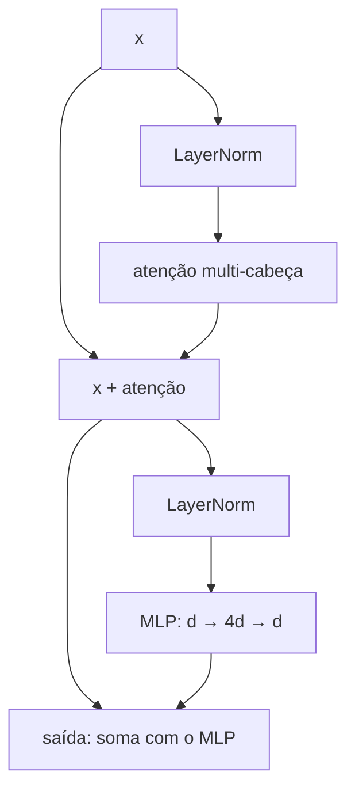

## Passo 1 · Leitura · A atenção não vê a ordem

Releia a conta da atenção sem máscara: a pontuação entre as posições $i$ e $j$ depende só do **conteúdo** das duas linhas, $q_i \cdot k_j$. Em nenhum lugar entra o número $i$ ou o número $j$. A consequência é que a atenção trata a sequência como um conjunto: se você embaralhar as linhas da entrada, as linhas da saída saem embaralhadas do mesmo jeito, com os mesmos valores.

```python
ordem = [2, 0, 3, 1]
Y = atencao(X)
print(np.allclose(atencao(X[ordem]), Y[ordem]))   # True
```

Para um modelo de linguagem, isso é um defeito grave. `a raposa viu a garça` e `a garça viu a raposa` têm as mesmas palavras, e uma atenção sem posição daria a cada palavra exatamente a mesma representação nas duas frases. A máscara causal quebra a simetria só em parte: a posição 3 sabe quais tokens vieram antes dela, mas não em que ordem.

A saída é pôr a posição **dentro da entrada**. Antes do primeiro bloco, cada token recebe a soma de dois vetores: o embedding do token, que diz o que ele é, e um vetor da posição, que diz onde ele está.

$$
x_t = \text{emb}[\text{token}_t] + P[t]
$$

Há dois jeitos comuns de obter a matriz $P$, de forma $(T, d)$.

**Aprendida.** $P$ é um parâmetro como outro qualquer, sorteado no começo e ajustado pelo gradiente. É o que o mini-GPT deste nível usa: são $T \cdot d$ números a mais. A limitação é que não existe linha para uma posição além de $T$.

**Senoidal.** $P$ é uma tabela fixa, sem parâmetros, feita de senos e cossenos de frequências diferentes:

$$
P_{t,\,2i} = \sin\!\left(\frac{t}{10000^{2i/d}}\right), \qquad P_{t,\,2i+1} = \cos\!\left(\frac{t}{10000^{2i/d}}\right)
$$

As primeiras colunas oscilam depressa (a coluna 0 é $\sin t$) e as últimas muito devagar, como os ponteiros de um relógio: juntas, elas dão a cada posição uma combinação única de valores entre $-1$ e $1$.

A soma acontece uma vez só, antes do primeiro bloco. Graças às conexões residuais, que aparecem no passo 4, a informação de posição continua disponível nos blocos seguintes.

## Passo 2 · Previsão · Permutar a entrada

A função `atencao` é uma cabeça sem máscara em que consultas, chaves e valores são o próprio `X`. O código embaralha as posições e compara as saídas, primeiro sem informação de posição e depois somando um vetor diferente a cada posição. Preveja os três booleanos.

### Código

```python
import numpy as np


def atencao(X):
    S = X @ X.T / np.sqrt(X.shape[1])
    E = np.exp(S - S.max(axis=1, keepdims=True))
    return (E / E.sum(axis=1, keepdims=True)) @ X


X = np.array([[1.0, 0.0, 0.0], [0.0, 2.0, 0.0], [0.0, 0.0, 3.0], [1.0, 1.0, 1.0]])
ordem = [2, 0, 3, 1]

Y = atencao(X)
print(bool(np.allclose(atencao(X[ordem]), Y[ordem])))

P = 0.5 * np.arange(4)[:, None] * np.ones((1, 3))
Yp = atencao(X + P)
print(bool(np.allclose(atencao(X[ordem] + P), Yp[ordem])))
print(bool(np.allclose(atencao((X + P)[ordem]), Yp[ordem])))
```

### Dicas

1. Sem posição, embaralhar a entrada só embaralha a saída.
2. Em `X[ordem] + P`, o token que estava na posição 2 passa a receber o vetor da posição 0.
3. Em `(X + P)[ordem]`, cada token leva consigo o vetor de posição antigo: é a mesma entrada embaralhada.

### Saída esperada

```text
True
False
True
```

## Passo 3 · Exercício · `posicional_senoidal(T, d)`
modo: lacunas

Complete a função que monta a tabela senoidal de posições, de forma `(T, d)`, com `d` par:

$$
P_{t,\,2i} = \sin\!\left(\frac{t}{10000^{2i/d}}\right), \qquad P_{t,\,2i+1} = \cos\!\left(\frac{t}{10000^{2i/d}}\right)
$$

As posições vão de `0` a `T - 1`. No código, o array `i` já guarda os números pares `0, 2, 4, ...` (o $2i$ da fórmula), um por par de colunas.

### Instruções

1. Monte a coluna das posições `t`, de `0` a `T - 1`, com forma `(T, 1)`.
2. Calcule os ângulos dividindo a posição por $10000^{2i/d}$, lembrando que o array `i` do código já é o $2i$ da fórmula.
3. Ponha os senos nas colunas pares e os cossenos nas colunas ímpares.

### Código inicial

```python
import numpy as np


def posicional_senoidal(T, d):
    t = ___
    i = np.arange(0, d, 2)[None, :]
    angulos = ___
    P = np.zeros((T, d))
    P[:, 0::2] = ___
    P[:, 1::2] = ___
    return P


if __name__ == "__main__":
    P = posicional_senoidal(16, 32)
    print(P.shape)
    print(np.round(P[1, :4], 4).tolist())
```

### Solução

```python
import numpy as np


def posicional_senoidal(T, d):
    t = np.arange(T)[:, None]
    i = np.arange(0, d, 2)[None, :]
    angulos = t / 10000 ** (i / d)
    P = np.zeros((T, d))
    P[:, 0::2] = np.sin(angulos)
    P[:, 1::2] = np.cos(angulos)
    return P


if __name__ == "__main__":
    P = posicional_senoidal(16, 32)
    print(P.shape)
    print(np.round(P[1, :4], 4).tolist())
```

### Dicas

1. Na posição 0, todos os ângulos são 0: a linha é `[0, 1, 0, 1, ...]`.
2. Na primeira dupla de colunas, o expoente é 0 e o ângulo é o próprio `t`.
3. `P[:, 0::2]` são as colunas pares e `P[:, 1::2]` as ímpares.

### Verificação

```json
[
  {"id": "forma", "checkpoint": 1, "kind": "expr", "expr": "list(posicional_senoidal(16, 32).shape)", "expected": [16, 32], "name": "A tabela tem forma (T, d)"},
  {"id": "posicao-zero", "checkpoint": 1, "kind": "expr", "setup": "import numpy as np", "expr": "np.round(posicional_senoidal(5, 6)[0], 12).tolist()", "expected": [0.0, 1.0, 0.0, 1.0, 0.0, 1.0], "name": "A posição 0 é [0, 1, 0, 1, 0, 1]", "hint": "As posições começam em 0, e sen 0 = 0, cos 0 = 1."},
  {"id": "primeira-dupla", "checkpoint": 3, "kind": "expr", "setup": "import numpy as np\n_P = posicional_senoidal(6, 8)", "expr": "[bool(np.allclose(_P[:, 0], np.sin(np.arange(6)), atol=1e-12)), bool(np.allclose(_P[:, 1], np.cos(np.arange(6)), atol=1e-12))]", "expected": [true, true], "name": "A coluna 0 é sen t e a coluna 1 é cos t", "hint": "Senos nas colunas pares, cossenos nas ímpares."},
  {"id": "literal", "checkpoint": 2, "kind": "expr", "setup": "import numpy as np", "expr": "posicional_senoidal(3, 4).ravel().tolist()", "expected": [0.0, 1.0, 0.0, 1.0, 0.8414709848078965, 0.5403023058681398, 0.009999833334166664, 0.9999500004166653, 0.9092974268256817, -0.4161468365471424, 0.01999866669333308, 0.9998000066665778], "tolerance": 1e-12, "name": "Tabela com T = 3 e d = 4", "hint": "A segunda dupla de colunas usa o ângulo t / 10000^(2/4) = t / 100."},
  {"id": "referencia", "checkpoint": 2, "kind": "expr", "setup": "import math\nimport numpy as np\ndef _ref(T, d):\n    P = [[0.0] * d for _ in range(T)]\n    for t in range(T):\n        for par in range(d // 2):\n            angulo = t / (10000.0 ** (2 * par / d))\n            P[t][2 * par] = math.sin(angulo)\n            P[t][2 * par + 1] = math.cos(angulo)\n    return np.array(P)\n", "expr": "bool(np.allclose(posicional_senoidal(16, 32), _ref(16, 32), atol=1e-12))", "expected": true, "name": "Igual à referência com T = 16 e d = 32", "hint": "A referência calcula sen e cos de t / 10000^(2i/d) para cada dupla de colunas i."},
  {"id": "ultima-dupla", "checkpoint": 2, "kind": "expr", "setup": "import numpy as np", "expr": "float(posicional_senoidal(4, 8)[3, 6])", "expected": 0.002999995500002025, "tolerance": 1e-12, "name": "Posição 3, coluna 6 (d = 8): sen(3 / 10000^(6/8))", "hint": "O expoente é o índice par da coluna dividido por d."},
  {"id": "pitagoras", "checkpoint": 3, "kind": "expr", "setup": "import numpy as np\n_P = posicional_senoidal(10, 12)", "expr": "bool(np.allclose(_P[:, 0::2] ** 2 + _P[:, 1::2] ** 2, 1.0, atol=1e-12))", "expected": true, "name": "Em cada dupla de colunas, sen² + cos² = 1", "hint": "As duas colunas de uma dupla usam o mesmo ângulo."},
  {"id": "frequencias-caem", "checkpoint": 2, "kind": "expr", "setup": "import numpy as np\n_P = posicional_senoidal(2, 16)", "expr": "bool((np.diff(_P[1, 0::2]) < 0).all())", "expected": true, "name": "Na posição 1, os senos diminuem da primeira dupla para a última", "hint": "A posição é dividida pela potência de 10000, não multiplicada."},
  {"id": "linhas-distintas", "checkpoint": 1, "kind": "expr", "setup": "import numpy as np\n_P = posicional_senoidal(50, 16)", "expr": "len({tuple(np.round(l, 9)) for l in _P})", "expected": 50, "name": "50 posições, 50 linhas diferentes"}
]
```

### Soluções erradas

```python name="senos e cossenos trocados"
import numpy as np


def posicional_senoidal(T, d):
    t = np.arange(T)[:, None]
    i = np.arange(0, d, 2)[None, :]
    angulos = t / 10000 ** (i / d)
    P = np.zeros((T, d))
    P[:, 0::2] = np.cos(angulos)
    P[:, 1::2] = np.sin(angulos)
    return P


if __name__ == "__main__":
    P = posicional_senoidal(16, 32)
    print(P.shape)
    print(np.round(P[1, :4], 4).tolist())
```

```python name="expoente dobrado"
import numpy as np


def posicional_senoidal(T, d):
    t = np.arange(T)[:, None]
    i = np.arange(0, d, 2)[None, :]
    angulos = t / 10000 ** (2 * i / d)
    P = np.zeros((T, d))
    P[:, 0::2] = np.sin(angulos)
    P[:, 1::2] = np.cos(angulos)
    return P


if __name__ == "__main__":
    P = posicional_senoidal(16, 32)
    print(P.shape)
    print(np.round(P[1, :4], 4).tolist())
```

```python name="multiplica a posição pela potência"
import numpy as np


def posicional_senoidal(T, d):
    t = np.arange(T)[:, None]
    i = np.arange(0, d, 2)[None, :]
    angulos = t * 10000 ** (i / d)
    P = np.zeros((T, d))
    P[:, 0::2] = np.sin(angulos)
    P[:, 1::2] = np.cos(angulos)
    return P


if __name__ == "__main__":
    P = posicional_senoidal(16, 32)
    print(P.shape)
    print(np.round(P[1, :4], 4).tolist())
```

```python name="expoente sem dividir por d"
import numpy as np


def posicional_senoidal(T, d):
    t = np.arange(T)[:, None]
    i = np.arange(0, d, 2)[None, :]
    angulos = t / 10000 ** i
    P = np.zeros((T, d))
    P[:, 0::2] = np.sin(angulos)
    P[:, 1::2] = np.cos(angulos)
    return P


if __name__ == "__main__":
    P = posicional_senoidal(16, 32)
    print(P.shape)
    print(np.round(P[1, :4], 4).tolist())
```

```python name="só senos, nas duas colunas"
import numpy as np


def posicional_senoidal(T, d):
    t = np.arange(T)[:, None]
    i = np.arange(0, d, 2)[None, :]
    angulos = t / 10000 ** (i / d)
    P = np.zeros((T, d))
    P[:, 0::2] = np.sin(angulos)
    P[:, 1::2] = np.sin(angulos)
    return P


if __name__ == "__main__":
    P = posicional_senoidal(16, 32)
    print(P.shape)
    print(np.round(P[1, :4], 4).tolist())
```

```python name="posições começando em 1"
import numpy as np


def posicional_senoidal(T, d):
    t = np.arange(1, T + 1)[:, None]
    i = np.arange(0, d, 2)[None, :]
    angulos = t / 10000 ** (i / d)
    P = np.zeros((T, d))
    P[:, 0::2] = np.sin(angulos)
    P[:, 1::2] = np.cos(angulos)
    return P


if __name__ == "__main__":
    P = posicional_senoidal(16, 32)
    print(P.shape)
    print(np.round(P[1, :4], 4).tolist())
```

## Passo 4 · Leitura · LayerNorm e residual, pré-norm

A atenção multi-cabeça é metade de um **bloco transformer**. A outra metade é um MLP de duas camadas aplicado a cada posição em separado: a atenção troca informação entre posições, e o MLP processa o que cada posição recebeu. As duas metades são embrulhadas do mesmo jeito, com uma normalização antes e uma conexão residual em volta.



```python
x = x + atencao(layernorm(x))
x = x + mlp(layernorm(x))
```

**Residual.** Cada metade calcula uma correção que é **somada** à entrada, como na ResNet. No backward, a soma copia o gradiente para os dois ramos: existe um caminho direto da perda até os embeddings, por mais blocos que haja no meio.

**LayerNorm.** Cada vetor $x$ de tamanho $d$ (uma posição de um exemplo) é normalizado sozinho, pela própria média $\mu$ e pelo próprio desvio $\sigma = \sqrt{\text{var} + \epsilon}$, e depois ajustado por dois parâmetros aprendidos: $y = \gamma \odot \hat{x} + \beta$, com $\hat{x} = (x - \mu)/\sigma$. Nada depende do lote, ao contrário da BatchNorm, e por isso a camada se comporta igual no treino e na geração.

**Pré-norm.** A normalização fica dentro do ramo, antes da atenção e do MLP, e o caminho residual fica livre. A ordem original (normalizar depois da soma) também funciona, mas treina pior em redes fundas.

**Ativação.** Os modelos GPT usam a GELU no MLP, $\text{GELU}(x) = x\,\Phi(x)$, uma ReLU de canto arredondado: $\text{GELU}(1) = 0{,}841$ e $\text{GELU}(-1) = -0{,}159$. O mini-GPT deste nível usa a ReLU, cujo backward você já conhece.

**O backward da LayerNorm.** Como $\mu$ e $\sigma$ dependem de todas as componentes de $x$, o gradiente de uma componente recebe três parcelas. Com $g = dy \odot \gamma$ (o gradiente que chega em $\hat{x}$) e as médias tiradas sobre as $d$ componentes do vetor:

$$
dx = \frac{1}{\sigma}\Big( g - \text{média}(g) - \hat{x} \cdot \text{média}(g \odot \hat{x}) \Big)
$$

$$
d\gamma = \sum dy \odot \hat{x}, \qquad d\beta = \sum dy
$$

As somas de $d\gamma$ e $d\beta$ correm sobre todos os vetores (lote e tempo), porque os mesmos $\gamma$ e $\beta$ servem a todos.

## Passo 5 · Exercício · LayerNorm com backward

Escreva a LayerNorm com o seu backward. O último eixo de `X` é a dimensão `d` do vetor; os eixos anteriores (lote e tempo, ou só lote) são tratados como uma coleção de vetores independentes.

`layernorm_forward(X, gamma, beta, eps=1e-5)` normaliza cada vetor pela própria média e pelo desvio $\sigma = \sqrt{\text{var} + \epsilon}$ (variância com `.var()`, que divide por `d`), aplica `gamma` e `beta` (ambos de forma `(d,)`) e devolve `(Y, cache)`. O conteúdo do `cache` é escolha sua: guarde o que o backward precisar.

`layernorm_backward(dY, cache)` devolve `(dX, dgamma, dbeta)`: `dX` com a forma de `X`, e `dgamma` e `dbeta` com forma `(d,)`, somados sobre todos os vetores. Os casos conferem os três com a diferença central.

### Instruções

1. Forward: média e variância no último eixo, com `keepdims=True`; `eps` dentro da raiz; `gamma` e `beta` depois da normalização.
2. Backward dos parâmetros: `dgamma` e `dbeta` somam sobre todos os eixos menos o último.
3. Backward da entrada: as três parcelas da fórmula da leitura, com as médias no último eixo, divididas pelo desvio.

### Código inicial

```python
import numpy as np


def layernorm_forward(X, gamma, beta, eps=1e-5):
    # normalize cada vetor do último eixo, aplique gamma e beta e devolva (Y, cache)
    pass


def layernorm_backward(dY, cache):
    # devolva (dX, dgamma, dbeta)
    pass


if __name__ == "__main__":
    rng = np.random.default_rng(0)
    X = rng.normal(2.0, 3.0, (2, 3, 4))
    Y, cache = layernorm_forward(X, np.ones(4), np.zeros(4))
    print(np.round(Y.mean(axis=-1), 6).tolist())
    dX, dgamma, dbeta = layernorm_backward(np.ones_like(Y), cache)
    print(dX.shape, dgamma.shape, dbeta.shape)
```

### Solução

```python
import numpy as np


def layernorm_forward(X, gamma, beta, eps=1e-5):
    media = X.mean(axis=-1, keepdims=True)
    desvio = np.sqrt(X.var(axis=-1, keepdims=True) + eps)
    Xn = (X - media) / desvio
    Y = gamma * Xn + beta
    cache = (Xn, desvio, gamma)
    return Y, cache


def layernorm_backward(dY, cache):
    Xn, desvio, gamma = cache
    d = Xn.shape[-1]
    dgamma = (dY * Xn).reshape(-1, d).sum(axis=0)
    dbeta = dY.reshape(-1, d).sum(axis=0)
    g = dY * gamma
    dX = (g - g.mean(axis=-1, keepdims=True) - Xn * (g * Xn).mean(axis=-1, keepdims=True)) / desvio
    return dX, dgamma, dbeta


if __name__ == "__main__":
    rng = np.random.default_rng(0)
    X = rng.normal(2.0, 3.0, (2, 3, 4))
    Y, cache = layernorm_forward(X, np.ones(4), np.zeros(4))
    print(np.round(Y.mean(axis=-1), 6).tolist())
    dX, dgamma, dbeta = layernorm_backward(np.ones_like(Y), cache)
    print(dX.shape, dgamma.shape, dbeta.shape)
```

### Dicas

1. O vetor normalizado e o desvio são o que o backward mais usa: vale guardá-los no cache.
2. `reshape(-1, d).sum(axis=0)` soma sobre lote e tempo de uma vez, para qualquer número de eixos.
3. Somando `dX` no último eixo, o resultado precisa ser zero: deslocar o vetor inteiro não muda a saída.

### Verificação

```json
[
  {"id": "media-e-desvio", "checkpoint": 1, "kind": "expr", "setup": "import numpy as np\n_rng = np.random.default_rng(9)\n_X = _rng.normal(1.0, 2.0, (2, 3, 4))\n_g, _b = _rng.normal(1.0, 0.5, 4), _rng.normal(0.0, 0.5, 4)\n_G = _rng.normal(size=(2, 3, 4))\ndef _perda():\n    return float((layernorm_forward(_X, _g, _b)[0] * _G).sum())\ndef _numerico(a, h=1e-5):\n    n = np.zeros_like(a)\n    it = np.nditer(a, flags=[\"multi_index\"])\n    for _ in it:\n        i = it.multi_index\n        v = a[i]\n        a[i] = v + h\n        mais = _perda()\n        a[i] = v - h\n        menos = _perda()\n        a[i] = v\n        n[i] = (mais - menos) / (2 * h)\n    return n\ndef _erro(a, n):\n    return float(np.linalg.norm(a - n) / max(np.linalg.norm(a) + np.linalg.norm(n), 1e-8))\n_Y, _cache = layernorm_forward(_X, _g, _b)\n_dX, _dg, _db = layernorm_backward(_G, _cache)\n", "expr": "[bool(np.allclose(layernorm_forward(_X, np.ones(4), np.zeros(4))[0].mean(axis=-1), 0.0, atol=1e-12)), bool(np.allclose(layernorm_forward(_X, np.ones(4), np.zeros(4))[0].std(axis=-1), 1.0, atol=1e-3))]", "expected": [true, true], "name": "Com gamma = 1 e beta = 0, cada vetor sai com média 0 e desvio 1", "hint": "A média e a variância são de cada vetor (último eixo), não do lote."},
  {"id": "forward-literal", "checkpoint": 1, "kind": "expr", "setup": "import numpy as np", "expr": "layernorm_forward(np.array([[1.0, 2.0, 3.0, 4.0]]), np.array([1.0, 2.0, 1.0, 0.5]), np.array([0.0, 1.0, -1.0, 0.0]))[0].ravel().tolist()", "expected": [-1.3416354199689269, 0.105576386687382, -0.552788193343691, 0.6708177099844634], "tolerance": 1e-12, "name": "Forward de [1, 2, 3, 4] com gamma e beta dados", "hint": "y = gamma · (x − média) / raiz(var + eps) + beta."},
  {"id": "eps-dentro-da-raiz", "checkpoint": 1, "kind": "expr", "setup": "import numpy as np", "expr": "layernorm_forward(np.array([[0.0, 2.0]]), np.ones(2), np.zeros(2), eps=1.0)[0].ravel().tolist()", "expected": [-0.7071067811865475, 0.7071067811865475], "tolerance": 1e-12, "name": "Com eps = 1 e variância 1, o desvio é raiz de 2", "hint": "O eps é somado à variância, dentro da raiz."},
  {"id": "vetor-constante", "checkpoint": 1, "kind": "expr", "setup": "import numpy as np", "expr": "layernorm_forward(np.full((2, 3), 5.0), np.ones(3), np.array([0.5, -0.5, 2.0]))[0].tolist()", "expected": [[0.5, -0.5, 2.0], [0.5, -0.5, 2.0]], "tolerance": 1e-12, "name": "Vetor constante: a saída é beta, sem nan"},
  {"id": "por-vetor", "checkpoint": 1, "kind": "expr", "setup": "import numpy as np\n_rng = np.random.default_rng(9)\n_X = _rng.normal(1.0, 2.0, (2, 3, 4))\n_g, _b = _rng.normal(1.0, 0.5, 4), _rng.normal(0.0, 0.5, 4)\n_G = _rng.normal(size=(2, 3, 4))\ndef _perda():\n    return float((layernorm_forward(_X, _g, _b)[0] * _G).sum())\ndef _numerico(a, h=1e-5):\n    n = np.zeros_like(a)\n    it = np.nditer(a, flags=[\"multi_index\"])\n    for _ in it:\n        i = it.multi_index\n        v = a[i]\n        a[i] = v + h\n        mais = _perda()\n        a[i] = v - h\n        menos = _perda()\n        a[i] = v\n        n[i] = (mais - menos) / (2 * h)\n    return n\ndef _erro(a, n):\n    return float(np.linalg.norm(a - n) / max(np.linalg.norm(a) + np.linalg.norm(n), 1e-8))\n_Y, _cache = layernorm_forward(_X, _g, _b)\n_dX, _dg, _db = layernorm_backward(_G, _cache)\n", "expr": "bool(np.allclose(layernorm_forward(_X, _g, _b)[0][1, 2], layernorm_forward(_X[1, 2][None, :], _g, _b)[0][0], atol=1e-12))", "expected": true, "name": "A saída de um vetor não depende dos outros vetores do lote", "hint": "Normalizar no eixo 0 mistura exemplos diferentes."},
  {"id": "formas", "checkpoint": 2, "kind": "expr", "setup": "import numpy as np\n_rng = np.random.default_rng(9)\n_X = _rng.normal(1.0, 2.0, (2, 3, 4))\n_g, _b = _rng.normal(1.0, 0.5, 4), _rng.normal(0.0, 0.5, 4)\n_G = _rng.normal(size=(2, 3, 4))\ndef _perda():\n    return float((layernorm_forward(_X, _g, _b)[0] * _G).sum())\ndef _numerico(a, h=1e-5):\n    n = np.zeros_like(a)\n    it = np.nditer(a, flags=[\"multi_index\"])\n    for _ in it:\n        i = it.multi_index\n        v = a[i]\n        a[i] = v + h\n        mais = _perda()\n        a[i] = v - h\n        menos = _perda()\n        a[i] = v\n        n[i] = (mais - menos) / (2 * h)\n    return n\ndef _erro(a, n):\n    return float(np.linalg.norm(a - n) / max(np.linalg.norm(a) + np.linalg.norm(n), 1e-8))\n_Y, _cache = layernorm_forward(_X, _g, _b)\n_dX, _dg, _db = layernorm_backward(_G, _cache)\n", "expr": "[list(_dX.shape), list(_dg.shape), list(_db.shape)]", "expected": [[2, 3, 4], [4], [4]], "name": "dX tem a forma de X; dgamma e dbeta têm forma (d,)", "hint": "Some dgamma e dbeta sobre o lote e o tempo."},
  {"id": "dbeta-e-dgamma", "checkpoint": 2, "kind": "expr", "setup": "import numpy as np\n_rng = np.random.default_rng(9)\n_X = _rng.normal(1.0, 2.0, (2, 3, 4))\n_g, _b = _rng.normal(1.0, 0.5, 4), _rng.normal(0.0, 0.5, 4)\n_G = _rng.normal(size=(2, 3, 4))\ndef _perda():\n    return float((layernorm_forward(_X, _g, _b)[0] * _G).sum())\ndef _numerico(a, h=1e-5):\n    n = np.zeros_like(a)\n    it = np.nditer(a, flags=[\"multi_index\"])\n    for _ in it:\n        i = it.multi_index\n        v = a[i]\n        a[i] = v + h\n        mais = _perda()\n        a[i] = v - h\n        menos = _perda()\n        a[i] = v\n        n[i] = (mais - menos) / (2 * h)\n    return n\ndef _erro(a, n):\n    return float(np.linalg.norm(a - n) / max(np.linalg.norm(a) + np.linalg.norm(n), 1e-8))\n_Y, _cache = layernorm_forward(_X, _g, _b)\n_dX, _dg, _db = layernorm_backward(_G, _cache)\n", "expr": "[bool(_erro(_dg, _numerico(_g)) < 1e-7), bool(_erro(_db, _numerico(_b)) < 1e-7)]", "expected": [true, true], "name": "dgamma e dbeta conferem com a diferença central"},
  {"id": "checagem-3d", "checkpoint": 3, "kind": "expr", "setup": "import numpy as np\n_rng = np.random.default_rng(9)\n_X = _rng.normal(1.0, 2.0, (2, 3, 4))\n_g, _b = _rng.normal(1.0, 0.5, 4), _rng.normal(0.0, 0.5, 4)\n_G = _rng.normal(size=(2, 3, 4))\ndef _perda():\n    return float((layernorm_forward(_X, _g, _b)[0] * _G).sum())\ndef _numerico(a, h=1e-5):\n    n = np.zeros_like(a)\n    it = np.nditer(a, flags=[\"multi_index\"])\n    for _ in it:\n        i = it.multi_index\n        v = a[i]\n        a[i] = v + h\n        mais = _perda()\n        a[i] = v - h\n        menos = _perda()\n        a[i] = v\n        n[i] = (mais - menos) / (2 * h)\n    return n\ndef _erro(a, n):\n    return float(np.linalg.norm(a - n) / max(np.linalg.norm(a) + np.linalg.norm(n), 1e-8))\n_Y, _cache = layernorm_forward(_X, _g, _b)\n_dX, _dg, _db = layernorm_backward(_G, _cache)\n", "expr": "[bool(_erro(_dX, _numerico(_X)) < 1e-7), bool(_erro(_dg, _numerico(_g)) < 1e-7), bool(_erro(_db, _numerico(_b)) < 1e-7)]", "expected": [true, true, true], "name": "Checagem numérica com X de forma (2, 3, 4): [dX, dgamma, dbeta]", "hint": "A média e o desvio dependem de todas as componentes do vetor: dX tem três parcelas."},
  {"id": "checagem-2d", "checkpoint": 3, "kind": "expr", "setup": "import numpy as np\n_rng = np.random.default_rng(10)\n_X = _rng.normal(1.0, 2.0, (5, 6))\n_g, _b = _rng.normal(1.0, 0.5, 6), _rng.normal(0.0, 0.5, 6)\n_G = _rng.normal(size=(5, 6))\ndef _perda():\n    return float((layernorm_forward(_X, _g, _b)[0] * _G).sum())\ndef _numerico(a, h=1e-5):\n    n = np.zeros_like(a)\n    it = np.nditer(a, flags=[\"multi_index\"])\n    for _ in it:\n        i = it.multi_index\n        v = a[i]\n        a[i] = v + h\n        mais = _perda()\n        a[i] = v - h\n        menos = _perda()\n        a[i] = v\n        n[i] = (mais - menos) / (2 * h)\n    return n\ndef _erro(a, n):\n    return float(np.linalg.norm(a - n) / max(np.linalg.norm(a) + np.linalg.norm(n), 1e-8))\n_Y, _cache = layernorm_forward(_X, _g, _b)\n_dX, _dg, _db = layernorm_backward(_G, _cache)\n", "expr": "[bool(_erro(_dX, _numerico(_X)) < 1e-7), bool(_erro(_dg, _numerico(_g)) < 1e-7), bool(_erro(_db, _numerico(_b)) < 1e-7)]", "expected": [true, true, true], "name": "Checagem numérica com X de forma (5, 6)"},
  {"id": "dx-soma-zero", "checkpoint": 3, "kind": "expr", "setup": "import numpy as np\n_rng = np.random.default_rng(9)\n_X = _rng.normal(1.0, 2.0, (2, 3, 4))\n_g, _b = _rng.normal(1.0, 0.5, 4), _rng.normal(0.0, 0.5, 4)\n_G = _rng.normal(size=(2, 3, 4))\ndef _perda():\n    return float((layernorm_forward(_X, _g, _b)[0] * _G).sum())\ndef _numerico(a, h=1e-5):\n    n = np.zeros_like(a)\n    it = np.nditer(a, flags=[\"multi_index\"])\n    for _ in it:\n        i = it.multi_index\n        v = a[i]\n        a[i] = v + h\n        mais = _perda()\n        a[i] = v - h\n        menos = _perda()\n        a[i] = v\n        n[i] = (mais - menos) / (2 * h)\n    return n\ndef _erro(a, n):\n    return float(np.linalg.norm(a - n) / max(np.linalg.norm(a) + np.linalg.norm(n), 1e-8))\n_Y, _cache = layernorm_forward(_X, _g, _b)\n_dX, _dg, _db = layernorm_backward(_G, _cache)\n", "expr": "bool(np.allclose(_dX.sum(axis=-1), 0.0, atol=1e-12))", "expected": true, "name": "dX soma zero em cada vetor", "hint": "Somar uma constante ao vetor não muda a saída da LayerNorm."},
  {"id": "entrada-intacta", "checkpoint": 3, "kind": "expr", "setup": "import numpy as np\n_rng = np.random.default_rng(9)\n_X = _rng.normal(1.0, 2.0, (2, 3, 4))\n_g, _b = _rng.normal(1.0, 0.5, 4), _rng.normal(0.0, 0.5, 4)\n_G = _rng.normal(size=(2, 3, 4))\ndef _perda():\n    return float((layernorm_forward(_X, _g, _b)[0] * _G).sum())\ndef _numerico(a, h=1e-5):\n    n = np.zeros_like(a)\n    it = np.nditer(a, flags=[\"multi_index\"])\n    for _ in it:\n        i = it.multi_index\n        v = a[i]\n        a[i] = v + h\n        mais = _perda()\n        a[i] = v - h\n        menos = _perda()\n        a[i] = v\n        n[i] = (mais - menos) / (2 * h)\n    return n\ndef _erro(a, n):\n    return float(np.linalg.norm(a - n) / max(np.linalg.norm(a) + np.linalg.norm(n), 1e-8))\n_Y, _cache = layernorm_forward(_X, _g, _b)\n_dX, _dg, _db = layernorm_backward(_G, _cache)\n_c = _X.copy()\nlayernorm_backward(_G, layernorm_forward(_X, _g, _b)[1])", "expr": "bool(np.array_equal(_X, _c))", "expected": true, "name": "X não é alterado"}
]
```

### Soluções erradas

```python name="LayerNorm no eixo do lote"
import numpy as np


def layernorm_forward(X, gamma, beta, eps=1e-5):
    media = X.mean(axis=0, keepdims=True)
    desvio = np.sqrt(X.var(axis=0, keepdims=True) + eps)
    Xn = (X - media) / desvio
    Y = gamma * Xn + beta
    cache = (Xn, desvio, gamma)
    return Y, cache


def layernorm_backward(dY, cache):
    Xn, desvio, gamma = cache
    d = Xn.shape[-1]
    dgamma = (dY * Xn).reshape(-1, d).sum(axis=0)
    dbeta = dY.reshape(-1, d).sum(axis=0)
    g = dY * gamma
    dX = (g - g.mean(axis=-1, keepdims=True) - Xn * (g * Xn).mean(axis=-1, keepdims=True)) / desvio
    return dX, dgamma, dbeta


if __name__ == "__main__":
    rng = np.random.default_rng(0)
    X = rng.normal(2.0, 3.0, (2, 3, 4))
    Y, cache = layernorm_forward(X, np.ones(4), np.zeros(4))
    print(np.round(Y.mean(axis=-1), 6).tolist())
    dX, dgamma, dbeta = layernorm_backward(np.ones_like(Y), cache)
    print(dX.shape, dgamma.shape, dbeta.shape)
```

```python name="dgamma sem somar sobre lote e tempo"
import numpy as np


def layernorm_forward(X, gamma, beta, eps=1e-5):
    media = X.mean(axis=-1, keepdims=True)
    desvio = np.sqrt(X.var(axis=-1, keepdims=True) + eps)
    Xn = (X - media) / desvio
    Y = gamma * Xn + beta
    cache = (Xn, desvio, gamma)
    return Y, cache


def layernorm_backward(dY, cache):
    Xn, desvio, gamma = cache
    d = Xn.shape[-1]
    dgamma = (dY * Xn).sum(axis=0)
    dbeta = dY.reshape(-1, d).sum(axis=0)
    g = dY * gamma
    dX = (g - g.mean(axis=-1, keepdims=True) - Xn * (g * Xn).mean(axis=-1, keepdims=True)) / desvio
    return dX, dgamma, dbeta


if __name__ == "__main__":
    rng = np.random.default_rng(0)
    X = rng.normal(2.0, 3.0, (2, 3, 4))
    Y, cache = layernorm_forward(X, np.ones(4), np.zeros(4))
    print(np.round(Y.mean(axis=-1), 6).tolist())
    dX, dgamma, dbeta = layernorm_backward(np.ones_like(Y), cache)
    print(dX.shape, dgamma.shape, dbeta.shape)
```

```python name="backward ignora a dependência da média e da variância"
import numpy as np


def layernorm_forward(X, gamma, beta, eps=1e-5):
    media = X.mean(axis=-1, keepdims=True)
    desvio = np.sqrt(X.var(axis=-1, keepdims=True) + eps)
    Xn = (X - media) / desvio
    Y = gamma * Xn + beta
    cache = (Xn, desvio, gamma)
    return Y, cache


def layernorm_backward(dY, cache):
    Xn, desvio, gamma = cache
    d = Xn.shape[-1]
    dgamma = (dY * Xn).reshape(-1, d).sum(axis=0)
    dbeta = dY.reshape(-1, d).sum(axis=0)
    g = dY * gamma
    dX = g / desvio
    return dX, dgamma, dbeta


if __name__ == "__main__":
    rng = np.random.default_rng(0)
    X = rng.normal(2.0, 3.0, (2, 3, 4))
    Y, cache = layernorm_forward(X, np.ones(4), np.zeros(4))
    print(np.round(Y.mean(axis=-1), 6).tolist())
    dX, dgamma, dbeta = layernorm_backward(np.ones_like(Y), cache)
    print(dX.shape, dgamma.shape, dbeta.shape)
```

```python name="backward sem a parcela da variância"
import numpy as np


def layernorm_forward(X, gamma, beta, eps=1e-5):
    media = X.mean(axis=-1, keepdims=True)
    desvio = np.sqrt(X.var(axis=-1, keepdims=True) + eps)
    Xn = (X - media) / desvio
    Y = gamma * Xn + beta
    cache = (Xn, desvio, gamma)
    return Y, cache


def layernorm_backward(dY, cache):
    Xn, desvio, gamma = cache
    d = Xn.shape[-1]
    dgamma = (dY * Xn).reshape(-1, d).sum(axis=0)
    dbeta = dY.reshape(-1, d).sum(axis=0)
    g = dY * gamma
    dX = (g - g.mean(axis=-1, keepdims=True)) / desvio
    return dX, dgamma, dbeta


if __name__ == "__main__":
    rng = np.random.default_rng(0)
    X = rng.normal(2.0, 3.0, (2, 3, 4))
    Y, cache = layernorm_forward(X, np.ones(4), np.zeros(4))
    print(np.round(Y.mean(axis=-1), 6).tolist())
    dX, dgamma, dbeta = layernorm_backward(np.ones_like(Y), cache)
    print(dX.shape, dgamma.shape, dbeta.shape)
```

```python name="eps fora da raiz"
import numpy as np


def layernorm_forward(X, gamma, beta, eps=1e-5):
    media = X.mean(axis=-1, keepdims=True)
    desvio = np.sqrt(X.var(axis=-1, keepdims=True)) + eps
    Xn = (X - media) / desvio
    Y = gamma * Xn + beta
    cache = (Xn, desvio, gamma)
    return Y, cache


def layernorm_backward(dY, cache):
    Xn, desvio, gamma = cache
    d = Xn.shape[-1]
    dgamma = (dY * Xn).reshape(-1, d).sum(axis=0)
    dbeta = dY.reshape(-1, d).sum(axis=0)
    g = dY * gamma
    dX = (g - g.mean(axis=-1, keepdims=True) - Xn * (g * Xn).mean(axis=-1, keepdims=True)) / desvio
    return dX, dgamma, dbeta


if __name__ == "__main__":
    rng = np.random.default_rng(0)
    X = rng.normal(2.0, 3.0, (2, 3, 4))
    Y, cache = layernorm_forward(X, np.ones(4), np.zeros(4))
    print(np.round(Y.mean(axis=-1), 6).tolist())
    dX, dgamma, dbeta = layernorm_backward(np.ones_like(Y), cache)
    print(dX.shape, dgamma.shape, dbeta.shape)
```

```python name="dX sem multiplicar por gamma"
import numpy as np


def layernorm_forward(X, gamma, beta, eps=1e-5):
    media = X.mean(axis=-1, keepdims=True)
    desvio = np.sqrt(X.var(axis=-1, keepdims=True) + eps)
    Xn = (X - media) / desvio
    Y = gamma * Xn + beta
    cache = (Xn, desvio, gamma)
    return Y, cache


def layernorm_backward(dY, cache):
    Xn, desvio, gamma = cache
    d = Xn.shape[-1]
    dgamma = (dY * Xn).reshape(-1, d).sum(axis=0)
    dbeta = dY.reshape(-1, d).sum(axis=0)
    g = dY
    dX = (g - g.mean(axis=-1, keepdims=True) - Xn * (g * Xn).mean(axis=-1, keepdims=True)) / desvio
    return dX, dgamma, dbeta


if __name__ == "__main__":
    rng = np.random.default_rng(0)
    X = rng.normal(2.0, 3.0, (2, 3, 4))
    Y, cache = layernorm_forward(X, np.ones(4), np.zeros(4))
    print(np.round(Y.mean(axis=-1), 6).tolist())
    dX, dgamma, dbeta = layernorm_backward(np.ones_like(Y), cache)
    print(dX.shape, dgamma.shape, dbeta.shape)
```

```python name="beta esquecido no forward"
import numpy as np


def layernorm_forward(X, gamma, beta, eps=1e-5):
    media = X.mean(axis=-1, keepdims=True)
    desvio = np.sqrt(X.var(axis=-1, keepdims=True) + eps)
    Xn = (X - media) / desvio
    Y = gamma * Xn
    cache = (Xn, desvio, gamma)
    return Y, cache


def layernorm_backward(dY, cache):
    Xn, desvio, gamma = cache
    d = Xn.shape[-1]
    dgamma = (dY * Xn).reshape(-1, d).sum(axis=0)
    dbeta = dY.reshape(-1, d).sum(axis=0)
    g = dY * gamma
    dX = (g - g.mean(axis=-1, keepdims=True) - Xn * (g * Xn).mean(axis=-1, keepdims=True)) / desvio
    return dX, dgamma, dbeta


if __name__ == "__main__":
    rng = np.random.default_rng(0)
    X = rng.normal(2.0, 3.0, (2, 3, 4))
    Y, cache = layernorm_forward(X, np.ones(4), np.zeros(4))
    print(np.round(Y.mean(axis=-1), 6).tolist())
    dX, dgamma, dbeta = layernorm_backward(np.ones_like(Y), cache)
    print(dX.shape, dgamma.shape, dbeta.shape)
```

```python name="dbeta com a média no lugar da soma"
import numpy as np


def layernorm_forward(X, gamma, beta, eps=1e-5):
    media = X.mean(axis=-1, keepdims=True)
    desvio = np.sqrt(X.var(axis=-1, keepdims=True) + eps)
    Xn = (X - media) / desvio
    Y = gamma * Xn + beta
    cache = (Xn, desvio, gamma)
    return Y, cache


def layernorm_backward(dY, cache):
    Xn, desvio, gamma = cache
    d = Xn.shape[-1]
    dgamma = (dY * Xn).reshape(-1, d).sum(axis=0)
    dbeta = dY.reshape(-1, d).mean(axis=0)
    g = dY * gamma
    dX = (g - g.mean(axis=-1, keepdims=True) - Xn * (g * Xn).mean(axis=-1, keepdims=True)) / desvio
    return dX, dgamma, dbeta


if __name__ == "__main__":
    rng = np.random.default_rng(0)
    X = rng.normal(2.0, 3.0, (2, 3, 4))
    Y, cache = layernorm_forward(X, np.ones(4), np.zeros(4))
    print(np.round(Y.mean(axis=-1), 6).tolist())
    dX, dgamma, dbeta = layernorm_backward(np.ones_like(Y), cache)
    print(dX.shape, dgamma.shape, dbeta.shape)
```

## Passo 6 · Leitura · O GPT inteiro

Com o bloco pronto, o modelo completo é uma pilha curta de peças que você já conhece.

1. **Entrada.** Os ids dos tokens, de forma $(B, T)$, selecionam linhas da matriz de embeddings, e a matriz de posições é somada: `x = tok[ids] + pos[:T]`, de forma $(B, T, d)$.
2. **Blocos.** $n$ blocos em sequência, cada um com atenção causal e MLP, sempre em $(B, T, d)$.
3. **LayerNorm final.** Como o pré-norm deixa o caminho residual sem normalizar, uma última LayerNorm arruma a escala antes da saída.
4. **Cabeça de saída.** Uma matriz $(d, V)$ transforma cada vetor em $V$ logits: a pontuação de cada token do vocabulário para ser o próximo.

```python
x = params["tok"][ids] + params["pos"][:T]
for i in range(n_blocos):
    x = bloco_forward(bloco_i, x, h)
logits = layernorm(x, lnf_g, lnf_b) @ params["Ws"]     # (B, T, V)
```

A saída da posição $t$ só depende dos tokens de $0$ a $t$ e é comparada com o token $t + 1$: um forward produz $T$ previsões.

**Contagem de parâmetros.** No mini-GPT do nível, a atenção e a cabeça de saída não têm viés, e as duas camadas do MLP têm. Para $V = 29$, $T = 16$, $d = 32$:

| Peça | Fórmula | Com 1 bloco |
|---|---|---|
| embeddings de token | $V d$ | 928 |
| posições | $T d$ | 512 |
| atenção ($W_q$, $W_k$, $W_v$, $W_o$) | $4d^2$ | 4 096 |
| duas LayerNorm do bloco | $2 \cdot 2d$ | 128 |
| MLP ($d \to 4d \to d$, com vieses) | $8d^2 + 5d$ | 8 352 |
| LayerNorm final | $2d$ | 64 |
| cabeça de saída | $d V$ | 928 |
| **total** | | **15 008** |

Um bloco inteiro soma $12d^2 + 9d = 12\,576$ parâmetros, e o modelo de 2 blocos tem $15\,008 + 12\,576 = 27\,584$. Dois terços de cada bloco estão no MLP, não na atenção.

O backward do modelo inteiro percorre as mesmas peças de trás para a frente, e virá pronto na próxima lição, num arquivo `gpt.py`.

## Passo 7 · Exercício · Bloco e contagem

Monte o forward de um bloco e conte os parâmetros do modelo inteiro. O arquivo `pecas.py` traz `layernorm(X, gamma, beta)` e `multi_head(params, X, h)` prontos.

`bloco_forward(params, X, h)` recebe `X` de forma `(B, T, d)` e o dicionário `params` com as chaves `"ln1_g"`, `"ln1_b"` (a LayerNorm antes da atenção), `"Wq"`, `"Wk"`, `"Wv"`, `"Wo"`, `"ln2_g"`, `"ln2_b"` (a LayerNorm antes do MLP), `"W1"` `(d, 4d)`, `"c1"` `(4d,)`, `"W2"` `(4d, d)` e `"c2"` `(d,)`. O bloco é pré-norm, e o MLP usa ReLU: `x = x + atenção(LN1(x))`, depois `x = x + MLP(LN2(x))`, com `MLP(m) = ReLU(m W1 + c1) W2 + c2`.

`contar_parametros_gpt(V, T, d, n_blocos)` devolve o total de parâmetros do mini-GPT da leitura: embeddings de token e de posição, `n_blocos` blocos, LayerNorm final e cabeça de saída `(d, V)` sem viés.

### Instruções

1. `bloco_forward`: primeira metade com `layernorm` (parâmetros `ln1`), `multi_head` e a soma residual; segunda metade com `layernorm` (parâmetros `ln2`), o MLP com ReLU e outra soma residual.
2. `contar_parametros_gpt`: some as peças da tabela da leitura, com o bloco multiplicado por `n_blocos`.

### Código inicial

```python
import numpy as np

from pecas import layernorm, multi_head


def bloco_forward(params, X, h):
    # x + atenção(LN(x)), depois x + MLP(LN(x)), com ReLU no MLP
    pass


def contar_parametros_gpt(V, T, d, n_blocos):
    # embeddings, posições, n_blocos blocos, LayerNorm final e cabeça de saída
    pass


if __name__ == "__main__":
    print(contar_parametros_gpt(29, 16, 32, 1))
    print(contar_parametros_gpt(29, 16, 32, 2))
```
```python path=pecas.py
"""Peças prontas das lições anteriores."""
import numpy as np


def layernorm(X, gamma, beta, eps=1e-5):
    """LayerNorm no último eixo (só o forward)."""
    media = X.mean(axis=-1, keepdims=True)
    desvio = np.sqrt(X.var(axis=-1, keepdims=True) + eps)
    return gamma * (X - media) / desvio + beta


def multi_head(params, X, h):
    """Atenção multi-cabeça causal: usa params["Wq"], params["Wk"], params["Wv"] e params["Wo"]."""
    B, T, d = X.shape
    dividir = lambda M: M.reshape(B, T, h, d // h).transpose(0, 2, 1, 3)
    Q, K, V = dividir(X @ params["Wq"]), dividir(X @ params["Wk"]), dividir(X @ params["Wv"])
    S = Q @ K.transpose(0, 1, 3, 2) / np.sqrt(d // h)
    S = np.where(np.triu(np.ones((T, T), dtype=bool), 1), -np.inf, S)
    E = np.exp(S - S.max(axis=-1, keepdims=True))
    A = E / E.sum(axis=-1, keepdims=True)
    return (A @ V).transpose(0, 2, 1, 3).reshape(B, T, d) @ params["Wo"]
```

### Solução

```python
import numpy as np

from pecas import layernorm, multi_head


def bloco_forward(params, X, h):
    A = multi_head(params, layernorm(X, params["ln1_g"], params["ln1_b"]), h)
    X = X + A
    M = layernorm(X, params["ln2_g"], params["ln2_b"])
    R = np.maximum(M @ params["W1"] + params["c1"], 0.0)
    return X + R @ params["W2"] + params["c2"]


def contar_parametros_gpt(V, T, d, n_blocos):
    entrada = V * d + T * d
    atencao = 4 * d * d
    normas = 2 * 2 * d
    mlp = (d * 4 * d + 4 * d) + (4 * d * d + d)
    saida = 2 * d + d * V
    return entrada + n_blocos * (atencao + normas + mlp) + saida


if __name__ == "__main__":
    print(contar_parametros_gpt(29, 16, 32, 1))
    print(contar_parametros_gpt(29, 16, 32, 2))
```
```python path=pecas.py
"""Peças prontas das lições anteriores."""
import numpy as np


def layernorm(X, gamma, beta, eps=1e-5):
    """LayerNorm no último eixo (só o forward)."""
    media = X.mean(axis=-1, keepdims=True)
    desvio = np.sqrt(X.var(axis=-1, keepdims=True) + eps)
    return gamma * (X - media) / desvio + beta


def multi_head(params, X, h):
    """Atenção multi-cabeça causal: usa params["Wq"], params["Wk"], params["Wv"] e params["Wo"]."""
    B, T, d = X.shape
    dividir = lambda M: M.reshape(B, T, h, d // h).transpose(0, 2, 1, 3)
    Q, K, V = dividir(X @ params["Wq"]), dividir(X @ params["Wk"]), dividir(X @ params["Wv"])
    S = Q @ K.transpose(0, 1, 3, 2) / np.sqrt(d // h)
    S = np.where(np.triu(np.ones((T, T), dtype=bool), 1), -np.inf, S)
    E = np.exp(S - S.max(axis=-1, keepdims=True))
    A = E / E.sum(axis=-1, keepdims=True)
    return (A @ V).transpose(0, 2, 1, 3).reshape(B, T, d) @ params["Wo"]
```

### Dicas

1. A segunda metade parte do `x` já atualizado pela primeira.
2. Cada LayerNorm tem `2d` parâmetros; o bloco tem duas e o modelo tem mais uma no fim.
3. Confira com os números da leitura: 15 008 com 1 bloco e 27 584 com 2.

### Verificação

```json
[
  {"id": "forma", "checkpoint": 1, "kind": "expr", "setup": "import numpy as np\n_rng = np.random.default_rng(12)\n_d = 8\n_p = {\"ln1_g\": _rng.normal(1.0, 0.3, _d), \"ln1_b\": _rng.normal(0.0, 0.3, _d), \"ln2_g\": _rng.normal(1.0, 0.3, _d), \"ln2_b\": _rng.normal(0.0, 0.3, _d)}\nfor _nome in (\"Wq\", \"Wk\", \"Wv\", \"Wo\"):\n    _p[_nome] = _rng.normal(0.0, 0.4, (_d, _d))\n_p[\"W1\"], _p[\"c1\"] = _rng.normal(0.0, 0.4, (_d, 4 * _d)), _rng.normal(0.0, 0.3, 4 * _d)\n_p[\"W2\"], _p[\"c2\"] = _rng.normal(0.0, 0.4, (4 * _d, _d)), _rng.normal(0.0, 0.3, _d)\n_X = _rng.normal(size=(2, 5, _d))\ndef _ln(v, g, b):\n    return g * (v - v.mean()) / (v.var() + 1e-5) ** 0.5 + b\ndef _ref(p, X, h):\n    B, T, d = X.shape\n    dh = d // h\n    Y = np.zeros_like(X)\n    for b in range(B):\n        N = np.array([_ln(X[b, t], p[\"ln1_g\"], p[\"ln1_b\"]) for t in range(T)])\n        Q, K, V = N @ p[\"Wq\"], N @ p[\"Wk\"], N @ p[\"Wv\"]\n        O = np.zeros((T, d))\n        for c in range(h):\n            s = slice(c * dh, (c + 1) * dh)\n            for i in range(T):\n                pontos = K[:i + 1, s] @ Q[i, s] / dh ** 0.5\n                pesos = np.exp(pontos - pontos.max())\n                pesos = pesos / pesos.sum()\n                O[i, s] = pesos @ V[:i + 1, s]\n        X1 = X[b] + O @ p[\"Wo\"]\n        for t in range(T):\n            m = _ln(X1[t], p[\"ln2_g\"], p[\"ln2_b\"])\n            Y[b, t] = X1[t] + np.maximum(m @ p[\"W1\"] + p[\"c1\"], 0.0) @ p[\"W2\"] + p[\"c2\"]\n    return Y\n", "expr": "list(bloco_forward(_p, _X, 2).shape)", "expected": [2, 5, 8], "name": "A saída do bloco tem a forma da entrada"},
  {"id": "referencia-2", "checkpoint": 1, "kind": "expr", "setup": "import numpy as np\n_rng = np.random.default_rng(12)\n_d = 8\n_p = {\"ln1_g\": _rng.normal(1.0, 0.3, _d), \"ln1_b\": _rng.normal(0.0, 0.3, _d), \"ln2_g\": _rng.normal(1.0, 0.3, _d), \"ln2_b\": _rng.normal(0.0, 0.3, _d)}\nfor _nome in (\"Wq\", \"Wk\", \"Wv\", \"Wo\"):\n    _p[_nome] = _rng.normal(0.0, 0.4, (_d, _d))\n_p[\"W1\"], _p[\"c1\"] = _rng.normal(0.0, 0.4, (_d, 4 * _d)), _rng.normal(0.0, 0.3, 4 * _d)\n_p[\"W2\"], _p[\"c2\"] = _rng.normal(0.0, 0.4, (4 * _d, _d)), _rng.normal(0.0, 0.3, _d)\n_X = _rng.normal(size=(2, 5, _d))\ndef _ln(v, g, b):\n    return g * (v - v.mean()) / (v.var() + 1e-5) ** 0.5 + b\ndef _ref(p, X, h):\n    B, T, d = X.shape\n    dh = d // h\n    Y = np.zeros_like(X)\n    for b in range(B):\n        N = np.array([_ln(X[b, t], p[\"ln1_g\"], p[\"ln1_b\"]) for t in range(T)])\n        Q, K, V = N @ p[\"Wq\"], N @ p[\"Wk\"], N @ p[\"Wv\"]\n        O = np.zeros((T, d))\n        for c in range(h):\n            s = slice(c * dh, (c + 1) * dh)\n            for i in range(T):\n                pontos = K[:i + 1, s] @ Q[i, s] / dh ** 0.5\n                pesos = np.exp(pontos - pontos.max())\n                pesos = pesos / pesos.sum()\n                O[i, s] = pesos @ V[:i + 1, s]\n        X1 = X[b] + O @ p[\"Wo\"]\n        for t in range(T):\n            m = _ln(X1[t], p[\"ln2_g\"], p[\"ln2_b\"])\n            Y[b, t] = X1[t] + np.maximum(m @ p[\"W1\"] + p[\"c1\"], 0.0) @ p[\"W2\"] + p[\"c2\"]\n    return Y\n", "expr": "bool(np.allclose(bloco_forward(_p, _X, 2), _ref(_p, _X, 2), atol=1e-12))", "expected": true, "name": "Igual à referência com 2 cabeças", "hint": "A referência faz x1 = x + atenção(LN1(x)) e devolve x1 + MLP(LN2(x1)), com ReLU."},
  {"id": "referencia-4", "checkpoint": 1, "kind": "expr", "setup": "import numpy as np\n_rng = np.random.default_rng(12)\n_d = 8\n_p = {\"ln1_g\": _rng.normal(1.0, 0.3, _d), \"ln1_b\": _rng.normal(0.0, 0.3, _d), \"ln2_g\": _rng.normal(1.0, 0.3, _d), \"ln2_b\": _rng.normal(0.0, 0.3, _d)}\nfor _nome in (\"Wq\", \"Wk\", \"Wv\", \"Wo\"):\n    _p[_nome] = _rng.normal(0.0, 0.4, (_d, _d))\n_p[\"W1\"], _p[\"c1\"] = _rng.normal(0.0, 0.4, (_d, 4 * _d)), _rng.normal(0.0, 0.3, 4 * _d)\n_p[\"W2\"], _p[\"c2\"] = _rng.normal(0.0, 0.4, (4 * _d, _d)), _rng.normal(0.0, 0.3, _d)\n_X = _rng.normal(size=(2, 5, _d))\ndef _ln(v, g, b):\n    return g * (v - v.mean()) / (v.var() + 1e-5) ** 0.5 + b\ndef _ref(p, X, h):\n    B, T, d = X.shape\n    dh = d // h\n    Y = np.zeros_like(X)\n    for b in range(B):\n        N = np.array([_ln(X[b, t], p[\"ln1_g\"], p[\"ln1_b\"]) for t in range(T)])\n        Q, K, V = N @ p[\"Wq\"], N @ p[\"Wk\"], N @ p[\"Wv\"]\n        O = np.zeros((T, d))\n        for c in range(h):\n            s = slice(c * dh, (c + 1) * dh)\n            for i in range(T):\n                pontos = K[:i + 1, s] @ Q[i, s] / dh ** 0.5\n                pesos = np.exp(pontos - pontos.max())\n                pesos = pesos / pesos.sum()\n                O[i, s] = pesos @ V[:i + 1, s]\n        X1 = X[b] + O @ p[\"Wo\"]\n        for t in range(T):\n            m = _ln(X1[t], p[\"ln2_g\"], p[\"ln2_b\"])\n            Y[b, t] = X1[t] + np.maximum(m @ p[\"W1\"] + p[\"c1\"], 0.0) @ p[\"W2\"] + p[\"c2\"]\n    return Y\n", "expr": "bool(np.allclose(bloco_forward(_p, _X, 4), _ref(_p, _X, 4), atol=1e-12))", "expected": true, "name": "Igual à referência com 4 cabeças"},
  {"id": "residual-puro", "checkpoint": 1, "kind": "expr", "setup": "import numpy as np\n_rng = np.random.default_rng(12)\n_d = 8\n_p = {\"ln1_g\": _rng.normal(1.0, 0.3, _d), \"ln1_b\": _rng.normal(0.0, 0.3, _d), \"ln2_g\": _rng.normal(1.0, 0.3, _d), \"ln2_b\": _rng.normal(0.0, 0.3, _d)}\nfor _nome in (\"Wq\", \"Wk\", \"Wv\", \"Wo\"):\n    _p[_nome] = _rng.normal(0.0, 0.4, (_d, _d))\n_p[\"W1\"], _p[\"c1\"] = _rng.normal(0.0, 0.4, (_d, 4 * _d)), _rng.normal(0.0, 0.3, 4 * _d)\n_p[\"W2\"], _p[\"c2\"] = _rng.normal(0.0, 0.4, (4 * _d, _d)), _rng.normal(0.0, 0.3, _d)\n_X = _rng.normal(size=(2, 5, _d))\ndef _ln(v, g, b):\n    return g * (v - v.mean()) / (v.var() + 1e-5) ** 0.5 + b\ndef _ref(p, X, h):\n    B, T, d = X.shape\n    dh = d // h\n    Y = np.zeros_like(X)\n    for b in range(B):\n        N = np.array([_ln(X[b, t], p[\"ln1_g\"], p[\"ln1_b\"]) for t in range(T)])\n        Q, K, V = N @ p[\"Wq\"], N @ p[\"Wk\"], N @ p[\"Wv\"]\n        O = np.zeros((T, d))\n        for c in range(h):\n            s = slice(c * dh, (c + 1) * dh)\n            for i in range(T):\n                pontos = K[:i + 1, s] @ Q[i, s] / dh ** 0.5\n                pesos = np.exp(pontos - pontos.max())\n                pesos = pesos / pesos.sum()\n                O[i, s] = pesos @ V[:i + 1, s]\n        X1 = X[b] + O @ p[\"Wo\"]\n        for t in range(T):\n            m = _ln(X1[t], p[\"ln2_g\"], p[\"ln2_b\"])\n            Y[b, t] = X1[t] + np.maximum(m @ p[\"W1\"] + p[\"c1\"], 0.0) @ p[\"W2\"] + p[\"c2\"]\n    return Y\n_z = dict(_p)\n_z[\"Wo\"] = np.zeros((8, 8))\n_z[\"W2\"] = np.zeros((32, 8))\n_z[\"c2\"] = np.zeros(8)", "expr": "bool(np.allclose(bloco_forward(_z, _X, 2), _X, atol=1e-12))", "expected": true, "name": "Com Wo, W2 e c2 zerados, o bloco devolve a própria entrada", "hint": "As duas metades somam a correção à entrada: x + ..."},
  {"id": "so-atencao", "checkpoint": 1, "kind": "expr", "setup": "import numpy as np\n_rng = np.random.default_rng(12)\n_d = 8\n_p = {\"ln1_g\": _rng.normal(1.0, 0.3, _d), \"ln1_b\": _rng.normal(0.0, 0.3, _d), \"ln2_g\": _rng.normal(1.0, 0.3, _d), \"ln2_b\": _rng.normal(0.0, 0.3, _d)}\nfor _nome in (\"Wq\", \"Wk\", \"Wv\", \"Wo\"):\n    _p[_nome] = _rng.normal(0.0, 0.4, (_d, _d))\n_p[\"W1\"], _p[\"c1\"] = _rng.normal(0.0, 0.4, (_d, 4 * _d)), _rng.normal(0.0, 0.3, 4 * _d)\n_p[\"W2\"], _p[\"c2\"] = _rng.normal(0.0, 0.4, (4 * _d, _d)), _rng.normal(0.0, 0.3, _d)\n_X = _rng.normal(size=(2, 5, _d))\ndef _ln(v, g, b):\n    return g * (v - v.mean()) / (v.var() + 1e-5) ** 0.5 + b\ndef _ref(p, X, h):\n    B, T, d = X.shape\n    dh = d // h\n    Y = np.zeros_like(X)\n    for b in range(B):\n        N = np.array([_ln(X[b, t], p[\"ln1_g\"], p[\"ln1_b\"]) for t in range(T)])\n        Q, K, V = N @ p[\"Wq\"], N @ p[\"Wk\"], N @ p[\"Wv\"]\n        O = np.zeros((T, d))\n        for c in range(h):\n            s = slice(c * dh, (c + 1) * dh)\n            for i in range(T):\n                pontos = K[:i + 1, s] @ Q[i, s] / dh ** 0.5\n                pesos = np.exp(pontos - pontos.max())\n                pesos = pesos / pesos.sum()\n                O[i, s] = pesos @ V[:i + 1, s]\n        X1 = X[b] + O @ p[\"Wo\"]\n        for t in range(T):\n            m = _ln(X1[t], p[\"ln2_g\"], p[\"ln2_b\"])\n            Y[b, t] = X1[t] + np.maximum(m @ p[\"W1\"] + p[\"c1\"], 0.0) @ p[\"W2\"] + p[\"c2\"]\n    return Y\n_z = dict(_p)\n_z[\"W2\"] = np.zeros((32, 8))\n_z[\"c2\"] = np.zeros(8)", "expr": "bool(np.allclose(bloco_forward(_z, _X, 2), _ref(_z, _X, 2), atol=1e-12))", "expected": true, "name": "Com o MLP zerado, sobra x + atenção(LN1(x))"},
  {"id": "causal", "checkpoint": 1, "kind": "expr", "setup": "import numpy as np\n_rng = np.random.default_rng(12)\n_d = 8\n_p = {\"ln1_g\": _rng.normal(1.0, 0.3, _d), \"ln1_b\": _rng.normal(0.0, 0.3, _d), \"ln2_g\": _rng.normal(1.0, 0.3, _d), \"ln2_b\": _rng.normal(0.0, 0.3, _d)}\nfor _nome in (\"Wq\", \"Wk\", \"Wv\", \"Wo\"):\n    _p[_nome] = _rng.normal(0.0, 0.4, (_d, _d))\n_p[\"W1\"], _p[\"c1\"] = _rng.normal(0.0, 0.4, (_d, 4 * _d)), _rng.normal(0.0, 0.3, 4 * _d)\n_p[\"W2\"], _p[\"c2\"] = _rng.normal(0.0, 0.4, (4 * _d, _d)), _rng.normal(0.0, 0.3, _d)\n_X = _rng.normal(size=(2, 5, _d))\ndef _ln(v, g, b):\n    return g * (v - v.mean()) / (v.var() + 1e-5) ** 0.5 + b\ndef _ref(p, X, h):\n    B, T, d = X.shape\n    dh = d // h\n    Y = np.zeros_like(X)\n    for b in range(B):\n        N = np.array([_ln(X[b, t], p[\"ln1_g\"], p[\"ln1_b\"]) for t in range(T)])\n        Q, K, V = N @ p[\"Wq\"], N @ p[\"Wk\"], N @ p[\"Wv\"]\n        O = np.zeros((T, d))\n        for c in range(h):\n            s = slice(c * dh, (c + 1) * dh)\n            for i in range(T):\n                pontos = K[:i + 1, s] @ Q[i, s] / dh ** 0.5\n                pesos = np.exp(pontos - pontos.max())\n                pesos = pesos / pesos.sum()\n                O[i, s] = pesos @ V[:i + 1, s]\n        X1 = X[b] + O @ p[\"Wo\"]\n        for t in range(T):\n            m = _ln(X1[t], p[\"ln2_g\"], p[\"ln2_b\"])\n            Y[b, t] = X1[t] + np.maximum(m @ p[\"W1\"] + p[\"c1\"], 0.0) @ p[\"W2\"] + p[\"c2\"]\n    return Y\n_X2 = _X.copy()\n_X2[:, 3:] += 1.0", "expr": "bool(np.allclose(bloco_forward(_p, _X, 2)[:, :3], bloco_forward(_p, _X2, 2)[:, :3], atol=1e-12))", "expected": true, "name": "O bloco é causal: mudar as posições 3 e 4 não muda as saídas de 0 a 2"},
  {"id": "entrada-intacta", "checkpoint": 1, "kind": "expr", "setup": "import numpy as np\n_rng = np.random.default_rng(12)\n_d = 8\n_p = {\"ln1_g\": _rng.normal(1.0, 0.3, _d), \"ln1_b\": _rng.normal(0.0, 0.3, _d), \"ln2_g\": _rng.normal(1.0, 0.3, _d), \"ln2_b\": _rng.normal(0.0, 0.3, _d)}\nfor _nome in (\"Wq\", \"Wk\", \"Wv\", \"Wo\"):\n    _p[_nome] = _rng.normal(0.0, 0.4, (_d, _d))\n_p[\"W1\"], _p[\"c1\"] = _rng.normal(0.0, 0.4, (_d, 4 * _d)), _rng.normal(0.0, 0.3, 4 * _d)\n_p[\"W2\"], _p[\"c2\"] = _rng.normal(0.0, 0.4, (4 * _d, _d)), _rng.normal(0.0, 0.3, _d)\n_X = _rng.normal(size=(2, 5, _d))\ndef _ln(v, g, b):\n    return g * (v - v.mean()) / (v.var() + 1e-5) ** 0.5 + b\ndef _ref(p, X, h):\n    B, T, d = X.shape\n    dh = d // h\n    Y = np.zeros_like(X)\n    for b in range(B):\n        N = np.array([_ln(X[b, t], p[\"ln1_g\"], p[\"ln1_b\"]) for t in range(T)])\n        Q, K, V = N @ p[\"Wq\"], N @ p[\"Wk\"], N @ p[\"Wv\"]\n        O = np.zeros((T, d))\n        for c in range(h):\n            s = slice(c * dh, (c + 1) * dh)\n            for i in range(T):\n                pontos = K[:i + 1, s] @ Q[i, s] / dh ** 0.5\n                pesos = np.exp(pontos - pontos.max())\n                pesos = pesos / pesos.sum()\n                O[i, s] = pesos @ V[:i + 1, s]\n        X1 = X[b] + O @ p[\"Wo\"]\n        for t in range(T):\n            m = _ln(X1[t], p[\"ln2_g\"], p[\"ln2_b\"])\n            Y[b, t] = X1[t] + np.maximum(m @ p[\"W1\"] + p[\"c1\"], 0.0) @ p[\"W2\"] + p[\"c2\"]\n    return Y\n_c = _X.copy()\nbloco_forward(_p, _X, 2)", "expr": "bool(np.array_equal(_X, _c))", "expected": true, "name": "X não é alterado", "hint": "Use x = x + ..., que cria um array novo, e não x += ..."},
  {"id": "um-bloco", "checkpoint": 2, "kind": "call", "function": "contar_parametros_gpt", "args": [29, 16, 32, 1], "expected": 15008, "name": "V = 29, T = 16, d = 32, 1 bloco: 15 008"},
  {"id": "dois-blocos", "checkpoint": 2, "kind": "call", "function": "contar_parametros_gpt", "args": [29, 16, 32, 2], "expected": 27584, "name": "O mesmo modelo com 2 blocos: 27 584", "hint": "Cada bloco soma 12d² + 9d parâmetros."},
  {"id": "sem-blocos", "checkpoint": 2, "kind": "call", "function": "contar_parametros_gpt", "args": [29, 16, 32, 0], "expected": 2432, "name": "Sem blocos: embeddings, posições, LayerNorm final e cabeça somam 2 432"},
  {"id": "vocabulario-20", "checkpoint": 2, "kind": "call", "function": "contar_parametros_gpt", "args": [20, 8, 16, 1], "expected": 4016, "name": "V = 20, T = 8, d = 16, 1 bloco: 4 016", "hint": "O vocabulário entra duas vezes: nos embeddings e na cabeça de saída."},
  {"id": "modelo-maior", "checkpoint": 2, "kind": "call", "function": "contar_parametros_gpt", "args": [20, 32, 64, 2], "expected": 104192, "name": "V = 20, T = 32, d = 64, 2 blocos: 104 192"}
]
```

### Soluções erradas

```python name="residual da atenção esquecido"
import numpy as np

from pecas import layernorm, multi_head


def bloco_forward(params, X, h):
    A = multi_head(params, layernorm(X, params["ln1_g"], params["ln1_b"]), h)
    X = A
    M = layernorm(X, params["ln2_g"], params["ln2_b"])
    R = np.maximum(M @ params["W1"] + params["c1"], 0.0)
    return X + R @ params["W2"] + params["c2"]


def contar_parametros_gpt(V, T, d, n_blocos):
    entrada = V * d + T * d
    atencao = 4 * d * d
    normas = 2 * 2 * d
    mlp = (d * 4 * d + 4 * d) + (4 * d * d + d)
    saida = 2 * d + d * V
    return entrada + n_blocos * (atencao + normas + mlp) + saida


if __name__ == "__main__":
    print(contar_parametros_gpt(29, 16, 32, 1))
    print(contar_parametros_gpt(29, 16, 32, 2))
```

```python name="residual do MLP esquecido"
import numpy as np

from pecas import layernorm, multi_head


def bloco_forward(params, X, h):
    A = multi_head(params, layernorm(X, params["ln1_g"], params["ln1_b"]), h)
    X = X + A
    M = layernorm(X, params["ln2_g"], params["ln2_b"])
    R = np.maximum(M @ params["W1"] + params["c1"], 0.0)
    return R @ params["W2"] + params["c2"]


def contar_parametros_gpt(V, T, d, n_blocos):
    entrada = V * d + T * d
    atencao = 4 * d * d
    normas = 2 * 2 * d
    mlp = (d * 4 * d + 4 * d) + (4 * d * d + d)
    saida = 2 * d + d * V
    return entrada + n_blocos * (atencao + normas + mlp) + saida


if __name__ == "__main__":
    print(contar_parametros_gpt(29, 16, 32, 1))
    print(contar_parametros_gpt(29, 16, 32, 2))
```

```python name="segunda LayerNorm com os parâmetros da primeira"
import numpy as np

from pecas import layernorm, multi_head


def bloco_forward(params, X, h):
    A = multi_head(params, layernorm(X, params["ln1_g"], params["ln1_b"]), h)
    X = X + A
    M = layernorm(X, params["ln1_g"], params["ln1_b"])
    R = np.maximum(M @ params["W1"] + params["c1"], 0.0)
    return X + R @ params["W2"] + params["c2"]


def contar_parametros_gpt(V, T, d, n_blocos):
    entrada = V * d + T * d
    atencao = 4 * d * d
    normas = 2 * 2 * d
    mlp = (d * 4 * d + 4 * d) + (4 * d * d + d)
    saida = 2 * d + d * V
    return entrada + n_blocos * (atencao + normas + mlp) + saida


if __name__ == "__main__":
    print(contar_parametros_gpt(29, 16, 32, 1))
    print(contar_parametros_gpt(29, 16, 32, 2))
```

```python name="MLP sem ativação"
import numpy as np

from pecas import layernorm, multi_head


def bloco_forward(params, X, h):
    A = multi_head(params, layernorm(X, params["ln1_g"], params["ln1_b"]), h)
    X = X + A
    M = layernorm(X, params["ln2_g"], params["ln2_b"])
    R = M @ params["W1"] + params["c1"]
    return X + R @ params["W2"] + params["c2"]


def contar_parametros_gpt(V, T, d, n_blocos):
    entrada = V * d + T * d
    atencao = 4 * d * d
    normas = 2 * 2 * d
    mlp = (d * 4 * d + 4 * d) + (4 * d * d + d)
    saida = 2 * d + d * V
    return entrada + n_blocos * (atencao + normas + mlp) + saida


if __name__ == "__main__":
    print(contar_parametros_gpt(29, 16, 32, 1))
    print(contar_parametros_gpt(29, 16, 32, 2))
```

```python name="pós-norm no lugar de pré-norm"
import numpy as np

from pecas import layernorm, multi_head


def bloco_forward(params, X, h):
    X = layernorm(X + multi_head(params, X, h), params["ln1_g"], params["ln1_b"])
    M = layernorm(X, params["ln2_g"], params["ln2_b"])
    R = np.maximum(M @ params["W1"] + params["c1"], 0.0)
    return X + R @ params["W2"] + params["c2"]


def contar_parametros_gpt(V, T, d, n_blocos):
    entrada = V * d + T * d
    atencao = 4 * d * d
    normas = 2 * 2 * d
    mlp = (d * 4 * d + 4 * d) + (4 * d * d + d)
    saida = 2 * d + d * V
    return entrada + n_blocos * (atencao + normas + mlp) + saida


if __name__ == "__main__":
    print(contar_parametros_gpt(29, 16, 32, 1))
    print(contar_parametros_gpt(29, 16, 32, 2))
```

```python name="MLP sem a LayerNorm"
import numpy as np

from pecas import layernorm, multi_head


def bloco_forward(params, X, h):
    A = multi_head(params, layernorm(X, params["ln1_g"], params["ln1_b"]), h)
    X = X + A
    M = X
    R = np.maximum(M @ params["W1"] + params["c1"], 0.0)
    return X + R @ params["W2"] + params["c2"]


def contar_parametros_gpt(V, T, d, n_blocos):
    entrada = V * d + T * d
    atencao = 4 * d * d
    normas = 2 * 2 * d
    mlp = (d * 4 * d + 4 * d) + (4 * d * d + d)
    saida = 2 * d + d * V
    return entrada + n_blocos * (atencao + normas + mlp) + saida


if __name__ == "__main__":
    print(contar_parametros_gpt(29, 16, 32, 1))
    print(contar_parametros_gpt(29, 16, 32, 2))
```

```python name="contagem sem as posições"
import numpy as np

from pecas import layernorm, multi_head


def bloco_forward(params, X, h):
    A = multi_head(params, layernorm(X, params["ln1_g"], params["ln1_b"]), h)
    X = X + A
    M = layernorm(X, params["ln2_g"], params["ln2_b"])
    R = np.maximum(M @ params["W1"] + params["c1"], 0.0)
    return X + R @ params["W2"] + params["c2"]


def contar_parametros_gpt(V, T, d, n_blocos):
    entrada = V * d
    atencao = 4 * d * d
    normas = 2 * 2 * d
    mlp = (d * 4 * d + 4 * d) + (4 * d * d + d)
    saida = 2 * d + d * V
    return entrada + n_blocos * (atencao + normas + mlp) + saida


if __name__ == "__main__":
    print(contar_parametros_gpt(29, 16, 32, 1))
    print(contar_parametros_gpt(29, 16, 32, 2))
```

```python name="contagem com um bloco só"
import numpy as np

from pecas import layernorm, multi_head


def bloco_forward(params, X, h):
    A = multi_head(params, layernorm(X, params["ln1_g"], params["ln1_b"]), h)
    X = X + A
    M = layernorm(X, params["ln2_g"], params["ln2_b"])
    R = np.maximum(M @ params["W1"] + params["c1"], 0.0)
    return X + R @ params["W2"] + params["c2"]


def contar_parametros_gpt(V, T, d, n_blocos):
    entrada = V * d + T * d
    atencao = 4 * d * d
    normas = 2 * 2 * d
    mlp = (d * 4 * d + 4 * d) + (4 * d * d + d)
    saida = 2 * d + d * V
    return entrada + (atencao + normas + mlp) + saida


if __name__ == "__main__":
    print(contar_parametros_gpt(29, 16, 32, 1))
    print(contar_parametros_gpt(29, 16, 32, 2))
```

```python name="contagem sem a LayerNorm final"
import numpy as np

from pecas import layernorm, multi_head


def bloco_forward(params, X, h):
    A = multi_head(params, layernorm(X, params["ln1_g"], params["ln1_b"]), h)
    X = X + A
    M = layernorm(X, params["ln2_g"], params["ln2_b"])
    R = np.maximum(M @ params["W1"] + params["c1"], 0.0)
    return X + R @ params["W2"] + params["c2"]


def contar_parametros_gpt(V, T, d, n_blocos):
    entrada = V * d + T * d
    atencao = 4 * d * d
    normas = 2 * 2 * d
    mlp = (d * 4 * d + 4 * d) + (4 * d * d + d)
    saida = d * V
    return entrada + n_blocos * (atencao + normas + mlp) + saida


if __name__ == "__main__":
    print(contar_parametros_gpt(29, 16, 32, 1))
    print(contar_parametros_gpt(29, 16, 32, 2))
```

```python name="contagem com viés na cabeça de saída"
import numpy as np

from pecas import layernorm, multi_head


def bloco_forward(params, X, h):
    A = multi_head(params, layernorm(X, params["ln1_g"], params["ln1_b"]), h)
    X = X + A
    M = layernorm(X, params["ln2_g"], params["ln2_b"])
    R = np.maximum(M @ params["W1"] + params["c1"], 0.0)
    return X + R @ params["W2"] + params["c2"]


def contar_parametros_gpt(V, T, d, n_blocos):
    entrada = V * d + T * d
    atencao = 4 * d * d
    normas = 2 * 2 * d
    mlp = (d * 4 * d + 4 * d) + (4 * d * d + d)
    saida = 2 * d + d * V + V
    return entrada + n_blocos * (atencao + normas + mlp) + saida


if __name__ == "__main__":
    print(contar_parametros_gpt(29, 16, 32, 1))
    print(contar_parametros_gpt(29, 16, 32, 2))
```

```python name="contagem do MLP sem os vieses"
import numpy as np

from pecas import layernorm, multi_head


def bloco_forward(params, X, h):
    A = multi_head(params, layernorm(X, params["ln1_g"], params["ln1_b"]), h)
    X = X + A
    M = layernorm(X, params["ln2_g"], params["ln2_b"])
    R = np.maximum(M @ params["W1"] + params["c1"], 0.0)
    return X + R @ params["W2"] + params["c2"]


def contar_parametros_gpt(V, T, d, n_blocos):
    entrada = V * d + T * d
    atencao = 4 * d * d
    normas = 2 * 2 * d
    mlp = d * 4 * d + 4 * d * d
    saida = 2 * d + d * V
    return entrada + n_blocos * (atencao + normas + mlp) + saida


if __name__ == "__main__":
    print(contar_parametros_gpt(29, 16, 32, 1))
    print(contar_parametros_gpt(29, 16, 32, 2))
```

## Passo 8 · Quiz · Posição e residual

### Pergunta

Uma atenção sem máscara e sem informação de posição recebe os embeddings de `a raposa viu a garça` e depois os de `a garça viu a raposa`. O que se pode afirmar sobre a representação que sai para o token `raposa` nas duas frases?

- [ ] É diferente, porque a atenção pondera mais os tokens vizinhos
- [x] É idêntica: as duas frases têm o mesmo conjunto de tokens, e a conta da atenção só usa o conteúdo das linhas, nunca o índice delas
- [ ] É diferente, porque a softmax por linha depende da ordem das colunas
- [ ] É idêntica só se a frase tiver menos tokens que a dimensão do embedding

> Permutar as linhas da entrada só permuta as linhas da saída, então `raposa` recebe a mesma média ponderada nas duas ordens. A atenção não sabe quem é vizinho de quem; a soma da softmax não muda quando as parcelas trocam de lugar; e a propriedade vale para qualquer comprimento e dimensão.

### Pergunta

O mini-GPT do nível tem 15 008 parâmetros com 1 bloco ($V = 29$, $T = 16$, $d = 32$), e cada bloco soma 12 576. Dobrando só o contexto para $T = 32$, quantos parâmetros tem o modelo de 1 bloco?

- [ ] 30 016, porque dobrar o contexto dobra o modelo
- [ ] 15 008, porque o contexto não tem parâmetros
- [ ] 27 584, porque o contexto maior exige um segundo bloco
- [x] 15 520: só a matriz de posições cresce, de $16 \cdot 32$ para $32 \cdot 32$

> O único parâmetro com $T$ na forma é a matriz de posições aprendidas, $(T, d)$: ela passa de 512 para 1 024 números, e o total sobe 512. As matrizes da atenção e do MLP são $(d, d)$ e $(d, 4d)$, não mudam com $T$ (o que muda é o custo); o contexto tem parâmetros, sim, na versão aprendida; e o número de blocos é uma escolha independente.

### Pergunta

Uma implementação do bloco escreve a primeira metade como `x = atencao(layernorm(x))`, sem a soma. O forward roda, as formas batem, e o modelo treina mal. Qual é a melhor explicação?

- [ ] Sem a soma, a máscara causal deixa de funcionar e o modelo passa a ver o futuro
- [ ] Sem a soma, a LayerNorm passa a normalizar pelo lote
- [x] Sem a soma, a entrada do bloco só chega adiante pelo que a atenção deixou passar: o embedding do próprio token e a posição se perdem, e o gradiente perde o caminho direto até a entrada
- [ ] Sem a soma, o número de parâmetros do bloco cai pela metade

> A conexão residual mantém a entrada intacta e soma a ela a correção de cada metade; sem ela, cada bloco substitui a representação, e o gradiente só volta passando pela atenção. A máscara é aplicada dentro da atenção e não depende da soma; a LayerNorm continua no último eixo; e a soma não tem parâmetros.
