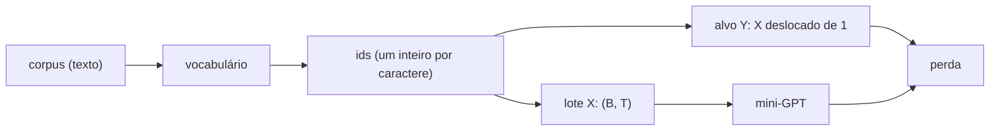

## Passo 1 · Leitura · Do texto aos lotes

As quatro lições anteriores montaram o modelo. Falta o que vem antes dele: transformar um texto em exemplos de treino. O caminho tem quatro etapas.



**Corpus.** O arquivo `corpus.py` gera o texto do módulo: 1 500 frases sobre uma vila fictícia, montadas por uma gramática pequena (sujeito, verbo, objeto, lugar e, em metade das frases, um tempo), como `a oleira procura o queijo no moinho de manhã.`. São 62 879 caracteres. O texto é simples de propósito: a estrutura dele pode ser aprendida em segundos, e dá para ver o modelo aprendendo de verdade dentro do limite de tempo do executor.

**Vocabulário e ids.** Neste módulo, o token é o caractere (o BPE da primeira lição fica para o projeto). O corpus tem $V = 29$ caracteres distintos, e cada um vira um inteiro de 0 a 28. Os primeiros 90 % dos ids (56 591) são o treino, e os 10 % finais (6 288) ficam para a validação.

```python
import corpus
vocab, ids_treino, ids_val = corpus.carregar()
print(len(vocab), len(ids_treino), len(ids_val))   # 29 56591 6288
```

**Lotes.** O modelo enxerga janelas de $T = 16$ tokens. Um lote é feito de $B$ janelas que começam em pontos sorteados do texto, empilhadas num array `X` de forma $(B, T)$.

**Alvos deslocados.** O alvo `Y` é a mesma janela um passo adiante: se `X` cobre os ids de `i` a `i + T - 1`, `Y` cobre os de `i + 1` a `i + T`. Na posição $t$, o modelo vê `X[:, :t + 1]` (a máscara causal garante isso) e precisa prever `Y[:, t]`. Uma única janela de 16 tokens rende 16 exemplos de treino, com contextos de 1 a 16 tokens.

Por causa do `+ 1`, o último início válido é `len(ids) - T - 1`. Um início sorteado além dele produz uma janela ou um alvo mais curto, e o `np.stack` do lote falha.

## Passo 2 · Previsão · O alvo deslocado

O código monta uma janela e o alvo dela a partir de uma posição fixa do texto, e depois mostra os exemplos de treino que saem dessa janela. Preveja cada linha.

### Código

```python
texto = "a rede no porto."
vocab = sorted(set(texto))
ids = [vocab.index(c) for c in texto]
print(len(vocab))

T = 4
inicio = 2
x = ids[inicio:inicio + T]
y = ids[inicio + 1:inicio + T + 1]
print(repr("".join(vocab[i] for i in x)), repr("".join(vocab[i] for i in y)))

for t in range(T):
    contexto = "".join(vocab[i] for i in x[:t + 1])
    print(repr(contexto), "->", repr(vocab[y[t]]))
```

### Dicas

1. O vocabulário conta caracteres distintos, incluindo o espaço e o ponto.
2. A posição 2 do texto é o `r` de `rede`.
3. Na posição `t`, o alvo é o caractere que vem logo depois do contexto.

### Saída esperada

```text
10
'rede' 'ede '
'r' -> 'e'
're' -> 'd'
'red' -> 'e'
'rede' -> ' '
```

## Passo 3 · Exercício · `gerar_lote(ids, T, B, rng)`
modo: lacunas

Complete a função que sorteia um lote de treino. `ids` é um array de inteiros (o texto inteiro), `T` é o tamanho da janela, `B` é o número de janelas e `rng` é um gerador do numpy já criado. A função devolve `(X, Y)`, os dois de forma `(B, T)`: `X[b]` é uma janela de `T` ids seguidos e `Y[b]` é a mesma janela deslocada um passo adiante.

Os inícios são sorteados com uma chamada só, `rng.integers(0, limite, B)`, em que `limite` é o primeiro início que **não** cabe (o `rng.integers` exclui o limite superior).

### Instruções

1. Sorteie os `B` inícios de modo que a janela e o alvo caibam inteiros no texto.
2. Monte `X` com as janelas de `T` ids a partir de cada início.
3. Monte `Y` com as mesmas janelas deslocadas de 1.

### Código inicial

```python
import numpy as np


def gerar_lote(ids, T, B, rng):
    inicios = rng.integers(0, ___, B)
    X = np.stack([ids[___] for i in inicios])
    Y = np.stack([ids[___] for i in inicios])
    return X, Y


if __name__ == "__main__":
    ids = np.arange(100)
    X, Y = gerar_lote(ids, 8, 4, np.random.default_rng(0))
    print(X.shape, Y.shape)
    print(X[0].tolist(), Y[0].tolist())
```

### Solução

```python
import numpy as np


def gerar_lote(ids, T, B, rng):
    inicios = rng.integers(0, len(ids) - T, B)
    X = np.stack([ids[i:i + T] for i in inicios])
    Y = np.stack([ids[i + 1:i + T + 1] for i in inicios])
    return X, Y


if __name__ == "__main__":
    ids = np.arange(100)
    X, Y = gerar_lote(ids, 8, 4, np.random.default_rng(0))
    print(X.shape, Y.shape)
    print(X[0].tolist(), Y[0].tolist())
```

### Dicas

1. O alvo da última posição da janela é o id `i + T`: ele precisa existir.
2. A janela que começa em `i` vai de `i` até `i + T - 1`.
3. `Y[b, t]` é sempre o id que vem depois de `X[b, t]` no texto.

### Verificação

```json
[
  {"id": "formas", "checkpoint": 2, "kind": "expr", "setup": "import numpy as np\n_ids = np.arange(1000, 1100)\n_X, _Y = gerar_lote(_ids, 8, 5, np.random.default_rng(0))", "expr": "[list(_X.shape), list(_Y.shape)]", "expected": [[5, 8], [5, 8]], "name": "X e Y têm forma (B, T)"},
  {"id": "janelas-seguidas", "checkpoint": 2, "kind": "expr", "setup": "import numpy as np\n_ids = np.arange(1000, 1100)\n_X, _Y = gerar_lote(_ids, 8, 5, np.random.default_rng(0))", "expr": "bool((np.diff(_X, axis=1) == 1).all())", "expected": true, "name": "Cada linha de X são T ids seguidos do texto"},
  {"id": "alvo-deslocado", "checkpoint": 3, "kind": "expr", "setup": "import numpy as np\n_ids = np.arange(1000, 1100)\n_X, _Y = gerar_lote(_ids, 8, 5, np.random.default_rng(0))", "expr": "bool(np.array_equal(_Y, _X + 1))", "expected": true, "name": "Com ids em sequência, Y é X + 1", "hint": "O alvo começa uma posição depois da janela e tem o mesmo tamanho."},
  {"id": "inicios-do-gerador", "checkpoint": 1, "kind": "expr", "setup": "import numpy as np\n_ids = np.arange(1000, 1100)\n_X, _Y = gerar_lote(_ids, 8, 6, np.random.default_rng(3))", "expr": "bool(np.array_equal(_X[:, 0] - 1000, np.random.default_rng(3).integers(0, 92, 6)))", "expected": true, "name": "Os inícios vêm de uma chamada rng.integers(0, len(ids) - T, B)", "hint": "Com 100 ids e T = 8, os inícios válidos vão de 0 a 91."},
  {"id": "texto-minimo", "checkpoint": 1, "kind": "expr", "setup": "import numpy as np\n_X, _Y = gerar_lote(np.array([5, 6, 7, 8, 9]), 4, 3, np.random.default_rng(0))", "expr": "[_X.tolist(), _Y.tolist()]", "expected": [[[5, 6, 7, 8], [5, 6, 7, 8], [5, 6, 7, 8]], [[6, 7, 8, 9], [6, 7, 8, 9], [6, 7, 8, 9]]], "name": "Com T + 1 ids, o único início possível é 0", "hint": "O limite do sorteio é len(ids) - T: aqui, 1."},
  {"id": "nunca-curto", "checkpoint": 1, "kind": "expr", "setup": "import numpy as np\n_X, _Y = gerar_lote(np.arange(12), 8, 300, np.random.default_rng(1))", "expr": "[list(_X.shape), list(_Y.shape), int(_Y.max())]", "expected": [[300, 8], [300, 8], 11], "name": "300 janelas num texto de 12 ids: nenhuma sai curta, e o último id é alcançado", "hint": "Um início grande demais deixa o alvo sem o último id, e o np.stack falha."},
  {"id": "espalhados", "checkpoint": 1, "kind": "expr", "setup": "import numpy as np\n_ids = np.arange(1000, 1100)\n_X, _Y = gerar_lote(_ids, 8, 200, np.random.default_rng(2))", "expr": "[bool(_X[:, 0].min() < 1010), bool(_X[:, 0].max() > 1080)]", "expected": [true, true], "name": "Os inícios se espalham pelo texto inteiro", "hint": "Os inícios são sorteados, não os primeiros B do texto."},
  {"id": "dois-lotes", "checkpoint": 1, "kind": "expr", "setup": "import numpy as np\n_ids = np.arange(1000, 1100)\n_r = np.random.default_rng(4)\n_X1, _ = gerar_lote(_ids, 8, 6, _r)\n_X2, _ = gerar_lote(_ids, 8, 6, _r)", "expr": "bool(np.array_equal(_X1, _X2))", "expected": false, "name": "Duas chamadas com o mesmo gerador dão lotes diferentes"},
  {"id": "texto-de-verdade", "checkpoint": 3, "kind": "expr", "setup": "import numpy as np\n_ids = np.array([3, 1, 4, 1, 5, 9, 2, 6, 5, 3, 5, 8, 9, 7, 9, 3])\n_X, _Y = gerar_lote(_ids, 5, 4, np.random.default_rng(0))", "expr": "bool(np.array_equal(_X[:, 1:], _Y[:, :-1]))", "expected": true, "name": "Num texto qualquer, Y[:, :-1] coincide com X[:, 1:]"}
]
```

### Soluções erradas

```python name="alvo não deslocado"
import numpy as np


def gerar_lote(ids, T, B, rng):
    inicios = rng.integers(0, len(ids) - T, B)
    X = np.stack([ids[i:i + T] for i in inicios])
    Y = np.stack([ids[i:i + T] for i in inicios])
    return X, Y


if __name__ == "__main__":
    ids = np.arange(100)
    X, Y = gerar_lote(ids, 8, 4, np.random.default_rng(0))
    print(X.shape, Y.shape)
    print(X[0].tolist(), Y[0].tolist())
```

```python name="início sorteado até len(ids)"
import numpy as np


def gerar_lote(ids, T, B, rng):
    inicios = rng.integers(0, len(ids), B)
    X = np.stack([ids[i:i + T] for i in inicios])
    Y = np.stack([ids[i + 1:i + T + 1] for i in inicios])
    return X, Y


if __name__ == "__main__":
    ids = np.arange(100)
    X, Y = gerar_lote(ids, 8, 4, np.random.default_rng(0))
    print(X.shape, Y.shape)
    print(X[0].tolist(), Y[0].tolist())
```

```python name="lotes só do início do texto"
import numpy as np


def gerar_lote(ids, T, B, rng):
    inicios = np.arange(B)
    X = np.stack([ids[i:i + T] for i in inicios])
    Y = np.stack([ids[i + 1:i + T + 1] for i in inicios])
    return X, Y


if __name__ == "__main__":
    ids = np.arange(100)
    X, Y = gerar_lote(ids, 8, 4, np.random.default_rng(0))
    print(X.shape, Y.shape)
    print(X[0].tolist(), Y[0].tolist())
```

```python name="alvo com um token a menos"
import numpy as np


def gerar_lote(ids, T, B, rng):
    inicios = rng.integers(0, len(ids) - T, B)
    X = np.stack([ids[i:i + T] for i in inicios])
    Y = np.stack([ids[i + 1:i + T] for i in inicios])
    return X, Y


if __name__ == "__main__":
    ids = np.arange(100)
    X, Y = gerar_lote(ids, 8, 4, np.random.default_rng(0))
    print(X.shape, Y.shape)
    print(X[0].tolist(), Y[0].tolist())
```

```python name="limite do sorteio um a mais"
import numpy as np


def gerar_lote(ids, T, B, rng):
    inicios = rng.integers(0, len(ids) - T + 1, B)
    X = np.stack([ids[i:i + T] for i in inicios])
    Y = np.stack([ids[i + 1:i + T + 1] for i in inicios])
    return X, Y


if __name__ == "__main__":
    ids = np.arange(100)
    X, Y = gerar_lote(ids, 8, 4, np.random.default_rng(0))
    print(X.shape, Y.shape)
    print(X[0].tolist(), Y[0].tolist())
```

```python name="alvo deslocado para trás"
import numpy as np


def gerar_lote(ids, T, B, rng):
    inicios = rng.integers(0, len(ids) - T, B)
    X = np.stack([ids[i:i + T] for i in inicios])
    Y = np.stack([ids[i - 1:i + T - 1] for i in inicios])
    return X, Y


if __name__ == "__main__":
    ids = np.arange(100)
    X, Y = gerar_lote(ids, 8, 4, np.random.default_rng(0))
    print(X.shape, Y.shape)
    print(X[0].tolist(), Y[0].tolist())
```

## Passo 4 · Leitura · Perda de próximo token e o orçamento

O forward do mini-GPT devolve logits de forma $(B, T, V)$: para cada janela e cada posição, uma pontuação por caractere do vocabulário. A perda é a entropia cruzada de sempre, com uma diferença só de contabilidade: cada posição de cada janela conta como um exemplo, e a média é tirada sobre os $B \cdot T$ exemplos.

$$
L = -\frac{1}{B\,T} \sum_{b=1}^{B} \sum_{t=1}^{T} \ln p_{b,t}[y_{b,t}], \qquad \frac{\partial L}{\partial \text{logits}} = \frac{p - \text{onehot}(y)}{B\,T}
$$

Antes do treino, as probabilidades são quase iguais e a perda fica perto de $\ln V = \ln 29 = 3{,}37$. Esse número é o primeiro teste de qualquer treino: uma perda inicial muito diferente de $\ln V$ indica defeito na inicialização ou na perda.

O passo de treino usa o Adam, com um cuidado a mais: o **clipping** da norma do gradiente. Se a norma de todos os gradientes juntos passar de 1, eles são divididos por ela, o que impede um lote ruim de dar um passo enorme.

```python
norma = np.sqrt(sum((g ** 2).sum() for g in grads.values()))
if norma > 1.0:
    grads = {k: g / norma for k, g in grads.items()}
```

**O orçamento.** Uma estimativa útil do custo de treinar um modelo com $N$ parâmetros em $D$ tokens é $6ND$ operações: cada parâmetro participa de cerca de 2 operações por token no forward e 4 no backward. Com $N = 15\,008$ e $16 \cdot 16 = 256$ tokens por passo, são 23 milhões de operações por passo. No executor do curso, cada passo desse modelo leva 6,9 ms, o que dá 3,3 bilhões de operações por segundo.

| Modelo | Parâmetros | Tempo por passo |
|---|---|---|
| $T = 16$, $d = 32$, 1 bloco, lote 16 | 15 008 | 6,9 ms |
| $T = 16$, $d = 32$, 2 blocos, lote 16 | 27 584 | 13 ms |
| $T = 32$, $d = 64$, 2 blocos, lote 32 | 105 344 | 220 ms |

Cada execução no curso tem um limite de 10 segundos. O terceiro modelo faria 45 passos nesse tempo, o que não treina nada. Com o primeiro, cabem 600 passos em 4,2 s, e o texto da vila é aprendido. Por isso os exercícios treinam por poucas dezenas de passos, e o modelo treinado por mais tempo chega pronto num arquivo de pesos.

## Passo 5 · Exercício · Perda e treino curto

Escreva a perda e o laço de treino. O arquivo já traz `gerar_lote` (do passo 3), e os arquivos de apoio são `gpt.py` (o mini-GPT de referência: `criar_params`, `forward` e `backward`), `adam.py` (o `Adam` da lição de otimizadores, com `passo(params, grads)` recebendo listas de arrays) e `corpus.py`.

`perda_proximo_token(logits, alvos)` recebe logits `(B, T, V)` e alvos inteiros `(B, T)` e devolve `(perda, dlogits)`: a entropia cruzada média sobre as `B * T` posições, como `float`, e o gradiente dela em relação aos logits, com a forma dos logits. Use a softmax estável.

`treinar(params, ids, T, B, passos, taxa, semente, perda_e_grads)` treina no lugar o dicionário `params` e devolve a lista com a perda de cada passo. A função `perda_e_grads(params, X, Y)` é recebida pronta e devolve `(perda, grads)`, com `grads` um dicionário com as mesmas chaves de `params`. O procedimento é fixo:

- crie `rng = np.random.default_rng(semente)` e um `Adam(taxa)`, uma vez cada;
- a cada passo, sorteie `gerar_lote(ids, T, B, rng)`, chame `perda_e_grads` e guarde a perda;
- clipping: calcule a norma de todos os gradientes juntos (raiz da soma dos quadrados de todos os arrays) e, se ela passar de `1.0`, divida todos os gradientes por ela;
- atualize com `otimizador.passo`, passando as listas de parâmetros e de gradientes na ordem das chaves de `params`.

Nos casos, 40 passos num mini-GPT de 2 blocos levam a perda de perto de $\ln 29 = 3{,}37$ para menos de 2,6 (a solução chega a cerca de 2,1).

### Instruções

1. `perda_proximo_token`: softmax estável no último eixo, média de $-\ln p$ do alvo sobre as `B * T` posições, e `dlogits = (p - onehot) / (B * T)`.
2. `treinar`: gerador e otimizador criados uma vez; a cada passo, lote, perda e gradientes, clipping pela norma global em `1.0`, atualização com o Adam; devolva a lista das perdas.

### Código inicial

```python
import numpy as np

import gpt
from adam import Adam


def gerar_lote(ids, T, B, rng):
    inicios = rng.integers(0, len(ids) - T, B)
    X = np.stack([ids[i:i + T] for i in inicios])
    Y = np.stack([ids[i + 1:i + T + 1] for i in inicios])
    return X, Y


def perda_proximo_token(logits, alvos):
    # logits (B, T, V), alvos (B, T) -> (perda média, dlogits)
    pass


def treinar(params, ids, T, B, passos, taxa, semente, perda_e_grads):
    # gerador, Adam, e a cada passo: lote, perda e gradientes, clipping, atualização
    pass


def perda_e_grads_gpt(params, X, Y):
    logits, cache = gpt.forward(params, X)
    perda, dlogits = perda_proximo_token(logits, Y)
    return perda, gpt.backward(params, dlogits, cache)


if __name__ == "__main__":
    ids = np.arange(300) % 7
    params = gpt.criar_params(7, 8, 16, 2, 0)
    perdas = treinar(params, ids, 8, 16, 20, 0.01, 0, perda_e_grads_gpt)
    print(round(perdas[0], 3), round(perdas[-1], 3))
```
```python path=gpt.py
"""Mini-GPT de referência do curso: forward e backward em numpy.

params é um dicionário de arrays. Chaves: "tok" (V, d), "pos" (T, d), por bloco i
"b{i}.ln1_g", "b{i}.ln1_b", "b{i}.Wq", "b{i}.Wk", "b{i}.Wv", "b{i}.Wo", "b{i}.ln2_g",
"b{i}.ln2_b", "b{i}.W1", "b{i}.c1", "b{i}.W2", "b{i}.c2", e no fim "lnf_g", "lnf_b", "Ws" (d, V).
"""
import base64
import json

import numpy as np


def criar_params(V, T, d, n_blocos, semente=0):
    """Sorteia os parâmetros de um mini-GPT (pré-norm, MLP 4d com ReLU)."""
    rng = np.random.default_rng(semente)
    p = {"tok": rng.normal(0, 0.1, (V, d)), "pos": rng.normal(0, 0.1, (T, d))}
    for i in range(n_blocos):
        p[f"b{i}.ln1_g"], p[f"b{i}.ln1_b"] = np.ones(d), np.zeros(d)
        for nome in ("Wq", "Wk", "Wv", "Wo"):
            p[f"b{i}.{nome}"] = rng.normal(0, d ** -0.5, (d, d))
        p[f"b{i}.ln2_g"], p[f"b{i}.ln2_b"] = np.ones(d), np.zeros(d)
        p[f"b{i}.W1"], p[f"b{i}.c1"] = rng.normal(0, (2 / d) ** 0.5, (d, 4 * d)), np.zeros(4 * d)
        p[f"b{i}.W2"], p[f"b{i}.c2"] = rng.normal(0, (4 * d) ** -0.5, (4 * d, d)), np.zeros(d)
    p["lnf_g"], p["lnf_b"] = np.ones(d), np.zeros(d)
    p["Ws"] = rng.normal(0, 0.1 * d ** -0.5, (d, V))
    return p


def contar_parametros(params):
    """Total de números em todos os arrays de params."""
    return int(sum(a.size for a in params.values()))


def _ln(x, g, b, eps=1e-5):
    xc = x - x.mean(-1, keepdims=True)
    s = np.sqrt((xc ** 2).mean(-1, keepdims=True) + eps)
    return g * (xc / s) + b, (xc / s, s, g)


def _ln_back(dy, cache):
    xh, s, g = cache
    dxh = dy * g
    dx = (dxh - dxh.mean(-1, keepdims=True) - xh * (dxh * xh).mean(-1, keepdims=True)) / s
    return dx, (dy * xh).sum((0, 1)), dy.sum((0, 1))


def _dividir(x, h):
    B, T, d = x.shape
    return x.reshape(B, T, h, d // h).transpose(0, 2, 1, 3)


def _juntar(x):
    B, h, T, dh = x.shape
    return x.transpose(0, 2, 1, 3).reshape(B, T, h * dh)


def forward(params, ids, h=4):
    """ids (B, T) de inteiros -> (logits (B, T, V), cache). T pode ser menor que o contexto."""
    B, T = ids.shape
    n_blocos = sum(1 for k in params if k.endswith(".Wq"))
    x = params["tok"][ids] + params["pos"][:T]
    dh = x.shape[-1] // h
    futuro = np.triu(np.ones((T, T), dtype=bool), 1)
    blocos = []
    for i in range(n_blocos):
        P = {k.split(".")[1]: v for k, v in params.items() if k.startswith(f"b{i}.")}
        a, ln1 = _ln(x, P["ln1_g"], P["ln1_b"])
        q, k, v = _dividir(a @ P["Wq"], h), _dividir(a @ P["Wk"], h), _dividir(a @ P["Wv"], h)
        S = np.where(futuro, -np.inf, q @ k.transpose(0, 1, 3, 2) / np.sqrt(dh))
        A = np.exp(S - S.max(-1, keepdims=True))
        A = A / A.sum(-1, keepdims=True)
        o = _juntar(A @ v)
        x = x + o @ P["Wo"]
        m, ln2 = _ln(x, P["ln2_g"], P["ln2_b"])
        z = m @ P["W1"] + P["c1"]
        r = np.maximum(z, 0.0)
        x = x + r @ P["W2"] + P["c2"]
        blocos.append((a, ln1, q, k, v, A, o, m, ln2, z, r))
    f, lnf = _ln(x, params["lnf_g"], params["lnf_b"])
    return f @ params["Ws"], (ids, blocos, f, lnf, h)


def backward(params, dlogits, cache):
    """Gradientes de todos os parâmetros (dicionário com as mesmas chaves), dado dL/dlogits."""
    ids, blocos, f, lnf, h = cache
    B, T = ids.shape
    dh = f.shape[-1] // h
    plano = lambda a: a.reshape(B * T, -1)
    g = {"Ws": plano(f).T @ plano(dlogits)}
    dx, g["lnf_g"], g["lnf_b"] = _ln_back(dlogits @ params["Ws"].T, lnf)
    for i in reversed(range(len(blocos))):
        P = {k.split(".")[1]: v for k, v in params.items() if k.startswith(f"b{i}.")}
        a, ln1, q, k, v, A, o, m, ln2, z, r = blocos[i]
        g[f"b{i}.W2"], g[f"b{i}.c2"] = plano(r).T @ plano(dx), dx.sum((0, 1))
        dz = (dx @ P["W2"].T) * (z > 0)
        g[f"b{i}.W1"], g[f"b{i}.c1"] = plano(m).T @ plano(dz), dz.sum((0, 1))
        dm, g[f"b{i}.ln2_g"], g[f"b{i}.ln2_b"] = _ln_back(dz @ P["W1"].T, ln2)
        dx = dx + dm
        g[f"b{i}.Wo"] = plano(o).T @ plano(dx)
        dAv = _dividir(dx @ P["Wo"].T, h)
        dA = dAv @ v.transpose(0, 1, 3, 2)
        dS = A * (dA - (dA * A).sum(-1, keepdims=True)) / np.sqrt(dh)
        dq, dk, dv = _juntar(dS @ k), _juntar(dS.transpose(0, 1, 3, 2) @ q), _juntar(A.transpose(0, 1, 3, 2) @ dAv)
        for nome, dp in (("Wq", dq), ("Wk", dk), ("Wv", dv)):
            g[f"b{i}.{nome}"] = plano(a).T @ plano(dp)
        da, g[f"b{i}.ln1_g"], g[f"b{i}.ln1_b"] = _ln_back(dq @ P["Wq"].T + dk @ P["Wk"].T + dv @ P["Wv"].T, ln1)
        dx = dx + da
    g["tok"] = np.zeros_like(params["tok"])
    np.add.at(g["tok"], ids, dx)
    g["pos"] = np.zeros_like(params["pos"])
    g["pos"][:T] = dx.sum(0)
    return g


def carregar_pesos(caminho="pesos_gpt.txt"):
    """Lê os pesos pré-treinados: linha 1 com [chave, forma] em JSON, linha 2 com float16 em base64."""
    with open(caminho, encoding="utf-8") as arq:
        formas = json.loads(arq.readline())
        plano = np.frombuffer(base64.b64decode(arq.readline().strip()), dtype=np.float16).astype(np.float64)
    params, i = {}, 0
    for chave, forma in formas:
        n = int(np.prod(forma))
        params[chave] = plano[i:i + n].reshape(forma).copy()
        i += n
    return params
```
```python path=adam.py
import numpy as np


class Adam:
    """O Adam da lição de otimizadores: params e grads são listas planas de arrays, atualizados no lugar."""

    def __init__(self, taxa=0.001, beta1=0.9, beta2=0.999, eps=1e-8):
        self.taxa = taxa
        self.beta1 = beta1
        self.beta2 = beta2
        self.eps = eps
        self.t = 0
        self.m = None
        self.v = None

    def passo(self, params, grads):
        if self.m is None:
            self.m = [np.zeros_like(p) for p in params]
            self.v = [np.zeros_like(p) for p in params]
        self.t += 1
        for i, (p, g) in enumerate(zip(params, grads)):
            self.m[i] = self.beta1 * self.m[i] + (1 - self.beta1) * g
            self.v[i] = self.beta2 * self.v[i] + (1 - self.beta2) * g * g
            m_c = self.m[i] / (1 - self.beta1 ** self.t)
            v_c = self.v[i] / (1 - self.beta2 ** self.t)
            p -= self.taxa * m_c / (np.sqrt(v_c) + self.eps)
```
```python path=corpus.py
"""Corpus do curso: frases geradas por uma gramática pequena sobre uma vila fictícia."""
import numpy as np

SUJEITOS = ["a padeira", "o ferreiro", "a tecelã", "o pescador", "a moleira", "o pastor", "a oleira", "o barqueiro"]
VERBOS = ["leva", "guarda", "vende", "procura", "conserta", "divide"]
OBJETOS = ["o pão", "a rede", "o barco", "a lenha", "o queijo", "a farinha", "o cesto", "o azeite"]
LUGARES = ["na praça", "no moinho", "na ponte", "no porto", "na feira", "no celeiro"]
TEMPOS = ["de manhã", "à tarde", "à noite", "até o almoço", "antes da chuva", "depois da festa"]


def gerar_corpus(n_frases=1500, semente=0):
    """Devolve n_frases frases, uma por linha; metade delas termina com um tempo."""
    rng = np.random.default_rng(semente)
    frases = []
    for _ in range(n_frases):
        partes = [str(rng.choice(SUJEITOS)), str(rng.choice(VERBOS)), str(rng.choice(OBJETOS)), str(rng.choice(LUGARES))]
        if rng.random() < 0.5:
            partes.append(str(rng.choice(TEMPOS)))
        frases.append(" ".join(partes) + ".")
    return "\n".join(frases) + "\n"


def vocabulario(texto):
    """Caracteres distintos do texto, em ordem."""
    return sorted(set(texto))


def codificar(texto, vocab):
    """Texto -> array de ids (posição de cada caractere em vocab)."""
    para_id = {c: i for i, c in enumerate(vocab)}
    return np.array([para_id[c] for c in texto], dtype=np.intp)


def decodificar(ids, vocab):
    """Ids -> texto."""
    return "".join(vocab[int(i)] for i in ids)


def carregar(n_frases=1500, semente=0, fracao_treino=0.9):
    """Devolve (vocab, ids_treino, ids_val): os últimos 10 % do texto ficam para validação."""
    texto = gerar_corpus(n_frases, semente)
    vocab = vocabulario(texto)
    ids = codificar(texto, vocab)
    corte = int(len(ids) * fracao_treino)
    return vocab, ids[:corte], ids[corte:]
```

### Solução

```python
import numpy as np

import gpt
from adam import Adam


def gerar_lote(ids, T, B, rng):
    inicios = rng.integers(0, len(ids) - T, B)
    X = np.stack([ids[i:i + T] for i in inicios])
    Y = np.stack([ids[i + 1:i + T + 1] for i in inicios])
    return X, Y


def perda_proximo_token(logits, alvos):
    B, T, V = logits.shape
    Z = logits - logits.max(axis=-1, keepdims=True)
    P = np.exp(Z)
    P = P / P.sum(axis=-1, keepdims=True)
    linhas, colunas = np.arange(B)[:, None], np.arange(T)
    perda = float(-np.log(P[linhas, colunas, alvos]).mean())
    dlogits = P.copy()
    dlogits[linhas, colunas, alvos] -= 1.0
    return perda, dlogits / (B * T)


def treinar(params, ids, T, B, passos, taxa, semente, perda_e_grads):
    rng = np.random.default_rng(semente)
    otimizador = Adam(taxa)
    chaves = list(params)
    perdas = []
    for _ in range(passos):
        X, Y = gerar_lote(ids, T, B, rng)
        perda, grads = perda_e_grads(params, X, Y)
        norma = float(np.sqrt(sum((grads[k] ** 2).sum() for k in chaves)))
        if norma > 1.0:
            grads = {k: grads[k] / norma for k in chaves}
        otimizador.passo([params[k] for k in chaves], [grads[k] for k in chaves])
        perdas.append(perda)
    return perdas


def perda_e_grads_gpt(params, X, Y):
    logits, cache = gpt.forward(params, X)
    perda, dlogits = perda_proximo_token(logits, Y)
    return perda, gpt.backward(params, dlogits, cache)


if __name__ == "__main__":
    ids = np.arange(300) % 7
    params = gpt.criar_params(7, 8, 16, 2, 0)
    perdas = treinar(params, ids, 8, 16, 20, 0.01, 0, perda_e_grads_gpt)
    print(round(perdas[0], 3), round(perdas[-1], 3))
```
```python path=gpt.py
"""Mini-GPT de referência do curso: forward e backward em numpy.

params é um dicionário de arrays. Chaves: "tok" (V, d), "pos" (T, d), por bloco i
"b{i}.ln1_g", "b{i}.ln1_b", "b{i}.Wq", "b{i}.Wk", "b{i}.Wv", "b{i}.Wo", "b{i}.ln2_g",
"b{i}.ln2_b", "b{i}.W1", "b{i}.c1", "b{i}.W2", "b{i}.c2", e no fim "lnf_g", "lnf_b", "Ws" (d, V).
"""
import base64
import json

import numpy as np


def criar_params(V, T, d, n_blocos, semente=0):
    """Sorteia os parâmetros de um mini-GPT (pré-norm, MLP 4d com ReLU)."""
    rng = np.random.default_rng(semente)
    p = {"tok": rng.normal(0, 0.1, (V, d)), "pos": rng.normal(0, 0.1, (T, d))}
    for i in range(n_blocos):
        p[f"b{i}.ln1_g"], p[f"b{i}.ln1_b"] = np.ones(d), np.zeros(d)
        for nome in ("Wq", "Wk", "Wv", "Wo"):
            p[f"b{i}.{nome}"] = rng.normal(0, d ** -0.5, (d, d))
        p[f"b{i}.ln2_g"], p[f"b{i}.ln2_b"] = np.ones(d), np.zeros(d)
        p[f"b{i}.W1"], p[f"b{i}.c1"] = rng.normal(0, (2 / d) ** 0.5, (d, 4 * d)), np.zeros(4 * d)
        p[f"b{i}.W2"], p[f"b{i}.c2"] = rng.normal(0, (4 * d) ** -0.5, (4 * d, d)), np.zeros(d)
    p["lnf_g"], p["lnf_b"] = np.ones(d), np.zeros(d)
    p["Ws"] = rng.normal(0, 0.1 * d ** -0.5, (d, V))
    return p


def contar_parametros(params):
    """Total de números em todos os arrays de params."""
    return int(sum(a.size for a in params.values()))


def _ln(x, g, b, eps=1e-5):
    xc = x - x.mean(-1, keepdims=True)
    s = np.sqrt((xc ** 2).mean(-1, keepdims=True) + eps)
    return g * (xc / s) + b, (xc / s, s, g)


def _ln_back(dy, cache):
    xh, s, g = cache
    dxh = dy * g
    dx = (dxh - dxh.mean(-1, keepdims=True) - xh * (dxh * xh).mean(-1, keepdims=True)) / s
    return dx, (dy * xh).sum((0, 1)), dy.sum((0, 1))


def _dividir(x, h):
    B, T, d = x.shape
    return x.reshape(B, T, h, d // h).transpose(0, 2, 1, 3)


def _juntar(x):
    B, h, T, dh = x.shape
    return x.transpose(0, 2, 1, 3).reshape(B, T, h * dh)


def forward(params, ids, h=4):
    """ids (B, T) de inteiros -> (logits (B, T, V), cache). T pode ser menor que o contexto."""
    B, T = ids.shape
    n_blocos = sum(1 for k in params if k.endswith(".Wq"))
    x = params["tok"][ids] + params["pos"][:T]
    dh = x.shape[-1] // h
    futuro = np.triu(np.ones((T, T), dtype=bool), 1)
    blocos = []
    for i in range(n_blocos):
        P = {k.split(".")[1]: v for k, v in params.items() if k.startswith(f"b{i}.")}
        a, ln1 = _ln(x, P["ln1_g"], P["ln1_b"])
        q, k, v = _dividir(a @ P["Wq"], h), _dividir(a @ P["Wk"], h), _dividir(a @ P["Wv"], h)
        S = np.where(futuro, -np.inf, q @ k.transpose(0, 1, 3, 2) / np.sqrt(dh))
        A = np.exp(S - S.max(-1, keepdims=True))
        A = A / A.sum(-1, keepdims=True)
        o = _juntar(A @ v)
        x = x + o @ P["Wo"]
        m, ln2 = _ln(x, P["ln2_g"], P["ln2_b"])
        z = m @ P["W1"] + P["c1"]
        r = np.maximum(z, 0.0)
        x = x + r @ P["W2"] + P["c2"]
        blocos.append((a, ln1, q, k, v, A, o, m, ln2, z, r))
    f, lnf = _ln(x, params["lnf_g"], params["lnf_b"])
    return f @ params["Ws"], (ids, blocos, f, lnf, h)


def backward(params, dlogits, cache):
    """Gradientes de todos os parâmetros (dicionário com as mesmas chaves), dado dL/dlogits."""
    ids, blocos, f, lnf, h = cache
    B, T = ids.shape
    dh = f.shape[-1] // h
    plano = lambda a: a.reshape(B * T, -1)
    g = {"Ws": plano(f).T @ plano(dlogits)}
    dx, g["lnf_g"], g["lnf_b"] = _ln_back(dlogits @ params["Ws"].T, lnf)
    for i in reversed(range(len(blocos))):
        P = {k.split(".")[1]: v for k, v in params.items() if k.startswith(f"b{i}.")}
        a, ln1, q, k, v, A, o, m, ln2, z, r = blocos[i]
        g[f"b{i}.W2"], g[f"b{i}.c2"] = plano(r).T @ plano(dx), dx.sum((0, 1))
        dz = (dx @ P["W2"].T) * (z > 0)
        g[f"b{i}.W1"], g[f"b{i}.c1"] = plano(m).T @ plano(dz), dz.sum((0, 1))
        dm, g[f"b{i}.ln2_g"], g[f"b{i}.ln2_b"] = _ln_back(dz @ P["W1"].T, ln2)
        dx = dx + dm
        g[f"b{i}.Wo"] = plano(o).T @ plano(dx)
        dAv = _dividir(dx @ P["Wo"].T, h)
        dA = dAv @ v.transpose(0, 1, 3, 2)
        dS = A * (dA - (dA * A).sum(-1, keepdims=True)) / np.sqrt(dh)
        dq, dk, dv = _juntar(dS @ k), _juntar(dS.transpose(0, 1, 3, 2) @ q), _juntar(A.transpose(0, 1, 3, 2) @ dAv)
        for nome, dp in (("Wq", dq), ("Wk", dk), ("Wv", dv)):
            g[f"b{i}.{nome}"] = plano(a).T @ plano(dp)
        da, g[f"b{i}.ln1_g"], g[f"b{i}.ln1_b"] = _ln_back(dq @ P["Wq"].T + dk @ P["Wk"].T + dv @ P["Wv"].T, ln1)
        dx = dx + da
    g["tok"] = np.zeros_like(params["tok"])
    np.add.at(g["tok"], ids, dx)
    g["pos"] = np.zeros_like(params["pos"])
    g["pos"][:T] = dx.sum(0)
    return g


def carregar_pesos(caminho="pesos_gpt.txt"):
    """Lê os pesos pré-treinados: linha 1 com [chave, forma] em JSON, linha 2 com float16 em base64."""
    with open(caminho, encoding="utf-8") as arq:
        formas = json.loads(arq.readline())
        plano = np.frombuffer(base64.b64decode(arq.readline().strip()), dtype=np.float16).astype(np.float64)
    params, i = {}, 0
    for chave, forma in formas:
        n = int(np.prod(forma))
        params[chave] = plano[i:i + n].reshape(forma).copy()
        i += n
    return params
```
```python path=adam.py
import numpy as np


class Adam:
    """O Adam da lição de otimizadores: params e grads são listas planas de arrays, atualizados no lugar."""

    def __init__(self, taxa=0.001, beta1=0.9, beta2=0.999, eps=1e-8):
        self.taxa = taxa
        self.beta1 = beta1
        self.beta2 = beta2
        self.eps = eps
        self.t = 0
        self.m = None
        self.v = None

    def passo(self, params, grads):
        if self.m is None:
            self.m = [np.zeros_like(p) for p in params]
            self.v = [np.zeros_like(p) for p in params]
        self.t += 1
        for i, (p, g) in enumerate(zip(params, grads)):
            self.m[i] = self.beta1 * self.m[i] + (1 - self.beta1) * g
            self.v[i] = self.beta2 * self.v[i] + (1 - self.beta2) * g * g
            m_c = self.m[i] / (1 - self.beta1 ** self.t)
            v_c = self.v[i] / (1 - self.beta2 ** self.t)
            p -= self.taxa * m_c / (np.sqrt(v_c) + self.eps)
```
```python path=corpus.py
"""Corpus do curso: frases geradas por uma gramática pequena sobre uma vila fictícia."""
import numpy as np

SUJEITOS = ["a padeira", "o ferreiro", "a tecelã", "o pescador", "a moleira", "o pastor", "a oleira", "o barqueiro"]
VERBOS = ["leva", "guarda", "vende", "procura", "conserta", "divide"]
OBJETOS = ["o pão", "a rede", "o barco", "a lenha", "o queijo", "a farinha", "o cesto", "o azeite"]
LUGARES = ["na praça", "no moinho", "na ponte", "no porto", "na feira", "no celeiro"]
TEMPOS = ["de manhã", "à tarde", "à noite", "até o almoço", "antes da chuva", "depois da festa"]


def gerar_corpus(n_frases=1500, semente=0):
    """Devolve n_frases frases, uma por linha; metade delas termina com um tempo."""
    rng = np.random.default_rng(semente)
    frases = []
    for _ in range(n_frases):
        partes = [str(rng.choice(SUJEITOS)), str(rng.choice(VERBOS)), str(rng.choice(OBJETOS)), str(rng.choice(LUGARES))]
        if rng.random() < 0.5:
            partes.append(str(rng.choice(TEMPOS)))
        frases.append(" ".join(partes) + ".")
    return "\n".join(frases) + "\n"


def vocabulario(texto):
    """Caracteres distintos do texto, em ordem."""
    return sorted(set(texto))


def codificar(texto, vocab):
    """Texto -> array de ids (posição de cada caractere em vocab)."""
    para_id = {c: i for i, c in enumerate(vocab)}
    return np.array([para_id[c] for c in texto], dtype=np.intp)


def decodificar(ids, vocab):
    """Ids -> texto."""
    return "".join(vocab[int(i)] for i in ids)


def carregar(n_frases=1500, semente=0, fracao_treino=0.9):
    """Devolve (vocab, ids_treino, ids_val): os últimos 10 % do texto ficam para validação."""
    texto = gerar_corpus(n_frases, semente)
    vocab = vocabulario(texto)
    ids = codificar(texto, vocab)
    corte = int(len(ids) * fracao_treino)
    return vocab, ids[:corte], ids[corte:]
```

### Dicas

1. Para indexar a probabilidade do alvo em três eixos, use `P[linhas, colunas, alvos]` com `linhas = np.arange(B)[:, None]` e `colunas = np.arange(T)`.
2. A norma global é uma só para o modelo inteiro: some os quadrados de todos os arrays antes de tirar a raiz.
3. `list(params)` dá as chaves na ordem do dicionário; use a mesma ordem para as duas listas do `passo`.

### Verificação

```json
[
  {"id": "logits-iguais", "checkpoint": 1, "kind": "expr", "setup": "import numpy as np", "expr": "perda_proximo_token(np.zeros((2, 3, 29)), np.array([[0, 5, 28], [7, 7, 1]]))[0]", "expected": 3.367295829986474, "tolerance": 1e-12, "name": "Logits iguais com V = 29: a perda é ln 29", "hint": "Com logits iguais, cada caractere tem probabilidade 1/29."},
  {"id": "perda-referencia", "checkpoint": 1, "kind": "expr", "setup": "import numpy as np\n_rng = np.random.default_rng(13)\n_lg = _rng.normal(size=(2, 3, 4))\n_y = np.array([[0, 3, 1], [2, 2, 0]])\ndef _ref(lg, y):\n    total = 0.0\n    for b in range(lg.shape[0]):\n        for t in range(lg.shape[1]):\n            e = np.exp(lg[b, t] - lg[b, t].max())\n            total -= float(np.log(e[y[b, t]] / e.sum()))\n    return total / (lg.shape[0] * lg.shape[1])\ndef _numerico(h=1e-5):\n    n = np.zeros_like(_lg)\n    it = np.nditer(_lg, flags=[\"multi_index\"])\n    for _ in it:\n        i = it.multi_index\n        v = _lg[i]\n        _lg[i] = v + h\n        mais = _ref(_lg, _y)\n        _lg[i] = v - h\n        menos = _ref(_lg, _y)\n        _lg[i] = v\n        n[i] = (mais - menos) / (2 * h)\n    return n\n", "expr": "bool(abs(perda_proximo_token(_lg, _y)[0] - _ref(_lg, _y)) < 1e-12)", "expected": true, "name": "Perda igual à da referência (B = 2, T = 3, V = 4)", "hint": "É a média sobre as B · T posições, não a soma."},
  {"id": "perda-float", "checkpoint": 1, "kind": "expr", "setup": "import numpy as np\n_rng = np.random.default_rng(13)\n_lg = _rng.normal(size=(2, 3, 4))\n_y = np.array([[0, 3, 1], [2, 2, 0]])\ndef _ref(lg, y):\n    total = 0.0\n    for b in range(lg.shape[0]):\n        for t in range(lg.shape[1]):\n            e = np.exp(lg[b, t] - lg[b, t].max())\n            total -= float(np.log(e[y[b, t]] / e.sum()))\n    return total / (lg.shape[0] * lg.shape[1])\ndef _numerico(h=1e-5):\n    n = np.zeros_like(_lg)\n    it = np.nditer(_lg, flags=[\"multi_index\"])\n    for _ in it:\n        i = it.multi_index\n        v = _lg[i]\n        _lg[i] = v + h\n        mais = _ref(_lg, _y)\n        _lg[i] = v - h\n        menos = _ref(_lg, _y)\n        _lg[i] = v\n        n[i] = (mais - menos) / (2 * h)\n    return n\n", "expr": "[type(perda_proximo_token(_lg, _y)[0]) is float, list(perda_proximo_token(_lg, _y)[1].shape)]", "expected": [true, [2, 3, 4]], "name": "A perda é float e dlogits tem a forma dos logits"},
  {"id": "dlogits-numerico", "checkpoint": 1, "kind": "expr", "setup": "import numpy as np\n_rng = np.random.default_rng(13)\n_lg = _rng.normal(size=(2, 3, 4))\n_y = np.array([[0, 3, 1], [2, 2, 0]])\ndef _ref(lg, y):\n    total = 0.0\n    for b in range(lg.shape[0]):\n        for t in range(lg.shape[1]):\n            e = np.exp(lg[b, t] - lg[b, t].max())\n            total -= float(np.log(e[y[b, t]] / e.sum()))\n    return total / (lg.shape[0] * lg.shape[1])\ndef _numerico(h=1e-5):\n    n = np.zeros_like(_lg)\n    it = np.nditer(_lg, flags=[\"multi_index\"])\n    for _ in it:\n        i = it.multi_index\n        v = _lg[i]\n        _lg[i] = v + h\n        mais = _ref(_lg, _y)\n        _lg[i] = v - h\n        menos = _ref(_lg, _y)\n        _lg[i] = v\n        n[i] = (mais - menos) / (2 * h)\n    return n\n_d = perda_proximo_token(_lg, _y)[1]\n_n = _numerico()", "expr": "bool(np.linalg.norm(_d - _n) / (np.linalg.norm(_d) + np.linalg.norm(_n)) < 1e-7)", "expected": true, "name": "dlogits confere com a diferença central", "hint": "dlogits = (p − onehot do alvo) / (B · T)."},
  {"id": "dlogits-soma-zero", "checkpoint": 1, "kind": "expr", "setup": "import numpy as np\n_rng = np.random.default_rng(13)\n_lg = _rng.normal(size=(2, 3, 4))\n_y = np.array([[0, 3, 1], [2, 2, 0]])\ndef _ref(lg, y):\n    total = 0.0\n    for b in range(lg.shape[0]):\n        for t in range(lg.shape[1]):\n            e = np.exp(lg[b, t] - lg[b, t].max())\n            total -= float(np.log(e[y[b, t]] / e.sum()))\n    return total / (lg.shape[0] * lg.shape[1])\ndef _numerico(h=1e-5):\n    n = np.zeros_like(_lg)\n    it = np.nditer(_lg, flags=[\"multi_index\"])\n    for _ in it:\n        i = it.multi_index\n        v = _lg[i]\n        _lg[i] = v + h\n        mais = _ref(_lg, _y)\n        _lg[i] = v - h\n        menos = _ref(_lg, _y)\n        _lg[i] = v\n        n[i] = (mais - menos) / (2 * h)\n    return n\n", "expr": "bool(np.allclose(perda_proximo_token(_lg, _y)[1].sum(axis=-1), 0.0, atol=1e-12))", "expected": true, "name": "Em cada posição, dlogits soma zero"},
  {"id": "logits-grandes", "checkpoint": 1, "kind": "expr", "setup": "import numpy as np\n_rng = np.random.default_rng(13)\n_lg = _rng.normal(size=(2, 3, 4))\n_y = np.array([[0, 3, 1], [2, 2, 0]])\ndef _ref(lg, y):\n    total = 0.0\n    for b in range(lg.shape[0]):\n        for t in range(lg.shape[1]):\n            e = np.exp(lg[b, t] - lg[b, t].max())\n            total -= float(np.log(e[y[b, t]] / e.sum()))\n    return total / (lg.shape[0] * lg.shape[1])\ndef _numerico(h=1e-5):\n    n = np.zeros_like(_lg)\n    it = np.nditer(_lg, flags=[\"multi_index\"])\n    for _ in it:\n        i = it.multi_index\n        v = _lg[i]\n        _lg[i] = v + h\n        mais = _ref(_lg, _y)\n        _lg[i] = v - h\n        menos = _ref(_lg, _y)\n        _lg[i] = v\n        n[i] = (mais - menos) / (2 * h)\n    return n\n", "expr": "bool(abs(perda_proximo_token(_lg + 1000.0, _y)[0] - _ref(_lg, _y)) < 1e-9)", "expected": true, "name": "Somar 1 000 a todos os logits não muda a perda nem produz nan", "hint": "Subtraia o máximo de cada posição antes da exponencial."},
  {"id": "tres-passos", "checkpoint": 2, "kind": "expr", "setup": "import numpy as np\n_ids = (np.arange(400) * 7 + np.arange(400) // 3) % 5\n_xs = []\n_fatores = [8.0, 0.5, 20.0]\ndef _tabela(p, X, Y):\n    Z = p[\"W\"][X] + p[\"b\"]\n    Pm = np.exp(Z - Z.max(axis=-1, keepdims=True))\n    Pm = Pm / Pm.sum(axis=-1, keepdims=True)\n    l, c = np.arange(X.shape[0])[:, None], np.arange(X.shape[1])\n    perda = float(-np.log(Pm[l, c, Y]).mean())\n    d = Pm.copy()\n    d[l, c, Y] -= 1.0\n    d = d / X.size\n    gW = np.zeros_like(p[\"W\"])\n    np.add.at(gW, X, d)\n    f = _fatores[len(_xs) % 3]\n    _xs.append(X.copy())\n    return perda, {\"W\": f * gW, \"b\": f * d.sum(axis=(0, 1))}\ndef _novo():\n    r = np.random.default_rng(21)\n    return {\"W\": r.normal(0.0, 0.5, (5, 5)), \"b\": np.zeros(5)}\n_p = _novo()\n_per = treinar(_p, _ids, 6, 8, 3, 0.05, 4, _tabela)", "expr": "_per", "expected": [1.566302303242279, 1.539121497034128, 1.5951600559518775], "tolerance": 1e-09, "name": "Três passos num modelo de tabela: as três perdas", "hint": "Confira a ordem: lote, perda e gradientes, clipping pela norma global, passo do Adam."},
  {"id": "tres-passos-pesos", "checkpoint": 2, "kind": "expr", "setup": "import numpy as np\n_ids = (np.arange(400) * 7 + np.arange(400) // 3) % 5\n_xs = []\n_fatores = [8.0, 0.5, 20.0]\ndef _tabela(p, X, Y):\n    Z = p[\"W\"][X] + p[\"b\"]\n    Pm = np.exp(Z - Z.max(axis=-1, keepdims=True))\n    Pm = Pm / Pm.sum(axis=-1, keepdims=True)\n    l, c = np.arange(X.shape[0])[:, None], np.arange(X.shape[1])\n    perda = float(-np.log(Pm[l, c, Y]).mean())\n    d = Pm.copy()\n    d[l, c, Y] -= 1.0\n    d = d / X.size\n    gW = np.zeros_like(p[\"W\"])\n    np.add.at(gW, X, d)\n    f = _fatores[len(_xs) % 3]\n    _xs.append(X.copy())\n    return perda, {\"W\": f * gW, \"b\": f * d.sum(axis=(0, 1))}\ndef _novo():\n    r = np.random.default_rng(21)\n    return {\"W\": r.normal(0.0, 0.5, (5, 5)), \"b\": np.zeros(5)}\n_p = _novo()\ntreinar(_p, _ids, 6, 8, 3, 0.05, 4, _tabela)", "expr": "_p[\"W\"].ravel().tolist() + _p[\"b\"].tolist()", "expected": [0.04734643884200472, 0.6238769514803036, -0.7594832020246597, 0.92974321349527, -0.15512126659119843, -0.5290986979853328, -0.5289206971081222, -0.6706394016902603, 0.018961588382009335, 0.279001017408199, 0.41555185942809714, 0.18606804588596979, -0.9817001412078001, -0.9197661405893939, 0.9117532851641533, 0.6117643552647728, 0.986286415831074, 0.47343367873094816, -0.6436504162266157, 0.5123191690406494, 0.18864089809568246, 0.22778071312636405, -0.27520387610678215, -0.12423211174707509, -0.19742356639345687, 0.1096194182148919, -0.12961973335518762, 0.13607556574383406, 0.10760767300263183, -0.12621079565211754], "tolerance": 1e-09, "name": "Os pesos depois dos três passos (com gradientes de norma acima e abaixo de 1)", "hint": "O clipping divide todos os gradientes pela mesma norma, só quando ela passa de 1; o Adam é um só para o treino inteiro."},
  {"id": "lista-de-perdas", "checkpoint": 2, "kind": "expr", "setup": "import numpy as np\n_ids = (np.arange(400) * 7 + np.arange(400) // 3) % 5\n_xs = []\n_fatores = [8.0, 0.5, 20.0]\ndef _tabela(p, X, Y):\n    Z = p[\"W\"][X] + p[\"b\"]\n    Pm = np.exp(Z - Z.max(axis=-1, keepdims=True))\n    Pm = Pm / Pm.sum(axis=-1, keepdims=True)\n    l, c = np.arange(X.shape[0])[:, None], np.arange(X.shape[1])\n    perda = float(-np.log(Pm[l, c, Y]).mean())\n    d = Pm.copy()\n    d[l, c, Y] -= 1.0\n    d = d / X.size\n    gW = np.zeros_like(p[\"W\"])\n    np.add.at(gW, X, d)\n    f = _fatores[len(_xs) % 3]\n    _xs.append(X.copy())\n    return perda, {\"W\": f * gW, \"b\": f * d.sum(axis=(0, 1))}\ndef _novo():\n    r = np.random.default_rng(21)\n    return {\"W\": r.normal(0.0, 0.5, (5, 5)), \"b\": np.zeros(5)}\n_p = _novo()\n_per = treinar(_p, _ids, 6, 8, 7, 0.05, 4, _tabela)", "expr": "[type(_per) is list, len(_per), len(_xs), list(_xs[0].shape)]", "expected": [true, 7, 7, [8, 6]], "name": "Uma perda por passo, uma chamada de perda_e_grads por passo, lotes (B, T)"},
  {"id": "lotes-variam", "checkpoint": 2, "kind": "expr", "setup": "import numpy as np\n_ids = (np.arange(400) * 7 + np.arange(400) // 3) % 5\n_xs = []\n_fatores = [8.0, 0.5, 20.0]\ndef _tabela(p, X, Y):\n    Z = p[\"W\"][X] + p[\"b\"]\n    Pm = np.exp(Z - Z.max(axis=-1, keepdims=True))\n    Pm = Pm / Pm.sum(axis=-1, keepdims=True)\n    l, c = np.arange(X.shape[0])[:, None], np.arange(X.shape[1])\n    perda = float(-np.log(Pm[l, c, Y]).mean())\n    d = Pm.copy()\n    d[l, c, Y] -= 1.0\n    d = d / X.size\n    gW = np.zeros_like(p[\"W\"])\n    np.add.at(gW, X, d)\n    f = _fatores[len(_xs) % 3]\n    _xs.append(X.copy())\n    return perda, {\"W\": f * gW, \"b\": f * d.sum(axis=(0, 1))}\ndef _novo():\n    r = np.random.default_rng(21)\n    return {\"W\": r.normal(0.0, 0.5, (5, 5)), \"b\": np.zeros(5)}\n_p = _novo()\ntreinar(_p, _ids, 6, 8, 3, 0.05, 4, _tabela)", "expr": "[bool(np.array_equal(_xs[0], _xs[1])), bool(np.array_equal(_xs[0][:, 0], _ids[np.random.default_rng(4).integers(0, 394, 8)]))]", "expected": [false, true], "name": "Os lotes mudam a cada passo, e o primeiro vem do gerador com a semente pedida", "hint": "O gerador é criado uma vez, antes do laço, com default_rng(semente)."},
  {"id": "semente", "checkpoint": 2, "kind": "expr", "setup": "import numpy as np\n_ids = (np.arange(400) * 7 + np.arange(400) // 3) % 5\n_xs = []\n_fatores = [8.0, 0.5, 20.0]\ndef _tabela(p, X, Y):\n    Z = p[\"W\"][X] + p[\"b\"]\n    Pm = np.exp(Z - Z.max(axis=-1, keepdims=True))\n    Pm = Pm / Pm.sum(axis=-1, keepdims=True)\n    l, c = np.arange(X.shape[0])[:, None], np.arange(X.shape[1])\n    perda = float(-np.log(Pm[l, c, Y]).mean())\n    d = Pm.copy()\n    d[l, c, Y] -= 1.0\n    d = d / X.size\n    gW = np.zeros_like(p[\"W\"])\n    np.add.at(gW, X, d)\n    f = _fatores[len(_xs) % 3]\n    _xs.append(X.copy())\n    return perda, {\"W\": f * gW, \"b\": f * d.sum(axis=(0, 1))}\ndef _novo():\n    r = np.random.default_rng(21)\n    return {\"W\": r.normal(0.0, 0.5, (5, 5)), \"b\": np.zeros(5)}\n_p = _novo()\n_a = treinar(_novo(), _ids, 6, 8, 4, 0.05, 1, _tabela)\n_xs.clear()\n_b = treinar(_novo(), _ids, 6, 8, 4, 0.05, 1, _tabela)\n_xs.clear()\n_c = treinar(_novo(), _ids, 6, 8, 4, 0.05, 2, _tabela)", "expr": "[_a == _b, _a != _c]", "expected": [true, true], "name": "Mesma semente, mesmas perdas; outra semente, outras perdas"},
  {"id": "gpt-2-blocos", "checkpoint": 2, "kind": "expr", "setup": "import numpy as np\nimport corpus\nimport gpt\n_vocab, _tr, _va = corpus.carregar()\ndef _peg(p, X, Y):\n    logits, cache = gpt.forward(p, X)\n    perda, dlogits = perda_proximo_token(logits, Y)\n    return perda, gpt.backward(p, dlogits, cache)\n_p = gpt.criar_params(29, 16, 32, 2, 0)\n_per = treinar(_p, _tr, 16, 16, 40, 0.01, 0, _peg)", "expr": "[bool(abs(_per[0] - 3.37) < 0.15), bool(float(np.mean(_per[-5:])) < 2.6)]", "expected": [true, true], "name": "Mini-GPT de 2 blocos, 40 passos: começa perto de ln 29 e termina abaixo de 2,6", "hint": "A solução chega a cerca de 2,1 na média dos 5 últimos passos."},
  {"id": "gpt-1-bloco", "checkpoint": 2, "kind": "expr", "setup": "import numpy as np\nimport corpus\nimport gpt\n_vocab, _tr, _va = corpus.carregar()\ndef _peg(p, X, Y):\n    logits, cache = gpt.forward(p, X)\n    perda, dlogits = perda_proximo_token(logits, Y)\n    return perda, gpt.backward(p, dlogits, cache)\n_p = gpt.criar_params(29, 16, 32, 1, 0)\n_per = treinar(_p, _tr, 16, 16, 60, 0.01, 0, _peg)", "expr": "bool(float(np.mean(_per[-5:])) < 2.1)", "expected": true, "name": "Mini-GPT de 1 bloco, 60 passos: perda abaixo de 2,1", "hint": "A solução chega a cerca de 1,7."}
]
```

### Soluções erradas

```python name="perda somada no lugar da média"
import numpy as np

import gpt
from adam import Adam


def gerar_lote(ids, T, B, rng):
    inicios = rng.integers(0, len(ids) - T, B)
    X = np.stack([ids[i:i + T] for i in inicios])
    Y = np.stack([ids[i + 1:i + T + 1] for i in inicios])
    return X, Y


def perda_proximo_token(logits, alvos):
    B, T, V = logits.shape
    Z = logits - logits.max(axis=-1, keepdims=True)
    P = np.exp(Z)
    P = P / P.sum(axis=-1, keepdims=True)
    linhas, colunas = np.arange(B)[:, None], np.arange(T)
    perda = float(-np.log(P[linhas, colunas, alvos]).sum())
    dlogits = P.copy()
    dlogits[linhas, colunas, alvos] -= 1.0
    return perda, dlogits / (B * T)


def treinar(params, ids, T, B, passos, taxa, semente, perda_e_grads):
    rng = np.random.default_rng(semente)
    otimizador = Adam(taxa)
    chaves = list(params)
    perdas = []
    for _ in range(passos):
        X, Y = gerar_lote(ids, T, B, rng)
        perda, grads = perda_e_grads(params, X, Y)
        norma = float(np.sqrt(sum((grads[k] ** 2).sum() for k in chaves)))
        if norma > 1.0:
            grads = {k: grads[k] / norma for k in chaves}
        otimizador.passo([params[k] for k in chaves], [grads[k] for k in chaves])
        perdas.append(perda)
    return perdas


def perda_e_grads_gpt(params, X, Y):
    logits, cache = gpt.forward(params, X)
    perda, dlogits = perda_proximo_token(logits, Y)
    return perda, gpt.backward(params, dlogits, cache)


if __name__ == "__main__":
    ids = np.arange(300) % 7
    params = gpt.criar_params(7, 8, 16, 2, 0)
    perdas = treinar(params, ids, 8, 16, 20, 0.01, 0, perda_e_grads_gpt)
    print(round(perdas[0], 3), round(perdas[-1], 3))
```

```python name="dlogits sem dividir por B vezes T"
import numpy as np

import gpt
from adam import Adam


def gerar_lote(ids, T, B, rng):
    inicios = rng.integers(0, len(ids) - T, B)
    X = np.stack([ids[i:i + T] for i in inicios])
    Y = np.stack([ids[i + 1:i + T + 1] for i in inicios])
    return X, Y


def perda_proximo_token(logits, alvos):
    B, T, V = logits.shape
    Z = logits - logits.max(axis=-1, keepdims=True)
    P = np.exp(Z)
    P = P / P.sum(axis=-1, keepdims=True)
    linhas, colunas = np.arange(B)[:, None], np.arange(T)
    perda = float(-np.log(P[linhas, colunas, alvos]).mean())
    dlogits = P.copy()
    dlogits[linhas, colunas, alvos] -= 1.0
    return perda, dlogits


def treinar(params, ids, T, B, passos, taxa, semente, perda_e_grads):
    rng = np.random.default_rng(semente)
    otimizador = Adam(taxa)
    chaves = list(params)
    perdas = []
    for _ in range(passos):
        X, Y = gerar_lote(ids, T, B, rng)
        perda, grads = perda_e_grads(params, X, Y)
        norma = float(np.sqrt(sum((grads[k] ** 2).sum() for k in chaves)))
        if norma > 1.0:
            grads = {k: grads[k] / norma for k in chaves}
        otimizador.passo([params[k] for k in chaves], [grads[k] for k in chaves])
        perdas.append(perda)
    return perdas


def perda_e_grads_gpt(params, X, Y):
    logits, cache = gpt.forward(params, X)
    perda, dlogits = perda_proximo_token(logits, Y)
    return perda, gpt.backward(params, dlogits, cache)


if __name__ == "__main__":
    ids = np.arange(300) % 7
    params = gpt.criar_params(7, 8, 16, 2, 0)
    perdas = treinar(params, ids, 8, 16, 20, 0.01, 0, perda_e_grads_gpt)
    print(round(perdas[0], 3), round(perdas[-1], 3))
```

```python name="softmax no eixo do tempo"
import numpy as np

import gpt
from adam import Adam


def gerar_lote(ids, T, B, rng):
    inicios = rng.integers(0, len(ids) - T, B)
    X = np.stack([ids[i:i + T] for i in inicios])
    Y = np.stack([ids[i + 1:i + T + 1] for i in inicios])
    return X, Y


def perda_proximo_token(logits, alvos):
    B, T, V = logits.shape
    Z = logits - logits.max(axis=1, keepdims=True)
    P = np.exp(Z)
    P = P / P.sum(axis=1, keepdims=True)
    linhas, colunas = np.arange(B)[:, None], np.arange(T)
    perda = float(-np.log(P[linhas, colunas, alvos]).mean())
    dlogits = P.copy()
    dlogits[linhas, colunas, alvos] -= 1.0
    return perda, dlogits / (B * T)


def treinar(params, ids, T, B, passos, taxa, semente, perda_e_grads):
    rng = np.random.default_rng(semente)
    otimizador = Adam(taxa)
    chaves = list(params)
    perdas = []
    for _ in range(passos):
        X, Y = gerar_lote(ids, T, B, rng)
        perda, grads = perda_e_grads(params, X, Y)
        norma = float(np.sqrt(sum((grads[k] ** 2).sum() for k in chaves)))
        if norma > 1.0:
            grads = {k: grads[k] / norma for k in chaves}
        otimizador.passo([params[k] for k in chaves], [grads[k] for k in chaves])
        perdas.append(perda)
    return perdas


def perda_e_grads_gpt(params, X, Y):
    logits, cache = gpt.forward(params, X)
    perda, dlogits = perda_proximo_token(logits, Y)
    return perda, gpt.backward(params, dlogits, cache)


if __name__ == "__main__":
    ids = np.arange(300) % 7
    params = gpt.criar_params(7, 8, 16, 2, 0)
    perdas = treinar(params, ids, 8, 16, 20, 0.01, 0, perda_e_grads_gpt)
    print(round(perdas[0], 3), round(perdas[-1], 3))
```

```python name="dlogits sem subtrair 1 do alvo"
import numpy as np

import gpt
from adam import Adam


def gerar_lote(ids, T, B, rng):
    inicios = rng.integers(0, len(ids) - T, B)
    X = np.stack([ids[i:i + T] for i in inicios])
    Y = np.stack([ids[i + 1:i + T + 1] for i in inicios])
    return X, Y


def perda_proximo_token(logits, alvos):
    B, T, V = logits.shape
    Z = logits - logits.max(axis=-1, keepdims=True)
    P = np.exp(Z)
    P = P / P.sum(axis=-1, keepdims=True)
    linhas, colunas = np.arange(B)[:, None], np.arange(T)
    perda = float(-np.log(P[linhas, colunas, alvos]).mean())
    dlogits = P.copy()
    return perda, dlogits / (B * T)


def treinar(params, ids, T, B, passos, taxa, semente, perda_e_grads):
    rng = np.random.default_rng(semente)
    otimizador = Adam(taxa)
    chaves = list(params)
    perdas = []
    for _ in range(passos):
        X, Y = gerar_lote(ids, T, B, rng)
        perda, grads = perda_e_grads(params, X, Y)
        norma = float(np.sqrt(sum((grads[k] ** 2).sum() for k in chaves)))
        if norma > 1.0:
            grads = {k: grads[k] / norma for k in chaves}
        otimizador.passo([params[k] for k in chaves], [grads[k] for k in chaves])
        perdas.append(perda)
    return perdas


def perda_e_grads_gpt(params, X, Y):
    logits, cache = gpt.forward(params, X)
    perda, dlogits = perda_proximo_token(logits, Y)
    return perda, gpt.backward(params, dlogits, cache)


if __name__ == "__main__":
    ids = np.arange(300) % 7
    params = gpt.criar_params(7, 8, 16, 2, 0)
    perdas = treinar(params, ids, 8, 16, 20, 0.01, 0, perda_e_grads_gpt)
    print(round(perdas[0], 3), round(perdas[-1], 3))
```

```python name="treino sem clipping"
import numpy as np

import gpt
from adam import Adam


def gerar_lote(ids, T, B, rng):
    inicios = rng.integers(0, len(ids) - T, B)
    X = np.stack([ids[i:i + T] for i in inicios])
    Y = np.stack([ids[i + 1:i + T + 1] for i in inicios])
    return X, Y


def perda_proximo_token(logits, alvos):
    B, T, V = logits.shape
    Z = logits - logits.max(axis=-1, keepdims=True)
    P = np.exp(Z)
    P = P / P.sum(axis=-1, keepdims=True)
    linhas, colunas = np.arange(B)[:, None], np.arange(T)
    perda = float(-np.log(P[linhas, colunas, alvos]).mean())
    dlogits = P.copy()
    dlogits[linhas, colunas, alvos] -= 1.0
    return perda, dlogits / (B * T)


def treinar(params, ids, T, B, passos, taxa, semente, perda_e_grads):
    rng = np.random.default_rng(semente)
    otimizador = Adam(taxa)
    chaves = list(params)
    perdas = []
    for _ in range(passos):
        X, Y = gerar_lote(ids, T, B, rng)
        perda, grads = perda_e_grads(params, X, Y)
        norma = float(np.sqrt(sum((grads[k] ** 2).sum() for k in chaves)))
        otimizador.passo([params[k] for k in chaves], [grads[k] for k in chaves])
        perdas.append(perda)
    return perdas


def perda_e_grads_gpt(params, X, Y):
    logits, cache = gpt.forward(params, X)
    perda, dlogits = perda_proximo_token(logits, Y)
    return perda, gpt.backward(params, dlogits, cache)


if __name__ == "__main__":
    ids = np.arange(300) % 7
    params = gpt.criar_params(7, 8, 16, 2, 0)
    perdas = treinar(params, ids, 8, 16, 20, 0.01, 0, perda_e_grads_gpt)
    print(round(perdas[0], 3), round(perdas[-1], 3))
```

```python name="clipping por array, não pela norma global"
import numpy as np

import gpt
from adam import Adam


def gerar_lote(ids, T, B, rng):
    inicios = rng.integers(0, len(ids) - T, B)
    X = np.stack([ids[i:i + T] for i in inicios])
    Y = np.stack([ids[i + 1:i + T + 1] for i in inicios])
    return X, Y


def perda_proximo_token(logits, alvos):
    B, T, V = logits.shape
    Z = logits - logits.max(axis=-1, keepdims=True)
    P = np.exp(Z)
    P = P / P.sum(axis=-1, keepdims=True)
    linhas, colunas = np.arange(B)[:, None], np.arange(T)
    perda = float(-np.log(P[linhas, colunas, alvos]).mean())
    dlogits = P.copy()
    dlogits[linhas, colunas, alvos] -= 1.0
    return perda, dlogits / (B * T)


def treinar(params, ids, T, B, passos, taxa, semente, perda_e_grads):
    rng = np.random.default_rng(semente)
    otimizador = Adam(taxa)
    chaves = list(params)
    perdas = []
    for _ in range(passos):
        X, Y = gerar_lote(ids, T, B, rng)
        perda, grads = perda_e_grads(params, X, Y)
        grads = {k: grads[k] / max(1.0, float(np.sqrt((grads[k] ** 2).sum()))) for k in chaves}
        otimizador.passo([params[k] for k in chaves], [grads[k] for k in chaves])
        perdas.append(perda)
    return perdas


def perda_e_grads_gpt(params, X, Y):
    logits, cache = gpt.forward(params, X)
    perda, dlogits = perda_proximo_token(logits, Y)
    return perda, gpt.backward(params, dlogits, cache)


if __name__ == "__main__":
    ids = np.arange(300) % 7
    params = gpt.criar_params(7, 8, 16, 2, 0)
    perdas = treinar(params, ids, 8, 16, 20, 0.01, 0, perda_e_grads_gpt)
    print(round(perdas[0], 3), round(perdas[-1], 3))
```

```python name="otimizador recriado a cada passo"
import numpy as np

import gpt
from adam import Adam


def gerar_lote(ids, T, B, rng):
    inicios = rng.integers(0, len(ids) - T, B)
    X = np.stack([ids[i:i + T] for i in inicios])
    Y = np.stack([ids[i + 1:i + T + 1] for i in inicios])
    return X, Y


def perda_proximo_token(logits, alvos):
    B, T, V = logits.shape
    Z = logits - logits.max(axis=-1, keepdims=True)
    P = np.exp(Z)
    P = P / P.sum(axis=-1, keepdims=True)
    linhas, colunas = np.arange(B)[:, None], np.arange(T)
    perda = float(-np.log(P[linhas, colunas, alvos]).mean())
    dlogits = P.copy()
    dlogits[linhas, colunas, alvos] -= 1.0
    return perda, dlogits / (B * T)


def treinar(params, ids, T, B, passos, taxa, semente, perda_e_grads):
    rng = np.random.default_rng(semente)
    chaves = list(params)
    perdas = []
    for _ in range(passos):
        X, Y = gerar_lote(ids, T, B, rng)
        perda, grads = perda_e_grads(params, X, Y)
        norma = float(np.sqrt(sum((grads[k] ** 2).sum() for k in chaves)))
        if norma > 1.0:
            grads = {k: grads[k] / norma for k in chaves}
        otimizador = Adam(taxa)
        otimizador.passo([params[k] for k in chaves], [grads[k] for k in chaves])
        perdas.append(perda)
    return perdas


def perda_e_grads_gpt(params, X, Y):
    logits, cache = gpt.forward(params, X)
    perda, dlogits = perda_proximo_token(logits, Y)
    return perda, gpt.backward(params, dlogits, cache)


if __name__ == "__main__":
    ids = np.arange(300) % 7
    params = gpt.criar_params(7, 8, 16, 2, 0)
    perdas = treinar(params, ids, 8, 16, 20, 0.01, 0, perda_e_grads_gpt)
    print(round(perdas[0], 3), round(perdas[-1], 3))
```

```python name="gerador recriado a cada passo"
import numpy as np

import gpt
from adam import Adam


def gerar_lote(ids, T, B, rng):
    inicios = rng.integers(0, len(ids) - T, B)
    X = np.stack([ids[i:i + T] for i in inicios])
    Y = np.stack([ids[i + 1:i + T + 1] for i in inicios])
    return X, Y


def perda_proximo_token(logits, alvos):
    B, T, V = logits.shape
    Z = logits - logits.max(axis=-1, keepdims=True)
    P = np.exp(Z)
    P = P / P.sum(axis=-1, keepdims=True)
    linhas, colunas = np.arange(B)[:, None], np.arange(T)
    perda = float(-np.log(P[linhas, colunas, alvos]).mean())
    dlogits = P.copy()
    dlogits[linhas, colunas, alvos] -= 1.0
    return perda, dlogits / (B * T)


def treinar(params, ids, T, B, passos, taxa, semente, perda_e_grads):
    otimizador = Adam(taxa)
    chaves = list(params)
    perdas = []
    for _ in range(passos):
        rng = np.random.default_rng(semente)
        X, Y = gerar_lote(ids, T, B, rng)
        perda, grads = perda_e_grads(params, X, Y)
        norma = float(np.sqrt(sum((grads[k] ** 2).sum() for k in chaves)))
        if norma > 1.0:
            grads = {k: grads[k] / norma for k in chaves}
        otimizador.passo([params[k] for k in chaves], [grads[k] for k in chaves])
        perdas.append(perda)
    return perdas


def perda_e_grads_gpt(params, X, Y):
    logits, cache = gpt.forward(params, X)
    perda, dlogits = perda_proximo_token(logits, Y)
    return perda, gpt.backward(params, dlogits, cache)


if __name__ == "__main__":
    ids = np.arange(300) % 7
    params = gpt.criar_params(7, 8, 16, 2, 0)
    perdas = treinar(params, ids, 8, 16, 20, 0.01, 0, perda_e_grads_gpt)
    print(round(perdas[0], 3), round(perdas[-1], 3))
```

```python name="clipping sempre, mesmo com norma pequena"
import numpy as np

import gpt
from adam import Adam


def gerar_lote(ids, T, B, rng):
    inicios = rng.integers(0, len(ids) - T, B)
    X = np.stack([ids[i:i + T] for i in inicios])
    Y = np.stack([ids[i + 1:i + T + 1] for i in inicios])
    return X, Y


def perda_proximo_token(logits, alvos):
    B, T, V = logits.shape
    Z = logits - logits.max(axis=-1, keepdims=True)
    P = np.exp(Z)
    P = P / P.sum(axis=-1, keepdims=True)
    linhas, colunas = np.arange(B)[:, None], np.arange(T)
    perda = float(-np.log(P[linhas, colunas, alvos]).mean())
    dlogits = P.copy()
    dlogits[linhas, colunas, alvos] -= 1.0
    return perda, dlogits / (B * T)


def treinar(params, ids, T, B, passos, taxa, semente, perda_e_grads):
    rng = np.random.default_rng(semente)
    otimizador = Adam(taxa)
    chaves = list(params)
    perdas = []
    for _ in range(passos):
        X, Y = gerar_lote(ids, T, B, rng)
        perda, grads = perda_e_grads(params, X, Y)
        norma = float(np.sqrt(sum((grads[k] ** 2).sum() for k in chaves)))
        grads = {k: grads[k] / norma for k in chaves}
        otimizador.passo([params[k] for k in chaves], [grads[k] for k in chaves])
        perdas.append(perda)
    return perdas


def perda_e_grads_gpt(params, X, Y):
    logits, cache = gpt.forward(params, X)
    perda, dlogits = perda_proximo_token(logits, Y)
    return perda, gpt.backward(params, dlogits, cache)


if __name__ == "__main__":
    ids = np.arange(300) % 7
    params = gpt.criar_params(7, 8, 16, 2, 0)
    perdas = treinar(params, ids, 8, 16, 20, 0.01, 0, perda_e_grads_gpt)
    print(round(perdas[0], 3), round(perdas[-1], 3))
```

```python name="devolve só a última perda"
import numpy as np

import gpt
from adam import Adam


def gerar_lote(ids, T, B, rng):
    inicios = rng.integers(0, len(ids) - T, B)
    X = np.stack([ids[i:i + T] for i in inicios])
    Y = np.stack([ids[i + 1:i + T + 1] for i in inicios])
    return X, Y


def perda_proximo_token(logits, alvos):
    B, T, V = logits.shape
    Z = logits - logits.max(axis=-1, keepdims=True)
    P = np.exp(Z)
    P = P / P.sum(axis=-1, keepdims=True)
    linhas, colunas = np.arange(B)[:, None], np.arange(T)
    perda = float(-np.log(P[linhas, colunas, alvos]).mean())
    dlogits = P.copy()
    dlogits[linhas, colunas, alvos] -= 1.0
    return perda, dlogits / (B * T)


def treinar(params, ids, T, B, passos, taxa, semente, perda_e_grads):
    rng = np.random.default_rng(semente)
    otimizador = Adam(taxa)
    chaves = list(params)
    perdas = []
    for _ in range(passos):
        X, Y = gerar_lote(ids, T, B, rng)
        perda, grads = perda_e_grads(params, X, Y)
        norma = float(np.sqrt(sum((grads[k] ** 2).sum() for k in chaves)))
        if norma > 1.0:
            grads = {k: grads[k] / norma for k in chaves}
        otimizador.passo([params[k] for k in chaves], [grads[k] for k in chaves])
        perdas.append(perda)
    return perdas[-1]


def perda_e_grads_gpt(params, X, Y):
    logits, cache = gpt.forward(params, X)
    perda, dlogits = perda_proximo_token(logits, Y)
    return perda, gpt.backward(params, dlogits, cache)


if __name__ == "__main__":
    ids = np.arange(300) % 7
    params = gpt.criar_params(7, 8, 16, 2, 0)
    perdas = treinar(params, ids, 8, 16, 20, 0.01, 0, perda_e_grads_gpt)
    print(round(perdas[0], 3), round(perdas[-1], 3))
```

## Passo 6 · Leitura · Curvas, validação e os limites

Os números abaixo vêm do treino do mini-GPT de 1 bloco no corpus da vila, com lote 16, taxa 0,01 e semente 0, medidos no executor do curso. A perda de validação (NLL média por caractere) é calculada em 20 lotes dos 10 % finais do texto, que o treino nunca viu.

| Passos | Tempo | NLL de validação |
|---|---|---|
| 0 | | 3,36 |
| 300 | 2,1 s | 0,70 |
| 600 | 4,2 s | 0,56 |
| 1 200 | 7,7 s | 0,52 |

```python
vocab, ids_treino, ids_val = corpus.carregar()
params = gpt.criar_params(len(vocab), 16, 32, 1, 0)
perdas = treinar(params, ids_treino, 16, 16, 600, 0.01, 0, perda_e_grads_gpt)
print(avaliar(params, ids_val, 16, 20, 1, gpt.forward))
```

**Como ler esses números.** A perda é um logaritmo: $e^{0{,}56} = 1{,}75$ quer dizer que o modelo hesita, em média, entre menos de dois caracteres. O piso é conhecido, porque o texto vem de uma gramática sorteada e a incerteza está só na escolha de cada palavra: o melhor modelo possível ficaria perto de 0,22.

**Treino e validação.** Nos pesos de 600 passos, a NLL em lotes do treino é 0,553 e a de validação é 0,559. Não há sobreajuste: a validação vem da mesma gramática, e 600 lotes de 256 tokens mal dão três voltas no corpus.

**Comparações honestas.** O bigrama do mesmo corpus fica em 1,60: ele só sabe qual letra costuma seguir qual. Um MLP de linguagem com 3 caracteres de contexto chega a 0,57 em 600 passos, e leva 0,35 s. Neste texto, três letras quase sempre bastam para adivinhar a próxima, e o transformer, que custa dez vezes mais, só empata. A vantagem dele aparece quando a resposta depende de algo distante, e contextos longos são o que o MLP não alcança.

**Mais blocos não é sempre melhor.** Com 2 blocos e os mesmos 300 passos, a validação fica em 0,76, pior que os 0,70 de 1 bloco, e cada passo custa o dobro. Num orçamento fixo de tempo, o modelo menor dá mais passos. O que muda quando o modelo, os dados e o orçamento crescem juntos é assunto do próximo módulo.

## Passo 7 · Exercício · Avaliar e guardar

Um treino só vale se você souber medir o resultado e guardar o modelo. Os arquivos de apoio são `gpt.py`, `corpus.py` e `pesos_gpt.txt`, com os pesos do mini-GPT de 1 bloco treinado por 600 passos (lidos por `gpt.carregar_pesos`). `gerar_lote` e `perda_proximo_token` já estão no arquivo.

`avaliar(params, ids_val, T, n_lotes, semente, forward)` devolve a NLL média do modelo em `ids_val`. Crie `rng = np.random.default_rng(semente)` uma vez; sorteie `n_lotes` lotes com `gerar_lote(ids_val, T, 16, rng)` (o lote de avaliação tem sempre 16 janelas); para cada um, chame `forward(params, X)`, que devolve `(logits, cache)`, e calcule a perda; devolva a média das `n_lotes` perdas. A função não altera `params`.

`salvar_checkpoint(params, caminho)` grava o dicionário de arrays num arquivo `.npz` com `np.savez`, um array por chave. `carregar_checkpoint(caminho)` lê o arquivo e devolve um dicionário comum (`dict`) de chave para `ndarray`, com os mesmos valores em `float64`.

Com os pesos pré-treinados, 20 lotes e semente 1, a NLL de validação fica perto de 0,563.

### Instruções

1. `avaliar`: um gerador só, `n_lotes` lotes de 16 janelas de `ids_val`, e a média das perdas.
2. `salvar_checkpoint`: `np.savez` com um array por chave do dicionário.
3. `carregar_checkpoint`: abra com `np.load` e copie cada array para um `dict`.

### Código inicial

```python
import numpy as np

import corpus
import gpt


def gerar_lote(ids, T, B, rng):
    inicios = rng.integers(0, len(ids) - T, B)
    X = np.stack([ids[i:i + T] for i in inicios])
    Y = np.stack([ids[i + 1:i + T + 1] for i in inicios])
    return X, Y


def perda_proximo_token(logits, alvos):
    B, T, V = logits.shape
    Z = logits - logits.max(axis=-1, keepdims=True)
    P = np.exp(Z)
    P = P / P.sum(axis=-1, keepdims=True)
    linhas, colunas = np.arange(B)[:, None], np.arange(T)
    perda = float(-np.log(P[linhas, colunas, alvos]).mean())
    dlogits = P.copy()
    dlogits[linhas, colunas, alvos] -= 1.0
    return perda, dlogits / (B * T)


def avaliar(params, ids_val, T, n_lotes, semente, forward):
    # média da perda em n_lotes lotes de 16 janelas sorteadas de ids_val
    pass


def salvar_checkpoint(params, caminho):
    # um arquivo .npz com um array por chave
    pass


def carregar_checkpoint(caminho):
    # devolve um dicionário comum, chave -> array
    pass


if __name__ == "__main__":
    vocab, ids_treino, ids_val = corpus.carregar(300)
    params = gpt.carregar_pesos("pesos_gpt.txt")
    print(round(avaliar(params, ids_val, 16, 5, 1, gpt.forward), 3))
    salvar_checkpoint(params, "modelo.npz")
    print(sorted(carregar_checkpoint("modelo.npz"))[:3])
```
```python path=gpt.py
"""Mini-GPT de referência do curso: forward e backward em numpy.

params é um dicionário de arrays. Chaves: "tok" (V, d), "pos" (T, d), por bloco i
"b{i}.ln1_g", "b{i}.ln1_b", "b{i}.Wq", "b{i}.Wk", "b{i}.Wv", "b{i}.Wo", "b{i}.ln2_g",
"b{i}.ln2_b", "b{i}.W1", "b{i}.c1", "b{i}.W2", "b{i}.c2", e no fim "lnf_g", "lnf_b", "Ws" (d, V).
"""
import base64
import json

import numpy as np


def criar_params(V, T, d, n_blocos, semente=0):
    """Sorteia os parâmetros de um mini-GPT (pré-norm, MLP 4d com ReLU)."""
    rng = np.random.default_rng(semente)
    p = {"tok": rng.normal(0, 0.1, (V, d)), "pos": rng.normal(0, 0.1, (T, d))}
    for i in range(n_blocos):
        p[f"b{i}.ln1_g"], p[f"b{i}.ln1_b"] = np.ones(d), np.zeros(d)
        for nome in ("Wq", "Wk", "Wv", "Wo"):
            p[f"b{i}.{nome}"] = rng.normal(0, d ** -0.5, (d, d))
        p[f"b{i}.ln2_g"], p[f"b{i}.ln2_b"] = np.ones(d), np.zeros(d)
        p[f"b{i}.W1"], p[f"b{i}.c1"] = rng.normal(0, (2 / d) ** 0.5, (d, 4 * d)), np.zeros(4 * d)
        p[f"b{i}.W2"], p[f"b{i}.c2"] = rng.normal(0, (4 * d) ** -0.5, (4 * d, d)), np.zeros(d)
    p["lnf_g"], p["lnf_b"] = np.ones(d), np.zeros(d)
    p["Ws"] = rng.normal(0, 0.1 * d ** -0.5, (d, V))
    return p


def contar_parametros(params):
    """Total de números em todos os arrays de params."""
    return int(sum(a.size for a in params.values()))


def _ln(x, g, b, eps=1e-5):
    xc = x - x.mean(-1, keepdims=True)
    s = np.sqrt((xc ** 2).mean(-1, keepdims=True) + eps)
    return g * (xc / s) + b, (xc / s, s, g)


def _ln_back(dy, cache):
    xh, s, g = cache
    dxh = dy * g
    dx = (dxh - dxh.mean(-1, keepdims=True) - xh * (dxh * xh).mean(-1, keepdims=True)) / s
    return dx, (dy * xh).sum((0, 1)), dy.sum((0, 1))


def _dividir(x, h):
    B, T, d = x.shape
    return x.reshape(B, T, h, d // h).transpose(0, 2, 1, 3)


def _juntar(x):
    B, h, T, dh = x.shape
    return x.transpose(0, 2, 1, 3).reshape(B, T, h * dh)


def forward(params, ids, h=4):
    """ids (B, T) de inteiros -> (logits (B, T, V), cache). T pode ser menor que o contexto."""
    B, T = ids.shape
    n_blocos = sum(1 for k in params if k.endswith(".Wq"))
    x = params["tok"][ids] + params["pos"][:T]
    dh = x.shape[-1] // h
    futuro = np.triu(np.ones((T, T), dtype=bool), 1)
    blocos = []
    for i in range(n_blocos):
        P = {k.split(".")[1]: v for k, v in params.items() if k.startswith(f"b{i}.")}
        a, ln1 = _ln(x, P["ln1_g"], P["ln1_b"])
        q, k, v = _dividir(a @ P["Wq"], h), _dividir(a @ P["Wk"], h), _dividir(a @ P["Wv"], h)
        S = np.where(futuro, -np.inf, q @ k.transpose(0, 1, 3, 2) / np.sqrt(dh))
        A = np.exp(S - S.max(-1, keepdims=True))
        A = A / A.sum(-1, keepdims=True)
        o = _juntar(A @ v)
        x = x + o @ P["Wo"]
        m, ln2 = _ln(x, P["ln2_g"], P["ln2_b"])
        z = m @ P["W1"] + P["c1"]
        r = np.maximum(z, 0.0)
        x = x + r @ P["W2"] + P["c2"]
        blocos.append((a, ln1, q, k, v, A, o, m, ln2, z, r))
    f, lnf = _ln(x, params["lnf_g"], params["lnf_b"])
    return f @ params["Ws"], (ids, blocos, f, lnf, h)


def backward(params, dlogits, cache):
    """Gradientes de todos os parâmetros (dicionário com as mesmas chaves), dado dL/dlogits."""
    ids, blocos, f, lnf, h = cache
    B, T = ids.shape
    dh = f.shape[-1] // h
    plano = lambda a: a.reshape(B * T, -1)
    g = {"Ws": plano(f).T @ plano(dlogits)}
    dx, g["lnf_g"], g["lnf_b"] = _ln_back(dlogits @ params["Ws"].T, lnf)
    for i in reversed(range(len(blocos))):
        P = {k.split(".")[1]: v for k, v in params.items() if k.startswith(f"b{i}.")}
        a, ln1, q, k, v, A, o, m, ln2, z, r = blocos[i]
        g[f"b{i}.W2"], g[f"b{i}.c2"] = plano(r).T @ plano(dx), dx.sum((0, 1))
        dz = (dx @ P["W2"].T) * (z > 0)
        g[f"b{i}.W1"], g[f"b{i}.c1"] = plano(m).T @ plano(dz), dz.sum((0, 1))
        dm, g[f"b{i}.ln2_g"], g[f"b{i}.ln2_b"] = _ln_back(dz @ P["W1"].T, ln2)
        dx = dx + dm
        g[f"b{i}.Wo"] = plano(o).T @ plano(dx)
        dAv = _dividir(dx @ P["Wo"].T, h)
        dA = dAv @ v.transpose(0, 1, 3, 2)
        dS = A * (dA - (dA * A).sum(-1, keepdims=True)) / np.sqrt(dh)
        dq, dk, dv = _juntar(dS @ k), _juntar(dS.transpose(0, 1, 3, 2) @ q), _juntar(A.transpose(0, 1, 3, 2) @ dAv)
        for nome, dp in (("Wq", dq), ("Wk", dk), ("Wv", dv)):
            g[f"b{i}.{nome}"] = plano(a).T @ plano(dp)
        da, g[f"b{i}.ln1_g"], g[f"b{i}.ln1_b"] = _ln_back(dq @ P["Wq"].T + dk @ P["Wk"].T + dv @ P["Wv"].T, ln1)
        dx = dx + da
    g["tok"] = np.zeros_like(params["tok"])
    np.add.at(g["tok"], ids, dx)
    g["pos"] = np.zeros_like(params["pos"])
    g["pos"][:T] = dx.sum(0)
    return g


def carregar_pesos(caminho="pesos_gpt.txt"):
    """Lê os pesos pré-treinados: linha 1 com [chave, forma] em JSON, linha 2 com float16 em base64."""
    with open(caminho, encoding="utf-8") as arq:
        formas = json.loads(arq.readline())
        plano = np.frombuffer(base64.b64decode(arq.readline().strip()), dtype=np.float16).astype(np.float64)
    params, i = {}, 0
    for chave, forma in formas:
        n = int(np.prod(forma))
        params[chave] = plano[i:i + n].reshape(forma).copy()
        i += n
    return params
```
```python path=corpus.py
"""Corpus do curso: frases geradas por uma gramática pequena sobre uma vila fictícia."""
import numpy as np

SUJEITOS = ["a padeira", "o ferreiro", "a tecelã", "o pescador", "a moleira", "o pastor", "a oleira", "o barqueiro"]
VERBOS = ["leva", "guarda", "vende", "procura", "conserta", "divide"]
OBJETOS = ["o pão", "a rede", "o barco", "a lenha", "o queijo", "a farinha", "o cesto", "o azeite"]
LUGARES = ["na praça", "no moinho", "na ponte", "no porto", "na feira", "no celeiro"]
TEMPOS = ["de manhã", "à tarde", "à noite", "até o almoço", "antes da chuva", "depois da festa"]


def gerar_corpus(n_frases=1500, semente=0):
    """Devolve n_frases frases, uma por linha; metade delas termina com um tempo."""
    rng = np.random.default_rng(semente)
    frases = []
    for _ in range(n_frases):
        partes = [str(rng.choice(SUJEITOS)), str(rng.choice(VERBOS)), str(rng.choice(OBJETOS)), str(rng.choice(LUGARES))]
        if rng.random() < 0.5:
            partes.append(str(rng.choice(TEMPOS)))
        frases.append(" ".join(partes) + ".")
    return "\n".join(frases) + "\n"


def vocabulario(texto):
    """Caracteres distintos do texto, em ordem."""
    return sorted(set(texto))


def codificar(texto, vocab):
    """Texto -> array de ids (posição de cada caractere em vocab)."""
    para_id = {c: i for i, c in enumerate(vocab)}
    return np.array([para_id[c] for c in texto], dtype=np.intp)


def decodificar(ids, vocab):
    """Ids -> texto."""
    return "".join(vocab[int(i)] for i in ids)


def carregar(n_frases=1500, semente=0, fracao_treino=0.9):
    """Devolve (vocab, ids_treino, ids_val): os últimos 10 % do texto ficam para validação."""
    texto = gerar_corpus(n_frases, semente)
    vocab = vocabulario(texto)
    ids = codificar(texto, vocab)
    corte = int(len(ids) * fracao_treino)
    return vocab, ids[:corte], ids[corte:]
```
```text path=pesos_gpt.txt
[["tok", [29, 32]], ["pos", [16, 32]], ["b0.ln1_g", [32]], ["b0.ln1_b", [32]], ["b0.Wq", [32, 32]], ["b0.Wk", [32, 32]], ["b0.Wv", [32, 32]], ["b0.Wo", [32, 32]], ["b0.ln2_g", [32]], ["b0.ln2_b", [32]], ["b0.W1", [32, 128]], ["b0.c1", [128]], ["b0.W2", [128, 32]], ["b0.c2", [32]], ["lnf_g", [32]], ["lnf_b", [32]], ["Ws", [32, 29]]]

```

### Solução

```python
import numpy as np

import corpus
import gpt


def gerar_lote(ids, T, B, rng):
    inicios = rng.integers(0, len(ids) - T, B)
    X = np.stack([ids[i:i + T] for i in inicios])
    Y = np.stack([ids[i + 1:i + T + 1] for i in inicios])
    return X, Y


def perda_proximo_token(logits, alvos):
    B, T, V = logits.shape
    Z = logits - logits.max(axis=-1, keepdims=True)
    P = np.exp(Z)
    P = P / P.sum(axis=-1, keepdims=True)
    linhas, colunas = np.arange(B)[:, None], np.arange(T)
    perda = float(-np.log(P[linhas, colunas, alvos]).mean())
    dlogits = P.copy()
    dlogits[linhas, colunas, alvos] -= 1.0
    return perda, dlogits / (B * T)


def avaliar(params, ids_val, T, n_lotes, semente, forward):
    rng = np.random.default_rng(semente)
    total = 0.0
    for _ in range(n_lotes):
        X, Y = gerar_lote(ids_val, T, 16, rng)
        logits, _cache = forward(params, X)
        total += perda_proximo_token(logits, Y)[0]
    return total / n_lotes


def salvar_checkpoint(params, caminho):
    np.savez(caminho, **params)


def carregar_checkpoint(caminho):
    with np.load(caminho) as arquivo:
        return {chave: arquivo[chave] for chave in arquivo.files}


if __name__ == "__main__":
    vocab, ids_treino, ids_val = corpus.carregar(300)
    params = gpt.carregar_pesos("pesos_gpt.txt")
    print(round(avaliar(params, ids_val, 16, 5, 1, gpt.forward), 3))
    salvar_checkpoint(params, "modelo.npz")
    print(sorted(carregar_checkpoint("modelo.npz"))[:3])
```
```python path=gpt.py
"""Mini-GPT de referência do curso: forward e backward em numpy.

params é um dicionário de arrays. Chaves: "tok" (V, d), "pos" (T, d), por bloco i
"b{i}.ln1_g", "b{i}.ln1_b", "b{i}.Wq", "b{i}.Wk", "b{i}.Wv", "b{i}.Wo", "b{i}.ln2_g",
"b{i}.ln2_b", "b{i}.W1", "b{i}.c1", "b{i}.W2", "b{i}.c2", e no fim "lnf_g", "lnf_b", "Ws" (d, V).
"""
import base64
import json

import numpy as np


def criar_params(V, T, d, n_blocos, semente=0):
    """Sorteia os parâmetros de um mini-GPT (pré-norm, MLP 4d com ReLU)."""
    rng = np.random.default_rng(semente)
    p = {"tok": rng.normal(0, 0.1, (V, d)), "pos": rng.normal(0, 0.1, (T, d))}
    for i in range(n_blocos):
        p[f"b{i}.ln1_g"], p[f"b{i}.ln1_b"] = np.ones(d), np.zeros(d)
        for nome in ("Wq", "Wk", "Wv", "Wo"):
            p[f"b{i}.{nome}"] = rng.normal(0, d ** -0.5, (d, d))
        p[f"b{i}.ln2_g"], p[f"b{i}.ln2_b"] = np.ones(d), np.zeros(d)
        p[f"b{i}.W1"], p[f"b{i}.c1"] = rng.normal(0, (2 / d) ** 0.5, (d, 4 * d)), np.zeros(4 * d)
        p[f"b{i}.W2"], p[f"b{i}.c2"] = rng.normal(0, (4 * d) ** -0.5, (4 * d, d)), np.zeros(d)
    p["lnf_g"], p["lnf_b"] = np.ones(d), np.zeros(d)
    p["Ws"] = rng.normal(0, 0.1 * d ** -0.5, (d, V))
    return p


def contar_parametros(params):
    """Total de números em todos os arrays de params."""
    return int(sum(a.size for a in params.values()))


def _ln(x, g, b, eps=1e-5):
    xc = x - x.mean(-1, keepdims=True)
    s = np.sqrt((xc ** 2).mean(-1, keepdims=True) + eps)
    return g * (xc / s) + b, (xc / s, s, g)


def _ln_back(dy, cache):
    xh, s, g = cache
    dxh = dy * g
    dx = (dxh - dxh.mean(-1, keepdims=True) - xh * (dxh * xh).mean(-1, keepdims=True)) / s
    return dx, (dy * xh).sum((0, 1)), dy.sum((0, 1))


def _dividir(x, h):
    B, T, d = x.shape
    return x.reshape(B, T, h, d // h).transpose(0, 2, 1, 3)


def _juntar(x):
    B, h, T, dh = x.shape
    return x.transpose(0, 2, 1, 3).reshape(B, T, h * dh)


def forward(params, ids, h=4):
    """ids (B, T) de inteiros -> (logits (B, T, V), cache). T pode ser menor que o contexto."""
    B, T = ids.shape
    n_blocos = sum(1 for k in params if k.endswith(".Wq"))
    x = params["tok"][ids] + params["pos"][:T]
    dh = x.shape[-1] // h
    futuro = np.triu(np.ones((T, T), dtype=bool), 1)
    blocos = []
    for i in range(n_blocos):
        P = {k.split(".")[1]: v for k, v in params.items() if k.startswith(f"b{i}.")}
        a, ln1 = _ln(x, P["ln1_g"], P["ln1_b"])
        q, k, v = _dividir(a @ P["Wq"], h), _dividir(a @ P["Wk"], h), _dividir(a @ P["Wv"], h)
        S = np.where(futuro, -np.inf, q @ k.transpose(0, 1, 3, 2) / np.sqrt(dh))
        A = np.exp(S - S.max(-1, keepdims=True))
        A = A / A.sum(-1, keepdims=True)
        o = _juntar(A @ v)
        x = x + o @ P["Wo"]
        m, ln2 = _ln(x, P["ln2_g"], P["ln2_b"])
        z = m @ P["W1"] + P["c1"]
        r = np.maximum(z, 0.0)
        x = x + r @ P["W2"] + P["c2"]
        blocos.append((a, ln1, q, k, v, A, o, m, ln2, z, r))
    f, lnf = _ln(x, params["lnf_g"], params["lnf_b"])
    return f @ params["Ws"], (ids, blocos, f, lnf, h)


def backward(params, dlogits, cache):
    """Gradientes de todos os parâmetros (dicionário com as mesmas chaves), dado dL/dlogits."""
    ids, blocos, f, lnf, h = cache
    B, T = ids.shape
    dh = f.shape[-1] // h
    plano = lambda a: a.reshape(B * T, -1)
    g = {"Ws": plano(f).T @ plano(dlogits)}
    dx, g["lnf_g"], g["lnf_b"] = _ln_back(dlogits @ params["Ws"].T, lnf)
    for i in reversed(range(len(blocos))):
        P = {k.split(".")[1]: v for k, v in params.items() if k.startswith(f"b{i}.")}
        a, ln1, q, k, v, A, o, m, ln2, z, r = blocos[i]
        g[f"b{i}.W2"], g[f"b{i}.c2"] = plano(r).T @ plano(dx), dx.sum((0, 1))
        dz = (dx @ P["W2"].T) * (z > 0)
        g[f"b{i}.W1"], g[f"b{i}.c1"] = plano(m).T @ plano(dz), dz.sum((0, 1))
        dm, g[f"b{i}.ln2_g"], g[f"b{i}.ln2_b"] = _ln_back(dz @ P["W1"].T, ln2)
        dx = dx + dm
        g[f"b{i}.Wo"] = plano(o).T @ plano(dx)
        dAv = _dividir(dx @ P["Wo"].T, h)
        dA = dAv @ v.transpose(0, 1, 3, 2)
        dS = A * (dA - (dA * A).sum(-1, keepdims=True)) / np.sqrt(dh)
        dq, dk, dv = _juntar(dS @ k), _juntar(dS.transpose(0, 1, 3, 2) @ q), _juntar(A.transpose(0, 1, 3, 2) @ dAv)
        for nome, dp in (("Wq", dq), ("Wk", dk), ("Wv", dv)):
            g[f"b{i}.{nome}"] = plano(a).T @ plano(dp)
        da, g[f"b{i}.ln1_g"], g[f"b{i}.ln1_b"] = _ln_back(dq @ P["Wq"].T + dk @ P["Wk"].T + dv @ P["Wv"].T, ln1)
        dx = dx + da
    g["tok"] = np.zeros_like(params["tok"])
    np.add.at(g["tok"], ids, dx)
    g["pos"] = np.zeros_like(params["pos"])
    g["pos"][:T] = dx.sum(0)
    return g


def carregar_pesos(caminho="pesos_gpt.txt"):
    """Lê os pesos pré-treinados: linha 1 com [chave, forma] em JSON, linha 2 com float16 em base64."""
    with open(caminho, encoding="utf-8") as arq:
        formas = json.loads(arq.readline())
        plano = np.frombuffer(base64.b64decode(arq.readline().strip()), dtype=np.float16).astype(np.float64)
    params, i = {}, 0
    for chave, forma in formas:
        n = int(np.prod(forma))
        params[chave] = plano[i:i + n].reshape(forma).copy()
        i += n
    return params
```
```python path=corpus.py
"""Corpus do curso: frases geradas por uma gramática pequena sobre uma vila fictícia."""
import numpy as np

SUJEITOS = ["a padeira", "o ferreiro", "a tecelã", "o pescador", "a moleira", "o pastor", "a oleira", "o barqueiro"]
VERBOS = ["leva", "guarda", "vende", "procura", "conserta", "divide"]
OBJETOS = ["o pão", "a rede", "o barco", "a lenha", "o queijo", "a farinha", "o cesto", "o azeite"]
LUGARES = ["na praça", "no moinho", "na ponte", "no porto", "na feira", "no celeiro"]
TEMPOS = ["de manhã", "à tarde", "à noite", "até o almoço", "antes da chuva", "depois da festa"]


def gerar_corpus(n_frases=1500, semente=0):
    """Devolve n_frases frases, uma por linha; metade delas termina com um tempo."""
    rng = np.random.default_rng(semente)
    frases = []
    for _ in range(n_frases):
        partes = [str(rng.choice(SUJEITOS)), str(rng.choice(VERBOS)), str(rng.choice(OBJETOS)), str(rng.choice(LUGARES))]
        if rng.random() < 0.5:
            partes.append(str(rng.choice(TEMPOS)))
        frases.append(" ".join(partes) + ".")
    return "\n".join(frases) + "\n"


def vocabulario(texto):
    """Caracteres distintos do texto, em ordem."""
    return sorted(set(texto))


def codificar(texto, vocab):
    """Texto -> array de ids (posição de cada caractere em vocab)."""
    para_id = {c: i for i, c in enumerate(vocab)}
    return np.array([para_id[c] for c in texto], dtype=np.intp)


def decodificar(ids, vocab):
    """Ids -> texto."""
    return "".join(vocab[int(i)] for i in ids)


def carregar(n_frases=1500, semente=0, fracao_treino=0.9):
    """Devolve (vocab, ids_treino, ids_val): os últimos 10 % do texto ficam para validação."""
    texto = gerar_corpus(n_frases, semente)
    vocab = vocabulario(texto)
    ids = codificar(texto, vocab)
    corte = int(len(ids) * fracao_treino)
    return vocab, ids[:corte], ids[corte:]
```
```text path=pesos_gpt.txt
[["tok", [29, 32]], ["pos", [16, 32]], ["b0.ln1_g", [32]], ["b0.ln1_b", [32]], ["b0.Wq", [32, 32]], ["b0.Wk", [32, 32]], ["b0.Wv", [32, 32]], ["b0.Wo", [32, 32]], ["b0.ln2_g", [32]], ["b0.ln2_b", [32]], ["b0.W1", [32, 128]], ["b0.c1", [128]], ["b0.W2", [128, 32]], ["b0.c2", [32]], ["lnf_g", [32]], ["lnf_b", [32]], ["Ws", [32, 29]]]

```

### Dicas

1. `np.savez(caminho, **params)` usa as chaves do dicionário como nomes dos arrays.
2. O objeto devolvido por `np.load` tem o atributo `files`, com os nomes dos arrays guardados.
3. A avaliação usa só o forward: nada de gradiente nem de otimizador.

### Verificação

```json
[
  {"id": "pesos-pre-treinados", "checkpoint": 1, "kind": "expr", "setup": "import numpy as np\nimport corpus\nimport gpt\n_vocab, _tr, _va = corpus.carregar()\n_p = gpt.carregar_pesos(\"pesos_gpt.txt\")\n", "expr": "avaliar(_p, _va, 16, 20, 1, gpt.forward)", "expected": 0.5631396572525083, "tolerance": 0.001, "name": "NLL de validação dos pesos pré-treinados (20 lotes, semente 1): perto de 0,563", "hint": "São 20 lotes de 16 janelas sorteados de ids_val com default_rng(1), e a média das 20 perdas."},
  {"id": "modelo-uniforme", "checkpoint": 1, "kind": "expr", "setup": "import numpy as np\n_ids = (np.arange(500) * 3 + np.arange(500) // 7) % 6\n_xs = []\ndef _uniforme(p, X):\n    _xs.append(X.copy())\n    return np.zeros(X.shape + (29,)), None\ndef _tabela(p, X):\n    _xs.append(X.copy())\n    return p[\"W\"][X], None\n_p = {\"W\": np.random.default_rng(31).normal(0.0, 1.0, (6, 6))}\n", "expr": "avaliar(_p, _ids, 8, 3, 0, _uniforme)", "expected": 3.367295829986474, "tolerance": 1e-12, "name": "Um forward de logits iguais dá ln 29, com qualquer número de lotes", "hint": "É a média das perdas dos lotes, não a soma."},
  {"id": "chamadas", "checkpoint": 1, "kind": "expr", "setup": "import numpy as np\n_ids = (np.arange(500) * 3 + np.arange(500) // 7) % 6\n_xs = []\ndef _uniforme(p, X):\n    _xs.append(X.copy())\n    return np.zeros(X.shape + (29,)), None\ndef _tabela(p, X):\n    _xs.append(X.copy())\n    return p[\"W\"][X], None\n_p = {\"W\": np.random.default_rng(31).normal(0.0, 1.0, (6, 6))}\navaliar(_p, _ids, 8, 5, 0, _uniforme)", "expr": "[len(_xs), list(_xs[0].shape)]", "expected": [5, [16, 8]], "name": "O forward é chamado n_lotes vezes, com lotes (16, T)"},
  {"id": "lotes-variam", "checkpoint": 1, "kind": "expr", "setup": "import numpy as np\n_ids = (np.arange(500) * 3 + np.arange(500) // 7) % 6\n_xs = []\ndef _uniforme(p, X):\n    _xs.append(X.copy())\n    return np.zeros(X.shape + (29,)), None\ndef _tabela(p, X):\n    _xs.append(X.copy())\n    return p[\"W\"][X], None\n_p = {\"W\": np.random.default_rng(31).normal(0.0, 1.0, (6, 6))}\navaliar(_p, _ids, 8, 4, 0, _uniforme)", "expr": "[bool(np.array_equal(_xs[0], _xs[1])), bool(np.array_equal(_xs[0][:, 0], _ids[np.random.default_rng(0).integers(0, 492, 16)]))]", "expected": [false, true], "name": "Os lotes são diferentes entre si, e o primeiro vem de default_rng(semente)", "hint": "Crie o gerador uma vez, antes do laço."},
  {"id": "usa-ids-recebidos", "checkpoint": 1, "kind": "expr", "setup": "import numpy as np\n_ids = (np.arange(500) * 3 + np.arange(500) // 7) % 6\n_xs = []\ndef _uniforme(p, X):\n    _xs.append(X.copy())\n    return np.zeros(X.shape + (29,)), None\ndef _tabela(p, X):\n    _xs.append(X.copy())\n    return p[\"W\"][X], None\n_p = {\"W\": np.random.default_rng(31).normal(0.0, 1.0, (6, 6))}\n", "expr": "avaliar(_p, _ids, 8, 6, 2, _tabela)", "expected": 2.2973608220724047, "tolerance": 1e-09, "name": "NLL de um modelo de tabela nos ids passados por argumento", "hint": "Os lotes saem de ids_val, o segundo argumento."},
  {"id": "semente", "checkpoint": 1, "kind": "expr", "setup": "import numpy as np\n_ids = (np.arange(500) * 3 + np.arange(500) // 7) % 6\n_xs = []\ndef _uniforme(p, X):\n    _xs.append(X.copy())\n    return np.zeros(X.shape + (29,)), None\ndef _tabela(p, X):\n    _xs.append(X.copy())\n    return p[\"W\"][X], None\n_p = {\"W\": np.random.default_rng(31).normal(0.0, 1.0, (6, 6))}\n", "expr": "[avaliar(_p, _ids, 8, 4, 5, _tabela) == avaliar(_p, _ids, 8, 4, 5, _tabela), avaliar(_p, _ids, 8, 4, 5, _tabela) != avaliar(_p, _ids, 8, 4, 6, _tabela)]", "expected": [true, true], "name": "Mesma semente, mesma NLL; outra semente, outra NLL"},
  {"id": "float-e-intacto", "checkpoint": 1, "kind": "expr", "setup": "import numpy as np\n_ids = (np.arange(500) * 3 + np.arange(500) // 7) % 6\n_xs = []\ndef _uniforme(p, X):\n    _xs.append(X.copy())\n    return np.zeros(X.shape + (29,)), None\ndef _tabela(p, X):\n    _xs.append(X.copy())\n    return p[\"W\"][X], None\n_p = {\"W\": np.random.default_rng(31).normal(0.0, 1.0, (6, 6))}\n_w = _p[\"W\"].copy()\n_r = avaliar(_p, _ids, 8, 2, 0, _tabela)", "expr": "[type(_r) is float, bool(np.array_equal(_p[\"W\"], _w))]", "expected": [true, true], "name": "Devolve float e não altera os parâmetros"},
  {"id": "ida-e-volta", "checkpoint": 3, "kind": "expr", "setup": "import numpy as np\n_rng = np.random.default_rng(41)\n_p = {\"tok\": _rng.normal(size=(5, 4)), \"b0.Wq\": _rng.normal(size=(4, 4)), \"b0.c1\": _rng.normal(size=16), \"lnf_g\": np.ones(4)}\nsalvar_checkpoint(_p, \"ck.npz\")\n_c = carregar_checkpoint(\"ck.npz\")\n", "expr": "[sorted(_c) == sorted(_p), all(bool(np.array_equal(_c[k], _p[k])) for k in _p)]", "expected": [true, true], "name": "Salvar e carregar devolve as mesmas chaves e os mesmos valores", "hint": "Cada chave do dicionário vira um array do arquivo."},
  {"id": "tipos", "checkpoint": 3, "kind": "expr", "setup": "import numpy as np\n_rng = np.random.default_rng(41)\n_p = {\"tok\": _rng.normal(size=(5, 4)), \"b0.Wq\": _rng.normal(size=(4, 4)), \"b0.c1\": _rng.normal(size=16), \"lnf_g\": np.ones(4)}\nsalvar_checkpoint(_p, \"ck.npz\")\n_c = carregar_checkpoint(\"ck.npz\")\n", "expr": "[type(_c) is dict, all(type(v) is np.ndarray for v in _c.values()), all(str(v.dtype) == \"float64\" for v in _c.values())]", "expected": [true, true, true], "name": "O resultado é um dict de ndarray em float64", "hint": "O objeto do np.load não é um dicionário: copie os arrays para um."},
  {"id": "arquivo-npz", "checkpoint": 2, "kind": "expr", "setup": "import numpy as np\n_rng = np.random.default_rng(41)\n_p = {\"tok\": _rng.normal(size=(5, 4)), \"b0.Wq\": _rng.normal(size=(4, 4)), \"b0.c1\": _rng.normal(size=16), \"lnf_g\": np.ones(4)}\nsalvar_checkpoint(_p, \"ck.npz\")\n_c = carregar_checkpoint(\"ck.npz\")\n", "expr": "sorted(np.load(\"ck.npz\").files)", "expected": ["b0.Wq", "b0.c1", "lnf_g", "tok"], "name": "O arquivo é um .npz com um array por chave", "hint": "np.savez(caminho, **params)."},
  {"id": "formas", "checkpoint": 3, "kind": "expr", "setup": "import numpy as np\n_rng = np.random.default_rng(41)\n_p = {\"tok\": _rng.normal(size=(5, 4)), \"b0.Wq\": _rng.normal(size=(4, 4)), \"b0.c1\": _rng.normal(size=16), \"lnf_g\": np.ones(4)}\nsalvar_checkpoint(_p, \"ck.npz\")\n_c = carregar_checkpoint(\"ck.npz\")\n", "expr": "[list(_c[k].shape) for k in sorted(_c)]", "expected": [[4, 4], [16], [4], [5, 4]], "name": "As formas dos arrays são preservadas"},
  {"id": "independente", "checkpoint": 3, "kind": "expr", "setup": "import numpy as np\n_rng = np.random.default_rng(41)\n_p = {\"tok\": _rng.normal(size=(5, 4)), \"b0.Wq\": _rng.normal(size=(4, 4)), \"b0.c1\": _rng.normal(size=16), \"lnf_g\": np.ones(4)}\nsalvar_checkpoint(_p, \"ck.npz\")\n_c = carregar_checkpoint(\"ck.npz\")\n_c[\"tok\"][0, 0] = 99.0\n_d = carregar_checkpoint(\"ck.npz\")", "expr": "[bool(_p[\"tok\"][0, 0] != 99.0), bool(_d[\"tok\"][0, 0] != 99.0)]", "expected": [true, true], "name": "Alterar o dicionário carregado não muda o original nem o arquivo"}
]
```

### Soluções erradas

```python name="avaliar com os dados de treino"
import numpy as np

import corpus
import gpt


def gerar_lote(ids, T, B, rng):
    inicios = rng.integers(0, len(ids) - T, B)
    X = np.stack([ids[i:i + T] for i in inicios])
    Y = np.stack([ids[i + 1:i + T + 1] for i in inicios])
    return X, Y


def perda_proximo_token(logits, alvos):
    B, T, V = logits.shape
    Z = logits - logits.max(axis=-1, keepdims=True)
    P = np.exp(Z)
    P = P / P.sum(axis=-1, keepdims=True)
    linhas, colunas = np.arange(B)[:, None], np.arange(T)
    perda = float(-np.log(P[linhas, colunas, alvos]).mean())
    dlogits = P.copy()
    dlogits[linhas, colunas, alvos] -= 1.0
    return perda, dlogits / (B * T)


def avaliar(params, ids_val, T, n_lotes, semente, forward):
    rng = np.random.default_rng(semente)
    total = 0.0
    for _ in range(n_lotes):
        X, Y = gerar_lote(corpus.carregar()[1], T, 16, rng)
        logits, _cache = forward(params, X)
        total += perda_proximo_token(logits, Y)[0]
    return total / n_lotes


def salvar_checkpoint(params, caminho):
    np.savez(caminho, **params)


def carregar_checkpoint(caminho):
    with np.load(caminho) as arquivo:
        return {chave: arquivo[chave] for chave in arquivo.files}


if __name__ == "__main__":
    vocab, ids_treino, ids_val = corpus.carregar(300)
    params = gpt.carregar_pesos("pesos_gpt.txt")
    print(round(avaliar(params, ids_val, 16, 5, 1, gpt.forward), 3))
    salvar_checkpoint(params, "modelo.npz")
    print(sorted(carregar_checkpoint("modelo.npz"))[:3])
```

```python name="soma das perdas sem dividir por n_lotes"
import numpy as np

import corpus
import gpt


def gerar_lote(ids, T, B, rng):
    inicios = rng.integers(0, len(ids) - T, B)
    X = np.stack([ids[i:i + T] for i in inicios])
    Y = np.stack([ids[i + 1:i + T + 1] for i in inicios])
    return X, Y


def perda_proximo_token(logits, alvos):
    B, T, V = logits.shape
    Z = logits - logits.max(axis=-1, keepdims=True)
    P = np.exp(Z)
    P = P / P.sum(axis=-1, keepdims=True)
    linhas, colunas = np.arange(B)[:, None], np.arange(T)
    perda = float(-np.log(P[linhas, colunas, alvos]).mean())
    dlogits = P.copy()
    dlogits[linhas, colunas, alvos] -= 1.0
    return perda, dlogits / (B * T)


def avaliar(params, ids_val, T, n_lotes, semente, forward):
    rng = np.random.default_rng(semente)
    total = 0.0
    for _ in range(n_lotes):
        X, Y = gerar_lote(ids_val, T, 16, rng)
        logits, _cache = forward(params, X)
        total += perda_proximo_token(logits, Y)[0]
    return total


def salvar_checkpoint(params, caminho):
    np.savez(caminho, **params)


def carregar_checkpoint(caminho):
    with np.load(caminho) as arquivo:
        return {chave: arquivo[chave] for chave in arquivo.files}


if __name__ == "__main__":
    vocab, ids_treino, ids_val = corpus.carregar(300)
    params = gpt.carregar_pesos("pesos_gpt.txt")
    print(round(avaliar(params, ids_val, 16, 5, 1, gpt.forward), 3))
    salvar_checkpoint(params, "modelo.npz")
    print(sorted(carregar_checkpoint("modelo.npz"))[:3])
```

```python name="gerador recriado a cada lote"
import numpy as np

import corpus
import gpt


def gerar_lote(ids, T, B, rng):
    inicios = rng.integers(0, len(ids) - T, B)
    X = np.stack([ids[i:i + T] for i in inicios])
    Y = np.stack([ids[i + 1:i + T + 1] for i in inicios])
    return X, Y


def perda_proximo_token(logits, alvos):
    B, T, V = logits.shape
    Z = logits - logits.max(axis=-1, keepdims=True)
    P = np.exp(Z)
    P = P / P.sum(axis=-1, keepdims=True)
    linhas, colunas = np.arange(B)[:, None], np.arange(T)
    perda = float(-np.log(P[linhas, colunas, alvos]).mean())
    dlogits = P.copy()
    dlogits[linhas, colunas, alvos] -= 1.0
    return perda, dlogits / (B * T)


def avaliar(params, ids_val, T, n_lotes, semente, forward):
    total = 0.0
    for _ in range(n_lotes):
        rng = np.random.default_rng(semente)
        X, Y = gerar_lote(ids_val, T, 16, rng)
        logits, _cache = forward(params, X)
        total += perda_proximo_token(logits, Y)[0]
    return total / n_lotes


def salvar_checkpoint(params, caminho):
    np.savez(caminho, **params)


def carregar_checkpoint(caminho):
    with np.load(caminho) as arquivo:
        return {chave: arquivo[chave] for chave in arquivo.files}


if __name__ == "__main__":
    vocab, ids_treino, ids_val = corpus.carregar(300)
    params = gpt.carregar_pesos("pesos_gpt.txt")
    print(round(avaliar(params, ids_val, 16, 5, 1, gpt.forward), 3))
    salvar_checkpoint(params, "modelo.npz")
    print(sorted(carregar_checkpoint("modelo.npz"))[:3])
```

```python name="avaliar com um lote só"
import numpy as np

import corpus
import gpt


def gerar_lote(ids, T, B, rng):
    inicios = rng.integers(0, len(ids) - T, B)
    X = np.stack([ids[i:i + T] for i in inicios])
    Y = np.stack([ids[i + 1:i + T + 1] for i in inicios])
    return X, Y


def perda_proximo_token(logits, alvos):
    B, T, V = logits.shape
    Z = logits - logits.max(axis=-1, keepdims=True)
    P = np.exp(Z)
    P = P / P.sum(axis=-1, keepdims=True)
    linhas, colunas = np.arange(B)[:, None], np.arange(T)
    perda = float(-np.log(P[linhas, colunas, alvos]).mean())
    dlogits = P.copy()
    dlogits[linhas, colunas, alvos] -= 1.0
    return perda, dlogits / (B * T)


def avaliar(params, ids_val, T, n_lotes, semente, forward):
    rng = np.random.default_rng(semente)
    total = 0.0
    for _ in range(1):
        X, Y = gerar_lote(ids_val, T, 16, rng)
        logits, _cache = forward(params, X)
        total += perda_proximo_token(logits, Y)[0]
    return total


def salvar_checkpoint(params, caminho):
    np.savez(caminho, **params)


def carregar_checkpoint(caminho):
    with np.load(caminho) as arquivo:
        return {chave: arquivo[chave] for chave in arquivo.files}


if __name__ == "__main__":
    vocab, ids_treino, ids_val = corpus.carregar(300)
    params = gpt.carregar_pesos("pesos_gpt.txt")
    print(round(avaliar(params, ids_val, 16, 5, 1, gpt.forward), 3))
    salvar_checkpoint(params, "modelo.npz")
    print(sorted(carregar_checkpoint("modelo.npz"))[:3])
```

```python name="checkpoint com json.dumps"
import numpy as np

import corpus
import gpt


def gerar_lote(ids, T, B, rng):
    inicios = rng.integers(0, len(ids) - T, B)
    X = np.stack([ids[i:i + T] for i in inicios])
    Y = np.stack([ids[i + 1:i + T + 1] for i in inicios])
    return X, Y


def perda_proximo_token(logits, alvos):
    B, T, V = logits.shape
    Z = logits - logits.max(axis=-1, keepdims=True)
    P = np.exp(Z)
    P = P / P.sum(axis=-1, keepdims=True)
    linhas, colunas = np.arange(B)[:, None], np.arange(T)
    perda = float(-np.log(P[linhas, colunas, alvos]).mean())
    dlogits = P.copy()
    dlogits[linhas, colunas, alvos] -= 1.0
    return perda, dlogits / (B * T)


def avaliar(params, ids_val, T, n_lotes, semente, forward):
    rng = np.random.default_rng(semente)
    total = 0.0
    for _ in range(n_lotes):
        X, Y = gerar_lote(ids_val, T, 16, rng)
        logits, _cache = forward(params, X)
        total += perda_proximo_token(logits, Y)[0]
    return total / n_lotes


def salvar_checkpoint(params, caminho):
    import json
    with open(caminho, "w") as arquivo:
        arquivo.write(json.dumps(params))


def carregar_checkpoint(caminho):
    with np.load(caminho) as arquivo:
        return {chave: arquivo[chave] for chave in arquivo.files}


if __name__ == "__main__":
    vocab, ids_treino, ids_val = corpus.carregar(300)
    params = gpt.carregar_pesos("pesos_gpt.txt")
    print(round(avaliar(params, ids_val, 16, 5, 1, gpt.forward), 3))
    salvar_checkpoint(params, "modelo.npz")
    print(sorted(carregar_checkpoint("modelo.npz"))[:3])
```

```python name="carregar devolve o objeto do np.load"
import numpy as np

import corpus
import gpt


def gerar_lote(ids, T, B, rng):
    inicios = rng.integers(0, len(ids) - T, B)
    X = np.stack([ids[i:i + T] for i in inicios])
    Y = np.stack([ids[i + 1:i + T + 1] for i in inicios])
    return X, Y


def perda_proximo_token(logits, alvos):
    B, T, V = logits.shape
    Z = logits - logits.max(axis=-1, keepdims=True)
    P = np.exp(Z)
    P = P / P.sum(axis=-1, keepdims=True)
    linhas, colunas = np.arange(B)[:, None], np.arange(T)
    perda = float(-np.log(P[linhas, colunas, alvos]).mean())
    dlogits = P.copy()
    dlogits[linhas, colunas, alvos] -= 1.0
    return perda, dlogits / (B * T)


def avaliar(params, ids_val, T, n_lotes, semente, forward):
    rng = np.random.default_rng(semente)
    total = 0.0
    for _ in range(n_lotes):
        X, Y = gerar_lote(ids_val, T, 16, rng)
        logits, _cache = forward(params, X)
        total += perda_proximo_token(logits, Y)[0]
    return total / n_lotes


def salvar_checkpoint(params, caminho):
    np.savez(caminho, **params)


def carregar_checkpoint(caminho):
    return np.load(caminho)


if __name__ == "__main__":
    vocab, ids_treino, ids_val = corpus.carregar(300)
    params = gpt.carregar_pesos("pesos_gpt.txt")
    print(round(avaliar(params, ids_val, 16, 5, 1, gpt.forward), 3))
    salvar_checkpoint(params, "modelo.npz")
    print(sorted(carregar_checkpoint("modelo.npz"))[:3])
```

```python name="checkpoint em float32"
import numpy as np

import corpus
import gpt


def gerar_lote(ids, T, B, rng):
    inicios = rng.integers(0, len(ids) - T, B)
    X = np.stack([ids[i:i + T] for i in inicios])
    Y = np.stack([ids[i + 1:i + T + 1] for i in inicios])
    return X, Y


def perda_proximo_token(logits, alvos):
    B, T, V = logits.shape
    Z = logits - logits.max(axis=-1, keepdims=True)
    P = np.exp(Z)
    P = P / P.sum(axis=-1, keepdims=True)
    linhas, colunas = np.arange(B)[:, None], np.arange(T)
    perda = float(-np.log(P[linhas, colunas, alvos]).mean())
    dlogits = P.copy()
    dlogits[linhas, colunas, alvos] -= 1.0
    return perda, dlogits / (B * T)


def avaliar(params, ids_val, T, n_lotes, semente, forward):
    rng = np.random.default_rng(semente)
    total = 0.0
    for _ in range(n_lotes):
        X, Y = gerar_lote(ids_val, T, 16, rng)
        logits, _cache = forward(params, X)
        total += perda_proximo_token(logits, Y)[0]
    return total / n_lotes


def salvar_checkpoint(params, caminho):
    np.savez(caminho, **{k: v.astype(np.float32) for k, v in params.items()})


def carregar_checkpoint(caminho):
    with np.load(caminho) as arquivo:
        return {chave: arquivo[chave] for chave in arquivo.files}


if __name__ == "__main__":
    vocab, ids_treino, ids_val = corpus.carregar(300)
    params = gpt.carregar_pesos("pesos_gpt.txt")
    print(round(avaliar(params, ids_val, 16, 5, 1, gpt.forward), 3))
    salvar_checkpoint(params, "modelo.npz")
    print(sorted(carregar_checkpoint("modelo.npz"))[:3])
```

```python name="savez com o dicionário num argumento só"
import numpy as np

import corpus
import gpt


def gerar_lote(ids, T, B, rng):
    inicios = rng.integers(0, len(ids) - T, B)
    X = np.stack([ids[i:i + T] for i in inicios])
    Y = np.stack([ids[i + 1:i + T + 1] for i in inicios])
    return X, Y


def perda_proximo_token(logits, alvos):
    B, T, V = logits.shape
    Z = logits - logits.max(axis=-1, keepdims=True)
    P = np.exp(Z)
    P = P / P.sum(axis=-1, keepdims=True)
    linhas, colunas = np.arange(B)[:, None], np.arange(T)
    perda = float(-np.log(P[linhas, colunas, alvos]).mean())
    dlogits = P.copy()
    dlogits[linhas, colunas, alvos] -= 1.0
    return perda, dlogits / (B * T)


def avaliar(params, ids_val, T, n_lotes, semente, forward):
    rng = np.random.default_rng(semente)
    total = 0.0
    for _ in range(n_lotes):
        X, Y = gerar_lote(ids_val, T, 16, rng)
        logits, _cache = forward(params, X)
        total += perda_proximo_token(logits, Y)[0]
    return total / n_lotes


def salvar_checkpoint(params, caminho):
    np.savez(caminho, params)


def carregar_checkpoint(caminho):
    with np.load(caminho) as arquivo:
        return {chave: arquivo[chave] for chave in arquivo.files}


if __name__ == "__main__":
    vocab, ids_treino, ids_val = corpus.carregar(300)
    params = gpt.carregar_pesos("pesos_gpt.txt")
    print(round(avaliar(params, ids_val, 16, 5, 1, gpt.forward), 3))
    salvar_checkpoint(params, "modelo.npz")
    print(sorted(carregar_checkpoint("modelo.npz"))[:3])
```

```python name="lote de avaliação com 1 janela"
import numpy as np

import corpus
import gpt


def gerar_lote(ids, T, B, rng):
    inicios = rng.integers(0, len(ids) - T, B)
    X = np.stack([ids[i:i + T] for i in inicios])
    Y = np.stack([ids[i + 1:i + T + 1] for i in inicios])
    return X, Y


def perda_proximo_token(logits, alvos):
    B, T, V = logits.shape
    Z = logits - logits.max(axis=-1, keepdims=True)
    P = np.exp(Z)
    P = P / P.sum(axis=-1, keepdims=True)
    linhas, colunas = np.arange(B)[:, None], np.arange(T)
    perda = float(-np.log(P[linhas, colunas, alvos]).mean())
    dlogits = P.copy()
    dlogits[linhas, colunas, alvos] -= 1.0
    return perda, dlogits / (B * T)


def avaliar(params, ids_val, T, n_lotes, semente, forward):
    rng = np.random.default_rng(semente)
    total = 0.0
    for _ in range(n_lotes):
        X, Y = gerar_lote(ids_val, T, 1, rng)
        logits, _cache = forward(params, X)
        total += perda_proximo_token(logits, Y)[0]
    return total / n_lotes


def salvar_checkpoint(params, caminho):
    np.savez(caminho, **params)


def carregar_checkpoint(caminho):
    with np.load(caminho) as arquivo:
        return {chave: arquivo[chave] for chave in arquivo.files}


if __name__ == "__main__":
    vocab, ids_treino, ids_val = corpus.carregar(300)
    params = gpt.carregar_pesos("pesos_gpt.txt")
    print(round(avaliar(params, ids_val, 16, 5, 1, gpt.forward), 3))
    salvar_checkpoint(params, "modelo.npz")
    print(sorted(carregar_checkpoint("modelo.npz"))[:3])
```

## Passo 8 · Quiz · Contexto e custo

### Pergunta

Um treino do mini-GPT de 1 bloco mostra, depois de 100 passos, perda de treino 0,004. A validação, medida com o alvo correto, dá 10,3 (pior que os 3,37 de um modelo sem treino). Os lotes foram montados com `Y = np.stack([ids[i:i + T] for i in inicios])`. O que aconteceu?

- [ ] O modelo sobreajustou: 100 passos foram suficientes para decorar o corpus
- [x] O alvo não foi deslocado: o modelo aprendeu a copiar o token da própria posição, o que zera a perda de treino e não ensina nada sobre o próximo token
- [ ] A taxa de aprendizado estava alta, e a perda de validação divergiu
- [ ] Os inícios foram sorteados além do fim do texto, e os lotes saíram curtos

> Com `Y` igual a `X`, a resposta de cada posição está na própria entrada, e copiar é fácil: a perda de treino vai a 0,004. Na validação com o alvo certo, o modelo aposta com confiança no caractere errado, e a NLL passa de $\ln 29$. Decorar 56 mil caracteres em 100 passos não é possível; uma taxa alta apareceria também na perda de treino; e lotes curtos fariam o `np.stack` falhar.

### Pergunta

No executor do curso, um passo do mini-GPT de 1 bloco ($T = 16$, $d = 32$, lote 16) leva 6,9 ms, e um passo do modelo com $T = 32$, $d = 64$, 2 blocos e lote 32 leva 220 ms. O limite de uma execução é 10 s. Qual é a leitura correta para quem quer o melhor modelo dentro do limite?

- [ ] O modelo maior, porque mais parâmetros sempre dão perda menor
- [ ] Tanto faz, porque os dois veem o mesmo corpus
- [ ] O modelo maior, treinado com taxa de aprendizado 32 vezes maior para compensar os passos
- [x] O modelo menor: ele dá mais de 1 400 passos em 10 s, contra 45 do maior, que nem sai do começo da curva

> Em 10 s cabem $10 / 0{,}0069 \approx 1\,450$ passos do modelo pequeno e $10 / 0{,}22 \approx 45$ do grande; com 1 200 passos o pequeno chega a 0,52 de validação, e 45 passos deixam qualquer modelo no começo da curva (o de 2 blocos da lição ainda está em 2,1 depois de 40). Mais parâmetros só ajudam com passos suficientes; os dois veem o mesmo corpus, mas quantidades muito diferentes dele; e multiplicar a taxa por 32 faz o treino divergir, não andar 32 vezes mais.

### Pergunta

No corpus da vila, o bigrama tem NLL de validação 1,60, um MLP de linguagem com 3 caracteres de contexto chega a 0,57 em 0,35 s, e o mini-GPT de 1 bloco chega a 0,56 em 4,2 s. Qual conclusão os números sustentam?

- [ ] O transformer é sempre a melhor escolha, porque teve a menor perda
- [ ] O MLP está com defeito, porque um modelo mais simples não pode empatar com um transformer
- [x] Neste texto, quase toda a informação para prever o próximo caractere está nos 3 anteriores; o transformer custa cerca de dez vezes mais e só empata, e a vantagem dele depende de haver dependências longas
- [ ] O bigrama é o melhor dos três, porque é o mais rápido

> A diferença de 0,57 para 0,56 é pequena perto do custo de 0,35 s contra 4,2 s: o corpus foi gerado por uma gramática em que o contexto curto quase basta. A menor perda por uma margem dessas não justifica dez vezes o tempo; não há defeito em um modelo simples ir bem numa tarefa simples; e o bigrama, com 1,60, está muito atrás dos outros dois.
