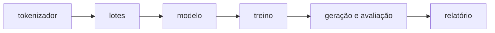

## Passo 1 · Leitura · O que você vai construir

Este é o projeto do nível: um modelo de linguagem completo em numpy, do texto cru ao relatório. Cada peça já apareceu no curso. O trabalho agora é fazê-las funcionar juntas, com contratos fixos entre elas.



| Passo | Peça | Funções |
|---|---|---|
| 3 | tokenizador | `treinar_bpe`, `codificar`, `decodificar`, `taxa_de_compressao`, `preparar` |
| 4 | modelo | `contar_parametros`, `montar`, `forward`, `perda_e_gradientes` |
| 5 | treino | `gerar_lote`, `cortar_gradientes`, `Adam`, `treinar`, `salvar`, `carregar` |
| 6 | geração e avaliação | `gerar`, `perplexidade`, `teste_de_causalidade` |
| 7 | relatório | `gerar_relatorio` |

A partir do passo 5, o que você escreveu antes chega pronto em arquivos de apoio (`modelo.py`, `tokenizador.py`), na versão de referência, para que um erro antigo não contamine o passo novo.

**Dados.** O `corpus.py` gera as frases da vila. O treino é `gerar_corpus(1500, 0)` e a validação é `gerar_corpus(150, 1)`, com outra semente.

**Tokenizador.** É o BPE do módulo 7 com uma troca: a base são os caracteres distintos do texto de treino, e não os 256 bytes. O corpus tem 29 caracteres; com 40 mesclagens, $V = 69$. Com a base de bytes seriam 296 tokens e 32 096 parâmetros, quase metade deles em linhas de embedding que nunca aparecem no texto.

**Modelo.** $T = 16$, $d = 32$, 4 cabeças e 1 bloco: 17 568 parâmetros.

```python
config = {"V": 69, "T": 16, "d": 32, "blocos": 1}
base, merges, ids_treino, ids_val = preparar(texto_treino, texto_val, 40)
params = montar(config, 0)
historico = treinar(params, ids_treino, config_de_treino, 600, 0, perda_e_gradientes)
print(perplexidade(params, ids_val, 16))
```

**Critérios.** Os gradientes conferem com a diferença central (erro relativo abaixo de $10^{-6}$ por array); o futuro não vaza para o passado; a perplexidade de validação fica abaixo de 60 % da perplexidade de um bigrama de tokens; as amostras se repetem com a mesma semente; o relatório traz a perplexidade de validação e as limitações.

**Como trabalhar.** Faça os passos na ordem. Em cada um, o "Executar" roda o bloco principal com uma demonstração, e a verificação confere cada função com casos pequenos: formas, valores calculados à mão, uma referência escrita de outro jeito e defeitos plantados. Quando um caso falhar, leia o nome dele antes de mexer no código: ele diz qual comportamento não bateu. Os contratos são rígidos de propósito: as chaves do dicionário de parâmetros, a ordem dos sorteios e o formato do relatório precisam ser exatamente os do enunciado, porque é isso que permite carregar os pesos pré-treinados no seu código.

**Orçamento.** O corretor executa o `main.py` inteiro em cada caso, incluindo o bloco `if __name__ == "__main__":`. O treino de 600 passos leva 4,1 s no executor: cabe no "Executar" e não cabe na verificação. Deixe no bloco principal só uma demonstração curta. Os passos 6 e 7 usam pesos pré-treinados com esses 600 passos, que chegam à perplexidade de validação 1,82, contra 4,33 do bigrama.

## Passo 2 · Previsão · Ida e volta de um tokenizador minúsculo

A base tem 7 caracteres, e três mesclagens foram escritas à mão: `"pa"`, `"o "` e, por cima das duas, `"o pa"`. O código codifica `"o pato parou"`, mostra os tokens e decodifica de volta. Aplique as mesclagens na ordem, uma de cada vez, antes de executar.

### Código

```python
base = [" ", "a", "o", "p", "r", "t", "u"]
merges = [((3, 1), 7), ((2, 0), 8), ((8, 7), 9)]


def mesclar(ids, par, novo_id):
    saida, i = [], 0
    while i < len(ids):
        if i < len(ids) - 1 and (ids[i], ids[i + 1]) == par:
            saida.append(novo_id)
            i += 2
        else:
            saida.append(ids[i])
            i += 1
    return saida


texto = "o pato parou"
ids = [base.index(c) for c in texto]
for par, novo_id in merges:
    ids = mesclar(ids, par, novo_id)
print(ids)

pedacos = list(base)
for (a, b), novo_id in merges:
    pedacos.append(pedacos[a] + pedacos[b])
print([pedacos[i] for i in ids])
print("".join(pedacos[i] for i in ids) == texto, len(texto) / len(ids))
```

### Dicas

1. Comece pelos ids dos caracteres: `o` é 2, o espaço é 0, `p` é 3, `a` é 1.
2. A terceira mesclagem junta os tokens 8 e 7, que só existem depois das duas primeiras.
3. O `o` de `parou` não é seguido de espaço, então fica como caractere solto.

### Saída esperada

```text
[9, 5, 9, 4, 2, 6]
['o pa', 't', 'o pa', 'r', 'o', 'u']
True 2.0
```

## Passo 3 · Exercício · Tokenizador

Escreva o tokenizador do projeto: um BPE sobre **caracteres**. `contar_pares` e `mesclar` são as do módulo 7 e já vêm prontas.

- `treinar_bpe(texto, n_mesclas)` devolve `(base, merges)`. `base` é a lista ordenada dos caracteres distintos do texto, e o id de cada caractere é a posição dele na base. `merges` é uma lista de `((a, b), novo_id)`: a cada rodada, o par de tokens vizinhos mais frequente vira um token novo, com id `len(base) + k` na rodada `k`. No empate, vence o menor par (comparação de tuplas). Se não sobrar nenhum par, o treino para antes de `n_mesclas`.
- `codificar(texto, base, merges)` devolve a lista de ids: os caracteres trocados pelos ids da base e, depois, cada mesclagem aplicada na ordem do treino. Um caractere fora da base levanta `ValueError`.
- `decodificar(ids, base, merges)` devolve o texto. A ida e volta é exata.
- `taxa_de_compressao(texto, base, merges)` devolve os caracteres por token: `len(texto)` dividido pelo número de tokens. O texto vazio levanta `ValueError`.
- `preparar(texto_treino, texto_val, n_mesclas)` devolve `(base, merges, ids_treino, ids_val)`, com os ids em arrays do numpy de inteiros. A base e as mesclagens são aprendidas **só** com o texto de treino; a validação é apenas codificada.

### Instruções

1. `treinar_bpe`: monte a base, converta o texto em ids e repita `n_mesclas` vezes: contar os pares, escolher o mais frequente (no empate, o menor), mesclar e registrar.
2. `codificar`: ids da base, depois todas as mesclagens na ordem; caractere desconhecido levanta `ValueError`.
3. `decodificar`: cada token novo vale a concatenação dos textos das suas duas partes.
4. `taxa_de_compressao`: caracteres divididos por tokens, com `ValueError` para o texto vazio.
5. `preparar`: treine o BPE só no texto de treino e codifique os dois textos em arrays de inteiros.

### Código inicial

```python
import numpy as np


def contar_pares(ids):
    contagem = {}
    for par in zip(ids, ids[1:]):
        contagem[par] = contagem.get(par, 0) + 1
    return contagem


def mesclar(ids, par, novo_id):
    saida = []
    i = 0
    while i < len(ids):
        if i < len(ids) - 1 and (ids[i], ids[i + 1]) == par:
            saida.append(novo_id)
            i += 2
        else:
            saida.append(ids[i])
            i += 1
    return saida


def treinar_bpe(texto, n_mesclas):
    # devolve (base, merges)
    pass


def codificar(texto, base, merges):
    # devolve a lista de ids
    pass


def decodificar(ids, base, merges):
    # devolve o texto
    pass


def taxa_de_compressao(texto, base, merges):
    # caracteres por token
    pass


def preparar(texto_treino, texto_val, n_mesclas):
    # devolve (base, merges, ids_treino, ids_val)
    pass


if __name__ == "__main__":
    import corpus

    treino, val = corpus.gerar_corpus(60, 0), corpus.gerar_corpus(10, 1)
    print(preparar(treino, val, 40))
```
```python path=corpus.py
"""Corpus do curso: frases geradas por uma gramática pequena sobre uma vila fictícia."""
import numpy as np

SUJEITOS = ["a padeira", "o ferreiro", "a tecelã", "o pescador", "a moleira", "o pastor", "a oleira", "o barqueiro"]
VERBOS = ["leva", "guarda", "vende", "procura", "conserta", "divide"]
OBJETOS = ["o pão", "a rede", "o barco", "a lenha", "o queijo", "a farinha", "o cesto", "o azeite"]
LUGARES = ["na praça", "no moinho", "na ponte", "no porto", "na feira", "no celeiro"]
TEMPOS = ["de manhã", "à tarde", "à noite", "até o almoço", "antes da chuva", "depois da festa"]


def gerar_corpus(n_frases=1500, semente=0):
    """Devolve n_frases frases, uma por linha; metade delas termina com um tempo."""
    rng = np.random.default_rng(semente)
    frases = []
    for _ in range(n_frases):
        partes = [str(rng.choice(SUJEITOS)), str(rng.choice(VERBOS)), str(rng.choice(OBJETOS)), str(rng.choice(LUGARES))]
        if rng.random() < 0.5:
            partes.append(str(rng.choice(TEMPOS)))
        frases.append(" ".join(partes) + ".")
    return "\n".join(frases) + "\n"


def vocabulario(texto):
    """Caracteres distintos do texto, em ordem."""
    return sorted(set(texto))


def codificar(texto, vocab):
    """Texto -> array de ids (posição de cada caractere em vocab)."""
    para_id = {c: i for i, c in enumerate(vocab)}
    return np.array([para_id[c] for c in texto], dtype=np.intp)


def decodificar(ids, vocab):
    """Ids -> texto."""
    return "".join(vocab[int(i)] for i in ids)


def carregar(n_frases=1500, semente=0, fracao_treino=0.9):
    """Devolve (vocab, ids_treino, ids_val): os últimos 10 % do texto ficam para validação."""
    texto = gerar_corpus(n_frases, semente)
    vocab = vocabulario(texto)
    ids = codificar(texto, vocab)
    corte = int(len(ids) * fracao_treino)
    return vocab, ids[:corte], ids[corte:]
```
```text path=fabulas.txt
A formiga e o grão de areia

Uma formiga carregava um grão de areia para o alto do formigueiro. A cigarra, que cantava na sombra, perguntou por que ela não escolhia um grão menor.
— Porque o formigueiro não se faz com o grão que eu escolho, e sim com o grão que falta — respondeu a formiga.
A cigarra riu e continuou a cantar. Quando a chuva chegou, a água desceu pela encosta e parou diante do formigueiro, onde cada grão estava no lugar em que fazia falta.
Moral: o trabalho que parece pequeno é medido pelo que sustenta.

A raposa e o espelho d'água

Uma raposa encontrou uma lagoa tão calma que mostrava o céu inteiro. Viu ali outra raposa, com um peixe na boca, e quis o peixe da outra.
— Solta o que é meu — disse a raposa para a lagoa.
A lagoa não respondeu. A raposa abriu a boca para morder a outra raposa, e o peixe que ela mesma carregava caiu na água e nadou para longe.
Uma garça, que assistia de uma pedra, comentou baixinho:
— Quem briga com o próprio reflexo perde duas vezes: o que queria e o que tinha.
Moral: a cobiça não enxerga o que já está na boca.

O sapo e a lanterna

Numa noite sem lua, um sapo encontrou uma lanterna esquecida na estrada. Achou que a luz era dele e passou a noite mandando nos vaga-lumes.
— Apaguem-se — dizia o sapo —, porque agora a claridade tem dono.
Os vaga-lumes, sem discutir, voaram para a mata. De manhã, o azeite da lanterna acabou. O sapo ficou no escuro e chamou pelos vaga-lumes, mas eles já iluminavam outro caminho.
Moral: quem toma emprestada a luz dos outros não deve mandar em quem brilha sozinho.

A tartaruga e a ponte

Os bichos da vila queriam atravessar o rio, e cada um tinha pressa. A lebre propôs uma ponte de galhos finos, que ficaria pronta num dia. A tartaruga propôs uma ponte de pedra, que levaria um mês.
— Um mês é tempo demais — disse a lebre.
A ponte de galhos ficou pronta no dia seguinte e caiu na primeira cheia. A lebre fez outra, que também caiu. No fim do mês, a lebre tinha feito quatro pontes e não tinha nenhuma. A tartaruga pôs a última pedra e atravessou devagar, sem molhar os pés.
Moral: a pressa conta os dias, e a paciência conta as cheias.

O galo e o relógio

Um galo se orgulhava de acordar a fazenda. Um dia, o fazendeiro trouxe da cidade um relógio que tocava sozinho. O galo, ofendido, decidiu cantar mais cedo que o relógio, e depois mais cedo ainda, até cantar no meio da noite.
Ninguém mais sabia quando era hora de levantar. O fazendeiro guardou o relógio na gaveta e pediu ao galo que voltasse a cantar com o sol.
— Eu só queria ser o primeiro — disse o galo.
— Ser o primeiro não adianta, se ninguém pode confiar na hora — respondeu o fazendeiro.
Moral: vale mais ser certo do que ser adiantado.
```

### Solução

```python
import numpy as np


def contar_pares(ids):
    contagem = {}
    for par in zip(ids, ids[1:]):
        contagem[par] = contagem.get(par, 0) + 1
    return contagem


def mesclar(ids, par, novo_id):
    saida = []
    i = 0
    while i < len(ids):
        if i < len(ids) - 1 and (ids[i], ids[i + 1]) == par:
            saida.append(novo_id)
            i += 2
        else:
            saida.append(ids[i])
            i += 1
    return saida


def treinar_bpe(texto, n_mesclas):
    base = sorted(set(texto))
    para_id = {c: i for i, c in enumerate(base)}
    ids = [para_id[c] for c in texto]
    merges = []
    for k in range(n_mesclas):
        contagem = contar_pares(ids)
        if not contagem:
            break
        par = min(contagem, key=lambda p: (-contagem[p], p))
        novo_id = len(base) + k
        ids = mesclar(ids, par, novo_id)
        merges.append((par, novo_id))
    return base, merges


def codificar(texto, base, merges):
    para_id = {c: i for i, c in enumerate(base)}
    for c in texto:
        if c not in para_id:
            raise ValueError(f"caractere fora do vocabulário: {c!r}")
    ids = [para_id[c] for c in texto]
    for par, novo_id in merges:
        ids = mesclar(ids, par, novo_id)
    return ids


def decodificar(ids, base, merges):
    pedacos = list(base)
    for (a, b), _novo_id in merges:
        pedacos.append(pedacos[a] + pedacos[b])
    return "".join(pedacos[int(i)] for i in ids)


def taxa_de_compressao(texto, base, merges):
    if not texto:
        raise ValueError("texto vazio")
    return len(texto) / len(codificar(texto, base, merges))


def preparar(texto_treino, texto_val, n_mesclas):
    base, merges = treinar_bpe(texto_treino, n_mesclas)
    ids_treino = np.array(codificar(texto_treino, base, merges), dtype=np.intp)
    ids_val = np.array(codificar(texto_val, base, merges), dtype=np.intp)
    return base, merges, ids_treino, ids_val


if __name__ == "__main__":
    import corpus

    treino, val = corpus.gerar_corpus(60, 0), corpus.gerar_corpus(10, 1)
    base, merges, ids_treino, ids_val = preparar(treino, val, 40)
    print(len(base) + len(merges), len(ids_treino), round(taxa_de_compressao(val, base, merges), 2))
    print(repr(decodificar(ids_val[:12], base, merges)))
```
```python path=corpus.py
"""Corpus do curso: frases geradas por uma gramática pequena sobre uma vila fictícia."""
import numpy as np

SUJEITOS = ["a padeira", "o ferreiro", "a tecelã", "o pescador", "a moleira", "o pastor", "a oleira", "o barqueiro"]
VERBOS = ["leva", "guarda", "vende", "procura", "conserta", "divide"]
OBJETOS = ["o pão", "a rede", "o barco", "a lenha", "o queijo", "a farinha", "o cesto", "o azeite"]
LUGARES = ["na praça", "no moinho", "na ponte", "no porto", "na feira", "no celeiro"]
TEMPOS = ["de manhã", "à tarde", "à noite", "até o almoço", "antes da chuva", "depois da festa"]


def gerar_corpus(n_frases=1500, semente=0):
    """Devolve n_frases frases, uma por linha; metade delas termina com um tempo."""
    rng = np.random.default_rng(semente)
    frases = []
    for _ in range(n_frases):
        partes = [str(rng.choice(SUJEITOS)), str(rng.choice(VERBOS)), str(rng.choice(OBJETOS)), str(rng.choice(LUGARES))]
        if rng.random() < 0.5:
            partes.append(str(rng.choice(TEMPOS)))
        frases.append(" ".join(partes) + ".")
    return "\n".join(frases) + "\n"


def vocabulario(texto):
    """Caracteres distintos do texto, em ordem."""
    return sorted(set(texto))


def codificar(texto, vocab):
    """Texto -> array de ids (posição de cada caractere em vocab)."""
    para_id = {c: i for i, c in enumerate(vocab)}
    return np.array([para_id[c] for c in texto], dtype=np.intp)


def decodificar(ids, vocab):
    """Ids -> texto."""
    return "".join(vocab[int(i)] for i in ids)


def carregar(n_frases=1500, semente=0, fracao_treino=0.9):
    """Devolve (vocab, ids_treino, ids_val): os últimos 10 % do texto ficam para validação."""
    texto = gerar_corpus(n_frases, semente)
    vocab = vocabulario(texto)
    ids = codificar(texto, vocab)
    corte = int(len(ids) * fracao_treino)
    return vocab, ids[:corte], ids[corte:]
```
```text path=fabulas.txt
A formiga e o grão de areia

Uma formiga carregava um grão de areia para o alto do formigueiro. A cigarra, que cantava na sombra, perguntou por que ela não escolhia um grão menor.
— Porque o formigueiro não se faz com o grão que eu escolho, e sim com o grão que falta — respondeu a formiga.
A cigarra riu e continuou a cantar. Quando a chuva chegou, a água desceu pela encosta e parou diante do formigueiro, onde cada grão estava no lugar em que fazia falta.
Moral: o trabalho que parece pequeno é medido pelo que sustenta.

A raposa e o espelho d'água

Uma raposa encontrou uma lagoa tão calma que mostrava o céu inteiro. Viu ali outra raposa, com um peixe na boca, e quis o peixe da outra.
— Solta o que é meu — disse a raposa para a lagoa.
A lagoa não respondeu. A raposa abriu a boca para morder a outra raposa, e o peixe que ela mesma carregava caiu na água e nadou para longe.
Uma garça, que assistia de uma pedra, comentou baixinho:
— Quem briga com o próprio reflexo perde duas vezes: o que queria e o que tinha.
Moral: a cobiça não enxerga o que já está na boca.

O sapo e a lanterna

Numa noite sem lua, um sapo encontrou uma lanterna esquecida na estrada. Achou que a luz era dele e passou a noite mandando nos vaga-lumes.
— Apaguem-se — dizia o sapo —, porque agora a claridade tem dono.
Os vaga-lumes, sem discutir, voaram para a mata. De manhã, o azeite da lanterna acabou. O sapo ficou no escuro e chamou pelos vaga-lumes, mas eles já iluminavam outro caminho.
Moral: quem toma emprestada a luz dos outros não deve mandar em quem brilha sozinho.

A tartaruga e a ponte

Os bichos da vila queriam atravessar o rio, e cada um tinha pressa. A lebre propôs uma ponte de galhos finos, que ficaria pronta num dia. A tartaruga propôs uma ponte de pedra, que levaria um mês.
— Um mês é tempo demais — disse a lebre.
A ponte de galhos ficou pronta no dia seguinte e caiu na primeira cheia. A lebre fez outra, que também caiu. No fim do mês, a lebre tinha feito quatro pontes e não tinha nenhuma. A tartaruga pôs a última pedra e atravessou devagar, sem molhar os pés.
Moral: a pressa conta os dias, e a paciência conta as cheias.

O galo e o relógio

Um galo se orgulhava de acordar a fazenda. Um dia, o fazendeiro trouxe da cidade um relógio que tocava sozinho. O galo, ofendido, decidiu cantar mais cedo que o relógio, e depois mais cedo ainda, até cantar no meio da noite.
Ninguém mais sabia quando era hora de levantar. O fazendeiro guardou o relógio na gaveta e pediu ao galo que voltasse a cantar com o sol.
— Eu só queria ser o primeiro — disse o galo.
— Ser o primeiro não adianta, se ninguém pode confiar na hora — respondeu o fazendeiro.
Moral: vale mais ser certo do que ser adiantado.
```

### Dicas

1. `min(contagem, key=lambda p: (-contagem[p], p))` escolhe o par mais frequente e, no empate, o menor.
2. Para decodificar, construa uma lista de textos: os da base e, para cada mesclagem, a soma dos textos das duas partes (que podem ser tokens novos).
3. Se a validação entrar no treino do BPE, a perplexidade de validação deixa de medir texto novo.

### Verificação

```json
[
  {"id": "base-ordenada", "checkpoint": 1, "kind": "expr", "expr": "[treinar_bpe(\"o pato parou\", 0)[0], len(treinar_bpe(\"o pato parou\", 0)[1])]", "expected": [[" ", "a", "o", "p", "r", "t", "u"], 0], "name": "A base são os caracteres distintos, em ordem; sem mesclagens, a lista fica vazia"},
  {"id": "mais-frequente", "checkpoint": 1, "kind": "expr", "expr": "[[list(p), n] for p, n in treinar_bpe(\"xyxyxy ab\", 1)[1]]", "expected": [[[3, 4], 5]], "name": "O par mais frequente vence, mesmo sendo o maior", "hint": "\"xy\" aparece 3 vezes; os outros pares, no máximo 2."},
  {"id": "empate-menor-par", "checkpoint": 1, "kind": "expr", "expr": "[[list(p), n] for p, n in treinar_bpe(\"dcba\", 1)[1]]", "expected": [[[1, 0], 4]], "name": "Com todos os pares empatados, vence o menor par", "hint": "Os pares são (3, 2), (2, 1) e (1, 0); o menor é (1, 0), que não é o primeiro do texto."},
  {"id": "tres-mesclas", "checkpoint": 1, "kind": "expr", "expr": "[[list(p), n] for p, n in treinar_bpe(\"o pato parou o pato\", 3)[1]]", "expected": [[[0, 3], 7], [[2, 7], 8], [[8, 1], 9]], "name": "Três mesclagens em \"o pato parou o pato\""},
  {"id": "ids-novos", "checkpoint": 1, "kind": "expr", "setup": "with open(\"fabulas.txt\", encoding=\"utf-8\") as _arq:\n    _fab = _arq.read()\n_b, _m = treinar_bpe(_fab, 40)\n", "expr": "[n - len(_b) for _, n in _m][:5] + [len(_m)]", "expected": [0, 1, 2, 3, 4, 40], "name": "Os tokens novos são numerados a partir de len(base)", "hint": "A base de caracteres não tem 256 itens: o primeiro id novo é len(base)."},
  {"id": "para-cedo", "checkpoint": 1, "kind": "expr", "expr": "[[list(p), n] for p, n in treinar_bpe(\"aaaa\", 10)[1]]", "expected": [[[0, 0], 1], [[1, 1], 2]], "name": "\"aaaa\" só permite duas mesclagens, e a segunda junta dois tokens novos"},
  {"id": "codificar-exemplo", "checkpoint": 2, "kind": "expr", "setup": "_base = [\" \", \"a\", \"o\", \"p\", \"r\", \"t\", \"u\"]\n_m = [((3, 1), 7), ((2, 0), 8), ((8, 7), 9)]\n", "expr": "codificar(\"o pato parou\", _base, _m)", "expected": [9, 5, 9, 4, 2, 6], "name": "O exemplo da Previsão: 12 caracteres viram 6 tokens"},
  {"id": "codificar-sem-mesclas", "checkpoint": 2, "kind": "expr", "setup": "_base = [\" \", \"a\", \"o\", \"p\", \"r\", \"t\", \"u\"]\n_m = [((3, 1), 7), ((2, 0), 8), ((8, 7), 9)]\n", "expr": "codificar(\"pato\", _base, [])", "expected": [3, 1, 5, 2], "name": "Sem mesclagens, os ids são as posições na base"},
  {"id": "codificar-ordem", "checkpoint": 2, "kind": "expr", "expr": "codificar(\"abcbc\", [\"a\", \"b\", \"c\"], [((0, 1), 3), ((3, 2), 4), ((1, 2), 5)])", "expected": [4, 5], "name": "As mesclagens são aplicadas na ordem do treino", "hint": "(1, 2) só é tentado depois de (0, 1) e de (3, 2)."},
  {"id": "codificar-vazio", "checkpoint": 2, "kind": "expr", "setup": "_base = [\" \", \"a\", \"o\", \"p\", \"r\", \"t\", \"u\"]\n_m = [((3, 1), 7), ((2, 0), 8), ((8, 7), 9)]\n", "expr": "codificar(\"\", _base, _m)", "expected": [], "name": "O texto vazio vira a lista vazia"},
  {"id": "codificar-desconhecido", "checkpoint": 2, "kind": "expr", "setup": "_base = [\" \", \"a\", \"o\", \"p\", \"r\", \"t\", \"u\"]\n_m = [((3, 1), 7), ((2, 0), 8), ((8, 7), 9)]\n", "expr": "codificar(\"o gato\", _base, _m)", "raises": "ValueError", "name": "Um caractere fora da base levanta ValueError", "hint": "O \"g\" não está na base: avise em vez de pular o caractere."},
  {"id": "decodificar-exemplo", "checkpoint": 3, "kind": "expr", "setup": "_base = [\" \", \"a\", \"o\", \"p\", \"r\", \"t\", \"u\"]\n_m = [((3, 1), 7), ((2, 0), 8), ((8, 7), 9)]\n", "expr": "decodificar([9, 5, 9, 4, 2, 6], _base, _m)", "expected": "o pato parou", "name": "Os 6 tokens da Previsão voltam a ser o texto", "hint": "O token 9 é feito dos tokens 8 e 7, que também são novos."},
  {"id": "decodificar-array", "checkpoint": 3, "kind": "expr", "setup": "_base = [\" \", \"a\", \"o\", \"p\", \"r\", \"t\", \"u\"]\n_m = [((3, 1), 7), ((2, 0), 8), ((8, 7), 9)]\nimport numpy as np\n", "expr": "decodificar(np.array([8, 7, 6]), _base, _m)", "expected": "o pau", "name": "decodificar aceita um array do numpy"},
  {"id": "ida-e-volta-fabulas", "checkpoint": 3, "kind": "expr", "setup": "with open(\"fabulas.txt\", encoding=\"utf-8\") as _arq:\n    _fab = _arq.read()\n_b, _m = treinar_bpe(_fab, 40)\n", "expr": "[decodificar(codificar(_fab, _b, _m), _b, _m) == _fab, len(codificar(_fab, _b, _m))]", "expected": [true, 1752], "name": "Ida e volta exata nas fábulas, com 40 mesclagens"},
  {"id": "taxa-exemplo", "checkpoint": 4, "kind": "expr", "setup": "_base = [\" \", \"a\", \"o\", \"p\", \"r\", \"t\", \"u\"]\n_m = [((3, 1), 7), ((2, 0), 8), ((8, 7), 9)]\n", "expr": "taxa_de_compressao(\"o pato parou\", _base, _m)", "expected": 2.0, "tolerance": 1e-12, "name": "12 caracteres em 6 tokens: 2 caracteres por token"},
  {"id": "taxa-sem-mesclas", "checkpoint": 4, "kind": "expr", "setup": "_base = [\" \", \"a\", \"o\", \"p\", \"r\", \"t\", \"u\"]\n_m = [((3, 1), 7), ((2, 0), 8), ((8, 7), 9)]\n", "expr": "taxa_de_compressao(\"pato\", _base, [])", "expected": 1.0, "tolerance": 1e-12, "name": "Sem mesclagens, a taxa é 1"},
  {"id": "taxa-fabulas", "checkpoint": 4, "kind": "expr", "setup": "with open(\"fabulas.txt\", encoding=\"utf-8\") as _arq:\n    _fab = _arq.read()\n_b, _m = treinar_bpe(_fab, 40)\n", "expr": "taxa_de_compressao(_fab, _b, _m)", "expected": 1.542808219178082, "tolerance": 1e-09, "name": "Taxa de compressão das fábulas com 40 mesclagens"},
  {"id": "taxa-vazia", "checkpoint": 4, "kind": "expr", "setup": "_base = [\" \", \"a\", \"o\", \"p\", \"r\", \"t\", \"u\"]\n_m = [((3, 1), 7), ((2, 0), 8), ((8, 7), 9)]\n", "expr": "taxa_de_compressao(\"\", _base, _m)", "raises": "ValueError", "name": "O texto vazio levanta ValueError"},
  {"id": "preparar-so-treino", "checkpoint": 5, "kind": "expr", "setup": "_tr, _va = \"abababab cdcd\", \"cdcdcdcdcdcdcdcd ab\"\n_r = preparar(_tr, _va, 1)\n", "expr": "[_r[0], [[list(p), n] for p, n in _r[1]]]", "expected": [[" ", "a", "b", "c", "d"], [[[1, 2], 5]]], "name": "A mesclagem vem do treino, mesmo com outro par dominando a validação", "hint": "No treino o par mais frequente é \"ab\"; em treino mais validação seria \"cd\"."},
  {"id": "preparar-ids", "checkpoint": 5, "kind": "expr", "setup": "_tr, _va = \"abababab cdcd\", \"cdcdcdcdcdcdcdcd ab\"\n_r = preparar(_tr, _va, 1)\n", "expr": "[_r[2].tolist(), _r[3].tolist()]", "expected": [[5, 5, 5, 5, 0, 3, 4, 3, 4], [3, 4, 3, 4, 3, 4, 3, 4, 3, 4, 3, 4, 3, 4, 3, 4, 0, 5]], "name": "Os dois textos são codificados com o tokenizador do treino"},
  {"id": "preparar-arrays", "checkpoint": 5, "kind": "expr", "setup": "_tr, _va = \"abababab cdcd\", \"cdcdcdcdcdcdcdcd ab\"\n_r = preparar(_tr, _va, 1)\nimport numpy as np\n", "expr": "[[type(a).__name__, bool(np.issubdtype(a.dtype, np.integer)), a.ndim] for a in _r[2:]]", "expected": [["ndarray", true, 1], ["ndarray", true, 1]], "name": "ids_treino e ids_val são arrays de inteiros de uma dimensão"},
  {"id": "preparar-val-desconhecido", "checkpoint": 5, "kind": "expr", "expr": "preparar(\"abab\", \"abz\", 1)", "raises": "ValueError", "name": "Caractere da validação que não existe no treino levanta ValueError", "hint": "A base vem só do treino; o \"z\" não tem id."},
  {"id": "preparar-corpus", "checkpoint": 5, "kind": "expr", "setup": "import corpus\n_tr, _va = corpus.gerar_corpus(80, 0), corpus.gerar_corpus(10, 1)\n_b, _m, _itr, _iva = preparar(_tr, _va, 40)\n", "expr": "[len(_b), len(_m), len(_itr), len(_iva), decodificar(_iva, _b, _m) == _va]", "expected": [29, 40, 1669, 219, true], "name": "80 frases do corpus com 40 mesclagens: tamanhos e volta exata da validação"}
]
```

### Soluções erradas

```python name="tokenizador treinado com a validação"
import numpy as np


def contar_pares(ids):
    contagem = {}
    for par in zip(ids, ids[1:]):
        contagem[par] = contagem.get(par, 0) + 1
    return contagem


def mesclar(ids, par, novo_id):
    saida = []
    i = 0
    while i < len(ids):
        if i < len(ids) - 1 and (ids[i], ids[i + 1]) == par:
            saida.append(novo_id)
            i += 2
        else:
            saida.append(ids[i])
            i += 1
    return saida


def treinar_bpe(texto, n_mesclas):
    base = sorted(set(texto))
    para_id = {c: i for i, c in enumerate(base)}
    ids = [para_id[c] for c in texto]
    merges = []
    for k in range(n_mesclas):
        contagem = contar_pares(ids)
        if not contagem:
            break
        par = min(contagem, key=lambda p: (-contagem[p], p))
        novo_id = len(base) + k
        ids = mesclar(ids, par, novo_id)
        merges.append((par, novo_id))
    return base, merges


def codificar(texto, base, merges):
    para_id = {c: i for i, c in enumerate(base)}
    for c in texto:
        if c not in para_id:
            raise ValueError(f"caractere fora do vocabulário: {c!r}")
    ids = [para_id[c] for c in texto]
    for par, novo_id in merges:
        ids = mesclar(ids, par, novo_id)
    return ids


def decodificar(ids, base, merges):
    pedacos = list(base)
    for (a, b), _novo_id in merges:
        pedacos.append(pedacos[a] + pedacos[b])
    return "".join(pedacos[int(i)] for i in ids)


def taxa_de_compressao(texto, base, merges):
    if not texto:
        raise ValueError("texto vazio")
    return len(texto) / len(codificar(texto, base, merges))


def preparar(texto_treino, texto_val, n_mesclas):
    base, merges = treinar_bpe(texto_treino + texto_val, n_mesclas)
    ids_treino = np.array(codificar(texto_treino, base, merges), dtype=np.intp)
    ids_val = np.array(codificar(texto_val, base, merges), dtype=np.intp)
    return base, merges, ids_treino, ids_val


if __name__ == "__main__":
    import corpus

    treino, val = corpus.gerar_corpus(60, 0), corpus.gerar_corpus(10, 1)
    base, merges, ids_treino, ids_val = preparar(treino, val, 40)
    print(len(base) + len(merges), len(ids_treino), round(taxa_de_compressao(val, base, merges), 2))
    print(repr(decodificar(ids_val[:12], base, merges)))
```

```python name="empate decidido pelo primeiro par visto"
import numpy as np


def contar_pares(ids):
    contagem = {}
    for par in zip(ids, ids[1:]):
        contagem[par] = contagem.get(par, 0) + 1
    return contagem


def mesclar(ids, par, novo_id):
    saida = []
    i = 0
    while i < len(ids):
        if i < len(ids) - 1 and (ids[i], ids[i + 1]) == par:
            saida.append(novo_id)
            i += 2
        else:
            saida.append(ids[i])
            i += 1
    return saida


def treinar_bpe(texto, n_mesclas):
    base = sorted(set(texto))
    para_id = {c: i for i, c in enumerate(base)}
    ids = [para_id[c] for c in texto]
    merges = []
    for k in range(n_mesclas):
        contagem = contar_pares(ids)
        if not contagem:
            break
        par = max(contagem, key=contagem.get)
        novo_id = len(base) + k
        ids = mesclar(ids, par, novo_id)
        merges.append((par, novo_id))
    return base, merges


def codificar(texto, base, merges):
    para_id = {c: i for i, c in enumerate(base)}
    for c in texto:
        if c not in para_id:
            raise ValueError(f"caractere fora do vocabulário: {c!r}")
    ids = [para_id[c] for c in texto]
    for par, novo_id in merges:
        ids = mesclar(ids, par, novo_id)
    return ids


def decodificar(ids, base, merges):
    pedacos = list(base)
    for (a, b), _novo_id in merges:
        pedacos.append(pedacos[a] + pedacos[b])
    return "".join(pedacos[int(i)] for i in ids)


def taxa_de_compressao(texto, base, merges):
    if not texto:
        raise ValueError("texto vazio")
    return len(texto) / len(codificar(texto, base, merges))


def preparar(texto_treino, texto_val, n_mesclas):
    base, merges = treinar_bpe(texto_treino, n_mesclas)
    ids_treino = np.array(codificar(texto_treino, base, merges), dtype=np.intp)
    ids_val = np.array(codificar(texto_val, base, merges), dtype=np.intp)
    return base, merges, ids_treino, ids_val


if __name__ == "__main__":
    import corpus

    treino, val = corpus.gerar_corpus(60, 0), corpus.gerar_corpus(10, 1)
    base, merges, ids_treino, ids_val = preparar(treino, val, 40)
    print(len(base) + len(merges), len(ids_treino), round(taxa_de_compressao(val, base, merges), 2))
    print(repr(decodificar(ids_val[:12], base, merges)))
```

```python name="ids novos a partir de 256"
import numpy as np


def contar_pares(ids):
    contagem = {}
    for par in zip(ids, ids[1:]):
        contagem[par] = contagem.get(par, 0) + 1
    return contagem


def mesclar(ids, par, novo_id):
    saida = []
    i = 0
    while i < len(ids):
        if i < len(ids) - 1 and (ids[i], ids[i + 1]) == par:
            saida.append(novo_id)
            i += 2
        else:
            saida.append(ids[i])
            i += 1
    return saida


def treinar_bpe(texto, n_mesclas):
    base = sorted(set(texto))
    para_id = {c: i for i, c in enumerate(base)}
    ids = [para_id[c] for c in texto]
    merges = []
    for k in range(n_mesclas):
        contagem = contar_pares(ids)
        if not contagem:
            break
        par = min(contagem, key=lambda p: (-contagem[p], p))
        novo_id = 256 + k
        ids = mesclar(ids, par, novo_id)
        merges.append((par, novo_id))
    return base, merges


def codificar(texto, base, merges):
    para_id = {c: i for i, c in enumerate(base)}
    for c in texto:
        if c not in para_id:
            raise ValueError(f"caractere fora do vocabulário: {c!r}")
    ids = [para_id[c] for c in texto]
    for par, novo_id in merges:
        ids = mesclar(ids, par, novo_id)
    return ids


def decodificar(ids, base, merges):
    pedacos = list(base)
    for (a, b), _novo_id in merges:
        pedacos.append(pedacos[a] + pedacos[b])
    return "".join(pedacos[int(i)] for i in ids)


def taxa_de_compressao(texto, base, merges):
    if not texto:
        raise ValueError("texto vazio")
    return len(texto) / len(codificar(texto, base, merges))


def preparar(texto_treino, texto_val, n_mesclas):
    base, merges = treinar_bpe(texto_treino, n_mesclas)
    ids_treino = np.array(codificar(texto_treino, base, merges), dtype=np.intp)
    ids_val = np.array(codificar(texto_val, base, merges), dtype=np.intp)
    return base, merges, ids_treino, ids_val


if __name__ == "__main__":
    import corpus

    treino, val = corpus.gerar_corpus(60, 0), corpus.gerar_corpus(10, 1)
    base, merges, ids_treino, ids_val = preparar(treino, val, 40)
    print(len(base) + len(merges), len(ids_treino), round(taxa_de_compressao(val, base, merges), 2))
    print(repr(decodificar(ids_val[:12], base, merges)))
```

```python name="base na ordem em que os caracteres aparecem"
import numpy as np


def contar_pares(ids):
    contagem = {}
    for par in zip(ids, ids[1:]):
        contagem[par] = contagem.get(par, 0) + 1
    return contagem


def mesclar(ids, par, novo_id):
    saida = []
    i = 0
    while i < len(ids):
        if i < len(ids) - 1 and (ids[i], ids[i + 1]) == par:
            saida.append(novo_id)
            i += 2
        else:
            saida.append(ids[i])
            i += 1
    return saida


def treinar_bpe(texto, n_mesclas):
    base = list(dict.fromkeys(texto))
    para_id = {c: i for i, c in enumerate(base)}
    ids = [para_id[c] for c in texto]
    merges = []
    for k in range(n_mesclas):
        contagem = contar_pares(ids)
        if not contagem:
            break
        par = min(contagem, key=lambda p: (-contagem[p], p))
        novo_id = len(base) + k
        ids = mesclar(ids, par, novo_id)
        merges.append((par, novo_id))
    return base, merges


def codificar(texto, base, merges):
    para_id = {c: i for i, c in enumerate(base)}
    for c in texto:
        if c not in para_id:
            raise ValueError(f"caractere fora do vocabulário: {c!r}")
    ids = [para_id[c] for c in texto]
    for par, novo_id in merges:
        ids = mesclar(ids, par, novo_id)
    return ids


def decodificar(ids, base, merges):
    pedacos = list(base)
    for (a, b), _novo_id in merges:
        pedacos.append(pedacos[a] + pedacos[b])
    return "".join(pedacos[int(i)] for i in ids)


def taxa_de_compressao(texto, base, merges):
    if not texto:
        raise ValueError("texto vazio")
    return len(texto) / len(codificar(texto, base, merges))


def preparar(texto_treino, texto_val, n_mesclas):
    base, merges = treinar_bpe(texto_treino, n_mesclas)
    ids_treino = np.array(codificar(texto_treino, base, merges), dtype=np.intp)
    ids_val = np.array(codificar(texto_val, base, merges), dtype=np.intp)
    return base, merges, ids_treino, ids_val


if __name__ == "__main__":
    import corpus

    treino, val = corpus.gerar_corpus(60, 0), corpus.gerar_corpus(10, 1)
    base, merges, ids_treino, ids_val = preparar(treino, val, 40)
    print(len(base) + len(merges), len(ids_treino), round(taxa_de_compressao(val, base, merges), 2))
    print(repr(decodificar(ids_val[:12], base, merges)))
```

```python name="codificar aplica as mesclagens de trás para frente"
import numpy as np


def contar_pares(ids):
    contagem = {}
    for par in zip(ids, ids[1:]):
        contagem[par] = contagem.get(par, 0) + 1
    return contagem


def mesclar(ids, par, novo_id):
    saida = []
    i = 0
    while i < len(ids):
        if i < len(ids) - 1 and (ids[i], ids[i + 1]) == par:
            saida.append(novo_id)
            i += 2
        else:
            saida.append(ids[i])
            i += 1
    return saida


def treinar_bpe(texto, n_mesclas):
    base = sorted(set(texto))
    para_id = {c: i for i, c in enumerate(base)}
    ids = [para_id[c] for c in texto]
    merges = []
    for k in range(n_mesclas):
        contagem = contar_pares(ids)
        if not contagem:
            break
        par = min(contagem, key=lambda p: (-contagem[p], p))
        novo_id = len(base) + k
        ids = mesclar(ids, par, novo_id)
        merges.append((par, novo_id))
    return base, merges


def codificar(texto, base, merges):
    para_id = {c: i for i, c in enumerate(base)}
    for c in texto:
        if c not in para_id:
            raise ValueError(f"caractere fora do vocabulário: {c!r}")
    ids = [para_id[c] for c in texto]
    for par, novo_id in reversed(merges):
        ids = mesclar(ids, par, novo_id)
    return ids


def decodificar(ids, base, merges):
    pedacos = list(base)
    for (a, b), _novo_id in merges:
        pedacos.append(pedacos[a] + pedacos[b])
    return "".join(pedacos[int(i)] for i in ids)


def taxa_de_compressao(texto, base, merges):
    if not texto:
        raise ValueError("texto vazio")
    return len(texto) / len(codificar(texto, base, merges))


def preparar(texto_treino, texto_val, n_mesclas):
    base, merges = treinar_bpe(texto_treino, n_mesclas)
    ids_treino = np.array(codificar(texto_treino, base, merges), dtype=np.intp)
    ids_val = np.array(codificar(texto_val, base, merges), dtype=np.intp)
    return base, merges, ids_treino, ids_val


if __name__ == "__main__":
    import corpus

    treino, val = corpus.gerar_corpus(60, 0), corpus.gerar_corpus(10, 1)
    base, merges, ids_treino, ids_val = preparar(treino, val, 40)
    print(len(base) + len(merges), len(ids_treino), round(taxa_de_compressao(val, base, merges), 2))
    print(repr(decodificar(ids_val[:12], base, merges)))
```

```python name="codificar pula o caractere desconhecido"
import numpy as np


def contar_pares(ids):
    contagem = {}
    for par in zip(ids, ids[1:]):
        contagem[par] = contagem.get(par, 0) + 1
    return contagem


def mesclar(ids, par, novo_id):
    saida = []
    i = 0
    while i < len(ids):
        if i < len(ids) - 1 and (ids[i], ids[i + 1]) == par:
            saida.append(novo_id)
            i += 2
        else:
            saida.append(ids[i])
            i += 1
    return saida


def treinar_bpe(texto, n_mesclas):
    base = sorted(set(texto))
    para_id = {c: i for i, c in enumerate(base)}
    ids = [para_id[c] for c in texto]
    merges = []
    for k in range(n_mesclas):
        contagem = contar_pares(ids)
        if not contagem:
            break
        par = min(contagem, key=lambda p: (-contagem[p], p))
        novo_id = len(base) + k
        ids = mesclar(ids, par, novo_id)
        merges.append((par, novo_id))
    return base, merges


def codificar(texto, base, merges):
    para_id = {c: i for i, c in enumerate(base)}
    ids = [para_id[c] for c in texto if c in para_id]
    for par, novo_id in merges:
        ids = mesclar(ids, par, novo_id)
    return ids


def decodificar(ids, base, merges):
    pedacos = list(base)
    for (a, b), _novo_id in merges:
        pedacos.append(pedacos[a] + pedacos[b])
    return "".join(pedacos[int(i)] for i in ids)


def taxa_de_compressao(texto, base, merges):
    if not texto:
        raise ValueError("texto vazio")
    return len(texto) / len(codificar(texto, base, merges))


def preparar(texto_treino, texto_val, n_mesclas):
    base, merges = treinar_bpe(texto_treino, n_mesclas)
    ids_treino = np.array(codificar(texto_treino, base, merges), dtype=np.intp)
    ids_val = np.array(codificar(texto_val, base, merges), dtype=np.intp)
    return base, merges, ids_treino, ids_val


if __name__ == "__main__":
    import corpus

    treino, val = corpus.gerar_corpus(60, 0), corpus.gerar_corpus(10, 1)
    base, merges, ids_treino, ids_val = preparar(treino, val, 40)
    print(len(base) + len(merges), len(ids_treino), round(taxa_de_compressao(val, base, merges), 2))
    print(repr(decodificar(ids_val[:12], base, merges)))
```

```python name="decodificar monta os tokens novos só com a base"
import numpy as np


def contar_pares(ids):
    contagem = {}
    for par in zip(ids, ids[1:]):
        contagem[par] = contagem.get(par, 0) + 1
    return contagem


def mesclar(ids, par, novo_id):
    saida = []
    i = 0
    while i < len(ids):
        if i < len(ids) - 1 and (ids[i], ids[i + 1]) == par:
            saida.append(novo_id)
            i += 2
        else:
            saida.append(ids[i])
            i += 1
    return saida


def treinar_bpe(texto, n_mesclas):
    base = sorted(set(texto))
    para_id = {c: i for i, c in enumerate(base)}
    ids = [para_id[c] for c in texto]
    merges = []
    for k in range(n_mesclas):
        contagem = contar_pares(ids)
        if not contagem:
            break
        par = min(contagem, key=lambda p: (-contagem[p], p))
        novo_id = len(base) + k
        ids = mesclar(ids, par, novo_id)
        merges.append((par, novo_id))
    return base, merges


def codificar(texto, base, merges):
    para_id = {c: i for i, c in enumerate(base)}
    for c in texto:
        if c not in para_id:
            raise ValueError(f"caractere fora do vocabulário: {c!r}")
    ids = [para_id[c] for c in texto]
    for par, novo_id in merges:
        ids = mesclar(ids, par, novo_id)
    return ids


def decodificar(ids, base, merges):
    pedacos = list(base)
    for (a, b), _novo_id in merges:
        pedacos.append(base[a] + base[b])
    return "".join(pedacos[int(i)] for i in ids)


def taxa_de_compressao(texto, base, merges):
    if not texto:
        raise ValueError("texto vazio")
    return len(texto) / len(codificar(texto, base, merges))


def preparar(texto_treino, texto_val, n_mesclas):
    base, merges = treinar_bpe(texto_treino, n_mesclas)
    ids_treino = np.array(codificar(texto_treino, base, merges), dtype=np.intp)
    ids_val = np.array(codificar(texto_val, base, merges), dtype=np.intp)
    return base, merges, ids_treino, ids_val


if __name__ == "__main__":
    import corpus

    treino, val = corpus.gerar_corpus(60, 0), corpus.gerar_corpus(10, 1)
    base, merges, ids_treino, ids_val = preparar(treino, val, 40)
    print(len(base) + len(merges), len(ids_treino), round(taxa_de_compressao(val, base, merges), 2))
    print(repr(decodificar(ids_val[:12], base, merges)))
```

```python name="taxa de compressão invertida"
import numpy as np


def contar_pares(ids):
    contagem = {}
    for par in zip(ids, ids[1:]):
        contagem[par] = contagem.get(par, 0) + 1
    return contagem


def mesclar(ids, par, novo_id):
    saida = []
    i = 0
    while i < len(ids):
        if i < len(ids) - 1 and (ids[i], ids[i + 1]) == par:
            saida.append(novo_id)
            i += 2
        else:
            saida.append(ids[i])
            i += 1
    return saida


def treinar_bpe(texto, n_mesclas):
    base = sorted(set(texto))
    para_id = {c: i for i, c in enumerate(base)}
    ids = [para_id[c] for c in texto]
    merges = []
    for k in range(n_mesclas):
        contagem = contar_pares(ids)
        if not contagem:
            break
        par = min(contagem, key=lambda p: (-contagem[p], p))
        novo_id = len(base) + k
        ids = mesclar(ids, par, novo_id)
        merges.append((par, novo_id))
    return base, merges


def codificar(texto, base, merges):
    para_id = {c: i for i, c in enumerate(base)}
    for c in texto:
        if c not in para_id:
            raise ValueError(f"caractere fora do vocabulário: {c!r}")
    ids = [para_id[c] for c in texto]
    for par, novo_id in merges:
        ids = mesclar(ids, par, novo_id)
    return ids


def decodificar(ids, base, merges):
    pedacos = list(base)
    for (a, b), _novo_id in merges:
        pedacos.append(pedacos[a] + pedacos[b])
    return "".join(pedacos[int(i)] for i in ids)


def taxa_de_compressao(texto, base, merges):
    if not texto:
        raise ValueError("texto vazio")
    return len(codificar(texto, base, merges)) / len(texto)


def preparar(texto_treino, texto_val, n_mesclas):
    base, merges = treinar_bpe(texto_treino, n_mesclas)
    ids_treino = np.array(codificar(texto_treino, base, merges), dtype=np.intp)
    ids_val = np.array(codificar(texto_val, base, merges), dtype=np.intp)
    return base, merges, ids_treino, ids_val


if __name__ == "__main__":
    import corpus

    treino, val = corpus.gerar_corpus(60, 0), corpus.gerar_corpus(10, 1)
    base, merges, ids_treino, ids_val = preparar(treino, val, 40)
    print(len(base) + len(merges), len(ids_treino), round(taxa_de_compressao(val, base, merges), 2))
    print(repr(decodificar(ids_val[:12], base, merges)))
```

## Passo 4 · Exercício · Modelo

Escreva o mini-GPT do projeto. A configuração é um dicionário com `"V"` (vocabulário), `"T"` (contexto), `"d"` (dimensão) e `"blocos"`. O número de cabeças é fixo: `CABECAS = 4`. Os parâmetros ficam num dicionário de arrays com estas chaves, em que `i` é o índice do bloco, a partir de 0:

| chave | forma | início |
|---|---|---|
| `tok`, `pos` | `(V, d)`, `(T, d)` | normal, desvio 0,1 |
| `b{i}.ln1_g`, `b{i}.ln2_g`, `lnf_g` | `(d,)` | uns |
| `b{i}.ln1_b`, `b{i}.ln2_b`, `lnf_b` | `(d,)` | zeros |
| `b{i}.Wq`, `b{i}.Wk`, `b{i}.Wv`, `b{i}.Wo` | `(d, d)` | normal, desvio $d^{-1/2}$ |
| `b{i}.W1`, `b{i}.c1` | `(d, 4d)`, `(4d,)` | normal com desvio $\sqrt{2/d}$; zeros |
| `b{i}.W2`, `b{i}.c2` | `(4d, d)`, `(d,)` | normal com desvio $(4d)^{-1/2}$; zeros |
| `Ws` | `(d, V)` | normal, desvio $0{,}1 \cdot d^{-1/2}$ |

O forward é o do módulo 7, com a normalização antes de cada subcamada:

1. $x = \text{tok}[\text{ids}] + \text{pos}[:T']$, em que $T'$ é o comprimento recebido (pode ser menor que o contexto);
2. em cada bloco: $a = \text{LN}_1(x)$; atenção causal de 4 cabeças com $Q = aW_q$, $K = aW_k$, $V = aW_v$, pontuações divididas por $\sqrt{d/4}$ e o futuro mascarado; $x = x + \text{atenção} \cdot W_o$; $m = \text{LN}_2(x)$; $x = x + \text{ReLU}(mW_1 + c_1)W_2 + c_2$;
3. $\text{logits} = \text{LN}_f(x)\,W_s$.

A LayerNorm age no último eixo: $g \cdot (x - \mu) / \sqrt{\sigma^2 + 10^{-5}} + b$.

- `contar_parametros(config)` devolve o total de números do modelo, calculado só com a configuração.
- `montar(config, semente)` cria `rng = np.random.default_rng(semente)` e devolve o dicionário de parâmetros com as chaves, as formas e os inícios da tabela.
- `forward(params, ids)` recebe `ids` de forma `(B, T')` e devolve os logits `(B, T', V)`. O número de blocos sai das chaves de `params`.
- `perda_e_gradientes(params, ids, alvos)` devolve `(perda, grads)`: a entropia cruzada média sobre as $B \cdot T'$ posições, como `float`, e um dicionário com as mesmas chaves e formas de `params`.

Nenhuma função altera `params`.

### Instruções

1. `contar_parametros`: some os tamanhos de todos os arrays da tabela, para `blocos` blocos.
2. `montar`: um gerador com a semente, as matrizes sorteadas com o desvio da tabela, ganhos em um e vieses em zero.
3. `forward`: embeddings mais posições, os blocos com atenção causal e MLP, a normalização final e a projeção.
4. `perda_e_gradientes`: softmax com entropia cruzada média e o backward de cada operação, na ordem inversa.

### Código inicial

```python
import numpy as np

CABECAS = 4
EPS = 1e-5


def contar_parametros(config):
    # total de números do modelo, calculado só a partir de config
    pass


def montar(config, semente):
    # dicionário de arrays com as chaves e as formas da tabela
    pass


def forward(params, ids):
    # ids (B, T) -> logits (B, T, V)
    pass


def perda_e_gradientes(params, ids, alvos):
    # (perda, grads): entropia cruzada média e um gradiente por parâmetro
    pass


if __name__ == "__main__":
    config = {"V": 69, "T": 16, "d": 32, "blocos": 1}
    params = montar(config, 0)
    ids = np.random.default_rng(0).integers(0, 69, (4, 17))
    print(contar_parametros(config))
    print(perda_e_gradientes(params, ids[:, :-1], ids[:, 1:]))
```

### Solução

```python
import numpy as np

CABECAS = 4
EPS = 1e-5


def contar_parametros(config):
    V, T, d, blocos = config["V"], config["T"], config["d"], config["blocos"]
    por_bloco = 12 * d * d + 9 * d
    return V * d + T * d + blocos * por_bloco + 2 * d + d * V


def montar(config, semente):
    V, T, d = config["V"], config["T"], config["d"]
    rng = np.random.default_rng(semente)
    p = {"tok": rng.normal(0, 0.1, (V, d)), "pos": rng.normal(0, 0.1, (T, d))}
    for i in range(config["blocos"]):
        p[f"b{i}.ln1_g"], p[f"b{i}.ln1_b"] = np.ones(d), np.zeros(d)
        for nome in ("Wq", "Wk", "Wv", "Wo"):
            p[f"b{i}.{nome}"] = rng.normal(0, d ** -0.5, (d, d))
        p[f"b{i}.ln2_g"], p[f"b{i}.ln2_b"] = np.ones(d), np.zeros(d)
        p[f"b{i}.W1"], p[f"b{i}.c1"] = rng.normal(0, (2 / d) ** 0.5, (d, 4 * d)), np.zeros(4 * d)
        p[f"b{i}.W2"], p[f"b{i}.c2"] = rng.normal(0, (4 * d) ** -0.5, (4 * d, d)), np.zeros(d)
    p["lnf_g"], p["lnf_b"] = np.ones(d), np.zeros(d)
    p["Ws"] = rng.normal(0, 0.1 * d ** -0.5, (d, V))
    return p


def _norma(x, g, b):
    xc = x - x.mean(-1, keepdims=True)
    s = np.sqrt((xc ** 2).mean(-1, keepdims=True) + EPS)
    return g * (xc / s) + b, (xc / s, s, g)


def _norma_volta(dy, cache):
    xh, s, g = cache
    dxh = dy * g
    dx = (dxh - dxh.mean(-1, keepdims=True) - xh * (dxh * xh).mean(-1, keepdims=True)) / s
    return dx, (dy * xh).sum((0, 1)), dy.sum((0, 1))


def _dividir(x):
    B, T, d = x.shape
    return x.reshape(B, T, CABECAS, d // CABECAS).transpose(0, 2, 1, 3)


def _juntar(x):
    B, h, T, dh = x.shape
    return x.transpose(0, 2, 1, 3).reshape(B, T, h * dh)


def _n_blocos(params):
    return sum(1 for chave in params if chave.endswith(".Wq"))


def _forward(params, ids):
    B, T = ids.shape
    x = params["tok"][ids] + params["pos"][:T]
    dh = x.shape[-1] // CABECAS
    futuro = np.triu(np.ones((T, T), dtype=bool), 1)
    blocos = []
    for i in range(_n_blocos(params)):
        P = {chave.split(".")[1]: v for chave, v in params.items() if chave.startswith(f"b{i}.")}
        a, ln1 = _norma(x, P["ln1_g"], P["ln1_b"])
        q, k, v = _dividir(a @ P["Wq"]), _dividir(a @ P["Wk"]), _dividir(a @ P["Wv"])
        S = np.where(futuro, -np.inf, q @ k.transpose(0, 1, 3, 2) / np.sqrt(dh))
        A = np.exp(S - S.max(-1, keepdims=True))
        A = A / A.sum(-1, keepdims=True)
        o = _juntar(A @ v)
        x = x + o @ P["Wo"]
        m, ln2 = _norma(x, P["ln2_g"], P["ln2_b"])
        z = m @ P["W1"] + P["c1"]
        r = np.maximum(z, 0.0)
        x = x + r @ P["W2"] + P["c2"]
        blocos.append((a, ln1, q, k, v, A, o, m, ln2, z, r))
    f, lnf = _norma(x, params["lnf_g"], params["lnf_b"])
    return f @ params["Ws"], (ids, blocos, f, lnf)


def forward(params, ids):
    return _forward(params, ids)[0]


def _backward(params, dlogits, cache):
    ids, blocos, f, lnf = cache
    B, T = ids.shape
    dh = f.shape[-1] // CABECAS
    plano = lambda a: a.reshape(B * T, -1)
    g = {"Ws": plano(f).T @ plano(dlogits)}
    dx, g["lnf_g"], g["lnf_b"] = _norma_volta(dlogits @ params["Ws"].T, lnf)
    for i in reversed(range(len(blocos))):
        P = {chave.split(".")[1]: v for chave, v in params.items() if chave.startswith(f"b{i}.")}
        a, ln1, q, k, v, A, o, m, ln2, z, r = blocos[i]
        g[f"b{i}.W2"], g[f"b{i}.c2"] = plano(r).T @ plano(dx), dx.sum((0, 1))
        dz = (dx @ P["W2"].T) * (z > 0)
        g[f"b{i}.W1"], g[f"b{i}.c1"] = plano(m).T @ plano(dz), dz.sum((0, 1))
        dm, g[f"b{i}.ln2_g"], g[f"b{i}.ln2_b"] = _norma_volta(dz @ P["W1"].T, ln2)
        dx = dx + dm
        g[f"b{i}.Wo"] = plano(o).T @ plano(dx)
        dAv = _dividir(dx @ P["Wo"].T)
        dA = dAv @ v.transpose(0, 1, 3, 2)
        dS = A * (dA - (dA * A).sum(-1, keepdims=True)) / np.sqrt(dh)
        dq, dk, dv = _juntar(dS @ k), _juntar(dS.transpose(0, 1, 3, 2) @ q), _juntar(A.transpose(0, 1, 3, 2) @ dAv)
        for nome, dp in (("Wq", dq), ("Wk", dk), ("Wv", dv)):
            g[f"b{i}.{nome}"] = plano(a).T @ plano(dp)
        da, g[f"b{i}.ln1_g"], g[f"b{i}.ln1_b"] = _norma_volta(dq @ P["Wq"].T + dk @ P["Wk"].T + dv @ P["Wv"].T, ln1)
        dx = dx + da
    g["tok"] = np.zeros_like(params["tok"])
    np.add.at(g["tok"], ids, dx)
    g["pos"] = np.zeros_like(params["pos"])
    g["pos"][:T] = dx.sum(0)
    return g


def perda_e_gradientes(params, ids, alvos):
    B, T = ids.shape
    logits, cache = _forward(params, ids)
    Z = logits - logits.max(-1, keepdims=True)
    P = np.exp(Z)
    P = P / P.sum(-1, keepdims=True)
    linhas, colunas = np.arange(B)[:, None], np.arange(T)
    perda = float(-np.log(P[linhas, colunas, alvos]).mean())
    dlogits = P.copy()
    dlogits[linhas, colunas, alvos] -= 1.0
    return perda, _backward(params, dlogits / (B * T), cache)


if __name__ == "__main__":
    config = {"V": 69, "T": 16, "d": 32, "blocos": 1}
    params = montar(config, 0)
    ids = np.random.default_rng(0).integers(0, 69, (4, 17))
    perda, grads = perda_e_gradientes(params, ids[:, :-1], ids[:, 1:])
    print(contar_parametros(config), forward(params, ids[:, :-1]).shape, round(perda, 3))
```

### Dicas

1. Cada bloco tem $12d^2 + 9d$ números: quatro matrizes $d \times d$, duas de $4d^2$, dois pares de LayerNorm e os vieses $4d$ e $d$.
2. Guarde no forward o que o backward usa: as entradas normalizadas, $Q$, $K$, $V$, os pesos de atenção e a pré-ativação da ReLU.
3. Um token que aparece duas vezes no lote recebe dois gradientes: use `np.add.at` no embedding. As posições além de $T'$ ficam com gradiente zero.

### Verificação

```json
[
  {"id": "contar-projeto", "checkpoint": 1, "kind": "call", "function": "contar_parametros", "args": [{"V": 69, "T": 16, "d": 32, "blocos": 1}], "expected": 17568, "name": "A configuração do projeto tem 17 568 parâmetros"},
  {"id": "contar-dois-blocos", "checkpoint": 1, "kind": "call", "function": "contar_parametros", "args": [{"V": 29, "T": 16, "d": 32, "blocos": 2}], "expected": 27584, "name": "V = 29 com 2 blocos: 27 584 parâmetros", "hint": "Só a parte dos blocos é multiplicada pelo número de blocos."},
  {"id": "contar-pequeno", "checkpoint": 1, "kind": "call", "function": "contar_parametros", "args": [{"V": 5, "T": 4, "d": 8, "blocos": 1}], "expected": 968, "name": "V = 5, T = 4, d = 8, 1 bloco", "hint": "As posições (T · d) e as duas LayerNorm de cada bloco entram na conta."},
  {"id": "contar-sem-blocos", "checkpoint": 1, "kind": "call", "function": "contar_parametros", "args": [{"V": 10, "T": 3, "d": 4, "blocos": 0}], "expected": 100, "name": "Sem blocos sobram os embeddings, a normalização final e a projeção"},
  {"id": "montar-formas", "checkpoint": 2, "kind": "expr", "setup": "import numpy as np\n_p = montar({\"V\": 11, \"T\": 6, \"d\": 8, \"blocos\": 1}, 0)\n", "expr": "sorted([k, list(v.shape)] for k, v in _p.items())", "expected": [["Ws", [8, 11]], ["b0.W1", [8, 32]], ["b0.W2", [32, 8]], ["b0.Wk", [8, 8]], ["b0.Wo", [8, 8]], ["b0.Wq", [8, 8]], ["b0.Wv", [8, 8]], ["b0.c1", [32]], ["b0.c2", [8]], ["b0.ln1_b", [8]], ["b0.ln1_g", [8]], ["b0.ln2_b", [8]], ["b0.ln2_g", [8]], ["lnf_b", [8]], ["lnf_g", [8]], ["pos", [6, 8]], ["tok", [11, 8]]], "name": "As 17 chaves e as formas de um modelo de 1 bloco"},
  {"id": "montar-conta", "checkpoint": 2, "kind": "expr", "setup": "import numpy as np\n_c = {\"V\": 69, \"T\": 16, \"d\": 32, \"blocos\": 2}\n_p = montar(_c, 0)\n", "expr": "[len(_p), int(sum(v.size for v in _p.values())) == contar_parametros(_c)]", "expected": [29, true], "name": "Com 2 blocos são 29 arrays, e a soma dos tamanhos bate com contar_parametros"},
  {"id": "montar-normalizacoes", "checkpoint": 2, "kind": "expr", "setup": "import numpy as np\n_c = {\"V\": 69, \"T\": 16, \"d\": 32, \"blocos\": 2}\n_p = montar(_c, 0)\n", "expr": "[bool(all((_p[k] == 1).all() for k in _p if k.endswith(\"_g\"))), bool(all((_p[k] == 0).all() for k in _p if k.endswith(\"_b\") or k.endswith(\".c1\") or k.endswith(\".c2\")))]", "expected": [true, true], "name": "Ganhos da LayerNorm em 1; vieses da LayerNorm e do MLP em 0"},
  {"id": "montar-desvios", "checkpoint": 2, "kind": "expr", "setup": "import numpy as np\n_c = {\"V\": 69, \"T\": 16, \"d\": 32, \"blocos\": 2}\n_p = montar(_c, 0)\n_alvo = {\"tok\": 0.1, \"pos\": 0.1, \"b0.Wq\": 32 ** -0.5, \"b1.Wo\": 32 ** -0.5, \"b0.W1\": (2 / 32) ** 0.5, \"b1.W2\": 128 ** -0.5, \"Ws\": 0.1 * 32 ** -0.5}\n", "expr": "[bool(abs(_p[k].std() - s) < 5 * s / (2 * _p[k].size) ** 0.5 and abs(_p[k].mean()) < 5 * s / _p[k].size ** 0.5) for k, s in _alvo.items()]", "expected": [true, true, true, true, true, true, true], "name": "Média 0 e desvio da tabela em tok, pos, Wq, Wo, W1, W2 e Ws (5 erros padrão)", "hint": "Confira o desvio de cada matriz: d^(-1/2) na atenção, sqrt(2/d) em W1, (4d)^(-1/2) em W2 e 0,1·d^(-1/2) em Ws."},
  {"id": "montar-semente", "checkpoint": 2, "kind": "expr", "setup": "import numpy as np\n_c = {\"V\": 11, \"T\": 6, \"d\": 8, \"blocos\": 1}\n", "expr": "[bool(np.array_equal(montar(_c, 3)[\"Ws\"], montar(_c, 3)[\"Ws\"])), bool(np.array_equal(montar(_c, 3)[\"Ws\"], montar(_c, 4)[\"Ws\"]))]", "expected": [true, false], "name": "A mesma semente repete os pesos; outra semente muda"},
  {"id": "forward-forma", "checkpoint": 3, "kind": "expr", "setup": "import numpy as np\n\n\ndef _criar(V, T, d, blocos, semente):\n    rng = np.random.default_rng(semente)\n    p = {\"tok\": rng.normal(0, 0.1, (V, d)), \"pos\": rng.normal(0, 0.1, (T, d))}\n    for i in range(blocos):\n        p[f\"b{i}.ln1_g\"], p[f\"b{i}.ln1_b\"] = 1 + rng.normal(0, 0.1, d), rng.normal(0, 0.1, d)\n        for nome in (\"Wq\", \"Wk\", \"Wv\", \"Wo\"):\n            p[f\"b{i}.{nome}\"] = rng.normal(0, d ** -0.5, (d, d))\n        p[f\"b{i}.ln2_g\"], p[f\"b{i}.ln2_b\"] = 1 + rng.normal(0, 0.1, d), rng.normal(0, 0.1, d)\n        p[f\"b{i}.W1\"], p[f\"b{i}.c1\"] = rng.normal(0, (2 / d) ** 0.5, (d, 4 * d)), rng.normal(0, 0.1, 4 * d)\n        p[f\"b{i}.W2\"], p[f\"b{i}.c2\"] = rng.normal(0, (4 * d) ** -0.5, (4 * d, d)), rng.normal(0, 0.1, d)\n    p[\"lnf_g\"], p[\"lnf_b\"] = 1 + rng.normal(0, 0.1, d), rng.normal(0, 0.1, d)\n    p[\"Ws\"] = rng.normal(0, d ** -0.5, (d, V))\n    return p\n\n\ndef _lote(V, B, T, semente):\n    ids = np.random.default_rng(semente).integers(0, V, (B, T + 1))\n    return ids[:, :-1], ids[:, 1:]\n_p = _criar(11, 6, 8, 1, 1)\n_X, _Y = _lote(11, 3, 6, 2)\n", "expr": "list(forward(_p, _X).shape)", "expected": [3, 6, 11], "name": "Logits com forma (B, T, V)"},
  {"id": "forward-referencia", "checkpoint": 3, "kind": "expr", "setup": "import numpy as np\n\n\ndef _criar(V, T, d, blocos, semente):\n    rng = np.random.default_rng(semente)\n    p = {\"tok\": rng.normal(0, 0.1, (V, d)), \"pos\": rng.normal(0, 0.1, (T, d))}\n    for i in range(blocos):\n        p[f\"b{i}.ln1_g\"], p[f\"b{i}.ln1_b\"] = 1 + rng.normal(0, 0.1, d), rng.normal(0, 0.1, d)\n        for nome in (\"Wq\", \"Wk\", \"Wv\", \"Wo\"):\n            p[f\"b{i}.{nome}\"] = rng.normal(0, d ** -0.5, (d, d))\n        p[f\"b{i}.ln2_g\"], p[f\"b{i}.ln2_b\"] = 1 + rng.normal(0, 0.1, d), rng.normal(0, 0.1, d)\n        p[f\"b{i}.W1\"], p[f\"b{i}.c1\"] = rng.normal(0, (2 / d) ** 0.5, (d, 4 * d)), rng.normal(0, 0.1, 4 * d)\n        p[f\"b{i}.W2\"], p[f\"b{i}.c2\"] = rng.normal(0, (4 * d) ** -0.5, (4 * d, d)), rng.normal(0, 0.1, d)\n    p[\"lnf_g\"], p[\"lnf_b\"] = 1 + rng.normal(0, 0.1, d), rng.normal(0, 0.1, d)\n    p[\"Ws\"] = rng.normal(0, d ** -0.5, (d, V))\n    return p\n\n\ndef _lote(V, B, T, semente):\n    ids = np.random.default_rng(semente).integers(0, V, (B, T + 1))\n    return ids[:, :-1], ids[:, 1:]\n\n\ndef _ln(x, g, b):\n    return g * (x - x.mean(-1, keepdims=True)) / np.sqrt(x.var(-1, keepdims=True) + 1e-5) + b\n\n\ndef _ref(p, ids):\n    B, T = ids.shape\n    d = p[\"tok\"].shape[1]\n    dh = d // 4\n    x = p[\"tok\"][ids] + p[\"pos\"][:T]\n    i = 0\n    while f\"b{i}.Wq\" in p:\n        a = _ln(x, p[f\"b{i}.ln1_g\"], p[f\"b{i}.ln1_b\"])\n        Q, K, Vv = a @ p[f\"b{i}.Wq\"], a @ p[f\"b{i}.Wk\"], a @ p[f\"b{i}.Wv\"]\n        o = np.zeros_like(x)\n        for c in range(4):\n            s = slice(c * dh, (c + 1) * dh)\n            S = Q[..., s] @ K[..., s].transpose(0, 2, 1) / np.sqrt(dh)\n            for t in range(T):\n                e = np.exp(S[:, t, :t + 1] - S[:, t, :t + 1].max(-1, keepdims=True))\n                o[:, t, s] = np.einsum(\"bj,bjk->bk\", e / e.sum(-1, keepdims=True), Vv[:, :t + 1, s])\n        x = x + o @ p[f\"b{i}.Wo\"]\n        m = _ln(x, p[f\"b{i}.ln2_g\"], p[f\"b{i}.ln2_b\"])\n        x = x + np.maximum(m @ p[f\"b{i}.W1\"] + p[f\"b{i}.c1\"], 0.0) @ p[f\"b{i}.W2\"] + p[f\"b{i}.c2\"]\n        i += 1\n    return _ln(x, p[\"lnf_g\"], p[\"lnf_b\"]) @ p[\"Ws\"]\n\n\ndef _perda_ref(p, ids, alvos):\n    L = _ref(p, ids)\n    Z = L - L.max(-1, keepdims=True)\n    lp = Z - np.log(np.exp(Z).sum(-1, keepdims=True))\n    B, T = ids.shape\n    return float(-lp[np.arange(B)[:, None], np.arange(T), alvos].mean())\n_p = _criar(11, 6, 8, 1, 1)\n_X, _Y = _lote(11, 3, 6, 2)\n", "expr": "bool(np.allclose(forward(_p, _X), _ref(_p, _X), atol=1e-10))", "expected": true, "name": "Logits iguais aos da referência num modelo pequeno (1 bloco, d = 8)", "hint": "A referência calcula a atenção cabeça por cabeça e posição por posição, olhando só para o passado."},
  {"id": "forward-dois-blocos", "checkpoint": 3, "kind": "expr", "setup": "import numpy as np\n\n\ndef _criar(V, T, d, blocos, semente):\n    rng = np.random.default_rng(semente)\n    p = {\"tok\": rng.normal(0, 0.1, (V, d)), \"pos\": rng.normal(0, 0.1, (T, d))}\n    for i in range(blocos):\n        p[f\"b{i}.ln1_g\"], p[f\"b{i}.ln1_b\"] = 1 + rng.normal(0, 0.1, d), rng.normal(0, 0.1, d)\n        for nome in (\"Wq\", \"Wk\", \"Wv\", \"Wo\"):\n            p[f\"b{i}.{nome}\"] = rng.normal(0, d ** -0.5, (d, d))\n        p[f\"b{i}.ln2_g\"], p[f\"b{i}.ln2_b\"] = 1 + rng.normal(0, 0.1, d), rng.normal(0, 0.1, d)\n        p[f\"b{i}.W1\"], p[f\"b{i}.c1\"] = rng.normal(0, (2 / d) ** 0.5, (d, 4 * d)), rng.normal(0, 0.1, 4 * d)\n        p[f\"b{i}.W2\"], p[f\"b{i}.c2\"] = rng.normal(0, (4 * d) ** -0.5, (4 * d, d)), rng.normal(0, 0.1, d)\n    p[\"lnf_g\"], p[\"lnf_b\"] = 1 + rng.normal(0, 0.1, d), rng.normal(0, 0.1, d)\n    p[\"Ws\"] = rng.normal(0, d ** -0.5, (d, V))\n    return p\n\n\ndef _lote(V, B, T, semente):\n    ids = np.random.default_rng(semente).integers(0, V, (B, T + 1))\n    return ids[:, :-1], ids[:, 1:]\n\n\ndef _ln(x, g, b):\n    return g * (x - x.mean(-1, keepdims=True)) / np.sqrt(x.var(-1, keepdims=True) + 1e-5) + b\n\n\ndef _ref(p, ids):\n    B, T = ids.shape\n    d = p[\"tok\"].shape[1]\n    dh = d // 4\n    x = p[\"tok\"][ids] + p[\"pos\"][:T]\n    i = 0\n    while f\"b{i}.Wq\" in p:\n        a = _ln(x, p[f\"b{i}.ln1_g\"], p[f\"b{i}.ln1_b\"])\n        Q, K, Vv = a @ p[f\"b{i}.Wq\"], a @ p[f\"b{i}.Wk\"], a @ p[f\"b{i}.Wv\"]\n        o = np.zeros_like(x)\n        for c in range(4):\n            s = slice(c * dh, (c + 1) * dh)\n            S = Q[..., s] @ K[..., s].transpose(0, 2, 1) / np.sqrt(dh)\n            for t in range(T):\n                e = np.exp(S[:, t, :t + 1] - S[:, t, :t + 1].max(-1, keepdims=True))\n                o[:, t, s] = np.einsum(\"bj,bjk->bk\", e / e.sum(-1, keepdims=True), Vv[:, :t + 1, s])\n        x = x + o @ p[f\"b{i}.Wo\"]\n        m = _ln(x, p[f\"b{i}.ln2_g\"], p[f\"b{i}.ln2_b\"])\n        x = x + np.maximum(m @ p[f\"b{i}.W1\"] + p[f\"b{i}.c1\"], 0.0) @ p[f\"b{i}.W2\"] + p[f\"b{i}.c2\"]\n        i += 1\n    return _ln(x, p[\"lnf_g\"], p[\"lnf_b\"]) @ p[\"Ws\"]\n\n\ndef _perda_ref(p, ids, alvos):\n    L = _ref(p, ids)\n    Z = L - L.max(-1, keepdims=True)\n    lp = Z - np.log(np.exp(Z).sum(-1, keepdims=True))\n    B, T = ids.shape\n    return float(-lp[np.arange(B)[:, None], np.arange(T), alvos].mean())\n_p = _criar(7, 5, 8, 2, 3)\n_X, _Y = _lote(7, 2, 5, 4)\n", "expr": "bool(np.allclose(forward(_p, _X), _ref(_p, _X), atol=1e-10))", "expected": true, "name": "Logits iguais aos da referência com 2 blocos"},
  {"id": "forward-projeto", "checkpoint": 3, "kind": "expr", "setup": "import numpy as np\n\n\ndef _criar(V, T, d, blocos, semente):\n    rng = np.random.default_rng(semente)\n    p = {\"tok\": rng.normal(0, 0.1, (V, d)), \"pos\": rng.normal(0, 0.1, (T, d))}\n    for i in range(blocos):\n        p[f\"b{i}.ln1_g\"], p[f\"b{i}.ln1_b\"] = 1 + rng.normal(0, 0.1, d), rng.normal(0, 0.1, d)\n        for nome in (\"Wq\", \"Wk\", \"Wv\", \"Wo\"):\n            p[f\"b{i}.{nome}\"] = rng.normal(0, d ** -0.5, (d, d))\n        p[f\"b{i}.ln2_g\"], p[f\"b{i}.ln2_b\"] = 1 + rng.normal(0, 0.1, d), rng.normal(0, 0.1, d)\n        p[f\"b{i}.W1\"], p[f\"b{i}.c1\"] = rng.normal(0, (2 / d) ** 0.5, (d, 4 * d)), rng.normal(0, 0.1, 4 * d)\n        p[f\"b{i}.W2\"], p[f\"b{i}.c2\"] = rng.normal(0, (4 * d) ** -0.5, (4 * d, d)), rng.normal(0, 0.1, d)\n    p[\"lnf_g\"], p[\"lnf_b\"] = 1 + rng.normal(0, 0.1, d), rng.normal(0, 0.1, d)\n    p[\"Ws\"] = rng.normal(0, d ** -0.5, (d, V))\n    return p\n\n\ndef _lote(V, B, T, semente):\n    ids = np.random.default_rng(semente).integers(0, V, (B, T + 1))\n    return ids[:, :-1], ids[:, 1:]\n\n\ndef _ln(x, g, b):\n    return g * (x - x.mean(-1, keepdims=True)) / np.sqrt(x.var(-1, keepdims=True) + 1e-5) + b\n\n\ndef _ref(p, ids):\n    B, T = ids.shape\n    d = p[\"tok\"].shape[1]\n    dh = d // 4\n    x = p[\"tok\"][ids] + p[\"pos\"][:T]\n    i = 0\n    while f\"b{i}.Wq\" in p:\n        a = _ln(x, p[f\"b{i}.ln1_g\"], p[f\"b{i}.ln1_b\"])\n        Q, K, Vv = a @ p[f\"b{i}.Wq\"], a @ p[f\"b{i}.Wk\"], a @ p[f\"b{i}.Wv\"]\n        o = np.zeros_like(x)\n        for c in range(4):\n            s = slice(c * dh, (c + 1) * dh)\n            S = Q[..., s] @ K[..., s].transpose(0, 2, 1) / np.sqrt(dh)\n            for t in range(T):\n                e = np.exp(S[:, t, :t + 1] - S[:, t, :t + 1].max(-1, keepdims=True))\n                o[:, t, s] = np.einsum(\"bj,bjk->bk\", e / e.sum(-1, keepdims=True), Vv[:, :t + 1, s])\n        x = x + o @ p[f\"b{i}.Wo\"]\n        m = _ln(x, p[f\"b{i}.ln2_g\"], p[f\"b{i}.ln2_b\"])\n        x = x + np.maximum(m @ p[f\"b{i}.W1\"] + p[f\"b{i}.c1\"], 0.0) @ p[f\"b{i}.W2\"] + p[f\"b{i}.c2\"]\n        i += 1\n    return _ln(x, p[\"lnf_g\"], p[\"lnf_b\"]) @ p[\"Ws\"]\n\n\ndef _perda_ref(p, ids, alvos):\n    L = _ref(p, ids)\n    Z = L - L.max(-1, keepdims=True)\n    lp = Z - np.log(np.exp(Z).sum(-1, keepdims=True))\n    B, T = ids.shape\n    return float(-lp[np.arange(B)[:, None], np.arange(T), alvos].mean())\n_p = _criar(69, 16, 32, 1, 5)\n_X, _Y = _lote(69, 4, 16, 6)\n", "expr": "bool(np.allclose(forward(_p, _X), _ref(_p, _X), atol=1e-10))", "expected": true, "name": "Logits iguais aos da referência na configuração do projeto"},
  {"id": "forward-contexto-curto", "checkpoint": 3, "kind": "expr", "setup": "import numpy as np\n\n\ndef _criar(V, T, d, blocos, semente):\n    rng = np.random.default_rng(semente)\n    p = {\"tok\": rng.normal(0, 0.1, (V, d)), \"pos\": rng.normal(0, 0.1, (T, d))}\n    for i in range(blocos):\n        p[f\"b{i}.ln1_g\"], p[f\"b{i}.ln1_b\"] = 1 + rng.normal(0, 0.1, d), rng.normal(0, 0.1, d)\n        for nome in (\"Wq\", \"Wk\", \"Wv\", \"Wo\"):\n            p[f\"b{i}.{nome}\"] = rng.normal(0, d ** -0.5, (d, d))\n        p[f\"b{i}.ln2_g\"], p[f\"b{i}.ln2_b\"] = 1 + rng.normal(0, 0.1, d), rng.normal(0, 0.1, d)\n        p[f\"b{i}.W1\"], p[f\"b{i}.c1\"] = rng.normal(0, (2 / d) ** 0.5, (d, 4 * d)), rng.normal(0, 0.1, 4 * d)\n        p[f\"b{i}.W2\"], p[f\"b{i}.c2\"] = rng.normal(0, (4 * d) ** -0.5, (4 * d, d)), rng.normal(0, 0.1, d)\n    p[\"lnf_g\"], p[\"lnf_b\"] = 1 + rng.normal(0, 0.1, d), rng.normal(0, 0.1, d)\n    p[\"Ws\"] = rng.normal(0, d ** -0.5, (d, V))\n    return p\n\n\ndef _lote(V, B, T, semente):\n    ids = np.random.default_rng(semente).integers(0, V, (B, T + 1))\n    return ids[:, :-1], ids[:, 1:]\n\n\ndef _ln(x, g, b):\n    return g * (x - x.mean(-1, keepdims=True)) / np.sqrt(x.var(-1, keepdims=True) + 1e-5) + b\n\n\ndef _ref(p, ids):\n    B, T = ids.shape\n    d = p[\"tok\"].shape[1]\n    dh = d // 4\n    x = p[\"tok\"][ids] + p[\"pos\"][:T]\n    i = 0\n    while f\"b{i}.Wq\" in p:\n        a = _ln(x, p[f\"b{i}.ln1_g\"], p[f\"b{i}.ln1_b\"])\n        Q, K, Vv = a @ p[f\"b{i}.Wq\"], a @ p[f\"b{i}.Wk\"], a @ p[f\"b{i}.Wv\"]\n        o = np.zeros_like(x)\n        for c in range(4):\n            s = slice(c * dh, (c + 1) * dh)\n            S = Q[..., s] @ K[..., s].transpose(0, 2, 1) / np.sqrt(dh)\n            for t in range(T):\n                e = np.exp(S[:, t, :t + 1] - S[:, t, :t + 1].max(-1, keepdims=True))\n                o[:, t, s] = np.einsum(\"bj,bjk->bk\", e / e.sum(-1, keepdims=True), Vv[:, :t + 1, s])\n        x = x + o @ p[f\"b{i}.Wo\"]\n        m = _ln(x, p[f\"b{i}.ln2_g\"], p[f\"b{i}.ln2_b\"])\n        x = x + np.maximum(m @ p[f\"b{i}.W1\"] + p[f\"b{i}.c1\"], 0.0) @ p[f\"b{i}.W2\"] + p[f\"b{i}.c2\"]\n        i += 1\n    return _ln(x, p[\"lnf_g\"], p[\"lnf_b\"]) @ p[\"Ws\"]\n\n\ndef _perda_ref(p, ids, alvos):\n    L = _ref(p, ids)\n    Z = L - L.max(-1, keepdims=True)\n    lp = Z - np.log(np.exp(Z).sum(-1, keepdims=True))\n    B, T = ids.shape\n    return float(-lp[np.arange(B)[:, None], np.arange(T), alvos].mean())\n_p = _criar(11, 6, 8, 1, 1)\n_X, _Y = _lote(11, 3, 6, 2)\n", "expr": "[list(forward(_p, _X[:, :2]).shape), bool(np.allclose(forward(_p, _X[:, :2]), _ref(_p, _X[:, :2]), atol=1e-10))]", "expected": [[3, 2, 11], true], "name": "Sequência mais curta que o contexto: usa as primeiras posições", "hint": "Some pos[:T'], não a matriz inteira."},
  {"id": "forward-causal", "checkpoint": 3, "kind": "expr", "setup": "import numpy as np\n\n\ndef _criar(V, T, d, blocos, semente):\n    rng = np.random.default_rng(semente)\n    p = {\"tok\": rng.normal(0, 0.1, (V, d)), \"pos\": rng.normal(0, 0.1, (T, d))}\n    for i in range(blocos):\n        p[f\"b{i}.ln1_g\"], p[f\"b{i}.ln1_b\"] = 1 + rng.normal(0, 0.1, d), rng.normal(0, 0.1, d)\n        for nome in (\"Wq\", \"Wk\", \"Wv\", \"Wo\"):\n            p[f\"b{i}.{nome}\"] = rng.normal(0, d ** -0.5, (d, d))\n        p[f\"b{i}.ln2_g\"], p[f\"b{i}.ln2_b\"] = 1 + rng.normal(0, 0.1, d), rng.normal(0, 0.1, d)\n        p[f\"b{i}.W1\"], p[f\"b{i}.c1\"] = rng.normal(0, (2 / d) ** 0.5, (d, 4 * d)), rng.normal(0, 0.1, 4 * d)\n        p[f\"b{i}.W2\"], p[f\"b{i}.c2\"] = rng.normal(0, (4 * d) ** -0.5, (4 * d, d)), rng.normal(0, 0.1, d)\n    p[\"lnf_g\"], p[\"lnf_b\"] = 1 + rng.normal(0, 0.1, d), rng.normal(0, 0.1, d)\n    p[\"Ws\"] = rng.normal(0, d ** -0.5, (d, V))\n    return p\n\n\ndef _lote(V, B, T, semente):\n    ids = np.random.default_rng(semente).integers(0, V, (B, T + 1))\n    return ids[:, :-1], ids[:, 1:]\n_p = _criar(11, 6, 8, 1, 1)\n_X, _Y = _lote(11, 3, 6, 2)\n_X2 = _X.copy()\n_X2[:, 4] = (_X2[:, 4] + 1) % 11\n", "expr": "[bool(np.allclose(forward(_p, _X)[:, :4], forward(_p, _X2)[:, :4], atol=1e-12)), bool(np.allclose(forward(_p, _X)[:, 4:], forward(_p, _X2)[:, 4:], atol=1e-12))]", "expected": [true, false], "name": "Trocar o token 4 não muda os logits das posições 0 a 3, e muda os seguintes", "hint": "A máscara causal entra antes da softmax, com -inf nas posições futuras."},
  {"id": "perda-referencia", "checkpoint": 4, "kind": "expr", "setup": "import numpy as np\n\n\ndef _criar(V, T, d, blocos, semente):\n    rng = np.random.default_rng(semente)\n    p = {\"tok\": rng.normal(0, 0.1, (V, d)), \"pos\": rng.normal(0, 0.1, (T, d))}\n    for i in range(blocos):\n        p[f\"b{i}.ln1_g\"], p[f\"b{i}.ln1_b\"] = 1 + rng.normal(0, 0.1, d), rng.normal(0, 0.1, d)\n        for nome in (\"Wq\", \"Wk\", \"Wv\", \"Wo\"):\n            p[f\"b{i}.{nome}\"] = rng.normal(0, d ** -0.5, (d, d))\n        p[f\"b{i}.ln2_g\"], p[f\"b{i}.ln2_b\"] = 1 + rng.normal(0, 0.1, d), rng.normal(0, 0.1, d)\n        p[f\"b{i}.W1\"], p[f\"b{i}.c1\"] = rng.normal(0, (2 / d) ** 0.5, (d, 4 * d)), rng.normal(0, 0.1, 4 * d)\n        p[f\"b{i}.W2\"], p[f\"b{i}.c2\"] = rng.normal(0, (4 * d) ** -0.5, (4 * d, d)), rng.normal(0, 0.1, d)\n    p[\"lnf_g\"], p[\"lnf_b\"] = 1 + rng.normal(0, 0.1, d), rng.normal(0, 0.1, d)\n    p[\"Ws\"] = rng.normal(0, d ** -0.5, (d, V))\n    return p\n\n\ndef _lote(V, B, T, semente):\n    ids = np.random.default_rng(semente).integers(0, V, (B, T + 1))\n    return ids[:, :-1], ids[:, 1:]\n\n\ndef _ln(x, g, b):\n    return g * (x - x.mean(-1, keepdims=True)) / np.sqrt(x.var(-1, keepdims=True) + 1e-5) + b\n\n\ndef _ref(p, ids):\n    B, T = ids.shape\n    d = p[\"tok\"].shape[1]\n    dh = d // 4\n    x = p[\"tok\"][ids] + p[\"pos\"][:T]\n    i = 0\n    while f\"b{i}.Wq\" in p:\n        a = _ln(x, p[f\"b{i}.ln1_g\"], p[f\"b{i}.ln1_b\"])\n        Q, K, Vv = a @ p[f\"b{i}.Wq\"], a @ p[f\"b{i}.Wk\"], a @ p[f\"b{i}.Wv\"]\n        o = np.zeros_like(x)\n        for c in range(4):\n            s = slice(c * dh, (c + 1) * dh)\n            S = Q[..., s] @ K[..., s].transpose(0, 2, 1) / np.sqrt(dh)\n            for t in range(T):\n                e = np.exp(S[:, t, :t + 1] - S[:, t, :t + 1].max(-1, keepdims=True))\n                o[:, t, s] = np.einsum(\"bj,bjk->bk\", e / e.sum(-1, keepdims=True), Vv[:, :t + 1, s])\n        x = x + o @ p[f\"b{i}.Wo\"]\n        m = _ln(x, p[f\"b{i}.ln2_g\"], p[f\"b{i}.ln2_b\"])\n        x = x + np.maximum(m @ p[f\"b{i}.W1\"] + p[f\"b{i}.c1\"], 0.0) @ p[f\"b{i}.W2\"] + p[f\"b{i}.c2\"]\n        i += 1\n    return _ln(x, p[\"lnf_g\"], p[\"lnf_b\"]) @ p[\"Ws\"]\n\n\ndef _perda_ref(p, ids, alvos):\n    L = _ref(p, ids)\n    Z = L - L.max(-1, keepdims=True)\n    lp = Z - np.log(np.exp(Z).sum(-1, keepdims=True))\n    B, T = ids.shape\n    return float(-lp[np.arange(B)[:, None], np.arange(T), alvos].mean())\n_p = _criar(11, 6, 8, 1, 1)\n_X, _Y = _lote(11, 3, 6, 2)\n", "expr": "abs(perda_e_gradientes(_p, _X, _Y)[0] - _perda_ref(_p, _X, _Y)) < 1e-10", "expected": true, "name": "A perda é a entropia cruzada média sobre todas as posições"},
  {"id": "perda-inicial", "checkpoint": 4, "kind": "expr", "setup": "import numpy as np\n_c = {\"V\": 69, \"T\": 16, \"d\": 32, \"blocos\": 1}\n_ids = np.random.default_rng(0).integers(0, 69, (8, 17))\n", "expr": "abs(perda_e_gradientes(montar(_c, 0), _ids[:, :-1], _ids[:, 1:])[0] - float(np.log(69))) < 0.05", "expected": true, "name": "Com os pesos de montar, a perda inicial fica perto de ln 69", "hint": "Ws começa pequeno: os logits iniciais são quase iguais."},
  {"id": "grads-formas", "checkpoint": 4, "kind": "expr", "setup": "import numpy as np\n\n\ndef _criar(V, T, d, blocos, semente):\n    rng = np.random.default_rng(semente)\n    p = {\"tok\": rng.normal(0, 0.1, (V, d)), \"pos\": rng.normal(0, 0.1, (T, d))}\n    for i in range(blocos):\n        p[f\"b{i}.ln1_g\"], p[f\"b{i}.ln1_b\"] = 1 + rng.normal(0, 0.1, d), rng.normal(0, 0.1, d)\n        for nome in (\"Wq\", \"Wk\", \"Wv\", \"Wo\"):\n            p[f\"b{i}.{nome}\"] = rng.normal(0, d ** -0.5, (d, d))\n        p[f\"b{i}.ln2_g\"], p[f\"b{i}.ln2_b\"] = 1 + rng.normal(0, 0.1, d), rng.normal(0, 0.1, d)\n        p[f\"b{i}.W1\"], p[f\"b{i}.c1\"] = rng.normal(0, (2 / d) ** 0.5, (d, 4 * d)), rng.normal(0, 0.1, 4 * d)\n        p[f\"b{i}.W2\"], p[f\"b{i}.c2\"] = rng.normal(0, (4 * d) ** -0.5, (4 * d, d)), rng.normal(0, 0.1, d)\n    p[\"lnf_g\"], p[\"lnf_b\"] = 1 + rng.normal(0, 0.1, d), rng.normal(0, 0.1, d)\n    p[\"Ws\"] = rng.normal(0, d ** -0.5, (d, V))\n    return p\n\n\ndef _lote(V, B, T, semente):\n    ids = np.random.default_rng(semente).integers(0, V, (B, T + 1))\n    return ids[:, :-1], ids[:, 1:]\n_p = _criar(7, 5, 8, 2, 3)\n_X, _Y = _lote(7, 2, 5, 4)\n", "expr": "(lambda g: [sorted(g) == sorted(_p), all(g[k].shape == _p[k].shape for k in _p)])(perda_e_gradientes(_p, _X, _Y)[1])", "expected": [true, true], "name": "Um gradiente por parâmetro, com a mesma forma"},
  {"id": "checagem-numerica", "checkpoint": 4, "kind": "expr", "setup": "import numpy as np\n\n\ndef _criar(V, T, d, blocos, semente):\n    rng = np.random.default_rng(semente)\n    p = {\"tok\": rng.normal(0, 0.1, (V, d)), \"pos\": rng.normal(0, 0.1, (T, d))}\n    for i in range(blocos):\n        p[f\"b{i}.ln1_g\"], p[f\"b{i}.ln1_b\"] = 1 + rng.normal(0, 0.1, d), rng.normal(0, 0.1, d)\n        for nome in (\"Wq\", \"Wk\", \"Wv\", \"Wo\"):\n            p[f\"b{i}.{nome}\"] = rng.normal(0, d ** -0.5, (d, d))\n        p[f\"b{i}.ln2_g\"], p[f\"b{i}.ln2_b\"] = 1 + rng.normal(0, 0.1, d), rng.normal(0, 0.1, d)\n        p[f\"b{i}.W1\"], p[f\"b{i}.c1\"] = rng.normal(0, (2 / d) ** 0.5, (d, 4 * d)), rng.normal(0, 0.1, 4 * d)\n        p[f\"b{i}.W2\"], p[f\"b{i}.c2\"] = rng.normal(0, (4 * d) ** -0.5, (4 * d, d)), rng.normal(0, 0.1, d)\n    p[\"lnf_g\"], p[\"lnf_b\"] = 1 + rng.normal(0, 0.1, d), rng.normal(0, 0.1, d)\n    p[\"Ws\"] = rng.normal(0, d ** -0.5, (d, V))\n    return p\n\n\ndef _lote(V, B, T, semente):\n    ids = np.random.default_rng(semente).integers(0, V, (B, T + 1))\n    return ids[:, :-1], ids[:, 1:]\n\n\ndef _ln(x, g, b):\n    return g * (x - x.mean(-1, keepdims=True)) / np.sqrt(x.var(-1, keepdims=True) + 1e-5) + b\n\n\ndef _ref(p, ids):\n    B, T = ids.shape\n    d = p[\"tok\"].shape[1]\n    dh = d // 4\n    x = p[\"tok\"][ids] + p[\"pos\"][:T]\n    i = 0\n    while f\"b{i}.Wq\" in p:\n        a = _ln(x, p[f\"b{i}.ln1_g\"], p[f\"b{i}.ln1_b\"])\n        Q, K, Vv = a @ p[f\"b{i}.Wq\"], a @ p[f\"b{i}.Wk\"], a @ p[f\"b{i}.Wv\"]\n        o = np.zeros_like(x)\n        for c in range(4):\n            s = slice(c * dh, (c + 1) * dh)\n            S = Q[..., s] @ K[..., s].transpose(0, 2, 1) / np.sqrt(dh)\n            for t in range(T):\n                e = np.exp(S[:, t, :t + 1] - S[:, t, :t + 1].max(-1, keepdims=True))\n                o[:, t, s] = np.einsum(\"bj,bjk->bk\", e / e.sum(-1, keepdims=True), Vv[:, :t + 1, s])\n        x = x + o @ p[f\"b{i}.Wo\"]\n        m = _ln(x, p[f\"b{i}.ln2_g\"], p[f\"b{i}.ln2_b\"])\n        x = x + np.maximum(m @ p[f\"b{i}.W1\"] + p[f\"b{i}.c1\"], 0.0) @ p[f\"b{i}.W2\"] + p[f\"b{i}.c2\"]\n        i += 1\n    return _ln(x, p[\"lnf_g\"], p[\"lnf_b\"]) @ p[\"Ws\"]\n\n\ndef _perda_ref(p, ids, alvos):\n    L = _ref(p, ids)\n    Z = L - L.max(-1, keepdims=True)\n    lp = Z - np.log(np.exp(Z).sum(-1, keepdims=True))\n    B, T = ids.shape\n    return float(-lp[np.arange(B)[:, None], np.arange(T), alvos].mean())\n\n\n\ndef _checar(p, ids, alvos, grads, por_array=4, h=1e-5):\n    rng = np.random.default_rng(0)\n    ok = []\n    for chave in p:\n        plano, a, n = p[chave].reshape(-1), [], []\n        for j in rng.choice(plano.size, min(por_array, plano.size), replace=False):\n            v = plano[j]\n            plano[j] = v + h\n            mais = _perda_ref(p, ids, alvos)\n            plano[j] = v - h\n            menos = _perda_ref(p, ids, alvos)\n            plano[j] = v\n            n.append((mais - menos) / (2 * h))\n            a.append(grads[chave].reshape(-1)[j])\n        a, n = np.array(a), np.array(n)\n        ok.append(bool(np.linalg.norm(a - n) / max(np.linalg.norm(a) + np.linalg.norm(n), 1e-8) < 1e-6))\n    return ok\n_p = _criar(11, 6, 8, 1, 1)\n_X, _Y = _lote(11, 3, 6, 2)\n", "expr": "_checar(_p, _X, _Y, perda_e_gradientes(_p, _X, _Y)[1])", "expected": [true, true, true, true, true, true, true, true, true, true, true, true, true, true, true, true, true], "name": "Diferença central em 4 números de cada array (1 bloco): erro relativo abaixo de 1e-6", "hint": "A lista segue a ordem das chaves: tok, pos, ln1_g, ln1_b, Wq, Wk, Wv, Wo, ln2_g, ln2_b, W1, c1, W2, c2, lnf_g, lnf_b, Ws."},
  {"id": "checagem-dois-blocos", "checkpoint": 4, "kind": "expr", "setup": "import numpy as np\n\n\ndef _criar(V, T, d, blocos, semente):\n    rng = np.random.default_rng(semente)\n    p = {\"tok\": rng.normal(0, 0.1, (V, d)), \"pos\": rng.normal(0, 0.1, (T, d))}\n    for i in range(blocos):\n        p[f\"b{i}.ln1_g\"], p[f\"b{i}.ln1_b\"] = 1 + rng.normal(0, 0.1, d), rng.normal(0, 0.1, d)\n        for nome in (\"Wq\", \"Wk\", \"Wv\", \"Wo\"):\n            p[f\"b{i}.{nome}\"] = rng.normal(0, d ** -0.5, (d, d))\n        p[f\"b{i}.ln2_g\"], p[f\"b{i}.ln2_b\"] = 1 + rng.normal(0, 0.1, d), rng.normal(0, 0.1, d)\n        p[f\"b{i}.W1\"], p[f\"b{i}.c1\"] = rng.normal(0, (2 / d) ** 0.5, (d, 4 * d)), rng.normal(0, 0.1, 4 * d)\n        p[f\"b{i}.W2\"], p[f\"b{i}.c2\"] = rng.normal(0, (4 * d) ** -0.5, (4 * d, d)), rng.normal(0, 0.1, d)\n    p[\"lnf_g\"], p[\"lnf_b\"] = 1 + rng.normal(0, 0.1, d), rng.normal(0, 0.1, d)\n    p[\"Ws\"] = rng.normal(0, d ** -0.5, (d, V))\n    return p\n\n\ndef _lote(V, B, T, semente):\n    ids = np.random.default_rng(semente).integers(0, V, (B, T + 1))\n    return ids[:, :-1], ids[:, 1:]\n\n\ndef _ln(x, g, b):\n    return g * (x - x.mean(-1, keepdims=True)) / np.sqrt(x.var(-1, keepdims=True) + 1e-5) + b\n\n\ndef _ref(p, ids):\n    B, T = ids.shape\n    d = p[\"tok\"].shape[1]\n    dh = d // 4\n    x = p[\"tok\"][ids] + p[\"pos\"][:T]\n    i = 0\n    while f\"b{i}.Wq\" in p:\n        a = _ln(x, p[f\"b{i}.ln1_g\"], p[f\"b{i}.ln1_b\"])\n        Q, K, Vv = a @ p[f\"b{i}.Wq\"], a @ p[f\"b{i}.Wk\"], a @ p[f\"b{i}.Wv\"]\n        o = np.zeros_like(x)\n        for c in range(4):\n            s = slice(c * dh, (c + 1) * dh)\n            S = Q[..., s] @ K[..., s].transpose(0, 2, 1) / np.sqrt(dh)\n            for t in range(T):\n                e = np.exp(S[:, t, :t + 1] - S[:, t, :t + 1].max(-1, keepdims=True))\n                o[:, t, s] = np.einsum(\"bj,bjk->bk\", e / e.sum(-1, keepdims=True), Vv[:, :t + 1, s])\n        x = x + o @ p[f\"b{i}.Wo\"]\n        m = _ln(x, p[f\"b{i}.ln2_g\"], p[f\"b{i}.ln2_b\"])\n        x = x + np.maximum(m @ p[f\"b{i}.W1\"] + p[f\"b{i}.c1\"], 0.0) @ p[f\"b{i}.W2\"] + p[f\"b{i}.c2\"]\n        i += 1\n    return _ln(x, p[\"lnf_g\"], p[\"lnf_b\"]) @ p[\"Ws\"]\n\n\ndef _perda_ref(p, ids, alvos):\n    L = _ref(p, ids)\n    Z = L - L.max(-1, keepdims=True)\n    lp = Z - np.log(np.exp(Z).sum(-1, keepdims=True))\n    B, T = ids.shape\n    return float(-lp[np.arange(B)[:, None], np.arange(T), alvos].mean())\n\n\n\ndef _checar(p, ids, alvos, grads, por_array=4, h=1e-5):\n    rng = np.random.default_rng(0)\n    ok = []\n    for chave in p:\n        plano, a, n = p[chave].reshape(-1), [], []\n        for j in rng.choice(plano.size, min(por_array, plano.size), replace=False):\n            v = plano[j]\n            plano[j] = v + h\n            mais = _perda_ref(p, ids, alvos)\n            plano[j] = v - h\n            menos = _perda_ref(p, ids, alvos)\n            plano[j] = v\n            n.append((mais - menos) / (2 * h))\n            a.append(grads[chave].reshape(-1)[j])\n        a, n = np.array(a), np.array(n)\n        ok.append(bool(np.linalg.norm(a - n) / max(np.linalg.norm(a) + np.linalg.norm(n), 1e-8) < 1e-6))\n    return ok\n_p = _criar(7, 5, 8, 2, 3)\n_X, _Y = _lote(7, 2, 5, 4)\n", "expr": "_checar(_p, _X, _Y, perda_e_gradientes(_p, _X, _Y)[1])", "expected": [true, true, true, true, true, true, true, true, true, true, true, true, true, true, true, true, true, true, true, true, true, true, true, true, true, true, true, true, true], "name": "Diferença central com 2 blocos"},
  {"id": "grad-posicoes-livres", "checkpoint": 4, "kind": "expr", "setup": "import numpy as np\n\n\ndef _criar(V, T, d, blocos, semente):\n    rng = np.random.default_rng(semente)\n    p = {\"tok\": rng.normal(0, 0.1, (V, d)), \"pos\": rng.normal(0, 0.1, (T, d))}\n    for i in range(blocos):\n        p[f\"b{i}.ln1_g\"], p[f\"b{i}.ln1_b\"] = 1 + rng.normal(0, 0.1, d), rng.normal(0, 0.1, d)\n        for nome in (\"Wq\", \"Wk\", \"Wv\", \"Wo\"):\n            p[f\"b{i}.{nome}\"] = rng.normal(0, d ** -0.5, (d, d))\n        p[f\"b{i}.ln2_g\"], p[f\"b{i}.ln2_b\"] = 1 + rng.normal(0, 0.1, d), rng.normal(0, 0.1, d)\n        p[f\"b{i}.W1\"], p[f\"b{i}.c1\"] = rng.normal(0, (2 / d) ** 0.5, (d, 4 * d)), rng.normal(0, 0.1, 4 * d)\n        p[f\"b{i}.W2\"], p[f\"b{i}.c2\"] = rng.normal(0, (4 * d) ** -0.5, (4 * d, d)), rng.normal(0, 0.1, d)\n    p[\"lnf_g\"], p[\"lnf_b\"] = 1 + rng.normal(0, 0.1, d), rng.normal(0, 0.1, d)\n    p[\"Ws\"] = rng.normal(0, d ** -0.5, (d, V))\n    return p\n\n\ndef _lote(V, B, T, semente):\n    ids = np.random.default_rng(semente).integers(0, V, (B, T + 1))\n    return ids[:, :-1], ids[:, 1:]\n_p = _criar(11, 6, 8, 1, 1)\n_X, _Y = _lote(11, 3, 6, 2)\n", "expr": "(lambda g: [bool((g[\"pos\"][3:] == 0).all()), bool((g[\"pos\"][:3] != 0).any())])(perda_e_gradientes(_p, _X[:, :3], _Y[:, :3])[1])", "expected": [true, true], "name": "Com T' = 3, as posições 3 em diante têm gradiente zero"},
  {"id": "params-intactos", "checkpoint": 4, "kind": "expr", "setup": "import numpy as np\n\n\ndef _criar(V, T, d, blocos, semente):\n    rng = np.random.default_rng(semente)\n    p = {\"tok\": rng.normal(0, 0.1, (V, d)), \"pos\": rng.normal(0, 0.1, (T, d))}\n    for i in range(blocos):\n        p[f\"b{i}.ln1_g\"], p[f\"b{i}.ln1_b\"] = 1 + rng.normal(0, 0.1, d), rng.normal(0, 0.1, d)\n        for nome in (\"Wq\", \"Wk\", \"Wv\", \"Wo\"):\n            p[f\"b{i}.{nome}\"] = rng.normal(0, d ** -0.5, (d, d))\n        p[f\"b{i}.ln2_g\"], p[f\"b{i}.ln2_b\"] = 1 + rng.normal(0, 0.1, d), rng.normal(0, 0.1, d)\n        p[f\"b{i}.W1\"], p[f\"b{i}.c1\"] = rng.normal(0, (2 / d) ** 0.5, (d, 4 * d)), rng.normal(0, 0.1, 4 * d)\n        p[f\"b{i}.W2\"], p[f\"b{i}.c2\"] = rng.normal(0, (4 * d) ** -0.5, (4 * d, d)), rng.normal(0, 0.1, d)\n    p[\"lnf_g\"], p[\"lnf_b\"] = 1 + rng.normal(0, 0.1, d), rng.normal(0, 0.1, d)\n    p[\"Ws\"] = rng.normal(0, d ** -0.5, (d, V))\n    return p\n\n\ndef _lote(V, B, T, semente):\n    ids = np.random.default_rng(semente).integers(0, V, (B, T + 1))\n    return ids[:, :-1], ids[:, 1:]\n_p = _criar(11, 6, 8, 1, 1)\n_X, _Y = _lote(11, 3, 6, 2)\n_c0 = {k: v.copy() for k, v in _p.items()}\n_l = forward(_p, _X)\n_r = perda_e_gradientes(_p, _X, _Y)\n", "expr": "all(bool(np.array_equal(_p[k], _c0[k])) for k in _c0)", "expected": true, "name": "forward e perda_e_gradientes não alteram os parâmetros"},
  {"id": "perda-cai", "checkpoint": 4, "kind": "expr", "setup": "import numpy as np\n\n\ndef _criar(V, T, d, blocos, semente):\n    rng = np.random.default_rng(semente)\n    p = {\"tok\": rng.normal(0, 0.1, (V, d)), \"pos\": rng.normal(0, 0.1, (T, d))}\n    for i in range(blocos):\n        p[f\"b{i}.ln1_g\"], p[f\"b{i}.ln1_b\"] = 1 + rng.normal(0, 0.1, d), rng.normal(0, 0.1, d)\n        for nome in (\"Wq\", \"Wk\", \"Wv\", \"Wo\"):\n            p[f\"b{i}.{nome}\"] = rng.normal(0, d ** -0.5, (d, d))\n        p[f\"b{i}.ln2_g\"], p[f\"b{i}.ln2_b\"] = 1 + rng.normal(0, 0.1, d), rng.normal(0, 0.1, d)\n        p[f\"b{i}.W1\"], p[f\"b{i}.c1\"] = rng.normal(0, (2 / d) ** 0.5, (d, 4 * d)), rng.normal(0, 0.1, 4 * d)\n        p[f\"b{i}.W2\"], p[f\"b{i}.c2\"] = rng.normal(0, (4 * d) ** -0.5, (4 * d, d)), rng.normal(0, 0.1, d)\n    p[\"lnf_g\"], p[\"lnf_b\"] = 1 + rng.normal(0, 0.1, d), rng.normal(0, 0.1, d)\n    p[\"Ws\"] = rng.normal(0, d ** -0.5, (d, V))\n    return p\n\n\ndef _lote(V, B, T, semente):\n    ids = np.random.default_rng(semente).integers(0, V, (B, T + 1))\n    return ids[:, :-1], ids[:, 1:]\n_p = _criar(11, 6, 8, 1, 1)\n_X, _Y = _lote(11, 3, 6, 2)\n_antes = perda_e_gradientes(_p, _X, _Y)[0]\nfor _ in range(40):\n    _g = perda_e_gradientes(_p, _X, _Y)[1]\n    for _k in _p:\n        _p[_k] -= 0.2 * _g[_k]\n", "expr": "bool(perda_e_gradientes(_p, _X, _Y)[0] < _antes / 2)", "expected": true, "name": "40 passos de descida com os seus gradientes cortam a perda pela metade"}
]
```

### Soluções erradas

```python name="máscara causal ausente"
import numpy as np

CABECAS = 4
EPS = 1e-5


def contar_parametros(config):
    V, T, d, blocos = config["V"], config["T"], config["d"], config["blocos"]
    por_bloco = 12 * d * d + 9 * d
    return V * d + T * d + blocos * por_bloco + 2 * d + d * V


def montar(config, semente):
    V, T, d = config["V"], config["T"], config["d"]
    rng = np.random.default_rng(semente)
    p = {"tok": rng.normal(0, 0.1, (V, d)), "pos": rng.normal(0, 0.1, (T, d))}
    for i in range(config["blocos"]):
        p[f"b{i}.ln1_g"], p[f"b{i}.ln1_b"] = np.ones(d), np.zeros(d)
        for nome in ("Wq", "Wk", "Wv", "Wo"):
            p[f"b{i}.{nome}"] = rng.normal(0, d ** -0.5, (d, d))
        p[f"b{i}.ln2_g"], p[f"b{i}.ln2_b"] = np.ones(d), np.zeros(d)
        p[f"b{i}.W1"], p[f"b{i}.c1"] = rng.normal(0, (2 / d) ** 0.5, (d, 4 * d)), np.zeros(4 * d)
        p[f"b{i}.W2"], p[f"b{i}.c2"] = rng.normal(0, (4 * d) ** -0.5, (4 * d, d)), np.zeros(d)
    p["lnf_g"], p["lnf_b"] = np.ones(d), np.zeros(d)
    p["Ws"] = rng.normal(0, 0.1 * d ** -0.5, (d, V))
    return p


def _norma(x, g, b):
    xc = x - x.mean(-1, keepdims=True)
    s = np.sqrt((xc ** 2).mean(-1, keepdims=True) + EPS)
    return g * (xc / s) + b, (xc / s, s, g)


def _norma_volta(dy, cache):
    xh, s, g = cache
    dxh = dy * g
    dx = (dxh - dxh.mean(-1, keepdims=True) - xh * (dxh * xh).mean(-1, keepdims=True)) / s
    return dx, (dy * xh).sum((0, 1)), dy.sum((0, 1))


def _dividir(x):
    B, T, d = x.shape
    return x.reshape(B, T, CABECAS, d // CABECAS).transpose(0, 2, 1, 3)


def _juntar(x):
    B, h, T, dh = x.shape
    return x.transpose(0, 2, 1, 3).reshape(B, T, h * dh)


def _n_blocos(params):
    return sum(1 for chave in params if chave.endswith(".Wq"))


def _forward(params, ids):
    B, T = ids.shape
    x = params["tok"][ids] + params["pos"][:T]
    dh = x.shape[-1] // CABECAS
    futuro = np.triu(np.ones((T, T), dtype=bool), 1)
    blocos = []
    for i in range(_n_blocos(params)):
        P = {chave.split(".")[1]: v for chave, v in params.items() if chave.startswith(f"b{i}.")}
        a, ln1 = _norma(x, P["ln1_g"], P["ln1_b"])
        q, k, v = _dividir(a @ P["Wq"]), _dividir(a @ P["Wk"]), _dividir(a @ P["Wv"])
        S = q @ k.transpose(0, 1, 3, 2) / np.sqrt(dh)
        A = np.exp(S - S.max(-1, keepdims=True))
        A = A / A.sum(-1, keepdims=True)
        o = _juntar(A @ v)
        x = x + o @ P["Wo"]
        m, ln2 = _norma(x, P["ln2_g"], P["ln2_b"])
        z = m @ P["W1"] + P["c1"]
        r = np.maximum(z, 0.0)
        x = x + r @ P["W2"] + P["c2"]
        blocos.append((a, ln1, q, k, v, A, o, m, ln2, z, r))
    f, lnf = _norma(x, params["lnf_g"], params["lnf_b"])
    return f @ params["Ws"], (ids, blocos, f, lnf)


def forward(params, ids):
    return _forward(params, ids)[0]


def _backward(params, dlogits, cache):
    ids, blocos, f, lnf = cache
    B, T = ids.shape
    dh = f.shape[-1] // CABECAS
    plano = lambda a: a.reshape(B * T, -1)
    g = {"Ws": plano(f).T @ plano(dlogits)}
    dx, g["lnf_g"], g["lnf_b"] = _norma_volta(dlogits @ params["Ws"].T, lnf)
    for i in reversed(range(len(blocos))):
        P = {chave.split(".")[1]: v for chave, v in params.items() if chave.startswith(f"b{i}.")}
        a, ln1, q, k, v, A, o, m, ln2, z, r = blocos[i]
        g[f"b{i}.W2"], g[f"b{i}.c2"] = plano(r).T @ plano(dx), dx.sum((0, 1))
        dz = (dx @ P["W2"].T) * (z > 0)
        g[f"b{i}.W1"], g[f"b{i}.c1"] = plano(m).T @ plano(dz), dz.sum((0, 1))
        dm, g[f"b{i}.ln2_g"], g[f"b{i}.ln2_b"] = _norma_volta(dz @ P["W1"].T, ln2)
        dx = dx + dm
        g[f"b{i}.Wo"] = plano(o).T @ plano(dx)
        dAv = _dividir(dx @ P["Wo"].T)
        dA = dAv @ v.transpose(0, 1, 3, 2)
        dS = A * (dA - (dA * A).sum(-1, keepdims=True)) / np.sqrt(dh)
        dq, dk, dv = _juntar(dS @ k), _juntar(dS.transpose(0, 1, 3, 2) @ q), _juntar(A.transpose(0, 1, 3, 2) @ dAv)
        for nome, dp in (("Wq", dq), ("Wk", dk), ("Wv", dv)):
            g[f"b{i}.{nome}"] = plano(a).T @ plano(dp)
        da, g[f"b{i}.ln1_g"], g[f"b{i}.ln1_b"] = _norma_volta(dq @ P["Wq"].T + dk @ P["Wk"].T + dv @ P["Wv"].T, ln1)
        dx = dx + da
    g["tok"] = np.zeros_like(params["tok"])
    np.add.at(g["tok"], ids, dx)
    g["pos"] = np.zeros_like(params["pos"])
    g["pos"][:T] = dx.sum(0)
    return g


def perda_e_gradientes(params, ids, alvos):
    B, T = ids.shape
    logits, cache = _forward(params, ids)
    Z = logits - logits.max(-1, keepdims=True)
    P = np.exp(Z)
    P = P / P.sum(-1, keepdims=True)
    linhas, colunas = np.arange(B)[:, None], np.arange(T)
    perda = float(-np.log(P[linhas, colunas, alvos]).mean())
    dlogits = P.copy()
    dlogits[linhas, colunas, alvos] -= 1.0
    return perda, _backward(params, dlogits / (B * T), cache)


if __name__ == "__main__":
    config = {"V": 69, "T": 16, "d": 32, "blocos": 1}
    params = montar(config, 0)
    ids = np.random.default_rng(0).integers(0, 69, (4, 17))
    perda, grads = perda_e_gradientes(params, ids[:, :-1], ids[:, 1:])
    print(contar_parametros(config), forward(params, ids[:, :-1]).shape, round(perda, 3))
```

```python name="LayerNorm no eixo do tempo"
import numpy as np

CABECAS = 4
EPS = 1e-5


def contar_parametros(config):
    V, T, d, blocos = config["V"], config["T"], config["d"], config["blocos"]
    por_bloco = 12 * d * d + 9 * d
    return V * d + T * d + blocos * por_bloco + 2 * d + d * V


def montar(config, semente):
    V, T, d = config["V"], config["T"], config["d"]
    rng = np.random.default_rng(semente)
    p = {"tok": rng.normal(0, 0.1, (V, d)), "pos": rng.normal(0, 0.1, (T, d))}
    for i in range(config["blocos"]):
        p[f"b{i}.ln1_g"], p[f"b{i}.ln1_b"] = np.ones(d), np.zeros(d)
        for nome in ("Wq", "Wk", "Wv", "Wo"):
            p[f"b{i}.{nome}"] = rng.normal(0, d ** -0.5, (d, d))
        p[f"b{i}.ln2_g"], p[f"b{i}.ln2_b"] = np.ones(d), np.zeros(d)
        p[f"b{i}.W1"], p[f"b{i}.c1"] = rng.normal(0, (2 / d) ** 0.5, (d, 4 * d)), np.zeros(4 * d)
        p[f"b{i}.W2"], p[f"b{i}.c2"] = rng.normal(0, (4 * d) ** -0.5, (4 * d, d)), np.zeros(d)
    p["lnf_g"], p["lnf_b"] = np.ones(d), np.zeros(d)
    p["Ws"] = rng.normal(0, 0.1 * d ** -0.5, (d, V))
    return p


def _norma(x, g, b):
    xc = x - x.mean(1, keepdims=True)
    s = np.sqrt((xc ** 2).mean(1, keepdims=True) + EPS)
    return g * (xc / s) + b, (xc / s, s, g)


def _norma_volta(dy, cache):
    xh, s, g = cache
    dxh = dy * g
    dx = (dxh - dxh.mean(-1, keepdims=True) - xh * (dxh * xh).mean(-1, keepdims=True)) / s
    return dx, (dy * xh).sum((0, 1)), dy.sum((0, 1))


def _dividir(x):
    B, T, d = x.shape
    return x.reshape(B, T, CABECAS, d // CABECAS).transpose(0, 2, 1, 3)


def _juntar(x):
    B, h, T, dh = x.shape
    return x.transpose(0, 2, 1, 3).reshape(B, T, h * dh)


def _n_blocos(params):
    return sum(1 for chave in params if chave.endswith(".Wq"))


def _forward(params, ids):
    B, T = ids.shape
    x = params["tok"][ids] + params["pos"][:T]
    dh = x.shape[-1] // CABECAS
    futuro = np.triu(np.ones((T, T), dtype=bool), 1)
    blocos = []
    for i in range(_n_blocos(params)):
        P = {chave.split(".")[1]: v for chave, v in params.items() if chave.startswith(f"b{i}.")}
        a, ln1 = _norma(x, P["ln1_g"], P["ln1_b"])
        q, k, v = _dividir(a @ P["Wq"]), _dividir(a @ P["Wk"]), _dividir(a @ P["Wv"])
        S = np.where(futuro, -np.inf, q @ k.transpose(0, 1, 3, 2) / np.sqrt(dh))
        A = np.exp(S - S.max(-1, keepdims=True))
        A = A / A.sum(-1, keepdims=True)
        o = _juntar(A @ v)
        x = x + o @ P["Wo"]
        m, ln2 = _norma(x, P["ln2_g"], P["ln2_b"])
        z = m @ P["W1"] + P["c1"]
        r = np.maximum(z, 0.0)
        x = x + r @ P["W2"] + P["c2"]
        blocos.append((a, ln1, q, k, v, A, o, m, ln2, z, r))
    f, lnf = _norma(x, params["lnf_g"], params["lnf_b"])
    return f @ params["Ws"], (ids, blocos, f, lnf)


def forward(params, ids):
    return _forward(params, ids)[0]


def _backward(params, dlogits, cache):
    ids, blocos, f, lnf = cache
    B, T = ids.shape
    dh = f.shape[-1] // CABECAS
    plano = lambda a: a.reshape(B * T, -1)
    g = {"Ws": plano(f).T @ plano(dlogits)}
    dx, g["lnf_g"], g["lnf_b"] = _norma_volta(dlogits @ params["Ws"].T, lnf)
    for i in reversed(range(len(blocos))):
        P = {chave.split(".")[1]: v for chave, v in params.items() if chave.startswith(f"b{i}.")}
        a, ln1, q, k, v, A, o, m, ln2, z, r = blocos[i]
        g[f"b{i}.W2"], g[f"b{i}.c2"] = plano(r).T @ plano(dx), dx.sum((0, 1))
        dz = (dx @ P["W2"].T) * (z > 0)
        g[f"b{i}.W1"], g[f"b{i}.c1"] = plano(m).T @ plano(dz), dz.sum((0, 1))
        dm, g[f"b{i}.ln2_g"], g[f"b{i}.ln2_b"] = _norma_volta(dz @ P["W1"].T, ln2)
        dx = dx + dm
        g[f"b{i}.Wo"] = plano(o).T @ plano(dx)
        dAv = _dividir(dx @ P["Wo"].T)
        dA = dAv @ v.transpose(0, 1, 3, 2)
        dS = A * (dA - (dA * A).sum(-1, keepdims=True)) / np.sqrt(dh)
        dq, dk, dv = _juntar(dS @ k), _juntar(dS.transpose(0, 1, 3, 2) @ q), _juntar(A.transpose(0, 1, 3, 2) @ dAv)
        for nome, dp in (("Wq", dq), ("Wk", dk), ("Wv", dv)):
            g[f"b{i}.{nome}"] = plano(a).T @ plano(dp)
        da, g[f"b{i}.ln1_g"], g[f"b{i}.ln1_b"] = _norma_volta(dq @ P["Wq"].T + dk @ P["Wk"].T + dv @ P["Wv"].T, ln1)
        dx = dx + da
    g["tok"] = np.zeros_like(params["tok"])
    np.add.at(g["tok"], ids, dx)
    g["pos"] = np.zeros_like(params["pos"])
    g["pos"][:T] = dx.sum(0)
    return g


def perda_e_gradientes(params, ids, alvos):
    B, T = ids.shape
    logits, cache = _forward(params, ids)
    Z = logits - logits.max(-1, keepdims=True)
    P = np.exp(Z)
    P = P / P.sum(-1, keepdims=True)
    linhas, colunas = np.arange(B)[:, None], np.arange(T)
    perda = float(-np.log(P[linhas, colunas, alvos]).mean())
    dlogits = P.copy()
    dlogits[linhas, colunas, alvos] -= 1.0
    return perda, _backward(params, dlogits / (B * T), cache)


if __name__ == "__main__":
    config = {"V": 69, "T": 16, "d": 32, "blocos": 1}
    params = montar(config, 0)
    ids = np.random.default_rng(0).integers(0, 69, (4, 17))
    perda, grads = perda_e_gradientes(params, ids[:, :-1], ids[:, 1:])
    print(contar_parametros(config), forward(params, ids[:, :-1]).shape, round(perda, 3))
```

```python name="gradiente sem dividir por B·T"
import numpy as np

CABECAS = 4
EPS = 1e-5


def contar_parametros(config):
    V, T, d, blocos = config["V"], config["T"], config["d"], config["blocos"]
    por_bloco = 12 * d * d + 9 * d
    return V * d + T * d + blocos * por_bloco + 2 * d + d * V


def montar(config, semente):
    V, T, d = config["V"], config["T"], config["d"]
    rng = np.random.default_rng(semente)
    p = {"tok": rng.normal(0, 0.1, (V, d)), "pos": rng.normal(0, 0.1, (T, d))}
    for i in range(config["blocos"]):
        p[f"b{i}.ln1_g"], p[f"b{i}.ln1_b"] = np.ones(d), np.zeros(d)
        for nome in ("Wq", "Wk", "Wv", "Wo"):
            p[f"b{i}.{nome}"] = rng.normal(0, d ** -0.5, (d, d))
        p[f"b{i}.ln2_g"], p[f"b{i}.ln2_b"] = np.ones(d), np.zeros(d)
        p[f"b{i}.W1"], p[f"b{i}.c1"] = rng.normal(0, (2 / d) ** 0.5, (d, 4 * d)), np.zeros(4 * d)
        p[f"b{i}.W2"], p[f"b{i}.c2"] = rng.normal(0, (4 * d) ** -0.5, (4 * d, d)), np.zeros(d)
    p["lnf_g"], p["lnf_b"] = np.ones(d), np.zeros(d)
    p["Ws"] = rng.normal(0, 0.1 * d ** -0.5, (d, V))
    return p


def _norma(x, g, b):
    xc = x - x.mean(-1, keepdims=True)
    s = np.sqrt((xc ** 2).mean(-1, keepdims=True) + EPS)
    return g * (xc / s) + b, (xc / s, s, g)


def _norma_volta(dy, cache):
    xh, s, g = cache
    dxh = dy * g
    dx = (dxh - dxh.mean(-1, keepdims=True) - xh * (dxh * xh).mean(-1, keepdims=True)) / s
    return dx, (dy * xh).sum((0, 1)), dy.sum((0, 1))


def _dividir(x):
    B, T, d = x.shape
    return x.reshape(B, T, CABECAS, d // CABECAS).transpose(0, 2, 1, 3)


def _juntar(x):
    B, h, T, dh = x.shape
    return x.transpose(0, 2, 1, 3).reshape(B, T, h * dh)


def _n_blocos(params):
    return sum(1 for chave in params if chave.endswith(".Wq"))


def _forward(params, ids):
    B, T = ids.shape
    x = params["tok"][ids] + params["pos"][:T]
    dh = x.shape[-1] // CABECAS
    futuro = np.triu(np.ones((T, T), dtype=bool), 1)
    blocos = []
    for i in range(_n_blocos(params)):
        P = {chave.split(".")[1]: v for chave, v in params.items() if chave.startswith(f"b{i}.")}
        a, ln1 = _norma(x, P["ln1_g"], P["ln1_b"])
        q, k, v = _dividir(a @ P["Wq"]), _dividir(a @ P["Wk"]), _dividir(a @ P["Wv"])
        S = np.where(futuro, -np.inf, q @ k.transpose(0, 1, 3, 2) / np.sqrt(dh))
        A = np.exp(S - S.max(-1, keepdims=True))
        A = A / A.sum(-1, keepdims=True)
        o = _juntar(A @ v)
        x = x + o @ P["Wo"]
        m, ln2 = _norma(x, P["ln2_g"], P["ln2_b"])
        z = m @ P["W1"] + P["c1"]
        r = np.maximum(z, 0.0)
        x = x + r @ P["W2"] + P["c2"]
        blocos.append((a, ln1, q, k, v, A, o, m, ln2, z, r))
    f, lnf = _norma(x, params["lnf_g"], params["lnf_b"])
    return f @ params["Ws"], (ids, blocos, f, lnf)


def forward(params, ids):
    return _forward(params, ids)[0]


def _backward(params, dlogits, cache):
    ids, blocos, f, lnf = cache
    B, T = ids.shape
    dh = f.shape[-1] // CABECAS
    plano = lambda a: a.reshape(B * T, -1)
    g = {"Ws": plano(f).T @ plano(dlogits)}
    dx, g["lnf_g"], g["lnf_b"] = _norma_volta(dlogits @ params["Ws"].T, lnf)
    for i in reversed(range(len(blocos))):
        P = {chave.split(".")[1]: v for chave, v in params.items() if chave.startswith(f"b{i}.")}
        a, ln1, q, k, v, A, o, m, ln2, z, r = blocos[i]
        g[f"b{i}.W2"], g[f"b{i}.c2"] = plano(r).T @ plano(dx), dx.sum((0, 1))
        dz = (dx @ P["W2"].T) * (z > 0)
        g[f"b{i}.W1"], g[f"b{i}.c1"] = plano(m).T @ plano(dz), dz.sum((0, 1))
        dm, g[f"b{i}.ln2_g"], g[f"b{i}.ln2_b"] = _norma_volta(dz @ P["W1"].T, ln2)
        dx = dx + dm
        g[f"b{i}.Wo"] = plano(o).T @ plano(dx)
        dAv = _dividir(dx @ P["Wo"].T)
        dA = dAv @ v.transpose(0, 1, 3, 2)
        dS = A * (dA - (dA * A).sum(-1, keepdims=True)) / np.sqrt(dh)
        dq, dk, dv = _juntar(dS @ k), _juntar(dS.transpose(0, 1, 3, 2) @ q), _juntar(A.transpose(0, 1, 3, 2) @ dAv)
        for nome, dp in (("Wq", dq), ("Wk", dk), ("Wv", dv)):
            g[f"b{i}.{nome}"] = plano(a).T @ plano(dp)
        da, g[f"b{i}.ln1_g"], g[f"b{i}.ln1_b"] = _norma_volta(dq @ P["Wq"].T + dk @ P["Wk"].T + dv @ P["Wv"].T, ln1)
        dx = dx + da
    g["tok"] = np.zeros_like(params["tok"])
    np.add.at(g["tok"], ids, dx)
    g["pos"] = np.zeros_like(params["pos"])
    g["pos"][:T] = dx.sum(0)
    return g


def perda_e_gradientes(params, ids, alvos):
    B, T = ids.shape
    logits, cache = _forward(params, ids)
    Z = logits - logits.max(-1, keepdims=True)
    P = np.exp(Z)
    P = P / P.sum(-1, keepdims=True)
    linhas, colunas = np.arange(B)[:, None], np.arange(T)
    perda = float(-np.log(P[linhas, colunas, alvos]).mean())
    dlogits = P.copy()
    dlogits[linhas, colunas, alvos] -= 1.0
    return perda, _backward(params, dlogits, cache)


if __name__ == "__main__":
    config = {"V": 69, "T": 16, "d": 32, "blocos": 1}
    params = montar(config, 0)
    ids = np.random.default_rng(0).integers(0, 69, (4, 17))
    perda, grads = perda_e_gradientes(params, ids[:, :-1], ids[:, 1:])
    print(contar_parametros(config), forward(params, ids[:, :-1]).shape, round(perda, 3))
```

```python name="contagem sem as posições"
import numpy as np

CABECAS = 4
EPS = 1e-5


def contar_parametros(config):
    V, T, d, blocos = config["V"], config["T"], config["d"], config["blocos"]
    por_bloco = 12 * d * d + 9 * d
    return V * d + blocos * por_bloco + 2 * d + d * V


def montar(config, semente):
    V, T, d = config["V"], config["T"], config["d"]
    rng = np.random.default_rng(semente)
    p = {"tok": rng.normal(0, 0.1, (V, d)), "pos": rng.normal(0, 0.1, (T, d))}
    for i in range(config["blocos"]):
        p[f"b{i}.ln1_g"], p[f"b{i}.ln1_b"] = np.ones(d), np.zeros(d)
        for nome in ("Wq", "Wk", "Wv", "Wo"):
            p[f"b{i}.{nome}"] = rng.normal(0, d ** -0.5, (d, d))
        p[f"b{i}.ln2_g"], p[f"b{i}.ln2_b"] = np.ones(d), np.zeros(d)
        p[f"b{i}.W1"], p[f"b{i}.c1"] = rng.normal(0, (2 / d) ** 0.5, (d, 4 * d)), np.zeros(4 * d)
        p[f"b{i}.W2"], p[f"b{i}.c2"] = rng.normal(0, (4 * d) ** -0.5, (4 * d, d)), np.zeros(d)
    p["lnf_g"], p["lnf_b"] = np.ones(d), np.zeros(d)
    p["Ws"] = rng.normal(0, 0.1 * d ** -0.5, (d, V))
    return p


def _norma(x, g, b):
    xc = x - x.mean(-1, keepdims=True)
    s = np.sqrt((xc ** 2).mean(-1, keepdims=True) + EPS)
    return g * (xc / s) + b, (xc / s, s, g)


def _norma_volta(dy, cache):
    xh, s, g = cache
    dxh = dy * g
    dx = (dxh - dxh.mean(-1, keepdims=True) - xh * (dxh * xh).mean(-1, keepdims=True)) / s
    return dx, (dy * xh).sum((0, 1)), dy.sum((0, 1))


def _dividir(x):
    B, T, d = x.shape
    return x.reshape(B, T, CABECAS, d // CABECAS).transpose(0, 2, 1, 3)


def _juntar(x):
    B, h, T, dh = x.shape
    return x.transpose(0, 2, 1, 3).reshape(B, T, h * dh)


def _n_blocos(params):
    return sum(1 for chave in params if chave.endswith(".Wq"))


def _forward(params, ids):
    B, T = ids.shape
    x = params["tok"][ids] + params["pos"][:T]
    dh = x.shape[-1] // CABECAS
    futuro = np.triu(np.ones((T, T), dtype=bool), 1)
    blocos = []
    for i in range(_n_blocos(params)):
        P = {chave.split(".")[1]: v for chave, v in params.items() if chave.startswith(f"b{i}.")}
        a, ln1 = _norma(x, P["ln1_g"], P["ln1_b"])
        q, k, v = _dividir(a @ P["Wq"]), _dividir(a @ P["Wk"]), _dividir(a @ P["Wv"])
        S = np.where(futuro, -np.inf, q @ k.transpose(0, 1, 3, 2) / np.sqrt(dh))
        A = np.exp(S - S.max(-1, keepdims=True))
        A = A / A.sum(-1, keepdims=True)
        o = _juntar(A @ v)
        x = x + o @ P["Wo"]
        m, ln2 = _norma(x, P["ln2_g"], P["ln2_b"])
        z = m @ P["W1"] + P["c1"]
        r = np.maximum(z, 0.0)
        x = x + r @ P["W2"] + P["c2"]
        blocos.append((a, ln1, q, k, v, A, o, m, ln2, z, r))
    f, lnf = _norma(x, params["lnf_g"], params["lnf_b"])
    return f @ params["Ws"], (ids, blocos, f, lnf)


def forward(params, ids):
    return _forward(params, ids)[0]


def _backward(params, dlogits, cache):
    ids, blocos, f, lnf = cache
    B, T = ids.shape
    dh = f.shape[-1] // CABECAS
    plano = lambda a: a.reshape(B * T, -1)
    g = {"Ws": plano(f).T @ plano(dlogits)}
    dx, g["lnf_g"], g["lnf_b"] = _norma_volta(dlogits @ params["Ws"].T, lnf)
    for i in reversed(range(len(blocos))):
        P = {chave.split(".")[1]: v for chave, v in params.items() if chave.startswith(f"b{i}.")}
        a, ln1, q, k, v, A, o, m, ln2, z, r = blocos[i]
        g[f"b{i}.W2"], g[f"b{i}.c2"] = plano(r).T @ plano(dx), dx.sum((0, 1))
        dz = (dx @ P["W2"].T) * (z > 0)
        g[f"b{i}.W1"], g[f"b{i}.c1"] = plano(m).T @ plano(dz), dz.sum((0, 1))
        dm, g[f"b{i}.ln2_g"], g[f"b{i}.ln2_b"] = _norma_volta(dz @ P["W1"].T, ln2)
        dx = dx + dm
        g[f"b{i}.Wo"] = plano(o).T @ plano(dx)
        dAv = _dividir(dx @ P["Wo"].T)
        dA = dAv @ v.transpose(0, 1, 3, 2)
        dS = A * (dA - (dA * A).sum(-1, keepdims=True)) / np.sqrt(dh)
        dq, dk, dv = _juntar(dS @ k), _juntar(dS.transpose(0, 1, 3, 2) @ q), _juntar(A.transpose(0, 1, 3, 2) @ dAv)
        for nome, dp in (("Wq", dq), ("Wk", dk), ("Wv", dv)):
            g[f"b{i}.{nome}"] = plano(a).T @ plano(dp)
        da, g[f"b{i}.ln1_g"], g[f"b{i}.ln1_b"] = _norma_volta(dq @ P["Wq"].T + dk @ P["Wk"].T + dv @ P["Wv"].T, ln1)
        dx = dx + da
    g["tok"] = np.zeros_like(params["tok"])
    np.add.at(g["tok"], ids, dx)
    g["pos"] = np.zeros_like(params["pos"])
    g["pos"][:T] = dx.sum(0)
    return g


def perda_e_gradientes(params, ids, alvos):
    B, T = ids.shape
    logits, cache = _forward(params, ids)
    Z = logits - logits.max(-1, keepdims=True)
    P = np.exp(Z)
    P = P / P.sum(-1, keepdims=True)
    linhas, colunas = np.arange(B)[:, None], np.arange(T)
    perda = float(-np.log(P[linhas, colunas, alvos]).mean())
    dlogits = P.copy()
    dlogits[linhas, colunas, alvos] -= 1.0
    return perda, _backward(params, dlogits / (B * T), cache)


if __name__ == "__main__":
    config = {"V": 69, "T": 16, "d": 32, "blocos": 1}
    params = montar(config, 0)
    ids = np.random.default_rng(0).integers(0, 69, (4, 17))
    perda, grads = perda_e_gradientes(params, ids[:, :-1], ids[:, 1:])
    print(contar_parametros(config), forward(params, ids[:, :-1]).shape, round(perda, 3))
```

```python name="gradiente do embedding com indexação direta"
import numpy as np

CABECAS = 4
EPS = 1e-5


def contar_parametros(config):
    V, T, d, blocos = config["V"], config["T"], config["d"], config["blocos"]
    por_bloco = 12 * d * d + 9 * d
    return V * d + T * d + blocos * por_bloco + 2 * d + d * V


def montar(config, semente):
    V, T, d = config["V"], config["T"], config["d"]
    rng = np.random.default_rng(semente)
    p = {"tok": rng.normal(0, 0.1, (V, d)), "pos": rng.normal(0, 0.1, (T, d))}
    for i in range(config["blocos"]):
        p[f"b{i}.ln1_g"], p[f"b{i}.ln1_b"] = np.ones(d), np.zeros(d)
        for nome in ("Wq", "Wk", "Wv", "Wo"):
            p[f"b{i}.{nome}"] = rng.normal(0, d ** -0.5, (d, d))
        p[f"b{i}.ln2_g"], p[f"b{i}.ln2_b"] = np.ones(d), np.zeros(d)
        p[f"b{i}.W1"], p[f"b{i}.c1"] = rng.normal(0, (2 / d) ** 0.5, (d, 4 * d)), np.zeros(4 * d)
        p[f"b{i}.W2"], p[f"b{i}.c2"] = rng.normal(0, (4 * d) ** -0.5, (4 * d, d)), np.zeros(d)
    p["lnf_g"], p["lnf_b"] = np.ones(d), np.zeros(d)
    p["Ws"] = rng.normal(0, 0.1 * d ** -0.5, (d, V))
    return p


def _norma(x, g, b):
    xc = x - x.mean(-1, keepdims=True)
    s = np.sqrt((xc ** 2).mean(-1, keepdims=True) + EPS)
    return g * (xc / s) + b, (xc / s, s, g)


def _norma_volta(dy, cache):
    xh, s, g = cache
    dxh = dy * g
    dx = (dxh - dxh.mean(-1, keepdims=True) - xh * (dxh * xh).mean(-1, keepdims=True)) / s
    return dx, (dy * xh).sum((0, 1)), dy.sum((0, 1))


def _dividir(x):
    B, T, d = x.shape
    return x.reshape(B, T, CABECAS, d // CABECAS).transpose(0, 2, 1, 3)


def _juntar(x):
    B, h, T, dh = x.shape
    return x.transpose(0, 2, 1, 3).reshape(B, T, h * dh)


def _n_blocos(params):
    return sum(1 for chave in params if chave.endswith(".Wq"))


def _forward(params, ids):
    B, T = ids.shape
    x = params["tok"][ids] + params["pos"][:T]
    dh = x.shape[-1] // CABECAS
    futuro = np.triu(np.ones((T, T), dtype=bool), 1)
    blocos = []
    for i in range(_n_blocos(params)):
        P = {chave.split(".")[1]: v for chave, v in params.items() if chave.startswith(f"b{i}.")}
        a, ln1 = _norma(x, P["ln1_g"], P["ln1_b"])
        q, k, v = _dividir(a @ P["Wq"]), _dividir(a @ P["Wk"]), _dividir(a @ P["Wv"])
        S = np.where(futuro, -np.inf, q @ k.transpose(0, 1, 3, 2) / np.sqrt(dh))
        A = np.exp(S - S.max(-1, keepdims=True))
        A = A / A.sum(-1, keepdims=True)
        o = _juntar(A @ v)
        x = x + o @ P["Wo"]
        m, ln2 = _norma(x, P["ln2_g"], P["ln2_b"])
        z = m @ P["W1"] + P["c1"]
        r = np.maximum(z, 0.0)
        x = x + r @ P["W2"] + P["c2"]
        blocos.append((a, ln1, q, k, v, A, o, m, ln2, z, r))
    f, lnf = _norma(x, params["lnf_g"], params["lnf_b"])
    return f @ params["Ws"], (ids, blocos, f, lnf)


def forward(params, ids):
    return _forward(params, ids)[0]


def _backward(params, dlogits, cache):
    ids, blocos, f, lnf = cache
    B, T = ids.shape
    dh = f.shape[-1] // CABECAS
    plano = lambda a: a.reshape(B * T, -1)
    g = {"Ws": plano(f).T @ plano(dlogits)}
    dx, g["lnf_g"], g["lnf_b"] = _norma_volta(dlogits @ params["Ws"].T, lnf)
    for i in reversed(range(len(blocos))):
        P = {chave.split(".")[1]: v for chave, v in params.items() if chave.startswith(f"b{i}.")}
        a, ln1, q, k, v, A, o, m, ln2, z, r = blocos[i]
        g[f"b{i}.W2"], g[f"b{i}.c2"] = plano(r).T @ plano(dx), dx.sum((0, 1))
        dz = (dx @ P["W2"].T) * (z > 0)
        g[f"b{i}.W1"], g[f"b{i}.c1"] = plano(m).T @ plano(dz), dz.sum((0, 1))
        dm, g[f"b{i}.ln2_g"], g[f"b{i}.ln2_b"] = _norma_volta(dz @ P["W1"].T, ln2)
        dx = dx + dm
        g[f"b{i}.Wo"] = plano(o).T @ plano(dx)
        dAv = _dividir(dx @ P["Wo"].T)
        dA = dAv @ v.transpose(0, 1, 3, 2)
        dS = A * (dA - (dA * A).sum(-1, keepdims=True)) / np.sqrt(dh)
        dq, dk, dv = _juntar(dS @ k), _juntar(dS.transpose(0, 1, 3, 2) @ q), _juntar(A.transpose(0, 1, 3, 2) @ dAv)
        for nome, dp in (("Wq", dq), ("Wk", dk), ("Wv", dv)):
            g[f"b{i}.{nome}"] = plano(a).T @ plano(dp)
        da, g[f"b{i}.ln1_g"], g[f"b{i}.ln1_b"] = _norma_volta(dq @ P["Wq"].T + dk @ P["Wk"].T + dv @ P["Wv"].T, ln1)
        dx = dx + da
    g["tok"] = np.zeros_like(params["tok"])
    g["tok"][ids] += dx
    g["pos"] = np.zeros_like(params["pos"])
    g["pos"][:T] = dx.sum(0)
    return g


def perda_e_gradientes(params, ids, alvos):
    B, T = ids.shape
    logits, cache = _forward(params, ids)
    Z = logits - logits.max(-1, keepdims=True)
    P = np.exp(Z)
    P = P / P.sum(-1, keepdims=True)
    linhas, colunas = np.arange(B)[:, None], np.arange(T)
    perda = float(-np.log(P[linhas, colunas, alvos]).mean())
    dlogits = P.copy()
    dlogits[linhas, colunas, alvos] -= 1.0
    return perda, _backward(params, dlogits / (B * T), cache)


if __name__ == "__main__":
    config = {"V": 69, "T": 16, "d": 32, "blocos": 1}
    params = montar(config, 0)
    ids = np.random.default_rng(0).integers(0, 69, (4, 17))
    perda, grads = perda_e_gradientes(params, ids[:, :-1], ids[:, 1:])
    print(contar_parametros(config), forward(params, ids[:, :-1]).shape, round(perda, 3))
```

```python name="ReLU não desfeita no backward"
import numpy as np

CABECAS = 4
EPS = 1e-5


def contar_parametros(config):
    V, T, d, blocos = config["V"], config["T"], config["d"], config["blocos"]
    por_bloco = 12 * d * d + 9 * d
    return V * d + T * d + blocos * por_bloco + 2 * d + d * V


def montar(config, semente):
    V, T, d = config["V"], config["T"], config["d"]
    rng = np.random.default_rng(semente)
    p = {"tok": rng.normal(0, 0.1, (V, d)), "pos": rng.normal(0, 0.1, (T, d))}
    for i in range(config["blocos"]):
        p[f"b{i}.ln1_g"], p[f"b{i}.ln1_b"] = np.ones(d), np.zeros(d)
        for nome in ("Wq", "Wk", "Wv", "Wo"):
            p[f"b{i}.{nome}"] = rng.normal(0, d ** -0.5, (d, d))
        p[f"b{i}.ln2_g"], p[f"b{i}.ln2_b"] = np.ones(d), np.zeros(d)
        p[f"b{i}.W1"], p[f"b{i}.c1"] = rng.normal(0, (2 / d) ** 0.5, (d, 4 * d)), np.zeros(4 * d)
        p[f"b{i}.W2"], p[f"b{i}.c2"] = rng.normal(0, (4 * d) ** -0.5, (4 * d, d)), np.zeros(d)
    p["lnf_g"], p["lnf_b"] = np.ones(d), np.zeros(d)
    p["Ws"] = rng.normal(0, 0.1 * d ** -0.5, (d, V))
    return p


def _norma(x, g, b):
    xc = x - x.mean(-1, keepdims=True)
    s = np.sqrt((xc ** 2).mean(-1, keepdims=True) + EPS)
    return g * (xc / s) + b, (xc / s, s, g)


def _norma_volta(dy, cache):
    xh, s, g = cache
    dxh = dy * g
    dx = (dxh - dxh.mean(-1, keepdims=True) - xh * (dxh * xh).mean(-1, keepdims=True)) / s
    return dx, (dy * xh).sum((0, 1)), dy.sum((0, 1))


def _dividir(x):
    B, T, d = x.shape
    return x.reshape(B, T, CABECAS, d // CABECAS).transpose(0, 2, 1, 3)


def _juntar(x):
    B, h, T, dh = x.shape
    return x.transpose(0, 2, 1, 3).reshape(B, T, h * dh)


def _n_blocos(params):
    return sum(1 for chave in params if chave.endswith(".Wq"))


def _forward(params, ids):
    B, T = ids.shape
    x = params["tok"][ids] + params["pos"][:T]
    dh = x.shape[-1] // CABECAS
    futuro = np.triu(np.ones((T, T), dtype=bool), 1)
    blocos = []
    for i in range(_n_blocos(params)):
        P = {chave.split(".")[1]: v for chave, v in params.items() if chave.startswith(f"b{i}.")}
        a, ln1 = _norma(x, P["ln1_g"], P["ln1_b"])
        q, k, v = _dividir(a @ P["Wq"]), _dividir(a @ P["Wk"]), _dividir(a @ P["Wv"])
        S = np.where(futuro, -np.inf, q @ k.transpose(0, 1, 3, 2) / np.sqrt(dh))
        A = np.exp(S - S.max(-1, keepdims=True))
        A = A / A.sum(-1, keepdims=True)
        o = _juntar(A @ v)
        x = x + o @ P["Wo"]
        m, ln2 = _norma(x, P["ln2_g"], P["ln2_b"])
        z = m @ P["W1"] + P["c1"]
        r = np.maximum(z, 0.0)
        x = x + r @ P["W2"] + P["c2"]
        blocos.append((a, ln1, q, k, v, A, o, m, ln2, z, r))
    f, lnf = _norma(x, params["lnf_g"], params["lnf_b"])
    return f @ params["Ws"], (ids, blocos, f, lnf)


def forward(params, ids):
    return _forward(params, ids)[0]


def _backward(params, dlogits, cache):
    ids, blocos, f, lnf = cache
    B, T = ids.shape
    dh = f.shape[-1] // CABECAS
    plano = lambda a: a.reshape(B * T, -1)
    g = {"Ws": plano(f).T @ plano(dlogits)}
    dx, g["lnf_g"], g["lnf_b"] = _norma_volta(dlogits @ params["Ws"].T, lnf)
    for i in reversed(range(len(blocos))):
        P = {chave.split(".")[1]: v for chave, v in params.items() if chave.startswith(f"b{i}.")}
        a, ln1, q, k, v, A, o, m, ln2, z, r = blocos[i]
        g[f"b{i}.W2"], g[f"b{i}.c2"] = plano(r).T @ plano(dx), dx.sum((0, 1))
        dz = dx @ P["W2"].T
        g[f"b{i}.W1"], g[f"b{i}.c1"] = plano(m).T @ plano(dz), dz.sum((0, 1))
        dm, g[f"b{i}.ln2_g"], g[f"b{i}.ln2_b"] = _norma_volta(dz @ P["W1"].T, ln2)
        dx = dx + dm
        g[f"b{i}.Wo"] = plano(o).T @ plano(dx)
        dAv = _dividir(dx @ P["Wo"].T)
        dA = dAv @ v.transpose(0, 1, 3, 2)
        dS = A * (dA - (dA * A).sum(-1, keepdims=True)) / np.sqrt(dh)
        dq, dk, dv = _juntar(dS @ k), _juntar(dS.transpose(0, 1, 3, 2) @ q), _juntar(A.transpose(0, 1, 3, 2) @ dAv)
        for nome, dp in (("Wq", dq), ("Wk", dk), ("Wv", dv)):
            g[f"b{i}.{nome}"] = plano(a).T @ plano(dp)
        da, g[f"b{i}.ln1_g"], g[f"b{i}.ln1_b"] = _norma_volta(dq @ P["Wq"].T + dk @ P["Wk"].T + dv @ P["Wv"].T, ln1)
        dx = dx + da
    g["tok"] = np.zeros_like(params["tok"])
    np.add.at(g["tok"], ids, dx)
    g["pos"] = np.zeros_like(params["pos"])
    g["pos"][:T] = dx.sum(0)
    return g


def perda_e_gradientes(params, ids, alvos):
    B, T = ids.shape
    logits, cache = _forward(params, ids)
    Z = logits - logits.max(-1, keepdims=True)
    P = np.exp(Z)
    P = P / P.sum(-1, keepdims=True)
    linhas, colunas = np.arange(B)[:, None], np.arange(T)
    perda = float(-np.log(P[linhas, colunas, alvos]).mean())
    dlogits = P.copy()
    dlogits[linhas, colunas, alvos] -= 1.0
    return perda, _backward(params, dlogits / (B * T), cache)


if __name__ == "__main__":
    config = {"V": 69, "T": 16, "d": 32, "blocos": 1}
    params = montar(config, 0)
    ids = np.random.default_rng(0).integers(0, 69, (4, 17))
    perda, grads = perda_e_gradientes(params, ids[:, :-1], ids[:, 1:])
    print(contar_parametros(config), forward(params, ids[:, :-1]).shape, round(perda, 3))
```

```python name="ganhos da LayerNorm sorteados"
import numpy as np

CABECAS = 4
EPS = 1e-5


def contar_parametros(config):
    V, T, d, blocos = config["V"], config["T"], config["d"], config["blocos"]
    por_bloco = 12 * d * d + 9 * d
    return V * d + T * d + blocos * por_bloco + 2 * d + d * V


def montar(config, semente):
    V, T, d = config["V"], config["T"], config["d"]
    rng = np.random.default_rng(semente)
    p = {"tok": rng.normal(0, 0.1, (V, d)), "pos": rng.normal(0, 0.1, (T, d))}
    for i in range(config["blocos"]):
        p[f"b{i}.ln1_g"], p[f"b{i}.ln1_b"] = np.ones(d), np.zeros(d)
        for nome in ("Wq", "Wk", "Wv", "Wo"):
            p[f"b{i}.{nome}"] = rng.normal(0, d ** -0.5, (d, d))
        p[f"b{i}.ln2_g"], p[f"b{i}.ln2_b"] = np.ones(d), np.zeros(d)
        p[f"b{i}.W1"], p[f"b{i}.c1"] = rng.normal(0, (2 / d) ** 0.5, (d, 4 * d)), np.zeros(4 * d)
        p[f"b{i}.W2"], p[f"b{i}.c2"] = rng.normal(0, (4 * d) ** -0.5, (4 * d, d)), np.zeros(d)
    p["lnf_g"], p["lnf_b"] = rng.normal(0, 0.1, d), np.zeros(d)
    p["Ws"] = rng.normal(0, 0.1 * d ** -0.5, (d, V))
    return p


def _norma(x, g, b):
    xc = x - x.mean(-1, keepdims=True)
    s = np.sqrt((xc ** 2).mean(-1, keepdims=True) + EPS)
    return g * (xc / s) + b, (xc / s, s, g)


def _norma_volta(dy, cache):
    xh, s, g = cache
    dxh = dy * g
    dx = (dxh - dxh.mean(-1, keepdims=True) - xh * (dxh * xh).mean(-1, keepdims=True)) / s
    return dx, (dy * xh).sum((0, 1)), dy.sum((0, 1))


def _dividir(x):
    B, T, d = x.shape
    return x.reshape(B, T, CABECAS, d // CABECAS).transpose(0, 2, 1, 3)


def _juntar(x):
    B, h, T, dh = x.shape
    return x.transpose(0, 2, 1, 3).reshape(B, T, h * dh)


def _n_blocos(params):
    return sum(1 for chave in params if chave.endswith(".Wq"))


def _forward(params, ids):
    B, T = ids.shape
    x = params["tok"][ids] + params["pos"][:T]
    dh = x.shape[-1] // CABECAS
    futuro = np.triu(np.ones((T, T), dtype=bool), 1)
    blocos = []
    for i in range(_n_blocos(params)):
        P = {chave.split(".")[1]: v for chave, v in params.items() if chave.startswith(f"b{i}.")}
        a, ln1 = _norma(x, P["ln1_g"], P["ln1_b"])
        q, k, v = _dividir(a @ P["Wq"]), _dividir(a @ P["Wk"]), _dividir(a @ P["Wv"])
        S = np.where(futuro, -np.inf, q @ k.transpose(0, 1, 3, 2) / np.sqrt(dh))
        A = np.exp(S - S.max(-1, keepdims=True))
        A = A / A.sum(-1, keepdims=True)
        o = _juntar(A @ v)
        x = x + o @ P["Wo"]
        m, ln2 = _norma(x, P["ln2_g"], P["ln2_b"])
        z = m @ P["W1"] + P["c1"]
        r = np.maximum(z, 0.0)
        x = x + r @ P["W2"] + P["c2"]
        blocos.append((a, ln1, q, k, v, A, o, m, ln2, z, r))
    f, lnf = _norma(x, params["lnf_g"], params["lnf_b"])
    return f @ params["Ws"], (ids, blocos, f, lnf)


def forward(params, ids):
    return _forward(params, ids)[0]


def _backward(params, dlogits, cache):
    ids, blocos, f, lnf = cache
    B, T = ids.shape
    dh = f.shape[-1] // CABECAS
    plano = lambda a: a.reshape(B * T, -1)
    g = {"Ws": plano(f).T @ plano(dlogits)}
    dx, g["lnf_g"], g["lnf_b"] = _norma_volta(dlogits @ params["Ws"].T, lnf)
    for i in reversed(range(len(blocos))):
        P = {chave.split(".")[1]: v for chave, v in params.items() if chave.startswith(f"b{i}.")}
        a, ln1, q, k, v, A, o, m, ln2, z, r = blocos[i]
        g[f"b{i}.W2"], g[f"b{i}.c2"] = plano(r).T @ plano(dx), dx.sum((0, 1))
        dz = (dx @ P["W2"].T) * (z > 0)
        g[f"b{i}.W1"], g[f"b{i}.c1"] = plano(m).T @ plano(dz), dz.sum((0, 1))
        dm, g[f"b{i}.ln2_g"], g[f"b{i}.ln2_b"] = _norma_volta(dz @ P["W1"].T, ln2)
        dx = dx + dm
        g[f"b{i}.Wo"] = plano(o).T @ plano(dx)
        dAv = _dividir(dx @ P["Wo"].T)
        dA = dAv @ v.transpose(0, 1, 3, 2)
        dS = A * (dA - (dA * A).sum(-1, keepdims=True)) / np.sqrt(dh)
        dq, dk, dv = _juntar(dS @ k), _juntar(dS.transpose(0, 1, 3, 2) @ q), _juntar(A.transpose(0, 1, 3, 2) @ dAv)
        for nome, dp in (("Wq", dq), ("Wk", dk), ("Wv", dv)):
            g[f"b{i}.{nome}"] = plano(a).T @ plano(dp)
        da, g[f"b{i}.ln1_g"], g[f"b{i}.ln1_b"] = _norma_volta(dq @ P["Wq"].T + dk @ P["Wk"].T + dv @ P["Wv"].T, ln1)
        dx = dx + da
    g["tok"] = np.zeros_like(params["tok"])
    np.add.at(g["tok"], ids, dx)
    g["pos"] = np.zeros_like(params["pos"])
    g["pos"][:T] = dx.sum(0)
    return g


def perda_e_gradientes(params, ids, alvos):
    B, T = ids.shape
    logits, cache = _forward(params, ids)
    Z = logits - logits.max(-1, keepdims=True)
    P = np.exp(Z)
    P = P / P.sum(-1, keepdims=True)
    linhas, colunas = np.arange(B)[:, None], np.arange(T)
    perda = float(-np.log(P[linhas, colunas, alvos]).mean())
    dlogits = P.copy()
    dlogits[linhas, colunas, alvos] -= 1.0
    return perda, _backward(params, dlogits / (B * T), cache)


if __name__ == "__main__":
    config = {"V": 69, "T": 16, "d": 32, "blocos": 1}
    params = montar(config, 0)
    ids = np.random.default_rng(0).integers(0, 69, (4, 17))
    perda, grads = perda_e_gradientes(params, ids[:, :-1], ids[:, 1:])
    print(contar_parametros(config), forward(params, ids[:, :-1]).shape, round(perda, 3))
```

```python name="Ws com o desvio das outras matrizes"
import numpy as np

CABECAS = 4
EPS = 1e-5


def contar_parametros(config):
    V, T, d, blocos = config["V"], config["T"], config["d"], config["blocos"]
    por_bloco = 12 * d * d + 9 * d
    return V * d + T * d + blocos * por_bloco + 2 * d + d * V


def montar(config, semente):
    V, T, d = config["V"], config["T"], config["d"]
    rng = np.random.default_rng(semente)
    p = {"tok": rng.normal(0, 0.1, (V, d)), "pos": rng.normal(0, 0.1, (T, d))}
    for i in range(config["blocos"]):
        p[f"b{i}.ln1_g"], p[f"b{i}.ln1_b"] = np.ones(d), np.zeros(d)
        for nome in ("Wq", "Wk", "Wv", "Wo"):
            p[f"b{i}.{nome}"] = rng.normal(0, d ** -0.5, (d, d))
        p[f"b{i}.ln2_g"], p[f"b{i}.ln2_b"] = np.ones(d), np.zeros(d)
        p[f"b{i}.W1"], p[f"b{i}.c1"] = rng.normal(0, (2 / d) ** 0.5, (d, 4 * d)), np.zeros(4 * d)
        p[f"b{i}.W2"], p[f"b{i}.c2"] = rng.normal(0, (4 * d) ** -0.5, (4 * d, d)), np.zeros(d)
    p["lnf_g"], p["lnf_b"] = np.ones(d), np.zeros(d)
    p["Ws"] = rng.normal(0, d ** -0.5, (d, V))
    return p


def _norma(x, g, b):
    xc = x - x.mean(-1, keepdims=True)
    s = np.sqrt((xc ** 2).mean(-1, keepdims=True) + EPS)
    return g * (xc / s) + b, (xc / s, s, g)


def _norma_volta(dy, cache):
    xh, s, g = cache
    dxh = dy * g
    dx = (dxh - dxh.mean(-1, keepdims=True) - xh * (dxh * xh).mean(-1, keepdims=True)) / s
    return dx, (dy * xh).sum((0, 1)), dy.sum((0, 1))


def _dividir(x):
    B, T, d = x.shape
    return x.reshape(B, T, CABECAS, d // CABECAS).transpose(0, 2, 1, 3)


def _juntar(x):
    B, h, T, dh = x.shape
    return x.transpose(0, 2, 1, 3).reshape(B, T, h * dh)


def _n_blocos(params):
    return sum(1 for chave in params if chave.endswith(".Wq"))


def _forward(params, ids):
    B, T = ids.shape
    x = params["tok"][ids] + params["pos"][:T]
    dh = x.shape[-1] // CABECAS
    futuro = np.triu(np.ones((T, T), dtype=bool), 1)
    blocos = []
    for i in range(_n_blocos(params)):
        P = {chave.split(".")[1]: v for chave, v in params.items() if chave.startswith(f"b{i}.")}
        a, ln1 = _norma(x, P["ln1_g"], P["ln1_b"])
        q, k, v = _dividir(a @ P["Wq"]), _dividir(a @ P["Wk"]), _dividir(a @ P["Wv"])
        S = np.where(futuro, -np.inf, q @ k.transpose(0, 1, 3, 2) / np.sqrt(dh))
        A = np.exp(S - S.max(-1, keepdims=True))
        A = A / A.sum(-1, keepdims=True)
        o = _juntar(A @ v)
        x = x + o @ P["Wo"]
        m, ln2 = _norma(x, P["ln2_g"], P["ln2_b"])
        z = m @ P["W1"] + P["c1"]
        r = np.maximum(z, 0.0)
        x = x + r @ P["W2"] + P["c2"]
        blocos.append((a, ln1, q, k, v, A, o, m, ln2, z, r))
    f, lnf = _norma(x, params["lnf_g"], params["lnf_b"])
    return f @ params["Ws"], (ids, blocos, f, lnf)


def forward(params, ids):
    return _forward(params, ids)[0]


def _backward(params, dlogits, cache):
    ids, blocos, f, lnf = cache
    B, T = ids.shape
    dh = f.shape[-1] // CABECAS
    plano = lambda a: a.reshape(B * T, -1)
    g = {"Ws": plano(f).T @ plano(dlogits)}
    dx, g["lnf_g"], g["lnf_b"] = _norma_volta(dlogits @ params["Ws"].T, lnf)
    for i in reversed(range(len(blocos))):
        P = {chave.split(".")[1]: v for chave, v in params.items() if chave.startswith(f"b{i}.")}
        a, ln1, q, k, v, A, o, m, ln2, z, r = blocos[i]
        g[f"b{i}.W2"], g[f"b{i}.c2"] = plano(r).T @ plano(dx), dx.sum((0, 1))
        dz = (dx @ P["W2"].T) * (z > 0)
        g[f"b{i}.W1"], g[f"b{i}.c1"] = plano(m).T @ plano(dz), dz.sum((0, 1))
        dm, g[f"b{i}.ln2_g"], g[f"b{i}.ln2_b"] = _norma_volta(dz @ P["W1"].T, ln2)
        dx = dx + dm
        g[f"b{i}.Wo"] = plano(o).T @ plano(dx)
        dAv = _dividir(dx @ P["Wo"].T)
        dA = dAv @ v.transpose(0, 1, 3, 2)
        dS = A * (dA - (dA * A).sum(-1, keepdims=True)) / np.sqrt(dh)
        dq, dk, dv = _juntar(dS @ k), _juntar(dS.transpose(0, 1, 3, 2) @ q), _juntar(A.transpose(0, 1, 3, 2) @ dAv)
        for nome, dp in (("Wq", dq), ("Wk", dk), ("Wv", dv)):
            g[f"b{i}.{nome}"] = plano(a).T @ plano(dp)
        da, g[f"b{i}.ln1_g"], g[f"b{i}.ln1_b"] = _norma_volta(dq @ P["Wq"].T + dk @ P["Wk"].T + dv @ P["Wv"].T, ln1)
        dx = dx + da
    g["tok"] = np.zeros_like(params["tok"])
    np.add.at(g["tok"], ids, dx)
    g["pos"] = np.zeros_like(params["pos"])
    g["pos"][:T] = dx.sum(0)
    return g


def perda_e_gradientes(params, ids, alvos):
    B, T = ids.shape
    logits, cache = _forward(params, ids)
    Z = logits - logits.max(-1, keepdims=True)
    P = np.exp(Z)
    P = P / P.sum(-1, keepdims=True)
    linhas, colunas = np.arange(B)[:, None], np.arange(T)
    perda = float(-np.log(P[linhas, colunas, alvos]).mean())
    dlogits = P.copy()
    dlogits[linhas, colunas, alvos] -= 1.0
    return perda, _backward(params, dlogits / (B * T), cache)


if __name__ == "__main__":
    config = {"V": 69, "T": 16, "d": 32, "blocos": 1}
    params = montar(config, 0)
    ids = np.random.default_rng(0).integers(0, 69, (4, 17))
    perda, grads = perda_e_gradientes(params, ids[:, :-1], ids[:, 1:])
    print(contar_parametros(config), forward(params, ids[:, :-1]).shape, round(perda, 3))
```

## Passo 5 · Exercício · Treino

Escreva o laço de treino. O `modelo.py` deste passo é a referência do passo 4, e `perda_e_grads` chega por argumento: os casos passam a função do `modelo.py` ou uma versão falsa. Para caber no orçamento, os casos treinam com os ids de **caracteres** de `corpus.carregar(200, 0)`; o laço é o mesmo para os ids do BPE.

- `gerar_lote(ids, T, B, rng)` sorteia os começos com uma única chamada `rng.integers(0, len(ids) - T, B)` e devolve `(X, Y)` de forma `(B, T)`: `X` são as janelas de `T` tokens e `Y` são as mesmas janelas **deslocadas de um token**.
- `cortar_gradientes(grads, norma_max)` devolve um dicionário novo. Se a norma global (a raiz da soma dos quadrados de **todos** os arrays) passar de `norma_max`, todos os gradientes são multiplicados por `norma_max / norma`; senão, saem com os mesmos valores. O dicionário recebido não é alterado.
- `Adam(taxa, beta1=0.9, beta2=0.999, eps=1e-8)` tem o método `passo(params, grads)`, que recebe dois dicionários com as mesmas chaves e atualiza os arrays de `params` **no lugar**, com as médias $m$ e $v$ corrigidas pelo viés: $\theta \leftarrow \theta - \text{taxa} \cdot \hat m / (\sqrt{\hat v} + \text{eps})$. Cada instância tem o seu estado.
- `treinar(params, ids, config, passos, semente, perda_e_grads)` cria `rng = np.random.default_rng(semente)` e um `Adam(config["taxa"])` uma vez. Em cada passo: `gerar_lote(ids, config["T"], config["lote"], rng)`, `perda_e_grads(params, X, Y)`, corte com `config["norma_max"]` e um passo do Adam. Devolve o histórico: a lista com a perda de cada passo, como `float`.
- `salvar(params, caminho)` grava o dicionário num arquivo `.npz` e `carregar(caminho)` devolve um dicionário com as mesmas chaves e os mesmos arrays.

### Instruções

1. `gerar_lote`: um sorteio de `B` começos; `Y` é `X` um token adiante.
2. `cortar_gradientes`: norma global de todos os arrays, e a mesma escala para todos quando ela passa do limite.
3. `Adam`: `t`, `m` e `v` por instância, correção de viés e atualização no lugar.
4. `treinar`: um gerador e um otimizador para o treino inteiro; lote, perda e gradientes, corte, passo do Adam; histórico de perdas.
5. `salvar` e `carregar`: ida e volta por um arquivo `.npz`.

### Código inicial

```python
import numpy as np


class Adam:
    def __init__(self, taxa, beta1=0.9, beta2=0.999, eps=1e-8):
        pass

    def passo(self, params, grads):
        # atualiza os arrays de params no lugar
        pass


def gerar_lote(ids, T, B, rng):
    # devolve (X, Y), os dois de forma (B, T)
    pass


def cortar_gradientes(grads, norma_max):
    # devolve um dicionário novo
    pass


def treinar(params, ids, config, passos, semente, perda_e_grads):
    # devolve a lista com a perda de cada passo
    pass


def salvar(params, caminho):
    pass


def carregar(caminho):
    pass


if __name__ == "__main__":
    import corpus
    from modelo import montar, perda_e_gradientes

    vocab, ids_treino, ids_val = corpus.carregar(200, 0)
    config = {"V": len(vocab), "T": 16, "d": 32, "blocos": 1, "lote": 16, "taxa": 0.01, "norma_max": 1.0}
    params = montar(config, 0)
    PASSOS = 5  # no "Executar", experimente 600; volte a 5 antes de verificar
    print(treinar(params, ids_treino, config, PASSOS, 0, perda_e_gradientes))
```
```python path=modelo.py
"""Modelo de referência do projeto (a solução do passo 4)."""
import numpy as np

CABECAS = 4
EPS = 1e-5


def contar_parametros(config):
    V, T, d, blocos = config["V"], config["T"], config["d"], config["blocos"]
    por_bloco = 12 * d * d + 9 * d
    return V * d + T * d + blocos * por_bloco + 2 * d + d * V


def montar(config, semente):
    V, T, d = config["V"], config["T"], config["d"]
    rng = np.random.default_rng(semente)
    p = {"tok": rng.normal(0, 0.1, (V, d)), "pos": rng.normal(0, 0.1, (T, d))}
    for i in range(config["blocos"]):
        p[f"b{i}.ln1_g"], p[f"b{i}.ln1_b"] = np.ones(d), np.zeros(d)
        for nome in ("Wq", "Wk", "Wv", "Wo"):
            p[f"b{i}.{nome}"] = rng.normal(0, d ** -0.5, (d, d))
        p[f"b{i}.ln2_g"], p[f"b{i}.ln2_b"] = np.ones(d), np.zeros(d)
        p[f"b{i}.W1"], p[f"b{i}.c1"] = rng.normal(0, (2 / d) ** 0.5, (d, 4 * d)), np.zeros(4 * d)
        p[f"b{i}.W2"], p[f"b{i}.c2"] = rng.normal(0, (4 * d) ** -0.5, (4 * d, d)), np.zeros(d)
    p["lnf_g"], p["lnf_b"] = np.ones(d), np.zeros(d)
    p["Ws"] = rng.normal(0, 0.1 * d ** -0.5, (d, V))
    return p


def _norma(x, g, b):
    xc = x - x.mean(-1, keepdims=True)
    s = np.sqrt((xc ** 2).mean(-1, keepdims=True) + EPS)
    return g * (xc / s) + b, (xc / s, s, g)


def _norma_volta(dy, cache):
    xh, s, g = cache
    dxh = dy * g
    dx = (dxh - dxh.mean(-1, keepdims=True) - xh * (dxh * xh).mean(-1, keepdims=True)) / s
    return dx, (dy * xh).sum((0, 1)), dy.sum((0, 1))


def _dividir(x):
    B, T, d = x.shape
    return x.reshape(B, T, CABECAS, d // CABECAS).transpose(0, 2, 1, 3)


def _juntar(x):
    B, h, T, dh = x.shape
    return x.transpose(0, 2, 1, 3).reshape(B, T, h * dh)


def _n_blocos(params):
    return sum(1 for chave in params if chave.endswith(".Wq"))


def _forward(params, ids):
    B, T = ids.shape
    x = params["tok"][ids] + params["pos"][:T]
    dh = x.shape[-1] // CABECAS
    futuro = np.triu(np.ones((T, T), dtype=bool), 1)
    blocos = []
    for i in range(_n_blocos(params)):
        P = {chave.split(".")[1]: v for chave, v in params.items() if chave.startswith(f"b{i}.")}
        a, ln1 = _norma(x, P["ln1_g"], P["ln1_b"])
        q, k, v = _dividir(a @ P["Wq"]), _dividir(a @ P["Wk"]), _dividir(a @ P["Wv"])
        S = np.where(futuro, -np.inf, q @ k.transpose(0, 1, 3, 2) / np.sqrt(dh))
        A = np.exp(S - S.max(-1, keepdims=True))
        A = A / A.sum(-1, keepdims=True)
        o = _juntar(A @ v)
        x = x + o @ P["Wo"]
        m, ln2 = _norma(x, P["ln2_g"], P["ln2_b"])
        z = m @ P["W1"] + P["c1"]
        r = np.maximum(z, 0.0)
        x = x + r @ P["W2"] + P["c2"]
        blocos.append((a, ln1, q, k, v, A, o, m, ln2, z, r))
    f, lnf = _norma(x, params["lnf_g"], params["lnf_b"])
    return f @ params["Ws"], (ids, blocos, f, lnf)


def forward(params, ids):
    return _forward(params, ids)[0]


def _backward(params, dlogits, cache):
    ids, blocos, f, lnf = cache
    B, T = ids.shape
    dh = f.shape[-1] // CABECAS
    plano = lambda a: a.reshape(B * T, -1)
    g = {"Ws": plano(f).T @ plano(dlogits)}
    dx, g["lnf_g"], g["lnf_b"] = _norma_volta(dlogits @ params["Ws"].T, lnf)
    for i in reversed(range(len(blocos))):
        P = {chave.split(".")[1]: v for chave, v in params.items() if chave.startswith(f"b{i}.")}
        a, ln1, q, k, v, A, o, m, ln2, z, r = blocos[i]
        g[f"b{i}.W2"], g[f"b{i}.c2"] = plano(r).T @ plano(dx), dx.sum((0, 1))
        dz = (dx @ P["W2"].T) * (z > 0)
        g[f"b{i}.W1"], g[f"b{i}.c1"] = plano(m).T @ plano(dz), dz.sum((0, 1))
        dm, g[f"b{i}.ln2_g"], g[f"b{i}.ln2_b"] = _norma_volta(dz @ P["W1"].T, ln2)
        dx = dx + dm
        g[f"b{i}.Wo"] = plano(o).T @ plano(dx)
        dAv = _dividir(dx @ P["Wo"].T)
        dA = dAv @ v.transpose(0, 1, 3, 2)
        dS = A * (dA - (dA * A).sum(-1, keepdims=True)) / np.sqrt(dh)
        dq, dk, dv = _juntar(dS @ k), _juntar(dS.transpose(0, 1, 3, 2) @ q), _juntar(A.transpose(0, 1, 3, 2) @ dAv)
        for nome, dp in (("Wq", dq), ("Wk", dk), ("Wv", dv)):
            g[f"b{i}.{nome}"] = plano(a).T @ plano(dp)
        da, g[f"b{i}.ln1_g"], g[f"b{i}.ln1_b"] = _norma_volta(dq @ P["Wq"].T + dk @ P["Wk"].T + dv @ P["Wv"].T, ln1)
        dx = dx + da
    g["tok"] = np.zeros_like(params["tok"])
    np.add.at(g["tok"], ids, dx)
    g["pos"] = np.zeros_like(params["pos"])
    g["pos"][:T] = dx.sum(0)
    return g


def perda_e_gradientes(params, ids, alvos):
    B, T = ids.shape
    logits, cache = _forward(params, ids)
    Z = logits - logits.max(-1, keepdims=True)
    P = np.exp(Z)
    P = P / P.sum(-1, keepdims=True)
    linhas, colunas = np.arange(B)[:, None], np.arange(T)
    perda = float(-np.log(P[linhas, colunas, alvos]).mean())
    dlogits = P.copy()
    dlogits[linhas, colunas, alvos] -= 1.0
    return perda, _backward(params, dlogits / (B * T), cache)
```
```python path=corpus.py
"""Corpus do curso: frases geradas por uma gramática pequena sobre uma vila fictícia."""
import numpy as np

SUJEITOS = ["a padeira", "o ferreiro", "a tecelã", "o pescador", "a moleira", "o pastor", "a oleira", "o barqueiro"]
VERBOS = ["leva", "guarda", "vende", "procura", "conserta", "divide"]
OBJETOS = ["o pão", "a rede", "o barco", "a lenha", "o queijo", "a farinha", "o cesto", "o azeite"]
LUGARES = ["na praça", "no moinho", "na ponte", "no porto", "na feira", "no celeiro"]
TEMPOS = ["de manhã", "à tarde", "à noite", "até o almoço", "antes da chuva", "depois da festa"]


def gerar_corpus(n_frases=1500, semente=0):
    """Devolve n_frases frases, uma por linha; metade delas termina com um tempo."""
    rng = np.random.default_rng(semente)
    frases = []
    for _ in range(n_frases):
        partes = [str(rng.choice(SUJEITOS)), str(rng.choice(VERBOS)), str(rng.choice(OBJETOS)), str(rng.choice(LUGARES))]
        if rng.random() < 0.5:
            partes.append(str(rng.choice(TEMPOS)))
        frases.append(" ".join(partes) + ".")
    return "\n".join(frases) + "\n"


def vocabulario(texto):
    """Caracteres distintos do texto, em ordem."""
    return sorted(set(texto))


def codificar(texto, vocab):
    """Texto -> array de ids (posição de cada caractere em vocab)."""
    para_id = {c: i for i, c in enumerate(vocab)}
    return np.array([para_id[c] for c in texto], dtype=np.intp)


def decodificar(ids, vocab):
    """Ids -> texto."""
    return "".join(vocab[int(i)] for i in ids)


def carregar(n_frases=1500, semente=0, fracao_treino=0.9):
    """Devolve (vocab, ids_treino, ids_val): os últimos 10 % do texto ficam para validação."""
    texto = gerar_corpus(n_frases, semente)
    vocab = vocabulario(texto)
    ids = codificar(texto, vocab)
    corte = int(len(ids) * fracao_treino)
    return vocab, ids[:corte], ids[corte:]
```

### Solução

```python
import numpy as np


class Adam:
    def __init__(self, taxa, beta1=0.9, beta2=0.999, eps=1e-8):
        self.taxa, self.beta1, self.beta2, self.eps = taxa, beta1, beta2, eps
        self.t = 0
        self.m = {}
        self.v = {}

    def passo(self, params, grads):
        self.t += 1
        for chave in params:
            g = grads[chave]
            self.m[chave] = self.beta1 * self.m.get(chave, 0.0) + (1 - self.beta1) * g
            self.v[chave] = self.beta2 * self.v.get(chave, 0.0) + (1 - self.beta2) * g * g
            m_c = self.m[chave] / (1 - self.beta1 ** self.t)
            v_c = self.v[chave] / (1 - self.beta2 ** self.t)
            params[chave] -= self.taxa * m_c / (np.sqrt(v_c) + self.eps)


def gerar_lote(ids, T, B, rng):
    inicios = rng.integers(0, len(ids) - T, B)
    X = np.stack([ids[i:i + T] for i in inicios])
    Y = np.stack([ids[i + 1:i + T + 1] for i in inicios])
    return X, Y


def cortar_gradientes(grads, norma_max):
    norma = float(np.sqrt(sum((g ** 2).sum() for g in grads.values())))
    if norma <= norma_max:
        return dict(grads)
    return {chave: g * (norma_max / norma) for chave, g in grads.items()}


def treinar(params, ids, config, passos, semente, perda_e_grads):
    rng = np.random.default_rng(semente)
    otimizador = Adam(config["taxa"])
    historico = []
    for _ in range(passos):
        X, Y = gerar_lote(ids, config["T"], config["lote"], rng)
        perda, grads = perda_e_grads(params, X, Y)
        otimizador.passo(params, cortar_gradientes(grads, config["norma_max"]))
        historico.append(float(perda))
    return historico


def salvar(params, caminho):
    np.savez(caminho, **params)


def carregar(caminho):
    with np.load(caminho) as dados:
        return {chave: dados[chave] for chave in dados.files}


if __name__ == "__main__":
    import corpus
    from modelo import montar, perda_e_gradientes

    vocab, ids_treino, ids_val = corpus.carregar(200, 0)
    config = {"V": len(vocab), "T": 16, "d": 32, "blocos": 1, "lote": 16, "taxa": 0.01, "norma_max": 1.0}
    params = montar(config, 0)
    PASSOS = 5  # no "Executar", experimente 600; volte a 5 antes de verificar
    historico = treinar(params, ids_treino, config, PASSOS, 0, perda_e_gradientes)
    print(round(historico[0], 3), round(historico[-1], 3))
```
```python path=modelo.py
"""Modelo de referência do projeto (a solução do passo 4)."""
import numpy as np

CABECAS = 4
EPS = 1e-5


def contar_parametros(config):
    V, T, d, blocos = config["V"], config["T"], config["d"], config["blocos"]
    por_bloco = 12 * d * d + 9 * d
    return V * d + T * d + blocos * por_bloco + 2 * d + d * V


def montar(config, semente):
    V, T, d = config["V"], config["T"], config["d"]
    rng = np.random.default_rng(semente)
    p = {"tok": rng.normal(0, 0.1, (V, d)), "pos": rng.normal(0, 0.1, (T, d))}
    for i in range(config["blocos"]):
        p[f"b{i}.ln1_g"], p[f"b{i}.ln1_b"] = np.ones(d), np.zeros(d)
        for nome in ("Wq", "Wk", "Wv", "Wo"):
            p[f"b{i}.{nome}"] = rng.normal(0, d ** -0.5, (d, d))
        p[f"b{i}.ln2_g"], p[f"b{i}.ln2_b"] = np.ones(d), np.zeros(d)
        p[f"b{i}.W1"], p[f"b{i}.c1"] = rng.normal(0, (2 / d) ** 0.5, (d, 4 * d)), np.zeros(4 * d)
        p[f"b{i}.W2"], p[f"b{i}.c2"] = rng.normal(0, (4 * d) ** -0.5, (4 * d, d)), np.zeros(d)
    p["lnf_g"], p["lnf_b"] = np.ones(d), np.zeros(d)
    p["Ws"] = rng.normal(0, 0.1 * d ** -0.5, (d, V))
    return p


def _norma(x, g, b):
    xc = x - x.mean(-1, keepdims=True)
    s = np.sqrt((xc ** 2).mean(-1, keepdims=True) + EPS)
    return g * (xc / s) + b, (xc / s, s, g)


def _norma_volta(dy, cache):
    xh, s, g = cache
    dxh = dy * g
    dx = (dxh - dxh.mean(-1, keepdims=True) - xh * (dxh * xh).mean(-1, keepdims=True)) / s
    return dx, (dy * xh).sum((0, 1)), dy.sum((0, 1))


def _dividir(x):
    B, T, d = x.shape
    return x.reshape(B, T, CABECAS, d // CABECAS).transpose(0, 2, 1, 3)


def _juntar(x):
    B, h, T, dh = x.shape
    return x.transpose(0, 2, 1, 3).reshape(B, T, h * dh)


def _n_blocos(params):
    return sum(1 for chave in params if chave.endswith(".Wq"))


def _forward(params, ids):
    B, T = ids.shape
    x = params["tok"][ids] + params["pos"][:T]
    dh = x.shape[-1] // CABECAS
    futuro = np.triu(np.ones((T, T), dtype=bool), 1)
    blocos = []
    for i in range(_n_blocos(params)):
        P = {chave.split(".")[1]: v for chave, v in params.items() if chave.startswith(f"b{i}.")}
        a, ln1 = _norma(x, P["ln1_g"], P["ln1_b"])
        q, k, v = _dividir(a @ P["Wq"]), _dividir(a @ P["Wk"]), _dividir(a @ P["Wv"])
        S = np.where(futuro, -np.inf, q @ k.transpose(0, 1, 3, 2) / np.sqrt(dh))
        A = np.exp(S - S.max(-1, keepdims=True))
        A = A / A.sum(-1, keepdims=True)
        o = _juntar(A @ v)
        x = x + o @ P["Wo"]
        m, ln2 = _norma(x, P["ln2_g"], P["ln2_b"])
        z = m @ P["W1"] + P["c1"]
        r = np.maximum(z, 0.0)
        x = x + r @ P["W2"] + P["c2"]
        blocos.append((a, ln1, q, k, v, A, o, m, ln2, z, r))
    f, lnf = _norma(x, params["lnf_g"], params["lnf_b"])
    return f @ params["Ws"], (ids, blocos, f, lnf)


def forward(params, ids):
    return _forward(params, ids)[0]


def _backward(params, dlogits, cache):
    ids, blocos, f, lnf = cache
    B, T = ids.shape
    dh = f.shape[-1] // CABECAS
    plano = lambda a: a.reshape(B * T, -1)
    g = {"Ws": plano(f).T @ plano(dlogits)}
    dx, g["lnf_g"], g["lnf_b"] = _norma_volta(dlogits @ params["Ws"].T, lnf)
    for i in reversed(range(len(blocos))):
        P = {chave.split(".")[1]: v for chave, v in params.items() if chave.startswith(f"b{i}.")}
        a, ln1, q, k, v, A, o, m, ln2, z, r = blocos[i]
        g[f"b{i}.W2"], g[f"b{i}.c2"] = plano(r).T @ plano(dx), dx.sum((0, 1))
        dz = (dx @ P["W2"].T) * (z > 0)
        g[f"b{i}.W1"], g[f"b{i}.c1"] = plano(m).T @ plano(dz), dz.sum((0, 1))
        dm, g[f"b{i}.ln2_g"], g[f"b{i}.ln2_b"] = _norma_volta(dz @ P["W1"].T, ln2)
        dx = dx + dm
        g[f"b{i}.Wo"] = plano(o).T @ plano(dx)
        dAv = _dividir(dx @ P["Wo"].T)
        dA = dAv @ v.transpose(0, 1, 3, 2)
        dS = A * (dA - (dA * A).sum(-1, keepdims=True)) / np.sqrt(dh)
        dq, dk, dv = _juntar(dS @ k), _juntar(dS.transpose(0, 1, 3, 2) @ q), _juntar(A.transpose(0, 1, 3, 2) @ dAv)
        for nome, dp in (("Wq", dq), ("Wk", dk), ("Wv", dv)):
            g[f"b{i}.{nome}"] = plano(a).T @ plano(dp)
        da, g[f"b{i}.ln1_g"], g[f"b{i}.ln1_b"] = _norma_volta(dq @ P["Wq"].T + dk @ P["Wk"].T + dv @ P["Wv"].T, ln1)
        dx = dx + da
    g["tok"] = np.zeros_like(params["tok"])
    np.add.at(g["tok"], ids, dx)
    g["pos"] = np.zeros_like(params["pos"])
    g["pos"][:T] = dx.sum(0)
    return g


def perda_e_gradientes(params, ids, alvos):
    B, T = ids.shape
    logits, cache = _forward(params, ids)
    Z = logits - logits.max(-1, keepdims=True)
    P = np.exp(Z)
    P = P / P.sum(-1, keepdims=True)
    linhas, colunas = np.arange(B)[:, None], np.arange(T)
    perda = float(-np.log(P[linhas, colunas, alvos]).mean())
    dlogits = P.copy()
    dlogits[linhas, colunas, alvos] -= 1.0
    return perda, _backward(params, dlogits / (B * T), cache)
```
```python path=corpus.py
"""Corpus do curso: frases geradas por uma gramática pequena sobre uma vila fictícia."""
import numpy as np

SUJEITOS = ["a padeira", "o ferreiro", "a tecelã", "o pescador", "a moleira", "o pastor", "a oleira", "o barqueiro"]
VERBOS = ["leva", "guarda", "vende", "procura", "conserta", "divide"]
OBJETOS = ["o pão", "a rede", "o barco", "a lenha", "o queijo", "a farinha", "o cesto", "o azeite"]
LUGARES = ["na praça", "no moinho", "na ponte", "no porto", "na feira", "no celeiro"]
TEMPOS = ["de manhã", "à tarde", "à noite", "até o almoço", "antes da chuva", "depois da festa"]


def gerar_corpus(n_frases=1500, semente=0):
    """Devolve n_frases frases, uma por linha; metade delas termina com um tempo."""
    rng = np.random.default_rng(semente)
    frases = []
    for _ in range(n_frases):
        partes = [str(rng.choice(SUJEITOS)), str(rng.choice(VERBOS)), str(rng.choice(OBJETOS)), str(rng.choice(LUGARES))]
        if rng.random() < 0.5:
            partes.append(str(rng.choice(TEMPOS)))
        frases.append(" ".join(partes) + ".")
    return "\n".join(frases) + "\n"


def vocabulario(texto):
    """Caracteres distintos do texto, em ordem."""
    return sorted(set(texto))


def codificar(texto, vocab):
    """Texto -> array de ids (posição de cada caractere em vocab)."""
    para_id = {c: i for i, c in enumerate(vocab)}
    return np.array([para_id[c] for c in texto], dtype=np.intp)


def decodificar(ids, vocab):
    """Ids -> texto."""
    return "".join(vocab[int(i)] for i in ids)


def carregar(n_frases=1500, semente=0, fracao_treino=0.9):
    """Devolve (vocab, ids_treino, ids_val): os últimos 10 % do texto ficam para validação."""
    texto = gerar_corpus(n_frases, semente)
    vocab = vocabulario(texto)
    ids = codificar(texto, vocab)
    corte = int(len(ids) * fracao_treino)
    return vocab, ids[:corte], ids[corte:]
```

### Dicas

1. O alvo da posição `t` é o token da posição `t + 1`: `ids[i + 1:i + T + 1]`.
2. No Adam, $\hat m = m / (1 - \beta_1^t)$ e $\hat v = v / (1 - \beta_2^t)$, com $t$ contando os passos a partir de 1.
3. `np.savez(caminho, **params)` grava um array por chave; ao ler com `np.load`, copie os arrays para um dicionário comum.

### Verificação

```json
[
  {"id": "lote-formas", "checkpoint": 1, "kind": "expr", "setup": "import numpy as np\n", "expr": "[list(a.shape) for a in gerar_lote(np.arange(100), 8, 5, np.random.default_rng(0))]", "expected": [[5, 8], [5, 8]], "name": "X e Y têm forma (B, T)"},
  {"id": "lote-deslocado", "checkpoint": 1, "kind": "expr", "setup": "import numpy as np\n", "expr": "(lambda X, Y: bool((Y == X + 1).all()))(*gerar_lote(np.arange(100), 8, 5, np.random.default_rng(1)))", "expected": true, "name": "Com ids = 0, 1, 2, …, cada alvo é a entrada mais 1", "hint": "Y começa um token depois de X."},
  {"id": "lote-literal", "checkpoint": 1, "kind": "expr", "setup": "import numpy as np\n", "expr": "gerar_lote(np.arange(50), 4, 3, np.random.default_rng(0))[0].tolist()", "expected": [[39, 40, 41, 42], [29, 30, 31, 32], [23, 24, 25, 26]], "name": "Os começos saem de rng.integers(0, len(ids) - T, B)"},
  {"id": "lote-limite", "checkpoint": 1, "kind": "expr", "setup": "import numpy as np\n", "expr": "[a.tolist() for a in gerar_lote(np.arange(6), 5, 8, np.random.default_rng(0))]", "expected": [[[0, 1, 2, 3, 4], [0, 1, 2, 3, 4], [0, 1, 2, 3, 4], [0, 1, 2, 3, 4], [0, 1, 2, 3, 4], [0, 1, 2, 3, 4], [0, 1, 2, 3, 4], [0, 1, 2, 3, 4]], [[1, 2, 3, 4, 5], [1, 2, 3, 4, 5], [1, 2, 3, 4, 5], [1, 2, 3, 4, 5], [1, 2, 3, 4, 5], [1, 2, 3, 4, 5], [1, 2, 3, 4, 5], [1, 2, 3, 4, 5]]], "name": "Com 6 tokens e T = 5, o único começo possível é 0", "hint": "O último começo válido é len(ids) - T - 1, para o alvo caber."},
  {"id": "lote-um-sorteio", "checkpoint": 1, "kind": "expr", "setup": "import numpy as np\n_r1, _r2 = np.random.default_rng(5), np.random.default_rng(5)\n_l = gerar_lote(np.arange(100), 8, 5, _r1)\n_c = _r2.integers(0, 92, 5)\n", "expr": "int(_r1.integers(0, 1000)) == int(_r2.integers(0, 1000))", "expected": true, "name": "O gerador é consumido por uma chamada só"},
  {"id": "corte-global", "checkpoint": 2, "kind": "expr", "setup": "import numpy as np\n_g = {\"a\": np.array([3.0, 0.0]), \"b\": np.array([[0.0, 4.0]])}\n", "expr": "[cortar_gradientes(_g, 1.0)[k].tolist() for k in (\"a\", \"b\")]", "expected": [[0.6, 0.0], [[0.0, 0.8]]], "tolerance": 1e-12, "name": "Norma global 5 e limite 1: tudo é multiplicado por 0,2", "hint": "A norma junta os dois arrays: sqrt(3² + 4²) = 5."},
  {"id": "corte-metade", "checkpoint": 2, "kind": "expr", "setup": "import numpy as np\n_g = {\"a\": np.array([3.0, 0.0]), \"b\": np.array([[0.0, 4.0]])}\n", "expr": "[cortar_gradientes(_g, 2.5)[k].tolist() for k in (\"a\", \"b\")]", "expected": [[1.5, 0.0], [[0.0, 2.0]]], "tolerance": 1e-12, "name": "Limite 2,5: tudo é multiplicado por 0,5"},
  {"id": "corte-abaixo", "checkpoint": 2, "kind": "expr", "setup": "import numpy as np\n_g = {\"a\": np.array([3.0, 0.0]), \"b\": np.array([[0.0, 4.0]])}\n", "expr": "[cortar_gradientes(_g, 10.0)[k].tolist() for k in (\"a\", \"b\")]", "expected": [[3.0, 0.0], [[0.0, 4.0]]], "tolerance": 1e-12, "name": "Norma abaixo do limite: os valores não mudam"},
  {"id": "corte-entrada-intacta", "checkpoint": 2, "kind": "expr", "setup": "import numpy as np\n_g = {\"a\": np.array([3.0, 0.0]), \"b\": np.array([[0.0, 4.0]])}\n_r = cortar_gradientes(_g, 1.0)\n", "expr": "[_g[\"a\"].tolist(), _g[\"b\"].tolist(), _r is _g, sorted(_r)]", "expected": [[3.0, 0.0], [[0.0, 4.0]], false, ["a", "b"]], "name": "O dicionário recebido fica intacto e o devolvido é outro"},
  {"id": "adam-um-passo", "checkpoint": 3, "kind": "expr", "setup": "import numpy as np\n_p = {\"w\": np.array([1.0, -2.0]), \"b\": np.array([0.5])}\n_g = {\"w\": np.array([0.3, -0.1]), \"b\": np.array([4.0])}\n_o = Adam(0.1)\n_o.passo(_p, _g)\n", "expr": "[_p[\"w\"].tolist(), _p[\"b\"].tolist()]", "expected": [[0.9000000033333332, -1.900000009999999], [0.40000000025]], "tolerance": 1e-10, "name": "No primeiro passo, cada número anda quase exatamente a taxa", "hint": "Com a correção de viés, m̂ = g e v̂ = g² no primeiro passo."},
  {"id": "adam-tres-passos", "checkpoint": 3, "kind": "expr", "setup": "import numpy as np\n_p = {\"w\": np.array([1.0, -2.0]), \"b\": np.array([0.5])}\n_g = {\"w\": np.array([0.3, -0.1]), \"b\": np.array([4.0])}\n_o = Adam(0.1)\nfor _f in (1.0, -0.5, 2.0):\n    _o.passo(_p, {k: _f * v for k, v in _g.items()})\n", "expr": "[_p[\"w\"].tolist(), _p[\"b\"].tolist()]", "expected": [[0.8075551421228052, -1.8075551543513813], [0.3075551364670882]], "tolerance": 1e-10, "name": "Três passos com gradientes diferentes"},
  {"id": "adam-instancias", "checkpoint": 3, "kind": "expr", "setup": "import numpy as np\n_p = {\"w\": np.array([1.0, -2.0]), \"b\": np.array([0.5])}\n_g = {\"w\": np.array([0.3, -0.1]), \"b\": np.array([4.0])}\n_o1, _o2 = Adam(0.1), Adam(0.1)\n_q = {k: v.copy() for k, v in _p.items()}\n_o1.passo(_p, _g)\n_o1.passo(_p, _g)\n_o2.passo(_q, {k: -v for k, v in _g.items()})\n", "expr": "[_q[\"w\"].tolist(), _q[\"b\"].tolist()]", "expected": [[1.0999999966666667, -2.099999990000001], [0.5999999997500001]], "tolerance": 1e-10, "name": "Dois otimizadores não dividem estado", "hint": "m, v e t são criados no __init__, um conjunto por instância."},
  {"id": "adam-no-lugar", "checkpoint": 3, "kind": "expr", "setup": "import numpy as np\n_p = {\"w\": np.array([1.0, -2.0]), \"b\": np.array([0.5])}\n_g = {\"w\": np.array([0.3, -0.1]), \"b\": np.array([4.0])}\n_w = _p[\"w\"]\nAdam(0.1).passo(_p, _g)\n", "expr": "[_w is _p[\"w\"], bool((_w != np.array([1.0, -2.0])).all())]", "expected": [true, true], "name": "Os arrays de params são atualizados no lugar"},
  {"id": "adam-gradiente-zero", "checkpoint": 3, "kind": "expr", "setup": "import numpy as np\n_p = {\"w\": np.array([1.0, -2.0]), \"b\": np.array([0.5])}\n_g = {\"w\": np.array([0.3, -0.1]), \"b\": np.array([4.0])}\n_o = Adam(0.1)\n_o.passo(_p, {\"w\": np.zeros(2), \"b\": np.zeros(1)})\n", "expr": "[_p[\"w\"].tolist(), _p[\"b\"].tolist()]", "expected": [[1.0, -2.0], [0.5]], "name": "Gradiente zero não move o parâmetro nem gera nan"},
  {"id": "treinar-injetado", "checkpoint": 4, "kind": "expr", "setup": "import numpy as np\n_cfg = {\"V\": 12, \"T\": 4, \"d\": 8, \"blocos\": 1, \"lote\": 3, \"taxa\": 0.1, \"norma_max\": 1.0}\n_ids = np.arange(40) % 12\n_p = {\"w\": np.array([1.0, -2.0, 0.5]), \"u\": np.array([[0.25]])}\n_vistos = []\ndef _falso(params, X, Y):\n    _vistos.append((X.copy(), Y.copy()))\n    escala = 100.0 if len(_vistos) == 1 else 0.5\n    return 2.5, {\"w\": escala * np.array([0.6, 0.0, -0.8]) * 0.6, \"u\": escala * np.array([[0.8]])}\n_h = treinar(_p, _ids, _cfg, 6, 0, _falso)\n", "expr": "[_h, len(_vistos), list(_vistos[0][0].shape), bool((_vistos[0][1] == (_vistos[0][0] + 1) % 12).all())]", "expected": [[2.5, 2.5, 2.5, 2.5, 2.5, 2.5], 6, [3, 4], true], "name": "treinar chama a função recebida uma vez por passo, com lotes de config", "hint": "Use o argumento perda_e_grads, não uma função importada."},
  {"id": "treinar-lotes", "checkpoint": 4, "kind": "expr", "setup": "import numpy as np\n_cfg = {\"V\": 12, \"T\": 4, \"d\": 8, \"blocos\": 1, \"lote\": 3, \"taxa\": 0.1, \"norma_max\": 1.0}\n_ids = np.arange(40) % 12\n_p = {\"w\": np.array([1.0, -2.0, 0.5]), \"u\": np.array([[0.25]])}\n_vistos = []\ndef _falso(params, X, Y):\n    _vistos.append((X.copy(), Y.copy()))\n    escala = 100.0 if len(_vistos) == 1 else 0.5\n    return 2.5, {\"w\": escala * np.array([0.6, 0.0, -0.8]) * 0.6, \"u\": escala * np.array([[0.8]])}\n_h = treinar(_p, _ids, _cfg, 3, 7, _falso)\n", "expr": "[v[0].tolist() for v in _vistos]", "expected": [[[10, 11, 0, 1], [10, 11, 0, 1], [0, 1, 2, 3]], [[8, 9, 10, 11], [8, 9, 10, 11], [3, 4, 5, 6]], [[6, 7, 8, 9], [8, 9, 10, 11], [1, 2, 3, 4]]], "name": "Os lotes dos 3 primeiros passos com a semente 7", "hint": "Um gerador só, criado antes do laço: cada passo sorteia um lote novo."},
  {"id": "treinar-corte-e-adam", "checkpoint": 4, "kind": "expr", "setup": "import numpy as np\n_cfg = {\"V\": 12, \"T\": 4, \"d\": 8, \"blocos\": 1, \"lote\": 3, \"taxa\": 0.1, \"norma_max\": 1.0}\n_ids = np.arange(40) % 12\n_p = {\"w\": np.array([1.0, -2.0, 0.5]), \"u\": np.array([[0.25]])}\n_vistos = []\ndef _falso(params, X, Y):\n    _vistos.append((X.copy(), Y.copy()))\n    escala = 100.0 if len(_vistos) == 1 else 0.5\n    return 2.5, {\"w\": escala * np.array([0.6, 0.0, -0.8]) * 0.6, \"u\": escala * np.array([[0.8]])}\n_h = treinar(_p, _ids, _cfg, 2, 0, _falso)\n", "expr": "[_p[\"w\"].tolist(), _p[\"u\"].tolist()]", "expected": [[0.8067820421724744, -2.0, 0.6932179593409292], [[0.05678203884298638]]], "tolerance": 1e-10, "name": "Dois passos com gradientes de norma 100 e 0,5: corte global e depois Adam", "hint": "O gradiente do primeiro passo é cortado para norma 1 antes de entrar nas médias do Adam."},
  {"id": "treinar-tres-passos", "checkpoint": 4, "kind": "expr", "setup": "import numpy as np\nimport corpus\nimport modelo\n_vocab, _tr, _va = corpus.carregar(200, 0)\n_cfg = {\"V\": len(_vocab), \"T\": 16, \"d\": 32, \"blocos\": 1, \"lote\": 16, \"taxa\": 0.01, \"norma_max\": 1.0}\n_p = modelo.montar(_cfg, 0)\n", "expr": "treinar(_p, _tr, _cfg, 3, 0, modelo.perda_e_gradientes)", "expected": [3.370507663783645, 3.1594738775763034, 2.9908114502317606], "tolerance": 1e-08, "name": "As 3 primeiras perdas com o modelo de referência"},
  {"id": "treinar-perda-cai", "checkpoint": 4, "kind": "expr", "setup": "import numpy as np\nimport corpus\nimport modelo\n_vocab, _tr, _va = corpus.carregar(200, 0)\n_cfg = {\"V\": len(_vocab), \"T\": 16, \"d\": 32, \"blocos\": 1, \"lote\": 16, \"taxa\": 0.01, \"norma_max\": 1.0}\n_p = modelo.montar(_cfg, 0)\n_h = treinar(_p, _tr, _cfg, 60, 0, modelo.perda_e_gradientes)\n", "expr": "[len(_h), bool(_h[0] > 3.0), bool(sum(_h[-10:]) / 10 < 2.3)]", "expected": [60, true, true], "name": "60 passos: a perda sai de perto de ln 29 e a média dos 10 últimos fica abaixo de 2,3", "hint": "A solução chega a 1,81. Confira a correção de viés do Adam e se os parâmetros são atualizados no lugar."},
  {"id": "treinar-semente", "checkpoint": 4, "kind": "expr", "setup": "import numpy as np\nimport corpus\nimport modelo\n_vocab, _tr, _va = corpus.carregar(200, 0)\n_cfg = {\"V\": len(_vocab), \"T\": 16, \"d\": 32, \"blocos\": 1, \"lote\": 16, \"taxa\": 0.01, \"norma_max\": 1.0}\n_h = [treinar(modelo.montar(_cfg, 0), _tr, _cfg, 3, s, modelo.perda_e_gradientes) for s in (4, 4, 5)]\n", "expr": "[_h[0] == _h[1], _h[0] == _h[2]]", "expected": [true, false], "name": "A mesma semente repete o histórico; outra semente muda"},
  {"id": "ida-e-volta", "checkpoint": 5, "kind": "expr", "setup": "import numpy as np\nimport modelo\n_p = modelo.montar({\"V\": 11, \"T\": 6, \"d\": 8, \"blocos\": 1}, 0)\nsalvar(_p, \"pesos.npz\")\n_q = carregar(\"pesos.npz\")\n", "expr": "[type(_q).__name__, sorted(_q) == sorted(_p), all(bool(np.array_equal(_q[k], _p[k])) for k in _p)]", "expected": ["dict", true, true], "name": "salvar e carregar devolvem as mesmas chaves e os mesmos arrays"},
  {"id": "carregar-treinavel", "checkpoint": 5, "kind": "expr", "setup": "import numpy as np\n_p = {\"w\": np.array([1.0, -2.0]), \"b\": np.array([0.5])}\nsalvar(_p, \"pesos.npz\")\n_q = carregar(\"pesos.npz\")\nAdam(0.1).passo(_q, {\"w\": np.array([0.3, -0.1]), \"b\": np.array([4.0])})\n", "expr": "[bool(np.allclose(_q[\"w\"], [0.9, -1.9], atol=1e-6)), _p[\"w\"].tolist()]", "expected": [true, [1.0, -2.0]], "name": "Os pesos carregados podem continuar o treino, sem mexer nos originais"}
]
```

### Soluções erradas

```python name="alvo não deslocado"
import numpy as np


class Adam:
    def __init__(self, taxa, beta1=0.9, beta2=0.999, eps=1e-8):
        self.taxa, self.beta1, self.beta2, self.eps = taxa, beta1, beta2, eps
        self.t = 0
        self.m = {}
        self.v = {}

    def passo(self, params, grads):
        self.t += 1
        for chave in params:
            g = grads[chave]
            self.m[chave] = self.beta1 * self.m.get(chave, 0.0) + (1 - self.beta1) * g
            self.v[chave] = self.beta2 * self.v.get(chave, 0.0) + (1 - self.beta2) * g * g
            m_c = self.m[chave] / (1 - self.beta1 ** self.t)
            v_c = self.v[chave] / (1 - self.beta2 ** self.t)
            params[chave] -= self.taxa * m_c / (np.sqrt(v_c) + self.eps)


def gerar_lote(ids, T, B, rng):
    inicios = rng.integers(0, len(ids) - T, B)
    X = np.stack([ids[i:i + T] for i in inicios])
    Y = np.stack([ids[i:i + T] for i in inicios])
    return X, Y


def cortar_gradientes(grads, norma_max):
    norma = float(np.sqrt(sum((g ** 2).sum() for g in grads.values())))
    if norma <= norma_max:
        return dict(grads)
    return {chave: g * (norma_max / norma) for chave, g in grads.items()}


def treinar(params, ids, config, passos, semente, perda_e_grads):
    rng = np.random.default_rng(semente)
    otimizador = Adam(config["taxa"])
    historico = []
    for _ in range(passos):
        X, Y = gerar_lote(ids, config["T"], config["lote"], rng)
        perda, grads = perda_e_grads(params, X, Y)
        otimizador.passo(params, cortar_gradientes(grads, config["norma_max"]))
        historico.append(float(perda))
    return historico


def salvar(params, caminho):
    np.savez(caminho, **params)


def carregar(caminho):
    with np.load(caminho) as dados:
        return {chave: dados[chave] for chave in dados.files}


if __name__ == "__main__":
    import corpus
    from modelo import montar, perda_e_gradientes

    vocab, ids_treino, ids_val = corpus.carregar(200, 0)
    config = {"V": len(vocab), "T": 16, "d": 32, "blocos": 1, "lote": 16, "taxa": 0.01, "norma_max": 1.0}
    params = montar(config, 0)
    PASSOS = 5  # no "Executar", experimente 600; volte a 5 antes de verificar
    historico = treinar(params, ids_treino, config, PASSOS, 0, perda_e_gradientes)
    print(round(historico[0], 3), round(historico[-1], 3))
```

```python name="começo sorteado pode passar do fim"
import numpy as np


class Adam:
    def __init__(self, taxa, beta1=0.9, beta2=0.999, eps=1e-8):
        self.taxa, self.beta1, self.beta2, self.eps = taxa, beta1, beta2, eps
        self.t = 0
        self.m = {}
        self.v = {}

    def passo(self, params, grads):
        self.t += 1
        for chave in params:
            g = grads[chave]
            self.m[chave] = self.beta1 * self.m.get(chave, 0.0) + (1 - self.beta1) * g
            self.v[chave] = self.beta2 * self.v.get(chave, 0.0) + (1 - self.beta2) * g * g
            m_c = self.m[chave] / (1 - self.beta1 ** self.t)
            v_c = self.v[chave] / (1 - self.beta2 ** self.t)
            params[chave] -= self.taxa * m_c / (np.sqrt(v_c) + self.eps)


def gerar_lote(ids, T, B, rng):
    inicios = rng.integers(0, len(ids) - T + 1, B)
    X = np.stack([ids[i:i + T] for i in inicios])
    Y = np.stack([ids[i + 1:i + T + 1] for i in inicios])
    return X, Y


def cortar_gradientes(grads, norma_max):
    norma = float(np.sqrt(sum((g ** 2).sum() for g in grads.values())))
    if norma <= norma_max:
        return dict(grads)
    return {chave: g * (norma_max / norma) for chave, g in grads.items()}


def treinar(params, ids, config, passos, semente, perda_e_grads):
    rng = np.random.default_rng(semente)
    otimizador = Adam(config["taxa"])
    historico = []
    for _ in range(passos):
        X, Y = gerar_lote(ids, config["T"], config["lote"], rng)
        perda, grads = perda_e_grads(params, X, Y)
        otimizador.passo(params, cortar_gradientes(grads, config["norma_max"]))
        historico.append(float(perda))
    return historico


def salvar(params, caminho):
    np.savez(caminho, **params)


def carregar(caminho):
    with np.load(caminho) as dados:
        return {chave: dados[chave] for chave in dados.files}


if __name__ == "__main__":
    import corpus
    from modelo import montar, perda_e_gradientes

    vocab, ids_treino, ids_val = corpus.carregar(200, 0)
    config = {"V": len(vocab), "T": 16, "d": 32, "blocos": 1, "lote": 16, "taxa": 0.01, "norma_max": 1.0}
    params = montar(config, 0)
    PASSOS = 5  # no "Executar", experimente 600; volte a 5 antes de verificar
    historico = treinar(params, ids_treino, config, PASSOS, 0, perda_e_gradientes)
    print(round(historico[0], 3), round(historico[-1], 3))
```

```python name="clipping por valor"
import numpy as np


class Adam:
    def __init__(self, taxa, beta1=0.9, beta2=0.999, eps=1e-8):
        self.taxa, self.beta1, self.beta2, self.eps = taxa, beta1, beta2, eps
        self.t = 0
        self.m = {}
        self.v = {}

    def passo(self, params, grads):
        self.t += 1
        for chave in params:
            g = grads[chave]
            self.m[chave] = self.beta1 * self.m.get(chave, 0.0) + (1 - self.beta1) * g
            self.v[chave] = self.beta2 * self.v.get(chave, 0.0) + (1 - self.beta2) * g * g
            m_c = self.m[chave] / (1 - self.beta1 ** self.t)
            v_c = self.v[chave] / (1 - self.beta2 ** self.t)
            params[chave] -= self.taxa * m_c / (np.sqrt(v_c) + self.eps)


def gerar_lote(ids, T, B, rng):
    inicios = rng.integers(0, len(ids) - T, B)
    X = np.stack([ids[i:i + T] for i in inicios])
    Y = np.stack([ids[i + 1:i + T + 1] for i in inicios])
    return X, Y


def cortar_gradientes(grads, norma_max):
    return {chave: np.clip(g, -norma_max, norma_max) for chave, g in grads.items()}


def treinar(params, ids, config, passos, semente, perda_e_grads):
    rng = np.random.default_rng(semente)
    otimizador = Adam(config["taxa"])
    historico = []
    for _ in range(passos):
        X, Y = gerar_lote(ids, config["T"], config["lote"], rng)
        perda, grads = perda_e_grads(params, X, Y)
        otimizador.passo(params, cortar_gradientes(grads, config["norma_max"]))
        historico.append(float(perda))
    return historico


def salvar(params, caminho):
    np.savez(caminho, **params)


def carregar(caminho):
    with np.load(caminho) as dados:
        return {chave: dados[chave] for chave in dados.files}


if __name__ == "__main__":
    import corpus
    from modelo import montar, perda_e_gradientes

    vocab, ids_treino, ids_val = corpus.carregar(200, 0)
    config = {"V": len(vocab), "T": 16, "d": 32, "blocos": 1, "lote": 16, "taxa": 0.01, "norma_max": 1.0}
    params = montar(config, 0)
    PASSOS = 5  # no "Executar", experimente 600; volte a 5 antes de verificar
    historico = treinar(params, ids_treino, config, PASSOS, 0, perda_e_gradientes)
    print(round(historico[0], 3), round(historico[-1], 3))
```

```python name="Adam sem correção de viés"
import numpy as np


class Adam:
    def __init__(self, taxa, beta1=0.9, beta2=0.999, eps=1e-8):
        self.taxa, self.beta1, self.beta2, self.eps = taxa, beta1, beta2, eps
        self.t = 0
        self.m = {}
        self.v = {}

    def passo(self, params, grads):
        self.t += 1
        for chave in params:
            g = grads[chave]
            self.m[chave] = self.beta1 * self.m.get(chave, 0.0) + (1 - self.beta1) * g
            self.v[chave] = self.beta2 * self.v.get(chave, 0.0) + (1 - self.beta2) * g * g
            m_c = self.m[chave]
            v_c = self.v[chave]
            params[chave] -= self.taxa * m_c / (np.sqrt(v_c) + self.eps)


def gerar_lote(ids, T, B, rng):
    inicios = rng.integers(0, len(ids) - T, B)
    X = np.stack([ids[i:i + T] for i in inicios])
    Y = np.stack([ids[i + 1:i + T + 1] for i in inicios])
    return X, Y


def cortar_gradientes(grads, norma_max):
    norma = float(np.sqrt(sum((g ** 2).sum() for g in grads.values())))
    if norma <= norma_max:
        return dict(grads)
    return {chave: g * (norma_max / norma) for chave, g in grads.items()}


def treinar(params, ids, config, passos, semente, perda_e_grads):
    rng = np.random.default_rng(semente)
    otimizador = Adam(config["taxa"])
    historico = []
    for _ in range(passos):
        X, Y = gerar_lote(ids, config["T"], config["lote"], rng)
        perda, grads = perda_e_grads(params, X, Y)
        otimizador.passo(params, cortar_gradientes(grads, config["norma_max"]))
        historico.append(float(perda))
    return historico


def salvar(params, caminho):
    np.savez(caminho, **params)


def carregar(caminho):
    with np.load(caminho) as dados:
        return {chave: dados[chave] for chave in dados.files}


if __name__ == "__main__":
    import corpus
    from modelo import montar, perda_e_gradientes

    vocab, ids_treino, ids_val = corpus.carregar(200, 0)
    config = {"V": len(vocab), "T": 16, "d": 32, "blocos": 1, "lote": 16, "taxa": 0.01, "norma_max": 1.0}
    params = montar(config, 0)
    PASSOS = 5  # no "Executar", experimente 600; volte a 5 antes de verificar
    historico = treinar(params, ids_treino, config, PASSOS, 0, perda_e_gradientes)
    print(round(historico[0], 3), round(historico[-1], 3))
```

```python name="estado do Adam na classe"
import numpy as np


class Adam:
    m = {}
    v = {}

    def __init__(self, taxa, beta1=0.9, beta2=0.999, eps=1e-8):
        self.taxa, self.beta1, self.beta2, self.eps = taxa, beta1, beta2, eps
        self.t = 0

    def passo(self, params, grads):
        self.t += 1
        for chave in params:
            g = grads[chave]
            self.m[chave] = self.beta1 * self.m.get(chave, 0.0) + (1 - self.beta1) * g
            self.v[chave] = self.beta2 * self.v.get(chave, 0.0) + (1 - self.beta2) * g * g
            m_c = self.m[chave] / (1 - self.beta1 ** self.t)
            v_c = self.v[chave] / (1 - self.beta2 ** self.t)
            params[chave] -= self.taxa * m_c / (np.sqrt(v_c) + self.eps)


def gerar_lote(ids, T, B, rng):
    inicios = rng.integers(0, len(ids) - T, B)
    X = np.stack([ids[i:i + T] for i in inicios])
    Y = np.stack([ids[i + 1:i + T + 1] for i in inicios])
    return X, Y


def cortar_gradientes(grads, norma_max):
    norma = float(np.sqrt(sum((g ** 2).sum() for g in grads.values())))
    if norma <= norma_max:
        return dict(grads)
    return {chave: g * (norma_max / norma) for chave, g in grads.items()}


def treinar(params, ids, config, passos, semente, perda_e_grads):
    rng = np.random.default_rng(semente)
    otimizador = Adam(config["taxa"])
    historico = []
    for _ in range(passos):
        X, Y = gerar_lote(ids, config["T"], config["lote"], rng)
        perda, grads = perda_e_grads(params, X, Y)
        otimizador.passo(params, cortar_gradientes(grads, config["norma_max"]))
        historico.append(float(perda))
    return historico


def salvar(params, caminho):
    np.savez(caminho, **params)


def carregar(caminho):
    with np.load(caminho) as dados:
        return {chave: dados[chave] for chave in dados.files}


if __name__ == "__main__":
    import corpus
    from modelo import montar, perda_e_gradientes

    vocab, ids_treino, ids_val = corpus.carregar(200, 0)
    config = {"V": len(vocab), "T": 16, "d": 32, "blocos": 1, "lote": 16, "taxa": 0.01, "norma_max": 1.0}
    params = montar(config, 0)
    PASSOS = 5  # no "Executar", experimente 600; volte a 5 antes de verificar
    historico = treinar(params, ids_treino, config, PASSOS, 0, perda_e_gradientes)
    print(round(historico[0], 3), round(historico[-1], 3))
```

```python name="treino sem clipping"
import numpy as np


class Adam:
    def __init__(self, taxa, beta1=0.9, beta2=0.999, eps=1e-8):
        self.taxa, self.beta1, self.beta2, self.eps = taxa, beta1, beta2, eps
        self.t = 0
        self.m = {}
        self.v = {}

    def passo(self, params, grads):
        self.t += 1
        for chave in params:
            g = grads[chave]
            self.m[chave] = self.beta1 * self.m.get(chave, 0.0) + (1 - self.beta1) * g
            self.v[chave] = self.beta2 * self.v.get(chave, 0.0) + (1 - self.beta2) * g * g
            m_c = self.m[chave] / (1 - self.beta1 ** self.t)
            v_c = self.v[chave] / (1 - self.beta2 ** self.t)
            params[chave] -= self.taxa * m_c / (np.sqrt(v_c) + self.eps)


def gerar_lote(ids, T, B, rng):
    inicios = rng.integers(0, len(ids) - T, B)
    X = np.stack([ids[i:i + T] for i in inicios])
    Y = np.stack([ids[i + 1:i + T + 1] for i in inicios])
    return X, Y


def cortar_gradientes(grads, norma_max):
    norma = float(np.sqrt(sum((g ** 2).sum() for g in grads.values())))
    if norma <= norma_max:
        return dict(grads)
    return {chave: g * (norma_max / norma) for chave, g in grads.items()}


def treinar(params, ids, config, passos, semente, perda_e_grads):
    rng = np.random.default_rng(semente)
    otimizador = Adam(config["taxa"])
    historico = []
    for _ in range(passos):
        X, Y = gerar_lote(ids, config["T"], config["lote"], rng)
        perda, grads = perda_e_grads(params, X, Y)
        otimizador.passo(params, grads)
        historico.append(float(perda))
    return historico


def salvar(params, caminho):
    np.savez(caminho, **params)


def carregar(caminho):
    with np.load(caminho) as dados:
        return {chave: dados[chave] for chave in dados.files}


if __name__ == "__main__":
    import corpus
    from modelo import montar, perda_e_gradientes

    vocab, ids_treino, ids_val = corpus.carregar(200, 0)
    config = {"V": len(vocab), "T": 16, "d": 32, "blocos": 1, "lote": 16, "taxa": 0.01, "norma_max": 1.0}
    params = montar(config, 0)
    PASSOS = 5  # no "Executar", experimente 600; volte a 5 antes de verificar
    historico = treinar(params, ids_treino, config, PASSOS, 0, perda_e_gradientes)
    print(round(historico[0], 3), round(historico[-1], 3))
```

```python name="gerador recriado a cada passo"
import numpy as np


class Adam:
    def __init__(self, taxa, beta1=0.9, beta2=0.999, eps=1e-8):
        self.taxa, self.beta1, self.beta2, self.eps = taxa, beta1, beta2, eps
        self.t = 0
        self.m = {}
        self.v = {}

    def passo(self, params, grads):
        self.t += 1
        for chave in params:
            g = grads[chave]
            self.m[chave] = self.beta1 * self.m.get(chave, 0.0) + (1 - self.beta1) * g
            self.v[chave] = self.beta2 * self.v.get(chave, 0.0) + (1 - self.beta2) * g * g
            m_c = self.m[chave] / (1 - self.beta1 ** self.t)
            v_c = self.v[chave] / (1 - self.beta2 ** self.t)
            params[chave] -= self.taxa * m_c / (np.sqrt(v_c) + self.eps)


def gerar_lote(ids, T, B, rng):
    inicios = rng.integers(0, len(ids) - T, B)
    X = np.stack([ids[i:i + T] for i in inicios])
    Y = np.stack([ids[i + 1:i + T + 1] for i in inicios])
    return X, Y


def cortar_gradientes(grads, norma_max):
    norma = float(np.sqrt(sum((g ** 2).sum() for g in grads.values())))
    if norma <= norma_max:
        return dict(grads)
    return {chave: g * (norma_max / norma) for chave, g in grads.items()}


def treinar(params, ids, config, passos, semente, perda_e_grads):
    otimizador = Adam(config["taxa"])
    historico = []
    for _ in range(passos):
        rng = np.random.default_rng(semente)
        X, Y = gerar_lote(ids, config["T"], config["lote"], rng)
        perda, grads = perda_e_grads(params, X, Y)
        otimizador.passo(params, cortar_gradientes(grads, config["norma_max"]))
        historico.append(float(perda))
    return historico


def salvar(params, caminho):
    np.savez(caminho, **params)


def carregar(caminho):
    with np.load(caminho) as dados:
        return {chave: dados[chave] for chave in dados.files}


if __name__ == "__main__":
    import corpus
    from modelo import montar, perda_e_gradientes

    vocab, ids_treino, ids_val = corpus.carregar(200, 0)
    config = {"V": len(vocab), "T": 16, "d": 32, "blocos": 1, "lote": 16, "taxa": 0.01, "norma_max": 1.0}
    params = montar(config, 0)
    PASSOS = 5  # no "Executar", experimente 600; volte a 5 antes de verificar
    historico = treinar(params, ids_treino, config, PASSOS, 0, perda_e_gradientes)
    print(round(historico[0], 3), round(historico[-1], 3))
```

```python name="treinar ignora a função recebida"
import numpy as np


class Adam:
    def __init__(self, taxa, beta1=0.9, beta2=0.999, eps=1e-8):
        self.taxa, self.beta1, self.beta2, self.eps = taxa, beta1, beta2, eps
        self.t = 0
        self.m = {}
        self.v = {}

    def passo(self, params, grads):
        self.t += 1
        for chave in params:
            g = grads[chave]
            self.m[chave] = self.beta1 * self.m.get(chave, 0.0) + (1 - self.beta1) * g
            self.v[chave] = self.beta2 * self.v.get(chave, 0.0) + (1 - self.beta2) * g * g
            m_c = self.m[chave] / (1 - self.beta1 ** self.t)
            v_c = self.v[chave] / (1 - self.beta2 ** self.t)
            params[chave] -= self.taxa * m_c / (np.sqrt(v_c) + self.eps)


def gerar_lote(ids, T, B, rng):
    inicios = rng.integers(0, len(ids) - T, B)
    X = np.stack([ids[i:i + T] for i in inicios])
    Y = np.stack([ids[i + 1:i + T + 1] for i in inicios])
    return X, Y


def cortar_gradientes(grads, norma_max):
    norma = float(np.sqrt(sum((g ** 2).sum() for g in grads.values())))
    if norma <= norma_max:
        return dict(grads)
    return {chave: g * (norma_max / norma) for chave, g in grads.items()}


def treinar(params, ids, config, passos, semente, perda_e_grads):
    rng = np.random.default_rng(semente)
    otimizador = Adam(config["taxa"])
    historico = []
    for _ in range(passos):
        X, Y = gerar_lote(ids, config["T"], config["lote"], rng)
        from modelo import perda_e_gradientes
        perda, grads = perda_e_gradientes(params, X, Y)
        otimizador.passo(params, cortar_gradientes(grads, config["norma_max"]))
        historico.append(float(perda))
    return historico


def salvar(params, caminho):
    np.savez(caminho, **params)


def carregar(caminho):
    with np.load(caminho) as dados:
        return {chave: dados[chave] for chave in dados.files}


if __name__ == "__main__":
    import corpus
    from modelo import montar, perda_e_gradientes

    vocab, ids_treino, ids_val = corpus.carregar(200, 0)
    config = {"V": len(vocab), "T": 16, "d": 32, "blocos": 1, "lote": 16, "taxa": 0.01, "norma_max": 1.0}
    params = montar(config, 0)
    PASSOS = 5  # no "Executar", experimente 600; volte a 5 antes de verificar
    historico = treinar(params, ids_treino, config, PASSOS, 0, perda_e_gradientes)
    print(round(historico[0], 3), round(historico[-1], 3))
```

## Passo 6 · Exercício · Geração e avaliação

Agora o modelo é usado. O `pesos_projeto.txt` traz o modelo do projeto treinado por 600 passos, e `carregar_pesos()` (em `pesos.py`) devolve `(config, base, merges, params)`. O `forward` é o do `modelo.py` de referência.

- `gerar(params, ids, n, temperatura, top_k, semente)` devolve uma lista de `int`: os ids recebidos seguidos de `n` ids novos. Crie `rng = np.random.default_rng(semente)` uma vez. Para cada token novo, rode o `forward` nos últimos `T` ids (um lote de 1, com `T` igual ao número de linhas de `params["pos"]`) e use os logits da última posição. Com `temperatura == 0`, o próximo token é o `argmax`, sem sorteio. Senão, divida os logits pela temperatura; se `top_k` não for `None`, mantenha só os `top_k` maiores (no empate, o de menor índice) e troque os outros por `-inf`; aplique a softmax e sorteie com `rng.choice(len(probs), p=probs)`. A sequência recebida não é alterada.
- `perplexidade(params, ids, T)` usa janelas sem sobreposição: os começos são `0, T, 2T, …` enquanto `i + T + 1 <= len(ids)`; a entrada é `ids[i:i + T]` e o alvo é `ids[i + 1:i + T + 1]`. A perda é a média de $-\ln p(\text{alvo})$ sobre todas as posições de todas as janelas, e a perplexidade é $e^{\text{perda}}$, como `float`. Com menos de `T + 1` tokens, levante `ValueError`.
- `teste_de_causalidade(params, forward)` recebe o forward a testar. Monte `ids = np.arange(T) % V` (com `T` e `V` tirados de `params["pos"]` e `params["tok"]`) e calcule os logits desse lote de 1. Para cada posição `t` de 1 a `T - 1`, troque **só** o token `t` por `(ids[t] + 1) % V` e confira, com `np.allclose(..., atol=1e-10)`, que os logits das posições `0` a `t - 1` não mudaram. Devolva `True` se nenhuma troca alterou o passado e `False` caso contrário (um `bool` do Python).

Com os pesos pré-treinados, a perplexidade de validação é 1,82; a de um bigrama de tokens com suavização, treinado no mesmo texto, é 4,33.

### Instruções

1. `gerar`: um gerador para a sequência toda, contexto cortado em `T`, logits da última posição, e a escolha por `argmax` ou por temperatura, top-k, softmax e sorteio.
2. `perplexidade`: janelas de `T` tokens sem sobreposição, alvo deslocado de um token, média do logaritmo natural e `np.exp` no fim.
3. `teste_de_causalidade`: uma troca por posição, comparando só as posições anteriores à troca.

### Código inicial

```python
import numpy as np

from modelo import forward


def gerar(params, ids, n, temperatura, top_k, semente):
    # devolve a lista com os ids recebidos e mais n ids gerados
    pass


def perplexidade(params, ids, T):
    # e elevado à perda média das janelas sem sobreposição
    pass


def teste_de_causalidade(params, forward):
    # True se trocar um token nunca muda os logits das posições anteriores
    pass


if __name__ == "__main__":
    from pesos import carregar_pesos
    from tokenizador import codificar, decodificar

    config, base, merges, params = carregar_pesos()
    comeco = codificar("a padeira ", base, merges)
    print(gerar(params, comeco, 12, 0.8, 10, 0))
    print(teste_de_causalidade(params, forward))
```
```python path=modelo.py
"""Modelo de referência do projeto (a solução do passo 4)."""
import numpy as np

CABECAS = 4
EPS = 1e-5


def contar_parametros(config):
    V, T, d, blocos = config["V"], config["T"], config["d"], config["blocos"]
    por_bloco = 12 * d * d + 9 * d
    return V * d + T * d + blocos * por_bloco + 2 * d + d * V


def montar(config, semente):
    V, T, d = config["V"], config["T"], config["d"]
    rng = np.random.default_rng(semente)
    p = {"tok": rng.normal(0, 0.1, (V, d)), "pos": rng.normal(0, 0.1, (T, d))}
    for i in range(config["blocos"]):
        p[f"b{i}.ln1_g"], p[f"b{i}.ln1_b"] = np.ones(d), np.zeros(d)
        for nome in ("Wq", "Wk", "Wv", "Wo"):
            p[f"b{i}.{nome}"] = rng.normal(0, d ** -0.5, (d, d))
        p[f"b{i}.ln2_g"], p[f"b{i}.ln2_b"] = np.ones(d), np.zeros(d)
        p[f"b{i}.W1"], p[f"b{i}.c1"] = rng.normal(0, (2 / d) ** 0.5, (d, 4 * d)), np.zeros(4 * d)
        p[f"b{i}.W2"], p[f"b{i}.c2"] = rng.normal(0, (4 * d) ** -0.5, (4 * d, d)), np.zeros(d)
    p["lnf_g"], p["lnf_b"] = np.ones(d), np.zeros(d)
    p["Ws"] = rng.normal(0, 0.1 * d ** -0.5, (d, V))
    return p


def _norma(x, g, b):
    xc = x - x.mean(-1, keepdims=True)
    s = np.sqrt((xc ** 2).mean(-1, keepdims=True) + EPS)
    return g * (xc / s) + b, (xc / s, s, g)


def _norma_volta(dy, cache):
    xh, s, g = cache
    dxh = dy * g
    dx = (dxh - dxh.mean(-1, keepdims=True) - xh * (dxh * xh).mean(-1, keepdims=True)) / s
    return dx, (dy * xh).sum((0, 1)), dy.sum((0, 1))


def _dividir(x):
    B, T, d = x.shape
    return x.reshape(B, T, CABECAS, d // CABECAS).transpose(0, 2, 1, 3)


def _juntar(x):
    B, h, T, dh = x.shape
    return x.transpose(0, 2, 1, 3).reshape(B, T, h * dh)


def _n_blocos(params):
    return sum(1 for chave in params if chave.endswith(".Wq"))


def _forward(params, ids):
    B, T = ids.shape
    x = params["tok"][ids] + params["pos"][:T]
    dh = x.shape[-1] // CABECAS
    futuro = np.triu(np.ones((T, T), dtype=bool), 1)
    blocos = []
    for i in range(_n_blocos(params)):
        P = {chave.split(".")[1]: v for chave, v in params.items() if chave.startswith(f"b{i}.")}
        a, ln1 = _norma(x, P["ln1_g"], P["ln1_b"])
        q, k, v = _dividir(a @ P["Wq"]), _dividir(a @ P["Wk"]), _dividir(a @ P["Wv"])
        S = np.where(futuro, -np.inf, q @ k.transpose(0, 1, 3, 2) / np.sqrt(dh))
        A = np.exp(S - S.max(-1, keepdims=True))
        A = A / A.sum(-1, keepdims=True)
        o = _juntar(A @ v)
        x = x + o @ P["Wo"]
        m, ln2 = _norma(x, P["ln2_g"], P["ln2_b"])
        z = m @ P["W1"] + P["c1"]
        r = np.maximum(z, 0.0)
        x = x + r @ P["W2"] + P["c2"]
        blocos.append((a, ln1, q, k, v, A, o, m, ln2, z, r))
    f, lnf = _norma(x, params["lnf_g"], params["lnf_b"])
    return f @ params["Ws"], (ids, blocos, f, lnf)


def forward(params, ids):
    return _forward(params, ids)[0]


def _backward(params, dlogits, cache):
    ids, blocos, f, lnf = cache
    B, T = ids.shape
    dh = f.shape[-1] // CABECAS
    plano = lambda a: a.reshape(B * T, -1)
    g = {"Ws": plano(f).T @ plano(dlogits)}
    dx, g["lnf_g"], g["lnf_b"] = _norma_volta(dlogits @ params["Ws"].T, lnf)
    for i in reversed(range(len(blocos))):
        P = {chave.split(".")[1]: v for chave, v in params.items() if chave.startswith(f"b{i}.")}
        a, ln1, q, k, v, A, o, m, ln2, z, r = blocos[i]
        g[f"b{i}.W2"], g[f"b{i}.c2"] = plano(r).T @ plano(dx), dx.sum((0, 1))
        dz = (dx @ P["W2"].T) * (z > 0)
        g[f"b{i}.W1"], g[f"b{i}.c1"] = plano(m).T @ plano(dz), dz.sum((0, 1))
        dm, g[f"b{i}.ln2_g"], g[f"b{i}.ln2_b"] = _norma_volta(dz @ P["W1"].T, ln2)
        dx = dx + dm
        g[f"b{i}.Wo"] = plano(o).T @ plano(dx)
        dAv = _dividir(dx @ P["Wo"].T)
        dA = dAv @ v.transpose(0, 1, 3, 2)
        dS = A * (dA - (dA * A).sum(-1, keepdims=True)) / np.sqrt(dh)
        dq, dk, dv = _juntar(dS @ k), _juntar(dS.transpose(0, 1, 3, 2) @ q), _juntar(A.transpose(0, 1, 3, 2) @ dAv)
        for nome, dp in (("Wq", dq), ("Wk", dk), ("Wv", dv)):
            g[f"b{i}.{nome}"] = plano(a).T @ plano(dp)
        da, g[f"b{i}.ln1_g"], g[f"b{i}.ln1_b"] = _norma_volta(dq @ P["Wq"].T + dk @ P["Wk"].T + dv @ P["Wv"].T, ln1)
        dx = dx + da
    g["tok"] = np.zeros_like(params["tok"])
    np.add.at(g["tok"], ids, dx)
    g["pos"] = np.zeros_like(params["pos"])
    g["pos"][:T] = dx.sum(0)
    return g


def perda_e_gradientes(params, ids, alvos):
    B, T = ids.shape
    logits, cache = _forward(params, ids)
    Z = logits - logits.max(-1, keepdims=True)
    P = np.exp(Z)
    P = P / P.sum(-1, keepdims=True)
    linhas, colunas = np.arange(B)[:, None], np.arange(T)
    perda = float(-np.log(P[linhas, colunas, alvos]).mean())
    dlogits = P.copy()
    dlogits[linhas, colunas, alvos] -= 1.0
    return perda, _backward(params, dlogits / (B * T), cache)
```
```python path=tokenizador.py
"""Tokenizador de referência do projeto (a solução do passo 3)."""
import numpy as np


def contar_pares(ids):
    contagem = {}
    for par in zip(ids, ids[1:]):
        contagem[par] = contagem.get(par, 0) + 1
    return contagem


def mesclar(ids, par, novo_id):
    saida = []
    i = 0
    while i < len(ids):
        if i < len(ids) - 1 and (ids[i], ids[i + 1]) == par:
            saida.append(novo_id)
            i += 2
        else:
            saida.append(ids[i])
            i += 1
    return saida


def treinar_bpe(texto, n_mesclas):
    base = sorted(set(texto))
    para_id = {c: i for i, c in enumerate(base)}
    ids = [para_id[c] for c in texto]
    merges = []
    for k in range(n_mesclas):
        contagem = contar_pares(ids)
        if not contagem:
            break
        par = min(contagem, key=lambda p: (-contagem[p], p))
        novo_id = len(base) + k
        ids = mesclar(ids, par, novo_id)
        merges.append((par, novo_id))
    return base, merges


def codificar(texto, base, merges):
    para_id = {c: i for i, c in enumerate(base)}
    for c in texto:
        if c not in para_id:
            raise ValueError(f"caractere fora do vocabulário: {c!r}")
    ids = [para_id[c] for c in texto]
    for par, novo_id in merges:
        ids = mesclar(ids, par, novo_id)
    return ids


def decodificar(ids, base, merges):
    pedacos = list(base)
    for (a, b), _novo_id in merges:
        pedacos.append(pedacos[a] + pedacos[b])
    return "".join(pedacos[int(i)] for i in ids)


def taxa_de_compressao(texto, base, merges):
    if not texto:
        raise ValueError("texto vazio")
    return len(texto) / len(codificar(texto, base, merges))


def preparar(texto_treino, texto_val, n_mesclas):
    base, merges = treinar_bpe(texto_treino, n_mesclas)
    ids_treino = np.array(codificar(texto_treino, base, merges), dtype=np.intp)
    ids_val = np.array(codificar(texto_val, base, merges), dtype=np.intp)
    return base, merges, ids_treino, ids_val
```
```python path=corpus.py
"""Corpus do curso: frases geradas por uma gramática pequena sobre uma vila fictícia."""
import numpy as np

SUJEITOS = ["a padeira", "o ferreiro", "a tecelã", "o pescador", "a moleira", "o pastor", "a oleira", "o barqueiro"]
VERBOS = ["leva", "guarda", "vende", "procura", "conserta", "divide"]
OBJETOS = ["o pão", "a rede", "o barco", "a lenha", "o queijo", "a farinha", "o cesto", "o azeite"]
LUGARES = ["na praça", "no moinho", "na ponte", "no porto", "na feira", "no celeiro"]
TEMPOS = ["de manhã", "à tarde", "à noite", "até o almoço", "antes da chuva", "depois da festa"]


def gerar_corpus(n_frases=1500, semente=0):
    """Devolve n_frases frases, uma por linha; metade delas termina com um tempo."""
    rng = np.random.default_rng(semente)
    frases = []
    for _ in range(n_frases):
        partes = [str(rng.choice(SUJEITOS)), str(rng.choice(VERBOS)), str(rng.choice(OBJETOS)), str(rng.choice(LUGARES))]
        if rng.random() < 0.5:
            partes.append(str(rng.choice(TEMPOS)))
        frases.append(" ".join(partes) + ".")
    return "\n".join(frases) + "\n"


def vocabulario(texto):
    """Caracteres distintos do texto, em ordem."""
    return sorted(set(texto))


def codificar(texto, vocab):
    """Texto -> array de ids (posição de cada caractere em vocab)."""
    para_id = {c: i for i, c in enumerate(vocab)}
    return np.array([para_id[c] for c in texto], dtype=np.intp)


def decodificar(ids, vocab):
    """Ids -> texto."""
    return "".join(vocab[int(i)] for i in ids)


def carregar(n_frases=1500, semente=0, fracao_treino=0.9):
    """Devolve (vocab, ids_treino, ids_val): os últimos 10 % do texto ficam para validação."""
    texto = gerar_corpus(n_frases, semente)
    vocab = vocabulario(texto)
    ids = codificar(texto, vocab)
    corte = int(len(ids) * fracao_treino)
    return vocab, ids[:corte], ids[corte:]
```
```python path=pesos.py
"""Leitura dos pesos pré-treinados do projeto."""
import base64
import json

import numpy as np


def carregar_pesos(caminho="pesos_projeto.txt"):
    """Devolve (config, base, merges, params) do modelo treinado pelo curso por 600 passos.

    A linha 1 do arquivo é um JSON com a configuração, o tokenizador e as formas dos arrays;
    a linha 2 guarda todos os pesos em float16, codificados em base64.
    """
    with open(caminho, encoding="utf-8") as arq:
        cabecalho = json.loads(arq.readline())
        plano = np.frombuffer(base64.b64decode(arq.readline().strip()), dtype=np.float16).astype(np.float64)
    merges = [((a, b), novo_id) for (a, b), novo_id in cabecalho["merges"]]
    params, i = {}, 0
    for chave, forma in cabecalho["formas"]:
        n = int(np.prod(forma))
        params[chave] = plano[i:i + n].reshape(forma).copy()
        i += n
    return cabecalho["config"], cabecalho["base"], merges, params
```
```text path=pesos_projeto.txt
{"config": {"V": 69, "T": 16, "d": 32, "blocos": 1}, "base": ["\n", " ", ".", "a", "b", "c", "d", "e", "f", "g", "h", "i", "j", "l", "m", "n", "o", "p", "q", "r", "s", "t", "u", "v", "z", "à", "ã", "ç", "é"], "merges": [[[3, 1], 29], [[16, 1], 30], [[7, 11], 31], [[2, 0], 32], [[31, 19], 33], [[7, 1], 34], [[3, 19], 35], [[30, 17], 36], [[6, 34], 37], [[15, 10], 38], [[29, 17], 39], [[30, 15], 40], [[16, 19], 41], [[13, 33], 42], [[7, 20], 43], [[29, 8], 44], [[14, 16], 45], [[32, 29], 46], [[29, 30], 47], [[16, 15], 48], [[11, 38], 49], [[7, 19], 50], [[21, 7], 51], [[5, 7], 52], [[13, 7], 53], [[3, 6], 54], [[18, 22], 55], [[29, 15], 56], [[32, 36], 57], [[41, 1], 58], [[32, 30], 59], [[4, 35], 60], [[39, 19], 61], [[35, 6], 62], [[21, 34], 63], [[30, 3], 64], [[33, 30], 65], [[42, 29], 66], [[33, 29], 67], [[1, 6], 68]], "formas": [["tok", [69, 32]], ["pos", [16, 32]], ["b0.ln1_g", [32]], ["b0.ln1_b", [32]], ["b0.Wq", [32, 32]], ["b0.Wk", [32, 32]], ["b0.Wv", [32, 32]], ["b0.Wo", [32, 32]], ["b0.ln2_g", [32]], ["b0.ln2_b", [32]], ["b0.W1", [32, 128]], ["b0.c1", [128]], ["b0.W2", [128, 32]], ["b0.c2", [32]], ["lnf_g", [32]], ["lnf_b", [32]], ["Ws", [32, 69]]]}

```

### Solução

```python
import numpy as np

from modelo import forward


def gerar(params, ids, n, temperatura, top_k, semente):
    rng = np.random.default_rng(semente)
    T = params["pos"].shape[0]
    ids = [int(i) for i in ids]
    for _ in range(n):
        logits = forward(params, np.array([ids[-T:]]))[0, -1]
        if temperatura == 0:
            proximo = int(np.argmax(logits))
        else:
            logits = logits / temperatura
            if top_k is not None:
                mantidos = np.argsort(-logits, kind="stable")[:top_k]
                filtrados = np.full(logits.shape, -np.inf)
                filtrados[mantidos] = logits[mantidos]
                logits = filtrados
            probs = np.exp(logits - logits.max())
            probs = probs / probs.sum()
            proximo = int(rng.choice(len(probs), p=probs))
        ids.append(proximo)
    return ids


def perplexidade(params, ids, T):
    if len(ids) < T + 1:
        raise ValueError("a sequência precisa de pelo menos T + 1 tokens")
    inicios = range(0, len(ids) - T, T)
    X = np.stack([ids[i:i + T] for i in inicios])
    Y = np.stack([ids[i + 1:i + T + 1] for i in inicios])
    logits = forward(params, X)
    Z = logits - logits.max(-1, keepdims=True)
    log_probs = Z - np.log(np.exp(Z).sum(-1, keepdims=True))
    linhas, colunas = np.arange(len(X))[:, None], np.arange(T)
    perda = -log_probs[linhas, colunas, Y].mean()
    return float(np.exp(perda))


def teste_de_causalidade(params, forward):
    T, V = params["pos"].shape[0], params["tok"].shape[0]
    ids = np.arange(T) % V
    original = forward(params, ids[None])[0]
    for t in range(1, T):
        trocado = ids.copy()
        trocado[t] = (trocado[t] + 1) % V
        novo = forward(params, trocado[None])[0]
        if not np.allclose(novo[:t], original[:t], atol=1e-10):
            return False
    return True


if __name__ == "__main__":
    from pesos import carregar_pesos
    from tokenizador import codificar, decodificar

    config, base, merges, params = carregar_pesos()
    comeco = codificar("a padeira ", base, merges)
    print(repr(decodificar(gerar(params, comeco, 12, 0.8, 10, 0), base, merges)))
    print(teste_de_causalidade(params, forward))
```
```python path=modelo.py
"""Modelo de referência do projeto (a solução do passo 4)."""
import numpy as np

CABECAS = 4
EPS = 1e-5


def contar_parametros(config):
    V, T, d, blocos = config["V"], config["T"], config["d"], config["blocos"]
    por_bloco = 12 * d * d + 9 * d
    return V * d + T * d + blocos * por_bloco + 2 * d + d * V


def montar(config, semente):
    V, T, d = config["V"], config["T"], config["d"]
    rng = np.random.default_rng(semente)
    p = {"tok": rng.normal(0, 0.1, (V, d)), "pos": rng.normal(0, 0.1, (T, d))}
    for i in range(config["blocos"]):
        p[f"b{i}.ln1_g"], p[f"b{i}.ln1_b"] = np.ones(d), np.zeros(d)
        for nome in ("Wq", "Wk", "Wv", "Wo"):
            p[f"b{i}.{nome}"] = rng.normal(0, d ** -0.5, (d, d))
        p[f"b{i}.ln2_g"], p[f"b{i}.ln2_b"] = np.ones(d), np.zeros(d)
        p[f"b{i}.W1"], p[f"b{i}.c1"] = rng.normal(0, (2 / d) ** 0.5, (d, 4 * d)), np.zeros(4 * d)
        p[f"b{i}.W2"], p[f"b{i}.c2"] = rng.normal(0, (4 * d) ** -0.5, (4 * d, d)), np.zeros(d)
    p["lnf_g"], p["lnf_b"] = np.ones(d), np.zeros(d)
    p["Ws"] = rng.normal(0, 0.1 * d ** -0.5, (d, V))
    return p


def _norma(x, g, b):
    xc = x - x.mean(-1, keepdims=True)
    s = np.sqrt((xc ** 2).mean(-1, keepdims=True) + EPS)
    return g * (xc / s) + b, (xc / s, s, g)


def _norma_volta(dy, cache):
    xh, s, g = cache
    dxh = dy * g
    dx = (dxh - dxh.mean(-1, keepdims=True) - xh * (dxh * xh).mean(-1, keepdims=True)) / s
    return dx, (dy * xh).sum((0, 1)), dy.sum((0, 1))


def _dividir(x):
    B, T, d = x.shape
    return x.reshape(B, T, CABECAS, d // CABECAS).transpose(0, 2, 1, 3)


def _juntar(x):
    B, h, T, dh = x.shape
    return x.transpose(0, 2, 1, 3).reshape(B, T, h * dh)


def _n_blocos(params):
    return sum(1 for chave in params if chave.endswith(".Wq"))


def _forward(params, ids):
    B, T = ids.shape
    x = params["tok"][ids] + params["pos"][:T]
    dh = x.shape[-1] // CABECAS
    futuro = np.triu(np.ones((T, T), dtype=bool), 1)
    blocos = []
    for i in range(_n_blocos(params)):
        P = {chave.split(".")[1]: v for chave, v in params.items() if chave.startswith(f"b{i}.")}
        a, ln1 = _norma(x, P["ln1_g"], P["ln1_b"])
        q, k, v = _dividir(a @ P["Wq"]), _dividir(a @ P["Wk"]), _dividir(a @ P["Wv"])
        S = np.where(futuro, -np.inf, q @ k.transpose(0, 1, 3, 2) / np.sqrt(dh))
        A = np.exp(S - S.max(-1, keepdims=True))
        A = A / A.sum(-1, keepdims=True)
        o = _juntar(A @ v)
        x = x + o @ P["Wo"]
        m, ln2 = _norma(x, P["ln2_g"], P["ln2_b"])
        z = m @ P["W1"] + P["c1"]
        r = np.maximum(z, 0.0)
        x = x + r @ P["W2"] + P["c2"]
        blocos.append((a, ln1, q, k, v, A, o, m, ln2, z, r))
    f, lnf = _norma(x, params["lnf_g"], params["lnf_b"])
    return f @ params["Ws"], (ids, blocos, f, lnf)


def forward(params, ids):
    return _forward(params, ids)[0]


def _backward(params, dlogits, cache):
    ids, blocos, f, lnf = cache
    B, T = ids.shape
    dh = f.shape[-1] // CABECAS
    plano = lambda a: a.reshape(B * T, -1)
    g = {"Ws": plano(f).T @ plano(dlogits)}
    dx, g["lnf_g"], g["lnf_b"] = _norma_volta(dlogits @ params["Ws"].T, lnf)
    for i in reversed(range(len(blocos))):
        P = {chave.split(".")[1]: v for chave, v in params.items() if chave.startswith(f"b{i}.")}
        a, ln1, q, k, v, A, o, m, ln2, z, r = blocos[i]
        g[f"b{i}.W2"], g[f"b{i}.c2"] = plano(r).T @ plano(dx), dx.sum((0, 1))
        dz = (dx @ P["W2"].T) * (z > 0)
        g[f"b{i}.W1"], g[f"b{i}.c1"] = plano(m).T @ plano(dz), dz.sum((0, 1))
        dm, g[f"b{i}.ln2_g"], g[f"b{i}.ln2_b"] = _norma_volta(dz @ P["W1"].T, ln2)
        dx = dx + dm
        g[f"b{i}.Wo"] = plano(o).T @ plano(dx)
        dAv = _dividir(dx @ P["Wo"].T)
        dA = dAv @ v.transpose(0, 1, 3, 2)
        dS = A * (dA - (dA * A).sum(-1, keepdims=True)) / np.sqrt(dh)
        dq, dk, dv = _juntar(dS @ k), _juntar(dS.transpose(0, 1, 3, 2) @ q), _juntar(A.transpose(0, 1, 3, 2) @ dAv)
        for nome, dp in (("Wq", dq), ("Wk", dk), ("Wv", dv)):
            g[f"b{i}.{nome}"] = plano(a).T @ plano(dp)
        da, g[f"b{i}.ln1_g"], g[f"b{i}.ln1_b"] = _norma_volta(dq @ P["Wq"].T + dk @ P["Wk"].T + dv @ P["Wv"].T, ln1)
        dx = dx + da
    g["tok"] = np.zeros_like(params["tok"])
    np.add.at(g["tok"], ids, dx)
    g["pos"] = np.zeros_like(params["pos"])
    g["pos"][:T] = dx.sum(0)
    return g


def perda_e_gradientes(params, ids, alvos):
    B, T = ids.shape
    logits, cache = _forward(params, ids)
    Z = logits - logits.max(-1, keepdims=True)
    P = np.exp(Z)
    P = P / P.sum(-1, keepdims=True)
    linhas, colunas = np.arange(B)[:, None], np.arange(T)
    perda = float(-np.log(P[linhas, colunas, alvos]).mean())
    dlogits = P.copy()
    dlogits[linhas, colunas, alvos] -= 1.0
    return perda, _backward(params, dlogits / (B * T), cache)
```
```python path=tokenizador.py
"""Tokenizador de referência do projeto (a solução do passo 3)."""
import numpy as np


def contar_pares(ids):
    contagem = {}
    for par in zip(ids, ids[1:]):
        contagem[par] = contagem.get(par, 0) + 1
    return contagem


def mesclar(ids, par, novo_id):
    saida = []
    i = 0
    while i < len(ids):
        if i < len(ids) - 1 and (ids[i], ids[i + 1]) == par:
            saida.append(novo_id)
            i += 2
        else:
            saida.append(ids[i])
            i += 1
    return saida


def treinar_bpe(texto, n_mesclas):
    base = sorted(set(texto))
    para_id = {c: i for i, c in enumerate(base)}
    ids = [para_id[c] for c in texto]
    merges = []
    for k in range(n_mesclas):
        contagem = contar_pares(ids)
        if not contagem:
            break
        par = min(contagem, key=lambda p: (-contagem[p], p))
        novo_id = len(base) + k
        ids = mesclar(ids, par, novo_id)
        merges.append((par, novo_id))
    return base, merges


def codificar(texto, base, merges):
    para_id = {c: i for i, c in enumerate(base)}
    for c in texto:
        if c not in para_id:
            raise ValueError(f"caractere fora do vocabulário: {c!r}")
    ids = [para_id[c] for c in texto]
    for par, novo_id in merges:
        ids = mesclar(ids, par, novo_id)
    return ids


def decodificar(ids, base, merges):
    pedacos = list(base)
    for (a, b), _novo_id in merges:
        pedacos.append(pedacos[a] + pedacos[b])
    return "".join(pedacos[int(i)] for i in ids)


def taxa_de_compressao(texto, base, merges):
    if not texto:
        raise ValueError("texto vazio")
    return len(texto) / len(codificar(texto, base, merges))


def preparar(texto_treino, texto_val, n_mesclas):
    base, merges = treinar_bpe(texto_treino, n_mesclas)
    ids_treino = np.array(codificar(texto_treino, base, merges), dtype=np.intp)
    ids_val = np.array(codificar(texto_val, base, merges), dtype=np.intp)
    return base, merges, ids_treino, ids_val
```
```python path=corpus.py
"""Corpus do curso: frases geradas por uma gramática pequena sobre uma vila fictícia."""
import numpy as np

SUJEITOS = ["a padeira", "o ferreiro", "a tecelã", "o pescador", "a moleira", "o pastor", "a oleira", "o barqueiro"]
VERBOS = ["leva", "guarda", "vende", "procura", "conserta", "divide"]
OBJETOS = ["o pão", "a rede", "o barco", "a lenha", "o queijo", "a farinha", "o cesto", "o azeite"]
LUGARES = ["na praça", "no moinho", "na ponte", "no porto", "na feira", "no celeiro"]
TEMPOS = ["de manhã", "à tarde", "à noite", "até o almoço", "antes da chuva", "depois da festa"]


def gerar_corpus(n_frases=1500, semente=0):
    """Devolve n_frases frases, uma por linha; metade delas termina com um tempo."""
    rng = np.random.default_rng(semente)
    frases = []
    for _ in range(n_frases):
        partes = [str(rng.choice(SUJEITOS)), str(rng.choice(VERBOS)), str(rng.choice(OBJETOS)), str(rng.choice(LUGARES))]
        if rng.random() < 0.5:
            partes.append(str(rng.choice(TEMPOS)))
        frases.append(" ".join(partes) + ".")
    return "\n".join(frases) + "\n"


def vocabulario(texto):
    """Caracteres distintos do texto, em ordem."""
    return sorted(set(texto))


def codificar(texto, vocab):
    """Texto -> array de ids (posição de cada caractere em vocab)."""
    para_id = {c: i for i, c in enumerate(vocab)}
    return np.array([para_id[c] for c in texto], dtype=np.intp)


def decodificar(ids, vocab):
    """Ids -> texto."""
    return "".join(vocab[int(i)] for i in ids)


def carregar(n_frases=1500, semente=0, fracao_treino=0.9):
    """Devolve (vocab, ids_treino, ids_val): os últimos 10 % do texto ficam para validação."""
    texto = gerar_corpus(n_frases, semente)
    vocab = vocabulario(texto)
    ids = codificar(texto, vocab)
    corte = int(len(ids) * fracao_treino)
    return vocab, ids[:corte], ids[corte:]
```
```python path=pesos.py
"""Leitura dos pesos pré-treinados do projeto."""
import base64
import json

import numpy as np


def carregar_pesos(caminho="pesos_projeto.txt"):
    """Devolve (config, base, merges, params) do modelo treinado pelo curso por 600 passos.

    A linha 1 do arquivo é um JSON com a configuração, o tokenizador e as formas dos arrays;
    a linha 2 guarda todos os pesos em float16, codificados em base64.
    """
    with open(caminho, encoding="utf-8") as arq:
        cabecalho = json.loads(arq.readline())
        plano = np.frombuffer(base64.b64decode(arq.readline().strip()), dtype=np.float16).astype(np.float64)
    merges = [((a, b), novo_id) for (a, b), novo_id in cabecalho["merges"]]
    params, i = {}, 0
    for chave, forma in cabecalho["formas"]:
        n = int(np.prod(forma))
        params[chave] = plano[i:i + n].reshape(forma).copy()
        i += n
    return cabecalho["config"], cabecalho["base"], merges, params
```
```text path=pesos_projeto.txt
{"config": {"V": 69, "T": 16, "d": 32, "blocos": 1}, "base": ["\n", " ", ".", "a", "b", "c", "d", "e", "f", "g", "h", "i", "j", "l", "m", "n", "o", "p", "q", "r", "s", "t", "u", "v", "z", "à", "ã", "ç", "é"], "merges": [[[3, 1], 29], [[16, 1], 30], [[7, 11], 31], [[2, 0], 32], [[31, 19], 33], [[7, 1], 34], [[3, 19], 35], [[30, 17], 36], [[6, 34], 37], [[15, 10], 38], [[29, 17], 39], [[30, 15], 40], [[16, 19], 41], [[13, 33], 42], [[7, 20], 43], [[29, 8], 44], [[14, 16], 45], [[32, 29], 46], [[29, 30], 47], [[16, 15], 48], [[11, 38], 49], [[7, 19], 50], [[21, 7], 51], [[5, 7], 52], [[13, 7], 53], [[3, 6], 54], [[18, 22], 55], [[29, 15], 56], [[32, 36], 57], [[41, 1], 58], [[32, 30], 59], [[4, 35], 60], [[39, 19], 61], [[35, 6], 62], [[21, 34], 63], [[30, 3], 64], [[33, 30], 65], [[42, 29], 66], [[33, 29], 67], [[1, 6], 68]], "formas": [["tok", [69, 32]], ["pos", [16, 32]], ["b0.ln1_g", [32]], ["b0.ln1_b", [32]], ["b0.Wq", [32, 32]], ["b0.Wk", [32, 32]], ["b0.Wv", [32, 32]], ["b0.Wo", [32, 32]], ["b0.ln2_g", [32]], ["b0.ln2_b", [32]], ["b0.W1", [32, 128]], ["b0.c1", [128]], ["b0.W2", [128, 32]], ["b0.c2", [32]], ["lnf_g", [32]], ["lnf_b", [32]], ["Ws", [32, 69]]]}

```

### Dicas

1. `ids[-T:]` corta o contexto; sem o corte, `pos[:T']` não tem linhas para um texto mais longo que `T`.
2. A perda está em logaritmo natural, então a perplexidade é `np.exp(perda)`. Um modelo que dá a mesma probabilidade a todos os tokens tem perplexidade `V`.
3. Trocar só o último token testa uma única fronteira entre passado e futuro. O laço precisa passar por todas as posições.

### Verificação

```json
[
  {"id": "gerar-tamanho", "checkpoint": 1, "kind": "expr", "setup": "import numpy as np\nfrom pesos import carregar_pesos\nfrom modelo import forward as _fw\n_cfg, _base, _merges, _p = carregar_pesos()\n_c = [39, 54, 67]\n_g = gerar(_p, _c, 12, 1.0, None, 0)\n", "expr": "[len(_g), _g[:3], all(type(i) is int for i in _g), all(0 <= i < 69 for i in _g)]", "expected": [15, [39, 54, 67], true, true], "name": "3 ids recebidos mais 12 gerados, todos int dentro do vocabulário"},
  {"id": "gerar-guloso", "checkpoint": 1, "kind": "expr", "setup": "import numpy as np\nfrom pesos import carregar_pesos\nfrom modelo import forward as _fw\n_cfg, _base, _merges, _p = carregar_pesos()\n_c = [39, 54, 67]\n", "expr": "gerar(_p, _c, 12, 0, None, 0)", "expected": [39, 54, 67, 6, 11, 23, 11, 37, 30, 55, 31, 12, 40, 30, 45], "name": "Temperatura 0: os 12 tokens mais prováveis depois de \"a padeira \""},
  {"id": "guloso-sem-sorteio", "checkpoint": 1, "kind": "expr", "setup": "import numpy as np\nfrom pesos import carregar_pesos\nfrom modelo import forward as _fw\n_cfg, _base, _merges, _p = carregar_pesos()\n_c = [39, 54, 67]\n", "expr": "gerar(_p, _c, 12, 0, 5, 0) == gerar(_p, _c, 12, 0, None, 99)", "expected": true, "name": "Com temperatura 0, a semente e o top-k não mudam o resultado"},
  {"id": "gerar-amostra", "checkpoint": 1, "kind": "expr", "setup": "import numpy as np\nfrom pesos import carregar_pesos\nfrom modelo import forward as _fw\n_cfg, _base, _merges, _p = carregar_pesos()\n_c = [39, 54, 67]\n", "expr": "gerar(_p, _c, 12, 0.8, 10, 0)", "expected": [39, 54, 67, 6, 11, 23, 11, 37, 64, 24, 31, 63, 15, 44, 33], "name": "Amostra com temperatura 0,8, top-k 10 e semente 0", "hint": "Um rng.choice por token, com o gerador criado uma vez antes do laço."},
  {"id": "gerar-sem-top-k", "checkpoint": 1, "kind": "expr", "setup": "import numpy as np\nfrom pesos import carregar_pesos\nfrom modelo import forward as _fw\n_cfg, _base, _merges, _p = carregar_pesos()\n_c = [39, 54, 67]\n", "expr": "gerar(_p, _c, 12, 1.5, None, 3)", "expected": [39, 54, 67, 5, 48, 20, 50, 21, 29, 36, 26, 40, 30, 45, 49], "name": "Amostra com temperatura 1,5, sem top-k, semente 3", "hint": "A temperatura divide os logits."},
  {"id": "gerar-reprodutivel", "checkpoint": 1, "kind": "expr", "setup": "import numpy as np\nfrom pesos import carregar_pesos\nfrom modelo import forward as _fw\n_cfg, _base, _merges, _p = carregar_pesos()\n_c = [39, 54, 67]\n", "expr": "[gerar(_p, _c, 30, 1.0, None, 7) == gerar(_p, _c, 30, 1.0, None, 7), gerar(_p, _c, 30, 1.0, None, 7) == gerar(_p, _c, 30, 1.0, None, 8)]", "expected": [true, false], "name": "A mesma semente repete a amostra; outra semente muda"},
  {"id": "top-k-um", "checkpoint": 1, "kind": "expr", "setup": "import numpy as np\nfrom pesos import carregar_pesos\nfrom modelo import forward as _fw\n_cfg, _base, _merges, _p = carregar_pesos()\n_c = [39, 54, 67]\n", "expr": "gerar(_p, _c, 12, 2.0, 1, 5) == gerar(_p, _c, 12, 0, None, 0)", "expected": true, "name": "top-k 1 escolhe sempre o mais provável, com qualquer temperatura"},
  {"id": "top-k-restringe", "checkpoint": 1, "kind": "expr", "setup": "import numpy as np\nfrom pesos import carregar_pesos\nfrom modelo import forward as _fw\n_cfg, _base, _merges, _p = carregar_pesos()\n_c = [39, 54, 67]\n_g = gerar(_p, _c, 20, 5.0, 2, 1)\n", "expr": "all(_g[i] in np.argsort(-_fw(_p, np.array([_g[max(0, i - 16):i]]))[0, -1], kind=\"stable\")[:2] for i in range(3, len(_g)))", "expected": true, "name": "Com top-k 2 e temperatura 5, todo token gerado está entre os 2 mais prováveis"},
  {"id": "contexto-cortado", "checkpoint": 1, "kind": "expr", "setup": "import numpy as np\nfrom pesos import carregar_pesos\nfrom modelo import forward as _fw\n_cfg, _base, _merges, _p = carregar_pesos()\n_c = [39, 54, 67]\n_longo = [int(i) for i in np.arange(40) % 60]\n_g = gerar(_p, _longo, 5, 0, None, 0)\n", "expr": "[len(_g), _g[40:] == gerar(_p, _longo[-16:], 5, 0, None, 0)[16:]]", "expected": [45, true], "name": "Com 40 ids de entrada, só os 16 últimos entram no forward", "hint": "O modelo tem 16 posições: corte o contexto antes de cada forward."},
  {"id": "gerar-zero", "checkpoint": 1, "kind": "expr", "setup": "import numpy as np\nfrom pesos import carregar_pesos\nfrom modelo import forward as _fw\n_cfg, _base, _merges, _p = carregar_pesos()\n_c = [39, 54, 67]\n_a = np.array(_c)\n_g = gerar(_p, _a, 0, 1.0, None, 0)\n", "expr": "[_g, type(_g).__name__, _a.tolist()]", "expected": [[39, 54, 67], "list", [39, 54, 67]], "name": "n = 0 devolve os ids recebidos, como lista, e aceita um array"},
  {"id": "entrada-intacta", "checkpoint": 1, "kind": "expr", "setup": "import numpy as np\nfrom pesos import carregar_pesos\nfrom modelo import forward as _fw\n_cfg, _base, _merges, _p = carregar_pesos()\n_c = [39, 54, 67]\n_g = gerar(_p, _c, 8, 1.0, None, 0)\n", "expr": "[_c, len(_g)]", "expected": [[39, 54, 67], 11], "name": "A lista recebida não cresce"},
  {"id": "ppl-validacao", "checkpoint": 2, "kind": "expr", "setup": "import numpy as np\nfrom pesos import carregar_pesos\nfrom modelo import forward as _fw\n_cfg, _base, _merges, _p = carregar_pesos()\n_c = [39, 54, 67]\nimport corpus\nimport tokenizador\n_val = np.array(tokenizador.codificar(corpus.gerar_corpus(150, 1), _base, _merges))\n", "expr": "perplexidade(_p, _val, 16)", "expected": 1.8204395239214008, "tolerance": 1e-06, "name": "Perplexidade de validação dos pesos pré-treinados: 1,82"},
  {"id": "ppl-abaixo-do-bigrama", "checkpoint": 2, "kind": "expr", "setup": "import numpy as np\nfrom pesos import carregar_pesos\nfrom modelo import forward as _fw\n_cfg, _base, _merges, _p = carregar_pesos()\n_c = [39, 54, 67]\nimport corpus\nimport tokenizador\n_val = np.array(tokenizador.codificar(corpus.gerar_corpus(150, 1), _base, _merges))\n", "expr": "bool(perplexidade(_p, _val, 16) < 0.6 * 4.33)", "expected": true, "name": "A perplexidade fica abaixo de 60 % da do bigrama (4,33)"},
  {"id": "ppl-uniforme", "checkpoint": 2, "kind": "expr", "setup": "import numpy as np\nfrom pesos import carregar_pesos\nfrom modelo import forward as _fw\n_cfg, _base, _merges, _p = carregar_pesos()\n_c = [39, 54, 67]\nimport corpus\nimport tokenizador\n_val = np.array(tokenizador.codificar(corpus.gerar_corpus(150, 1), _base, _merges))\n_z = {k: np.zeros_like(v) for k, v in _p.items()}\n", "expr": "perplexidade(_z, _val, 16)", "expected": 69.0, "tolerance": 1e-09, "name": "Pesos zerados dão logits iguais: a perplexidade é V = 69", "hint": "A perda é ln 69, e e^(ln 69) = 69. A base do logaritmo e a da potência precisam ser a mesma."},
  {"id": "ppl-tres-janelas", "checkpoint": 2, "kind": "expr", "setup": "import numpy as np\nfrom pesos import carregar_pesos\nfrom modelo import forward as _fw\n_cfg, _base, _merges, _p = carregar_pesos()\n_c = [39, 54, 67]\nimport corpus\nimport tokenizador\n_val = np.array(tokenizador.codificar(corpus.gerar_corpus(150, 1), _base, _merges))\n", "expr": "[perplexidade(_p, _val[:49], 16), perplexidade(_p, _val[:50], 16), perplexidade(_p, _val[:64], 16)]", "expected": [2.608794402220116, 2.608794402220116, 2.608794402220116], "tolerance": 1e-06, "name": "49, 50 e 64 tokens dão as mesmas 3 janelas", "hint": "A quarta janela só existe a partir de 65 tokens, porque o alvo precisa de um token a mais."},
  {"id": "ppl-uma-janela", "checkpoint": 2, "kind": "expr", "setup": "import numpy as np\nfrom pesos import carregar_pesos\nfrom modelo import forward as _fw\n_cfg, _base, _merges, _p = carregar_pesos()\n_c = [39, 54, 67]\nimport corpus\nimport tokenizador\n_val = np.array(tokenizador.codificar(corpus.gerar_corpus(150, 1), _base, _merges))\n", "expr": "perplexidade(_p, _val[:17], 16)", "expected": 5.997199478812801, "tolerance": 1e-06, "name": "Com exatamente T + 1 tokens há uma janela"},
  {"id": "ppl-outro-T", "checkpoint": 2, "kind": "expr", "setup": "import numpy as np\nfrom pesos import carregar_pesos\nfrom modelo import forward as _fw\n_cfg, _base, _merges, _p = carregar_pesos()\n_c = [39, 54, 67]\nimport corpus\nimport tokenizador\n_val = np.array(tokenizador.codificar(corpus.gerar_corpus(150, 1), _base, _merges))\n", "expr": "perplexidade(_p, _val[:200], 8)", "expected": 2.2274462322764736, "tolerance": 1e-06, "name": "Janelas de 8 tokens nos 200 primeiros tokens da validação"},
  {"id": "ppl-curta", "checkpoint": 2, "kind": "expr", "setup": "import numpy as np\nfrom pesos import carregar_pesos\nfrom modelo import forward as _fw\n_cfg, _base, _merges, _p = carregar_pesos()\n_c = [39, 54, 67]\nimport corpus\nimport tokenizador\n_val = np.array(tokenizador.codificar(corpus.gerar_corpus(150, 1), _base, _merges))\n", "expr": "perplexidade(_p, _val[:16], 16)", "raises": "ValueError", "name": "Com T tokens não há alvo para a última posição: ValueError"},
  {"id": "causal-referencia", "checkpoint": 3, "kind": "expr", "setup": "import numpy as np\nfrom pesos import carregar_pesos\nfrom modelo import forward as _fw\n_cfg, _base, _merges, _p = carregar_pesos()\n_c = [39, 54, 67]\n\ndef _vaza_tudo(p, ids):\n    return _fw(p, ids) + p[\"tok\"][ids].mean(1, keepdims=True) @ p[\"Ws\"]\ndef _vaza_ponto(p, ids):\n    saida = _fw(p, ids).copy()\n    if ids.shape[1] > 4:\n        saida[:, 3] += p[\"tok\"][ids[:, 4]] @ p[\"Ws\"]\n    return saida\ndef _vaza_ultimo(p, ids):\n    saida = _fw(p, ids).copy()\n    if ids.shape[1] > 1:\n        saida[:, 0] += p[\"tok\"][ids[:, -1]] @ p[\"Ws\"]\n    return saida\ndef _so_atual(p, ids):\n    return p[\"tok\"][ids] @ p[\"Ws\"]\n", "expr": "[teste_de_causalidade(_p, _fw), type(teste_de_causalidade(_p, _fw)).__name__]", "expected": [true, "bool"], "name": "O forward de referência passa no teste, e a resposta é um bool"},
  {"id": "causal-sem-mascara", "checkpoint": 3, "kind": "expr", "setup": "import numpy as np\nfrom pesos import carregar_pesos\nfrom modelo import forward as _fw\n_cfg, _base, _merges, _p = carregar_pesos()\n_c = [39, 54, 67]\n\ndef _vaza_tudo(p, ids):\n    return _fw(p, ids) + p[\"tok\"][ids].mean(1, keepdims=True) @ p[\"Ws\"]\ndef _vaza_ponto(p, ids):\n    saida = _fw(p, ids).copy()\n    if ids.shape[1] > 4:\n        saida[:, 3] += p[\"tok\"][ids[:, 4]] @ p[\"Ws\"]\n    return saida\ndef _vaza_ultimo(p, ids):\n    saida = _fw(p, ids).copy()\n    if ids.shape[1] > 1:\n        saida[:, 0] += p[\"tok\"][ids[:, -1]] @ p[\"Ws\"]\n    return saida\ndef _so_atual(p, ids):\n    return p[\"tok\"][ids] @ p[\"Ws\"]\n", "expr": "teste_de_causalidade(_p, _vaza_tudo)", "expected": false, "name": "Um forward em que toda posição vê a sequência inteira é reprovado"},
  {"id": "causal-vazamento-pontual", "checkpoint": 3, "kind": "expr", "setup": "import numpy as np\nfrom pesos import carregar_pesos\nfrom modelo import forward as _fw\n_cfg, _base, _merges, _p = carregar_pesos()\n_c = [39, 54, 67]\n\ndef _vaza_tudo(p, ids):\n    return _fw(p, ids) + p[\"tok\"][ids].mean(1, keepdims=True) @ p[\"Ws\"]\ndef _vaza_ponto(p, ids):\n    saida = _fw(p, ids).copy()\n    if ids.shape[1] > 4:\n        saida[:, 3] += p[\"tok\"][ids[:, 4]] @ p[\"Ws\"]\n    return saida\ndef _vaza_ultimo(p, ids):\n    saida = _fw(p, ids).copy()\n    if ids.shape[1] > 1:\n        saida[:, 0] += p[\"tok\"][ids[:, -1]] @ p[\"Ws\"]\n    return saida\ndef _so_atual(p, ids):\n    return p[\"tok\"][ids] @ p[\"Ws\"]\n", "expr": "teste_de_causalidade(_p, _vaza_ponto)", "expected": false, "name": "Um forward em que só a posição 3 vê o token 4 é reprovado", "hint": "Trocar apenas o último token não revela esse vazamento: troque cada posição."},
  {"id": "causal-vazamento-longe", "checkpoint": 3, "kind": "expr", "setup": "import numpy as np\nfrom pesos import carregar_pesos\nfrom modelo import forward as _fw\n_cfg, _base, _merges, _p = carregar_pesos()\n_c = [39, 54, 67]\n\ndef _vaza_tudo(p, ids):\n    return _fw(p, ids) + p[\"tok\"][ids].mean(1, keepdims=True) @ p[\"Ws\"]\ndef _vaza_ponto(p, ids):\n    saida = _fw(p, ids).copy()\n    if ids.shape[1] > 4:\n        saida[:, 3] += p[\"tok\"][ids[:, 4]] @ p[\"Ws\"]\n    return saida\ndef _vaza_ultimo(p, ids):\n    saida = _fw(p, ids).copy()\n    if ids.shape[1] > 1:\n        saida[:, 0] += p[\"tok\"][ids[:, -1]] @ p[\"Ws\"]\n    return saida\ndef _so_atual(p, ids):\n    return p[\"tok\"][ids] @ p[\"Ws\"]\n", "expr": "teste_de_causalidade(_p, _vaza_ultimo)", "expected": false, "name": "Um forward em que a posição 0 vê o último token é reprovado", "hint": "Depois de trocar o token t, compare todas as posições de 0 a t - 1, não só a vizinha."},
  {"id": "causal-so-o-proprio-token", "checkpoint": 3, "kind": "expr", "setup": "import numpy as np\nfrom pesos import carregar_pesos\nfrom modelo import forward as _fw\n_cfg, _base, _merges, _p = carregar_pesos()\n_c = [39, 54, 67]\n\ndef _vaza_tudo(p, ids):\n    return _fw(p, ids) + p[\"tok\"][ids].mean(1, keepdims=True) @ p[\"Ws\"]\ndef _vaza_ponto(p, ids):\n    saida = _fw(p, ids).copy()\n    if ids.shape[1] > 4:\n        saida[:, 3] += p[\"tok\"][ids[:, 4]] @ p[\"Ws\"]\n    return saida\ndef _vaza_ultimo(p, ids):\n    saida = _fw(p, ids).copy()\n    if ids.shape[1] > 1:\n        saida[:, 0] += p[\"tok\"][ids[:, -1]] @ p[\"Ws\"]\n    return saida\ndef _so_atual(p, ids):\n    return p[\"tok\"][ids] @ p[\"Ws\"]\n", "expr": "teste_de_causalidade(_p, _so_atual)", "expected": true, "name": "Um forward em que cada posição só vê o próprio token é causal", "hint": "A posição trocada pode mudar; só as anteriores precisam ficar iguais."}
]
```

### Soluções erradas

```python name="geração sem cortar o contexto"
import numpy as np

from modelo import forward


def gerar(params, ids, n, temperatura, top_k, semente):
    rng = np.random.default_rng(semente)
    T = params["pos"].shape[0]
    ids = [int(i) for i in ids]
    for _ in range(n):
        logits = forward(params, np.array([ids]))[0, -1]
        if temperatura == 0:
            proximo = int(np.argmax(logits))
        else:
            logits = logits / temperatura
            if top_k is not None:
                mantidos = np.argsort(-logits, kind="stable")[:top_k]
                filtrados = np.full(logits.shape, -np.inf)
                filtrados[mantidos] = logits[mantidos]
                logits = filtrados
            probs = np.exp(logits - logits.max())
            probs = probs / probs.sum()
            proximo = int(rng.choice(len(probs), p=probs))
        ids.append(proximo)
    return ids


def perplexidade(params, ids, T):
    if len(ids) < T + 1:
        raise ValueError("a sequência precisa de pelo menos T + 1 tokens")
    inicios = range(0, len(ids) - T, T)
    X = np.stack([ids[i:i + T] for i in inicios])
    Y = np.stack([ids[i + 1:i + T + 1] for i in inicios])
    logits = forward(params, X)
    Z = logits - logits.max(-1, keepdims=True)
    log_probs = Z - np.log(np.exp(Z).sum(-1, keepdims=True))
    linhas, colunas = np.arange(len(X))[:, None], np.arange(T)
    perda = -log_probs[linhas, colunas, Y].mean()
    return float(np.exp(perda))


def teste_de_causalidade(params, forward):
    T, V = params["pos"].shape[0], params["tok"].shape[0]
    ids = np.arange(T) % V
    original = forward(params, ids[None])[0]
    for t in range(1, T):
        trocado = ids.copy()
        trocado[t] = (trocado[t] + 1) % V
        novo = forward(params, trocado[None])[0]
        if not np.allclose(novo[:t], original[:t], atol=1e-10):
            return False
    return True


if __name__ == "__main__":
    from pesos import carregar_pesos
    from tokenizador import codificar, decodificar

    config, base, merges, params = carregar_pesos()
    comeco = codificar("a padeira ", base, merges)
    print(repr(decodificar(gerar(params, comeco, 12, 0.8, 10, 0), base, merges)))
    print(teste_de_causalidade(params, forward))
```

```python name="temperatura multiplicando os logits"
import numpy as np

from modelo import forward


def gerar(params, ids, n, temperatura, top_k, semente):
    rng = np.random.default_rng(semente)
    T = params["pos"].shape[0]
    ids = [int(i) for i in ids]
    for _ in range(n):
        logits = forward(params, np.array([ids[-T:]]))[0, -1]
        if temperatura == 0:
            proximo = int(np.argmax(logits))
        else:
            logits = logits * temperatura
            if top_k is not None:
                mantidos = np.argsort(-logits, kind="stable")[:top_k]
                filtrados = np.full(logits.shape, -np.inf)
                filtrados[mantidos] = logits[mantidos]
                logits = filtrados
            probs = np.exp(logits - logits.max())
            probs = probs / probs.sum()
            proximo = int(rng.choice(len(probs), p=probs))
        ids.append(proximo)
    return ids


def perplexidade(params, ids, T):
    if len(ids) < T + 1:
        raise ValueError("a sequência precisa de pelo menos T + 1 tokens")
    inicios = range(0, len(ids) - T, T)
    X = np.stack([ids[i:i + T] for i in inicios])
    Y = np.stack([ids[i + 1:i + T + 1] for i in inicios])
    logits = forward(params, X)
    Z = logits - logits.max(-1, keepdims=True)
    log_probs = Z - np.log(np.exp(Z).sum(-1, keepdims=True))
    linhas, colunas = np.arange(len(X))[:, None], np.arange(T)
    perda = -log_probs[linhas, colunas, Y].mean()
    return float(np.exp(perda))


def teste_de_causalidade(params, forward):
    T, V = params["pos"].shape[0], params["tok"].shape[0]
    ids = np.arange(T) % V
    original = forward(params, ids[None])[0]
    for t in range(1, T):
        trocado = ids.copy()
        trocado[t] = (trocado[t] + 1) % V
        novo = forward(params, trocado[None])[0]
        if not np.allclose(novo[:t], original[:t], atol=1e-10):
            return False
    return True


if __name__ == "__main__":
    from pesos import carregar_pesos
    from tokenizador import codificar, decodificar

    config, base, merges, params = carregar_pesos()
    comeco = codificar("a padeira ", base, merges)
    print(repr(decodificar(gerar(params, comeco, 12, 0.8, 10, 0), base, merges)))
    print(teste_de_causalidade(params, forward))
```

```python name="gerador recriado a cada token"
import numpy as np

from modelo import forward


def gerar(params, ids, n, temperatura, top_k, semente):
    T = params["pos"].shape[0]
    ids = [int(i) for i in ids]
    for _ in range(n):
        rng = np.random.default_rng(semente)
        logits = forward(params, np.array([ids[-T:]]))[0, -1]
        if temperatura == 0:
            proximo = int(np.argmax(logits))
        else:
            logits = logits / temperatura
            if top_k is not None:
                mantidos = np.argsort(-logits, kind="stable")[:top_k]
                filtrados = np.full(logits.shape, -np.inf)
                filtrados[mantidos] = logits[mantidos]
                logits = filtrados
            probs = np.exp(logits - logits.max())
            probs = probs / probs.sum()
            proximo = int(rng.choice(len(probs), p=probs))
        ids.append(proximo)
    return ids


def perplexidade(params, ids, T):
    if len(ids) < T + 1:
        raise ValueError("a sequência precisa de pelo menos T + 1 tokens")
    inicios = range(0, len(ids) - T, T)
    X = np.stack([ids[i:i + T] for i in inicios])
    Y = np.stack([ids[i + 1:i + T + 1] for i in inicios])
    logits = forward(params, X)
    Z = logits - logits.max(-1, keepdims=True)
    log_probs = Z - np.log(np.exp(Z).sum(-1, keepdims=True))
    linhas, colunas = np.arange(len(X))[:, None], np.arange(T)
    perda = -log_probs[linhas, colunas, Y].mean()
    return float(np.exp(perda))


def teste_de_causalidade(params, forward):
    T, V = params["pos"].shape[0], params["tok"].shape[0]
    ids = np.arange(T) % V
    original = forward(params, ids[None])[0]
    for t in range(1, T):
        trocado = ids.copy()
        trocado[t] = (trocado[t] + 1) % V
        novo = forward(params, trocado[None])[0]
        if not np.allclose(novo[:t], original[:t], atol=1e-10):
            return False
    return True


if __name__ == "__main__":
    from pesos import carregar_pesos
    from tokenizador import codificar, decodificar

    config, base, merges, params = carregar_pesos()
    comeco = codificar("a padeira ", base, merges)
    print(repr(decodificar(gerar(params, comeco, 12, 0.8, 10, 0), base, merges)))
    print(teste_de_causalidade(params, forward))
```

```python name="perplexidade com 10 elevado à perda"
import numpy as np

from modelo import forward


def gerar(params, ids, n, temperatura, top_k, semente):
    rng = np.random.default_rng(semente)
    T = params["pos"].shape[0]
    ids = [int(i) for i in ids]
    for _ in range(n):
        logits = forward(params, np.array([ids[-T:]]))[0, -1]
        if temperatura == 0:
            proximo = int(np.argmax(logits))
        else:
            logits = logits / temperatura
            if top_k is not None:
                mantidos = np.argsort(-logits, kind="stable")[:top_k]
                filtrados = np.full(logits.shape, -np.inf)
                filtrados[mantidos] = logits[mantidos]
                logits = filtrados
            probs = np.exp(logits - logits.max())
            probs = probs / probs.sum()
            proximo = int(rng.choice(len(probs), p=probs))
        ids.append(proximo)
    return ids


def perplexidade(params, ids, T):
    if len(ids) < T + 1:
        raise ValueError("a sequência precisa de pelo menos T + 1 tokens")
    inicios = range(0, len(ids) - T, T)
    X = np.stack([ids[i:i + T] for i in inicios])
    Y = np.stack([ids[i + 1:i + T + 1] for i in inicios])
    logits = forward(params, X)
    Z = logits - logits.max(-1, keepdims=True)
    log_probs = Z - np.log(np.exp(Z).sum(-1, keepdims=True))
    linhas, colunas = np.arange(len(X))[:, None], np.arange(T)
    perda = -log_probs[linhas, colunas, Y].mean()
    return float(10 ** perda)


def teste_de_causalidade(params, forward):
    T, V = params["pos"].shape[0], params["tok"].shape[0]
    ids = np.arange(T) % V
    original = forward(params, ids[None])[0]
    for t in range(1, T):
        trocado = ids.copy()
        trocado[t] = (trocado[t] + 1) % V
        novo = forward(params, trocado[None])[0]
        if not np.allclose(novo[:t], original[:t], atol=1e-10):
            return False
    return True


if __name__ == "__main__":
    from pesos import carregar_pesos
    from tokenizador import codificar, decodificar

    config, base, merges, params = carregar_pesos()
    comeco = codificar("a padeira ", base, merges)
    print(repr(decodificar(gerar(params, comeco, 12, 0.8, 10, 0), base, merges)))
    print(teste_de_causalidade(params, forward))
```

```python name="perplexidade com o alvo não deslocado"
import numpy as np

from modelo import forward


def gerar(params, ids, n, temperatura, top_k, semente):
    rng = np.random.default_rng(semente)
    T = params["pos"].shape[0]
    ids = [int(i) for i in ids]
    for _ in range(n):
        logits = forward(params, np.array([ids[-T:]]))[0, -1]
        if temperatura == 0:
            proximo = int(np.argmax(logits))
        else:
            logits = logits / temperatura
            if top_k is not None:
                mantidos = np.argsort(-logits, kind="stable")[:top_k]
                filtrados = np.full(logits.shape, -np.inf)
                filtrados[mantidos] = logits[mantidos]
                logits = filtrados
            probs = np.exp(logits - logits.max())
            probs = probs / probs.sum()
            proximo = int(rng.choice(len(probs), p=probs))
        ids.append(proximo)
    return ids


def perplexidade(params, ids, T):
    if len(ids) < T + 1:
        raise ValueError("a sequência precisa de pelo menos T + 1 tokens")
    inicios = range(0, len(ids) - T, T)
    X = np.stack([ids[i:i + T] for i in inicios])
    Y = np.stack([ids[i:i + T] for i in inicios])
    logits = forward(params, X)
    Z = logits - logits.max(-1, keepdims=True)
    log_probs = Z - np.log(np.exp(Z).sum(-1, keepdims=True))
    linhas, colunas = np.arange(len(X))[:, None], np.arange(T)
    perda = -log_probs[linhas, colunas, Y].mean()
    return float(np.exp(perda))


def teste_de_causalidade(params, forward):
    T, V = params["pos"].shape[0], params["tok"].shape[0]
    ids = np.arange(T) % V
    original = forward(params, ids[None])[0]
    for t in range(1, T):
        trocado = ids.copy()
        trocado[t] = (trocado[t] + 1) % V
        novo = forward(params, trocado[None])[0]
        if not np.allclose(novo[:t], original[:t], atol=1e-10):
            return False
    return True


if __name__ == "__main__":
    from pesos import carregar_pesos
    from tokenizador import codificar, decodificar

    config, base, merges, params = carregar_pesos()
    comeco = codificar("a padeira ", base, merges)
    print(repr(decodificar(gerar(params, comeco, 12, 0.8, 10, 0), base, merges)))
    print(teste_de_causalidade(params, forward))
```

```python name="perplexidade com janelas sobrepostas"
import numpy as np

from modelo import forward


def gerar(params, ids, n, temperatura, top_k, semente):
    rng = np.random.default_rng(semente)
    T = params["pos"].shape[0]
    ids = [int(i) for i in ids]
    for _ in range(n):
        logits = forward(params, np.array([ids[-T:]]))[0, -1]
        if temperatura == 0:
            proximo = int(np.argmax(logits))
        else:
            logits = logits / temperatura
            if top_k is not None:
                mantidos = np.argsort(-logits, kind="stable")[:top_k]
                filtrados = np.full(logits.shape, -np.inf)
                filtrados[mantidos] = logits[mantidos]
                logits = filtrados
            probs = np.exp(logits - logits.max())
            probs = probs / probs.sum()
            proximo = int(rng.choice(len(probs), p=probs))
        ids.append(proximo)
    return ids


def perplexidade(params, ids, T):
    if len(ids) < T + 1:
        raise ValueError("a sequência precisa de pelo menos T + 1 tokens")
    inicios = range(0, len(ids) - T)
    X = np.stack([ids[i:i + T] for i in inicios])
    Y = np.stack([ids[i + 1:i + T + 1] for i in inicios])
    logits = forward(params, X)
    Z = logits - logits.max(-1, keepdims=True)
    log_probs = Z - np.log(np.exp(Z).sum(-1, keepdims=True))
    linhas, colunas = np.arange(len(X))[:, None], np.arange(T)
    perda = -log_probs[linhas, colunas, Y].mean()
    return float(np.exp(perda))


def teste_de_causalidade(params, forward):
    T, V = params["pos"].shape[0], params["tok"].shape[0]
    ids = np.arange(T) % V
    original = forward(params, ids[None])[0]
    for t in range(1, T):
        trocado = ids.copy()
        trocado[t] = (trocado[t] + 1) % V
        novo = forward(params, trocado[None])[0]
        if not np.allclose(novo[:t], original[:t], atol=1e-10):
            return False
    return True


if __name__ == "__main__":
    from pesos import carregar_pesos
    from tokenizador import codificar, decodificar

    config, base, merges, params = carregar_pesos()
    comeco = codificar("a padeira ", base, merges)
    print(repr(decodificar(gerar(params, comeco, 12, 0.8, 10, 0), base, merges)))
    print(teste_de_causalidade(params, forward))
```

```python name="teste de causalidade só troca o último token"
import numpy as np

from modelo import forward


def gerar(params, ids, n, temperatura, top_k, semente):
    rng = np.random.default_rng(semente)
    T = params["pos"].shape[0]
    ids = [int(i) for i in ids]
    for _ in range(n):
        logits = forward(params, np.array([ids[-T:]]))[0, -1]
        if temperatura == 0:
            proximo = int(np.argmax(logits))
        else:
            logits = logits / temperatura
            if top_k is not None:
                mantidos = np.argsort(-logits, kind="stable")[:top_k]
                filtrados = np.full(logits.shape, -np.inf)
                filtrados[mantidos] = logits[mantidos]
                logits = filtrados
            probs = np.exp(logits - logits.max())
            probs = probs / probs.sum()
            proximo = int(rng.choice(len(probs), p=probs))
        ids.append(proximo)
    return ids


def perplexidade(params, ids, T):
    if len(ids) < T + 1:
        raise ValueError("a sequência precisa de pelo menos T + 1 tokens")
    inicios = range(0, len(ids) - T, T)
    X = np.stack([ids[i:i + T] for i in inicios])
    Y = np.stack([ids[i + 1:i + T + 1] for i in inicios])
    logits = forward(params, X)
    Z = logits - logits.max(-1, keepdims=True)
    log_probs = Z - np.log(np.exp(Z).sum(-1, keepdims=True))
    linhas, colunas = np.arange(len(X))[:, None], np.arange(T)
    perda = -log_probs[linhas, colunas, Y].mean()
    return float(np.exp(perda))


def teste_de_causalidade(params, forward):
    T, V = params["pos"].shape[0], params["tok"].shape[0]
    ids = np.arange(T) % V
    original = forward(params, ids[None])[0]
    for t in range(T - 1, T):
        trocado = ids.copy()
        trocado[t] = (trocado[t] + 1) % V
        novo = forward(params, trocado[None])[0]
        if not np.allclose(novo[:t], original[:t], atol=1e-10):
            return False
    return True


if __name__ == "__main__":
    from pesos import carregar_pesos
    from tokenizador import codificar, decodificar

    config, base, merges, params = carregar_pesos()
    comeco = codificar("a padeira ", base, merges)
    print(repr(decodificar(gerar(params, comeco, 12, 0.8, 10, 0), base, merges)))
    print(teste_de_causalidade(params, forward))
```

```python name="teste de causalidade compara só a posição vizinha"
import numpy as np

from modelo import forward


def gerar(params, ids, n, temperatura, top_k, semente):
    rng = np.random.default_rng(semente)
    T = params["pos"].shape[0]
    ids = [int(i) for i in ids]
    for _ in range(n):
        logits = forward(params, np.array([ids[-T:]]))[0, -1]
        if temperatura == 0:
            proximo = int(np.argmax(logits))
        else:
            logits = logits / temperatura
            if top_k is not None:
                mantidos = np.argsort(-logits, kind="stable")[:top_k]
                filtrados = np.full(logits.shape, -np.inf)
                filtrados[mantidos] = logits[mantidos]
                logits = filtrados
            probs = np.exp(logits - logits.max())
            probs = probs / probs.sum()
            proximo = int(rng.choice(len(probs), p=probs))
        ids.append(proximo)
    return ids


def perplexidade(params, ids, T):
    if len(ids) < T + 1:
        raise ValueError("a sequência precisa de pelo menos T + 1 tokens")
    inicios = range(0, len(ids) - T, T)
    X = np.stack([ids[i:i + T] for i in inicios])
    Y = np.stack([ids[i + 1:i + T + 1] for i in inicios])
    logits = forward(params, X)
    Z = logits - logits.max(-1, keepdims=True)
    log_probs = Z - np.log(np.exp(Z).sum(-1, keepdims=True))
    linhas, colunas = np.arange(len(X))[:, None], np.arange(T)
    perda = -log_probs[linhas, colunas, Y].mean()
    return float(np.exp(perda))


def teste_de_causalidade(params, forward):
    T, V = params["pos"].shape[0], params["tok"].shape[0]
    ids = np.arange(T) % V
    original = forward(params, ids[None])[0]
    for t in range(1, T):
        trocado = ids.copy()
        trocado[t] = (trocado[t] + 1) % V
        novo = forward(params, trocado[None])[0]
        if not np.allclose(novo[t - 1], original[t - 1], atol=1e-10):
            return False
    return True


if __name__ == "__main__":
    from pesos import carregar_pesos
    from tokenizador import codificar, decodificar

    config, base, merges, params = carregar_pesos()
    comeco = codificar("a padeira ", base, merges)
    print(repr(decodificar(gerar(params, comeco, 12, 0.8, 10, 0), base, merges)))
    print(teste_de_causalidade(params, forward))
```

```python name="teste de causalidade inclui a posição trocada"
import numpy as np

from modelo import forward


def gerar(params, ids, n, temperatura, top_k, semente):
    rng = np.random.default_rng(semente)
    T = params["pos"].shape[0]
    ids = [int(i) for i in ids]
    for _ in range(n):
        logits = forward(params, np.array([ids[-T:]]))[0, -1]
        if temperatura == 0:
            proximo = int(np.argmax(logits))
        else:
            logits = logits / temperatura
            if top_k is not None:
                mantidos = np.argsort(-logits, kind="stable")[:top_k]
                filtrados = np.full(logits.shape, -np.inf)
                filtrados[mantidos] = logits[mantidos]
                logits = filtrados
            probs = np.exp(logits - logits.max())
            probs = probs / probs.sum()
            proximo = int(rng.choice(len(probs), p=probs))
        ids.append(proximo)
    return ids


def perplexidade(params, ids, T):
    if len(ids) < T + 1:
        raise ValueError("a sequência precisa de pelo menos T + 1 tokens")
    inicios = range(0, len(ids) - T, T)
    X = np.stack([ids[i:i + T] for i in inicios])
    Y = np.stack([ids[i + 1:i + T + 1] for i in inicios])
    logits = forward(params, X)
    Z = logits - logits.max(-1, keepdims=True)
    log_probs = Z - np.log(np.exp(Z).sum(-1, keepdims=True))
    linhas, colunas = np.arange(len(X))[:, None], np.arange(T)
    perda = -log_probs[linhas, colunas, Y].mean()
    return float(np.exp(perda))


def teste_de_causalidade(params, forward):
    T, V = params["pos"].shape[0], params["tok"].shape[0]
    ids = np.arange(T) % V
    original = forward(params, ids[None])[0]
    for t in range(1, T):
        trocado = ids.copy()
        trocado[t] = (trocado[t] + 1) % V
        novo = forward(params, trocado[None])[0]
        if not np.allclose(novo[:t + 1], original[:t + 1], atol=1e-10):
            return False
    return True


if __name__ == "__main__":
    from pesos import carregar_pesos
    from tokenizador import codificar, decodificar

    config, base, merges, params = carregar_pesos()
    comeco = codificar("a padeira ", base, merges)
    print(repr(decodificar(gerar(params, comeco, 12, 0.8, 10, 0), base, merges)))
    print(teste_de_causalidade(params, forward))
```

## Passo 7 · Exercício · Relatório

Um modelo sem relatório é um número solto. Escreva `gerar_relatorio(resultados)`, que recebe um dicionário com as medidas do projeto e devolve o texto abaixo, linha por linha, sem quebra de linha no fim. O exemplo usa os números medidos com os pesos pré-treinados.

```text
RELATÓRIO DO MODELO
Parâmetros: 17568
Treino: 600 passos em 4.1 s
Perplexidade de validação: 1.82
Perplexidade do bigrama: 4.33
Razão modelo/bigrama: 0.42
Critério (razão abaixo de 0.60): aprovado
Amostras:
1. a padeira divide o azeite na feira. / a padeira guarda
2. a padeira divide o barco no celeiro. / o queiro conserta o pão na feira
3. a padeira divide o queijo na ponte. / o pastor guarda o barco na praça.
Viés observado: "a padeira" abre 13.5 % das frases do treino e 97.5 % das amostras
Limitações:
- O modelo continua textos plausíveis; ele não confere fatos.
- O contexto tem 16 tokens; o que ficou antes disso não é visto.
- As proporções do corpus se repetem nas amostras, e a temperatura baixa as amplia.
```

As chaves de `resultados` são `"parametros"`, `"passos"`, `"tempo_s"`, `"perplexidade_val"`, `"perplexidade_bigrama"`, `"contexto"`, `"amostras"` (lista de 3 textos) e `"vies"` (dicionário com `"trecho"`, `"treino"` e `"amostras"`, as duas últimas em fração). As regras:

- o tempo sai com 1 casa decimal; as perplexidades e a razão, com 2; as porcentagens do viés, com 1;
- a razão é a perplexidade de validação dividida pela do bigrama. O critério é `aprovado` quando a razão, **sem arredondar**, é menor que 0,6, e `reprovado` caso contrário;
- em cada amostra, os espaços e as quebras de linha das pontas saem, e cada quebra de linha interna vira ` / `;
- as três linhas de limitações são fixas, a não ser pelo tamanho do contexto;
- se faltar qualquer chave, ou se as amostras não forem exatamente 3, a função levanta `ValueError`. Um relatório sem a perplexidade de validação não é emitido.

O viés do exemplo foi medido em 40 amostras geradas a partir do token de fim de frase, com temperatura 1: 39 começaram por "a padeira", que abre 203 das 1 500 frases do treino. O dicionário recebido não é alterado.

### Instruções

1. Valide primeiro: todas as chaves presentes e exatamente 3 amostras, senão `ValueError`.
2. Monte as linhas de parâmetros, treino, perplexidades, razão e critério, com as casas decimais pedidas.
3. Acrescente as amostras numeradas, a linha do viés e as três limitações, e junte tudo com quebras de linha.

### Código inicial

```python
def gerar_relatorio(resultados):
    # devolve o texto do relatório, no formato do enunciado
    pass


if __name__ == "__main__":
    resultados = {
        "parametros": 17568,
        "passos": 600,
        "tempo_s": 4.11,
        "perplexidade_val": 1.8204,
        "perplexidade_bigrama": 4.3342,
        "contexto": 16,
        "amostras": [
            "a padeira divide o azeite na feira.\na padeira guarda",
            "a padeira divide o barco no celeiro.\no queiro conserta o pão na feira",
            "a padeira divide o queijo na ponte.\no pastor guarda o barco na praça.\n",
        ],
        "vies": {"trecho": "a padeira", "treino": 0.135, "amostras": 0.975},
    }
    print(gerar_relatorio(resultados))
```

### Solução

```python
OBRIGATORIAS = ("parametros", "passos", "tempo_s", "perplexidade_val", "perplexidade_bigrama", "contexto", "amostras", "vies")


def gerar_relatorio(resultados):
    for chave in OBRIGATORIAS:
        if chave not in resultados:
            raise ValueError(f"relatório sem a chave {chave}")
    amostras = resultados["amostras"]
    if len(amostras) != 3:
        raise ValueError("o relatório leva exatamente 3 amostras")
    razao = resultados["perplexidade_val"] / resultados["perplexidade_bigrama"]
    vies = resultados["vies"]
    linhas = [
        "RELATÓRIO DO MODELO",
        f"Parâmetros: {resultados['parametros']}",
        f"Treino: {resultados['passos']} passos em {resultados['tempo_s']:.1f} s",
        f"Perplexidade de validação: {resultados['perplexidade_val']:.2f}",
        f"Perplexidade do bigrama: {resultados['perplexidade_bigrama']:.2f}",
        f"Razão modelo/bigrama: {razao:.2f}",
        f"Critério (razão abaixo de 0.60): {'aprovado' if razao < 0.6 else 'reprovado'}",
        "Amostras:",
    ]
    for i, amostra in enumerate(amostras, start=1):
        linhas.append(f"{i}. " + " / ".join(amostra.strip().split("\n")))
    linhas.append(
        f"Viés observado: \"{vies['trecho']}\" abre {100 * vies['treino']:.1f} % das frases do treino"
        f" e {100 * vies['amostras']:.1f} % das amostras"
    )
    linhas.append("Limitações:")
    linhas.append("- O modelo continua textos plausíveis; ele não confere fatos.")
    linhas.append(f"- O contexto tem {resultados['contexto']} tokens; o que ficou antes disso não é visto.")
    linhas.append("- As proporções do corpus se repetem nas amostras, e a temperatura baixa as amplia.")
    return "\n".join(linhas)


if __name__ == "__main__":
    resultados = {
        "parametros": 17568,
        "passos": 600,
        "tempo_s": 4.11,
        "perplexidade_val": 1.8204,
        "perplexidade_bigrama": 4.3342,
        "contexto": 16,
        "amostras": [
            "a padeira divide o azeite na feira.\na padeira guarda",
            "a padeira divide o barco no celeiro.\no queiro conserta o pão na feira",
            "a padeira divide o queijo na ponte.\no pastor guarda o barco na praça.\n",
        ],
        "vies": {"trecho": "a padeira", "treino": 0.135, "amostras": 0.975},
    }
    print(gerar_relatorio(resultados))
```

### Dicas

1. `f"{valor:.2f}"` formata com duas casas; a comparação do critério usa o valor antes da formatação.
2. `amostra.strip().split("\n")` separa as linhas de uma amostra já sem as pontas.
3. `"\n".join(linhas)` não deixa quebra de linha no fim.

### Verificação

```json
[
  {"id": "relatorio-completo", "checkpoint": 3, "kind": "expr", "setup": "import copy\n_r = {\"parametros\": 17568, \"passos\": 600, \"tempo_s\": 4.11, \"perplexidade_val\": 1.8204, \"perplexidade_bigrama\": 4.3342, \"contexto\": 16, \"amostras\": [\"a padeira divide o azeite na feira.\\na padeira guarda\", \"a padeira divide o barco no celeiro.\\no queiro conserta o pão na feira\", \"a padeira divide o queijo na ponte.\\no pastor guarda o barco na praça.\\n\"], \"vies\": {\"trecho\": \"a padeira\", \"treino\": 0.135, \"amostras\": 0.975}}\n_r0 = copy.deepcopy(_r)\ndef _com(**troca):\n    novo = copy.deepcopy(_r0)\n    novo.update(troca)\n    return novo\ndef _sem(chave):\n    novo = copy.deepcopy(_r0)\n    del novo[chave]\n    return novo\n_t = gerar_relatorio(_r)\n_l = _t.split(\"\\n\")\n", "expr": "_t", "expected": "RELATÓRIO DO MODELO\nParâmetros: 17568\nTreino: 600 passos em 4.1 s\nPerplexidade de validação: 1.82\nPerplexidade do bigrama: 4.33\nRazão modelo/bigrama: 0.42\nCritério (razão abaixo de 0.60): aprovado\nAmostras:\n1. a padeira divide o azeite na feira. / a padeira guarda\n2. a padeira divide o barco no celeiro. / o queiro conserta o pão na feira\n3. a padeira divide o queijo na ponte. / o pastor guarda o barco na praça.\nViés observado: \"a padeira\" abre 13.5 % das frases do treino e 97.5 % das amostras\nLimitações:\n- O modelo continua textos plausíveis; ele não confere fatos.\n- O contexto tem 16 tokens; o que ficou antes disso não é visto.\n- As proporções do corpus se repetem nas amostras, e a temperatura baixa as amplia.", "name": "O relatório do enunciado, inteiro"},
  {"id": "numero-de-linhas", "checkpoint": 3, "kind": "expr", "setup": "import copy\n_r = {\"parametros\": 17568, \"passos\": 600, \"tempo_s\": 4.11, \"perplexidade_val\": 1.8204, \"perplexidade_bigrama\": 4.3342, \"contexto\": 16, \"amostras\": [\"a padeira divide o azeite na feira.\\na padeira guarda\", \"a padeira divide o barco no celeiro.\\no queiro conserta o pão na feira\", \"a padeira divide o queijo na ponte.\\no pastor guarda o barco na praça.\\n\"], \"vies\": {\"trecho\": \"a padeira\", \"treino\": 0.135, \"amostras\": 0.975}}\n_r0 = copy.deepcopy(_r)\ndef _com(**troca):\n    novo = copy.deepcopy(_r0)\n    novo.update(troca)\n    return novo\ndef _sem(chave):\n    novo = copy.deepcopy(_r0)\n    del novo[chave]\n    return novo\n_t = gerar_relatorio(_r)\n_l = _t.split(\"\\n\")\n", "expr": "[len(_l), _l[0], _t.endswith(\"\\n\")]", "expected": [16, "RELATÓRIO DO MODELO", false], "name": "16 linhas, começando pelo título e sem quebra de linha no fim"},
  {"id": "parametros-e-treino", "checkpoint": 2, "kind": "expr", "setup": "import copy\n_r = {\"parametros\": 17568, \"passos\": 600, \"tempo_s\": 4.11, \"perplexidade_val\": 1.8204, \"perplexidade_bigrama\": 4.3342, \"contexto\": 16, \"amostras\": [\"a padeira divide o azeite na feira.\\na padeira guarda\", \"a padeira divide o barco no celeiro.\\no queiro conserta o pão na feira\", \"a padeira divide o queijo na ponte.\\no pastor guarda o barco na praça.\\n\"], \"vies\": {\"trecho\": \"a padeira\", \"treino\": 0.135, \"amostras\": 0.975}}\n_r0 = copy.deepcopy(_r)\ndef _com(**troca):\n    novo = copy.deepcopy(_r0)\n    novo.update(troca)\n    return novo\ndef _sem(chave):\n    novo = copy.deepcopy(_r0)\n    del novo[chave]\n    return novo\n_t = gerar_relatorio(_r)\n_l = _t.split(\"\\n\")\n", "expr": "_l[1:3]", "expected": ["Parâmetros: 17568", "Treino: 600 passos em 4.1 s"], "name": "Linhas de parâmetros e de treino"},
  {"id": "tempo-uma-casa", "checkpoint": 2, "kind": "expr", "setup": "import copy\n_r = {\"parametros\": 17568, \"passos\": 600, \"tempo_s\": 4.11, \"perplexidade_val\": 1.8204, \"perplexidade_bigrama\": 4.3342, \"contexto\": 16, \"amostras\": [\"a padeira divide o azeite na feira.\\na padeira guarda\", \"a padeira divide o barco no celeiro.\\no queiro conserta o pão na feira\", \"a padeira divide o queijo na ponte.\\no pastor guarda o barco na praça.\\n\"], \"vies\": {\"trecho\": \"a padeira\", \"treino\": 0.135, \"amostras\": 0.975}}\n_r0 = copy.deepcopy(_r)\ndef _com(**troca):\n    novo = copy.deepcopy(_r0)\n    novo.update(troca)\n    return novo\ndef _sem(chave):\n    novo = copy.deepcopy(_r0)\n    del novo[chave]\n    return novo\n", "expr": "gerar_relatorio(_com(passos=60, tempo_s=4)).split(\"\\n\")[2]", "expected": "Treino: 60 passos em 4.0 s", "name": "Tempo inteiro também sai com uma casa decimal"},
  {"id": "perplexidades", "checkpoint": 2, "kind": "expr", "setup": "import copy\n_r = {\"parametros\": 17568, \"passos\": 600, \"tempo_s\": 4.11, \"perplexidade_val\": 1.8204, \"perplexidade_bigrama\": 4.3342, \"contexto\": 16, \"amostras\": [\"a padeira divide o azeite na feira.\\na padeira guarda\", \"a padeira divide o barco no celeiro.\\no queiro conserta o pão na feira\", \"a padeira divide o queijo na ponte.\\no pastor guarda o barco na praça.\\n\"], \"vies\": {\"trecho\": \"a padeira\", \"treino\": 0.135, \"amostras\": 0.975}}\n_r0 = copy.deepcopy(_r)\ndef _com(**troca):\n    novo = copy.deepcopy(_r0)\n    novo.update(troca)\n    return novo\ndef _sem(chave):\n    novo = copy.deepcopy(_r0)\n    del novo[chave]\n    return novo\n_t = gerar_relatorio(_r)\n_l = _t.split(\"\\n\")\n", "expr": "_l[3:5]", "expected": ["Perplexidade de validação: 1.82", "Perplexidade do bigrama: 4.33"], "name": "A perplexidade de validação e a do bigrama, com 2 casas", "hint": "O relatório sem a perplexidade de validação é o erro que este passo cobra."},
  {"id": "razao-e-criterio", "checkpoint": 2, "kind": "expr", "setup": "import copy\n_r = {\"parametros\": 17568, \"passos\": 600, \"tempo_s\": 4.11, \"perplexidade_val\": 1.8204, \"perplexidade_bigrama\": 4.3342, \"contexto\": 16, \"amostras\": [\"a padeira divide o azeite na feira.\\na padeira guarda\", \"a padeira divide o barco no celeiro.\\no queiro conserta o pão na feira\", \"a padeira divide o queijo na ponte.\\no pastor guarda o barco na praça.\\n\"], \"vies\": {\"trecho\": \"a padeira\", \"treino\": 0.135, \"amostras\": 0.975}}\n_r0 = copy.deepcopy(_r)\ndef _com(**troca):\n    novo = copy.deepcopy(_r0)\n    novo.update(troca)\n    return novo\ndef _sem(chave):\n    novo = copy.deepcopy(_r0)\n    del novo[chave]\n    return novo\n_t = gerar_relatorio(_r)\n_l = _t.split(\"\\n\")\n", "expr": "_l[5:7]", "expected": ["Razão modelo/bigrama: 0.42", "Critério (razão abaixo de 0.60): aprovado"], "name": "Razão 0,42: aprovado"},
  {"id": "criterio-reprovado", "checkpoint": 2, "kind": "expr", "setup": "import copy\n_r = {\"parametros\": 17568, \"passos\": 600, \"tempo_s\": 4.11, \"perplexidade_val\": 1.8204, \"perplexidade_bigrama\": 4.3342, \"contexto\": 16, \"amostras\": [\"a padeira divide o azeite na feira.\\na padeira guarda\", \"a padeira divide o barco no celeiro.\\no queiro conserta o pão na feira\", \"a padeira divide o queijo na ponte.\\no pastor guarda o barco na praça.\\n\"], \"vies\": {\"trecho\": \"a padeira\", \"treino\": 0.135, \"amostras\": 0.975}}\n_r0 = copy.deepcopy(_r)\ndef _com(**troca):\n    novo = copy.deepcopy(_r0)\n    novo.update(troca)\n    return novo\ndef _sem(chave):\n    novo = copy.deepcopy(_r0)\n    del novo[chave]\n    return novo\n", "expr": "gerar_relatorio(_com(perplexidade_val=3.0, perplexidade_bigrama=4.0)).split(\"\\n\")[5:7]", "expected": ["Razão modelo/bigrama: 0.75", "Critério (razão abaixo de 0.60): reprovado"], "name": "Razão 0,75: reprovado"},
  {"id": "criterio-no-limite", "checkpoint": 2, "kind": "expr", "setup": "import copy\n_r = {\"parametros\": 17568, \"passos\": 600, \"tempo_s\": 4.11, \"perplexidade_val\": 1.8204, \"perplexidade_bigrama\": 4.3342, \"contexto\": 16, \"amostras\": [\"a padeira divide o azeite na feira.\\na padeira guarda\", \"a padeira divide o barco no celeiro.\\no queiro conserta o pão na feira\", \"a padeira divide o queijo na ponte.\\no pastor guarda o barco na praça.\\n\"], \"vies\": {\"trecho\": \"a padeira\", \"treino\": 0.135, \"amostras\": 0.975}}\n_r0 = copy.deepcopy(_r)\ndef _com(**troca):\n    novo = copy.deepcopy(_r0)\n    novo.update(troca)\n    return novo\ndef _sem(chave):\n    novo = copy.deepcopy(_r0)\n    del novo[chave]\n    return novo\n", "expr": "gerar_relatorio(_com(perplexidade_val=3.0, perplexidade_bigrama=5.0)).split(\"\\n\")[5:7]", "expected": ["Razão modelo/bigrama: 0.60", "Critério (razão abaixo de 0.60): reprovado"], "name": "Razão exatamente 0,6: reprovado", "hint": "O critério é \"menor que\", não \"menor ou igual\"."},
  {"id": "criterio-sem-arredondar", "checkpoint": 2, "kind": "expr", "setup": "import copy\n_r = {\"parametros\": 17568, \"passos\": 600, \"tempo_s\": 4.11, \"perplexidade_val\": 1.8204, \"perplexidade_bigrama\": 4.3342, \"contexto\": 16, \"amostras\": [\"a padeira divide o azeite na feira.\\na padeira guarda\", \"a padeira divide o barco no celeiro.\\no queiro conserta o pão na feira\", \"a padeira divide o queijo na ponte.\\no pastor guarda o barco na praça.\\n\"], \"vies\": {\"trecho\": \"a padeira\", \"treino\": 0.135, \"amostras\": 0.975}}\n_r0 = copy.deepcopy(_r)\ndef _com(**troca):\n    novo = copy.deepcopy(_r0)\n    novo.update(troca)\n    return novo\ndef _sem(chave):\n    novo = copy.deepcopy(_r0)\n    del novo[chave]\n    return novo\n", "expr": "gerar_relatorio(_com(perplexidade_val=2.985, perplexidade_bigrama=5.0)).split(\"\\n\")[5:7]", "expected": ["Razão modelo/bigrama: 0.60", "Critério (razão abaixo de 0.60): aprovado"], "name": "Razão 0,597 aparece como 0.60 e é aprovada", "hint": "Compare a razão antes de arredondar."},
  {"id": "amostras", "checkpoint": 3, "kind": "expr", "setup": "import copy\n_r = {\"parametros\": 17568, \"passos\": 600, \"tempo_s\": 4.11, \"perplexidade_val\": 1.8204, \"perplexidade_bigrama\": 4.3342, \"contexto\": 16, \"amostras\": [\"a padeira divide o azeite na feira.\\na padeira guarda\", \"a padeira divide o barco no celeiro.\\no queiro conserta o pão na feira\", \"a padeira divide o queijo na ponte.\\no pastor guarda o barco na praça.\\n\"], \"vies\": {\"trecho\": \"a padeira\", \"treino\": 0.135, \"amostras\": 0.975}}\n_r0 = copy.deepcopy(_r)\ndef _com(**troca):\n    novo = copy.deepcopy(_r0)\n    novo.update(troca)\n    return novo\ndef _sem(chave):\n    novo = copy.deepcopy(_r0)\n    del novo[chave]\n    return novo\n_t = gerar_relatorio(_r)\n_l = _t.split(\"\\n\")\n", "expr": "_l[7:11]", "expected": ["Amostras:", "1. a padeira divide o azeite na feira. / a padeira guarda", "2. a padeira divide o barco no celeiro. / o queiro conserta o pão na feira", "3. a padeira divide o queijo na ponte. / o pastor guarda o barco na praça."], "name": "As amostras numeradas, com as quebras de linha trocadas por \" / \""},
  {"id": "amostra-pontas", "checkpoint": 3, "kind": "expr", "setup": "import copy\n_r = {\"parametros\": 17568, \"passos\": 600, \"tempo_s\": 4.11, \"perplexidade_val\": 1.8204, \"perplexidade_bigrama\": 4.3342, \"contexto\": 16, \"amostras\": [\"a padeira divide o azeite na feira.\\na padeira guarda\", \"a padeira divide o barco no celeiro.\\no queiro conserta o pão na feira\", \"a padeira divide o queijo na ponte.\\no pastor guarda o barco na praça.\\n\"], \"vies\": {\"trecho\": \"a padeira\", \"treino\": 0.135, \"amostras\": 0.975}}\n_r0 = copy.deepcopy(_r)\ndef _com(**troca):\n    novo = copy.deepcopy(_r0)\n    novo.update(troca)\n    return novo\ndef _sem(chave):\n    novo = copy.deepcopy(_r0)\n    del novo[chave]\n    return novo\n", "expr": "gerar_relatorio(_com(amostras=[\"  o pastor leva o pão.  \\n\\n\", \"\\na\\nb\\nc\", \"x\"])).split(\"\\n\")[8:11]", "expected": ["1. o pastor leva o pão.", "2. a / b / c", "3. x"], "name": "Espaços e quebras das pontas saem; as internas viram \" / \""},
  {"id": "vies", "checkpoint": 3, "kind": "expr", "setup": "import copy\n_r = {\"parametros\": 17568, \"passos\": 600, \"tempo_s\": 4.11, \"perplexidade_val\": 1.8204, \"perplexidade_bigrama\": 4.3342, \"contexto\": 16, \"amostras\": [\"a padeira divide o azeite na feira.\\na padeira guarda\", \"a padeira divide o barco no celeiro.\\no queiro conserta o pão na feira\", \"a padeira divide o queijo na ponte.\\no pastor guarda o barco na praça.\\n\"], \"vies\": {\"trecho\": \"a padeira\", \"treino\": 0.135, \"amostras\": 0.975}}\n_r0 = copy.deepcopy(_r)\ndef _com(**troca):\n    novo = copy.deepcopy(_r0)\n    novo.update(troca)\n    return novo\ndef _sem(chave):\n    novo = copy.deepcopy(_r0)\n    del novo[chave]\n    return novo\n_t = gerar_relatorio(_r)\n_l = _t.split(\"\\n\")\n", "expr": "_l[11]", "expected": "Viés observado: \"a padeira\" abre 13.5 % das frases do treino e 97.5 % das amostras", "name": "A linha do viés observado, com as porcentagens"},
  {"id": "vies-porcentagens", "checkpoint": 3, "kind": "expr", "setup": "import copy\n_r = {\"parametros\": 17568, \"passos\": 600, \"tempo_s\": 4.11, \"perplexidade_val\": 1.8204, \"perplexidade_bigrama\": 4.3342, \"contexto\": 16, \"amostras\": [\"a padeira divide o azeite na feira.\\na padeira guarda\", \"a padeira divide o barco no celeiro.\\no queiro conserta o pão na feira\", \"a padeira divide o queijo na ponte.\\no pastor guarda o barco na praça.\\n\"], \"vies\": {\"trecho\": \"a padeira\", \"treino\": 0.135, \"amostras\": 0.975}}\n_r0 = copy.deepcopy(_r)\ndef _com(**troca):\n    novo = copy.deepcopy(_r0)\n    novo.update(troca)\n    return novo\ndef _sem(chave):\n    novo = copy.deepcopy(_r0)\n    del novo[chave]\n    return novo\n", "expr": "gerar_relatorio(_com(vies={\"trecho\": \"o pastor\", \"treino\": 0.5, \"amostras\": 1 / 3})).split(\"\\n\")[11]", "expected": "Viés observado: \"o pastor\" abre 50.0 % das frases do treino e 33.3 % das amostras", "name": "Frações 0,5 e 1/3 viram 50.0 % e 33.3 %"},
  {"id": "limitacoes", "checkpoint": 3, "kind": "expr", "setup": "import copy\n_r = {\"parametros\": 17568, \"passos\": 600, \"tempo_s\": 4.11, \"perplexidade_val\": 1.8204, \"perplexidade_bigrama\": 4.3342, \"contexto\": 16, \"amostras\": [\"a padeira divide o azeite na feira.\\na padeira guarda\", \"a padeira divide o barco no celeiro.\\no queiro conserta o pão na feira\", \"a padeira divide o queijo na ponte.\\no pastor guarda o barco na praça.\\n\"], \"vies\": {\"trecho\": \"a padeira\", \"treino\": 0.135, \"amostras\": 0.975}}\n_r0 = copy.deepcopy(_r)\ndef _com(**troca):\n    novo = copy.deepcopy(_r0)\n    novo.update(troca)\n    return novo\ndef _sem(chave):\n    novo = copy.deepcopy(_r0)\n    del novo[chave]\n    return novo\n_t = gerar_relatorio(_r)\n_l = _t.split(\"\\n\")\n", "expr": "_l[12:]", "expected": ["Limitações:", "- O modelo continua textos plausíveis; ele não confere fatos.", "- O contexto tem 16 tokens; o que ficou antes disso não é visto.", "- As proporções do corpus se repetem nas amostras, e a temperatura baixa as amplia."], "name": "O título e as três limitações fecham o relatório"},
  {"id": "contexto-outro", "checkpoint": 3, "kind": "expr", "setup": "import copy\n_r = {\"parametros\": 17568, \"passos\": 600, \"tempo_s\": 4.11, \"perplexidade_val\": 1.8204, \"perplexidade_bigrama\": 4.3342, \"contexto\": 16, \"amostras\": [\"a padeira divide o azeite na feira.\\na padeira guarda\", \"a padeira divide o barco no celeiro.\\no queiro conserta o pão na feira\", \"a padeira divide o queijo na ponte.\\no pastor guarda o barco na praça.\\n\"], \"vies\": {\"trecho\": \"a padeira\", \"treino\": 0.135, \"amostras\": 0.975}}\n_r0 = copy.deepcopy(_r)\ndef _com(**troca):\n    novo = copy.deepcopy(_r0)\n    novo.update(troca)\n    return novo\ndef _sem(chave):\n    novo = copy.deepcopy(_r0)\n    del novo[chave]\n    return novo\n", "expr": "gerar_relatorio(_com(contexto=32)).split(\"\\n\")[14]", "expected": "- O contexto tem 32 tokens; o que ficou antes disso não é visto.", "name": "O tamanho do contexto vem de resultados"},
  {"id": "sem-perplexidade-val", "checkpoint": 1, "kind": "expr", "setup": "import copy\n_r = {\"parametros\": 17568, \"passos\": 600, \"tempo_s\": 4.11, \"perplexidade_val\": 1.8204, \"perplexidade_bigrama\": 4.3342, \"contexto\": 16, \"amostras\": [\"a padeira divide o azeite na feira.\\na padeira guarda\", \"a padeira divide o barco no celeiro.\\no queiro conserta o pão na feira\", \"a padeira divide o queijo na ponte.\\no pastor guarda o barco na praça.\\n\"], \"vies\": {\"trecho\": \"a padeira\", \"treino\": 0.135, \"amostras\": 0.975}}\n_r0 = copy.deepcopy(_r)\ndef _com(**troca):\n    novo = copy.deepcopy(_r0)\n    novo.update(troca)\n    return novo\ndef _sem(chave):\n    novo = copy.deepcopy(_r0)\n    del novo[chave]\n    return novo\n", "expr": "gerar_relatorio(_sem(\"perplexidade_val\"))", "raises": "ValueError", "name": "Sem a perplexidade de validação: ValueError", "hint": "Confira as chaves antes de montar o texto; um KeyError não é a resposta pedida."},
  {"id": "sem-vies", "checkpoint": 1, "kind": "expr", "setup": "import copy\n_r = {\"parametros\": 17568, \"passos\": 600, \"tempo_s\": 4.11, \"perplexidade_val\": 1.8204, \"perplexidade_bigrama\": 4.3342, \"contexto\": 16, \"amostras\": [\"a padeira divide o azeite na feira.\\na padeira guarda\", \"a padeira divide o barco no celeiro.\\no queiro conserta o pão na feira\", \"a padeira divide o queijo na ponte.\\no pastor guarda o barco na praça.\\n\"], \"vies\": {\"trecho\": \"a padeira\", \"treino\": 0.135, \"amostras\": 0.975}}\n_r0 = copy.deepcopy(_r)\ndef _com(**troca):\n    novo = copy.deepcopy(_r0)\n    novo.update(troca)\n    return novo\ndef _sem(chave):\n    novo = copy.deepcopy(_r0)\n    del novo[chave]\n    return novo\n", "expr": "gerar_relatorio(_sem(\"vies\"))", "raises": "ValueError", "name": "Sem o viés observado: ValueError"},
  {"id": "sem-contexto", "checkpoint": 1, "kind": "expr", "setup": "import copy\n_r = {\"parametros\": 17568, \"passos\": 600, \"tempo_s\": 4.11, \"perplexidade_val\": 1.8204, \"perplexidade_bigrama\": 4.3342, \"contexto\": 16, \"amostras\": [\"a padeira divide o azeite na feira.\\na padeira guarda\", \"a padeira divide o barco no celeiro.\\no queiro conserta o pão na feira\", \"a padeira divide o queijo na ponte.\\no pastor guarda o barco na praça.\\n\"], \"vies\": {\"trecho\": \"a padeira\", \"treino\": 0.135, \"amostras\": 0.975}}\n_r0 = copy.deepcopy(_r)\ndef _com(**troca):\n    novo = copy.deepcopy(_r0)\n    novo.update(troca)\n    return novo\ndef _sem(chave):\n    novo = copy.deepcopy(_r0)\n    del novo[chave]\n    return novo\n", "expr": "gerar_relatorio(_sem(\"contexto\"))", "raises": "ValueError", "name": "Sem o tamanho do contexto: ValueError"},
  {"id": "duas-amostras", "checkpoint": 1, "kind": "expr", "setup": "import copy\n_r = {\"parametros\": 17568, \"passos\": 600, \"tempo_s\": 4.11, \"perplexidade_val\": 1.8204, \"perplexidade_bigrama\": 4.3342, \"contexto\": 16, \"amostras\": [\"a padeira divide o azeite na feira.\\na padeira guarda\", \"a padeira divide o barco no celeiro.\\no queiro conserta o pão na feira\", \"a padeira divide o queijo na ponte.\\no pastor guarda o barco na praça.\\n\"], \"vies\": {\"trecho\": \"a padeira\", \"treino\": 0.135, \"amostras\": 0.975}}\n_r0 = copy.deepcopy(_r)\ndef _com(**troca):\n    novo = copy.deepcopy(_r0)\n    novo.update(troca)\n    return novo\ndef _sem(chave):\n    novo = copy.deepcopy(_r0)\n    del novo[chave]\n    return novo\n", "expr": "gerar_relatorio(_com(amostras=[\"a\", \"b\"]))", "raises": "ValueError", "name": "Duas amostras: ValueError"},
  {"id": "quatro-amostras", "checkpoint": 1, "kind": "expr", "setup": "import copy\n_r = {\"parametros\": 17568, \"passos\": 600, \"tempo_s\": 4.11, \"perplexidade_val\": 1.8204, \"perplexidade_bigrama\": 4.3342, \"contexto\": 16, \"amostras\": [\"a padeira divide o azeite na feira.\\na padeira guarda\", \"a padeira divide o barco no celeiro.\\no queiro conserta o pão na feira\", \"a padeira divide o queijo na ponte.\\no pastor guarda o barco na praça.\\n\"], \"vies\": {\"trecho\": \"a padeira\", \"treino\": 0.135, \"amostras\": 0.975}}\n_r0 = copy.deepcopy(_r)\ndef _com(**troca):\n    novo = copy.deepcopy(_r0)\n    novo.update(troca)\n    return novo\ndef _sem(chave):\n    novo = copy.deepcopy(_r0)\n    del novo[chave]\n    return novo\n", "expr": "gerar_relatorio(_com(amostras=[\"a\", \"b\", \"c\", \"d\"]))", "raises": "ValueError", "name": "Quatro amostras: ValueError"},
  {"id": "entrada-intacta", "checkpoint": 3, "kind": "expr", "setup": "import copy\n_r = {\"parametros\": 17568, \"passos\": 600, \"tempo_s\": 4.11, \"perplexidade_val\": 1.8204, \"perplexidade_bigrama\": 4.3342, \"contexto\": 16, \"amostras\": [\"a padeira divide o azeite na feira.\\na padeira guarda\", \"a padeira divide o barco no celeiro.\\no queiro conserta o pão na feira\", \"a padeira divide o queijo na ponte.\\no pastor guarda o barco na praça.\\n\"], \"vies\": {\"trecho\": \"a padeira\", \"treino\": 0.135, \"amostras\": 0.975}}\n_r0 = copy.deepcopy(_r)\ndef _com(**troca):\n    novo = copy.deepcopy(_r0)\n    novo.update(troca)\n    return novo\ndef _sem(chave):\n    novo = copy.deepcopy(_r0)\n    del novo[chave]\n    return novo\n_t = gerar_relatorio(_r)\n_l = _t.split(\"\\n\")\n", "expr": "_r == _r0", "expected": true, "name": "O dicionário recebido continua como estava"}
]
```

### Soluções erradas

```python name="relatório sem a perplexidade de validação"
OBRIGATORIAS = ("parametros", "passos", "tempo_s", "perplexidade_val", "perplexidade_bigrama", "contexto", "amostras", "vies")


def gerar_relatorio(resultados):
    for chave in OBRIGATORIAS:
        if chave not in resultados:
            raise ValueError(f"relatório sem a chave {chave}")
    amostras = resultados["amostras"]
    if len(amostras) != 3:
        raise ValueError("o relatório leva exatamente 3 amostras")
    razao = resultados["perplexidade_val"] / resultados["perplexidade_bigrama"]
    vies = resultados["vies"]
    linhas = [
        "RELATÓRIO DO MODELO",
        f"Parâmetros: {resultados['parametros']}",
        f"Treino: {resultados['passos']} passos em {resultados['tempo_s']:.1f} s",
        f"Perplexidade do bigrama: {resultados['perplexidade_bigrama']:.2f}",
        f"Razão modelo/bigrama: {razao:.2f}",
        f"Critério (razão abaixo de 0.60): {'aprovado' if razao < 0.6 else 'reprovado'}",
        "Amostras:",
    ]
    for i, amostra in enumerate(amostras, start=1):
        linhas.append(f"{i}. " + " / ".join(amostra.strip().split("\n")))
    linhas.append(
        f"Viés observado: \"{vies['trecho']}\" abre {100 * vies['treino']:.1f} % das frases do treino"
        f" e {100 * vies['amostras']:.1f} % das amostras"
    )
    linhas.append("Limitações:")
    linhas.append("- O modelo continua textos plausíveis; ele não confere fatos.")
    linhas.append(f"- O contexto tem {resultados['contexto']} tokens; o que ficou antes disso não é visto.")
    linhas.append("- As proporções do corpus se repetem nas amostras, e a temperatura baixa as amplia.")
    return "\n".join(linhas)


if __name__ == "__main__":
    resultados = {
        "parametros": 17568,
        "passos": 600,
        "tempo_s": 4.11,
        "perplexidade_val": 1.8204,
        "perplexidade_bigrama": 4.3342,
        "contexto": 16,
        "amostras": [
            "a padeira divide o azeite na feira.\na padeira guarda",
            "a padeira divide o barco no celeiro.\no queiro conserta o pão na feira",
            "a padeira divide o queijo na ponte.\no pastor guarda o barco na praça.\n",
        ],
        "vies": {"trecho": "a padeira", "treino": 0.135, "amostras": 0.975},
    }
    print(gerar_relatorio(resultados))
```

```python name="relatório sem as limitações"
OBRIGATORIAS = ("parametros", "passos", "tempo_s", "perplexidade_val", "perplexidade_bigrama", "contexto", "amostras", "vies")


def gerar_relatorio(resultados):
    for chave in OBRIGATORIAS:
        if chave not in resultados:
            raise ValueError(f"relatório sem a chave {chave}")
    amostras = resultados["amostras"]
    if len(amostras) != 3:
        raise ValueError("o relatório leva exatamente 3 amostras")
    razao = resultados["perplexidade_val"] / resultados["perplexidade_bigrama"]
    vies = resultados["vies"]
    linhas = [
        "RELATÓRIO DO MODELO",
        f"Parâmetros: {resultados['parametros']}",
        f"Treino: {resultados['passos']} passos em {resultados['tempo_s']:.1f} s",
        f"Perplexidade de validação: {resultados['perplexidade_val']:.2f}",
        f"Perplexidade do bigrama: {resultados['perplexidade_bigrama']:.2f}",
        f"Razão modelo/bigrama: {razao:.2f}",
        f"Critério (razão abaixo de 0.60): {'aprovado' if razao < 0.6 else 'reprovado'}",
        "Amostras:",
    ]
    for i, amostra in enumerate(amostras, start=1):
        linhas.append(f"{i}. " + " / ".join(amostra.strip().split("\n")))
    linhas.append(
        f"Viés observado: \"{vies['trecho']}\" abre {100 * vies['treino']:.1f} % das frases do treino"
        f" e {100 * vies['amostras']:.1f} % das amostras"
    )
    return "\n".join(linhas)


if __name__ == "__main__":
    resultados = {
        "parametros": 17568,
        "passos": 600,
        "tempo_s": 4.11,
        "perplexidade_val": 1.8204,
        "perplexidade_bigrama": 4.3342,
        "contexto": 16,
        "amostras": [
            "a padeira divide o azeite na feira.\na padeira guarda",
            "a padeira divide o barco no celeiro.\no queiro conserta o pão na feira",
            "a padeira divide o queijo na ponte.\no pastor guarda o barco na praça.\n",
        ],
        "vies": {"trecho": "a padeira", "treino": 0.135, "amostras": 0.975},
    }
    print(gerar_relatorio(resultados))
```

```python name="critério com a razão arredondada"
OBRIGATORIAS = ("parametros", "passos", "tempo_s", "perplexidade_val", "perplexidade_bigrama", "contexto", "amostras", "vies")


def gerar_relatorio(resultados):
    for chave in OBRIGATORIAS:
        if chave not in resultados:
            raise ValueError(f"relatório sem a chave {chave}")
    amostras = resultados["amostras"]
    if len(amostras) != 3:
        raise ValueError("o relatório leva exatamente 3 amostras")
    razao = resultados["perplexidade_val"] / resultados["perplexidade_bigrama"]
    vies = resultados["vies"]
    linhas = [
        "RELATÓRIO DO MODELO",
        f"Parâmetros: {resultados['parametros']}",
        f"Treino: {resultados['passos']} passos em {resultados['tempo_s']:.1f} s",
        f"Perplexidade de validação: {resultados['perplexidade_val']:.2f}",
        f"Perplexidade do bigrama: {resultados['perplexidade_bigrama']:.2f}",
        f"Razão modelo/bigrama: {razao:.2f}",
        f"Critério (razão abaixo de 0.60): {'aprovado' if round(razao, 2) < 0.6 else 'reprovado'}",
        "Amostras:",
    ]
    for i, amostra in enumerate(amostras, start=1):
        linhas.append(f"{i}. " + " / ".join(amostra.strip().split("\n")))
    linhas.append(
        f"Viés observado: \"{vies['trecho']}\" abre {100 * vies['treino']:.1f} % das frases do treino"
        f" e {100 * vies['amostras']:.1f} % das amostras"
    )
    linhas.append("Limitações:")
    linhas.append("- O modelo continua textos plausíveis; ele não confere fatos.")
    linhas.append(f"- O contexto tem {resultados['contexto']} tokens; o que ficou antes disso não é visto.")
    linhas.append("- As proporções do corpus se repetem nas amostras, e a temperatura baixa as amplia.")
    return "\n".join(linhas)


if __name__ == "__main__":
    resultados = {
        "parametros": 17568,
        "passos": 600,
        "tempo_s": 4.11,
        "perplexidade_val": 1.8204,
        "perplexidade_bigrama": 4.3342,
        "contexto": 16,
        "amostras": [
            "a padeira divide o azeite na feira.\na padeira guarda",
            "a padeira divide o barco no celeiro.\no queiro conserta o pão na feira",
            "a padeira divide o queijo na ponte.\no pastor guarda o barco na praça.\n",
        ],
        "vies": {"trecho": "a padeira", "treino": 0.135, "amostras": 0.975},
    }
    print(gerar_relatorio(resultados))
```

```python name="critério com menor ou igual"
OBRIGATORIAS = ("parametros", "passos", "tempo_s", "perplexidade_val", "perplexidade_bigrama", "contexto", "amostras", "vies")


def gerar_relatorio(resultados):
    for chave in OBRIGATORIAS:
        if chave not in resultados:
            raise ValueError(f"relatório sem a chave {chave}")
    amostras = resultados["amostras"]
    if len(amostras) != 3:
        raise ValueError("o relatório leva exatamente 3 amostras")
    razao = resultados["perplexidade_val"] / resultados["perplexidade_bigrama"]
    vies = resultados["vies"]
    linhas = [
        "RELATÓRIO DO MODELO",
        f"Parâmetros: {resultados['parametros']}",
        f"Treino: {resultados['passos']} passos em {resultados['tempo_s']:.1f} s",
        f"Perplexidade de validação: {resultados['perplexidade_val']:.2f}",
        f"Perplexidade do bigrama: {resultados['perplexidade_bigrama']:.2f}",
        f"Razão modelo/bigrama: {razao:.2f}",
        f"Critério (razão abaixo de 0.60): {'aprovado' if razao <= 0.6 else 'reprovado'}",
        "Amostras:",
    ]
    for i, amostra in enumerate(amostras, start=1):
        linhas.append(f"{i}. " + " / ".join(amostra.strip().split("\n")))
    linhas.append(
        f"Viés observado: \"{vies['trecho']}\" abre {100 * vies['treino']:.1f} % das frases do treino"
        f" e {100 * vies['amostras']:.1f} % das amostras"
    )
    linhas.append("Limitações:")
    linhas.append("- O modelo continua textos plausíveis; ele não confere fatos.")
    linhas.append(f"- O contexto tem {resultados['contexto']} tokens; o que ficou antes disso não é visto.")
    linhas.append("- As proporções do corpus se repetem nas amostras, e a temperatura baixa as amplia.")
    return "\n".join(linhas)


if __name__ == "__main__":
    resultados = {
        "parametros": 17568,
        "passos": 600,
        "tempo_s": 4.11,
        "perplexidade_val": 1.8204,
        "perplexidade_bigrama": 4.3342,
        "contexto": 16,
        "amostras": [
            "a padeira divide o azeite na feira.\na padeira guarda",
            "a padeira divide o barco no celeiro.\no queiro conserta o pão na feira",
            "a padeira divide o queijo na ponte.\no pastor guarda o barco na praça.\n",
        ],
        "vies": {"trecho": "a padeira", "treino": 0.135, "amostras": 0.975},
    }
    print(gerar_relatorio(resultados))
```

```python name="chave ausente vira KeyError"
OBRIGATORIAS = ("parametros", "passos", "tempo_s", "perplexidade_val", "perplexidade_bigrama", "contexto", "amostras", "vies")


def gerar_relatorio(resultados):
    amostras = resultados["amostras"]
    if len(amostras) != 3:
        raise ValueError("o relatório leva exatamente 3 amostras")
    razao = resultados["perplexidade_val"] / resultados["perplexidade_bigrama"]
    vies = resultados["vies"]
    linhas = [
        "RELATÓRIO DO MODELO",
        f"Parâmetros: {resultados['parametros']}",
        f"Treino: {resultados['passos']} passos em {resultados['tempo_s']:.1f} s",
        f"Perplexidade de validação: {resultados['perplexidade_val']:.2f}",
        f"Perplexidade do bigrama: {resultados['perplexidade_bigrama']:.2f}",
        f"Razão modelo/bigrama: {razao:.2f}",
        f"Critério (razão abaixo de 0.60): {'aprovado' if razao < 0.6 else 'reprovado'}",
        "Amostras:",
    ]
    for i, amostra in enumerate(amostras, start=1):
        linhas.append(f"{i}. " + " / ".join(amostra.strip().split("\n")))
    linhas.append(
        f"Viés observado: \"{vies['trecho']}\" abre {100 * vies['treino']:.1f} % das frases do treino"
        f" e {100 * vies['amostras']:.1f} % das amostras"
    )
    linhas.append("Limitações:")
    linhas.append("- O modelo continua textos plausíveis; ele não confere fatos.")
    linhas.append(f"- O contexto tem {resultados['contexto']} tokens; o que ficou antes disso não é visto.")
    linhas.append("- As proporções do corpus se repetem nas amostras, e a temperatura baixa as amplia.")
    return "\n".join(linhas)


if __name__ == "__main__":
    resultados = {
        "parametros": 17568,
        "passos": 600,
        "tempo_s": 4.11,
        "perplexidade_val": 1.8204,
        "perplexidade_bigrama": 4.3342,
        "contexto": 16,
        "amostras": [
            "a padeira divide o azeite na feira.\na padeira guarda",
            "a padeira divide o barco no celeiro.\no queiro conserta o pão na feira",
            "a padeira divide o queijo na ponte.\no pastor guarda o barco na praça.\n",
        ],
        "vies": {"trecho": "a padeira", "treino": 0.135, "amostras": 0.975},
    }
    print(gerar_relatorio(resultados))
```

```python name="aceita qualquer número de amostras"
OBRIGATORIAS = ("parametros", "passos", "tempo_s", "perplexidade_val", "perplexidade_bigrama", "contexto", "amostras", "vies")


def gerar_relatorio(resultados):
    for chave in OBRIGATORIAS:
        if chave not in resultados:
            raise ValueError(f"relatório sem a chave {chave}")
    amostras = resultados["amostras"]
    razao = resultados["perplexidade_val"] / resultados["perplexidade_bigrama"]
    vies = resultados["vies"]
    linhas = [
        "RELATÓRIO DO MODELO",
        f"Parâmetros: {resultados['parametros']}",
        f"Treino: {resultados['passos']} passos em {resultados['tempo_s']:.1f} s",
        f"Perplexidade de validação: {resultados['perplexidade_val']:.2f}",
        f"Perplexidade do bigrama: {resultados['perplexidade_bigrama']:.2f}",
        f"Razão modelo/bigrama: {razao:.2f}",
        f"Critério (razão abaixo de 0.60): {'aprovado' if razao < 0.6 else 'reprovado'}",
        "Amostras:",
    ]
    for i, amostra in enumerate(amostras, start=1):
        linhas.append(f"{i}. " + " / ".join(amostra.strip().split("\n")))
    linhas.append(
        f"Viés observado: \"{vies['trecho']}\" abre {100 * vies['treino']:.1f} % das frases do treino"
        f" e {100 * vies['amostras']:.1f} % das amostras"
    )
    linhas.append("Limitações:")
    linhas.append("- O modelo continua textos plausíveis; ele não confere fatos.")
    linhas.append(f"- O contexto tem {resultados['contexto']} tokens; o que ficou antes disso não é visto.")
    linhas.append("- As proporções do corpus se repetem nas amostras, e a temperatura baixa as amplia.")
    return "\n".join(linhas)


if __name__ == "__main__":
    resultados = {
        "parametros": 17568,
        "passos": 600,
        "tempo_s": 4.11,
        "perplexidade_val": 1.8204,
        "perplexidade_bigrama": 4.3342,
        "contexto": 16,
        "amostras": [
            "a padeira divide o azeite na feira.\na padeira guarda",
            "a padeira divide o barco no celeiro.\no queiro conserta o pão na feira",
            "a padeira divide o queijo na ponte.\no pastor guarda o barco na praça.\n",
        ],
        "vies": {"trecho": "a padeira", "treino": 0.135, "amostras": 0.975},
    }
    print(gerar_relatorio(resultados))
```

```python name="quebras de linha das amostras mantidas"
OBRIGATORIAS = ("parametros", "passos", "tempo_s", "perplexidade_val", "perplexidade_bigrama", "contexto", "amostras", "vies")


def gerar_relatorio(resultados):
    for chave in OBRIGATORIAS:
        if chave not in resultados:
            raise ValueError(f"relatório sem a chave {chave}")
    amostras = resultados["amostras"]
    if len(amostras) != 3:
        raise ValueError("o relatório leva exatamente 3 amostras")
    razao = resultados["perplexidade_val"] / resultados["perplexidade_bigrama"]
    vies = resultados["vies"]
    linhas = [
        "RELATÓRIO DO MODELO",
        f"Parâmetros: {resultados['parametros']}",
        f"Treino: {resultados['passos']} passos em {resultados['tempo_s']:.1f} s",
        f"Perplexidade de validação: {resultados['perplexidade_val']:.2f}",
        f"Perplexidade do bigrama: {resultados['perplexidade_bigrama']:.2f}",
        f"Razão modelo/bigrama: {razao:.2f}",
        f"Critério (razão abaixo de 0.60): {'aprovado' if razao < 0.6 else 'reprovado'}",
        "Amostras:",
    ]
    for i, amostra in enumerate(amostras, start=1):
        linhas.append(f"{i}. " + amostra)
    linhas.append(
        f"Viés observado: \"{vies['trecho']}\" abre {100 * vies['treino']:.1f} % das frases do treino"
        f" e {100 * vies['amostras']:.1f} % das amostras"
    )
    linhas.append("Limitações:")
    linhas.append("- O modelo continua textos plausíveis; ele não confere fatos.")
    linhas.append(f"- O contexto tem {resultados['contexto']} tokens; o que ficou antes disso não é visto.")
    linhas.append("- As proporções do corpus se repetem nas amostras, e a temperatura baixa as amplia.")
    return "\n".join(linhas)


if __name__ == "__main__":
    resultados = {
        "parametros": 17568,
        "passos": 600,
        "tempo_s": 4.11,
        "perplexidade_val": 1.8204,
        "perplexidade_bigrama": 4.3342,
        "contexto": 16,
        "amostras": [
            "a padeira divide o azeite na feira.\na padeira guarda",
            "a padeira divide o barco no celeiro.\no queiro conserta o pão na feira",
            "a padeira divide o queijo na ponte.\no pastor guarda o barco na praça.\n",
        ],
        "vies": {"trecho": "a padeira", "treino": 0.135, "amostras": 0.975},
    }
    print(gerar_relatorio(resultados))
```

```python name="viés em fração, sem multiplicar por 100"
OBRIGATORIAS = ("parametros", "passos", "tempo_s", "perplexidade_val", "perplexidade_bigrama", "contexto", "amostras", "vies")


def gerar_relatorio(resultados):
    for chave in OBRIGATORIAS:
        if chave not in resultados:
            raise ValueError(f"relatório sem a chave {chave}")
    amostras = resultados["amostras"]
    if len(amostras) != 3:
        raise ValueError("o relatório leva exatamente 3 amostras")
    razao = resultados["perplexidade_val"] / resultados["perplexidade_bigrama"]
    vies = resultados["vies"]
    linhas = [
        "RELATÓRIO DO MODELO",
        f"Parâmetros: {resultados['parametros']}",
        f"Treino: {resultados['passos']} passos em {resultados['tempo_s']:.1f} s",
        f"Perplexidade de validação: {resultados['perplexidade_val']:.2f}",
        f"Perplexidade do bigrama: {resultados['perplexidade_bigrama']:.2f}",
        f"Razão modelo/bigrama: {razao:.2f}",
        f"Critério (razão abaixo de 0.60): {'aprovado' if razao < 0.6 else 'reprovado'}",
        "Amostras:",
    ]
    for i, amostra in enumerate(amostras, start=1):
        linhas.append(f"{i}. " + " / ".join(amostra.strip().split("\n")))
    linhas.append(
        f"Viés observado: \"{vies['trecho']}\" abre {vies['treino']:.1f} % das frases do treino"
        f" e {vies['amostras']:.1f} % das amostras"
    )
    linhas.append("Limitações:")
    linhas.append("- O modelo continua textos plausíveis; ele não confere fatos.")
    linhas.append(f"- O contexto tem {resultados['contexto']} tokens; o que ficou antes disso não é visto.")
    linhas.append("- As proporções do corpus se repetem nas amostras, e a temperatura baixa as amplia.")
    return "\n".join(linhas)


if __name__ == "__main__":
    resultados = {
        "parametros": 17568,
        "passos": 600,
        "tempo_s": 4.11,
        "perplexidade_val": 1.8204,
        "perplexidade_bigrama": 4.3342,
        "contexto": 16,
        "amostras": [
            "a padeira divide o azeite na feira.\na padeira guarda",
            "a padeira divide o barco no celeiro.\no queiro conserta o pão na feira",
            "a padeira divide o queijo na ponte.\no pastor guarda o barco na praça.\n",
        ],
        "vies": {"trecho": "a padeira", "treino": 0.135, "amostras": 0.975},
    }
    print(gerar_relatorio(resultados))
```

## Passo 8 · Quiz · Autoavaliação do projeto

### Pergunta

Duas versões do projeto diferem numa linha do preparo dos dados:

```python
base, merges = treinar_bpe(texto_treino, 40)                 # versão A
base, merges = treinar_bpe(texto_treino + texto_val, 40)     # versão B
```

As duas treinam e geram texto sem erro. Qual versão vai para o relatório?

- [ ] A versão B, porque com mais texto as mesclagens representam melhor a língua.
- [ ] Qualquer uma: o tokenizador não tem pesos treinados por gradiente, então não há vazamento.
- [x] A versão A: na B, as mesclagens foram escolhidas olhando a validação, e o número deixa de medir texto novo.
- [ ] A versão B, desde que o modelo seja treinado só com `ids_treino`.

> As mesclagens são aprendidas dos dados, como os pesos: escolhê-las com a validação é vazamento, e a perplexidade medida deixa de valer para um texto que o projeto nunca viu. Mais texto ajudaria se viesse de outra fonte, e não da validação. Não ter gradiente não impede o vazamento, porque a contagem de pares também é ajuste aos dados. Treinar o modelo só com `ids_treino` não desfaz a escolha das mesclagens.

### Pergunta

Num treino do projeto, a perda cai de 4,23 para 0,005 em 100 passos. A geração com temperatura 0 a partir de "a padeira " devolve "a padeira eira eira eira eira", e a perplexidade de validação passa de 100 000. Qual linha explica os três sintomas?

- [x] `Y = np.stack([ids[i:i + T] for i in inicios])` em `gerar_lote`
- [ ] `return float(10 ** perda)` em `perplexidade`
- [ ] `inicios = rng.integers(0, len(ids) - T + 1, B)` em `gerar_lote`
- [ ] `otimizador.passo(params, grads)` sem o corte dos gradientes em `treinar`

> Com o alvo igual à entrada, o modelo aprende a copiar o token atual: a perda de treino vai a quase zero, a geração repete o último token e a validação, que cobra o próximo token, é péssima. A potência de base 10 muda a perplexidade reportada, mas não a perda de treino nem as amostras. O começo sorteado um a mais dá erro de forma quando cai no fim do texto, e não esses números. A falta do corte deixa o treino mais instável, sem fazer o modelo copiar a entrada.

### Pergunta

Duas pessoas avaliam os mesmos pesos na mesma validação. A perda média é 0,599 nas duas contas. Uma reporta perplexidade 1,82 e a outra, 3,97. De onde vem a diferença?

- [ ] A segunda usou janelas com sobreposição, que contam os mesmos tokens várias vezes.
- [x] A segunda calculou `10 ** perda`, mas a perda está em logaritmo natural: o correto é `np.exp(perda)`.
- [ ] A primeira esqueceu de multiplicar a perda pelo número de tokens antes da exponencial.
- [ ] As duas estão certas: a perplexidade depende da semente da amostragem.

> $e^{0{,}599} = 1{,}82$ e $10^{0{,}599} = 3{,}97$: a perda vem de `np.log`, então a base da potência é $e$. A sobreposição mudaria a perda média, que aqui é a mesma nas duas contas. Multiplicar pelo número de tokens daria a exponencial da soma, um número enorme, e não 1,82. A perplexidade não envolve sorteio: é uma média sobre a validação inteira.
