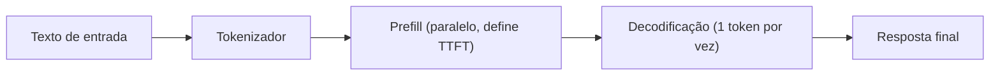

## Passo 1 · Leitura · Do Transformer treinado ao serviço de API

No Nível 6 você construiu um mini-GPT por dentro: texto virava uma sequência de inteiros (tokens), atravessava camadas de atenção causal e produzia uma distribuição de probabilidades sobre o próximo token. Em Engenharia de IA, esse mesmo modelo roda atrás de um servidor HTTP de inferência. Para projetar sistemas confiáveis, rápidos e dentro do orçamento, você precisa dominar quatro grandezas operacionais: **tokens**, **janela de contexto**, **latência** e **custo**.

O modelo não lê palavras nem caracteres diretamente, e sim **subpalavras** geradas por um tokenizador (como BPE). Em textos em português, uma regra prática sólida de engenharia é que **cada palavra equivale, em média, a $1{,}35$ token** (ou cerca de 1 token a cada 4 caracteres). Palavras comuns viram um único token; palavras longas, conjugações verbais ou códigos (`MAC0110`) costumam ser quebrados em duas ou três partes.

Quando sua aplicação envia um prompt ao servidor, a execução acontece em duas fases com custos computacionais muito diferentes:



1. **Prefill (processamento da entrada):** todos os tokens do prompt já são conhecidos. A GPU processa todos em paralelo em uma única passagem e preenche a memória de chaves e valores da atenção (*KV cache*). O tempo até o primeiro token sair é chamado de **TTFT** (*Time To First Token*).
2. **Decodificação (geração da saída):** o modelo é autorregressivo — para gerar o token $k+1$, ele precisa ter gerado o token $k$. Essa fase ocorre em série, um token por vez, limitada pela largura de banda de memória da GPU. Por isso, **a latência total cresce principalmente com o tamanho da saída**, e tokens de saída custam de $2\times$ a $5\times$ mais caro que tokens de entrada.

Se $T_{\text{entrada}}$ e $T_{\text{saída}}$ são as quantidades de tokens, $P_{\text{entrada}}$ e $P_{\text{saída}}$ são os preços por milhão de tokens e $t_{\text{token}}$ é o tempo por token gerado, o custo $C$ e a latência $L$ de uma chamada são dados por:

$$C = \frac{T_{\text{entrada}}}{10^6} \cdot P_{\text{entrada}} + \frac{T_{\text{saída}}}{10^6} \cdot P_{\text{saída}}, \qquad L = \text{TTFT} + T_{\text{saída}} \cdot t_{\text{token}}$$

Todo modelo possui uma **janela de contexto** máxima (por exemplo, $8\,192$ ou $128\,000$ tokens). Esse limite é **duro e compartilhado**: a soma dos tokens de entrada mais os tokens reservados para a resposta (`max_tokens`) precisa caber inteira na janela. Além de `max_tokens`, três parâmetros controlam a geração:

- `temperature`: achata ou concentra a distribuição de probabilidades antes do sorteio. Em `temperature = 0`, escolhe-se sempre o token mais provável (*greedy decoding*), o que é ideal para extração de dados e classificação (embora variações de ponto flutuante em GPUs paralelas ainda possam causar raríssimos empates não determinísticos).
- `top_p`: amostra apenas do menor conjunto de tokens cuja probabilidade acumulada atinge $p$.
- `stop`: lista de sequências que interrompem imediatamente a geração assim que aparecem.

Por fim, provedores modernos oferecem **cache de prefixo** (*prompt caching*): quando várias chamadas compartilham o mesmo prefixo longo (como o regimento da secretaria acadêmica e exemplos fixos no início do prompt), o *KV cache* do prefixo é reaproveitado, reduzindo o TTFT e o preço dos tokens cacheados.

## Passo 2 · Previsão · Orçamento da janela de contexto

Analise o código abaixo. Ele verifica se duas chamadas à secretaria acadêmica cabem em uma janela de contexto de $100$ tokens, considerando a reserva de `max_tokens` para a saída do modelo.

### Código

```python
def total_com_reserva(mensagens, max_tokens_saida):
    tokens_entrada = 0
    for msg in mensagens:
        tokens_entrada += len(msg.split())
    return tokens_entrada + max_tokens_saida

conversa = [
    "Voce atende alunos de graduacao da USP",
    "Como funciona o trancamento parcial de matricula no semestre"
]

limite_janela = 25
t1 = total_com_reserva(conversa, 5)
t2 = total_com_reserva(conversa, 12)

print("Entrada:", len(conversa[0].split()) + len(conversa[1].split()))
print("Chamada 1:", t1, t1 <= limite_janela)
print("Chamada 2:", t2, t2 <= limite_janela)
```

### Dicas

1. Conte quantas palavras separadas por espaço existem em `conversa[0]` ($7$ palavras) e em `conversa[1]` ($9$ palavras).
2. Lembre-se de que `total_com_reserva` soma os tokens de entrada (`7 + 9 = 16`) com `max_tokens_saida`.

### Saída esperada

```text
Entrada: 16
Chamada 1: 21 True
Chamada 2: 28 False
```

## Passo 3 · Exercício · Estimando tokens e custo

modo: lacunas

Antes de disparar um lote de chamadas para resumir requerimentos de alunos, precisamos estimar quantos tokens cada texto consumirá e qual será o custo financeiro da operação.

Adotaremos a regra prática para textos em português: se o texto não tiver palavras (`len(palavras) == 0`), a estimativa é `0`; caso contrário, multiplicamos o número de palavras (`texto.split()`) por `1.35` e arredondamos para cima com `math.ceil`. Já o custo soma a parcela de entrada e a parcela de saída dividindo as contagens por `1_000_000`.

### Instruções

1. Complete `estimar_tokens(texto)` para retornar `0` quando `not palavras` e `math.ceil(len(palavras) * 1.35)` caso contrário.
2. Complete `estimar_custo(tokens_entrada, tokens_saida, preco)` multiplicando os tokens de entrada por `preco["entrada_por_milhao"]` e os tokens de saída por `preco["saida_por_milhao"]`, dividindo cada parcela por `1_000_000`.

### Código inicial

```python path=main.py
import math


def estimar_tokens(texto):
    palavras = texto.split()
    if not palavras:
        return ___
    return math.ceil(len(palavras) * ___)


def estimar_custo(tokens_entrada, tokens_saida, preco):
    custo_entrada = (tokens_entrada / 1_000_000) * preco["___"]
    custo_saida = (tokens_saida / 1_000_000) * preco["___"]
    return custo_entrada + custo_saida


if __name__ == "__main__":
    t = estimar_tokens("Solicito aproveitamento de estudos na disciplina MAC0110")
    p = {"entrada_por_milhao": 2.0, "saida_por_milhao": 8.0}
    print(t, round(estimar_custo(t, 100, p), 6))
```

### Solução

```python path=main.py
import math


def estimar_tokens(texto):
    palavras = texto.split()
    if not palavras:
        return 0
    return math.ceil(len(palavras) * 1.35)


def estimar_custo(tokens_entrada, tokens_saida, preco):
    custo_entrada = (tokens_entrada / 1_000_000) * preco["entrada_por_milhao"]
    custo_saida = (tokens_saida / 1_000_000) * preco["saida_por_milhao"]
    return custo_entrada + custo_saida


if __name__ == "__main__":
    t = estimar_tokens("Solicito aproveitamento de estudos na disciplina MAC0110")
    p = {"entrada_por_milhao": 2.0, "saida_por_milhao": 8.0}
    print(t, round(estimar_custo(t, 100, p), 6))
```

### Dicas

1. Uma string vazia ou só com espaços produz `palavras = []`, portanto deve retornar `0` tokens.
2. O fator médio de subpalavras em português é `1.35`.
3. Os nomes das chaves no dicionário `preco` são `"entrada_por_milhao"` e `"saida_por_milhao"`.

### Verificação

```json
[
  {
    "id": "tokens-vazio",
    "name": "Texto vazio tem 0 tokens",
    "checkpoint": 1,
    "kind": "call",
    "function": "estimar_tokens",
    "args": ["   "],
    "expected": 0
  },
  {
    "id": "tokens-7-palavras",
    "name": "Frase de 7 palavras estima 10 tokens (ceil(7 * 1.35))",
    "checkpoint": 1,
    "kind": "call",
    "function": "estimar_tokens",
    "args": ["Solicito aproveitamento de estudos na disciplina MAC0110"],
    "expected": 10
  },
  {
    "id": "tokens-10-palavras",
    "name": "Frase de 10 palavras estima 14 tokens",
    "checkpoint": 1,
    "kind": "call",
    "function": "estimar_tokens",
    "args": ["um dois tres quatro cinco seis sete oito nove dez"],
    "expected": 14
  },
  {
    "id": "custo-lote",
    "name": "Custo combina tarifas distintas de entrada e saída",
    "checkpoint": 2,
    "kind": "call",
    "function": "estimar_custo",
    "args": [500000, 250000, {"entrada_por_milhao": 2.0, "saida_por_milhao": 8.0}],
    "expected": 3.0,
    "tolerance": 1e-6
  },
  {
    "id": "custo-unitario",
    "name": "Custo para chamada unitária pequena",
    "checkpoint": 2,
    "kind": "call",
    "function": "estimar_custo",
    "args": [1000, 500, {"entrada_por_milhao": 1.5, "saida_por_milhao": 6.0}],
    "expected": 0.0045,
    "tolerance": 1e-6
  }
]
```

### Soluções erradas

```python name="Conta palavras sem aplicar o fator 1.35 de subpalavras"
import math


def estimar_tokens(texto):
    palavras = texto.split()
    if not palavras:
        return 0
    return len(palavras)


def estimar_custo(tokens_entrada, tokens_saida, preco):
    custo_entrada = (tokens_entrada / 1_000_000) * preco["entrada_por_milhao"]
    custo_saida = (tokens_saida / 1_000_000) * preco["saida_por_milhao"]
    return custo_entrada + custo_saida
```

```python name="Usa o preço de entrada também para os tokens de saída"
import math


def estimar_tokens(texto):
    palavras = texto.split()
    if not palavras:
        return 0
    return math.ceil(len(palavras) * 1.35)


def estimar_custo(tokens_entrada, tokens_saida, preco):
    custo_entrada = (tokens_entrada / 1_000_000) * preco["entrada_por_milhao"]
    custo_saida = (tokens_saida / 1_000_000) * preco["entrada_por_milhao"]
    return custo_entrada + custo_saida
```

## Passo 4 · Exercício · Cabe na janela de contexto?

modo: ordenar

Ordene as linhas para implementar a função `cabe_no_contexto(mensagens, limite, reserva_para_saida)`. Cada item de `mensagens` é uma string; cada mensagem consome `math.ceil(len(m.split()) * 1.35)` tokens (ou `0` se vazia), e o total com `reserva_para_saida` deve ser menor ou igual a `limite`.

### Instruções

1. Receba `mensagens`, `limite` e `reserva_para_saida` na assinatura de `cabe_no_contexto`.
2. Acumule em `usados` os tokens estimados de cada mensagem da lista, iniciando em `reserva_para_saida`.
3. Retorne `True` se `usados <= limite` e `False` caso contrário.

### Solução

```python
import math


def cabe_no_contexto(mensagens, limite, reserva_para_saida):
    usados = reserva_para_saida
    for msg in mensagens:
        usados += math.ceil(len(msg.split()) * 1.35)
    return usados <= limite
```

### Dicas

1. Comece com `import math` e a definição `def cabe_no_contexto(mensagens, limite, reserva_para_saida):`.
2. Inicialize `usados = reserva_para_saida` antes do laço `for msg in mensagens:`.
3. A comparação final `return usados <= limite` fica fora do laço `for`.

### Verificação

```json
[
  {
    "id": "contexto-folga",
    "name": "Cabe quando entrada mais reserva ficam abaixo do limite",
    "checkpoint": 1,
    "kind": "call",
    "function": "cabe_no_contexto",
    "args": [["ola mundo", "teste curto"], 20, 10],
    "expected": true
  },
  {
    "id": "contexto-borda",
    "name": "Cabe exatamente na borda do limite",
    "checkpoint": 3,
    "kind": "call",
    "function": "cabe_no_contexto",
    "args": [["um dois tres quatro"], 16, 10],
    "expected": true
  },
  {
    "id": "contexto-estoura-reserva",
    "name": "Rejeita quando a reserva para saída faz estourar o limite",
    "checkpoint": 2,
    "kind": "call",
    "function": "cabe_no_contexto",
    "args": [["um dois tres quatro"], 15, 10],
    "expected": false
  },
  {
    "id": "contexto-vazio-reserva-grande",
    "name": "Lista vazia considera apenas a reserva de saída",
    "checkpoint": 2,
    "kind": "call",
    "function": "cabe_no_contexto",
    "args": [[], 50, 60],
    "expected": false
  }
]
```

### Soluções erradas

```python name="Esquece de somar a reserva para a saída"
import math


def cabe_no_contexto(mensagens, limite, reserva_para_saida):
    usados = 0
    for msg in mensagens:
        usados += math.ceil(len(msg.split()) * 1.35)
    return usados <= limite
```

```python name="Usa menor estrito e rejeita chamadas exatamente no limite"
import math


def cabe_no_contexto(mensagens, limite, reserva_para_saida):
    usados = reserva_para_saida
    for msg in mensagens:
        usados += math.ceil(len(msg.split()) * 1.35)
    return usados < limite
```

## Passo 5 · Exercício · Escolhendo o modelo pelo caso de uso

Nem toda tarefa exige o maior e mais caro modelo disponível. Para classificar requerimentos simples da secretaria, um modelo compacto de baixa latência pode ter qualidade suficiente por uma fração do preço; já para analisar equivalência de ementas longas, precisamos de janela de contexto ampla e qualidade alta.

Implemente a função `escolher_modelo(requisitos, catalogo)` que seleciona o modelo de **menor custo por chamada** dentre aqueles que cumprem todos os requisitos técnicos da tarefa.

Cada item de `catalogo` é um dicionário com o formato:
- `"nome"`: string identificadora (ex.: `"leve-8b"`, `"medio-70b"`, `"frontal-400b"`).
- `"qualidade"`: float de `0.0` a `1.0`.
- `"contexto_max"`: inteiro com o limite da janela de contexto (entrada + saída).
- `"ttft_ms"`: latência até o primeiro token em milissegundos.
- `"ms_por_token"`: milissegundos gastos por token de saída gerado.
- `"entrada_por_milhao"` e `"saida_por_milhao"`: preços em dólares por milhão de tokens.

O dicionário `requisitos` contém:
- `"tokens_entrada"`: inteiro com os tokens do prompt.
- `"tokens_saida"`: inteiro com os tokens esperados na resposta.
- `"qualidade_minima"`: float mínimo exigido para `"qualidade"`.
- `"latencia_max_ms"`: latência total máxima tolerada (`ttft_ms + tokens_saida * ms_por_token`).

### Instruções

1. Para cada modelo de `catalogo`, verifique se `modelo["qualidade"] >= requisitos["qualidade_minima"]`.
2. Verifique se a janela de contexto comporta a chamada inteira: `requisitos["tokens_entrada"] + requisitos["tokens_saida"] <= modelo["contexto_max"]`.
3. Calcule a latência estimada `modelo["ttft_ms"] + requisitos["tokens_saida"] * modelo["ms_por_token"]` e filtre apenas os modelos com latência `<= requisitos["latencia_max_ms"]`.
4. Entre os modelos aprovados nos filtros, retorne o `"nome"` daquele que tiver o menor custo total estimado para `(tokens_entrada, tokens_saida)`. Se nenhum modelo atender a todos os critérios, retorne `None`.

### Código inicial

```python path=main.py
def escolher_modelo(requisitos, catalogo):
    # Filtre os modelos que atendem qualidade, contexto e latência
    # e devolva o nome do mais barato para a chamada (ou None).
    pass


if __name__ == "__main__":
    cat = [
        {
            "nome": "mini-rapido",
            "qualidade": 0.72,
            "contexto_max": 8000,
            "ttft_ms": 120,
            "ms_por_token": 8,
            "entrada_por_milhao": 0.2,
            "saida_por_milhao": 0.8,
        },
        {
            "nome": "pro-equilibrado",
            "qualidade": 0.88,
            "contexto_max": 32000,
            "ttft_ms": 250,
            "ms_por_token": 15,
            "entrada_por_milhao": 1.5,
            "saida_por_milhao": 6.0,
        },
    ]
    req = {
        "tokens_entrada": 2000,
        "tokens_saida": 100,
        "qualidade_minima": 0.80,
        "latencia_max_ms": 2000,
    }
    print(escolher_modelo(req, cat))
```

### Solução

```python path=main.py
def escolher_modelo(requisitos, catalogo):
    t_in = requisitos["tokens_entrada"]
    t_out = requisitos["tokens_saida"]
    total_tokens = t_in + t_out

    melhor_nome = None
    menor_custo = None

    for modelo in catalogo:
        if modelo["qualidade"] < requisitos["qualidade_minima"]:
            continue
        if total_tokens > modelo["contexto_max"]:
            continue
        latencia = modelo["ttft_ms"] + t_out * modelo["ms_por_token"]
        if latencia > requisitos["latencia_max_ms"]:
            continue

        custo = (t_in / 1_000_000) * modelo["entrada_por_milhao"] + (
            t_out / 1_000_000
        ) * modelo["saida_por_milhao"]
        if menor_custo is None or custo < menor_custo:
            menor_custo = custo
            melhor_nome = modelo["nome"]

    return melhor_nome


if __name__ == "__main__":
    cat = [
        {
            "nome": "mini-rapido",
            "qualidade": 0.72,
            "contexto_max": 8000,
            "ttft_ms": 120,
            "ms_por_token": 8,
            "entrada_por_milhao": 0.2,
            "saida_por_milhao": 0.8,
        },
        {
            "nome": "pro-equilibrado",
            "qualidade": 0.88,
            "contexto_max": 32000,
            "ttft_ms": 250,
            "ms_por_token": 15,
            "entrada_por_milhao": 1.5,
            "saida_por_milhao": 6.0,
        },
    ]
    req = {
        "tokens_entrada": 2000,
        "tokens_saida": 100,
        "qualidade_minima": 0.80,
        "latencia_max_ms": 2000,
    }
    print(escolher_modelo(req, cat))
```

### Dicas

1. Lembre-se de somar `requisitos["tokens_entrada"] + requisitos["tokens_saida"]` para comparar com `modelo["contexto_max"]`.
2. A latência total depende apenas dos tokens de saída mais o tempo de prefill: `modelo["ttft_ms"] + requisitos["tokens_saida"] * modelo["ms_por_token"]`.
3. Compare o custo completo da chamada (entrada + saída), e não apenas o preço por milhão de tokens de entrada.

### Verificação

```json
[
  {
    "id": "filtra-qualidade",
    "name": "Descarta modelo barato que não atinge qualidade mínima",
    "checkpoint": 1,
    "kind": "call",
    "function": "escolher_modelo",
    "args": [
      {
        "tokens_entrada": 1000,
        "tokens_saida": 100,
        "qualidade_minima": 0.85,
        "latencia_max_ms": 3000
      },
      [
        {
          "nome": "mini",
          "qualidade": 0.75,
          "contexto_max": 8000,
          "ttft_ms": 100,
          "ms_por_token": 5,
          "entrada_por_milhao": 0.1,
          "saida_por_milhao": 0.4
        },
        {
          "nome": "medio",
          "qualidade": 0.88,
          "contexto_max": 16000,
          "ttft_ms": 200,
          "ms_por_token": 10,
          "entrada_por_milhao": 1.0,
          "saida_por_milhao": 4.0
        }
      ]
    ],
    "expected": "medio"
  },
  {
    "id": "filtra-contexto",
    "name": "Descarta modelo cuja janela não comporta entrada + saída",
    "checkpoint": 2,
    "kind": "call",
    "function": "escolher_modelo",
    "args": [
      {
        "tokens_entrada": 7500,
        "tokens_saida": 1000,
        "qualidade_minima": 0.7,
        "latencia_max_ms": 5000
      },
      [
        {
          "nome": "curto",
          "qualidade": 0.9,
          "contexto_max": 8000,
          "ttft_ms": 150,
          "ms_por_token": 3,
          "entrada_por_milhao": 0.5,
          "saida_por_milhao": 1.5
        },
        {
          "nome": "longo",
          "qualidade": 0.9,
          "contexto_max": 32000,
          "ttft_ms": 200,
          "ms_por_token": 4,
          "entrada_por_milhao": 1.0,
          "saida_por_milhao": 3.0
        }
      ]
    ],
    "expected": "longo"
  },
  {
    "id": "filtra-latencia",
    "name": "Descarta modelo lento que estoura latencia_max_ms",
    "checkpoint": 3,
    "kind": "call",
    "function": "escolher_modelo",
    "args": [
      {
        "tokens_entrada": 500,
        "tokens_saida": 200,
        "qualidade_minima": 0.8,
        "latencia_max_ms": 1500
      },
      [
        {
          "nome": "pesado",
          "qualidade": 0.95,
          "contexto_max": 32000,
          "ttft_ms": 400,
          "ms_por_token": 10,
          "entrada_por_milhao": 0.5,
          "saida_por_milhao": 1.0
        },
        {
          "nome": "agil",
          "qualidade": 0.85,
          "contexto_max": 32000,
          "ttft_ms": 150,
          "ms_por_token": 5,
          "entrada_por_milhao": 0.8,
          "saida_por_milhao": 2.0
        }
      ]
    ],
    "expected": "agil"
  },
  {
    "id": "menor-custo-combinado",
    "name": "Escolhe o modelo de menor custo combinando entrada e saída",
    "checkpoint": 4,
    "kind": "call",
    "function": "escolher_modelo",
    "args": [
      {
        "tokens_entrada": 100,
        "tokens_saida": 2000,
        "qualidade_minima": 0.8,
        "latencia_max_ms": 10000
      },
      [
        {
          "nome": "entrada-barata-saida-cara",
          "qualidade": 0.85,
          "contexto_max": 16000,
          "ttft_ms": 100,
          "ms_por_token": 2,
          "entrada_por_milhao": 0.5,
          "saida_por_milhao": 20.0
        },
        {
          "nome": "saida-economica",
          "qualidade": 0.85,
          "contexto_max": 16000,
          "ttft_ms": 100,
          "ms_por_token": 2,
          "entrada_por_milhao": 2.0,
          "saida_por_milhao": 4.0
        }
      ]
    ],
    "expected": "saida-economica"
  },
  {
    "id": "nenhum-atende",
    "name": "Retorna None quando nenhum modelo cumpre todos os requisitos",
    "checkpoint": 4,
    "kind": "call",
    "function": "escolher_modelo",
    "args": [
      {
        "tokens_entrada": 1000,
        "tokens_saida": 500,
        "qualidade_minima": 0.99,
        "latencia_max_ms": 500
      },
      [
        {
          "nome": "unico",
          "qualidade": 0.85,
          "contexto_max": 8000,
          "ttft_ms": 200,
          "ms_por_token": 10,
          "entrada_por_milhao": 1.0,
          "saida_por_milhao": 2.0
        }
      ]
    ],
    "expected": null
  }
]
```

### Soluções erradas

```python name="Escolhe o modelo mais barato sem filtrar por qualidade e latência"
def escolher_modelo(requisitos, catalogo):
    t_in = requisitos["tokens_entrada"]
    t_out = requisitos["tokens_saida"]
    melhor_nome = None
    menor_custo = None
    for modelo in catalogo:
        custo = (t_in / 1_000_000) * modelo["entrada_por_milhao"] + (
            t_out / 1_000_000
        ) * modelo["saida_por_milhao"]
        if menor_custo is None or custo < menor_custo:
            menor_custo = custo
            melhor_nome = modelo["nome"]
    return melhor_nome
```

```python name="Compara apenas pelo preço de entrada por milhão"
def escolher_modelo(requisitos, catalogo):
    t_in = requisitos["tokens_entrada"]
    t_out = requisitos["tokens_saida"]
    total_tokens = t_in + t_out

    melhor_nome = None
    menor_preco_in = None

    for modelo in catalogo:
        if modelo["qualidade"] < requisitos["qualidade_minima"]:
            continue
        if total_tokens > modelo["contexto_max"]:
            continue
        latencia = modelo["ttft_ms"] + t_out * modelo["ms_por_token"]
        if latencia > requisitos["latencia_max_ms"]:
            continue
        if menor_preco_in is None or modelo["entrada_por_milhao"] < menor_preco_in:
            menor_preco_in = modelo["entrada_por_milhao"]
            melhor_nome = modelo["nome"]

    return melhor_nome
```

## Passo 6 · Quiz · Tokens, latência e parâmetros

### Pergunta

Por que o tempo total de uma chamada a um LLM costuma ser dominado pelo número de tokens de **saída** em vez do número de tokens de **entrada**?

- [ ] Porque os tokens de entrada não passam pelas camadas de atenção do Transformer.
- [x] Porque o prefill processa os tokens de entrada em paralelo, enquanto a decodificação gera a saída em série, um token por vez.
- [ ] Porque a rede HTTP comprime apenas o texto de entrada e nunca o texto de saída.
- [ ] Porque o tokenizador só é executado durante a geração da resposta.

> No *prefill*, todos os tokens do prompt já estão disponíveis e são processados matricialmente em paralelo pela GPU. Na decodificação autorregressiva, cada token depende do anterior, exigindo uma etapa sequencial por token gerado.

### Pergunta

Você está extraindo códigos de disciplinas (como `MAC0110`) em formato JSON a partir de requerimentos estudantis e quer minimizar variações aleatórias e limitar o tamanho da resposta a no máximo 80 tokens. Quais parâmetros deve configurar?

- [ ] `temperature = 1.5` e `top_p = 1.0`.
- [ ] `max_tokens = 0` e `temperature = 1.0`.
- [x] `temperature = 0` e `max_tokens = 80`.
- [ ] `stop = ["80"]` e `temperature = 0.9`.

> Configurar `temperature = 0` seleciona sempre o token mais provável a cada passo, reduzindo a aleatoriedade em tarefas de extração, enquanto `max_tokens = 80` impõe um teto duro ao tamanho da saída gerada.

### Pergunta

Um modelo possui janela de contexto de $8\,000$ tokens. Seu prompt de entrada possui $7\,600$ tokens e você configurou `max_tokens = 600`. O que acontece com essa chamada?

- [ ] A chamada é aceita normalmente porque $7\,600 < 8\,000$.
- [x] A chamada falha ou é rejeitada porque a janela de contexto ($8\,000$) é compartilhada entre a entrada ($7\,600$) e a reserva de saída ($600$), somando $8\,200$ tokens.
- [ ] O modelo apaga automaticamente os primeiros $200$ tokens da mensagem `system` sem avisar.
- [ ] Os tokens de saída nunca ocupam espaço na janela de contexto.

> Tanto os tokens do prompt quanto os tokens gerados na resposta precisam coexistir no *KV cache* dentro da janela de contexto do modelo. Por isso, $T_{\text{entrada}} + \text{max\_tokens}$ não pode ultrapassar o limite da janela.
