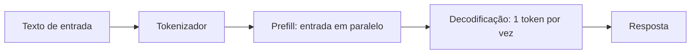

## Passo 1 · Leitura · Tokens não são palavras

No Nível 6 você viu o mini-GPT por dentro: o texto vira uma sequência de inteiros, os **tokens**, e o modelo prevê o próximo token. Num serviço de API é igual, e tudo o que importa para quem programa é medido em tokens: o tamanho máximo da conversa, o preço e o tempo de resposta.

Um token não é uma palavra. O tokenizador (BPE e parentes) aprende pedaços frequentes no texto de treino. Palavras curtas e comuns viram um token só; palavras longas, raras, com acento ou códigos como `PRG101` se quebram em vários pedaços. Como boa parte do texto de treino costuma ser inglês, um mesmo conteúdo em português tende a gastar **mais tokens por palavra** que em inglês. O número exato depende do tokenizador de cada modelo: a única contagem confiável é a que a própria API devolve no campo de uso (`usage`) ou a do tokenizador oficial do modelo.

Neste curso, sem rede e sem o tokenizador real, usamos uma **aproximação declarada**: cada palavra (separada por espaço) vira pedaços de até 4 caracteres.

```python
# Tokenizador de brinquedo do curso (NÃO é o de um modelo real)
# "the cat sat"            -> the | cat | sat                   3 palavras, 3 tokens
# "Qual o prazo de trancamento?"
#   -> Qual | o | praz o | de | tran came nto?                  5 palavras, 8 tokens
```

A aproximação erra para cima ou para baixo em cada palavra, mas captura o que interessa: tokens ≠ palavras, e texto longo em português custa mais do que a contagem de palavras sugere. Em produção, calibre a sua estimativa com o `usage` de chamadas reais.

#### A janela de contexto

Todo modelo tem uma **janela de contexto**: o máximo de tokens que ele enxerga de uma vez. Ela é **compartilhada** entre a entrada e a saída. Se a janela tem 8 000 tokens e a sua entrada tem 7 600, sobram 400 para a resposta. Pedir `max_tokens = 600` nesse caso ou é recusado pela API, ou a resposta sai cortada, dependendo do provedor. Por isso, ao planejar uma chamada, some a entrada **e** a reserva de saída.

A conversa inteira também conta: cada mensagem carrega alguns tokens extras de formatação (o papel, os separadores), além do texto.

## Passo 2 · Previsão · Cabe na janela?

O programa abaixo usa o tokenizador de brinquedo do passo anterior para contar os tokens de duas mensagens e testa duas reservas de saída numa janela de 40 tokens. Leia sem executar e digite exatamente o que ele imprime.

### Código
```python
import math


def tokens(texto):
    return sum(math.ceil(len(p) / 4) for p in texto.split())


sistema = "Responda em uma frase."
pergunta = "Qual o prazo de trancamento?"
print(tokens(sistema), tokens(pergunta))
entrada = tokens(sistema) + tokens(pergunta)
print(len(sistema.split()) + len(pergunta.split()), entrada)
for max_tokens in [20, 30]:
    print(max_tokens, entrada + max_tokens <= 40)
```

### Dicas
1. `math.ceil(len(p) / 4)` arredonda para cima: uma palavra de 5 a 8 caracteres vale 2 tokens. A pontuação colada conta como caractere (`frase.` tem 6).
2. `trancamento?` tem 12 caracteres.
3. A reserva de saída entra na soma antes da comparação com a janela.

### Saída esperada
```text
6 8
9 14
20 True
30 False
```

## Passo 3 · Exercício · Estimando tokens e custo
modo: lacunas

Antes de mandar um lote de 10 000 requerimentos para resumir, a secretaria acadêmica quer saber quanto vai pagar. Os provedores cobram por **milhão de tokens**, com um preço para a entrada e outro, em geral mais alto, para a saída:

$$
C = \frac{T_{\text{entrada}}}{10^6} \cdot P_{\text{entrada}} + \frac{T_{\text{saída}}}{10^6} \cdot P_{\text{saída}}
$$

Os preços deste curso são **fictícios**, em reais por milhão de tokens, num dicionário como `{"entrada": 2.0, "saida": 8.0}`.

Complete as lacunas (`___`) de `estimar_tokens(texto)`, que usa o tokenizador de brinquedo (cada palavra separada por espaço vale `ceil(len(palavra) / 4)` tokens, e texto sem palavras vale 0), e de `estimar_custo(tokens_entrada, tokens_saida, preco)`, que devolve o custo em reais.

### Instruções
1. Em `estimar_tokens`, percorra as palavras do texto separadas por espaço e arredonde cada uma para cima separadamente.
   Dica: arredondar a soma de todas as palavras dá outro número.
2. Em `estimar_custo`, cobre os tokens de saída com o preço de saída, por milhão de tokens.

### Código inicial
```python
import math


def estimar_tokens(texto):
    total = 0
    for palavra in texto.___():
        total += math.ceil(len(palavra) / ___)
    return total


def estimar_custo(tokens_entrada, tokens_saida, preco):
    custo_entrada = tokens_entrada / 1_000_000 * preco["entrada"]
    custo_saida = tokens_saida / ___ * preco[___]
    return custo_entrada + custo_saida
```

### Solução
```python
import math


def estimar_tokens(texto):
    total = 0
    for palavra in texto.split():
        total += math.ceil(len(palavra) / 4)
    return total


def estimar_custo(tokens_entrada, tokens_saida, preco):
    custo_entrada = tokens_entrada / 1_000_000 * preco["entrada"]
    custo_saida = tokens_saida / 1_000_000 * preco["saida"]
    return custo_entrada + custo_saida
```

### Dicas
1. `split()` sem argumentos separa por qualquer sequência de espaços e ignora espaços nas pontas.
2. Uma palavra de 1 a 4 caracteres vale 1 token; de 5 a 8, vale 2.
3. A divisão por um milhão vale para as duas parcelas; o que muda entre elas é o preço.

### Verificação
```json
[
  { "id": "vazio", "checkpoint": 1, "kind": "call", "function": "estimar_tokens", "args": ["   "], "expected": 0,
    "name": "Texto só com espaços tem 0 tokens" },
  { "id": "curta", "checkpoint": 1, "kind": "call", "function": "estimar_tokens", "args": ["Oi"], "expected": 1,
    "name": "estimar_tokens(\"Oi\") é 1", "hint": "Uma palavra curta ainda vale um token inteiro: arredonde para cima." },
  { "id": "longa", "checkpoint": 1, "kind": "call", "function": "estimar_tokens", "args": ["trancamento"], "expected": 3,
    "name": "Uma palavra longa vale vários tokens", "hint": "Tokens não são palavras: divida o tamanho da palavra." },
  { "id": "frase", "checkpoint": 1, "kind": "call", "function": "estimar_tokens", "args": ["Solicito aproveitamento de estudos"], "expected": 9,
    "name": "Frase de 4 palavras estima 9 tokens" },
  { "id": "pontuacao", "checkpoint": 1, "kind": "call", "function": "estimar_tokens", "args": ["Olá, tudo bem?"], "expected": 3,
    "name": "A pontuação colada faz parte da palavra; os espaços não contam",
    "hint": "Conte o tamanho de cada palavra, não do texto inteiro." },
  { "id": "curtas", "checkpoint": 1, "kind": "call", "function": "estimar_tokens", "args": ["a de o e"], "expected": 4,
    "name": "Quatro palavras curtas valem 4 tokens", "hint": "Arredonde cada palavra, não a soma." },
  { "id": "custo-lote", "checkpoint": 2, "kind": "call", "function": "estimar_custo",
    "args": [500000, 250000, { "entrada": 2.0, "saida": 8.0 }], "expected": 3.0, "tolerance": 1e-9,
    "name": "Meio milhão de entrada e um quarto de milhão de saída custam 3.0" },
  { "id": "custo-pequeno", "checkpoint": 2, "kind": "call", "function": "estimar_custo",
    "args": [1000, 500, { "entrada": 1.5, "saida": 6.0 }], "expected": 0.0045, "tolerance": 1e-9,
    "name": "Chamada pequena: 1000 de entrada e 500 de saída" },
  { "id": "so-saida", "checkpoint": 2, "kind": "call", "function": "estimar_custo",
    "args": [0, 1000000, { "entrada": 3.0, "saida": 12.0 }], "expected": 12.0, "tolerance": 1e-9,
    "name": "Um milhão de tokens de saída custa o preço de saída",
    "hint": "A saída tem o seu próprio preço no dicionário." }
]
```

### Soluções erradas
```python name="conta palavras como tokens"
import math


def estimar_tokens(texto):
    return len(texto.split())


def estimar_custo(tokens_entrada, tokens_saida, preco):
    custo_entrada = tokens_entrada / 1_000_000 * preco["entrada"]
    custo_saida = tokens_saida / 1_000_000 * preco["saida"]
    return custo_entrada + custo_saida
```
```python name="divisão inteira arredonda para baixo"
import math


def estimar_tokens(texto):
    total = 0
    for palavra in texto.split():
        total += len(palavra) // 4
    return total


def estimar_custo(tokens_entrada, tokens_saida, preco):
    custo_entrada = tokens_entrada / 1_000_000 * preco["entrada"]
    custo_saida = tokens_saida / 1_000_000 * preco["saida"]
    return custo_entrada + custo_saida
```
```python name="arredonda a soma, não cada palavra"
import math


def estimar_tokens(texto):
    letras = sum(len(p) for p in texto.split())
    return math.ceil(letras / 4)


def estimar_custo(tokens_entrada, tokens_saida, preco):
    custo_entrada = tokens_entrada / 1_000_000 * preco["entrada"]
    custo_saida = tokens_saida / 1_000_000 * preco["saida"]
    return custo_entrada + custo_saida
```
```python name="conta caracteres do texto inteiro, com espaços"
import math


def estimar_tokens(texto):
    if not texto.strip():
        return 0
    return math.ceil(len(texto) / 4)


def estimar_custo(tokens_entrada, tokens_saida, preco):
    custo_entrada = tokens_entrada / 1_000_000 * preco["entrada"]
    custo_saida = tokens_saida / 1_000_000 * preco["saida"]
    return custo_entrada + custo_saida
```
```python name="cobra a saída pelo preço de entrada"
import math


def estimar_tokens(texto):
    total = 0
    for palavra in texto.split():
        total += math.ceil(len(palavra) / 4)
    return total


def estimar_custo(tokens_entrada, tokens_saida, preco):
    return (tokens_entrada + tokens_saida) / 1_000_000 * preco["entrada"]
```
```python name="preço por mil em vez de por milhão"
import math


def estimar_tokens(texto):
    total = 0
    for palavra in texto.split():
        total += math.ceil(len(palavra) / 4)
    return total


def estimar_custo(tokens_entrada, tokens_saida, preco):
    custo_entrada = tokens_entrada / 1_000_000 * preco["entrada"]
    custo_saida = tokens_saida / 1_000 * preco["saida"]
    return custo_entrada + custo_saida
```

## Passo 4 · Exercício · Cabe na janela de contexto?
modo: ordenar

Antes de enviar uma conversa, o sistema confere se ela cabe na janela. Você recebe a lista com os tokens do texto de cada mensagem (já contados), o `limite` da janela e o `max_tokens` reservado para a resposta. Cada mensagem custa ainda `SOBRECARGA_POR_MENSAGEM = 4` tokens de formatação (valor do simulador do curso; cada provedor tem o seu).

Arraste as linhas para montar `cabe_no_contexto(tokens_mensagens, limite, max_tokens)`, que devolve `True` quando entrada + sobrecargas + reserva de saída ficam **dentro** do limite (igual ao limite ainda cabe). Duas linhas estão sobrando.

### Instruções
1. Comece a conta pela reserva de saída.
2. Some, para cada mensagem, os tokens do texto e a sobrecarga de formatação.
3. Devolva se o total cabe no limite, contando o caso de ficar exatamente igual.

### Solução
```python
SOBRECARGA_POR_MENSAGEM = 4


def cabe_no_contexto(tokens_mensagens, limite, max_tokens):
    usados = max_tokens
    for tokens in tokens_mensagens:
        usados += tokens + SOBRECARGA_POR_MENSAGEM
    return usados <= limite
```

### Distratores
```python
usados = 0
return usados < limite
```

### Dicas
1. A reserva de saída é somada uma vez só, fora do laço.
2. O `return` fica fora do laço: ele só pode decidir depois de somar todas as mensagens.
3. "Igual ao limite ainda cabe" decide o operador de comparação.

### Verificação
```json
[
  { "id": "borda", "checkpoint": 3, "kind": "call", "function": "cabe_no_contexto", "args": [[10, 20], 50, 12], "expected": true,
    "name": "Total exatamente igual ao limite cabe", "hint": "Igual ao limite ainda cabe." },
  { "id": "estoura-1", "checkpoint": 3, "kind": "call", "function": "cabe_no_contexto", "args": [[10, 20], 49, 12], "expected": false,
    "name": "Um token acima do limite não cabe" },
  { "id": "reserva", "checkpoint": 1, "kind": "call", "function": "cabe_no_contexto", "args": [[100], 120, 30], "expected": false,
    "name": "A reserva de saída faz a conversa estourar", "hint": "A resposta também ocupa a janela." },
  { "id": "sobrecarga", "checkpoint": 2, "kind": "call", "function": "cabe_no_contexto", "args": [[30], 40, 7], "expected": false,
    "name": "A sobrecarga de formatação conta", "hint": "Cada mensagem custa os tokens do texto mais a formatação." },
  { "id": "varias", "checkpoint": 2, "kind": "call", "function": "cabe_no_contexto", "args": [[5, 5, 5, 5], 36, 0], "expected": true,
    "name": "Quatro mensagens com a sobrecarga de cada uma, na borda" },
  { "id": "todas", "checkpoint": 2, "kind": "call", "function": "cabe_no_contexto", "args": [[10, 30], 45, 0], "expected": false,
    "name": "Todas as mensagens entram na soma", "hint": "Decida só depois de somar a lista inteira." },
  { "id": "sem-mensagens", "checkpoint": 1, "kind": "call", "function": "cabe_no_contexto", "args": [[], 9, 10], "expected": false,
    "name": "Sem mensagens, só a reserva já pode estourar" }
]
```

### Soluções erradas
```python name="esquece a reserva de saída"
SOBRECARGA_POR_MENSAGEM = 4


def cabe_no_contexto(tokens_mensagens, limite, max_tokens):
    usados = 0
    for tokens in tokens_mensagens:
        usados += tokens + SOBRECARGA_POR_MENSAGEM
    return usados <= limite
```
```python name="menor estrito recusa a borda"
SOBRECARGA_POR_MENSAGEM = 4


def cabe_no_contexto(tokens_mensagens, limite, max_tokens):
    usados = max_tokens
    for tokens in tokens_mensagens:
        usados += tokens + SOBRECARGA_POR_MENSAGEM
    return usados < limite
```
```python name="ignora a sobrecarga por mensagem"
SOBRECARGA_POR_MENSAGEM = 4


def cabe_no_contexto(tokens_mensagens, limite, max_tokens):
    usados = max_tokens
    for tokens in tokens_mensagens:
        usados += tokens
    return usados <= limite
```
```python name="return dentro do laço decide na primeira mensagem"
SOBRECARGA_POR_MENSAGEM = 4


def cabe_no_contexto(tokens_mensagens, limite, max_tokens):
    usados = max_tokens
    for tokens in tokens_mensagens:
        usados += tokens + SOBRECARGA_POR_MENSAGEM
        return usados <= limite
```

## Passo 5 · Leitura · Prefill, decodificação e os botões da geração

Quando a chamada chega ao servidor, o modelo trabalha em duas fases bem diferentes:



1. **Prefill.** Todos os tokens da entrada já são conhecidos, então a GPU os processa juntos, numa passagem, e guarda as chaves e valores da atenção (o *KV cache*, que você viu no Nível 6). O tempo até o primeiro token sair é o **TTFT** (*time to first token*). Ele cresce com a entrada, mas devagar, porque o trabalho é paralelo.
2. **Decodificação.** O modelo é autorregressivo: o token $k+1$ só pode ser gerado depois do token $k$. Cada token de saída custa uma passagem inteira pelo modelo, em série.

Por isso a **latência** é dominada pela saída, e por isso os provedores costumam cobrar mais caro por token de saída:

$$
L \approx \text{TTFT} + T_{\text{saída}} \cdot t_{\text{token}}
$$

Com TTFT de 300 ms e 20 ms por token, uma resposta de 50 tokens sai em cerca de 1,3 s; uma de 500 tokens, em 10,3 s. Para responder mais rápido, peça respostas curtas antes de pensar em encurtar o prompt.

#### Os botões

- `max_tokens`: teto da saída. Se a resposta bate no teto, ela é cortada e a API avisa com `finish_reason = "length"` (lição 02).
- `stop`: sequências que encerram a geração quando aparecem.
- `temperature`: divide os *logits* antes do softmax. Abaixo de 1, concentra a probabilidade no token mais provável; acima de 1, espalha. Com temperatura maior que zero, **a mesma pergunta pode receber respostas diferentes**.
- `top_p`: sorteia só entre os tokens mais prováveis cuja probabilidade somada chega a $p$.

Temperatura 0 escolhe sempre o token mais provável, mas nem isso garante respostas idênticas num servidor real: somas de ponto flutuante em paralelo e lotes compartilhados com outras requisições podem mudar um empate. Alguns provedores aceitam uma semente (`seed`) que torna o sorteio reproduzível *na maior parte das vezes*. Testes automáticos, portanto, não podem depender de a resposta ser sempre a mesma: é por isso que, neste curso, o modelo é simulado com semente fixa.

Veja a temperatura mudando as probabilidades e a semente repetindo o sorteio:

```python visualizar
import math
import random

proximos = ["sexta", "segunda", "amanhã"]
logits = [2.0, 1.0, 0.5]


def probabilidades(logits, temperatura):
    exps = [math.exp(x / temperatura) for x in logits]
    total = sum(exps)
    return [e / total for e in exps]


for t in [0.2, 1.0, 2.0]:
    print(t, [round(p, 2) for p in probabilidades(logits, t)])

pesos = probabilidades(logits, 1.0)
rng = random.Random(7)
primeiro = [rng.choices(proximos, weights=pesos)[0] for _ in range(5)]
rng = random.Random(7)
segundo = [rng.choices(proximos, weights=pesos)[0] for _ in range(5)]
print(primeiro)
print(primeiro == segundo)
```

## Passo 6 · Exercício · Escolhendo o modelo pelo caso de uso

Para classificar requerimentos curtos, um modelo pequeno e rápido pode bastar; para comparar ementas longas, você precisa de janela grande e qualidade alta. Escreva `escolher_modelo(requisitos, catalogo)`, que devolve o `"nome"` do modelo **mais barato para esta chamada** entre os que cumprem todos os requisitos, ou `None` se nenhum cumprir. Em caso de empate no custo, fica o que aparece primeiro no catálogo.

Cada modelo do `catalogo` (nomes e números fictícios) tem:
- `"nome"`, `"qualidade"` (de 0 a 1, medida no seu conjunto de avaliação), `"contexto_max"` (janela, entrada + saída);
- `"ttft_ms"` e `"ms_por_token"` (tempo por token de saída);
- `"entrada"` e `"saida"`: preços em reais por milhão de tokens.

`requisitos` tem `"tokens_entrada"`, `"tokens_saida"`, `"qualidade_minima"` e `"latencia_max_ms"`.

Exemplo: com entrada de 2 000 tokens, saída de 100, qualidade mínima 0,80 e latência máxima de 2 000 ms, um modelo com qualidade 0,72 está fora, por mais barato que seja; um com TTFT 250 ms e 15 ms por token leva $250 + 100 \cdot 15 = 1750$ ms e passa.

### Instruções
1. Descarte modelos com qualidade abaixo da mínima (igual à mínima serve).
2. Descarte modelos cuja janela não comporta a entrada mais a saída.
3. Descarte modelos cuja latência estimada passa da máxima (igual serve).
4. Entre os que sobraram, devolva o nome do de menor custo total da chamada (entrada e saída, cada uma pelo seu preço), ou `None`.

### Código inicial
```python
def escolher_modelo(requisitos, catalogo):
    pass
```

### Solução
```python
def custo(modelo, t_in, t_out):
    return t_in / 1_000_000 * modelo["entrada"] + t_out / 1_000_000 * modelo["saida"]


def escolher_modelo(requisitos, catalogo):
    t_in = requisitos["tokens_entrada"]
    t_out = requisitos["tokens_saida"]
    melhor = None
    for modelo in catalogo:
        if modelo["qualidade"] < requisitos["qualidade_minima"]:
            continue
        if t_in + t_out > modelo["contexto_max"]:
            continue
        latencia = modelo["ttft_ms"] + t_out * modelo["ms_por_token"]
        if latencia > requisitos["latencia_max_ms"]:
            continue
        if melhor is None or custo(modelo, t_in, t_out) < custo(melhor, t_in, t_out):
            melhor = modelo
    return melhor["nome"] if melhor is not None else None
```

### Dicas
1. Um laço com três `if ... continue` deixa cada filtro numa linha e o que sobra é candidato.
2. A latência depende dos tokens de **saída**: a entrada vai toda de uma vez no prefill.
3. Guarde o melhor candidato até agora e compare o custo completo da chamada.

### Verificação
```json
[
  { "id": "qualidade", "checkpoint": 1, "kind": "call", "function": "escolher_modelo",
    "args": [{ "tokens_entrada": 1000, "tokens_saida": 100, "qualidade_minima": 0.85, "latencia_max_ms": 3000 },
      [{ "nome": "mini", "qualidade": 0.75, "contexto_max": 8000, "ttft_ms": 100, "ms_por_token": 5, "entrada": 0.1, "saida": 0.4 },
       { "nome": "medio", "qualidade": 0.88, "contexto_max": 16000, "ttft_ms": 200, "ms_por_token": 10, "entrada": 1.0, "saida": 4.0 }]],
    "expected": "medio", "name": "Descarta o modelo barato que não atinge a qualidade mínima" },
  { "id": "qualidade-borda", "checkpoint": 1, "kind": "call", "function": "escolher_modelo",
    "args": [{ "tokens_entrada": 1000, "tokens_saida": 100, "qualidade_minima": 0.8, "latencia_max_ms": 3000 },
      [{ "nome": "caro", "qualidade": 0.95, "contexto_max": 8000, "ttft_ms": 100, "ms_por_token": 5, "entrada": 5.0, "saida": 15.0 },
       { "nome": "justo", "qualidade": 0.8, "contexto_max": 8000, "ttft_ms": 100, "ms_por_token": 5, "entrada": 0.5, "saida": 1.5 }]],
    "expected": "justo", "name": "Qualidade igual à mínima serve", "hint": "Igual à mínima atende o requisito." },
  { "id": "contexto", "checkpoint": 2, "kind": "call", "function": "escolher_modelo",
    "args": [{ "tokens_entrada": 7500, "tokens_saida": 1000, "qualidade_minima": 0.7, "latencia_max_ms": 9000 },
      [{ "nome": "curto", "qualidade": 0.9, "contexto_max": 8000, "ttft_ms": 150, "ms_por_token": 3, "entrada": 0.5, "saida": 1.5 },
       { "nome": "longo", "qualidade": 0.9, "contexto_max": 32000, "ttft_ms": 200, "ms_por_token": 4, "entrada": 1.0, "saida": 3.0 }]],
    "expected": "longo", "name": "Descarta a janela que não comporta entrada + saída",
    "hint": "A saída também ocupa a janela de contexto." },
  { "id": "latencia", "checkpoint": 3, "kind": "call", "function": "escolher_modelo",
    "args": [{ "tokens_entrada": 500, "tokens_saida": 200, "qualidade_minima": 0.8, "latencia_max_ms": 1500 },
      [{ "nome": "pesado", "qualidade": 0.95, "contexto_max": 32000, "ttft_ms": 400, "ms_por_token": 10, "entrada": 0.5, "saida": 1.0 },
       { "nome": "agil", "qualidade": 0.85, "contexto_max": 32000, "ttft_ms": 150, "ms_por_token": 5, "entrada": 0.8, "saida": 2.0 }]],
    "expected": "agil", "name": "Descarta o modelo lento", "hint": "Latência = TTFT + tokens de saída × ms por token." },
  { "id": "latencia-borda", "checkpoint": 3, "kind": "call", "function": "escolher_modelo",
    "args": [{ "tokens_entrada": 300, "tokens_saida": 100, "qualidade_minima": 0.5, "latencia_max_ms": 1000 },
      [{ "nome": "exato", "qualidade": 0.7, "contexto_max": 4000, "ttft_ms": 500, "ms_por_token": 5, "entrada": 0.2, "saida": 0.6 },
       { "nome": "folgado", "qualidade": 0.7, "contexto_max": 4000, "ttft_ms": 100, "ms_por_token": 1, "entrada": 3.0, "saida": 9.0 }]],
    "expected": "exato", "name": "Latência igual à máxima serve" },
  { "id": "custo-combinado", "checkpoint": 4, "kind": "call", "function": "escolher_modelo",
    "args": [{ "tokens_entrada": 100, "tokens_saida": 2000, "qualidade_minima": 0.8, "latencia_max_ms": 10000 },
      [{ "nome": "entrada-barata", "qualidade": 0.85, "contexto_max": 16000, "ttft_ms": 100, "ms_por_token": 2, "entrada": 0.5, "saida": 20.0 },
       { "nome": "saida-barata", "qualidade": 0.85, "contexto_max": 16000, "ttft_ms": 100, "ms_por_token": 2, "entrada": 2.0, "saida": 4.0 }]],
    "expected": "saida-barata", "name": "Compara o custo da chamada inteira, entrada e saída",
    "hint": "Nesta chamada a saída é 20 vezes maior que a entrada." },
  { "id": "empate", "checkpoint": 4, "kind": "call", "function": "escolher_modelo",
    "args": [{ "tokens_entrada": 1000, "tokens_saida": 100, "qualidade_minima": 0.5, "latencia_max_ms": 5000 },
      [{ "nome": "primeiro", "qualidade": 0.7, "contexto_max": 8000, "ttft_ms": 100, "ms_por_token": 5, "entrada": 1.0, "saida": 2.0 },
       { "nome": "segundo", "qualidade": 0.9, "contexto_max": 8000, "ttft_ms": 100, "ms_por_token": 5, "entrada": 1.0, "saida": 2.0 }]],
    "expected": "primeiro", "name": "Empate no custo fica com o primeiro do catálogo" },
  { "id": "nenhum", "checkpoint": 4, "kind": "call", "function": "escolher_modelo",
    "args": [{ "tokens_entrada": 1000, "tokens_saida": 500, "qualidade_minima": 0.99, "latencia_max_ms": 500 },
      [{ "nome": "unico", "qualidade": 0.85, "contexto_max": 8000, "ttft_ms": 200, "ms_por_token": 10, "entrada": 1.0, "saida": 2.0 }]],
    "expected": null, "name": "Devolve None quando nenhum modelo atende" }
]
```

### Soluções erradas
```python name="escolhe o mais barato sem filtrar"
def custo(modelo, t_in, t_out):
    return t_in / 1_000_000 * modelo["entrada"] + t_out / 1_000_000 * modelo["saida"]


def escolher_modelo(requisitos, catalogo):
    t_in = requisitos["tokens_entrada"]
    t_out = requisitos["tokens_saida"]
    melhor = None
    for modelo in catalogo:
        if melhor is None or custo(modelo, t_in, t_out) < custo(melhor, t_in, t_out):
            melhor = modelo
    return melhor["nome"] if melhor is not None else None
```
```python name="compara só o preço de entrada"
def escolher_modelo(requisitos, catalogo):
    t_in = requisitos["tokens_entrada"]
    t_out = requisitos["tokens_saida"]
    melhor = None
    for modelo in catalogo:
        if modelo["qualidade"] < requisitos["qualidade_minima"]:
            continue
        if t_in + t_out > modelo["contexto_max"]:
            continue
        latencia = modelo["ttft_ms"] + t_out * modelo["ms_por_token"]
        if latencia > requisitos["latencia_max_ms"]:
            continue
        if melhor is None or modelo["entrada"] < melhor["entrada"]:
            melhor = modelo
    return melhor["nome"] if melhor is not None else None
```
```python name="latência calculada com os tokens de entrada"
def custo(modelo, t_in, t_out):
    return t_in / 1_000_000 * modelo["entrada"] + t_out / 1_000_000 * modelo["saida"]


def escolher_modelo(requisitos, catalogo):
    t_in = requisitos["tokens_entrada"]
    t_out = requisitos["tokens_saida"]
    melhor = None
    for modelo in catalogo:
        if modelo["qualidade"] < requisitos["qualidade_minima"]:
            continue
        if t_in + t_out > modelo["contexto_max"]:
            continue
        latencia = modelo["ttft_ms"] + t_in * modelo["ms_por_token"]
        if latencia > requisitos["latencia_max_ms"]:
            continue
        if melhor is None or custo(modelo, t_in, t_out) < custo(melhor, t_in, t_out):
            melhor = modelo
    return melhor["nome"] if melhor is not None else None
```
```python name="janela comparada só com a entrada"
def custo(modelo, t_in, t_out):
    return t_in / 1_000_000 * modelo["entrada"] + t_out / 1_000_000 * modelo["saida"]


def escolher_modelo(requisitos, catalogo):
    t_in = requisitos["tokens_entrada"]
    t_out = requisitos["tokens_saida"]
    melhor = None
    for modelo in catalogo:
        if modelo["qualidade"] < requisitos["qualidade_minima"]:
            continue
        if t_in > modelo["contexto_max"]:
            continue
        latencia = modelo["ttft_ms"] + t_out * modelo["ms_por_token"]
        if latencia > requisitos["latencia_max_ms"]:
            continue
        if melhor is None or custo(modelo, t_in, t_out) < custo(melhor, t_in, t_out):
            melhor = modelo
    return melhor["nome"] if melhor is not None else None
```
```python name="filtros com comparação estrita nas bordas"
def custo(modelo, t_in, t_out):
    return t_in / 1_000_000 * modelo["entrada"] + t_out / 1_000_000 * modelo["saida"]


def escolher_modelo(requisitos, catalogo):
    t_in = requisitos["tokens_entrada"]
    t_out = requisitos["tokens_saida"]
    melhor = None
    for modelo in catalogo:
        if modelo["qualidade"] <= requisitos["qualidade_minima"]:
            continue
        if t_in + t_out > modelo["contexto_max"]:
            continue
        latencia = modelo["ttft_ms"] + t_out * modelo["ms_por_token"]
        if latencia >= requisitos["latencia_max_ms"]:
            continue
        if melhor is None or custo(modelo, t_in, t_out) < custo(melhor, t_in, t_out):
            melhor = modelo
    return melhor["nome"] if melhor is not None else None
```
```python name="empate fica com o último"
def custo(modelo, t_in, t_out):
    return t_in / 1_000_000 * modelo["entrada"] + t_out / 1_000_000 * modelo["saida"]


def escolher_modelo(requisitos, catalogo):
    t_in = requisitos["tokens_entrada"]
    t_out = requisitos["tokens_saida"]
    melhor = None
    for modelo in catalogo:
        if modelo["qualidade"] < requisitos["qualidade_minima"]:
            continue
        if t_in + t_out > modelo["contexto_max"]:
            continue
        latencia = modelo["ttft_ms"] + t_out * modelo["ms_por_token"]
        if latencia > requisitos["latencia_max_ms"]:
            continue
        if melhor is None or custo(modelo, t_in, t_out) <= custo(melhor, t_in, t_out):
            melhor = modelo
    return melhor["nome"] if melhor is not None else None
```

## Passo 7 · Quiz · Tokens, latência e parâmetros

### Pergunta
Um assistente responde em 8 s: o prompt tem 3 000 tokens e a resposta, 350. O TTFT medido é 0,6 s. Qual mudança deve reduzir mais a latência?
- [ ] Cortar o prompt pela metade, para 1 500 tokens.
- [x] Pedir uma resposta mais curta, por exemplo limitando a cerca de 100 tokens.
- [ ] Trocar `temperature` de 0,7 para 0.
- [ ] Mandar o prompt em duas chamadas de 1 500 tokens.
> Só 0,6 s dos 8 s são prefill; o resto é decodificação, um token de saída por vez. Encurtar a saída corta diretamente o termo $T_{\text{saída}} \cdot t_{\text{token}}$. A temperatura não muda o número de passos.

### Pergunta
Você roda o mesmo prompt de extração duas vezes, com `temperature = 0`, num provedor real, e as respostas saem diferentes em uma palavra. O que explica isso?
- [ ] É impossível: temperatura 0 garante a mesma saída sempre.
- [x] Temperatura 0 escolhe o token mais provável, mas diferenças numéricas do processamento em paralelo podem mudar um quase empate, e a partir dali o texto diverge.
- [ ] O provedor guarda a primeira resposta e sorteia outra de propósito.
- [ ] `max_tokens` estava baixo demais.
> Temperatura 0 reduz muito a variação, mas não a elimina num servidor real. Testes automáticos não devem depender de a resposta ser idêntica: valide o formato e o conteúdo, ou use um modelo simulado com semente.

### Pergunta
O modelo tem janela de 8 000 tokens. O prompt tem 7 600 e você pede `max_tokens = 600`. O que esperar?
- [ ] Funciona normalmente, porque 7 600 < 8 000.
- [x] A chamada é recusada ou a resposta sai cortada, porque entrada e saída dividem a mesma janela e 7 600 + 600 > 8 000.
- [ ] O modelo descarta sozinho as primeiras mensagens para abrir espaço, sem avisar.
- [ ] A saída não ocupa a janela, só a entrada.
> A janela é compartilhada. Ou você encurta a entrada (truncando o histórico, lição 02), ou reduz a reserva de saída.
