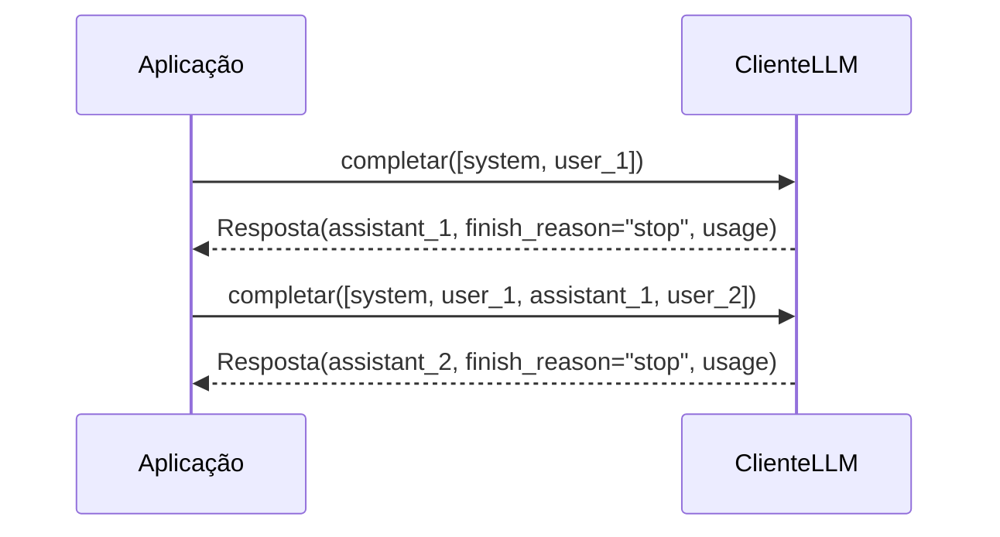

## Passo 1 · Leitura · Mensagens, papéis e o objeto Resposta

Servidores de LLMs são **sem estado** (*stateless*): o modelo não guarda memória da sua conversa entre uma requisição HTTP e outra. A sensação de diálogo contínuo acontece porque **a sua aplicação guarda a lista de mensagens e a reenvia inteira a cada turno**.

Cada mensagem é um dicionário `{"role": "<papel>", "content": "<texto>"}`. Os três papéis fundamentais são:

- `system`: define as diretrizes permanentes do assistente (tom, regras de negócio, limites de atuação). Vai sempre na primeira posição da lista.
- `user`: a pergunta, documento ou comando enviado pelo usuário (ou pela aplicação).
- `assistant`: as respostas que o próprio modelo deu nos turnos anteriores.



Neste curso, como o código roda em um ambiente isolado e reprodutível sem acesso à internet, usamos um `ClienteLLM` simulado com a mesma anatomia dos SDKs reais. O método `cliente.completar(mensagens, max_tokens=...)` devolve um objeto `Resposta` com três atributos essenciais:

1. `resposta.conteudo`: o texto gerado pelo modelo (`str`).
2. `resposta.finish_reason`: o motivo pelo qual a geração parou — `"stop"` quando o modelo concluiu o raciocínio naturalmente, ou `"length"` quando foi cortado ao atingir `max_tokens`. Tratar uma resposta cortada por `"length"` como se estivesse completa é uma fonte clássica de bugs silenciosos (por exemplo, JSONs truncados pela metade).
3. `resposta.usage`: dicionário com `"prompt_tokens"`, `"completion_tokens"` e `"total_tokens"`.

Observe no visualizador como a lista `historico` e o consumo de tokens evoluem ao longo de dois turnos de conversa:

```python visualizar
def simular_chamada(mensagens):
    prompt_t = sum(len(m["content"].split()) for m in mensagens)
    ultima = mensagens[-1]["content"]
    texto = f"Recebi ({len(mensagens)} msgs): {ultima}"
    comp_t = len(texto.split())
    return {
        "conteudo": texto,
        "finish_reason": "stop",
        "usage": {
            "prompt_tokens": prompt_t,
            "completion_tokens": comp_t,
            "total_tokens": prompt_t + comp_t,
        },
    }

mensagens = [{"role": "system", "content": "Atenda a secretaria da USP."}]
total_acumulado = 0

for pergunta in ["Prazo de trancamento?", "E para calouros?"]:
    mensagens.append({"role": "user", "content": pergunta})
    resp = simular_chamada(mensagens)
    mensagens.append({"role": "assistant", "content": resp["conteudo"]})
    total_acumulado += resp["usage"]["total_tokens"]
```

Quando você leva seu código para produção com um provedor externo, basta trocar a instância de `ClienteLLM` passada no construtor da sua classe `Assistente`. E atenção a uma regra de ouro de segurança: **chaves de API nunca devem ser escritas no código-fonte**. Elas são lidas do ambiente com `os.environ["LLM_API_KEY"]` para nunca vazarem em repositórios Git.

## Passo 2 · Exercício · Montando a lista de mensagens

modo: lacunas

Complete a função `montar_mensagens(sistema, historico, pergunta)` para construir a lista de mensagens que será enviada ao modelo em um turno de conversa, **sem modificar** a lista `historico` original passada como argumento.

### Instruções

1. Comece a lista `mensagens` com um dicionário de papel `"system"` e conteúdo `sistema`.
2. Copie todas as mensagens de `historico` para `mensagens` e adicione ao final a pergunta atual com papel `"user"` e conteúdo `pergunta`.

### Código inicial

```python path=main.py
def montar_mensagens(sistema, historico, pergunta):
    mensagens = [{"role": "___", "content": sistema}]
    for item in historico:
        mensagens.append(dict(item))
    mensagens.append({"role": "___", "content": ___})
    return mensagens


if __name__ == "__main__":
    hist = [
        {"role": "user", "content": "Oi"},
        {"role": "assistant", "content": "Olá! Como posso ajudar?"},
    ]
    print(montar_mensagens("Seja conciso.", hist, "Qual o código de Cálculo I?"))
```

### Solução

```python path=main.py
def montar_mensagens(sistema, historico, pergunta):
    mensagens = [{"role": "system", "content": sistema}]
    for item in historico:
        mensagens.append(dict(item))
    mensagens.append({"role": "user", "content": pergunta})
    return mensagens


if __name__ == "__main__":
    hist = [
        {"role": "user", "content": "Oi"},
        {"role": "assistant", "content": "Olá! Como posso ajudar?"},
    ]
    print(montar_mensagens("Seja conciso.", hist, "Qual o código de Cálculo I?"))
```

### Dicas

1. A primeira mensagem da conversa tem sempre `"role": "system"`.
2. A nova pergunta do aluno entra no final com `"role": "user"` e `"content": pergunta`.

### Verificação

```json
[
  {
    "id": "sem-historico",
    "name": "Monta conversa sem histórico prévio",
    "checkpoint": 1,
    "kind": "call",
    "function": "montar_mensagens",
    "args": ["Responda em pt-BR.", [], "Qual o horário da secretaria?"],
    "expected": [
      {"role": "system", "content": "Responda em pt-BR."},
      {"role": "user", "content": "Qual o horário da secretaria?"}
    ]
  },
  {
    "id": "com-historico",
    "name": "Inclui histórico entre system e a pergunta atual",
    "checkpoint": 2,
    "kind": "call",
    "function": "montar_mensagens",
    "args": [
      "Sistema",
      [
        {"role": "user", "content": "P1"},
        {"role": "assistant", "content": "R1"}
      ],
      "P2"
    ],
    "expected": [
      {"role": "system", "content": "Sistema"},
      {"role": "user", "content": "P1"},
      {"role": "assistant", "content": "R1"},
      {"role": "user", "content": "P2"}
    ]
  },
  {
    "id": "nao-muta-historico",
    "name": "Não altera a lista historico original",
    "checkpoint": 2,
    "kind": "expr",
    "setup": "h = [{'role': 'user', 'content': 'A'}]\n_ = montar_mensagens('Sys', h, 'B')",
    "expr": "len(h)",
    "expected": 1
  }
]
```

### Soluções erradas

```python name="Coloca o papel assistant na pergunta do usuário"
def montar_mensagens(sistema, historico, pergunta):
    mensagens = [{"role": "system", "content": sistema}]
    for item in historico:
        mensagens.append(dict(item))
    mensagens.append({"role": "assistant", "content": pergunta})
    return mensagens
```

```python name="Esquece a mensagem de sistema no início"
def montar_mensagens(sistema, historico, pergunta):
    mensagens = []
    for item in historico:
        mensagens.append(dict(item))
    mensagens.append({"role": "user", "content": pergunta})
    return mensagens
```

## Passo 3 · Exercício · Conversar e truncar histórico

À medida que uma conversa se alonga, o histórico cresce e pode estourar a janela de contexto. Quando precisamos descartar mensagens antigas, há uma regra essencial: **nunca descartar a mensagem `system` inicial**, pois ela contém as instruções de comportamento e segurança do assistente.

Além disso, ao chamar `cliente.completar(mensagens, max_tokens=max_tokens)`, precisamos inspecionar `resposta.finish_reason`. Se o valor for `"length"`, a resposta foi cortada no meio e nossa função deve levantar `RuntimeError("Resposta truncada")`.

### Instruções

1. Implemente `conversar(cliente, mensagens, max_tokens=200)` que chama `cliente.completar(mensagens, max_tokens=max_tokens)`. Se `resposta.finish_reason == "length"`, levante `RuntimeError("Resposta truncada")`; caso contrário, retorne a tupla `(resposta.conteudo, resposta.usage["total_tokens"])`.
2. Implemente `truncar_historico(mensagens, max_mensagens)` que retorna uma nova lista com no máximo `max_mensagens` itens. Se `len(mensagens) <= max_mensagens`, retorne uma cópia da lista. Caso contrário, se a primeira mensagem tiver `"role": "system"`, preserve essa primeira mensagem e mantenha as últimas `max_mensagens - 1` mensagens do restante; se a primeira não for `"system"`, mantenha as últimas `max_mensagens` mensagens.

### Código inicial

```python path=main.py
class Resposta:
    def __init__(self, conteudo, finish_reason, prompt_tokens, completion_tokens):
        self.conteudo = conteudo
        self.finish_reason = finish_reason
        self.usage = {
            "prompt_tokens": prompt_tokens,
            "completion_tokens": completion_tokens,
            "total_tokens": prompt_tokens + completion_tokens,
        }


class ClienteLLM:
    def __init__(self, resposta_padrao="Ok, entendido."):
        self.resposta_padrao = resposta_padrao

    def completar(self, mensagens, max_tokens=200):
        p_tokens = sum(len(m["content"].split()) for m in mensagens)
        palavras_saida = self.resposta_padrao.split()
        if len(palavras_saida) > max_tokens:
            cortado = " ".join(palavras_saida[:max_tokens])
            return Resposta(cortado, "length", p_tokens, max_tokens)
        return Resposta(self.resposta_padrao, "stop", p_tokens, len(palavras_saida))


def conversar(cliente, mensagens, max_tokens=200):
    # Chame cliente.completar e verifique finish_reason
    pass


def truncar_historico(mensagens, max_mensagens):
    # Preserve a mensagem system inicial ao truncar
    pass


if __name__ == "__main__":
    cli = ClienteLLM("A matrícula em MAC0110 ocorre pelo JúpiterWeb.")
    msgs = [
        {"role": "system", "content": "Você é o atendente da secretaria."},
        {"role": "user", "content": "Como faço matrícula?"},
    ]
    print(conversar(cli, msgs))
```

### Solução

```python path=main.py
class Resposta:
    def __init__(self, conteudo, finish_reason, prompt_tokens, completion_tokens):
        self.conteudo = conteudo
        self.finish_reason = finish_reason
        self.usage = {
            "prompt_tokens": prompt_tokens,
            "completion_tokens": completion_tokens,
            "total_tokens": prompt_tokens + completion_tokens,
        }


class ClienteLLM:
    def __init__(self, resposta_padrao="Ok, entendido."):
        self.resposta_padrao = resposta_padrao

    def completar(self, mensagens, max_tokens=200):
        p_tokens = sum(len(m["content"].split()) for m in mensagens)
        palavras_saida = self.resposta_padrao.split()
        if len(palavras_saida) > max_tokens:
            cortado = " ".join(palavras_saida[:max_tokens])
            return Resposta(cortado, "length", p_tokens, max_tokens)
        return Resposta(self.resposta_padrao, "stop", p_tokens, len(palavras_saida))


def conversar(cliente, mensagens, max_tokens=200):
    resposta = cliente.completar(mensagens, max_tokens=max_tokens)
    if resposta.finish_reason == "length":
        raise RuntimeError("Resposta truncada")
    return (resposta.conteudo, resposta.usage["total_tokens"])


def truncar_historico(mensagens, max_mensagens):
    if len(mensagens) <= max_mensagens:
        return list(mensagens)
    if mensagens and mensagens[0].get("role") == "system":
        if max_mensagens <= 1:
            return [mensagens[0]]
        return [mensagens[0]] + list(mensagens[-(max_mensagens - 1) :])
    return list(mensagens[-max_mensagens:])


if __name__ == "__main__":
    cli = ClienteLLM("A matrícula em MAC0110 ocorre pelo JúpiterWeb.")
    msgs = [
        {"role": "system", "content": "Você é o atendente da secretaria."},
        {"role": "user", "content": "Como faço matrícula?"},
    ]
    print(conversar(cli, msgs))
```

### Dicas

1. Em `conversar`, passe `max_tokens=max_tokens` para `cliente.completar(...)` e cheque `if resposta.finish_reason == "length":`.
2. Em `truncar_historico`, use fatiamento negativo `mensagens[-(max_mensagens - 1):]` para pegar as mensagens mais recentes depois de separar `mensagens[0]`.

### Verificação

```json
[
  {
    "id": "conversar-stop",
    "name": "conversar retorna conteúdo e total de tokens quando finish_reason é stop",
    "checkpoint": 1,
    "kind": "expr",
    "setup": "cli = ClienteLLM('Solicitação registrada com sucesso')\nmsgs = [{'role': 'system', 'content': 'Atenda bem'}, {'role': 'user', 'content': 'Trancar disciplina'}]",
    "expr": "conversar(cli, msgs, max_tokens=20)",
    "expected": ["Solicitação registrada com sucesso", 8]
  },
  {
    "id": "conversar-length",
    "name": "conversar levanta RuntimeError quando finish_reason é length",
    "checkpoint": 1,
    "kind": "expr",
    "setup": "cli = ClienteLLM('Esta resposta tem muito mais do que três palavras')",
    "expr": "conversar(cli, [{'role': 'user', 'content': 'Oi'}], max_tokens=3)",
    "raises": "RuntimeError",
    "message_contains": "Resposta truncada"
  },
  {
    "id": "truncar-preserva-system",
    "name": "truncar_historico preserva system e mantém as mensagens mais recentes",
    "checkpoint": 2,
    "kind": "call",
    "function": "truncar_historico",
    "args": [
      [
        {"role": "system", "content": "Regras"},
        {"role": "user", "content": "M1"},
        {"role": "assistant", "content": "M2"},
        {"role": "user", "content": "M3"},
        {"role": "assistant", "content": "M4"}
      ],
      3
    ],
    "expected": [
      {"role": "system", "content": "Regras"},
      {"role": "user", "content": "M3"},
      {"role": "assistant", "content": "M4"}
    ]
  },
  {
    "id": "truncar-ja-cabe",
    "name": "truncar_historico não altera lista que já cabe em max_mensagens",
    "checkpoint": 2,
    "kind": "call",
    "function": "truncar_historico",
    "args": [
      [
        {"role": "system", "content": "Regras"},
        {"role": "user", "content": "M1"}
      ],
      5
    ],
    "expected": [
      {"role": "system", "content": "Regras"},
      {"role": "user", "content": "M1"}
    ]
  }
]
```

### Soluções erradas

```python name="Ignora finish_reason e devolve resposta cortada sem erro"
class Resposta:
    def __init__(self, conteudo, finish_reason, prompt_tokens, completion_tokens):
        self.conteudo = conteudo
        self.finish_reason = finish_reason
        self.usage = {
            "prompt_tokens": prompt_tokens,
            "completion_tokens": completion_tokens,
            "total_tokens": prompt_tokens + completion_tokens,
        }


class ClienteLLM:
    def __init__(self, resposta_padrao="Ok, entendido."):
        self.resposta_padrao = resposta_padrao

    def completar(self, mensagens, max_tokens=200):
        p_tokens = sum(len(m["content"].split()) for m in mensagens)
        palavras_saida = self.resposta_padrao.split()
        if len(palavras_saida) > max_tokens:
            cortado = " ".join(palavras_saida[:max_tokens])
            return Resposta(cortado, "length", p_tokens, max_tokens)
        return Resposta(self.resposta_padrao, "stop", p_tokens, len(palavras_saida))


def conversar(cliente, mensagens, max_tokens=200):
    resposta = cliente.completar(mensagens, max_tokens=max_tokens)
    return (resposta.conteudo, resposta.usage["total_tokens"])


def truncar_historico(mensagens, max_mensagens):
    if len(mensagens) <= max_mensagens:
        return list(mensagens)
    return [mensagens[0]] + list(mensagens[-(max_mensagens - 1) :])
```

```python name="Descarta a mensagem system ao fatiar apenas o final da lista"
class Resposta:
    def __init__(self, conteudo, finish_reason, prompt_tokens, completion_tokens):
        self.conteudo = conteudo
        self.finish_reason = finish_reason
        self.usage = {
            "prompt_tokens": prompt_tokens,
            "completion_tokens": completion_tokens,
            "total_tokens": prompt_tokens + completion_tokens,
        }


class ClienteLLM:
    def __init__(self, resposta_padrao="Ok, entendido."):
        self.resposta_padrao = resposta_padrao

    def completar(self, mensagens, max_tokens=200):
        p_tokens = sum(len(m["content"].split()) for m in mensagens)
        palavras_saida = self.resposta_padrao.split()
        if len(palavras_saida) > max_tokens:
            cortado = " ".join(palavras_saida[:max_tokens])
            return Resposta(cortado, "length", p_tokens, max_tokens)
        return Resposta(self.resposta_padrao, "stop", p_tokens, len(palavras_saida))


def conversar(cliente, mensagens, max_tokens=200):
    resposta = cliente.completar(mensagens, max_tokens=max_tokens)
    if resposta.finish_reason == "length":
        raise RuntimeError("Resposta truncada")
    return (resposta.conteudo, resposta.usage["total_tokens"])


def truncar_historico(mensagens, max_mensagens):
    return list(mensagens[-max_mensagens:])
```

## Passo 4 · Exercício · A classe Assistente

Em uma aplicação real, o restante do sistema não deve montar dicionários `{"role": ...}` nem somar faturas de tokens manualmente a cada chamada. Vamos encapsular o cliente e o estado da conversa na classe `Assistente`.

### Instruções

1. No `__init__(self, cliente, sistema, preco_por_milhao)`, armazene os argumentos, inicialize `self.historico = []` (apenas as mensagens `"user"` e `"assistant"` trocadas) e contadores `self.tokens_entrada = 0` e `self.tokens_saida = 0`.
2. Implemente `perguntar(self, texto)`: monte a lista `[system] + self.historico + [user]`, chame `self.cliente.completar(mensagens)` e acumule `prompt_tokens` e `completion_tokens` a partir de `resposta.usage`. Se `resposta.finish_reason != "stop"`, levante `RuntimeError("Geração incompleta")`. Caso contrário, adicione a mensagem `"user"` e a mensagem `"assistant"` ao `self.historico` e retorne `resposta.conteudo`.
3. Implemente `custo_acumulado(self)` retornando o custo total em dólares calculado com `self.preco_por_milhao["entrada"]` e `self.preco_por_milhao["saida"]` (divididos por `1_000_000`).

### Código inicial

```python path=main.py
class Resposta:
    def __init__(self, conteudo, finish_reason, prompt_tokens, completion_tokens):
        self.conteudo = conteudo
        self.finish_reason = finish_reason
        self.usage = {
            "prompt_tokens": prompt_tokens,
            "completion_tokens": completion_tokens,
            "total_tokens": prompt_tokens + completion_tokens,
        }


class ClienteDialogoSimulado:
    def completar(self, mensagens, **params):
        prompt_t = sum(len(m["content"].split()) for m in mensagens)
        ultima = mensagens[-1]["content"]
        turno = sum(1 for m in mensagens if m["role"] == "user")
        texto = f"Turno {turno}: respondendo sobre {ultima}"
        comp_t = len(texto.split())
        return Resposta(texto, "stop", prompt_t, comp_t)


class Assistente:
    def __init__(self, cliente, sistema, preco_por_milhao):
        # Inicialize atributos, histórico e contadores de tokens
        pass

    def perguntar(self, texto):
        # Envie mensagens ao cliente, valide finish_reason, atualize histórico e tokens
        pass

    def custo_acumulado(self):
        # Calcule o custo acumulado de entrada e saída
        pass


if __name__ == "__main__":
    cli = ClienteDialogoSimulado()
    precos = {"entrada": 1000.0, "saida": 2000.0}
    bot = Assistente(cli, "Secretaria USP", precos)
    print(bot.perguntar("MAC0110"))
    print(bot.perguntar("MAC0121"))
    print("Msgs no histórico:", len(bot.historico))
    print("Custo:", round(bot.custo_acumulado(), 6))
```

### Solução

```python path=main.py
class Resposta:
    def __init__(self, conteudo, finish_reason, prompt_tokens, completion_tokens):
        self.conteudo = conteudo
        self.finish_reason = finish_reason
        self.usage = {
            "prompt_tokens": prompt_tokens,
            "completion_tokens": completion_tokens,
            "total_tokens": prompt_tokens + completion_tokens,
        }


class ClienteDialogoSimulado:
    def completar(self, mensagens, **params):
        prompt_t = sum(len(m["content"].split()) for m in mensagens)
        ultima = mensagens[-1]["content"]
        turno = sum(1 for m in mensagens if m["role"] == "user")
        texto = f"Turno {turno}: respondendo sobre {ultima}"
        comp_t = len(texto.split())
        return Resposta(texto, "stop", prompt_t, comp_t)


class Assistente:
    def __init__(self, cliente, sistema, preco_por_milhao):
        self.cliente = cliente
        self.sistema = sistema
        self.preco_por_milhao = preco_por_milhao
        self.historico = []
        self.tokens_entrada = 0
        self.tokens_saida = 0

    def perguntar(self, texto):
        mensagens = (
            [{"role": "system", "content": self.sistema}]
            + list(self.historico)
            + [{"role": "user", "content": texto}]
        )
        resposta = self.cliente.completar(mensagens)
        self.tokens_entrada += resposta.usage["prompt_tokens"]
        self.tokens_saida += resposta.usage["completion_tokens"]
        if resposta.finish_reason != "stop":
            raise RuntimeError("Geração incompleta")
        self.historico.append({"role": "user", "content": texto})
        self.historico.append({"role": "assistant", "content": resposta.conteudo})
        return resposta.conteudo

    def custo_acumulado(self):
        c_in = (self.tokens_entrada / 1_000_000) * self.preco_por_milhao["entrada"]
        c_out = (self.tokens_saida / 1_000_000) * self.preco_por_milhao["saida"]
        return c_in + c_out


if __name__ == "__main__":
    cli = ClienteDialogoSimulado()
    precos = {"entrada": 1000.0, "saida": 2000.0}
    bot = Assistente(cli, "Secretaria USP", precos)
    print(bot.perguntar("MAC0110"))
    print(bot.perguntar("MAC0121"))
    print("Msgs no histórico:", len(bot.historico))
    print("Custo:", round(bot.custo_acumulado(), 6))
```

### Dicas

1. A cada chamada de `perguntar(texto)`, envie `[{"role": "system", "content": self.sistema}] + self.historico + [{"role": "user", "content": texto}]`.
2. Não se esqueça de adicionar tanto a pergunta (`"user"`) quanto a resposta (`"assistant"`) em `self.historico` após uma resposta bem-sucedida.
3. Em `custo_acumulado`, use as chaves `"entrada"` e `"saida"` de `self.preco_por_milhao`.

### Verificação

```json
[
  {
    "id": "historico-multi-turno",
    "name": "Mantém o histórico entre múltiplos turnos",
    "checkpoint": 2,
    "kind": "expr",
    "setup": "cli = ClienteDialogoSimulado()\nbot = Assistente(cli, 'Secretaria USP', {'entrada': 1000.0, 'saida': 2000.0})\nr1 = bot.perguntar('MAC0110')\nr2 = bot.perguntar('MAC0121')",
    "expr": "[r1, r2, len(bot.historico)]",
    "expected": [
      "Turno 1: respondendo sobre MAC0110",
      "Turno 2: respondendo sobre MAC0121",
      4
    ]
  },
  {
    "id": "custo-dois-turnos",
    "name": "Acumula tokens e calcula custo corretamente após dois turnos",
    "checkpoint": 3,
    "kind": "expr",
    "setup": "cli = ClienteDialogoSimulado()\nbot = Assistente(cli, 'Secretaria USP', {'entrada': 1000.0, 'saida': 2000.0})\nbot.perguntar('MAC0110')\nbot.perguntar('MAC0121')",
    "expr": "bot.custo_acumulado()",
    "expected": 0.032,
    "tolerance": 1e-6
  },
  {
    "id": "erro-finish-reason",
    "name": "Levanta RuntimeError se finish_reason for diferente de stop",
    "checkpoint": 2,
    "kind": "expr",
    "setup": "class CliCurto:\n    def completar(self, msgs):\n        return Resposta('incompleto', 'length', 5, 2)\nbot = Assistente(CliCurto(), 'Sys', {'entrada': 1.0, 'saida': 2.0})",
    "expr": "bot.perguntar('Oi')",
    "raises": "RuntimeError",
    "message_contains": "Geração incompleta"
  }
]
```

### Soluções erradas

```python name="Não guarda a resposta do assistant no histórico"
class Resposta:
    def __init__(self, conteudo, finish_reason, prompt_tokens, completion_tokens):
        self.conteudo = conteudo
        self.finish_reason = finish_reason
        self.usage = {
            "prompt_tokens": prompt_tokens,
            "completion_tokens": completion_tokens,
            "total_tokens": prompt_tokens + completion_tokens,
        }


class ClienteDialogoSimulado:
    def completar(self, mensagens, **params):
        prompt_t = sum(len(m["content"].split()) for m in mensagens)
        ultima = mensagens[-1]["content"]
        turno = sum(1 for m in mensagens if m["role"] == "user")
        texto = f"Turno {turno}: respondendo sobre {ultima}"
        comp_t = len(texto.split())
        return Resposta(texto, "stop", prompt_t, comp_t)


class Assistente:
    def __init__(self, cliente, sistema, preco_por_milhao):
        self.cliente = cliente
        self.sistema = sistema
        self.preco_por_milhao = preco_por_milhao
        self.historico = []
        self.tokens_entrada = 0
        self.tokens_saida = 0

    def perguntar(self, texto):
        mensagens = (
            [{"role": "system", "content": self.sistema}]
            + list(self.historico)
            + [{"role": "user", "content": texto}]
        )
        resposta = self.cliente.completar(mensagens)
        self.tokens_entrada += resposta.usage["prompt_tokens"]
        self.tokens_saida += resposta.usage["completion_tokens"]
        self.historico.append({"role": "user", "content": texto})
        return resposta.conteudo

    def custo_acumulado(self):
        c_in = (self.tokens_entrada / 1_000_000) * self.preco_por_milhao["entrada"]
        c_out = (self.tokens_saida / 1_000_000) * self.preco_por_milhao["saida"]
        return c_in + c_out
```

```python name="Reinicia o histórico a cada pergunta em vez de acumular"
class Resposta:
    def __init__(self, conteudo, finish_reason, prompt_tokens, completion_tokens):
        self.conteudo = conteudo
        self.finish_reason = finish_reason
        self.usage = {
            "prompt_tokens": prompt_tokens,
            "completion_tokens": completion_tokens,
            "total_tokens": prompt_tokens + completion_tokens,
        }


class ClienteDialogoSimulado:
    def completar(self, mensagens, **params):
        prompt_t = sum(len(m["content"].split()) for m in mensagens)
        ultima = mensagens[-1]["content"]
        turno = sum(1 for m in mensagens if m["role"] == "user")
        texto = f"Turno {turno}: respondendo sobre {ultima}"
        comp_t = len(texto.split())
        return Resposta(texto, "stop", prompt_t, comp_t)


class Assistente:
    def __init__(self, cliente, sistema, preco_por_milhao):
        self.cliente = cliente
        self.sistema = sistema
        self.preco_por_milhao = preco_por_milhao
        self.historico = []
        self.tokens_entrada = 0
        self.tokens_saida = 0

    def perguntar(self, texto):
        mensagens = [
            {"role": "system", "content": self.sistema},
            {"role": "user", "content": texto},
        ]
        resposta = self.cliente.completar(mensagens)
        self.tokens_entrada += resposta.usage["prompt_tokens"]
        self.tokens_saida += resposta.usage["completion_tokens"]
        if resposta.finish_reason != "stop":
            raise RuntimeError("Geração incompleta")
        self.historico = [{"role": "user", "content": texto}]
        return resposta.conteudo

    def custo_acumulado(self):
        return 0.0
```

## Passo 5 · Quiz · Papéis e estado da conversa

### Pergunta

Em uma conversa de vários turnos com uma API de LLM, como o modelo sabe o que foi dito nas perguntas anteriores?

- [ ] O servidor da API identifica o IP do cliente e carrega automaticamente a sessão na GPU.
- [x] A aplicação cliente guarda o histórico de mensagens (`user` e `assistant`) e o reenvia junto com a nova pergunta a cada chamada.
- [ ] O modelo atualiza os pesos da rede neural a cada mensagem recebida.
- [ ] A mensagem `system` armazena automaticamente todas as respostas passadas.

> As APIs padrão de completamento de chat são *stateless*: o cliente é responsável por manter e enviar a lista de mensagens anteriores (e por isso paga novamente pelos tokens de entrada do histórico enviado).

### Pergunta

Ao inspecionar a resposta de uma chamada que pedia um objeto JSON, você observa `resposta.finish_reason == "length"`. O que isso indica?

- [ ] Que o JSON gerado foi validado com sucesso pelo servidor.
- [ ] Que o prompt de entrada estava vazio.
- [x] Que a geração foi interrompida por atingir o limite `max_tokens`, e o texto retornado provavelmente está incompleto.
- [ ] Que o modelo encontrou uma sequência da lista `stop`.

> O motivo `"length"` indica que a geração atingiu o teto de tokens de saída permitido antes de emitir o token de fim de turno, produzindo uma resposta truncada.

### Pergunta

Qual é a prática correta para armazenar e carregar a chave de API (`API_KEY`) em uma aplicação Python que consome um serviço de LLM?

- [ ] Definir uma constante `API_KEY = "sk-..."` no topo do `main.py`.
- [ ] Salvar a chave em um comentário dentro do arquivo `README.md` do repositório.
- [x] Configurar a chave em uma variável de ambiente do sistema/servidor e lê-la com `os.environ["LLM_API_KEY"]`.
- [ ] Enviar a chave dentro do texto da mensagem `system`.

> Credenciais nunca devem ir para o controle de versão. Lê-las de variáveis de ambiente (`os.environ`) permite separar código de segredos e rotacionar chaves sem alterar o código-fonte.
