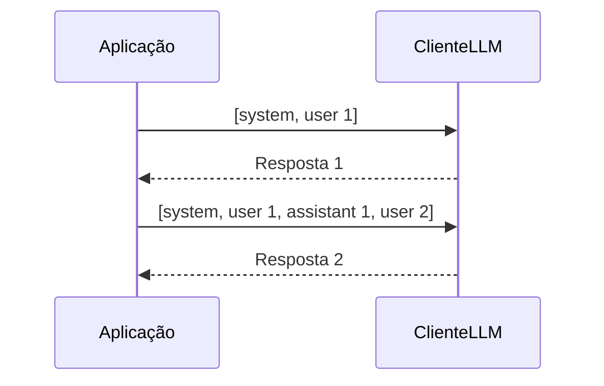

## Passo 1 · Leitura · Mensagens, papéis e o objeto Resposta

Uma API de chat recebe uma **lista de mensagens** e devolve a próxima. Cada mensagem é um dicionário com papel e texto, `{"role": ..., "content": ...}`, e há três papéis:

- `system`: as regras fixas do assistente (tom, escopo, o que recusar). Vai na primeira posição.
- `user`: o que a pessoa (ou o seu programa) pergunta.
- `assistant`: o que o modelo respondeu nos turnos anteriores.

O servidor **não guarda a conversa**. Cada chamada é independente: se o modelo parece lembrar do turno anterior, é porque a sua aplicação reenviou o histórico inteiro. Duas consequências práticas: quem cuida do histórico é você, e cada turno paga de novo, como entrada, todos os tokens da conversa até ali.



A chamada devolve um objeto com três campos que você precisa ler sempre:

```python
resposta = cliente.completar(mensagens, max_tokens=200)
resposta.conteudo        # o texto gerado
resposta.finish_reason   # por que parou: "stop", "length" ou "tool_calls"
resposta.usage           # {"prompt_tokens": 61, "completion_tokens": 13, "total_tokens": 74}
```

- `finish_reason == "stop"`: o modelo terminou a resposta.
- `finish_reason == "length"`: bateu em `max_tokens` e foi **cortado no meio**. O texto existe, parece normal e está incompleto. Um JSON cortado assim não abre; um resumo cortado perde a conclusão. Tratar `"length"` como sucesso é um defeito silencioso clássico.
- `finish_reason == "tool_calls"`: o modelo pediu para chamar uma ferramenta (lição 04).

O `usage` traz a contagem **oficial** de tokens: é por ela que a fatura é calculada, e não pela sua estimativa da lição anterior. `prompt_tokens` é a entrada inteira (todas as mensagens, com a formatação de cada uma); `completion_tokens` é a saída.

#### A chave de API

Para falar com um provedor real você precisa de uma chave secreta. Ela **nunca** vai no código: há robôs que varrem repositórios públicos atrás de chaves expostas, e quem achar a sua gasta por sua conta. O padrão é ler do ambiente, `chave = os.environ["LLM_API_KEY"]`, e configurar a variável no servidor.

## Passo 2 · Leitura · O cliente simulado do curso

O executor desta plataforma não tem rede, então as lições usam o arquivo `llm_simulado.py`, que imita a interface de um SDK real e mostra, de propósito, o comportamento que você vai encontrar na prática. Ele é aberto: leia o arquivo nos exercícios.

```python
from llm_simulado import ClienteLLM

cliente = ClienteLLM(["Pode trancar até a 8ª semana.", "O prazo vai até a 8ª semana."], seed=1)
r = cliente.completar([{"role": "user", "content": "Até quando posso trancar?"}], max_tokens=50)
print(r.conteudo, r.finish_reason, r.usage, r.latencia_ms)
```

O que ele simula, e como:

| Comportamento real | No simulador |
|---|---|
| Tokens ≠ palavras | Tokenizador de brinquedo (pedaços de até 4 caracteres; o espaço em branco vai colado no pedaço, então a resposta volta com as quebras de linha) + 4 tokens de formatação por mensagem |
| Mesma pergunta, respostas diferentes | Com `temperature > 0`, sorteia entre as respostas candidatas com `random.Random(seed)` |
| Corte por `max_tokens` | Corta no token e devolve `finish_reason = "length"` |
| Latência | `ttft_ms + tokens × ms_por_token`, somada a um relógio falso (`cliente.relogio`) |
| Falhas 429, 5xx, timeout, 400 | Fila `falhas=[...]`, consumida uma por chamada (lição 03) |

Os preços do curso são fictícios. Em vez de uma lista de respostas, o simulador também aceita uma função que recebe as mensagens e devolve o texto: é assim que os testes criam "modelos" que reagem ao histórico.

Para usar um provedor real fora daqui, você escreve uma classe com o mesmo método `completar(mensagens, max_tokens=...)` que faz a requisição HTTP e devolve um `Resposta`. Se o resto do seu código só conhece essa interface, trocar o simulador pelo real é trocar **um objeto**.

No visualizador, acompanhe a lista `mensagens` crescer e o custo de entrada de cada turno subir, porque o histórico inteiro é reenviado:

```python visualizar
def tokens(texto):
    return sum((len(p) + 3) // 4 for p in texto.split()) + 4


mensagens = [{"role": "system", "content": "Atenda alunos da secretaria."}]
entrada_por_turno = []
for pergunta in ["Como tranco uma disciplina?", "E qual é o prazo?"]:
    mensagens.append({"role": "user", "content": pergunta})
    entrada = sum(tokens(m["content"]) for m in mensagens)
    entrada_por_turno.append(entrada)
    resposta = "Resposta sobre: " + pergunta
    mensagens.append({"role": "assistant", "content": resposta})
print(entrada_por_turno)
print(len(mensagens))
```

## Passo 3 · Previsão · O que o modelo lembra

O "modelo" abaixo só sabe o que está na lista que recebe. Leia o programa sem executar e digite exatamente o que ele imprime.

### Código
```python
def modelo(mensagens):
    for m in mensagens:
        if m["role"] == "user" and m["content"].startswith("Meu nome é "):
            return "Olá, " + m["content"][len("Meu nome é "):] + "!"
    return "Não sei o seu nome."


historico = []
for pergunta in ["Meu nome é Ana", "Qual é o meu nome?"]:
    historico.append({"role": "user", "content": pergunta})
    resposta = modelo(historico)
    historico.append({"role": "assistant", "content": resposta})
    print(resposta)

print(modelo([{"role": "user", "content": "Qual é o meu nome?"}]))
print(len(historico))
```

### Dicas
1. Na segunda volta do laço, a lista enviada ainda tem a primeira pergunta.
2. A chamada fora do laço recebe uma lista nova, só com uma mensagem.
3. Cada volta acrescenta duas mensagens ao histórico.

### Saída esperada
```text
Olá, Ana!
Olá, Ana!
Não sei o seu nome.
4
```

## Passo 4 · Exercício · Montando a lista de mensagens
modo: lacunas

A cada turno, a aplicação monta a lista que vai para a API: a mensagem `system`, depois o histórico (só mensagens `user` e `assistant`, na ordem em que aconteceram) e, por último, a pergunta nova. A função **não pode alterar** a lista `historico` recebida: quem decide se a pergunta entra no histórico é quem chama, depois de ver se a resposta deu certo.

Complete as três lacunas (`___`) de `montar_mensagens(sistema, historico, pergunta)`.

### Instruções
1. A primeira mensagem é a de sistema, com o texto recebido em `sistema`.
2. A pergunta nova entra por último, com o papel de quem pergunta.
3. O histórico fica entre as duas, sem ser modificado.
   Dica: somar listas com `+` cria uma lista nova.

### Código inicial
```python
def montar_mensagens(sistema, historico, pergunta):
    inicio = [{"role": "system", "content": ___}]
    nova = {"role": ___, "content": pergunta}
    return inicio + ___ + [nova]
```

### Solução
```python
def montar_mensagens(sistema, historico, pergunta):
    inicio = [{"role": "system", "content": sistema}]
    nova = {"role": "user", "content": pergunta}
    return inicio + historico + [nova]
```

### Dicas
1. Os papéis possíveis são `system`, `user` e `assistant`. Quem faz a pergunta nova?
2. A ordem da lista é a ordem da conversa: regras, passado, pergunta atual.

### Verificação
```json
[
  { "id": "sem-historico", "checkpoint": 1, "kind": "call", "function": "montar_mensagens",
    "args": ["Responda em português.", [], "Qual o horário da secretaria?"],
    "expected": [{ "role": "system", "content": "Responda em português." }, { "role": "user", "content": "Qual o horário da secretaria?" }],
    "name": "Sem histórico: system e a pergunta" },
  { "id": "papel-user", "checkpoint": 2, "kind": "expr", "expr": "montar_mensagens('S', [], 'P')[-1]['role']", "expected": "user",
    "name": "A pergunta nova tem papel user", "hint": "assistant é o papel das respostas do modelo." },
  { "id": "com-historico", "checkpoint": 3, "kind": "call", "function": "montar_mensagens",
    "args": ["Sistema", [{ "role": "user", "content": "P1" }, { "role": "assistant", "content": "R1" }], "P2"],
    "expected": [{ "role": "system", "content": "Sistema" }, { "role": "user", "content": "P1" },
      { "role": "assistant", "content": "R1" }, { "role": "user", "content": "P2" }],
    "name": "Histórico entre o system e a pergunta atual" },
  { "id": "dois-turnos", "checkpoint": 3, "kind": "expr",
    "setup": "h = [{'role': 'user', 'content': 'A'}, {'role': 'assistant', 'content': 'B'}, {'role': 'user', 'content': 'C'}, {'role': 'assistant', 'content': 'D'}]",
    "expr": "[m['content'] for m in montar_mensagens('S', h, 'E')]", "expected": ["S", "A", "B", "C", "D", "E"],
    "name": "Dois turnos de histórico, na ordem" },
  { "id": "nao-muta", "checkpoint": 3, "kind": "expr",
    "setup": "h = [{'role': 'user', 'content': 'A'}, {'role': 'assistant', 'content': 'B'}]\nr = montar_mensagens('S', h, 'C')",
    "expr": "[len(h), r is h, len(r)]", "expected": [2, false, 4],
    "name": "A lista historico original não muda", "hint": "Não use append no histórico recebido." }
]
```

### Soluções erradas
```python name="acrescenta a pergunta no próprio histórico"
def montar_mensagens(sistema, historico, pergunta):
    historico.append({"role": "user", "content": pergunta})
    return [{"role": "system", "content": sistema}] + historico
```
```python name="pergunta antes do histórico"
def montar_mensagens(sistema, historico, pergunta):
    inicio = [{"role": "system", "content": sistema}]
    nova = {"role": "user", "content": pergunta}
    return inicio + [nova] + historico
```
```python name="pergunta com papel assistant"
def montar_mensagens(sistema, historico, pergunta):
    inicio = [{"role": "system", "content": sistema}]
    nova = {"role": "assistant", "content": pergunta}
    return inicio + historico + [nova]
```
```python name="esquece a mensagem system"
def montar_mensagens(sistema, historico, pergunta):
    nova = {"role": "user", "content": pergunta}
    return historico + [nova]
```

## Passo 5 · Exercício · Conversar e truncar o histórico

Duas funções que toda aplicação de chat precisa. Use o `llm_simulado.py` (aba ao lado) sem alterá-lo.

**`conversar(cliente, mensagens, max_tokens=200)`** chama o cliente repassando `max_tokens`. Se a resposta foi cortada (`finish_reason == "length"`), levanta `RuntimeError("Resposta truncada")`; senão, devolve a tupla `(conteudo, total_tokens)`.

**`truncar_historico(mensagens, limite_tokens)`** encurta uma conversa longa para caber num orçamento de tokens. O custo de cada mensagem é `contar_tokens(m["content"]) + SOBRECARGA_POR_MENSAGEM`, ambos do simulador. As regras:

- Se a primeira mensagem é `system`, ela fica sempre, e o custo dela entra no orçamento.
- Das outras, fica o **trecho mais recente** que cabe: percorra de trás para frente e pare na primeira mensagem que não couber (pular uma e manter outra mais antiga deixaria um buraco na conversa).
- Se o trecho mantido começa com uma mensagem `assistant`, descarte-a: uma resposta sem a pergunta que a originou confunde o modelo.
- Devolva uma lista nova, sem alterar `mensagens`.

Exemplo: com `system` de custo 6 e quatro mensagens de custo 5 (`P1`, `R1`, `P2`, `R2`), o limite 21 mantém `R1`, `P2` e `R2`; como `R1` é uma resposta, ela sai e o resultado é `[system, P2, R2]`.

### Instruções
1. `conversar` repassa `max_tokens` ao cliente e devolve `(conteudo, total_tokens)` quando a resposta terminou normalmente.
2. `conversar` levanta `RuntimeError("Resposta truncada")` quando a resposta foi cortada.
3. `truncar_historico` preserva a mensagem `system` inicial e conta o custo dela no limite.
4. `truncar_historico` mantém o trecho final mais longo que cabe, sem buracos, e sem começar por `assistant`.
5. `truncar_historico` não altera a lista recebida.

### Código inicial
```python
from llm_simulado import ClienteLLM, contar_tokens, SOBRECARGA_POR_MENSAGEM


def conversar(cliente, mensagens, max_tokens=200):
    pass


def truncar_historico(mensagens, limite_tokens):
    pass
```
```python path=llm_simulado.py
"""Cliente de LLM simulado do curso: a interface de um SDK real, sem rede.

Aproximações declaradas (tudo reproduzível):
- tokens: brinquedo, cada palavra vira pedaços de até 4 caracteres;
  o espaço em branco (quebras de linha inclusive) não conta à parte:
  vai colado no pedaço seguinte, ou no último quando fecha o texto,
  então "".join(tokenizar(t)) == t; o tokenizador real dá outros números;
- preços: fictícios, em R$ por milhão de tokens;
- latência: TTFT + ms por token de saída, somada a um relógio falso;
- sorteio: random.Random(seed); com temperature > 0 a resposta pode variar;
- falhas: fila programada (429, 503, "timeout", 400), consumida em ordem.
"""
import random
import re

PRECO_ENTRADA = 2.0  # R$ por milhão de tokens de entrada (fictício)
PRECO_SAIDA = 8.0  # R$ por milhão de tokens de saída (fictício)
SOBRECARGA_POR_MENSAGEM = 4  # tokens de formatação de cada mensagem


class ErroDeTaxa(Exception):  # HTTP 429: transitório
    def __init__(self, mensagem="429 Too Many Requests", retry_after=None):
        super().__init__(mensagem)
        self.retry_after = retry_after  # espera sugerida pelo servidor, em s


class ErroDeServidor(Exception):  # HTTP 5xx: transitório
    pass


class ErroDeTimeout(Exception):  # resposta não chegou no prazo: transitório
    pass


class ErroDeRequisicao(Exception):  # HTTP 400/401: permanente, não repita
    pass


def tokenizar(texto):
    return re.findall(r"\s*\S{1,4}(?:\s+\Z)?|\s+\Z", texto)


def contar_tokens(texto):
    return len(tokenizar(texto))


class Resposta:
    def __init__(self, conteudo, finish_reason, prompt_tokens, completion_tokens,
                 latencia_ms=0, tool_calls=None):
        self.conteudo = conteudo
        self.finish_reason = finish_reason  # "stop", "length" ou "tool_calls"
        self.usage = {"prompt_tokens": prompt_tokens,
                      "completion_tokens": completion_tokens,
                      "total_tokens": prompt_tokens + completion_tokens}
        self.latencia_ms = latencia_ms
        self.tool_calls = tool_calls or []


class Relogio:  # relógio falso: só anda quando alguém manda
    def __init__(self):
        self.agora_ms = 0

    def avancar(self, ms):
        self.agora_ms += ms


class ClienteLLM:
    """respostas: lista de textos candidatos, ou função(mensagens) que devolve
    um texto ou uma lista de tool_calls."""

    def __init__(self, respostas, seed=None, falhas=(), relogio=None,
                 ttft_ms=300, ms_por_token=20):
        self.respostas = respostas
        self.rng = random.Random(seed)
        self.falhas = list(falhas)
        self.relogio = relogio or Relogio()
        self.ttft_ms = ttft_ms
        self.ms_por_token = ms_por_token
        self.chamadas = 0

    def _preparar(self, mensagens, temperature):
        self.chamadas += 1
        falha = self.falhas.pop(0) if self.falhas else None
        if falha == 429:
            raise ErroDeTaxa(retry_after=2.0)
        if falha == 503:
            raise ErroDeServidor("503 Service Unavailable")
        if falha == "timeout":
            self.relogio.avancar(10_000)
            raise ErroDeTimeout("sem resposta em 10 s")
        if falha == 400:
            raise ErroDeRequisicao("400 Bad Request")
        if callable(self.respostas):
            return self.respostas(mensagens)
        if temperature == 0:
            return self.respostas[0]  # num servidor real, nem isso é garantido
        return self.rng.choice(self.respostas)

    def completar(self, mensagens, max_tokens=256, temperature=1.0):
        gerado = self._preparar(mensagens, temperature)
        entrada = sum(contar_tokens(m["content"]) + SOBRECARGA_POR_MENSAGEM
                      for m in mensagens)
        if isinstance(gerado, list):  # o modelo pediu ferramentas
            self.relogio.avancar(self.ttft_ms)
            return Resposta("", "tool_calls", entrada, 10, self.ttft_ms, gerado)
        tokens, motivo = tokenizar(gerado), "stop"
        if len(tokens) > max_tokens:
            tokens, motivo = tokens[:max_tokens], "length"
        latencia = self.ttft_ms + len(tokens) * self.ms_por_token
        self.relogio.avancar(latencia)
        return Resposta("".join(tokens), motivo, entrada, len(tokens), latencia)

    def completar_stream(self, mensagens, max_tokens=256, temperature=1.0, cair_apos=None):
        """Gera eventos {"delta": texto}; o último traz "finish_reason".
        cair_apos=n: a conexão cai depois de n tokens, sem o evento final."""
        tokens, motivo = tokenizar(self._preparar(mensagens, temperature)), "stop"
        if len(tokens) > max_tokens:
            tokens, motivo = tokens[:max_tokens], "length"
        self.relogio.avancar(self.ttft_ms)
        for i, token in enumerate(tokens):
            if i == cair_apos:
                return
            self.relogio.avancar(self.ms_por_token)
            yield {"delta": token}
        yield {"delta": "", "finish_reason": motivo}
```

### Solução
```python
from llm_simulado import ClienteLLM, contar_tokens, SOBRECARGA_POR_MENSAGEM


def conversar(cliente, mensagens, max_tokens=200):
    resposta = cliente.completar(mensagens, max_tokens=max_tokens)
    if resposta.finish_reason == "length":
        raise RuntimeError("Resposta truncada")
    return resposta.conteudo, resposta.usage["total_tokens"]


def custo(mensagem):
    return contar_tokens(mensagem["content"]) + SOBRECARGA_POR_MENSAGEM


def truncar_historico(mensagens, limite_tokens):
    fixas = []
    resto = list(mensagens)
    if resto and resto[0]["role"] == "system":
        fixas = [resto[0]]
        resto = resto[1:]
    usados = sum(custo(m) for m in fixas)
    mantidas = []
    for mensagem in reversed(resto):
        if usados + custo(mensagem) > limite_tokens:
            break
        mantidas.append(mensagem)
        usados += custo(mensagem)
    mantidas.reverse()
    while mantidas and mantidas[0]["role"] == "assistant":
        mantidas.pop(0)
    return fixas + mantidas
```
```python path=llm_simulado.py
"""Cliente de LLM simulado do curso: a interface de um SDK real, sem rede.

Aproximações declaradas (tudo reproduzível):
- tokens: brinquedo, cada palavra vira pedaços de até 4 caracteres;
  o espaço em branco (quebras de linha inclusive) não conta à parte:
  vai colado no pedaço seguinte, ou no último quando fecha o texto,
  então "".join(tokenizar(t)) == t; o tokenizador real dá outros números;
- preços: fictícios, em R$ por milhão de tokens;
- latência: TTFT + ms por token de saída, somada a um relógio falso;
- sorteio: random.Random(seed); com temperature > 0 a resposta pode variar;
- falhas: fila programada (429, 503, "timeout", 400), consumida em ordem.
"""
import random
import re

PRECO_ENTRADA = 2.0  # R$ por milhão de tokens de entrada (fictício)
PRECO_SAIDA = 8.0  # R$ por milhão de tokens de saída (fictício)
SOBRECARGA_POR_MENSAGEM = 4  # tokens de formatação de cada mensagem


class ErroDeTaxa(Exception):  # HTTP 429: transitório
    def __init__(self, mensagem="429 Too Many Requests", retry_after=None):
        super().__init__(mensagem)
        self.retry_after = retry_after  # espera sugerida pelo servidor, em s


class ErroDeServidor(Exception):  # HTTP 5xx: transitório
    pass


class ErroDeTimeout(Exception):  # resposta não chegou no prazo: transitório
    pass


class ErroDeRequisicao(Exception):  # HTTP 400/401: permanente, não repita
    pass


def tokenizar(texto):
    return re.findall(r"\s*\S{1,4}(?:\s+\Z)?|\s+\Z", texto)


def contar_tokens(texto):
    return len(tokenizar(texto))


class Resposta:
    def __init__(self, conteudo, finish_reason, prompt_tokens, completion_tokens,
                 latencia_ms=0, tool_calls=None):
        self.conteudo = conteudo
        self.finish_reason = finish_reason  # "stop", "length" ou "tool_calls"
        self.usage = {"prompt_tokens": prompt_tokens,
                      "completion_tokens": completion_tokens,
                      "total_tokens": prompt_tokens + completion_tokens}
        self.latencia_ms = latencia_ms
        self.tool_calls = tool_calls or []


class Relogio:  # relógio falso: só anda quando alguém manda
    def __init__(self):
        self.agora_ms = 0

    def avancar(self, ms):
        self.agora_ms += ms


class ClienteLLM:
    """respostas: lista de textos candidatos, ou função(mensagens) que devolve
    um texto ou uma lista de tool_calls."""

    def __init__(self, respostas, seed=None, falhas=(), relogio=None,
                 ttft_ms=300, ms_por_token=20):
        self.respostas = respostas
        self.rng = random.Random(seed)
        self.falhas = list(falhas)
        self.relogio = relogio or Relogio()
        self.ttft_ms = ttft_ms
        self.ms_por_token = ms_por_token
        self.chamadas = 0

    def _preparar(self, mensagens, temperature):
        self.chamadas += 1
        falha = self.falhas.pop(0) if self.falhas else None
        if falha == 429:
            raise ErroDeTaxa(retry_after=2.0)
        if falha == 503:
            raise ErroDeServidor("503 Service Unavailable")
        if falha == "timeout":
            self.relogio.avancar(10_000)
            raise ErroDeTimeout("sem resposta em 10 s")
        if falha == 400:
            raise ErroDeRequisicao("400 Bad Request")
        if callable(self.respostas):
            return self.respostas(mensagens)
        if temperature == 0:
            return self.respostas[0]  # num servidor real, nem isso é garantido
        return self.rng.choice(self.respostas)

    def completar(self, mensagens, max_tokens=256, temperature=1.0):
        gerado = self._preparar(mensagens, temperature)
        entrada = sum(contar_tokens(m["content"]) + SOBRECARGA_POR_MENSAGEM
                      for m in mensagens)
        if isinstance(gerado, list):  # o modelo pediu ferramentas
            self.relogio.avancar(self.ttft_ms)
            return Resposta("", "tool_calls", entrada, 10, self.ttft_ms, gerado)
        tokens, motivo = tokenizar(gerado), "stop"
        if len(tokens) > max_tokens:
            tokens, motivo = tokens[:max_tokens], "length"
        latencia = self.ttft_ms + len(tokens) * self.ms_por_token
        self.relogio.avancar(latencia)
        return Resposta("".join(tokens), motivo, entrada, len(tokens), latencia)

    def completar_stream(self, mensagens, max_tokens=256, temperature=1.0, cair_apos=None):
        """Gera eventos {"delta": texto}; o último traz "finish_reason".
        cair_apos=n: a conexão cai depois de n tokens, sem o evento final."""
        tokens, motivo = tokenizar(self._preparar(mensagens, temperature)), "stop"
        if len(tokens) > max_tokens:
            tokens, motivo = tokens[:max_tokens], "length"
        self.relogio.avancar(self.ttft_ms)
        for i, token in enumerate(tokens):
            if i == cair_apos:
                return
            self.relogio.avancar(self.ms_por_token)
            yield {"delta": token}
        yield {"delta": "", "finish_reason": motivo}
```

### Dicas
1. Em `conversar`, o cliente só sabe do limite se você passar `max_tokens=max_tokens` na chamada.
2. Em `truncar_historico`, separe a `system` primeiro; depois percorra o resto com `reversed(...)` e use `break`, não `continue`.
3. Para não alterar a lista recebida, trabalhe sobre `list(mensagens)` ou fatias, nunca com `pop` na original.

### Verificação
```json
[
  { "id": "conversar-ok", "checkpoint": 1, "kind": "expr",
    "setup": "cli = ClienteLLM(['Pode trancar até a oitava semana do semestre.'])\nmsgs = [{'role': 'system', 'content': 'Atenda alunos com cordialidade.'}, {'role': 'user', 'content': 'Até quando posso trancar?'}]",
    "expr": "conversar(cli, msgs)", "expected": ["Pode trancar até a oitava semana do semestre.", 37],
    "name": "Devolve o conteúdo e o total de tokens do usage", "hint": "O total está em resposta.usage, não é a sua estimativa." },
  { "id": "conversar-borda", "checkpoint": 1, "kind": "expr",
    "setup": "cli = ClienteLLM(['Sim, pelo sistema acadêmico.'])",
    "expr": "conversar(cli, [{'role': 'user', 'content': 'Dá?'}], max_tokens=7)", "expected": ["Sim, pelo sistema acadêmico.", 12],
    "name": "Resposta que usa exatamente max_tokens não é truncada" },
  { "id": "conversar-length", "checkpoint": 2, "kind": "expr",
    "setup": "cli = ClienteLLM(['Esta resposta é comprida demais para o limite pedido'])",
    "expr": "conversar(cli, [{'role': 'user', 'content': 'Oi'}], max_tokens=3)", "raises": "RuntimeError", "message_contains": "truncada",
    "name": "Resposta cortada por max_tokens levanta RuntimeError", "hint": "Repasse max_tokens ao cliente e confira finish_reason." },
  { "id": "trunca-recentes", "checkpoint": 4, "kind": "call", "function": "truncar_historico",
    "args": [[{ "role": "system", "content": "Regras" }, { "role": "user", "content": "P1" }, { "role": "assistant", "content": "R1" },
      { "role": "user", "content": "P2" }, { "role": "assistant", "content": "R2" }], 16],
    "expected": [{ "role": "system", "content": "Regras" }, { "role": "user", "content": "P2" }, { "role": "assistant", "content": "R2" }],
    "name": "Mantém system e as mensagens mais recentes que cabem" },
  { "id": "trunca-orfa", "checkpoint": 4, "kind": "call", "function": "truncar_historico",
    "args": [[{ "role": "system", "content": "Regras" }, { "role": "user", "content": "P1" }, { "role": "assistant", "content": "R1" },
      { "role": "user", "content": "P2" }, { "role": "assistant", "content": "R2" }], 21],
    "expected": [{ "role": "system", "content": "Regras" }, { "role": "user", "content": "P2" }, { "role": "assistant", "content": "R2" }],
    "name": "Não deixa resposta do assistant sem a pergunta", "hint": "O trecho mantido não pode começar por assistant." },
  { "id": "trunca-sem-buraco", "checkpoint": 4, "kind": "call", "function": "truncar_historico",
    "args": [[{ "role": "system", "content": "Regras" }, { "role": "user", "content": "P1" },
      { "role": "assistant", "content": "xxxxxxxxxxxxxxxxxxxx" }, { "role": "user", "content": "P2" }, { "role": "assistant", "content": "R2" }], 21],
    "expected": [{ "role": "system", "content": "Regras" }, { "role": "user", "content": "P2" }, { "role": "assistant", "content": "R2" }],
    "name": "Para na primeira mensagem que não cabe, sem pular", "hint": "Pular uma mensagem grande e manter uma mais antiga deixa um buraco." },
  { "id": "trunca-conta-system", "checkpoint": 3, "kind": "call", "function": "truncar_historico",
    "args": [[{ "role": "system", "content": "Regras" }, { "role": "user", "content": "P1" }, { "role": "assistant", "content": "R1" },
      { "role": "user", "content": "P2" }, { "role": "assistant", "content": "R2" }], 15],
    "expected": [{ "role": "system", "content": "Regras" }],
    "name": "O custo da system entra no limite", "hint": "Comece a conta com o custo da mensagem system." },
  { "id": "trunca-sem-system", "checkpoint": 4, "kind": "call", "function": "truncar_historico",
    "args": [[{ "role": "user", "content": "P1" }, { "role": "assistant", "content": "R1" },
      { "role": "user", "content": "P2" }, { "role": "assistant", "content": "R2" }], 10],
    "expected": [{ "role": "user", "content": "P2" }, { "role": "assistant", "content": "R2" }],
    "name": "Sem system, só o trecho final" },
  { "id": "trunca-cabe", "checkpoint": 3, "kind": "call", "function": "truncar_historico",
    "args": [[{ "role": "system", "content": "Regras" }, { "role": "user", "content": "P1" }], 100],
    "expected": [{ "role": "system", "content": "Regras" }, { "role": "user", "content": "P1" }],
    "name": "Conversa que já cabe volta inteira" },
  { "id": "trunca-nao-muta", "checkpoint": 5, "kind": "expr",
    "setup": "m = [{'role': 'system', 'content': 'Regras'}, {'role': 'user', 'content': 'P1'}, {'role': 'assistant', 'content': 'R1'}, {'role': 'user', 'content': 'P2'}]\nr = truncar_historico(m, 11)",
    "expr": "[len(m), r is m, [x['content'] for x in r]]", "expected": [4, false, ["Regras", "P2"]],
    "name": "Não altera a lista recebida" }
]
```

### Soluções erradas
```python name="ignora finish_reason"
from llm_simulado import ClienteLLM, contar_tokens, SOBRECARGA_POR_MENSAGEM


def conversar(cliente, mensagens, max_tokens=200):
    resposta = cliente.completar(mensagens, max_tokens=max_tokens)
    return resposta.conteudo, resposta.usage["total_tokens"]


def custo(mensagem):
    return contar_tokens(mensagem["content"]) + SOBRECARGA_POR_MENSAGEM


def truncar_historico(mensagens, limite_tokens):
    fixas = []
    resto = list(mensagens)
    if resto and resto[0]["role"] == "system":
        fixas = [resto[0]]
        resto = resto[1:]
    usados = sum(custo(m) for m in fixas)
    mantidas = []
    for mensagem in reversed(resto):
        if usados + custo(mensagem) > limite_tokens:
            break
        mantidas.append(mensagem)
        usados += custo(mensagem)
    mantidas.reverse()
    while mantidas and mantidas[0]["role"] == "assistant":
        mantidas.pop(0)
    return fixas + mantidas
```
```python name="não repassa max_tokens ao cliente"
from llm_simulado import ClienteLLM, contar_tokens, SOBRECARGA_POR_MENSAGEM


def conversar(cliente, mensagens, max_tokens=200):
    resposta = cliente.completar(mensagens)
    if resposta.finish_reason == "length":
        raise RuntimeError("Resposta truncada")
    return resposta.conteudo, resposta.usage["total_tokens"]


def custo(mensagem):
    return contar_tokens(mensagem["content"]) + SOBRECARGA_POR_MENSAGEM


def truncar_historico(mensagens, limite_tokens):
    fixas = []
    resto = list(mensagens)
    if resto and resto[0]["role"] == "system":
        fixas = [resto[0]]
        resto = resto[1:]
    usados = sum(custo(m) for m in fixas)
    mantidas = []
    for mensagem in reversed(resto):
        if usados + custo(mensagem) > limite_tokens:
            break
        mantidas.append(mensagem)
        usados += custo(mensagem)
    mantidas.reverse()
    while mantidas and mantidas[0]["role"] == "assistant":
        mantidas.pop(0)
    return fixas + mantidas
```
```python name="devolve só os tokens de saída"
from llm_simulado import ClienteLLM, contar_tokens, SOBRECARGA_POR_MENSAGEM


def conversar(cliente, mensagens, max_tokens=200):
    resposta = cliente.completar(mensagens, max_tokens=max_tokens)
    if resposta.finish_reason == "length":
        raise RuntimeError("Resposta truncada")
    return resposta.conteudo, resposta.usage["completion_tokens"]


def custo(mensagem):
    return contar_tokens(mensagem["content"]) + SOBRECARGA_POR_MENSAGEM


def truncar_historico(mensagens, limite_tokens):
    fixas = []
    resto = list(mensagens)
    if resto and resto[0]["role"] == "system":
        fixas = [resto[0]]
        resto = resto[1:]
    usados = sum(custo(m) for m in fixas)
    mantidas = []
    for mensagem in reversed(resto):
        if usados + custo(mensagem) > limite_tokens:
            break
        mantidas.append(mensagem)
        usados += custo(mensagem)
    mantidas.reverse()
    while mantidas and mantidas[0]["role"] == "assistant":
        mantidas.pop(0)
    return fixas + mantidas
```
```python name="deixa a resposta órfã no começo"
from llm_simulado import ClienteLLM, contar_tokens, SOBRECARGA_POR_MENSAGEM


def conversar(cliente, mensagens, max_tokens=200):
    resposta = cliente.completar(mensagens, max_tokens=max_tokens)
    if resposta.finish_reason == "length":
        raise RuntimeError("Resposta truncada")
    return resposta.conteudo, resposta.usage["total_tokens"]


def custo(mensagem):
    return contar_tokens(mensagem["content"]) + SOBRECARGA_POR_MENSAGEM


def truncar_historico(mensagens, limite_tokens):
    fixas = []
    resto = list(mensagens)
    if resto and resto[0]["role"] == "system":
        fixas = [resto[0]]
        resto = resto[1:]
    usados = sum(custo(m) for m in fixas)
    mantidas = []
    for mensagem in reversed(resto):
        if usados + custo(mensagem) > limite_tokens:
            break
        mantidas.append(mensagem)
        usados += custo(mensagem)
    mantidas.reverse()
    return fixas + mantidas
```
```python name="continue em vez de break deixa buraco"
from llm_simulado import ClienteLLM, contar_tokens, SOBRECARGA_POR_MENSAGEM


def conversar(cliente, mensagens, max_tokens=200):
    resposta = cliente.completar(mensagens, max_tokens=max_tokens)
    if resposta.finish_reason == "length":
        raise RuntimeError("Resposta truncada")
    return resposta.conteudo, resposta.usage["total_tokens"]


def custo(mensagem):
    return contar_tokens(mensagem["content"]) + SOBRECARGA_POR_MENSAGEM


def truncar_historico(mensagens, limite_tokens):
    fixas = []
    resto = list(mensagens)
    if resto and resto[0]["role"] == "system":
        fixas = [resto[0]]
        resto = resto[1:]
    usados = sum(custo(m) for m in fixas)
    mantidas = []
    for mensagem in reversed(resto):
        if usados + custo(mensagem) > limite_tokens:
            continue
        mantidas.append(mensagem)
        usados += custo(mensagem)
    mantidas.reverse()
    while mantidas and mantidas[0]["role"] == "assistant":
        mantidas.pop(0)
    return fixas + mantidas
```
```python name="fatia só o fim e perde a system"
from llm_simulado import ClienteLLM, contar_tokens, SOBRECARGA_POR_MENSAGEM


def conversar(cliente, mensagens, max_tokens=200):
    resposta = cliente.completar(mensagens, max_tokens=max_tokens)
    if resposta.finish_reason == "length":
        raise RuntimeError("Resposta truncada")
    return resposta.conteudo, resposta.usage["total_tokens"]


def custo(mensagem):
    return contar_tokens(mensagem["content"]) + SOBRECARGA_POR_MENSAGEM


def truncar_historico(mensagens, limite_tokens):
    usados = 0
    mantidas = []
    for mensagem in reversed(mensagens):
        if usados + custo(mensagem) > limite_tokens:
            break
        mantidas.append(mensagem)
        usados += custo(mensagem)
    mantidas.reverse()
    while mantidas and mantidas[0]["role"] == "assistant":
        mantidas.pop(0)
    return mantidas
```
```python name="não desconta o custo da system"
from llm_simulado import ClienteLLM, contar_tokens, SOBRECARGA_POR_MENSAGEM


def conversar(cliente, mensagens, max_tokens=200):
    resposta = cliente.completar(mensagens, max_tokens=max_tokens)
    if resposta.finish_reason == "length":
        raise RuntimeError("Resposta truncada")
    return resposta.conteudo, resposta.usage["total_tokens"]


def custo(mensagem):
    return contar_tokens(mensagem["content"]) + SOBRECARGA_POR_MENSAGEM


def truncar_historico(mensagens, limite_tokens):
    fixas = []
    resto = list(mensagens)
    if resto and resto[0]["role"] == "system":
        fixas = [resto[0]]
        resto = resto[1:]
    usados = 0
    mantidas = []
    for mensagem in reversed(resto):
        if usados + custo(mensagem) > limite_tokens:
            break
        mantidas.append(mensagem)
        usados += custo(mensagem)
    mantidas.reverse()
    while mantidas and mantidas[0]["role"] == "assistant":
        mantidas.pop(0)
    return fixas + mantidas
```
```python name="pop na lista original"
from llm_simulado import ClienteLLM, contar_tokens, SOBRECARGA_POR_MENSAGEM


def conversar(cliente, mensagens, max_tokens=200):
    resposta = cliente.completar(mensagens, max_tokens=max_tokens)
    if resposta.finish_reason == "length":
        raise RuntimeError("Resposta truncada")
    return resposta.conteudo, resposta.usage["total_tokens"]


def custo(mensagem):
    return contar_tokens(mensagem["content"]) + SOBRECARGA_POR_MENSAGEM


def truncar_historico(mensagens, limite_tokens):
    usados = 0
    while sum(custo(m) for m in mensagens) > limite_tokens and len(mensagens) > 1:
        if mensagens[0]["role"] == "system":
            mensagens.pop(1)
        else:
            mensagens.pop(0)
    if len(mensagens) > 1 and mensagens[0]["role"] == "system" and mensagens[1]["role"] == "assistant":
        mensagens.pop(1)
    return mensagens
```

## Passo 6 · Exercício · A classe Assistente

O resto do sistema não deveria montar dicionários de mensagem nem somar tokens a cada chamada. A classe `Assistente` guarda o cliente, a mensagem de sistema e o histórico, e soma o que a conversa custou. Ela recebe o **cliente pronto** no construtor: com o `ClienteLLM` simulado nos testes, com um cliente HTTP real em produção, sem mudar uma linha da classe.

`Assistente(cliente, sistema, precos, max_tokens=256)`, com `precos` como `{"entrada": 2.0, "saida": 8.0}` (reais por milhão de tokens, fictícios):

- `perguntar(texto)` envia system + histórico + pergunta, repassando `max_tokens`. Toda chamada que volta é **cobrada**, mesmo a cortada: some `prompt_tokens` em `self.tokens_entrada` e `completion_tokens` em `self.tokens_saida`. Se a resposta foi cortada, levante `RuntimeError("Resposta truncada")` **sem** mexer no histórico. Senão, acrescente a pergunta e a resposta ao `self.historico` e devolva o texto.
- `custo_acumulado()` devolve o custo em reais de tudo o que foi cobrado.

### Instruções
1. No construtor, guarde os parâmetros e comece `historico` vazio e os dois contadores de tokens em zero.
2. `perguntar` envia a conversa inteira e, quando a resposta termina normalmente, guarda a pergunta e a resposta no histórico.
3. Uma resposta cortada levanta `RuntimeError("Resposta truncada")` e não entra no histórico.
4. Os tokens de toda chamada, inclusive a cortada, entram nos contadores, e `custo_acumulado` usa o preço de cada tipo.
5. A classe funciona com qualquer cliente que tenha `completar(mensagens, max_tokens=...)`.

### Código inicial
```python
from llm_simulado import ClienteLLM, Resposta


class Assistente:
    def __init__(self, cliente, sistema, precos, max_tokens=256):
        pass

    def perguntar(self, texto):
        pass

    def custo_acumulado(self):
        pass
```
```python path=llm_simulado.py
"""Cliente de LLM simulado do curso: a interface de um SDK real, sem rede.

Aproximações declaradas (tudo reproduzível):
- tokens: brinquedo, cada palavra vira pedaços de até 4 caracteres;
  o espaço em branco (quebras de linha inclusive) não conta à parte:
  vai colado no pedaço seguinte, ou no último quando fecha o texto,
  então "".join(tokenizar(t)) == t; o tokenizador real dá outros números;
- preços: fictícios, em R$ por milhão de tokens;
- latência: TTFT + ms por token de saída, somada a um relógio falso;
- sorteio: random.Random(seed); com temperature > 0 a resposta pode variar;
- falhas: fila programada (429, 503, "timeout", 400), consumida em ordem.
"""
import random
import re

PRECO_ENTRADA = 2.0  # R$ por milhão de tokens de entrada (fictício)
PRECO_SAIDA = 8.0  # R$ por milhão de tokens de saída (fictício)
SOBRECARGA_POR_MENSAGEM = 4  # tokens de formatação de cada mensagem


class ErroDeTaxa(Exception):  # HTTP 429: transitório
    def __init__(self, mensagem="429 Too Many Requests", retry_after=None):
        super().__init__(mensagem)
        self.retry_after = retry_after  # espera sugerida pelo servidor, em s


class ErroDeServidor(Exception):  # HTTP 5xx: transitório
    pass


class ErroDeTimeout(Exception):  # resposta não chegou no prazo: transitório
    pass


class ErroDeRequisicao(Exception):  # HTTP 400/401: permanente, não repita
    pass


def tokenizar(texto):
    return re.findall(r"\s*\S{1,4}(?:\s+\Z)?|\s+\Z", texto)


def contar_tokens(texto):
    return len(tokenizar(texto))


class Resposta:
    def __init__(self, conteudo, finish_reason, prompt_tokens, completion_tokens,
                 latencia_ms=0, tool_calls=None):
        self.conteudo = conteudo
        self.finish_reason = finish_reason  # "stop", "length" ou "tool_calls"
        self.usage = {"prompt_tokens": prompt_tokens,
                      "completion_tokens": completion_tokens,
                      "total_tokens": prompt_tokens + completion_tokens}
        self.latencia_ms = latencia_ms
        self.tool_calls = tool_calls or []


class Relogio:  # relógio falso: só anda quando alguém manda
    def __init__(self):
        self.agora_ms = 0

    def avancar(self, ms):
        self.agora_ms += ms


class ClienteLLM:
    """respostas: lista de textos candidatos, ou função(mensagens) que devolve
    um texto ou uma lista de tool_calls."""

    def __init__(self, respostas, seed=None, falhas=(), relogio=None,
                 ttft_ms=300, ms_por_token=20):
        self.respostas = respostas
        self.rng = random.Random(seed)
        self.falhas = list(falhas)
        self.relogio = relogio or Relogio()
        self.ttft_ms = ttft_ms
        self.ms_por_token = ms_por_token
        self.chamadas = 0

    def _preparar(self, mensagens, temperature):
        self.chamadas += 1
        falha = self.falhas.pop(0) if self.falhas else None
        if falha == 429:
            raise ErroDeTaxa(retry_after=2.0)
        if falha == 503:
            raise ErroDeServidor("503 Service Unavailable")
        if falha == "timeout":
            self.relogio.avancar(10_000)
            raise ErroDeTimeout("sem resposta em 10 s")
        if falha == 400:
            raise ErroDeRequisicao("400 Bad Request")
        if callable(self.respostas):
            return self.respostas(mensagens)
        if temperature == 0:
            return self.respostas[0]  # num servidor real, nem isso é garantido
        return self.rng.choice(self.respostas)

    def completar(self, mensagens, max_tokens=256, temperature=1.0):
        gerado = self._preparar(mensagens, temperature)
        entrada = sum(contar_tokens(m["content"]) + SOBRECARGA_POR_MENSAGEM
                      for m in mensagens)
        if isinstance(gerado, list):  # o modelo pediu ferramentas
            self.relogio.avancar(self.ttft_ms)
            return Resposta("", "tool_calls", entrada, 10, self.ttft_ms, gerado)
        tokens, motivo = tokenizar(gerado), "stop"
        if len(tokens) > max_tokens:
            tokens, motivo = tokens[:max_tokens], "length"
        latencia = self.ttft_ms + len(tokens) * self.ms_por_token
        self.relogio.avancar(latencia)
        return Resposta("".join(tokens), motivo, entrada, len(tokens), latencia)

    def completar_stream(self, mensagens, max_tokens=256, temperature=1.0, cair_apos=None):
        """Gera eventos {"delta": texto}; o último traz "finish_reason".
        cair_apos=n: a conexão cai depois de n tokens, sem o evento final."""
        tokens, motivo = tokenizar(self._preparar(mensagens, temperature)), "stop"
        if len(tokens) > max_tokens:
            tokens, motivo = tokens[:max_tokens], "length"
        self.relogio.avancar(self.ttft_ms)
        for i, token in enumerate(tokens):
            if i == cair_apos:
                return
            self.relogio.avancar(self.ms_por_token)
            yield {"delta": token}
        yield {"delta": "", "finish_reason": motivo}
```

### Solução
```python
from llm_simulado import ClienteLLM, Resposta


class Assistente:
    def __init__(self, cliente, sistema, precos, max_tokens=256):
        self.cliente = cliente
        self.sistema = sistema
        self.precos = precos
        self.max_tokens = max_tokens
        self.historico = []
        self.tokens_entrada = 0
        self.tokens_saida = 0

    def perguntar(self, texto):
        pergunta = {"role": "user", "content": texto}
        mensagens = [{"role": "system", "content": self.sistema}] + self.historico + [pergunta]
        resposta = self.cliente.completar(mensagens, max_tokens=self.max_tokens)
        self.tokens_entrada += resposta.usage["prompt_tokens"]
        self.tokens_saida += resposta.usage["completion_tokens"]
        if resposta.finish_reason == "length":
            raise RuntimeError("Resposta truncada")
        self.historico += [pergunta, {"role": "assistant", "content": resposta.conteudo}]
        return resposta.conteudo

    def custo_acumulado(self):
        return (self.tokens_entrada * self.precos["entrada"]
                + self.tokens_saida * self.precos["saida"]) / 1_000_000
```
```python path=llm_simulado.py
"""Cliente de LLM simulado do curso: a interface de um SDK real, sem rede.

Aproximações declaradas (tudo reproduzível):
- tokens: brinquedo, cada palavra vira pedaços de até 4 caracteres;
  o espaço em branco (quebras de linha inclusive) não conta à parte:
  vai colado no pedaço seguinte, ou no último quando fecha o texto,
  então "".join(tokenizar(t)) == t; o tokenizador real dá outros números;
- preços: fictícios, em R$ por milhão de tokens;
- latência: TTFT + ms por token de saída, somada a um relógio falso;
- sorteio: random.Random(seed); com temperature > 0 a resposta pode variar;
- falhas: fila programada (429, 503, "timeout", 400), consumida em ordem.
"""
import random
import re

PRECO_ENTRADA = 2.0  # R$ por milhão de tokens de entrada (fictício)
PRECO_SAIDA = 8.0  # R$ por milhão de tokens de saída (fictício)
SOBRECARGA_POR_MENSAGEM = 4  # tokens de formatação de cada mensagem


class ErroDeTaxa(Exception):  # HTTP 429: transitório
    def __init__(self, mensagem="429 Too Many Requests", retry_after=None):
        super().__init__(mensagem)
        self.retry_after = retry_after  # espera sugerida pelo servidor, em s


class ErroDeServidor(Exception):  # HTTP 5xx: transitório
    pass


class ErroDeTimeout(Exception):  # resposta não chegou no prazo: transitório
    pass


class ErroDeRequisicao(Exception):  # HTTP 400/401: permanente, não repita
    pass


def tokenizar(texto):
    return re.findall(r"\s*\S{1,4}(?:\s+\Z)?|\s+\Z", texto)


def contar_tokens(texto):
    return len(tokenizar(texto))


class Resposta:
    def __init__(self, conteudo, finish_reason, prompt_tokens, completion_tokens,
                 latencia_ms=0, tool_calls=None):
        self.conteudo = conteudo
        self.finish_reason = finish_reason  # "stop", "length" ou "tool_calls"
        self.usage = {"prompt_tokens": prompt_tokens,
                      "completion_tokens": completion_tokens,
                      "total_tokens": prompt_tokens + completion_tokens}
        self.latencia_ms = latencia_ms
        self.tool_calls = tool_calls or []


class Relogio:  # relógio falso: só anda quando alguém manda
    def __init__(self):
        self.agora_ms = 0

    def avancar(self, ms):
        self.agora_ms += ms


class ClienteLLM:
    """respostas: lista de textos candidatos, ou função(mensagens) que devolve
    um texto ou uma lista de tool_calls."""

    def __init__(self, respostas, seed=None, falhas=(), relogio=None,
                 ttft_ms=300, ms_por_token=20):
        self.respostas = respostas
        self.rng = random.Random(seed)
        self.falhas = list(falhas)
        self.relogio = relogio or Relogio()
        self.ttft_ms = ttft_ms
        self.ms_por_token = ms_por_token
        self.chamadas = 0

    def _preparar(self, mensagens, temperature):
        self.chamadas += 1
        falha = self.falhas.pop(0) if self.falhas else None
        if falha == 429:
            raise ErroDeTaxa(retry_after=2.0)
        if falha == 503:
            raise ErroDeServidor("503 Service Unavailable")
        if falha == "timeout":
            self.relogio.avancar(10_000)
            raise ErroDeTimeout("sem resposta em 10 s")
        if falha == 400:
            raise ErroDeRequisicao("400 Bad Request")
        if callable(self.respostas):
            return self.respostas(mensagens)
        if temperature == 0:
            return self.respostas[0]  # num servidor real, nem isso é garantido
        return self.rng.choice(self.respostas)

    def completar(self, mensagens, max_tokens=256, temperature=1.0):
        gerado = self._preparar(mensagens, temperature)
        entrada = sum(contar_tokens(m["content"]) + SOBRECARGA_POR_MENSAGEM
                      for m in mensagens)
        if isinstance(gerado, list):  # o modelo pediu ferramentas
            self.relogio.avancar(self.ttft_ms)
            return Resposta("", "tool_calls", entrada, 10, self.ttft_ms, gerado)
        tokens, motivo = tokenizar(gerado), "stop"
        if len(tokens) > max_tokens:
            tokens, motivo = tokens[:max_tokens], "length"
        latencia = self.ttft_ms + len(tokens) * self.ms_por_token
        self.relogio.avancar(latencia)
        return Resposta("".join(tokens), motivo, entrada, len(tokens), latencia)

    def completar_stream(self, mensagens, max_tokens=256, temperature=1.0, cair_apos=None):
        """Gera eventos {"delta": texto}; o último traz "finish_reason".
        cair_apos=n: a conexão cai depois de n tokens, sem o evento final."""
        tokens, motivo = tokenizar(self._preparar(mensagens, temperature)), "stop"
        if len(tokens) > max_tokens:
            tokens, motivo = tokens[:max_tokens], "length"
        self.relogio.avancar(self.ttft_ms)
        for i, token in enumerate(tokens):
            if i == cair_apos:
                return
            self.relogio.avancar(self.ms_por_token)
            yield {"delta": token}
        yield {"delta": "", "finish_reason": motivo}
```

### Dicas
1. Monte a lista nova a cada pergunta: `[system] + self.historico + [pergunta]`.
2. Some o `usage` logo depois da chamada, antes de decidir se a resposta serve: o provedor cobra de qualquer jeito.
3. O histórico só recebe a pergunta e a resposta juntas, depois de confirmar que a resposta está completa.

### Verificação
```json
[
  { "id": "memoria", "checkpoint": 2, "kind": "expr",
    "setup": "eco = lambda msgs: f'Vejo {len(msgs) - 2} mensagens anteriores.'\nbot = Assistente(ClienteLLM(eco), 'Seja breve.', {'entrada': 2.0, 'saida': 8.0})\nr = [bot.perguntar('Oi'), bot.perguntar('Tudo bem?'), bot.perguntar('E agora?')]",
    "expr": "[r, len(bot.historico)]",
    "expected": [["Vejo 0 mensagens anteriores.", "Vejo 2 mensagens anteriores.", "Vejo 4 mensagens anteriores."], 6],
    "name": "O modelo recebe a conversa inteira a cada pergunta", "hint": "Guarde a pergunta e a resposta no histórico." },
  { "id": "papeis", "checkpoint": 2, "kind": "expr",
    "setup": "bot = Assistente(ClienteLLM(['Certo.']), 'Sys', {'entrada': 1.0, 'saida': 1.0})\nbot.perguntar('Oi')",
    "expr": "bot.historico", "expected": [{ "role": "user", "content": "Oi" }, { "role": "assistant", "content": "Certo." }],
    "name": "O histórico guarda pergunta (user) e resposta (assistant), sem a system" },
  { "id": "tokens", "checkpoint": 4, "kind": "expr",
    "setup": "eco = lambda msgs: f'Vejo {len(msgs) - 2} mensagens anteriores.'\nbot = Assistente(ClienteLLM(eco), 'Seja breve.', {'entrada': 2.0, 'saida': 8.0})\nfor p in ['Oi', 'Tudo bem?', 'E agora?']:\n    bot.perguntar(p)",
    "expr": "[bot.tokens_entrada, bot.tokens_saida]", "expected": [91, 24],
    "name": "Soma prompt_tokens e completion_tokens de cada chamada" },
  { "id": "custo", "checkpoint": 4, "kind": "expr",
    "setup": "eco = lambda msgs: f'Vejo {len(msgs) - 2} mensagens anteriores.'\nbot = Assistente(ClienteLLM(eco), 'Seja breve.', {'entrada': 3.0, 'saida': 15.0})\nbot.perguntar('Oi')\nbot.perguntar('Tudo bem?')",
    "expr": "bot.custo_acumulado()", "expected": 0.000366, "tolerance": 1e-12,
    "name": "Custo usa o preço de entrada e o de saída", "hint": "Entrada e saída têm preços diferentes." },
  { "id": "truncada-erro", "checkpoint": 3, "kind": "expr",
    "setup": "bot = Assistente(ClienteLLM(['Resposta muito comprida que passa do limite de tokens pedido']), 'Sys', {'entrada': 2.0, 'saida': 8.0}, max_tokens=5)",
    "expr": "bot.perguntar('Explique tudo')", "raises": "RuntimeError", "message_contains": "truncada",
    "name": "Resposta cortada levanta RuntimeError", "hint": "Repasse max_tokens e confira finish_reason." },
  { "id": "truncada-cobrada", "checkpoint": 4, "kind": "expr",
    "setup": "bot = Assistente(ClienteLLM(['Ok.']), 'Sys', {'entrada': 2.0, 'saida': 8.0}, max_tokens=5)\nbot.perguntar('Oi')\nbot.cliente = ClienteLLM(['Resposta muito comprida que passa do limite de tokens pedido'])\ntry:\n    bot.perguntar('Explique tudo')\nexcept RuntimeError:\n    pass",
    "expr": "[len(bot.historico), bot.tokens_entrada, bot.tokens_saida]", "expected": [2, 32, 6],
    "name": "A chamada cortada é cobrada e não entra no histórico",
    "hint": "Some o usage antes de levantar o erro; o histórico só muda quando dá certo." },
  { "id": "outro-provedor", "checkpoint": 5, "kind": "expr",
    "setup": "class OutroProvedor:\n    def __init__(self):\n        self.recebidas = []\n    def completar(self, mensagens, max_tokens=256):\n        self.recebidas.append([m['role'] for m in mensagens])\n        return Resposta('ok', 'stop', 100, 10)\np = OutroProvedor()\nbot = Assistente(p, 'Sys', {'entrada': 1.0, 'saida': 1.0})\nbot.perguntar('A')\nbot.perguntar('B')",
    "expr": "[p.recebidas, bot.custo_acumulado()]",
    "expected": [[["system", "user"], ["system", "user", "assistant", "user"]], 0.00022], "tolerance": 1e-12,
    "name": "Funciona com outro cliente de mesma interface" }
]
```

### Soluções erradas
```python name="não guarda a resposta no histórico"
from llm_simulado import ClienteLLM, Resposta


class Assistente:
    def __init__(self, cliente, sistema, precos, max_tokens=256):
        self.cliente = cliente
        self.sistema = sistema
        self.precos = precos
        self.max_tokens = max_tokens
        self.historico = []
        self.tokens_entrada = 0
        self.tokens_saida = 0

    def perguntar(self, texto):
        pergunta = {"role": "user", "content": texto}
        mensagens = [{"role": "system", "content": self.sistema}] + self.historico + [pergunta]
        resposta = self.cliente.completar(mensagens, max_tokens=self.max_tokens)
        self.tokens_entrada += resposta.usage["prompt_tokens"]
        self.tokens_saida += resposta.usage["completion_tokens"]
        if resposta.finish_reason == "length":
            raise RuntimeError("Resposta truncada")
        self.historico.append(pergunta)
        return resposta.conteudo

    def custo_acumulado(self):
        return (self.tokens_entrada * self.precos["entrada"]
                + self.tokens_saida * self.precos["saida"]) / 1_000_000
```
```python name="reinicia o histórico a cada pergunta"
from llm_simulado import ClienteLLM, Resposta


class Assistente:
    def __init__(self, cliente, sistema, precos, max_tokens=256):
        self.cliente = cliente
        self.sistema = sistema
        self.precos = precos
        self.max_tokens = max_tokens
        self.historico = []
        self.tokens_entrada = 0
        self.tokens_saida = 0

    def perguntar(self, texto):
        pergunta = {"role": "user", "content": texto}
        mensagens = [{"role": "system", "content": self.sistema}, pergunta]
        resposta = self.cliente.completar(mensagens, max_tokens=self.max_tokens)
        self.tokens_entrada += resposta.usage["prompt_tokens"]
        self.tokens_saida += resposta.usage["completion_tokens"]
        if resposta.finish_reason == "length":
            raise RuntimeError("Resposta truncada")
        self.historico = [pergunta, {"role": "assistant", "content": resposta.conteudo}]
        return resposta.conteudo

    def custo_acumulado(self):
        return (self.tokens_entrada * self.precos["entrada"]
                + self.tokens_saida * self.precos["saida"]) / 1_000_000
```
```python name="guarda a pergunta antes de saber se deu certo"
from llm_simulado import ClienteLLM, Resposta


class Assistente:
    def __init__(self, cliente, sistema, precos, max_tokens=256):
        self.cliente = cliente
        self.sistema = sistema
        self.precos = precos
        self.max_tokens = max_tokens
        self.historico = []
        self.tokens_entrada = 0
        self.tokens_saida = 0

    def perguntar(self, texto):
        self.historico.append({"role": "user", "content": texto})
        mensagens = [{"role": "system", "content": self.sistema}] + self.historico
        resposta = self.cliente.completar(mensagens, max_tokens=self.max_tokens)
        self.tokens_entrada += resposta.usage["prompt_tokens"]
        self.tokens_saida += resposta.usage["completion_tokens"]
        if resposta.finish_reason == "length":
            raise RuntimeError("Resposta truncada")
        self.historico.append({"role": "assistant", "content": resposta.conteudo})
        return resposta.conteudo

    def custo_acumulado(self):
        return (self.tokens_entrada * self.precos["entrada"]
                + self.tokens_saida * self.precos["saida"]) / 1_000_000
```
```python name="não cobra a chamada cortada"
from llm_simulado import ClienteLLM, Resposta


class Assistente:
    def __init__(self, cliente, sistema, precos, max_tokens=256):
        self.cliente = cliente
        self.sistema = sistema
        self.precos = precos
        self.max_tokens = max_tokens
        self.historico = []
        self.tokens_entrada = 0
        self.tokens_saida = 0

    def perguntar(self, texto):
        pergunta = {"role": "user", "content": texto}
        mensagens = [{"role": "system", "content": self.sistema}] + self.historico + [pergunta]
        resposta = self.cliente.completar(mensagens, max_tokens=self.max_tokens)
        if resposta.finish_reason == "length":
            raise RuntimeError("Resposta truncada")
        self.tokens_entrada += resposta.usage["prompt_tokens"]
        self.tokens_saida += resposta.usage["completion_tokens"]
        self.historico += [pergunta, {"role": "assistant", "content": resposta.conteudo}]
        return resposta.conteudo

    def custo_acumulado(self):
        return (self.tokens_entrada * self.precos["entrada"]
                + self.tokens_saida * self.precos["saida"]) / 1_000_000
```
```python name="cobra tudo pelo preço de entrada"
from llm_simulado import ClienteLLM, Resposta


class Assistente:
    def __init__(self, cliente, sistema, precos, max_tokens=256):
        self.cliente = cliente
        self.sistema = sistema
        self.precos = precos
        self.max_tokens = max_tokens
        self.historico = []
        self.tokens_entrada = 0
        self.tokens_saida = 0

    def perguntar(self, texto):
        pergunta = {"role": "user", "content": texto}
        mensagens = [{"role": "system", "content": self.sistema}] + self.historico + [pergunta]
        resposta = self.cliente.completar(mensagens, max_tokens=self.max_tokens)
        self.tokens_entrada += resposta.usage["prompt_tokens"]
        self.tokens_saida += resposta.usage["completion_tokens"]
        if resposta.finish_reason == "length":
            raise RuntimeError("Resposta truncada")
        self.historico += [pergunta, {"role": "assistant", "content": resposta.conteudo}]
        return resposta.conteudo

    def custo_acumulado(self):
        return (self.tokens_entrada + self.tokens_saida) * self.precos["entrada"] / 1_000_000
```
```python name="cria o próprio ClienteLLM em vez de usar o recebido"
from llm_simulado import ClienteLLM, Resposta


class Assistente:
    def __init__(self, cliente, sistema, precos, max_tokens=256):
        self.cliente = ClienteLLM(["Olá! Como posso ajudar?"])
        self.sistema = sistema
        self.precos = precos
        self.max_tokens = max_tokens
        self.historico = []
        self.tokens_entrada = 0
        self.tokens_saida = 0

    def perguntar(self, texto):
        pergunta = {"role": "user", "content": texto}
        mensagens = [{"role": "system", "content": self.sistema}] + self.historico + [pergunta]
        resposta = self.cliente.completar(mensagens, max_tokens=self.max_tokens)
        self.tokens_entrada += resposta.usage["prompt_tokens"]
        self.tokens_saida += resposta.usage["completion_tokens"]
        if resposta.finish_reason == "length":
            raise RuntimeError("Resposta truncada")
        self.historico += [pergunta, {"role": "assistant", "content": resposta.conteudo}]
        return resposta.conteudo

    def custo_acumulado(self):
        return (self.tokens_entrada * self.precos["entrada"]
                + self.tokens_saida * self.precos["saida"]) / 1_000_000
```

## Passo 7 · Quiz · Papéis e estado da conversa

### Pergunta
Um chatbot de atendimento funciona bem nas primeiras perguntas, mas a partir do terceiro turno passa a responder como se nunca tivesse ouvido as perguntas anteriores. Qual é a causa mais provável?
- [ ] O modelo esquece por causa da temperatura alta.
- [x] A aplicação não está acrescentando a resposta e a pergunta de cada turno à lista que reenvia na chamada seguinte.
- [ ] O servidor apaga a sessão do usuário depois de duas perguntas.
- [ ] A mensagem `system` está no começo da lista.
> O servidor não guarda a conversa: o modelo só "lembra" do que vem na lista de mensagens de cada chamada. Se o histórico não é atualizado, cada turno chega sem o passado.

### Pergunta
Você pede um JSON com `max_tokens = 100` e recebe `finish_reason == "length"`. O texto começa com `{"aluno": "Ana", "disciplinas": [`. O que fazer?
- [ ] Usar o texto mesmo assim: o começo do JSON já está certo.
- [ ] Tentar `json.loads` e, se der erro, apagar o último caractere até funcionar.
- [x] Tratar como falha: a resposta foi cortada no limite; aumente `max_tokens` ou peça uma saída menor, e só então use o resultado.
- [ ] Repetir a mesma chamada com os mesmos parâmetros até vir `"stop"`.
> `"length"` quer dizer que a geração parou no teto, não que terminou. Repetir com os mesmos parâmetros tende a cortar de novo, e "consertar" um JSON truncado inventa dados.

### Pergunta
O `Assistente` recebe o cliente pronto no construtor, em vez de criar um `ClienteLLM` lá dentro. Qual é a vantagem?
- [ ] O código fica mais rápido, porque o cliente é criado uma vez só.
- [x] A mesma classe funciona com o simulador nos testes e com um cliente HTTP real em produção: basta passar outro objeto com o mesmo método `completar`.
- [ ] Assim a chave de API pode ficar escrita dentro da classe com segurança.
- [ ] O histórico passa a ser guardado pelo servidor.
> É injeção de dependência: a classe depende só da interface `completar(mensagens, max_tokens=...)`. Trocar de provedor, ou testar sem rede, vira trocar o objeto passado no construtor. A chave continua no ambiente (`os.environ`), nunca no código.
