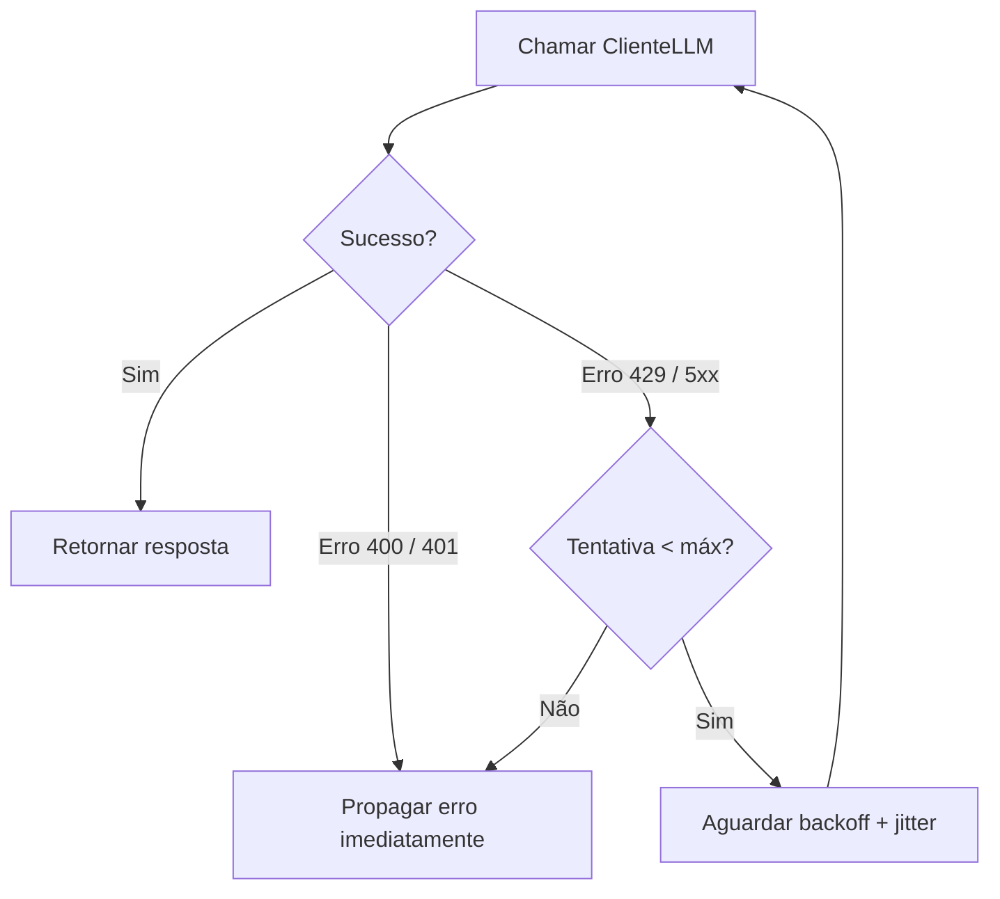

## Passo 1 · Leitura · Streaming e resiliência em chamadas de IA

Uma resposta de 400 tokens pode levar de 5 a 10 segundos para terminar. Se a interface gráfica ficar congelada esperando o último token, a aplicação parecerá travada. Com **streaming**, o servidor envia cada pedaço (*chunk*) assim que é decodificado, reduzindo a latência percebida pelo usuário para o tempo do primeiro token (TTFT). Em Python, clientes de LLM expõem o stream como um **gerador** (como você aprendeu no Nível 2): você itera sobre os pedaços com `for pedaco in stream:` e monta o texto final incrementalmente.

Além da latência, serviços de IA em produção sofrem falhas frequentes de capacidade. Para construir um cliente resiliente, você precisa separar as exceções em dois grupos:

- **Erros transitórios (devem ser repetidos):** limite de taxa atingido (`ErroDeTaxa`, HTTP 429 — *Too Many Requests*), sobrecarga ou falha temporária da GPU (`ErroDeServidor`, HTTP 500/502/503) e *timeouts* de rede.
- **Erros permanentes (NÃO devem ser repetidos):** JSON ou parâmetros inválidos, prompt maior que a janela de contexto ou chave de API incorreta (`ErroDeRequisicao`, HTTP 400/401/403). Repetir um erro 400 só gasta tempo e cota para receber a mesma falha.



Se mil clientes receberem um erro 429 no mesmo segundo e todos aguardarem exatamente 2 segundos para tentar de novo, eles causarão uma nova colisão sincronizada — o problema da **tempestade de retries** (*thundering herd*). A solução padrão de engenharia é o **backoff exponencial com teto e jitter** (ruído aleatório): na tentativa $k \ge 1$, o tempo de espera $t_k$ antes da próxima chamada é:

$$t_k = \min\!\left(T_{\text{teto}},\; b \cdot 2^{k-1}\right) + u_k, \qquad u_k \in [0, 1)$$

onde $b$ é o tempo base (por exemplo, $1{,}0$ segundo), $T_{\text{teto}}$ impede esperas absurdas e $u_k$ espalha as chamadas no tempo. Em operações que causam efeitos colaterais (como debitar créditos ou gravar um protocolo), toda repetição deve enviar a mesma **chave de idempotência** para que o servidor não duplique a operação caso a primeira tentativa tenha sido processada antes de a conexão cair.

Veja no visualizador como o consumo do gerador monta a resposta e como o tempo de espera cresce a cada tentativa:

```python visualizar
import random

def stream_simulado():
    for parte in ["O prazo ", "final ", "é sexta-feira."]:
        yield parte

acumulado = ""
for chunk in stream_simulado():
    acumulado += chunk

tempos = []
for tentativa in [1, 2, 3, 4]:
    rng = random.Random(42 + tentativa)
    espera = min(8.0, 1.0 * (2 ** (tentativa - 1))) + rng.random()
    tempos.append(round(espera, 3))
```

## Passo 2 · Previsão · Geradores só podem ser consumidos uma vez

Um erro comum ao trabalhar com `completar_stream` é tentar iterar duas vezes sobre o mesmo gerador — por exemplo, uma vez para imprimir os pedaços na tela e outra com `"".join(stream)` para salvar a resposta no histórico. Veja o que acontece no código abaixo.

### Código

```python
def gerar_pedacos():
    yield "Matrícula "
    yield "confirmada "
    yield "em MAC0110."

fluxo = gerar_pedacos()

primeira_leitura = "".join(fluxo)
segunda_leitura = "".join(fluxo)

print("1a:", repr(primeira_leitura))
print("2a:", repr(segunda_leitura))
print("Tamanhos:", len(primeira_leitura), len(segunda_leitura))
```

### Dicas

1. `gerar_pedacos()` devolve um objeto gerador, não uma lista.
2. Quando `"".join(fluxo)` percorre o gerador até o fim (`StopIteration`), o gerador fica esgotado.

### Saída esperada

```text
1a: 'Matrícula confirmada em MAC0110.'
2a: ''
Tamanhos: 32 0
```

## Passo 3 · Exercício · Consumir stream e calcular espera

Vamos implementar as duas funções de base para streaming e resiliência:

1. `consumir_stream(gerador, ao_receber=None)`: percorre o `gerador` uma única vez, ignora pedaços vazios (`""`), chama o *callback* `ao_receber(pedaco)` para cada pedaço não vazio (se `ao_receber` não for `None`) e retorna a string completa concatenada.
2. `calcular_espera(tentativa, base=1.0, teto=16.0, semente=42)`: aplica a fórmula do backoff exponencial com teto e jitter determinístico usando `rng = random.Random(semente + tentativa)` e `rng.random()`.

### Instruções

1. Em `consumir_stream(gerador, ao_receber=None)`, acumule os pedaços não vazios do gerador em uma lista, chame `ao_receber(pedaco)` quando `ao_receber is not None` e retorne `"".join(partes)`.
2. Em `calcular_espera(tentativa, base=1.0, teto=16.0, semente=42)`, instancie `rng = random.Random(semente + tentativa)`, calcule o backoff limitado `min(teto, base * (2 ** (tentativa - 1)))` e some `rng.random()`.

### Código inicial

```python path=main.py
import random


def consumir_stream(gerador, ao_receber=None):
    # Itere uma única vez sobre o gerador, chame ao_receber nos pedaços não vazios
    # e devolva o texto completo.
    pass


def calcular_espera(tentativa, base=1.0, teto=16.0, semente=42):
    # Calcule min(teto, base * 2**(tentativa - 1)) + jitter com Random(semente + tentativa)
    pass


if __name__ == "__main__":
    recebidos = []
    texto = consumir_stream((p for p in ["Olá, ", "", "mundo!"]), recebidos.append)
    print(texto, recebidos)
    print(round(calcular_espera(1), 4), round(calcular_espera(5, base=2.0, teto=10.0), 4))
```

### Solução

```python path=main.py
import random


def consumir_stream(gerador, ao_receber=None):
    partes = []
    for pedaco in gerador:
        if pedaco:
            if ao_receber is not None:
                ao_receber(pedaco)
            partes.append(pedaco)
    return "".join(partes)


def calcular_espera(tentativa, base=1.0, teto=16.0, semente=42):
    rng = random.Random(semente + tentativa)
    atraso_puro = min(teto, base * (2 ** (tentativa - 1)))
    return float(atraso_puro + rng.random())


if __name__ == "__main__":
    recebidos = []
    texto = consumir_stream((p for p in ["Olá, ", "", "mundo!"]), recebidos.append)
    print(texto, recebidos)
    print(round(calcular_espera(1), 4), round(calcular_espera(5, base=2.0, teto=10.0), 4))
```

### Dicas

1. Não converta nem percorra `gerador` duas vezes: dentro do mesmo `for pedaco in gerador:`, verifique `if pedaco:`, acione `ao_receber(pedaco)` e guarde em `partes`.
2. Em `calcular_espera`, use `random.Random(semente + tentativa)` para que cada tentativa tenha seu próprio jitter reprodutível.

### Verificação

```json
[
  {
    "id": "stream-callback",
    "name": "Consome gerador real e aciona callback apenas em pedaços não vazios",
    "checkpoint": 1,
    "kind": "expr",
    "setup": "vistos = []\ngen = (x for x in ['Atenção: ', '', 'prazo ', 'amanhã.'])\nres = consumir_stream(gen, vistos.append)",
    "expr": "[res, vistos]",
    "expected": ["Atenção: prazo amanhã.", ["Atenção: ", "prazo ", "amanhã."]]
  },
  {
    "id": "stream-sem-callback",
    "name": "Funciona quando ao_receber é None",
    "checkpoint": 1,
    "kind": "expr",
    "setup": "gen = (x for x in ['oi', ' ', 'USP'])",
    "expr": "consumir_stream(gen)",
    "expected": "oi USP"
  },
  {
    "id": "espera-tentativa-1",
    "name": "Calcula espera exponencial com jitter na tentativa 1",
    "checkpoint": 2,
    "kind": "call",
    "function": "calcular_espera",
    "args": [1, 1.0, 16.0, 42],
    "expected": 1.03855183933738,
    "tolerance": 1e-6
  },
  {
    "id": "espera-teto",
    "name": "Respeita o teto máximo em tentativas altas",
    "checkpoint": 2,
    "kind": "call",
    "function": "calcular_espera",
    "args": [6, 2.0, 10.0, 100],
    "expected": 10.710683733062492,
    "tolerance": 1e-6
  }
]
```

### Soluções erradas

```python name="Itera duas vezes sobre o gerador e perde o texto no retorno"
import random


def consumir_stream(gerador, ao_receber=None):
    if ao_receber is not None:
        for pedaco in gerador:
            if pedaco:
                ao_receber(pedaco)
    return "".join(gerador)


def calcular_espera(tentativa, base=1.0, teto=16.0, semente=42):
    rng = random.Random(semente + tentativa)
    return float(min(teto, base * (2 ** (tentativa - 1))) + rng.random())
```

```python name="Esquece de aplicar o teto no backoff exponencial"
import random


def consumir_stream(gerador, ao_receber=None):
    partes = []
    for pedaco in gerador:
        if pedaco:
            if ao_receber is not None:
                ao_receber(pedaco)
            partes.append(pedaco)
    return "".join(partes)


def calcular_espera(tentativa, base=1.0, teto=16.0, semente=42):
    rng = random.Random(semente + tentativa)
    return float(base * (2 ** (tentativa - 1)) + rng.random())
```

## Passo 4 · Exercício · Decorador com_retries e orçamento de tempo

Agora vamos juntar exceções tipadas, decoradores e controle de tempo. Definimos três exceções:
- `ErroDeTaxa(Exception)` e `ErroDeServidor(Exception)`: erros transitórios que devem ser repetidos.
- `ErroDeRequisicao(Exception)`: erro permanente (400/401) que **jamais** deve ser repetido.

Você implementará duas ferramentas:
1. O decorador `com_retries(max_tentativas=3)`: executa a função decorada até `max_tentativas` vezes. Se ocorrer `ErroDeTaxa` ou `ErroDeServidor` antes da última tentativa, tenta novamente; se atingir `max_tentativas` (ou se ocorrer qualquer outra exceção, como `ErroDeRequisicao`), relança a exceção imediatamente.
2. A função `executar_com_orcamento(funcao, max_tentativas, orcamento_s, dormir)`: tenta chamar `funcao()` até `max_tentativas` vezes. Quando captura `ErroDeTaxa` ou `ErroDeServidor`:
   - Se já for a última tentativa (`tentativa == max_tentativas`), relança a exceção.
   - Caso contrário, calcula a espera da tentativa atual como `espera = float(2 ** (tentativa - 1))`. Se o tempo total já dormido mais `espera` ultrapassar `orcamento_s` (`tempo_gasto + espera > orcamento_s`), levanta `TimeoutError("Orçamento de tempo esgotado")`. Senão, chama `dormir(espera)` e soma `espera` a `tempo_gasto`.

### Instruções

1. Implemente o decorador `com_retries(max_tentativas=3)` capturando apenas `(ErroDeTaxa, ErroDeServidor)` e relançando a exceção quando as tentativas acabarem.
2. Implemente `executar_com_orcamento(funcao, max_tentativas, orcamento_s, dormir)` verificando o limite de `orcamento_s` antes de chamar `dormir(espera)` entre tentativas transitórias.

### Código inicial

```python path=main.py
class ErroDeTaxa(Exception):
    pass


class ErroDeServidor(Exception):
    pass


class ErroDeRequisicao(Exception):
    pass


def com_retries(max_tentativas=3):
    # Retorne o decorador que repete apenas em ErroDeTaxa e ErroDeServidor
    pass


def executar_com_orcamento(funcao, max_tentativas, orcamento_s, dormir):
    # Controle tentativas e o tempo acumulado de espera em relação a orcamento_s
    pass


if __name__ == "__main__":
    estado = {"n": 0}

    @com_retries(max_tentativas=3)
    def instavel():
        estado["n"] += 1
        if estado["n"] < 3:
            raise ErroDeTaxa("429 Too Many Requests")
        return "Sucesso na tentativa " + str(estado["n"])

    print(instavel())
```

### Solução

```python path=main.py
class ErroDeTaxa(Exception):
    pass


class ErroDeServidor(Exception):
    pass


class ErroDeRequisicao(Exception):
    pass


def com_retries(max_tentativas=3):
    def decorador(funcao):
        def wrapper(*args, **kwargs):
            for tentativa in range(1, max_tentativas + 1):
                try:
                    return funcao(*args, **kwargs)
                except (ErroDeTaxa, ErroDeServidor):
                    if tentativa == max_tentativas:
                        raise

        return wrapper

    return decorador


def executar_com_orcamento(funcao, max_tentativas, orcamento_s, dormir):
    tempo_gasto = 0.0
    for tentativa in range(1, max_tentativas + 1):
        try:
            return funcao()
        except (ErroDeTaxa, ErroDeServidor):
            if tentativa == max_tentativas:
                raise
            espera = float(2 ** (tentativa - 1))
            if tempo_gasto + espera > orcamento_s:
                raise TimeoutError("Orçamento de tempo esgotado")
            dormir(espera)
            tempo_gasto += espera


if __name__ == "__main__":
    estado = {"n": 0}

    @com_retries(max_tentativas=3)
    def instavel():
        estado["n"] += 1
        if estado["n"] < 3:
            raise ErroDeTaxa("429 Too Many Requests")
        return "Sucesso na tentativa " + str(estado["n"])

    print(instavel())
```

### Dicas

1. Capture especificamente `except (ErroDeTaxa, ErroDeServidor):` para que `ErroDeRequisicao` suba na primeira falha sem ser repetido.
2. Dentro do bloco `except`, um `raise` sem argumentos relança a exceção original preservando seu tipo e mensagem.
3. Em `executar_com_orcamento`, verifique `if tempo_gasto + espera > orcamento_s:` **antes** de chamar `dormir(espera)`.

### Verificação

```json
[
  {
    "id": "retry-recupera",
    "name": "com_retries recupera quando falha 2 vezes com ErroDeTaxa e acerta na 3a",
    "checkpoint": 1,
    "kind": "expr",
    "setup": "c = {'n': 0}\n@com_retries(3)\ndef f():\n    c['n'] += 1\n    if c['n'] < 3:\n        raise ErroDeTaxa('429')\n    return 'ok'",
    "expr": "[f(), c['n']]",
    "expected": ["ok", 3]
  },
  {
    "id": "retry-nao-repete-400",
    "name": "com_retries NÃO repete quando ocorre ErroDeRequisicao (400)",
    "checkpoint": 1,
    "kind": "expr",
    "setup": "c = {'n': 0}\n@com_retries(4)\ndef f():\n    c['n'] += 1\n    raise ErroDeRequisicao('400 prompt invalido')\ntry:\n    f()\nexcept ErroDeRequisicao:\n    pass",
    "expr": "c['n']",
    "expected": 1
  },
  {
    "id": "retry-esgota",
    "name": "com_retries relança a exceção quando esgota max_tentativas",
    "checkpoint": 1,
    "kind": "expr",
    "setup": "@com_retries(2)\ndef sempre_falha():\n    raise ErroDeServidor('503 indisponivel')",
    "expr": "sempre_falha()",
    "raises": "ErroDeServidor",
    "message_contains": "503"
  },
  {
    "id": "orcamento-cabe",
    "name": "executar_com_orcamento dorme os tempos esperados quando cabe no orçamento",
    "checkpoint": 2,
    "kind": "expr",
    "setup": "dormidos = []\nc = {'n': 0}\ndef fn():\n    c['n'] += 1\n    if c['n'] < 3:\n        raise ErroDeTaxa('429')\n    return 'pronto'\nres = executar_com_orcamento(fn, 4, 5.0, dormidos.append)",
    "expr": "[res, dormidos]",
    "expected": ["pronto", [1.0, 2.0]]
  },
  {
    "id": "orcamento-estoura",
    "name": "executar_com_orcamento levanta TimeoutError se próxima espera estourar orçamento",
    "checkpoint": 2,
    "kind": "expr",
    "setup": "dormidos = []\ndef fn():\n    raise ErroDeServidor('503')",
    "expr": "executar_com_orcamento(fn, 5, 2.5, dormidos.append)",
    "raises": "TimeoutError",
    "message_contains": "Orçamento de tempo esgotado"
  }
]
```

### Soluções erradas

```python name="Captura Exception genérica e repete também em ErroDeRequisicao"
class ErroDeTaxa(Exception):
    pass


class ErroDeServidor(Exception):
    pass


class ErroDeRequisicao(Exception):
    pass


def com_retries(max_tentativas=3):
    def decorador(funcao):
        def wrapper(*args, **kwargs):
            for tentativa in range(1, max_tentativas + 1):
                try:
                    return funcao(*args, **kwargs)
                except Exception:
                    if tentativa == max_tentativas:
                        raise

        return wrapper

    return decorador


def executar_com_orcamento(funcao, max_tentativas, orcamento_s, dormir):
    tempo_gasto = 0.0
    for tentativa in range(1, max_tentativas + 1):
        try:
            return funcao()
        except Exception:
            if tentativa == max_tentativas:
                raise
            espera = float(2 ** (tentativa - 1))
            if tempo_gasto + espera > orcamento_s:
                raise TimeoutError("Orçamento de tempo esgotado")
            dormir(espera)
            tempo_gasto += espera
```

```python name="Ignora o orçamento de tempo e nunca levanta TimeoutError"
class ErroDeTaxa(Exception):
    pass


class ErroDeServidor(Exception):
    pass


class ErroDeRequisicao(Exception):
    pass


def com_retries(max_tentativas=3):
    def decorador(funcao):
        def wrapper(*args, **kwargs):
            for tentativa in range(1, max_tentativas + 1):
                try:
                    return funcao(*args, **kwargs)
                except (ErroDeTaxa, ErroDeServidor):
                    if tentativa == max_tentativas:
                        raise

        return wrapper

    return decorador


def executar_com_orcamento(funcao, max_tentativas, orcamento_s, dormir):
    for tentativa in range(1, max_tentativas + 1):
        try:
            return funcao()
        except (ErroDeTaxa, ErroDeServidor):
            if tentativa == max_tentativas:
                raise
            dormir(float(2 ** (tentativa - 1)))
```

## Passo 5 · Quiz · Retries, 429 vs 400 e streaming

### Pergunta

Quais respostas HTTP de uma API de LLM devem acionar uma nova tentativa (*retry*) com *backoff* exponencial?

- [ ] `400 Bad Request` (prompt malformado) e `401 Unauthorized` (chave inválida).
- [x] `429 Too Many Requests` (limite de taxa) e `503 Service Unavailable` (sobrecarga temporária).
- [ ] Apenas `200 OK`.
- [ ] Qualquer exceção capturada por `except Exception:`.

> Códigos 429 e 5xx representam condições temporárias de capacidade ou rede que costumam se resolver após alguns segundos. Erros 400 e 401 indicam problemas na requisição enviada que continuarão falhando.

### Pergunta

Qual é a finalidade de somar um valor aleatório (*jitter*) ao tempo de espera do *backoff* exponencial?

- [ ] Criptografar o cabeçalho HTTP da requisição.
- [ ] Reduzir a quantidade de tokens cobrados pelo servidor.
- [x] Dessincronizar clientes que falharam no mesmo instante, evitando ondas simultâneas de novas tentativas (*thundering herd*).
- [ ] Garantir que `temperature = 0` produza textos diferentes.

> Sem *jitter*, vários trabalhadores que recebem erro 429 ao mesmo tempo dormem exatamente o mesmo intervalo ($1\text{ s}, 2\text{ s}, 4\text{ s}$) e voltam a atingir o servidor juntos em pulsos sincronizados.

### Pergunta

Por que é perigoso repetir automaticamente uma chamada que realiza uma ação com efeito colateral (por exemplo, registrar o protocolo de trancamento de um aluno) sem enviar uma chave de idempotência?

- [ ] Porque chaves de idempotência diminuem a precisão dos embeddings.
- [x] Porque um *timeout* de rede pode ocorrer depois que o servidor já processou a primeira chamada, fazendo a repetição criar um registro duplicado.
- [ ] Porque o protocolo HTTP proíbe retries em requisições POST com JSON.
- [ ] Porque o gerador de streaming apaga o banco de dados ao falhar.

> Quando uma requisição sofre *timeout* na volta, o cliente não sabe se o servidor chegou a executar a operação. Com uma chave única de idempotência por operação lógica, o servidor reconhece a repetição e devolve o mesmo resultado sem duplicar o efeito.
