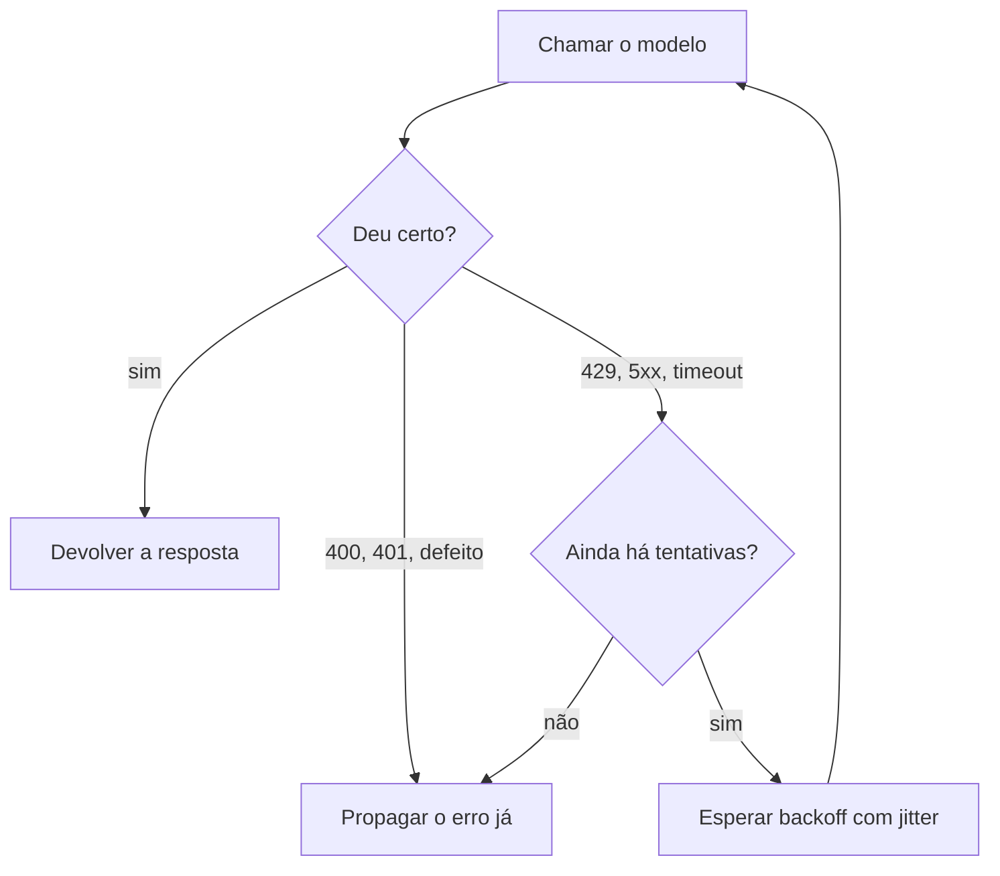

## Passo 1 · Leitura · Streaming: a resposta em pedaços

Uma resposta de 400 tokens a 20 ms por token leva 8 s para ficar pronta. Se a interface espera o fim para mostrar alguma coisa, a pessoa encara uma tela parada por 8 s. Com **streaming**, o servidor manda cada pedaço assim que ele é decodificado, e o primeiro aparece depois do TTFT, em uma fração de segundo. O tempo total é o mesmo; o tempo **percebido** cai muito.

Em Python, o SDK entrega o stream como um **gerador** (Nível 2): você itera e cada volta traz um evento. No simulador do curso, `cliente.completar_stream(mensagens)` gera dicionários `{"delta": "texto novo"}` e, no fim, um último evento com `"finish_reason"`:

```python
for evento in cliente.completar_stream(mensagens):
    print(evento)
# {'delta': 'O'}
# {'delta': ' praz'}
# {'delta': 'o'}
# ...
# {'delta': '', 'finish_reason': 'stop'}
```

Três cuidados que valem para qualquer provedor:

- **O evento final é o atestado de que a resposta terminou.** Se a conexão cai no meio, o laço simplesmente acaba, sem erro nenhum, e você fica com meia resposta que parece inteira. Sem o `finish_reason`, trate como falha.
- **`"length"` continua valendo**: o stream pode terminar normalmente e ainda assim ter sido cortado em `max_tokens`.
- **Um gerador só pode ser percorrido uma vez.** Quem quer mostrar os pedaços na tela *e* guardar o texto faz as duas coisas na mesma volta do laço.

No visualizador, veja o texto crescer a cada pedaço e o instante (em ms) em que cada um chega:

```python visualizar
def stream(texto, ttft_ms=300, ms_por_token=20):
    agora = ttft_ms
    for palavra in texto.split():
        agora += ms_por_token
        yield agora, palavra + " "


recebido = ""
for instante, pedaco in stream("O prazo final é sexta-feira"):
    recebido += pedaco
    print(instante, repr(recebido))
```

## Passo 2 · Previsão · Um gerador, duas leituras

Um erro comum é percorrer o stream uma vez para mostrar na tela e de novo para guardar no histórico. Leia o programa sem executar e digite exatamente o que ele imprime.

### Código
```python
def gerar_pedacos():
    yield "Matrícula "
    yield "confirmada "
    yield "em PRG101."


fluxo = gerar_pedacos()

primeira = "".join(fluxo)
segunda = "".join(fluxo)

print("1a:", repr(primeira))
print("2a:", repr(segunda))
print("Tamanhos:", len(primeira), len(segunda))
```

### Dicas
1. `gerar_pedacos()` devolve um gerador, não uma lista.
2. O primeiro `join` percorre o gerador até o fim. O que sobra para o segundo?
3. Conte os caracteres com os espaços: `Matrícula ` tem 10.

### Saída esperada
```text
1a: 'Matrícula confirmada em PRG101.'
2a: ''
Tamanhos: 31 0
```

## Passo 3 · Exercício · Consumir o stream

Escreva `consumir_stream(eventos, ao_receber=None)`, que percorre os eventos de um stream **uma única vez** e devolve a tupla `(texto, finish_reason)`.

- Cada `delta` não vazio é acrescentado ao texto e, se `ao_receber` não for `None`, passado para `ao_receber(delta)` **na hora em que chega** (é o que faz o texto aparecer aos poucos na tela).
- Quando aparece um evento com a chave `"finish_reason"`, a função devolve o texto e esse motivo, seja `"stop"` ou `"length"`.
- Se os eventos acabarem sem o evento final, a conexão caiu: levante `ConnectionError("stream interrompido antes do fim")`.

Para testar, use o simulador: `cliente.completar_stream(mensagens, cair_apos=3)` derruba a conexão depois de 3 tokens.

### Instruções
1. Monte o texto com os `delta` não vazios, na ordem em que chegam.
2. Chame `ao_receber` com cada `delta` não vazio durante o laço, quando ele for fornecido.
3. Devolva `(texto, finish_reason)` ao encontrar o evento final, com o motivo que veio nele.
4. Levante `ConnectionError` se o stream acabar sem evento final.

### Código inicial
```python
from llm_simulado import ClienteLLM


def consumir_stream(eventos, ao_receber=None):
    pass
```
```python path=llm_simulado.py
"""Cliente de LLM simulado do curso: a interface de um SDK real, sem rede.

Aproximações declaradas (tudo reproduzível):
- tokens: brinquedo, cada palavra vira pedaços de até 4 caracteres;
  o tokenizador de um modelo real dá outros números;
- preços: fictícios, em R$ por milhão de tokens;
- latência: TTFT + ms por token de saída, somada a um relógio falso;
- sorteio: random.Random(seed); com temperature > 0 a resposta pode variar;
- falhas: fila programada (429, 503, "timeout", 400), consumida em ordem.
"""
import random

PRECO_ENTRADA = 2.0  # R$ por milhão de tokens de entrada (fictício)
PRECO_SAIDA = 8.0  # R$ por milhão de tokens de saída (fictício)
SOBRECARGA_POR_MENSAGEM = 4  # tokens de formatação de cada mensagem


class ErroDeTaxa(Exception):  # HTTP 429: transitório
    def __init__(self, mensagem="429 Too Many Requests", retry_after=None):
        super().__init__(mensagem)
        self.retry_after = retry_after  # espera sugerida pelo servidor, em s


class ErroDeServidor(Exception):  # HTTP 5xx: transitório
    pass


class ErroDeTimeout(Exception):  # resposta não chegou no prazo: transitório
    pass


class ErroDeRequisicao(Exception):  # HTTP 400/401: permanente, não repita
    pass


def tokenizar(texto):
    tokens = []
    for i, palavra in enumerate(texto.split()):
        pedacos = [palavra[j:j + 4] for j in range(0, len(palavra), 4)]
        if i > 0:
            pedacos[0] = " " + pedacos[0]
        tokens.extend(pedacos)
    return tokens


def contar_tokens(texto):
    return len(tokenizar(texto))


class Resposta:
    def __init__(self, conteudo, finish_reason, prompt_tokens, completion_tokens,
                 latencia_ms=0, tool_calls=None):
        self.conteudo = conteudo
        self.finish_reason = finish_reason  # "stop", "length" ou "tool_calls"
        self.usage = {"prompt_tokens": prompt_tokens,
                      "completion_tokens": completion_tokens,
                      "total_tokens": prompt_tokens + completion_tokens}
        self.latencia_ms = latencia_ms
        self.tool_calls = tool_calls or []


class Relogio:  # relógio falso: só anda quando alguém manda
    def __init__(self):
        self.agora_ms = 0

    def avancar(self, ms):
        self.agora_ms += ms


class ClienteLLM:
    """respostas: lista de textos candidatos, ou função(mensagens) que devolve
    um texto ou uma lista de tool_calls."""

    def __init__(self, respostas, seed=None, falhas=(), relogio=None,
                 ttft_ms=300, ms_por_token=20):
        self.respostas = respostas
        self.rng = random.Random(seed)
        self.falhas = list(falhas)
        self.relogio = relogio or Relogio()
        self.ttft_ms = ttft_ms
        self.ms_por_token = ms_por_token
        self.chamadas = 0

    def _preparar(self, mensagens, temperature):
        self.chamadas += 1
        falha = self.falhas.pop(0) if self.falhas else None
        if falha == 429:
            raise ErroDeTaxa(retry_after=2.0)
        if falha == 503:
            raise ErroDeServidor("503 Service Unavailable")
        if falha == "timeout":
            self.relogio.avancar(10_000)
            raise ErroDeTimeout("sem resposta em 10 s")
        if falha == 400:
            raise ErroDeRequisicao("400 Bad Request")
        if callable(self.respostas):
            return self.respostas(mensagens)
        if temperature == 0:
            return self.respostas[0]  # num servidor real, nem isso é garantido
        return self.rng.choice(self.respostas)

    def completar(self, mensagens, max_tokens=256, temperature=1.0):
        gerado = self._preparar(mensagens, temperature)
        entrada = sum(contar_tokens(m["content"]) + SOBRECARGA_POR_MENSAGEM
                      for m in mensagens)
        if isinstance(gerado, list):  # o modelo pediu ferramentas
            self.relogio.avancar(self.ttft_ms)
            return Resposta("", "tool_calls", entrada, 10, self.ttft_ms, gerado)
        tokens, motivo = tokenizar(gerado), "stop"
        if len(tokens) > max_tokens:
            tokens, motivo = tokens[:max_tokens], "length"
        latencia = self.ttft_ms + len(tokens) * self.ms_por_token
        self.relogio.avancar(latencia)
        return Resposta("".join(tokens), motivo, entrada, len(tokens), latencia)

    def completar_stream(self, mensagens, max_tokens=256, temperature=1.0, cair_apos=None):
        """Gera eventos {"delta": texto}; o último traz "finish_reason".
        cair_apos=n: a conexão cai depois de n tokens, sem o evento final."""
        tokens, motivo = tokenizar(self._preparar(mensagens, temperature)), "stop"
        if len(tokens) > max_tokens:
            tokens, motivo = tokens[:max_tokens], "length"
        self.relogio.avancar(self.ttft_ms)
        for i, token in enumerate(tokens):
            if i == cair_apos:
                return
            self.relogio.avancar(self.ms_por_token)
            yield {"delta": token}
        yield {"delta": "", "finish_reason": motivo}
```

### Solução
```python
from llm_simulado import ClienteLLM


def consumir_stream(eventos, ao_receber=None):
    partes = []
    for evento in eventos:
        if evento["delta"]:
            partes.append(evento["delta"])
            if ao_receber is not None:
                ao_receber(evento["delta"])
        if "finish_reason" in evento:
            return "".join(partes), evento["finish_reason"]
    raise ConnectionError("stream interrompido antes do fim")
```
```python path=llm_simulado.py
"""Cliente de LLM simulado do curso: a interface de um SDK real, sem rede.

Aproximações declaradas (tudo reproduzível):
- tokens: brinquedo, cada palavra vira pedaços de até 4 caracteres;
  o tokenizador de um modelo real dá outros números;
- preços: fictícios, em R$ por milhão de tokens;
- latência: TTFT + ms por token de saída, somada a um relógio falso;
- sorteio: random.Random(seed); com temperature > 0 a resposta pode variar;
- falhas: fila programada (429, 503, "timeout", 400), consumida em ordem.
"""
import random

PRECO_ENTRADA = 2.0  # R$ por milhão de tokens de entrada (fictício)
PRECO_SAIDA = 8.0  # R$ por milhão de tokens de saída (fictício)
SOBRECARGA_POR_MENSAGEM = 4  # tokens de formatação de cada mensagem


class ErroDeTaxa(Exception):  # HTTP 429: transitório
    def __init__(self, mensagem="429 Too Many Requests", retry_after=None):
        super().__init__(mensagem)
        self.retry_after = retry_after  # espera sugerida pelo servidor, em s


class ErroDeServidor(Exception):  # HTTP 5xx: transitório
    pass


class ErroDeTimeout(Exception):  # resposta não chegou no prazo: transitório
    pass


class ErroDeRequisicao(Exception):  # HTTP 400/401: permanente, não repita
    pass


def tokenizar(texto):
    tokens = []
    for i, palavra in enumerate(texto.split()):
        pedacos = [palavra[j:j + 4] for j in range(0, len(palavra), 4)]
        if i > 0:
            pedacos[0] = " " + pedacos[0]
        tokens.extend(pedacos)
    return tokens


def contar_tokens(texto):
    return len(tokenizar(texto))


class Resposta:
    def __init__(self, conteudo, finish_reason, prompt_tokens, completion_tokens,
                 latencia_ms=0, tool_calls=None):
        self.conteudo = conteudo
        self.finish_reason = finish_reason  # "stop", "length" ou "tool_calls"
        self.usage = {"prompt_tokens": prompt_tokens,
                      "completion_tokens": completion_tokens,
                      "total_tokens": prompt_tokens + completion_tokens}
        self.latencia_ms = latencia_ms
        self.tool_calls = tool_calls or []


class Relogio:  # relógio falso: só anda quando alguém manda
    def __init__(self):
        self.agora_ms = 0

    def avancar(self, ms):
        self.agora_ms += ms


class ClienteLLM:
    """respostas: lista de textos candidatos, ou função(mensagens) que devolve
    um texto ou uma lista de tool_calls."""

    def __init__(self, respostas, seed=None, falhas=(), relogio=None,
                 ttft_ms=300, ms_por_token=20):
        self.respostas = respostas
        self.rng = random.Random(seed)
        self.falhas = list(falhas)
        self.relogio = relogio or Relogio()
        self.ttft_ms = ttft_ms
        self.ms_por_token = ms_por_token
        self.chamadas = 0

    def _preparar(self, mensagens, temperature):
        self.chamadas += 1
        falha = self.falhas.pop(0) if self.falhas else None
        if falha == 429:
            raise ErroDeTaxa(retry_after=2.0)
        if falha == 503:
            raise ErroDeServidor("503 Service Unavailable")
        if falha == "timeout":
            self.relogio.avancar(10_000)
            raise ErroDeTimeout("sem resposta em 10 s")
        if falha == 400:
            raise ErroDeRequisicao("400 Bad Request")
        if callable(self.respostas):
            return self.respostas(mensagens)
        if temperature == 0:
            return self.respostas[0]  # num servidor real, nem isso é garantido
        return self.rng.choice(self.respostas)

    def completar(self, mensagens, max_tokens=256, temperature=1.0):
        gerado = self._preparar(mensagens, temperature)
        entrada = sum(contar_tokens(m["content"]) + SOBRECARGA_POR_MENSAGEM
                      for m in mensagens)
        if isinstance(gerado, list):  # o modelo pediu ferramentas
            self.relogio.avancar(self.ttft_ms)
            return Resposta("", "tool_calls", entrada, 10, self.ttft_ms, gerado)
        tokens, motivo = tokenizar(gerado), "stop"
        if len(tokens) > max_tokens:
            tokens, motivo = tokens[:max_tokens], "length"
        latencia = self.ttft_ms + len(tokens) * self.ms_por_token
        self.relogio.avancar(latencia)
        return Resposta("".join(tokens), motivo, entrada, len(tokens), latencia)

    def completar_stream(self, mensagens, max_tokens=256, temperature=1.0, cair_apos=None):
        """Gera eventos {"delta": texto}; o último traz "finish_reason".
        cair_apos=n: a conexão cai depois de n tokens, sem o evento final."""
        tokens, motivo = tokenizar(self._preparar(mensagens, temperature)), "stop"
        if len(tokens) > max_tokens:
            tokens, motivo = tokens[:max_tokens], "length"
        self.relogio.avancar(self.ttft_ms)
        for i, token in enumerate(tokens):
            if i == cair_apos:
                return
            self.relogio.avancar(self.ms_por_token)
            yield {"delta": token}
        yield {"delta": "", "finish_reason": motivo}
```

### Dicas
1. Um único `for evento in eventos:` resolve tudo: dentro dele, guarde o pedaço, avise `ao_receber` e confira se é o evento final.
2. Se o laço terminar sem ter devolvido nada, o evento final nunca veio.
3. Não transforme o gerador em lista antes do laço: os pedaços deixariam de chegar aos poucos.

### Verificação
```json
[
  { "id": "texto", "checkpoint": 1, "kind": "expr",
    "setup": "cli = ClienteLLM(['O prazo final é sexta-feira.'])\nr = consumir_stream(cli.completar_stream([{'role': 'user', 'content': 'Prazo?'}]))",
    "expr": "r", "expected": ["O prazo final é sexta-feira.", "stop"],
    "name": "Monta o texto completo e devolve o motivo stop" },
  { "id": "gerador-manual", "checkpoint": 1, "kind": "expr",
    "setup": "def eventos():\n    yield {'delta': 'Bom'}\n    yield {'delta': ''}\n    yield {'delta': ' dia'}\n    yield {'delta': '', 'finish_reason': 'stop'}",
    "expr": "consumir_stream(eventos())", "expected": ["Bom dia", "stop"],
    "name": "Funciona sem ao_receber e ignora deltas vazios" },
  { "id": "callback", "checkpoint": 2, "kind": "expr",
    "setup": "vistos = []\ndef eventos():\n    yield {'delta': 'Bom'}\n    yield {'delta': ''}\n    yield {'delta': ' dia'}\n    yield {'delta': '', 'finish_reason': 'stop'}\nconsumir_stream(eventos(), vistos.append)",
    "expr": "vistos", "expected": ["Bom", " dia"],
    "name": "ao_receber recebe só os pedaços com texto", "hint": "Pule o delta vazio." },
  { "id": "aos-poucos", "checkpoint": 2, "kind": "expr",
    "setup": "cli = ClienteLLM(['O prazo final é sexta-feira.'])\ninstantes = []\nconsumir_stream(cli.completar_stream([{'role': 'user', 'content': 'Prazo?'}]), lambda d: instantes.append(cli.relogio.agora_ms))",
    "expr": "instantes", "expected": [320, 340, 360, 380, 400, 420, 440, 460, 480],
    "name": "Cada pedaço é entregue no instante em que chega",
    "hint": "Chame ao_receber dentro do laço, sem ler o stream inteiro antes." },
  { "id": "length", "checkpoint": 3, "kind": "expr",
    "setup": "cli = ClienteLLM(['O prazo final é sexta-feira.'])",
    "expr": "consumir_stream(cli.completar_stream([{'role': 'user', 'content': 'Prazo?'}], max_tokens=4))",
    "expected": ["O prazo fina", "length"], "name": "Repassa o motivo length quando o stream foi cortado" },
  { "id": "caiu", "checkpoint": 4, "kind": "expr",
    "setup": "cli = ClienteLLM(['O prazo final é sexta-feira.'])",
    "expr": "consumir_stream(cli.completar_stream([{'role': 'user', 'content': 'Prazo?'}], cair_apos=3))",
    "raises": "ConnectionError", "name": "Conexão que cai sem evento final levanta ConnectionError",
    "hint": "Meia resposta sem finish_reason não é resposta." },
  { "id": "caiu-callback", "checkpoint": 4, "kind": "expr",
    "setup": "vistos = []\ncli = ClienteLLM(['O prazo final é sexta-feira.'])\ntry:\n    consumir_stream(cli.completar_stream([{'role': 'user', 'content': 'x'}], cair_apos=2), vistos.append)\nexcept ConnectionError:\n    pass",
    "expr": "vistos", "expected": ["O", " praz"],
    "name": "Os pedaços que chegaram antes da queda foram entregues" }
]
```

### Soluções erradas
```python name="lê o stream inteiro antes de entregar"
from llm_simulado import ClienteLLM


def consumir_stream(eventos, ao_receber=None):
    todos = list(eventos)
    if not todos or "finish_reason" not in todos[-1]:
        raise ConnectionError("stream interrompido antes do fim")
    partes = [e["delta"] for e in todos if e["delta"]]
    if ao_receber is not None:
        for parte in partes:
            ao_receber(parte)
    return "".join(partes), todos[-1]["finish_reason"]
```
```python name="trata o fim do laço como sucesso"
from llm_simulado import ClienteLLM


def consumir_stream(eventos, ao_receber=None):
    partes = []
    motivo = "stop"
    for evento in eventos:
        if evento["delta"]:
            partes.append(evento["delta"])
            if ao_receber is not None:
                ao_receber(evento["delta"])
        motivo = evento.get("finish_reason", motivo)
    return "".join(partes), motivo
```
```python name="sempre devolve stop"
from llm_simulado import ClienteLLM


def consumir_stream(eventos, ao_receber=None):
    partes = []
    for evento in eventos:
        if evento["delta"]:
            partes.append(evento["delta"])
            if ao_receber is not None:
                ao_receber(evento["delta"])
        if "finish_reason" in evento:
            return "".join(partes), "stop"
    raise ConnectionError("stream interrompido antes do fim")
```
```python name="avisa ao_receber também com delta vazio"
from llm_simulado import ClienteLLM


def consumir_stream(eventos, ao_receber=None):
    partes = []
    for evento in eventos:
        partes.append(evento["delta"])
        if ao_receber is not None:
            ao_receber(evento["delta"])
        if "finish_reason" in evento:
            return "".join(partes), evento["finish_reason"]
    raise ConnectionError("stream interrompido antes do fim")
```
```python name="percorre o gerador duas vezes"
from llm_simulado import ClienteLLM


def consumir_stream(eventos, ao_receber=None):
    motivo = None
    for evento in eventos:
        if evento["delta"] and ao_receber is not None:
            ao_receber(evento["delta"])
        if "finish_reason" in evento:
            motivo = evento["finish_reason"]
    if motivo is None:
        raise ConnectionError("stream interrompido antes do fim")
    return "".join(e["delta"] for e in eventos), motivo
```

## Passo 4 · Leitura · Quais erros repetir, e como esperar

Serviços de LLM falham com frequência, e nem toda falha merece uma nova tentativa (*retry*):

- **Transitórios — vale repetir depois de esperar:** `429 Too Many Requests` (você passou do limite de requisições por minuto: `ErroDeTaxa`), `500`/`502`/`503` (servidor sobrecarregado: `ErroDeServidor`) e *timeout* (a resposta não chegou no prazo: `ErroDeTimeout`).
- **Permanentes — repetir não adianta:** `400` (pedido malformado, prompt maior que a janela) e `401`/`403` (chave errada ou sem permissão): `ErroDeRequisicao`. A segunda tentativa recebe o mesmo erro e ainda gasta cota.
- **Defeitos do seu código** (`KeyError`, `TypeError`): nunca entram no retry. Um `except Exception` que repete tudo esconde o defeito atrás de esperas.



Esperar quanto? Se o servidor está sobrecarregado, esperas curtas e fixas pioram a situação. O **backoff exponencial** dobra a espera a cada falha, até um teto. E se mil clientes recebem 429 no mesmo segundo e todos esperam exatamente 1 s, 2 s, 4 s, eles voltam juntos, em ondas, e derrubam o servidor de novo (*thundering herd*). O **jitter** sorteia parte da espera para espalhar os clientes. Nesta lição, na tentativa $k$:

$$
c_k = \min\left(T_{\text{teto}},\; b \cdot 2^{k-1}\right), \qquad t_k = \frac{c_k}{2} + u_k \cdot \frac{c_k}{2}, \quad u_k \in [0, 1)
$$

Metade da espera é fixa, a outra metade é sorteada (há variantes, como sortear a espera inteira entre 0 e $c_k$). Para testar, o sorteio vem de um `random.Random(semente)` **injetado**: nos testes, semente fixa; em produção, um gerador por cliente, sem semente, para que cada um sorteie diferente. Se o 429 vier com o cabeçalho `Retry-After` (no simulador, `erro.retry_after`), espere pelo menos o que o servidor pediu.

Três limites completam a política: número máximo de tentativas, *timeout* de cada chamada e um **orçamento total de espera**, para o usuário não ficar um minuto olhando um indicador girando.

Por fim, **idempotência**. Um timeout não diz se o servidor processou o pedido: talvez a resposta só não tenha chegado. Repetir uma operação com efeito (gravar um protocolo, cobrar créditos) pode duplicá-la. APIs sérias aceitam uma **chave de idempotência**: o mesmo identificador em todas as tentativas, para o servidor reconhecer a repetição.

```python visualizar
import random

clientes = 3
print("sem jitter:", [[1, 2, 4] for _ in range(clientes)])
rngs = [random.Random(s) for s in range(clientes)]
for k in [1, 2, 3]:
    limite = min(8.0, 2 ** (k - 1))
    esperas = [round(rng.uniform(0, limite), 2) for rng in rngs]
    print("tentativa", k, "com jitter:", esperas)
```

## Passo 5 · Exercício · Calcular a espera

Escreva `calcular_espera(tentativa, rng, base=1.0, teto=8.0)`, que devolve, em segundos, a espera antes da próxima tentativa, depois da falha número `tentativa` (1, 2, 3…), pela fórmula do passo anterior: $c = \min(\text{teto}, \text{base} \cdot 2^{\text{tentativa}-1})$ e espera $= c/2 + u \cdot c/2$, com $u$ = `rng.random()`.

`rng` é um `random.Random` criado por quem chama. Use exatamente uma chamada `rng.random()` por espera. Exemplo: com `base=1.0`, a tentativa 3 tem $c = 4$, e a espera fica entre 2 e 4 segundos.

### Instruções
1. Calcule o limite exponencial da tentativa: base vezes 2 elevado a (tentativa − 1), sem passar do teto.
2. Devolva metade do limite mais uma parte sorteada da outra metade, usando o `rng` recebido.
   Dica: não crie um `random.Random` dentro da função.

### Código inicial
```python
import random


def calcular_espera(tentativa, rng, base=1.0, teto=8.0):
    pass
```

### Solução
```python
import random


def calcular_espera(tentativa, rng, base=1.0, teto=8.0):
    limite = min(teto, base * 2 ** (tentativa - 1))
    return limite / 2 + rng.random() * limite / 2
```

### Dicas
1. Na primeira falha o expoente é 0: a espera fica entre `base / 2` e `base`.
2. Aplique o `min` antes do sorteio: o teto limita a espera inteira.
3. Um `Random` criado dentro da função com semente fixa faz todos os clientes sortearem igual, e o jitter deixa de espalhar.

### Verificação
```json
[
  { "id": "sequencia", "checkpoint": 1, "kind": "expr",
    "setup": "import random\nrng = random.Random(3)\nr = [calcular_espera(k, rng) for k in [1, 2, 3, 4, 5, 6]]",
    "expr": "[round(x, 6) for x in r]", "expected": [0.618982, 1.544229, 2.73991, 6.41568, 6.502881, 4.262115],
    "name": "Esperas das tentativas 1 a 6 com Random(3)", "hint": "Na tentativa 1 o expoente é 0." },
  { "id": "faixa", "checkpoint": 2, "kind": "expr",
    "setup": "import random\nrng = random.Random(8)\nok = all(2.0 <= calcular_espera(3, rng) <= 4.0 for _ in range(200))",
    "expr": "ok", "expected": true, "name": "Na tentativa 3 a espera fica sempre entre 2 e 4 s" },
  { "id": "teto", "checkpoint": 1, "kind": "expr",
    "setup": "import random\nrng = random.Random(11)", "expr": "calcular_espera(10, rng, base=2.0, teto=20.0)",
    "expected": 14.523795535098186, "tolerance": 1e-9, "name": "Tentativa alta respeita o teto", "hint": "Limite o valor exponencial com min(teto, ...)." },
  { "id": "teto-maximo", "checkpoint": 1, "kind": "expr",
    "setup": "import random\nrng = random.Random(4)", "expr": "max(calcular_espera(20, rng) for _ in range(100)) <= 8.0",
    "expected": true, "name": "Nenhuma espera passa do teto" },
  { "id": "usa-rng", "checkpoint": 2, "kind": "expr",
    "setup": "import random\nrng = random.Random(11)", "expr": "[calcular_espera(3, rng, base=0.5, teto=30.0) for _ in range(2)]",
    "expected": [1.4523795535098185, 1.559772386080496], "tolerance": 1e-9,
    "name": "Usa o rng recebido: duas chamadas seguidas sorteiam valores diferentes",
    "hint": "Sorteie com rng.random(), do gerador recebido." }
]
```

### Soluções erradas
```python name="sem teto"
import random


def calcular_espera(tentativa, rng, base=1.0, teto=8.0):
    limite = base * 2 ** (tentativa - 1)
    return limite / 2 + rng.random() * limite / 2
```
```python name="expoente começa em 1"
import random


def calcular_espera(tentativa, rng, base=1.0, teto=8.0):
    limite = min(teto, base * 2 ** tentativa)
    return limite / 2 + rng.random() * limite / 2
```
```python name="sem jitter"
import random


def calcular_espera(tentativa, rng, base=1.0, teto=8.0):
    return min(teto, base * 2 ** (tentativa - 1))
```
```python name="cria um Random com semente fixa a cada chamada"
import random


def calcular_espera(tentativa, rng, base=1.0, teto=8.0):
    limite = min(teto, base * 2 ** (tentativa - 1))
    return limite / 2 + random.Random(42).random() * limite / 2
```
```python name="jitter somado por fora passa do teto"
import random


def calcular_espera(tentativa, rng, base=1.0, teto=8.0):
    limite = min(teto, base * 2 ** (tentativa - 1))
    return limite + rng.random() * limite / 2
```

## Passo 6 · Exercício · O decorador com_retries

Junte tudo num decorador (Nível 2) que dá resiliência a qualquer função que chama o modelo:

```python
@com_retries(max_tentativas=4, rng=random.Random(5), dormir=esperas.append)
def pedir():
    return cliente.completar(mensagens).conteudo
```

`com_retries(max_tentativas=4, base=1.0, teto=8.0, rng=None, dormir=time.sleep)`:

- Repete a função só quando ela levanta um erro transitório: `ErroDeTaxa`, `ErroDeServidor` ou `ErroDeTimeout` (já estão em `TRANSITORIOS`). Qualquer outro erro sobe na hora, sem esperar.
- Depois da falha número `k`, chama `dormir(espera)` com `espera = calcular_espera(k, rng, base, teto)`; se o erro tiver `retry_after` (não `None`), espera o maior dos dois.
- Na última tentativa não dorme: relança o erro que recebeu.
- `rng=None` significa `random.Random()` sem semente. `dormir` é injetável para os testes não esperarem de verdade.
- Use `functools.wraps` para a função decorada manter o nome.

### Instruções
1. Repita apenas os erros transitórios e devolva o resultado da primeira tentativa que der certo.
2. Deixe subir na primeira vez qualquer erro que não seja transitório, sem dormir.
3. Entre as tentativas, durma a espera calculada para aquela falha, respeitando o `retry_after`.
4. Ao esgotar `max_tentativas`, relance o último erro, sem dormir depois da última tentativa.
5. Preserve o nome da função decorada.

### Código inicial
```python
import random
import time
from functools import wraps

from llm_simulado import ClienteLLM, ErroDeTaxa, ErroDeServidor, ErroDeTimeout, ErroDeRequisicao

TRANSITORIOS = (ErroDeTaxa, ErroDeServidor, ErroDeTimeout)


def calcular_espera(tentativa, rng, base=1.0, teto=8.0):
    limite = min(teto, base * 2 ** (tentativa - 1))
    return limite / 2 + rng.random() * limite / 2


def com_retries(max_tentativas=4, base=1.0, teto=8.0, rng=None, dormir=time.sleep):
    pass
```
```python path=llm_simulado.py
"""Cliente de LLM simulado do curso: a interface de um SDK real, sem rede.

Aproximações declaradas (tudo reproduzível):
- tokens: brinquedo, cada palavra vira pedaços de até 4 caracteres;
  o tokenizador de um modelo real dá outros números;
- preços: fictícios, em R$ por milhão de tokens;
- latência: TTFT + ms por token de saída, somada a um relógio falso;
- sorteio: random.Random(seed); com temperature > 0 a resposta pode variar;
- falhas: fila programada (429, 503, "timeout", 400), consumida em ordem.
"""
import random

PRECO_ENTRADA = 2.0  # R$ por milhão de tokens de entrada (fictício)
PRECO_SAIDA = 8.0  # R$ por milhão de tokens de saída (fictício)
SOBRECARGA_POR_MENSAGEM = 4  # tokens de formatação de cada mensagem


class ErroDeTaxa(Exception):  # HTTP 429: transitório
    def __init__(self, mensagem="429 Too Many Requests", retry_after=None):
        super().__init__(mensagem)
        self.retry_after = retry_after  # espera sugerida pelo servidor, em s


class ErroDeServidor(Exception):  # HTTP 5xx: transitório
    pass


class ErroDeTimeout(Exception):  # resposta não chegou no prazo: transitório
    pass


class ErroDeRequisicao(Exception):  # HTTP 400/401: permanente, não repita
    pass


def tokenizar(texto):
    tokens = []
    for i, palavra in enumerate(texto.split()):
        pedacos = [palavra[j:j + 4] for j in range(0, len(palavra), 4)]
        if i > 0:
            pedacos[0] = " " + pedacos[0]
        tokens.extend(pedacos)
    return tokens


def contar_tokens(texto):
    return len(tokenizar(texto))


class Resposta:
    def __init__(self, conteudo, finish_reason, prompt_tokens, completion_tokens,
                 latencia_ms=0, tool_calls=None):
        self.conteudo = conteudo
        self.finish_reason = finish_reason  # "stop", "length" ou "tool_calls"
        self.usage = {"prompt_tokens": prompt_tokens,
                      "completion_tokens": completion_tokens,
                      "total_tokens": prompt_tokens + completion_tokens}
        self.latencia_ms = latencia_ms
        self.tool_calls = tool_calls or []


class Relogio:  # relógio falso: só anda quando alguém manda
    def __init__(self):
        self.agora_ms = 0

    def avancar(self, ms):
        self.agora_ms += ms


class ClienteLLM:
    """respostas: lista de textos candidatos, ou função(mensagens) que devolve
    um texto ou uma lista de tool_calls."""

    def __init__(self, respostas, seed=None, falhas=(), relogio=None,
                 ttft_ms=300, ms_por_token=20):
        self.respostas = respostas
        self.rng = random.Random(seed)
        self.falhas = list(falhas)
        self.relogio = relogio or Relogio()
        self.ttft_ms = ttft_ms
        self.ms_por_token = ms_por_token
        self.chamadas = 0

    def _preparar(self, mensagens, temperature):
        self.chamadas += 1
        falha = self.falhas.pop(0) if self.falhas else None
        if falha == 429:
            raise ErroDeTaxa(retry_after=2.0)
        if falha == 503:
            raise ErroDeServidor("503 Service Unavailable")
        if falha == "timeout":
            self.relogio.avancar(10_000)
            raise ErroDeTimeout("sem resposta em 10 s")
        if falha == 400:
            raise ErroDeRequisicao("400 Bad Request")
        if callable(self.respostas):
            return self.respostas(mensagens)
        if temperature == 0:
            return self.respostas[0]  # num servidor real, nem isso é garantido
        return self.rng.choice(self.respostas)

    def completar(self, mensagens, max_tokens=256, temperature=1.0):
        gerado = self._preparar(mensagens, temperature)
        entrada = sum(contar_tokens(m["content"]) + SOBRECARGA_POR_MENSAGEM
                      for m in mensagens)
        if isinstance(gerado, list):  # o modelo pediu ferramentas
            self.relogio.avancar(self.ttft_ms)
            return Resposta("", "tool_calls", entrada, 10, self.ttft_ms, gerado)
        tokens, motivo = tokenizar(gerado), "stop"
        if len(tokens) > max_tokens:
            tokens, motivo = tokens[:max_tokens], "length"
        latencia = self.ttft_ms + len(tokens) * self.ms_por_token
        self.relogio.avancar(latencia)
        return Resposta("".join(tokens), motivo, entrada, len(tokens), latencia)

    def completar_stream(self, mensagens, max_tokens=256, temperature=1.0, cair_apos=None):
        """Gera eventos {"delta": texto}; o último traz "finish_reason".
        cair_apos=n: a conexão cai depois de n tokens, sem o evento final."""
        tokens, motivo = tokenizar(self._preparar(mensagens, temperature)), "stop"
        if len(tokens) > max_tokens:
            tokens, motivo = tokens[:max_tokens], "length"
        self.relogio.avancar(self.ttft_ms)
        for i, token in enumerate(tokens):
            if i == cair_apos:
                return
            self.relogio.avancar(self.ms_por_token)
            yield {"delta": token}
        yield {"delta": "", "finish_reason": motivo}
```

### Solução
```python
import random
import time
from functools import wraps

from llm_simulado import ClienteLLM, ErroDeTaxa, ErroDeServidor, ErroDeTimeout, ErroDeRequisicao

TRANSITORIOS = (ErroDeTaxa, ErroDeServidor, ErroDeTimeout)


def calcular_espera(tentativa, rng, base=1.0, teto=8.0):
    limite = min(teto, base * 2 ** (tentativa - 1))
    return limite / 2 + rng.random() * limite / 2


def com_retries(max_tentativas=4, base=1.0, teto=8.0, rng=None, dormir=time.sleep):
    rng = rng or random.Random()

    def decorador(funcao):
        @wraps(funcao)
        def envolucro(*args, **kwargs):
            for tentativa in range(1, max_tentativas + 1):
                try:
                    return funcao(*args, **kwargs)
                except TRANSITORIOS as erro:
                    if tentativa == max_tentativas:
                        raise
                    espera = calcular_espera(tentativa, rng, base, teto)
                    if getattr(erro, "retry_after", None) is not None:
                        espera = max(espera, erro.retry_after)
                    dormir(espera)
        return envolucro
    return decorador
```
```python path=llm_simulado.py
"""Cliente de LLM simulado do curso: a interface de um SDK real, sem rede.

Aproximações declaradas (tudo reproduzível):
- tokens: brinquedo, cada palavra vira pedaços de até 4 caracteres;
  o tokenizador de um modelo real dá outros números;
- preços: fictícios, em R$ por milhão de tokens;
- latência: TTFT + ms por token de saída, somada a um relógio falso;
- sorteio: random.Random(seed); com temperature > 0 a resposta pode variar;
- falhas: fila programada (429, 503, "timeout", 400), consumida em ordem.
"""
import random

PRECO_ENTRADA = 2.0  # R$ por milhão de tokens de entrada (fictício)
PRECO_SAIDA = 8.0  # R$ por milhão de tokens de saída (fictício)
SOBRECARGA_POR_MENSAGEM = 4  # tokens de formatação de cada mensagem


class ErroDeTaxa(Exception):  # HTTP 429: transitório
    def __init__(self, mensagem="429 Too Many Requests", retry_after=None):
        super().__init__(mensagem)
        self.retry_after = retry_after  # espera sugerida pelo servidor, em s


class ErroDeServidor(Exception):  # HTTP 5xx: transitório
    pass


class ErroDeTimeout(Exception):  # resposta não chegou no prazo: transitório
    pass


class ErroDeRequisicao(Exception):  # HTTP 400/401: permanente, não repita
    pass


def tokenizar(texto):
    tokens = []
    for i, palavra in enumerate(texto.split()):
        pedacos = [palavra[j:j + 4] for j in range(0, len(palavra), 4)]
        if i > 0:
            pedacos[0] = " " + pedacos[0]
        tokens.extend(pedacos)
    return tokens


def contar_tokens(texto):
    return len(tokenizar(texto))


class Resposta:
    def __init__(self, conteudo, finish_reason, prompt_tokens, completion_tokens,
                 latencia_ms=0, tool_calls=None):
        self.conteudo = conteudo
        self.finish_reason = finish_reason  # "stop", "length" ou "tool_calls"
        self.usage = {"prompt_tokens": prompt_tokens,
                      "completion_tokens": completion_tokens,
                      "total_tokens": prompt_tokens + completion_tokens}
        self.latencia_ms = latencia_ms
        self.tool_calls = tool_calls or []


class Relogio:  # relógio falso: só anda quando alguém manda
    def __init__(self):
        self.agora_ms = 0

    def avancar(self, ms):
        self.agora_ms += ms


class ClienteLLM:
    """respostas: lista de textos candidatos, ou função(mensagens) que devolve
    um texto ou uma lista de tool_calls."""

    def __init__(self, respostas, seed=None, falhas=(), relogio=None,
                 ttft_ms=300, ms_por_token=20):
        self.respostas = respostas
        self.rng = random.Random(seed)
        self.falhas = list(falhas)
        self.relogio = relogio or Relogio()
        self.ttft_ms = ttft_ms
        self.ms_por_token = ms_por_token
        self.chamadas = 0

    def _preparar(self, mensagens, temperature):
        self.chamadas += 1
        falha = self.falhas.pop(0) if self.falhas else None
        if falha == 429:
            raise ErroDeTaxa(retry_after=2.0)
        if falha == 503:
            raise ErroDeServidor("503 Service Unavailable")
        if falha == "timeout":
            self.relogio.avancar(10_000)
            raise ErroDeTimeout("sem resposta em 10 s")
        if falha == 400:
            raise ErroDeRequisicao("400 Bad Request")
        if callable(self.respostas):
            return self.respostas(mensagens)
        if temperature == 0:
            return self.respostas[0]  # num servidor real, nem isso é garantido
        return self.rng.choice(self.respostas)

    def completar(self, mensagens, max_tokens=256, temperature=1.0):
        gerado = self._preparar(mensagens, temperature)
        entrada = sum(contar_tokens(m["content"]) + SOBRECARGA_POR_MENSAGEM
                      for m in mensagens)
        if isinstance(gerado, list):  # o modelo pediu ferramentas
            self.relogio.avancar(self.ttft_ms)
            return Resposta("", "tool_calls", entrada, 10, self.ttft_ms, gerado)
        tokens, motivo = tokenizar(gerado), "stop"
        if len(tokens) > max_tokens:
            tokens, motivo = tokens[:max_tokens], "length"
        latencia = self.ttft_ms + len(tokens) * self.ms_por_token
        self.relogio.avancar(latencia)
        return Resposta("".join(tokens), motivo, entrada, len(tokens), latencia)

    def completar_stream(self, mensagens, max_tokens=256, temperature=1.0, cair_apos=None):
        """Gera eventos {"delta": texto}; o último traz "finish_reason".
        cair_apos=n: a conexão cai depois de n tokens, sem o evento final."""
        tokens, motivo = tokenizar(self._preparar(mensagens, temperature)), "stop"
        if len(tokens) > max_tokens:
            tokens, motivo = tokens[:max_tokens], "length"
        self.relogio.avancar(self.ttft_ms)
        for i, token in enumerate(tokens):
            if i == cair_apos:
                return
            self.relogio.avancar(self.ms_por_token)
            yield {"delta": token}
        yield {"delta": "", "finish_reason": motivo}
```

### Dicas
1. São três funções aninhadas: `com_retries` recebe a configuração, `decorador` recebe a função, `envolucro` faz as tentativas.
2. `except TRANSITORIOS as erro:` pega só os três; o resto atravessa o `try` sozinho. Dentro do `except`, um `raise` sem argumento relança o erro original.
3. `getattr(erro, "retry_after", None)` funciona para os três tipos, mesmo os que não têm o atributo.

### Verificação
```json
[
  { "id": "recupera", "checkpoint": 1, "kind": "expr",
    "setup": "import random\nesperas = []\ncli = ClienteLLM(['Pronto.'], falhas=[503, 'timeout'])\n@com_retries(rng=random.Random(5), dormir=esperas.append)\ndef pedir():\n    return cli.completar([{'role': 'user', 'content': 'Oi'}]).conteudo\nr = pedir()",
    "expr": "[r, cli.chamadas]", "expected": ["Pronto.", 3],
    "name": "Recupera de 503 e timeout e devolve a resposta" },
  { "id": "quarta", "checkpoint": 1, "kind": "expr",
    "setup": "import random\ncli = ClienteLLM(['Pronto.'], falhas=[503, 503, 429])\n@com_retries(max_tentativas=4, rng=random.Random(1), dormir=lambda s: None)\ndef pedir():\n    return cli.completar([{'role': 'user', 'content': 'Oi'}]).conteudo\nr = pedir()",
    "expr": "[r, cli.chamadas]", "expected": ["Pronto.", 4],
    "name": "Com max_tentativas=4, a quarta tentativa ainda acontece" },
  { "id": "nao-repete-400", "checkpoint": 2, "kind": "expr",
    "setup": "import random\nesperas = []\ncli = ClienteLLM(['Pronto.'], falhas=[400])\n@com_retries(rng=random.Random(5), dormir=esperas.append)\ndef pedir():\n    return cli.completar([{'role': 'user', 'content': 'Oi'}]).conteudo\ntry:\n    pedir()\nexcept ErroDeRequisicao:\n    pass",
    "expr": "[cli.chamadas, esperas]", "expected": [1, []],
    "name": "Erro 400 não é repetido nem espera", "hint": "Capture só os erros transitórios." },
  { "id": "sobe-400", "checkpoint": 2, "kind": "expr",
    "setup": "import random\ncli = ClienteLLM(['Pronto.'], falhas=[400])\n@com_retries(rng=random.Random(5), dormir=lambda s: None)\ndef pedir():\n    return cli.completar([{'role': 'user', 'content': 'Oi'}]).conteudo",
    "expr": "pedir()", "raises": "ErroDeRequisicao", "name": "O erro 400 chega a quem chamou" },
  { "id": "defeito", "checkpoint": 2, "kind": "expr",
    "setup": "import random\nn = []\n@com_retries(rng=random.Random(5), dormir=lambda s: None)\ndef pedir():\n    n.append(1)\n    return {}['resposta']\ntry:\n    pedir()\nexcept KeyError:\n    pass",
    "expr": "len(n)", "expected": 1, "name": "Defeito do código (KeyError) não é repetido" },
  { "id": "esperas", "checkpoint": 3, "kind": "expr",
    "setup": "import random\nesperas = []\ncli = ClienteLLM(['Pronto.'], falhas=[503, 'timeout'])\n@com_retries(rng=random.Random(5), dormir=esperas.append)\ndef pedir():\n    return cli.completar([{'role': 'user', 'content': 'Oi'}]).conteudo\npedir()",
    "expr": "[round(x, 6) for x in esperas]", "expected": [0.811451, 1.741787],
    "name": "Dorme a espera com backoff e jitter de cada falha", "hint": "Use calcular_espera(k, rng, base, teto) com o número da falha." },
  { "id": "retry-after", "checkpoint": 3, "kind": "expr",
    "setup": "import random\nesperas = []\ncli = ClienteLLM(['Pronto.'], falhas=[429])\n@com_retries(rng=random.Random(5), dormir=esperas.append)\ndef pedir():\n    return cli.completar([{'role': 'user', 'content': 'Oi'}]).conteudo\npedir()",
    "expr": "esperas", "expected": [2.0], "name": "Respeita o retry_after do 429", "hint": "Espere pelo menos o que o servidor pediu." },
  { "id": "esgota", "checkpoint": 4, "kind": "expr",
    "setup": "import random\ncli = ClienteLLM(['Pronto.'], falhas=[503, 503, 503, 503])\n@com_retries(max_tentativas=3, rng=random.Random(5), dormir=lambda s: None)\ndef pedir():\n    return cli.completar([{'role': 'user', 'content': 'Oi'}]).conteudo",
    "expr": "pedir()", "raises": "ErroDeServidor", "message_contains": "503",
    "name": "Ao esgotar as tentativas, relança o último erro" },
  { "id": "sem-dormir-no-fim", "checkpoint": 4, "kind": "expr",
    "setup": "import random\nesperas = []\ncli = ClienteLLM(['Pronto.'], falhas=[503, 503, 503, 503])\n@com_retries(max_tentativas=3, rng=random.Random(5), dormir=esperas.append)\ndef pedir():\n    return cli.completar([{'role': 'user', 'content': 'Oi'}]).conteudo\ntry:\n    pedir()\nexcept ErroDeServidor:\n    pass",
    "expr": "[cli.chamadas, len(esperas)]", "expected": [3, 2],
    "name": "Três tentativas, duas esperas: não dorme depois da última" },
  { "id": "nome", "checkpoint": 5, "kind": "expr",
    "setup": "@com_retries()\ndef consultar_prazo():\n    return 'ok'",
    "expr": "[consultar_prazo.__name__, consultar_prazo()]", "expected": ["consultar_prazo", "ok"],
    "name": "A função decorada mantém o nome" }
]
```

### Soluções erradas
```python name="except Exception repete também o 400"
import random
import time
from functools import wraps

from llm_simulado import ClienteLLM, ErroDeTaxa, ErroDeServidor, ErroDeTimeout, ErroDeRequisicao

TRANSITORIOS = (ErroDeTaxa, ErroDeServidor, ErroDeTimeout)


def calcular_espera(tentativa, rng, base=1.0, teto=8.0):
    limite = min(teto, base * 2 ** (tentativa - 1))
    return limite / 2 + rng.random() * limite / 2


def com_retries(max_tentativas=4, base=1.0, teto=8.0, rng=None, dormir=time.sleep):
    rng = rng or random.Random()

    def decorador(funcao):
        @wraps(funcao)
        def envolucro(*args, **kwargs):
            for tentativa in range(1, max_tentativas + 1):
                try:
                    return funcao(*args, **kwargs)
                except Exception as erro:
                    if tentativa == max_tentativas:
                        raise
                    espera = calcular_espera(tentativa, rng, base, teto)
                    if getattr(erro, "retry_after", None) is not None:
                        espera = max(espera, erro.retry_after)
                    dormir(espera)
        return envolucro
    return decorador
```
```python name="espera fixa de 1 segundo"
import random
import time
from functools import wraps

from llm_simulado import ClienteLLM, ErroDeTaxa, ErroDeServidor, ErroDeTimeout, ErroDeRequisicao

TRANSITORIOS = (ErroDeTaxa, ErroDeServidor, ErroDeTimeout)


def calcular_espera(tentativa, rng, base=1.0, teto=8.0):
    limite = min(teto, base * 2 ** (tentativa - 1))
    return limite / 2 + rng.random() * limite / 2


def com_retries(max_tentativas=4, base=1.0, teto=8.0, rng=None, dormir=time.sleep):
    def decorador(funcao):
        @wraps(funcao)
        def envolucro(*args, **kwargs):
            for tentativa in range(1, max_tentativas + 1):
                try:
                    return funcao(*args, **kwargs)
                except TRANSITORIOS:
                    if tentativa == max_tentativas:
                        raise
                    dormir(1.0)
        return envolucro
    return decorador
```
```python name="ignora o retry_after"
import random
import time
from functools import wraps

from llm_simulado import ClienteLLM, ErroDeTaxa, ErroDeServidor, ErroDeTimeout, ErroDeRequisicao

TRANSITORIOS = (ErroDeTaxa, ErroDeServidor, ErroDeTimeout)


def calcular_espera(tentativa, rng, base=1.0, teto=8.0):
    limite = min(teto, base * 2 ** (tentativa - 1))
    return limite / 2 + rng.random() * limite / 2


def com_retries(max_tentativas=4, base=1.0, teto=8.0, rng=None, dormir=time.sleep):
    rng = rng or random.Random()

    def decorador(funcao):
        @wraps(funcao)
        def envolucro(*args, **kwargs):
            for tentativa in range(1, max_tentativas + 1):
                try:
                    return funcao(*args, **kwargs)
                except TRANSITORIOS:
                    if tentativa == max_tentativas:
                        raise
                    dormir(calcular_espera(tentativa, rng, base, teto))
        return envolucro
    return decorador
```
```python name="dorme também depois da última tentativa"
import random
import time
from functools import wraps

from llm_simulado import ClienteLLM, ErroDeTaxa, ErroDeServidor, ErroDeTimeout, ErroDeRequisicao

TRANSITORIOS = (ErroDeTaxa, ErroDeServidor, ErroDeTimeout)


def calcular_espera(tentativa, rng, base=1.0, teto=8.0):
    limite = min(teto, base * 2 ** (tentativa - 1))
    return limite / 2 + rng.random() * limite / 2


def com_retries(max_tentativas=4, base=1.0, teto=8.0, rng=None, dormir=time.sleep):
    rng = rng or random.Random()

    def decorador(funcao):
        @wraps(funcao)
        def envolucro(*args, **kwargs):
            for tentativa in range(1, max_tentativas + 1):
                try:
                    return funcao(*args, **kwargs)
                except TRANSITORIOS as erro:
                    espera = calcular_espera(tentativa, rng, base, teto)
                    if getattr(erro, "retry_after", None) is not None:
                        espera = max(espera, erro.retry_after)
                    dormir(espera)
                    if tentativa == max_tentativas:
                        raise
        return envolucro
    return decorador
```
```python name="engole o erro e devolve None ao esgotar"
import random
import time
from functools import wraps

from llm_simulado import ClienteLLM, ErroDeTaxa, ErroDeServidor, ErroDeTimeout, ErroDeRequisicao

TRANSITORIOS = (ErroDeTaxa, ErroDeServidor, ErroDeTimeout)


def calcular_espera(tentativa, rng, base=1.0, teto=8.0):
    limite = min(teto, base * 2 ** (tentativa - 1))
    return limite / 2 + rng.random() * limite / 2


def com_retries(max_tentativas=4, base=1.0, teto=8.0, rng=None, dormir=time.sleep):
    rng = rng or random.Random()

    def decorador(funcao):
        @wraps(funcao)
        def envolucro(*args, **kwargs):
            for tentativa in range(1, max_tentativas + 1):
                try:
                    return funcao(*args, **kwargs)
                except TRANSITORIOS as erro:
                    if tentativa < max_tentativas:
                        espera = calcular_espera(tentativa, rng, base, teto)
                        if getattr(erro, "retry_after", None) is not None:
                            espera = max(espera, erro.retry_after)
                        dormir(espera)
            return None
        return envolucro
    return decorador
```
```python name="uma tentativa a menos"
import random
import time
from functools import wraps

from llm_simulado import ClienteLLM, ErroDeTaxa, ErroDeServidor, ErroDeTimeout, ErroDeRequisicao

TRANSITORIOS = (ErroDeTaxa, ErroDeServidor, ErroDeTimeout)


def calcular_espera(tentativa, rng, base=1.0, teto=8.0):
    limite = min(teto, base * 2 ** (tentativa - 1))
    return limite / 2 + rng.random() * limite / 2


def com_retries(max_tentativas=4, base=1.0, teto=8.0, rng=None, dormir=time.sleep):
    rng = rng or random.Random()

    def decorador(funcao):
        @wraps(funcao)
        def envolucro(*args, **kwargs):
            for tentativa in range(1, max_tentativas):
                try:
                    return funcao(*args, **kwargs)
                except TRANSITORIOS as erro:
                    if tentativa == max_tentativas - 1:
                        raise
                    espera = calcular_espera(tentativa, rng, base, teto)
                    if getattr(erro, "retry_after", None) is not None:
                        espera = max(espera, erro.retry_after)
                    dormir(espera)
        return envolucro
    return decorador
```

## Passo 7 · Exercício · Orçamento de espera e registro das falhas

Duas exigências de produção para o mesmo decorador. Continue do seu código.

**Orçamento.** Acrescente o parâmetro `orcamento_s=None` no fim da assinatura de `com_retries`. Some as esperas já dormidas; antes de dormir, se o total mais a próxima espera passar de `orcamento_s`, desista: levante `TimeoutError("orçamento de espera esgotado")` encadeado ao erro original (`raise ... from erro`), para o rastro mostrar a causa. `None` significa sem orçamento.

**Registro.** Cada falha transitória precisa aparecer no log de operação. Use o logger `logging.getLogger("llm")` e registre, com nível `warning`, uma linha por falha, no formato `tentativa 2/4 falhou: ErroDeTimeout` (número da tentativa, total de tentativas e o nome da classe do erro). Registre também a falha da última tentativa.

### Instruções
1. Com `orcamento_s`, levante `TimeoutError` antes de dormir quando a soma das esperas passaria do orçamento, encadeando o erro original.
2. Sem orçamento (`None`), o decorador se comporta como antes.
3. Registre cada falha transitória com `warning` no logger `"llm"`, no formato pedido.
   Dica: `type(erro).__name__` dá o nome da classe.

### Solução
```python
import logging
import random
import time
from functools import wraps

from llm_simulado import ClienteLLM, ErroDeTaxa, ErroDeServidor, ErroDeTimeout, ErroDeRequisicao

TRANSITORIOS = (ErroDeTaxa, ErroDeServidor, ErroDeTimeout)
log = logging.getLogger("llm")


def calcular_espera(tentativa, rng, base=1.0, teto=8.0):
    limite = min(teto, base * 2 ** (tentativa - 1))
    return limite / 2 + rng.random() * limite / 2


def com_retries(max_tentativas=4, base=1.0, teto=8.0, rng=None, dormir=time.sleep, orcamento_s=None):
    rng = rng or random.Random()

    def decorador(funcao):
        @wraps(funcao)
        def envolucro(*args, **kwargs):
            gasto = 0.0
            for tentativa in range(1, max_tentativas + 1):
                try:
                    return funcao(*args, **kwargs)
                except TRANSITORIOS as erro:
                    log.warning("tentativa %d/%d falhou: %s", tentativa, max_tentativas, type(erro).__name__)
                    if tentativa == max_tentativas:
                        raise
                    espera = calcular_espera(tentativa, rng, base, teto)
                    if getattr(erro, "retry_after", None) is not None:
                        espera = max(espera, erro.retry_after)
                    if orcamento_s is not None and gasto + espera > orcamento_s:
                        raise TimeoutError("orçamento de espera esgotado") from erro
                    dormir(espera)
                    gasto += espera
        return envolucro
    return decorador
```
```python path=llm_simulado.py
"""Cliente de LLM simulado do curso: a interface de um SDK real, sem rede.

Aproximações declaradas (tudo reproduzível):
- tokens: brinquedo, cada palavra vira pedaços de até 4 caracteres;
  o tokenizador de um modelo real dá outros números;
- preços: fictícios, em R$ por milhão de tokens;
- latência: TTFT + ms por token de saída, somada a um relógio falso;
- sorteio: random.Random(seed); com temperature > 0 a resposta pode variar;
- falhas: fila programada (429, 503, "timeout", 400), consumida em ordem.
"""
import random

PRECO_ENTRADA = 2.0  # R$ por milhão de tokens de entrada (fictício)
PRECO_SAIDA = 8.0  # R$ por milhão de tokens de saída (fictício)
SOBRECARGA_POR_MENSAGEM = 4  # tokens de formatação de cada mensagem


class ErroDeTaxa(Exception):  # HTTP 429: transitório
    def __init__(self, mensagem="429 Too Many Requests", retry_after=None):
        super().__init__(mensagem)
        self.retry_after = retry_after  # espera sugerida pelo servidor, em s


class ErroDeServidor(Exception):  # HTTP 5xx: transitório
    pass


class ErroDeTimeout(Exception):  # resposta não chegou no prazo: transitório
    pass


class ErroDeRequisicao(Exception):  # HTTP 400/401: permanente, não repita
    pass


def tokenizar(texto):
    tokens = []
    for i, palavra in enumerate(texto.split()):
        pedacos = [palavra[j:j + 4] for j in range(0, len(palavra), 4)]
        if i > 0:
            pedacos[0] = " " + pedacos[0]
        tokens.extend(pedacos)
    return tokens


def contar_tokens(texto):
    return len(tokenizar(texto))


class Resposta:
    def __init__(self, conteudo, finish_reason, prompt_tokens, completion_tokens,
                 latencia_ms=0, tool_calls=None):
        self.conteudo = conteudo
        self.finish_reason = finish_reason  # "stop", "length" ou "tool_calls"
        self.usage = {"prompt_tokens": prompt_tokens,
                      "completion_tokens": completion_tokens,
                      "total_tokens": prompt_tokens + completion_tokens}
        self.latencia_ms = latencia_ms
        self.tool_calls = tool_calls or []


class Relogio:  # relógio falso: só anda quando alguém manda
    def __init__(self):
        self.agora_ms = 0

    def avancar(self, ms):
        self.agora_ms += ms


class ClienteLLM:
    """respostas: lista de textos candidatos, ou função(mensagens) que devolve
    um texto ou uma lista de tool_calls."""

    def __init__(self, respostas, seed=None, falhas=(), relogio=None,
                 ttft_ms=300, ms_por_token=20):
        self.respostas = respostas
        self.rng = random.Random(seed)
        self.falhas = list(falhas)
        self.relogio = relogio or Relogio()
        self.ttft_ms = ttft_ms
        self.ms_por_token = ms_por_token
        self.chamadas = 0

    def _preparar(self, mensagens, temperature):
        self.chamadas += 1
        falha = self.falhas.pop(0) if self.falhas else None
        if falha == 429:
            raise ErroDeTaxa(retry_after=2.0)
        if falha == 503:
            raise ErroDeServidor("503 Service Unavailable")
        if falha == "timeout":
            self.relogio.avancar(10_000)
            raise ErroDeTimeout("sem resposta em 10 s")
        if falha == 400:
            raise ErroDeRequisicao("400 Bad Request")
        if callable(self.respostas):
            return self.respostas(mensagens)
        if temperature == 0:
            return self.respostas[0]  # num servidor real, nem isso é garantido
        return self.rng.choice(self.respostas)

    def completar(self, mensagens, max_tokens=256, temperature=1.0):
        gerado = self._preparar(mensagens, temperature)
        entrada = sum(contar_tokens(m["content"]) + SOBRECARGA_POR_MENSAGEM
                      for m in mensagens)
        if isinstance(gerado, list):  # o modelo pediu ferramentas
            self.relogio.avancar(self.ttft_ms)
            return Resposta("", "tool_calls", entrada, 10, self.ttft_ms, gerado)
        tokens, motivo = tokenizar(gerado), "stop"
        if len(tokens) > max_tokens:
            tokens, motivo = tokens[:max_tokens], "length"
        latencia = self.ttft_ms + len(tokens) * self.ms_por_token
        self.relogio.avancar(latencia)
        return Resposta("".join(tokens), motivo, entrada, len(tokens), latencia)

    def completar_stream(self, mensagens, max_tokens=256, temperature=1.0, cair_apos=None):
        """Gera eventos {"delta": texto}; o último traz "finish_reason".
        cair_apos=n: a conexão cai depois de n tokens, sem o evento final."""
        tokens, motivo = tokenizar(self._preparar(mensagens, temperature)), "stop"
        if len(tokens) > max_tokens:
            tokens, motivo = tokens[:max_tokens], "length"
        self.relogio.avancar(self.ttft_ms)
        for i, token in enumerate(tokens):
            if i == cair_apos:
                return
            self.relogio.avancar(self.ms_por_token)
            yield {"delta": token}
        yield {"delta": "", "finish_reason": motivo}
```

### Dicas
1. Guarde o total já dormido numa variável local do `envolucro`, começando em zero a cada chamada da função decorada.
2. Confira o orçamento entre o cálculo da espera e o `dormir`.
3. `log.warning("tentativa %d/%d falhou: %s", tentativa, max_tentativas, nome)` monta a mensagem só se ela for exibida.

### Verificação
```json
[
  { "id": "orcamento-estoura", "checkpoint": 1, "kind": "expr",
    "setup": "import random\ncli = ClienteLLM(['Pronto.'], falhas=[503, 503, 503, 503, 503])\n@com_retries(max_tentativas=5, orcamento_s=5.0, rng=random.Random(5), dormir=lambda s: None)\ndef pedir():\n    return cli.completar([{'role': 'user', 'content': 'Oi'}]).conteudo",
    "expr": "pedir()", "raises": "TimeoutError", "message_contains": "orçamento",
    "name": "Estourar o orçamento de espera levanta TimeoutError" },
  { "id": "orcamento-antes", "checkpoint": 1, "kind": "expr",
    "setup": "import random\nesperas = []\ncli = ClienteLLM(['Pronto.'], falhas=[503, 503, 503, 503, 503])\n@com_retries(max_tentativas=5, orcamento_s=5.0, rng=random.Random(5), dormir=esperas.append)\ndef pedir():\n    return cli.completar([{'role': 'user', 'content': 'Oi'}]).conteudo\ntry:\n    pedir()\nexcept TimeoutError as e:\n    causa = type(e.__cause__).__name__",
    "expr": "[cli.chamadas, len(esperas), causa]", "expected": [3, 2, "ErroDeServidor"],
    "name": "Desiste antes de dormir a espera que estouraria, com a causa encadeada",
    "hint": "Confira o orçamento antes de chamar dormir e use raise ... from erro." },
  { "id": "orcamento-cabe", "checkpoint": 2, "kind": "expr",
    "setup": "import random\ncli = ClienteLLM(['Pronto.'], falhas=[503, 'timeout'])\n@com_retries(orcamento_s=10.0, rng=random.Random(5), dormir=lambda s: None)\ndef pedir():\n    return cli.completar([{'role': 'user', 'content': 'Oi'}]).conteudo",
    "expr": "pedir()", "expected": "Pronto.", "name": "Dentro do orçamento, recupera normalmente" },
  { "id": "sem-orcamento", "checkpoint": 2, "kind": "expr",
    "setup": "import random\ncli = ClienteLLM(['Pronto.'], falhas=[503, 503, 503, 503, 503, 503, 503])\n@com_retries(max_tentativas=8, rng=random.Random(5), dormir=lambda s: None)\ndef pedir():\n    return cli.completar([{'role': 'user', 'content': 'Oi'}]).conteudo",
    "expr": "[pedir(), cli.chamadas]", "expected": ["Pronto.", 8], "name": "Sem orçamento, só o número de tentativas limita" },
  { "id": "log", "checkpoint": 3, "kind": "expr",
    "setup": "import logging, random\nregistros = []\nclass Coletor(logging.Handler):\n    def emit(self, record):\n        registros.append((record.levelname, record.getMessage()))\nlogging.getLogger('llm').addHandler(Coletor())\ncli = ClienteLLM(['Pronto.'], falhas=[503, 'timeout'])\n@com_retries(rng=random.Random(5), dormir=lambda s: None)\ndef pedir():\n    return cli.completar([{'role': 'user', 'content': 'Oi'}]).conteudo\npedir()",
    "expr": "registros", "expected": [["WARNING", "tentativa 1/4 falhou: ErroDeServidor"], ["WARNING", "tentativa 2/4 falhou: ErroDeTimeout"]],
    "name": "Registra cada falha no logger llm, com warning", "hint": "Use logging.getLogger(\"llm\").warning, uma linha por falha." },
  { "id": "log-ultima", "checkpoint": 3, "kind": "expr",
    "setup": "import logging, random\nregistros = []\nclass Coletor(logging.Handler):\n    def emit(self, record):\n        registros.append(record.getMessage())\nlogging.getLogger('llm').addHandler(Coletor())\ncli = ClienteLLM(['Pronto.'], falhas=[429, 429])\n@com_retries(max_tentativas=2, rng=random.Random(5), dormir=lambda s: None)\ndef pedir():\n    return cli.completar([{'role': 'user', 'content': 'Oi'}]).conteudo\ntry:\n    pedir()\nexcept ErroDeTaxa:\n    pass",
    "expr": "registros", "expected": ["tentativa 1/2 falhou: ErroDeTaxa", "tentativa 2/2 falhou: ErroDeTaxa"],
    "name": "A falha da última tentativa também é registrada" }
]
```

### Soluções erradas
```python name="confere o orçamento depois de dormir"
import logging
import random
import time
from functools import wraps

from llm_simulado import ClienteLLM, ErroDeTaxa, ErroDeServidor, ErroDeTimeout, ErroDeRequisicao

TRANSITORIOS = (ErroDeTaxa, ErroDeServidor, ErroDeTimeout)
log = logging.getLogger("llm")


def calcular_espera(tentativa, rng, base=1.0, teto=8.0):
    limite = min(teto, base * 2 ** (tentativa - 1))
    return limite / 2 + rng.random() * limite / 2


def com_retries(max_tentativas=4, base=1.0, teto=8.0, rng=None, dormir=time.sleep, orcamento_s=None):
    rng = rng or random.Random()

    def decorador(funcao):
        @wraps(funcao)
        def envolucro(*args, **kwargs):
            gasto = 0.0
            for tentativa in range(1, max_tentativas + 1):
                try:
                    return funcao(*args, **kwargs)
                except TRANSITORIOS as erro:
                    log.warning("tentativa %d/%d falhou: %s", tentativa, max_tentativas, type(erro).__name__)
                    if tentativa == max_tentativas:
                        raise
                    espera = calcular_espera(tentativa, rng, base, teto)
                    if getattr(erro, "retry_after", None) is not None:
                        espera = max(espera, erro.retry_after)
                    dormir(espera)
                    gasto += espera
                    if orcamento_s is not None and gasto > orcamento_s:
                        raise TimeoutError("orçamento de espera esgotado") from erro
        return envolucro
    return decorador
```
```python name="TimeoutError sem a causa encadeada"
import logging
import random
import time
from functools import wraps

from llm_simulado import ClienteLLM, ErroDeTaxa, ErroDeServidor, ErroDeTimeout, ErroDeRequisicao

TRANSITORIOS = (ErroDeTaxa, ErroDeServidor, ErroDeTimeout)
log = logging.getLogger("llm")


def calcular_espera(tentativa, rng, base=1.0, teto=8.0):
    limite = min(teto, base * 2 ** (tentativa - 1))
    return limite / 2 + rng.random() * limite / 2


def com_retries(max_tentativas=4, base=1.0, teto=8.0, rng=None, dormir=time.sleep, orcamento_s=None):
    rng = rng or random.Random()

    def decorador(funcao):
        @wraps(funcao)
        def envolucro(*args, **kwargs):
            gasto = 0.0
            ultimo = None
            for tentativa in range(1, max_tentativas + 1):
                try:
                    return funcao(*args, **kwargs)
                except TRANSITORIOS as erro:
                    log.warning("tentativa %d/%d falhou: %s", tentativa, max_tentativas, type(erro).__name__)
                    if tentativa == max_tentativas:
                        raise
                    espera = calcular_espera(tentativa, rng, base, teto)
                    if getattr(erro, "retry_after", None) is not None:
                        espera = max(espera, erro.retry_after)
                    if orcamento_s is not None and gasto + espera > orcamento_s:
                        ultimo = erro
                        break
                    dormir(espera)
                    gasto += espera
            raise TimeoutError("orçamento de espera esgotado")
        return envolucro
    return decorador
```
```python name="print no lugar do logging"
import logging
import random
import time
from functools import wraps

from llm_simulado import ClienteLLM, ErroDeTaxa, ErroDeServidor, ErroDeTimeout, ErroDeRequisicao

TRANSITORIOS = (ErroDeTaxa, ErroDeServidor, ErroDeTimeout)


def calcular_espera(tentativa, rng, base=1.0, teto=8.0):
    limite = min(teto, base * 2 ** (tentativa - 1))
    return limite / 2 + rng.random() * limite / 2


def com_retries(max_tentativas=4, base=1.0, teto=8.0, rng=None, dormir=time.sleep, orcamento_s=None):
    rng = rng or random.Random()

    def decorador(funcao):
        @wraps(funcao)
        def envolucro(*args, **kwargs):
            gasto = 0.0
            for tentativa in range(1, max_tentativas + 1):
                try:
                    return funcao(*args, **kwargs)
                except TRANSITORIOS as erro:
                    print(f"tentativa {tentativa}/{max_tentativas} falhou: {type(erro).__name__}")
                    if tentativa == max_tentativas:
                        raise
                    espera = calcular_espera(tentativa, rng, base, teto)
                    if getattr(erro, "retry_after", None) is not None:
                        espera = max(espera, erro.retry_after)
                    if orcamento_s is not None and gasto + espera > orcamento_s:
                        raise TimeoutError("orçamento de espera esgotado") from erro
                    dormir(espera)
                    gasto += espera
        return envolucro
    return decorador
```
```python name="não registra a falha da última tentativa"
import logging
import random
import time
from functools import wraps

from llm_simulado import ClienteLLM, ErroDeTaxa, ErroDeServidor, ErroDeTimeout, ErroDeRequisicao

TRANSITORIOS = (ErroDeTaxa, ErroDeServidor, ErroDeTimeout)
log = logging.getLogger("llm")


def calcular_espera(tentativa, rng, base=1.0, teto=8.0):
    limite = min(teto, base * 2 ** (tentativa - 1))
    return limite / 2 + rng.random() * limite / 2


def com_retries(max_tentativas=4, base=1.0, teto=8.0, rng=None, dormir=time.sleep, orcamento_s=None):
    rng = rng or random.Random()

    def decorador(funcao):
        @wraps(funcao)
        def envolucro(*args, **kwargs):
            gasto = 0.0
            for tentativa in range(1, max_tentativas + 1):
                try:
                    return funcao(*args, **kwargs)
                except TRANSITORIOS as erro:
                    if tentativa == max_tentativas:
                        raise
                    log.warning("tentativa %d/%d falhou: %s", tentativa, max_tentativas, type(erro).__name__)
                    espera = calcular_espera(tentativa, rng, base, teto)
                    if getattr(erro, "retry_after", None) is not None:
                        espera = max(espera, erro.retry_after)
                    if orcamento_s is not None and gasto + espera > orcamento_s:
                        raise TimeoutError("orçamento de espera esgotado") from erro
                    dormir(espera)
                    gasto += espera
        return envolucro
    return decorador
```

## Passo 8 · Quiz · Retries, idempotência e streaming

### Pergunta
Num lote noturno, a chamada ao modelo falha com estes erros, cada um numa execução diferente. Em qual deles o decorador `com_retries` deve repetir?
- [ ] `401 Unauthorized`, porque a chave pode voltar a valer no segundo seguinte.
- [ ] `400 Bad Request` por prompt maior que a janela de contexto.
- [x] `503 Service Unavailable`.
- [ ] `KeyError: 'choices'` ao ler a resposta.
> 503 é sobrecarga temporária: esperar e tentar de novo costuma resolver. 400 e 401 voltam iguais na segunda tentativa, e um `KeyError` é defeito do seu código, que o retry só esconderia.

### Pergunta
Duzentos processos de um lote recebem 429 no mesmo instante. Todos usam backoff exponencial **sem** jitter, com base de 1 s. O que acontece?
- [x] Todos voltam juntos depois de 1 s, depois de 2 s, depois de 4 s, e cada onda bate no limite de novo.
- [ ] Cada processo volta num instante diferente, porque o backoff é exponencial.
- [ ] O servidor passa a aceitar todos, porque 429 só acontece uma vez por minuto.
- [ ] Nada muda: o jitter só serve para reduzir o custo em tokens.
> O exponencial afasta as tentativas no tempo, mas igualmente para todos. Só o sorteio (jitter), com um gerador diferente em cada processo, espalha as voltas.

### Pergunta
A chamada que registra o protocolo de trancamento de uma aluna dá *timeout*. O que pode dar errado se o código simplesmente repetir a chamada?
- [ ] Nada: timeout garante que o servidor não processou o pedido.
- [x] O servidor pode ter gravado o protocolo e só a resposta se perdido; a repetição grava um segundo protocolo, a menos que as duas tentativas levem a mesma chave de idempotência.
- [ ] A segunda tentativa vai receber 400, porque timeouts não podem ser repetidos.
- [ ] O jitter do backoff impede a duplicação.
> Timeout significa "não sei o que aconteceu". Para operações com efeito, envie em todas as tentativas o mesmo identificador da operação, para o servidor reconhecer a repetição e devolver o resultado da primeira.
