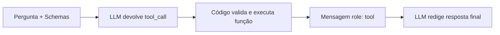

## Passo 1 · Leitura · De texto livre a contratos tipados e ferramentas

Quando um LLM responde a um humano no chat, prosa livre é excelente. Mas quando a saída do modelo alimenta o próximo passo de um programa — gravar no banco de dados, filtrar um catálogo ou acionar uma regra de negócio —, texto livre é um pesadelo: o modelo pode mudar o formato, acrescentar comentários educados antes dos dados ou inventar nomes de campos.

Para integrar LLMs a código tradicional com segurança, usamos dois mecanismos: **saída estruturada validada por schema** e **chamadas de ferramentas** (*function calling* / *tool calling*).

Na **saída estruturada**, pedimos um objeto JSON, fazemos o *parse* exclusivamente com `json.loads` (**jamais** use `eval()` na saída de um modelo, pois isso permitiria execução arbitrária de código!) e validamos o dicionário contra um contrato explícito:
1. Todos os campos obrigatórios estão presentes?
2. Há algum campo extra não declarado no schema? (Rejeitar campos extras evita que alucinações passem despercebidas.)
3. Cada valor tem o tipo esperado (`str`, `int`, `float`, `bool`, `list`)? Em Python, lembre-se de uma armadilha clássica: `isinstance(True, int)` é `True`, porque `bool` herda de `int`! Portanto, ao validar `int`, é preciso rejeitar booleanos explicitamente.
4. Se o campo é um enumerado (`enums`), o valor pertence à lista permitida?

Quando a validação falha, em vez de desistir na primeira tentativa, podemos executar um **loop de reparo**: enviamos de volta ao modelo a saída defeituosa junto com a mensagem exata do erro de validação, pedindo que ele corrija o JSON (até um número máximo de tentativas).

Já no **function calling**, declaramos ao modelo uma lista de ferramentas disponíveis (nome, descrição e schema dos argumentos). Atenção a um ponto fundamental de arquitetura e segurança: **o LLM nunca executa nenhuma função por conta própria**. Ele apenas devolve uma estrutura `tool_calls` dizendo *"gostaria de chamar a função `consultar_vagas` com `{"disciplina": "MAC0110"}`"*. O seu código verifica se a função está no dicionário permitido, executa-a localmente, anexa o resultado como uma mensagem de papel `"tool"` e chama o modelo novamente para redigir a resposta final:



## Passo 2 · Exercício · Validação de schema e extração

Implemente o validador de contratos `validar(obj, schema)` e a função de extração `extrair_pedido(texto, cliente, schema)`.

Um `schema` é um dicionário com três chaves:
- `"obrigatorios"`: lista de nomes de campos que devem existir em `obj`.
- `"tipos"`: dicionário `{campo: tipo_python}` (ex.: `{"disciplina": str, "creditos": int}`) definindo todos os campos permitidos e seus tipos.
- `"enums"`: dicionário opcional `{campo: [valores_permitidos]}`.

Qualquer violação deve levantar `ErroDeSchema` com uma mensagem descritiva.

### Instruções

1. Em `validar(obj, schema)`, levante `ErroDeSchema` se `obj` não for um `dict`, se faltar qualquer campo de `schema["obrigatorios"]` ou se existir em `obj` qualquer chave que não esteja em `schema["tipos"]`.
2. Para cada `campo, valor` em `obj.items()`, verifique o tipo esperado `tipo = schema["tipos"][campo]`. Lembre-se: se `tipo is int` e `isinstance(valor, bool)`, levante `ErroDeSchema`! Se `not isinstance(valor, tipo)`, levante `ErroDeSchema`.
3. Se `campo` estiver em `schema.get("enums", {})` e `valor` não pertencer a `schema["enums"][campo]`, levante `ErroDeSchema`. Se tudo estiver válido, retorne `obj`.
4. Em `extrair_pedido(texto, cliente, schema)`, chame `cliente.completar([{"role": "user", "content": texto}])`, converta `resposta.conteudo` com `json.loads` (capturando `json.JSONDecodeError` e levantando `ErroDeSchema("JSON inválido")`) e retorne `validar(dados, schema)`.

### Código inicial

```python path=main.py
import json


class ErroDeSchema(Exception):
    pass


def validar(obj, schema):
    # Verifique se obj é dict, campos obrigatórios, campos extras, tipos (cuidado com bool vs int!) e enums
    pass


def extrair_pedido(texto, cliente, schema):
    # Chame cliente.completar, faça json.loads e valide contra o schema
    pass


if __name__ == "__main__":
    esquema = {
        "obrigatorios": ["acao", "disciplina", "semestre"],
        "tipos": {"acao": str, "disciplina": str, "semestre": int},
        "enums": {"acao": ["matricular", "trancar"]},
    }
    amostra = {"acao": "trancar", "disciplina": "MAC0110", "semestre": 2}
    print(validar(amostra, esquema))
```

### Solução

```python path=main.py
import json


class ErroDeSchema(Exception):
    pass


def validar(obj, schema):
    if not isinstance(obj, dict):
        raise ErroDeSchema("O objeto raiz deve ser um dicionário")

    obrigatorios = schema.get("obrigatorios", [])
    tipos = schema.get("tipos", {})
    enums = schema.get("enums", {})

    for campo in obrigatorios:
        if campo not in obj:
            raise ErroDeSchema(f"Campo obrigatório ausente: {campo}")

    for campo, valor in obj.items():
        if campo not in tipos:
            raise ErroDeSchema(f"Campo extra não permitido: {campo}")
        tipo_esperado = tipos[campo]
        if tipo_esperado is int and isinstance(valor, bool):
            raise ErroDeSchema(f"Campo {campo} espera int, mas recebeu bool")
        if not isinstance(valor, tipo_esperado):
            raise ErroDeSchema(f"Tipo inválido no campo {campo}")
        if campo in enums and valor not in enums[campo]:
            raise ErroDeSchema(f"Valor fora do enum no campo {campo}")

    return obj


def extrair_pedido(texto, cliente, schema):
    resposta = cliente.completar([{"role": "user", "content": texto}])
    try:
        dados = json.loads(resposta.conteudo)
    except json.JSONDecodeError as exc:
        raise ErroDeSchema("JSON inválido") from exc
    return validar(dados, schema)


if __name__ == "__main__":
    esquema = {
        "obrigatorios": ["acao", "disciplina", "semestre"],
        "tipos": {"acao": str, "disciplina": str, "semestre": int},
        "enums": {"acao": ["matricular", "trancar"]},
    }
    amostra = {"acao": "trancar", "disciplina": "MAC0110", "semestre": 2}
    print(validar(amostra, esquema))
```

### Dicas

1. Verifique primeiro `if tipo_esperado is int and isinstance(valor, bool): raise ErroDeSchema(...)`, porque em Python `bool` é subclasse de `int`.
2. Qualquer chave de `obj` que não esteja em `schema["tipos"]` deve levantar `ErroDeSchema`.
3. Em `extrair_pedido`, use `try: dados = json.loads(...) except json.JSONDecodeError: raise ErroDeSchema("JSON inválido")`.

### Verificação

```json
[
  {
    "id": "valida-correto",
    "name": "Valida objeto correto com obrigatórios, tipos e enums",
    "checkpoint": 1,
    "kind": "expr",
    "setup": "s = {'obrigatorios': ['acao', 'semestre'], 'tipos': {'acao': str, 'semestre': int, 'obs': str}, 'enums': {'acao': ['matricular', 'trancar']}}",
    "expr": "validar({'acao': 'trancar', 'semestre': 1}, s)",
    "expected": {"acao": "trancar", "semestre": 1}
  },
  {
    "id": "rejeita-extra",
    "name": "Rejeita campo extra não declarado em tipos",
    "checkpoint": 1,
    "kind": "expr",
    "setup": "s = {'obrigatorios': ['acao'], 'tipos': {'acao': str}, 'enums': {}}",
    "expr": "validar({'acao': 'trancar', 'admin': True}, s)",
    "raises": "ErroDeSchema"
  },
  {
    "id": "rejeita-bool-como-int",
    "name": "Rejeita booleano quando o tipo esperado é int",
    "checkpoint": 2,
    "kind": "expr",
    "setup": "s = {'obrigatorios': ['semestre'], 'tipos': {'semestre': int}, 'enums': {}}",
    "expr": "validar({'semestre': True}, s)",
    "raises": "ErroDeSchema"
  },
  {
    "id": "rejeita-enum-invalido",
    "name": "Rejeita valor fora da lista de enums",
    "checkpoint": 3,
    "kind": "expr",
    "setup": "s = {'obrigatorios': ['acao'], 'tipos': {'acao': str}, 'enums': {'acao': ['matricular', 'trancar']}}",
    "expr": "validar({'acao': 'deletar_banco'}, s)",
    "raises": "ErroDeSchema"
  },
  {
    "id": "extrair-json-invalido",
    "name": "extrair_pedido levanta ErroDeSchema quando o modelo devolve texto que não é JSON",
    "checkpoint": 4,
    "kind": "expr",
    "setup": "class R:\n    conteudo = 'Claro! Aqui esta: {invalido}'\nclass C:\n    def completar(self, m):\n        return R()\ns = {'obrigatorios': ['acao'], 'tipos': {'acao': str}}",
    "expr": "extrair_pedido('Quero trancar', C(), s)",
    "raises": "ErroDeSchema"
  }
]
```

### Soluções erradas

```python name="Aceita campos extras e não diferencia bool de int"
import json


class ErroDeSchema(Exception):
    pass


def validar(obj, schema):
    for campo in schema.get("obrigatorios", []):
        if campo not in obj:
            raise ErroDeSchema("Faltando campo")
    for campo, valor in obj.items():
        if campo in schema["tipos"] and not isinstance(valor, schema["tipos"][campo]):
            raise ErroDeSchema("Tipo errado")
    return obj


def extrair_pedido(texto, cliente, schema):
    resposta = cliente.completar([{"role": "user", "content": texto}])
    return validar(json.loads(resposta.conteudo), schema)
```

```python name="Ignora validação de valores permitidos em enums"
import json


class ErroDeSchema(Exception):
    pass


def validar(obj, schema):
    if not isinstance(obj, dict):
        raise ErroDeSchema("Não é dict")
    for campo in schema.get("obrigatorios", []):
        if campo not in obj:
            raise ErroDeSchema("Ausente")
    for campo, valor in obj.items():
        if campo not in schema["tipos"]:
            raise ErroDeSchema("Extra")
        t = schema["tipos"][campo]
        if t is int and isinstance(valor, bool):
            raise ErroDeSchema("Bool como int")
        if not isinstance(valor, t):
            raise ErroDeSchema("Tipo")
    return obj


def extrair_pedido(texto, cliente, schema):
    resposta = cliente.completar([{"role": "user", "content": texto}])
    try:
        dados = json.loads(resposta.conteudo)
    except json.JSONDecodeError as exc:
        raise ErroDeSchema("JSON inválido") from exc
    return validar(dados, schema)
```

## Passo 3 · Exercício · Execução com reparo automático

Quando o modelo erra a formatação JSON ou viola um campo do schema, simplesmente reenviar o prompt original com `temperature = 0` produzirá exatamente o mesmo erro! Para que o modelo se autocorrija, precisamos acrescentar ao histórico da chamada a resposta inválida que ele deu (`"role": "assistant"`) seguida de uma mensagem `"role": "user"` descrevendo o erro encontrado.

### Instruções

1. Implemente `executar_com_reparo(cliente, prompt, schema, max_tentativas=3)` iniciando `mensagens = [{"role": "user", "content": prompt}]`.
2. Em cada tentativa (até `max_tentativas`), chame `resposta = cliente.completar(mensagens)` e tente converter `resposta.conteudo` com `json.loads` e validar com `validar(dados, schema)`. Se passar, retorne o dicionário validado.
3. Se ocorrer `json.JSONDecodeError` ou `ErroDeSchema`: caso seja a última tentativa, levante `ErroDeSchema` com a mensagem do erro; caso contrário, adicione `{"role": "assistant", "content": resposta.conteudo}` e `{"role": "user", "content": f"Erro de validação: {erro}. Corrija e devolva apenas JSON válido."}` à lista `mensagens` e continue para a próxima tentativa.

### Código inicial

```python path=main.py
import json


class ErroDeSchema(Exception):
    pass


def validar(obj, schema):
    if not isinstance(obj, dict):
        raise ErroDeSchema("O objeto raiz deve ser um dicionário")
    for campo in schema.get("obrigatorios", []):
        if campo not in obj:
            raise ErroDeSchema(f"Campo obrigatório ausente: {campo}")
    for campo, valor in obj.items():
        if campo not in schema.get("tipos", {}):
            raise ErroDeSchema(f"Campo extra não permitido: {campo}")
        t = schema["tipos"][campo]
        if t is int and isinstance(valor, bool):
            raise ErroDeSchema(f"Campo {campo} espera int, mas recebeu bool")
        if not isinstance(valor, t):
            raise ErroDeSchema(f"Tipo inválido no campo {campo}")
        if campo in schema.get("enums", {}) and valor not in schema["enums"][campo]:
            raise ErroDeSchema(f"Valor fora do enum no campo {campo}")
    return obj


def executar_com_reparo(cliente, prompt, schema, max_tentativas=3):
    # Tente extrair e validar; em falha, anexe a resposta e o feedback de erro ao histórico
    pass


if __name__ == "__main__":
    class Resp:
        def __init__(self, c):
            self.conteudo = c

    class ClienteQueCorrige:
        def completar(self, mensagens):
            if len(mensagens) == 1:
                return Resp('{"acao": "cancelar"}')
            return Resp('{"acao": "trancar"}')

    esq = {
        "obrigatorios": ["acao"],
        "tipos": {"acao": str},
        "enums": {"acao": ["matricular", "trancar"]},
    }
    print(executar_com_reparo(ClienteQueCorrige(), "Trancar MAC0110", esq))
```

### Solução

```python path=main.py
import json


class ErroDeSchema(Exception):
    pass


def validar(obj, schema):
    if not isinstance(obj, dict):
        raise ErroDeSchema("O objeto raiz deve ser um dicionário")
    for campo in schema.get("obrigatorios", []):
        if campo not in obj:
            raise ErroDeSchema(f"Campo obrigatório ausente: {campo}")
    for campo, valor in obj.items():
        if campo not in schema.get("tipos", {}):
            raise ErroDeSchema(f"Campo extra não permitido: {campo}")
        t = schema["tipos"][campo]
        if t is int and isinstance(valor, bool):
            raise ErroDeSchema(f"Campo {campo} espera int, mas recebeu bool")
        if not isinstance(valor, t):
            raise ErroDeSchema(f"Tipo inválido no campo {campo}")
        if campo in schema.get("enums", {}) and valor not in schema["enums"][campo]:
            raise ErroDeSchema(f"Valor fora do enum no campo {campo}")
    return obj


def executar_com_reparo(cliente, prompt, schema, max_tentativas=3):
    mensagens = [{"role": "user", "content": prompt}]
    for tentativa in range(1, max_tentativas + 1):
        resposta = cliente.completar(list(mensagens))
        try:
            dados = json.loads(resposta.conteudo)
            return validar(dados, schema)
        except (json.JSONDecodeError, ErroDeSchema) as erro:
            if tentativa == max_tentativas:
                raise ErroDeSchema(str(erro)) from erro
            mensagens.append({"role": "assistant", "content": resposta.conteudo})
            mensagens.append(
                {
                    "role": "user",
                    "content": f"Erro de validação: {erro}. Corrija e devolva apenas JSON válido.",
                }
            )


if __name__ == "__main__":
    class Resp:
        def __init__(self, c):
            self.conteudo = c

    class ClienteQueCorrige:
        def completar(self, mensagens):
            if len(mensagens) == 1:
                return Resp('{"acao": "cancelar"}')
            return Resp('{"acao": "trancar"}')

    esq = {
        "obrigatorios": ["acao"],
        "tipos": {"acao": str},
        "enums": {"acao": ["matricular", "trancar"]},
    }
    print(executar_com_reparo(ClienteQueCorrige(), "Trancar MAC0110", esq))
```

### Dicas

1. Capture `except (json.JSONDecodeError, ErroDeSchema) as erro:` para tratar tanto sintaxe JSON quebrada quanto violação de schema no mesmo fluxo.
2. Ao pedir reparo, adicione a saída anterior com `"role": "assistant"` e a instrução de correção com `"role": "user"` contendo `"Erro de validação: "`.

### Verificação

```json
[
  {
    "id": "reparo-segunda-tentativa",
    "name": "Recupera na segunda tentativa enviando o erro de validação ao modelo",
    "checkpoint": 3,
    "kind": "expr",
    "setup": "class R:\n    def __init__(self, c): self.conteudo = c\nclass Cli:\n    def __init__(self): self.historico_recebido = []\n    def completar(self, msgs):\n        self.historico_recebido = list(msgs)\n        if len(msgs) == 1:\n            return R('{\"acao\": \"invalida\"}')\n        if 'Erro de validação:' in msgs[-1]['content']:\n            return R('{\"acao\": \"trancar\"}')\n        return R('{\"acao\": \"invalida\"}')\ncli = Cli()\ns = {'obrigatorios': ['acao'], 'tipos': {'acao': str}, 'enums': {'acao': ['trancar']}}\nres = executar_com_reparo(cli, 'Trancar', s, max_tentativas=3)",
    "expr": "[res, len(cli.historico_recebido)]",
    "expected": [{"acao": "trancar"}, 3]
  },
  {
    "id": "reparo-esgota",
    "name": "Levanta ErroDeSchema quando todas as tentativas falham",
    "checkpoint": 3,
    "kind": "expr",
    "setup": "class R:\n    def __init__(self, c): self.conteudo = c\nclass CliRuim:\n    def completar(self, msgs): return R('nao eh json')\ns = {'obrigatorios': ['acao'], 'tipos': {'acao': str}}",
    "expr": "executar_com_reparo(CliRuim(), 'Oi', s, max_tentativas=2)",
    "raises": "ErroDeSchema"
  }
]
```

### Soluções erradas

```python name="Reenvia apenas o prompt original sem informar o erro ao modelo"
import json


class ErroDeSchema(Exception):
    pass


def validar(obj, schema):
    if not isinstance(obj, dict):
        raise ErroDeSchema("Não é dict")
    for campo in schema.get("obrigatorios", []):
        if campo not in obj:
            raise ErroDeSchema("Ausente")
    for campo, valor in obj.items():
        if campo not in schema.get("tipos", {}):
            raise ErroDeSchema("Extra")
        t = schema["tipos"][campo]
        if t is int and isinstance(valor, bool):
            raise ErroDeSchema("Bool")
        if not isinstance(valor, t):
            raise ErroDeSchema("Tipo")
        if campo in schema.get("enums", {}) and valor not in schema["enums"][campo]:
            raise ErroDeSchema("Enum")
    return obj


def executar_com_reparo(cliente, prompt, schema, max_tentativas=3):
    for tentativa in range(1, max_tentativas + 1):
        resposta = cliente.completar([{"role": "user", "content": prompt}])
        try:
            return validar(json.loads(resposta.conteudo), schema)
        except (json.JSONDecodeError, ErroDeSchema) as erro:
            if tentativa == max_tentativas:
                raise ErroDeSchema(str(erro)) from erro
```

```python name="Não converte JSONDecodeError em ErroDeSchema ao esgotar tentativas"
import json


class ErroDeSchema(Exception):
    pass


def validar(obj, schema):
    return obj


def executar_com_reparo(cliente, prompt, schema, max_tentativas=3):
    mensagens = [{"role": "user", "content": prompt}]
    for _ in range(max_tentativas):
        resposta = cliente.completar(mensagens)
        dados = json.loads(resposta.conteudo)
        return validar(dados, schema)
```

## Passo 4 · Exercício · Roteamento e ciclo de ferramenta

Agora vamos implementar o ciclo completo de *function calling*. Quando o modelo precisa consultar um dado externo, `resposta.tool_calls` vem preenchido com uma lista de dicionários no formato:

```python
[{"name": "consultar_vagas", "arguments": {"disciplina": "MAC0110"}}]
```

### Instruções

1. Implemente `rotear_ferramenta(chamada, ferramentas)`: verifique se `chamada["name"]` existe no dicionário `ferramentas` (se não existir, levante `KeyError(f"Ferramenta desconhecida: {chamada['name']}")`) e chame `ferramentas[nome](**chamada["arguments"])`, retornando o resultado.
2. Implemente `ciclo_de_ferramenta(cliente, pergunta, ferramentas)`:
   - Inicie `mensagens = [{"role": "user", "content": pergunta}]` e chame `resposta = cliente.completar(mensagens)`.
   - Se `not resposta.tool_calls`, retorne `resposta.conteudo` imediatamente.
   - Caso haja `resposta.tool_calls`, para cada `chamada` execute `resultado = rotear_ferramenta(chamada, ferramentas)` e adicione à lista `mensagens` um dicionário `{"role": "tool", "name": chamada["name"], "content": str(resultado)}`.
   - Ao final das ferramentas, faça uma nova chamada `final = cliente.completar(mensagens)` e retorne `final.conteudo`.

### Código inicial

```python path=main.py
class RespostaLLM:
    def __init__(self, conteudo="", tool_calls=None):
        self.conteudo = conteudo
        self.tool_calls = tool_calls or []


def rotear_ferramenta(chamada, ferramentas):
    # Valide se a ferramenta existe e execute-a com **chamada["arguments"]
    pass


def ciclo_de_ferramenta(cliente, pergunta, ferramentas):
    # Execute a chamada inicial, processe tool_calls se houver e peça a resposta final
    pass


if __name__ == "__main__":
    class ClienteToolSimulado:
        def completar(self, mensagens):
            if mensagens[-1]["role"] == "user":
                return RespostaLLM(
                    tool_calls=[
                        {"name": "vagas", "arguments": {"codigo": "MAC0110"}}
                    ]
                )
            return RespostaLLM(
                conteudo=f"A disciplina tem {mensagens[-1]['content']} vagas abertas."
            )

     catálogo_fn = {"vagas": lambda codigo: 12 if codigo == "MAC0110" else 0}
    print(ciclo_de_ferramenta(ClienteToolSimulado(), "Há vagas em MAC0110?", catálogo_fn))
```

### Solução

```python path=main.py
class RespostaLLM:
    def __init__(self, conteudo="", tool_calls=None):
        self.conteudo = conteudo
        self.tool_calls = tool_calls or []


def rotear_ferramenta(chamada, ferramentas):
    nome = chamada["name"]
    if nome not in ferramentas:
        raise KeyError(f"Ferramenta desconhecida: {nome}")
    argumentos = chamada.get("arguments", {})
    return ferramentas[nome](**argumentos)


def ciclo_de_ferramenta(cliente, pergunta, ferramentas):
    mensagens = [{"role": "user", "content": pergunta}]
    resposta = cliente.completar(list(mensagens))
    if not resposta.tool_calls:
        return resposta.conteudo

    for chamada in resposta.tool_calls:
        resultado = rotear_ferramenta(chamada, ferramentas)
        mensagens.append(
            {
                "role": "tool",
                "name": chamada["name"],
                "content": str(resultado),
            }
        )

    resposta_final = cliente.completar(list(mensagens))
    return resposta_final.conteudo


if __name__ == "__main__":
    class ClienteToolSimulado:
        def completar(self, mensagens):
            if mensagens[-1]["role"] == "user":
                return RespostaLLM(
                    tool_calls=[
                        {"name": "vagas", "arguments": {"codigo": "MAC0110"}}
                    ]
                )
            return RespostaLLM(
                conteudo=f"A disciplina tem {mensagens[-1]['content']} vagas abertas."
            )

    catalogo_fn = {"vagas": lambda codigo: 12 if codigo == "MAC0110" else 0}
    print(ciclo_de_ferramenta(ClienteToolSimulado(), "Há vagas em MAC0110?", catalogo_fn))
```

### Dicas

1. Para desempacotar o dicionário de argumentos na chamada da função Python, use `ferramentas[nome](**chamada["arguments"])`.
2. A mensagem de retorno da ferramenta deve ter `"role": "tool"`, `"name": chamada["name"]` e `"content": str(resultado)`.

### Verificação

```json
[
  {
    "id": "rotear-ok",
    "name": "rotear_ferramenta executa a função cadastrada com os argumentos nomeados",
    "checkpoint": 1,
    "kind": "expr",
    "setup": "fns = {'somar_creditos': lambda aula, trab: aula + trab}",
    "expr": "rotear_ferramenta({'name': 'somar_creditos', 'arguments': {'aula': 4, 'trab': 2}}, fns)",
    "expected": 6
  },
  {
    "id": "rotear-inexistente",
    "name": "rotear_ferramenta levanta KeyError quando o modelo pede ferramenta inexistente",
    "checkpoint": 1,
    "kind": "expr",
    "setup": "fns = {'consultar': lambda x: x}",
    "expr": "rotear_ferramenta({'name': 'apagar_sistema', 'arguments': {}}, fns)",
    "raises": "KeyError"
  },
  {
    "id": "ciclo-completo",
    "name": "ciclo_de_ferramenta executa tool_call e devolve a resposta final do modelo",
    "checkpoint": 2,
    "kind": "expr",
    "setup": "class Cli:\n    def completar(self, msgs):\n        if msgs[-1]['role'] == 'user':\n            return RespostaLLM(tool_calls=[{'name': 'pre_req', 'arguments': {'sigla': 'MAC0121'}}])\n        return RespostaLLM(conteudo='Pré-requisito: ' + msgs[-1]['content'])\nfns = {'pre_req': lambda sigla: 'MAC0110' if sigla == 'MAC0121' else 'Nenhum'}",
    "expr": "ciclo_de_ferramenta(Cli(), 'Qual o pré-requisito de MAC0121?', fns)",
    "expected": "Pré-requisito: MAC0110"
  },
  {
    "id": "ciclo-sem-tool",
    "name": "ciclo_de_ferramenta retorna direto quando não há tool_calls",
    "checkpoint": 2,
    "kind": "expr",
    "setup": "class CliDireto:\n    def completar(self, msgs): return RespostaLLM(conteudo='Bom dia!')",
    "expr": "ciclo_de_ferramenta(CliDireto(), 'Olá', {})",
    "expected": "Bom dia!"
  }
]
```

### Soluções erradas

```python name="Devolve o resultado bruto da ferramenta sem fazer a segunda chamada ao LLM"
class RespostaLLM:
    def __init__(self, conteudo="", tool_calls=None):
        self.conteudo = conteudo
        self.tool_calls = tool_calls or []


def rotear_ferramenta(chamada, ferramentas):
    nome = chamada["name"]
    return ferramentas[nome](**chamada["arguments"])


def ciclo_de_ferramenta(cliente, pergunta, ferramentas):
    mensagens = [{"role": "user", "content": pergunta}]
    resposta = cliente.completar(mensagens)
    if not resposta.tool_calls:
        return resposta.conteudo
    return str(rotear_ferramenta(resposta.tool_calls[0], ferramentas))
```

```python name="Ignora os argumentos solicitados pelo modelo ao chamar a ferramenta"
class RespostaLLM:
    def __init__(self, conteudo="", tool_calls=None):
        self.conteudo = conteudo
        self.tool_calls = tool_calls or []


def rotear_ferramenta(chamada, ferramentas):
    nome = chamada["name"]
    if nome not in ferramentas:
        raise KeyError(nome)
    return ferramentas[nome]()


def ciclo_de_ferramenta(cliente, pergunta, ferramentas):
    mensagens = [{"role": "user", "content": pergunta}]
    resposta = cliente.completar(mensagens)
    if not resposta.tool_calls:
        return resposta.conteudo
    for chamada in resposta.tool_calls:
        res = rotear_ferramenta(chamada, ferramentas)
        mensagens.append({"role": "tool", "name": chamada["name"], "content": str(res)})
    return cliente.completar(mensagens).conteudo
```

## Passo 5 · Quiz · JSON, reparo e function calling

### Pergunta

Por que você deve usar `json.loads(resposta.conteudo)` em vez de `eval(resposta.conteudo)` para converter uma saída estruturada do LLM em um dicionário Python?

- [ ] Porque `eval()` não consegue ler strings com acentos em português.
- [x] Porque `eval()` executa qualquer expressão Python arbitrária contida no texto, abrindo uma brecha crítica de execução remota de código se o modelo (ou um atacante via prompt) gerar código malicioso.
- [ ] Porque `json.loads()` ignora erros de sintaxe e nunca levanta exceções.
- [ ] Porque `eval()` só funciona em modelos de pesos abertos.

> `json.loads` interpreta exclusivamente a gramática de dados JSON. Já `eval` executa código Python arbitrário (como `__import__('os').system(...)`), tornando qualquer alucinação ou *prompt injection* uma falha grave de segurança.

### Pergunta

Quando um modelo retorna `tool_calls` em uma chamada com *function calling*, quem realmente executa a função em Python?

- [ ] O próprio servidor do LLM conecta-se ao seu banco de dados local e roda a função.
- [x] O código da sua aplicação valida o nome e os argumentos solicitados, executa a função localmente e envia o retorno em uma mensagem `"role": "tool"`.
- [ ] O tokenizador executa a função durante a fase de *prefill*.
- [ ] Ninguém: `tool_calls` serve apenas para documentação.

> O modelo de linguagem apenas gera uma intenção estruturada (nome da função e argumentos em JSON). A decisão e a responsabilidade de validar e executar a função pertencem 100 % ao código da aplicação.

### Pergunta

No padrão de execução com reparo automático, o que deve ser enviado ao modelo na segunda tentativa após uma falha de `ErroDeSchema`?

- [ ] Exatamente a mesma lista de mensagens da primeira tentativa, sem alterações.
- [ ] Apenas a palavra `"Tente novamente"`.
- [x] A resposta inválida gerada pelo modelo mais uma mensagem informando qual regra do schema ou sintaxe JSON foi violada.
- [ ] Um conjunto vazio de mensagens `[]`.

> Mostrar ao modelo o que ele acabou de responder junto com a mensagem específica do validador (`"Campo obrigatório ausente: semestre"`) permite que ele corrija o erro pontualmente na tentativa seguinte.
