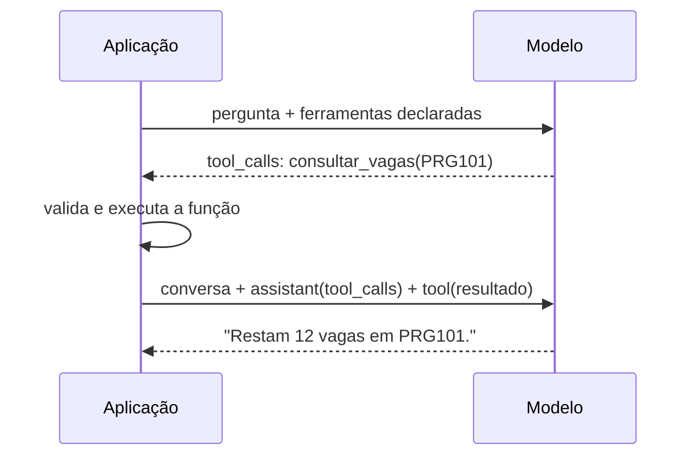

## Passo 1 · Leitura · O modelo como fonte de dados não confiável

Quando a resposta do modelo vai para uma pessoa, texto livre serve. Quando vai para o seu programa (gravar um requerimento, filtrar disciplinas, abrir um chamado), você precisa de dados com formato fixo. O caminho é pedir **JSON** e tratar a resposta como qualquer entrada externa: algo que pode chegar errado e precisa ser conferido.

O que costuma vir errado, mesmo com um bom prompt:

| A resposta | O problema |
|---|---|
| `Claro! Aqui está: {"acao": "trancar"}` | Texto em volta do JSON: `json.loads` falha |
| `{"acao": "trancar", "disciplina": "PRG101"` | Cortado em `max_tokens` (`finish_reason == "length"`) |
| `{"acao": "cancelar_tudo"}` | Valor fora da lista permitida |
| `{"acao": "trancar", "urgente": "sim"}` | Campo que ninguém pediu; tipo errado |
| `{"semestre": true}` | `bool` onde se esperava número |

Converta **só** com `json.loads`. Nunca com `eval`: ele executa qualquer expressão Python, e a resposta do modelo pode conter texto vindo de um usuário mal-intencionado (o módulo 6 trata disso). `json.loads` só entende dados.

Depois do *parse*, valide contra um **schema**, a descrição do formato aceito. Nesta lição o schema é um dicionário simples:

```python
schema = {
    "obrigatorios": ["acao", "disciplina"],
    "tipos": {"acao": str, "disciplina": str, "semestre": int, "nota": float},
    "enums": {"acao": ["matricular", "trancar"]},
}
```

Uma armadilha de Python: `isinstance(True, int)` é `True`, porque `bool` é subclasse de `int`. Um validador ingênuo aceita `true` como semestre. O contrário também morde: o JSON `8` vira `int`, e `isinstance(8, float)` é `False`, então um campo `float` precisa aceitar `int` (mas não `bool`).

Se a validação falha, não desista na primeira: faça um **ciclo de reparo**. Acrescente à conversa a resposta inválida (papel `assistant`) e uma mensagem `user` com o erro exato do validador. Reenviar o mesmo prompt sem dizer o que estava errado tende a produzir o mesmo erro. O reparo tem limite de tentativas, e há um caso em que ele não adianta: resposta cortada por `"length"`. O modelo vai cortar de novo no mesmo teto; a saída é aumentar `max_tokens` ou pedir menos.

Muitos provedores oferecem um modo de saída estruturada que força o JSON a seguir um schema. Ajuda muito, mas a validação no seu código continua: ela é a sua garantia, não a do fornecedor.

## Passo 2 · Exercício · Validar contra o schema

Escreva `validar(obj, schema)`, que devolve `obj` quando ele obedece ao schema e, senão, levanta `ErroDeSchema` com uma mensagem que **cita o campo** com problema (essa mensagem vai ser mandada ao modelo no reparo, no próximo passo). O schema tem `"obrigatorios"`, `"tipos"` e, opcionalmente, `"enums"`.

Exemplos de mensagens: `campo obrigatório ausente: disciplina`, `campo não permitido: urgente`, `tipo inválido em semestre: esperado int`, `valor inválido em acao: cancelar`.

### Instruções
1. Recuse o que não for um dicionário, e recuse a falta de qualquer campo obrigatório (um obrigatório com valor `0` ou `""` está presente).
2. Recuse campos que não aparecem em `schema["tipos"]`.
3. Confira o tipo de cada campo: `bool` não vale como `int` nem como `float`, e `int` vale como `float`.
4. Quando o campo tiver lista em `schema.get("enums", {})`, recuse valores fora dela.

### Código inicial
```python
import json


class ErroDeSchema(Exception):
    pass


def validar(obj, schema):
    pass
```

### Solução
```python
import json


class ErroDeSchema(Exception):
    pass


def tipo_confere(valor, tipo):
    if isinstance(valor, bool):
        return tipo is bool
    if tipo is float:
        return isinstance(valor, (int, float))
    return isinstance(valor, tipo)


def validar(obj, schema):
    if not isinstance(obj, dict):
        raise ErroDeSchema("a resposta precisa ser um objeto JSON")
    for campo in schema["obrigatorios"]:
        if campo not in obj:
            raise ErroDeSchema(f"campo obrigatório ausente: {campo}")
    for campo, valor in obj.items():
        if campo not in schema["tipos"]:
            raise ErroDeSchema(f"campo não permitido: {campo}")
        tipo = schema["tipos"][campo]
        if not tipo_confere(valor, tipo):
            raise ErroDeSchema(f"tipo inválido em {campo}: esperado {tipo.__name__}")
        permitidos = schema.get("enums", {}).get(campo)
        if permitidos is not None and valor not in permitidos:
            raise ErroDeSchema(f"valor inválido em {campo}: {valor}")
    return obj
```

### Dicas
1. Teste o `bool` antes de tudo: ele passa em `isinstance(valor, int)`.
2. Presença se testa com `campo in obj`, não com o valor ser verdadeiro.
3. Uma função auxiliar `tipo_confere(valor, tipo)` deixa as regras de tipo num lugar só.

### Verificação
```json
[
  { "id": "valido", "checkpoint": 1, "kind": "expr",
    "setup": "s = {'obrigatorios': ['acao', 'disciplina'], 'tipos': {'acao': str, 'disciplina': str, 'semestre': int}, 'enums': {'acao': ['matricular', 'trancar']}}",
    "expr": "validar({'acao': 'trancar', 'disciplina': 'PRG101', 'semestre': 2}, s)",
    "expected": { "acao": "trancar", "disciplina": "PRG101", "semestre": 2 }, "name": "Objeto válido é devolvido" },
  { "id": "opcional", "checkpoint": 1, "kind": "expr",
    "setup": "s = {'obrigatorios': ['acao'], 'tipos': {'acao': str, 'obs': str}}",
    "expr": "validar({'acao': 'trancar'}, s)", "expected": { "acao": "trancar" },
    "name": "Campo opcional ausente é aceito, e enums pode faltar no schema" },
  { "id": "ausente", "checkpoint": 1, "kind": "expr",
    "setup": "s = {'obrigatorios': ['acao', 'disciplina'], 'tipos': {'acao': str, 'disciplina': str}}",
    "expr": "validar({'acao': 'trancar'}, s)", "raises": "ErroDeSchema", "message_contains": "disciplina",
    "name": "Falta de obrigatório é recusada, citando o campo" },
  { "id": "zero-presente", "checkpoint": 1, "kind": "expr",
    "setup": "s = {'obrigatorios': ['faltas', 'obs'], 'tipos': {'faltas': int, 'obs': str}}",
    "expr": "validar({'faltas': 0, 'obs': ''}, s)", "expected": { "faltas": 0, "obs": "" },
    "name": "Obrigatório com valor 0 ou texto vazio está presente", "hint": "Teste a presença da chave, não se o valor é verdadeiro." },
  { "id": "lista", "checkpoint": 1, "kind": "expr",
    "setup": "s = {'obrigatorios': [], 'tipos': {}}", "expr": "validar([{'acao': 'trancar'}], s)", "raises": "ErroDeSchema",
    "name": "Uma lista no lugar do objeto é recusada com ErroDeSchema" },
  { "id": "extra", "checkpoint": 2, "kind": "expr",
    "setup": "s = {'obrigatorios': ['acao'], 'tipos': {'acao': str}}",
    "expr": "validar({'acao': 'trancar', 'urgente': True}, s)", "raises": "ErroDeSchema", "message_contains": "urgente",
    "name": "Campo não declarado é recusado" },
  { "id": "bool-int", "checkpoint": 3, "kind": "expr",
    "setup": "s = {'obrigatorios': ['semestre'], 'tipos': {'semestre': int}}",
    "expr": "validar({'semestre': True}, s)", "raises": "ErroDeSchema", "message_contains": "semestre",
    "name": "true não vale como int", "hint": "bool é subclasse de int em Python." },
  { "id": "bool-float", "checkpoint": 3, "kind": "expr",
    "setup": "s = {'obrigatorios': ['nota'], 'tipos': {'nota': float}}",
    "expr": "validar({'nota': False}, s)", "raises": "ErroDeSchema", "name": "false não vale como float" },
  { "id": "int-float", "checkpoint": 3, "kind": "expr",
    "setup": "s = {'obrigatorios': ['nota'], 'tipos': {'nota': float}}",
    "expr": "validar(json.loads('{\"nota\": 8}'), s)", "expected": { "nota": 8 },
    "name": "O JSON 8 é aceito num campo float", "hint": "json.loads devolve int para 8." },
  { "id": "texto-int", "checkpoint": 3, "kind": "expr",
    "setup": "s = {'obrigatorios': ['semestre'], 'tipos': {'semestre': int}}",
    "expr": "validar({'semestre': '2'}, s)", "raises": "ErroDeSchema", "name": "Texto \"2\" não vale como int" },
  { "id": "enum", "checkpoint": 4, "kind": "expr",
    "setup": "s = {'obrigatorios': ['acao'], 'tipos': {'acao': str}, 'enums': {'acao': ['matricular', 'trancar']}}",
    "expr": "validar({'acao': 'cancelar_tudo'}, s)", "raises": "ErroDeSchema", "message_contains": "acao",
    "name": "Valor fora do enum é recusado" }
]
```

### Soluções erradas
```python name="aceita campos extras"
import json


class ErroDeSchema(Exception):
    pass


def tipo_confere(valor, tipo):
    if isinstance(valor, bool):
        return tipo is bool
    if tipo is float:
        return isinstance(valor, (int, float))
    return isinstance(valor, tipo)


def validar(obj, schema):
    if not isinstance(obj, dict):
        raise ErroDeSchema("a resposta precisa ser um objeto JSON")
    for campo in schema["obrigatorios"]:
        if campo not in obj:
            raise ErroDeSchema(f"campo obrigatório ausente: {campo}")
    for campo, valor in obj.items():
        tipo = schema["tipos"].get(campo)
        if tipo is not None and not tipo_confere(valor, tipo):
            raise ErroDeSchema(f"tipo inválido em {campo}: esperado {tipo.__name__}")
        permitidos = schema.get("enums", {}).get(campo)
        if permitidos is not None and valor not in permitidos:
            raise ErroDeSchema(f"valor inválido em {campo}: {valor}")
    return obj
```
```python name="isinstance aceita bool como int"
import json


class ErroDeSchema(Exception):
    pass


def validar(obj, schema):
    if not isinstance(obj, dict):
        raise ErroDeSchema("a resposta precisa ser um objeto JSON")
    for campo in schema["obrigatorios"]:
        if campo not in obj:
            raise ErroDeSchema(f"campo obrigatório ausente: {campo}")
    for campo, valor in obj.items():
        if campo not in schema["tipos"]:
            raise ErroDeSchema(f"campo não permitido: {campo}")
        tipo = schema["tipos"][campo]
        if tipo is float:
            tipo = (int, float)
        if not isinstance(valor, tipo):
            raise ErroDeSchema(f"tipo inválido em {campo}")
        permitidos = schema.get("enums", {}).get(campo)
        if permitidos is not None and valor not in permitidos:
            raise ErroDeSchema(f"valor inválido em {campo}: {valor}")
    return obj
```
```python name="type(valor) is tipo recusa 8 num campo float"
import json


class ErroDeSchema(Exception):
    pass


def validar(obj, schema):
    if not isinstance(obj, dict):
        raise ErroDeSchema("a resposta precisa ser um objeto JSON")
    for campo in schema["obrigatorios"]:
        if campo not in obj:
            raise ErroDeSchema(f"campo obrigatório ausente: {campo}")
    for campo, valor in obj.items():
        if campo not in schema["tipos"]:
            raise ErroDeSchema(f"campo não permitido: {campo}")
        tipo = schema["tipos"][campo]
        if type(valor) is not tipo:
            raise ErroDeSchema(f"tipo inválido em {campo}: esperado {tipo.__name__}")
        permitidos = schema.get("enums", {}).get(campo)
        if permitidos is not None and valor not in permitidos:
            raise ErroDeSchema(f"valor inválido em {campo}: {valor}")
    return obj
```
```python name="presença testada pelo valor"
import json


class ErroDeSchema(Exception):
    pass


def tipo_confere(valor, tipo):
    if isinstance(valor, bool):
        return tipo is bool
    if tipo is float:
        return isinstance(valor, (int, float))
    return isinstance(valor, tipo)


def validar(obj, schema):
    if not isinstance(obj, dict):
        raise ErroDeSchema("a resposta precisa ser um objeto JSON")
    for campo in schema["obrigatorios"]:
        if not obj.get(campo):
            raise ErroDeSchema(f"campo obrigatório ausente: {campo}")
    for campo, valor in obj.items():
        if campo not in schema["tipos"]:
            raise ErroDeSchema(f"campo não permitido: {campo}")
        tipo = schema["tipos"][campo]
        if not tipo_confere(valor, tipo):
            raise ErroDeSchema(f"tipo inválido em {campo}: esperado {tipo.__name__}")
        permitidos = schema.get("enums", {}).get(campo)
        if permitidos is not None and valor not in permitidos:
            raise ErroDeSchema(f"valor inválido em {campo}: {valor}")
    return obj
```
```python name="ignora os enums"
import json


class ErroDeSchema(Exception):
    pass


def tipo_confere(valor, tipo):
    if isinstance(valor, bool):
        return tipo is bool
    if tipo is float:
        return isinstance(valor, (int, float))
    return isinstance(valor, tipo)


def validar(obj, schema):
    if not isinstance(obj, dict):
        raise ErroDeSchema("a resposta precisa ser um objeto JSON")
    for campo in schema["obrigatorios"]:
        if campo not in obj:
            raise ErroDeSchema(f"campo obrigatório ausente: {campo}")
    for campo, valor in obj.items():
        if campo not in schema["tipos"]:
            raise ErroDeSchema(f"campo não permitido: {campo}")
        tipo = schema["tipos"][campo]
        if not tipo_confere(valor, tipo):
            raise ErroDeSchema(f"tipo inválido em {campo}: esperado {tipo.__name__}")
    return obj
```
```python name="não confere se é dicionário"
import json


class ErroDeSchema(Exception):
    pass


def tipo_confere(valor, tipo):
    if isinstance(valor, bool):
        return tipo is bool
    if tipo is float:
        return isinstance(valor, (int, float))
    return isinstance(valor, tipo)


def validar(obj, schema):
    for campo in schema["obrigatorios"]:
        if campo not in obj:
            raise ErroDeSchema(f"campo obrigatório ausente: {campo}")
    for campo, valor in obj.items():
        if campo not in schema["tipos"]:
            raise ErroDeSchema(f"campo não permitido: {campo}")
        tipo = schema["tipos"][campo]
        if not tipo_confere(valor, tipo):
            raise ErroDeSchema(f"tipo inválido em {campo}: esperado {tipo.__name__}")
        permitidos = schema.get("enums", {}).get(campo)
        if permitidos is not None and valor not in permitidos:
            raise ErroDeSchema(f"valor inválido em {campo}: {valor}")
    return obj
```

## Passo 3 · Exercício · Extrair com ciclo de reparo

Escreva `extrair_com_reparo(cliente, prompt, schema, max_tentativas=3)`, que pede o JSON ao modelo e insiste, com o erro na mão, até receber um objeto válido. O `validar` do passo anterior já está pronto.

1. Comece a conversa com `[{"role": "user", "content": prompt}]` e chame `cliente.completar(conversa)`.
2. Se `finish_reason == "length"`, levante `ErroDeSchema("resposta truncada")` na hora: reparo não resolve corte.
3. Tente `json.loads` e `validar`. Deu certo: devolva o objeto.
4. Deu `json.JSONDecodeError` ou `ErroDeSchema`: acrescente à conversa a resposta do modelo (papel `assistant`) e a mensagem `user` `f"Erro de validação: {erro}. Corrija e devolva apenas o JSON."`, e tente de novo.
5. Na tentativa número `max_tentativas`, se ainda falhar, levante `ErroDeSchema` (mesmo que o erro tenha sido de JSON malformado).

### Instruções
1. Devolva o objeto validado assim que uma resposta passar no `json.loads` e no `validar`.
2. Em cada falha, devolva ao modelo a resposta dele e a mensagem com o erro exato, no formato pedido.
3. Faça no máximo `max_tentativas` chamadas e termine com `ErroDeSchema` se nenhuma servir.
4. Resposta cortada por `"length"` levanta `ErroDeSchema` sem novas tentativas.

### Código inicial
```python
import json

from llm_simulado import ClienteLLM


class ErroDeSchema(Exception):
    pass


def tipo_confere(valor, tipo):
    if isinstance(valor, bool):
        return tipo is bool
    if tipo is float:
        return isinstance(valor, (int, float))
    return isinstance(valor, tipo)


def validar(obj, schema):
    if not isinstance(obj, dict):
        raise ErroDeSchema("a resposta precisa ser um objeto JSON")
    for campo in schema["obrigatorios"]:
        if campo not in obj:
            raise ErroDeSchema(f"campo obrigatório ausente: {campo}")
    for campo, valor in obj.items():
        if campo not in schema["tipos"]:
            raise ErroDeSchema(f"campo não permitido: {campo}")
        tipo = schema["tipos"][campo]
        if not tipo_confere(valor, tipo):
            raise ErroDeSchema(f"tipo inválido em {campo}: esperado {tipo.__name__}")
        permitidos = schema.get("enums", {}).get(campo)
        if permitidos is not None and valor not in permitidos:
            raise ErroDeSchema(f"valor inválido em {campo}: {valor}")
    return obj


def extrair_com_reparo(cliente, prompt, schema, max_tentativas=3):
    pass
```
```python path=llm_simulado.py
"""Cliente de LLM simulado do curso: a interface de um SDK real, sem rede.

Aproximações declaradas (tudo reproduzível):
- tokens: brinquedo, cada palavra vira pedaços de até 4 caracteres;
  o tokenizador de um modelo real dá outros números;
- preços: fictícios, em R$ por milhão de tokens;
- latência: TTFT + ms por token de saída, somada a um relógio falso;
- sorteio: random.Random(seed); com temperature > 0 a resposta pode variar;
- falhas: fila programada (429, 503, "timeout", 400), consumida em ordem.
"""
import random

PRECO_ENTRADA = 2.0  # R$ por milhão de tokens de entrada (fictício)
PRECO_SAIDA = 8.0  # R$ por milhão de tokens de saída (fictício)
SOBRECARGA_POR_MENSAGEM = 4  # tokens de formatação de cada mensagem


class ErroDeTaxa(Exception):  # HTTP 429: transitório
    def __init__(self, mensagem="429 Too Many Requests", retry_after=None):
        super().__init__(mensagem)
        self.retry_after = retry_after  # espera sugerida pelo servidor, em s


class ErroDeServidor(Exception):  # HTTP 5xx: transitório
    pass


class ErroDeTimeout(Exception):  # resposta não chegou no prazo: transitório
    pass


class ErroDeRequisicao(Exception):  # HTTP 400/401: permanente, não repita
    pass


def tokenizar(texto):
    tokens = []
    for i, palavra in enumerate(texto.split()):
        pedacos = [palavra[j:j + 4] for j in range(0, len(palavra), 4)]
        if i > 0:
            pedacos[0] = " " + pedacos[0]
        tokens.extend(pedacos)
    return tokens


def contar_tokens(texto):
    return len(tokenizar(texto))


class Resposta:
    def __init__(self, conteudo, finish_reason, prompt_tokens, completion_tokens,
                 latencia_ms=0, tool_calls=None):
        self.conteudo = conteudo
        self.finish_reason = finish_reason  # "stop", "length" ou "tool_calls"
        self.usage = {"prompt_tokens": prompt_tokens,
                      "completion_tokens": completion_tokens,
                      "total_tokens": prompt_tokens + completion_tokens}
        self.latencia_ms = latencia_ms
        self.tool_calls = tool_calls or []


class Relogio:  # relógio falso: só anda quando alguém manda
    def __init__(self):
        self.agora_ms = 0

    def avancar(self, ms):
        self.agora_ms += ms


class ClienteLLM:
    """respostas: lista de textos candidatos, ou função(mensagens) que devolve
    um texto ou uma lista de tool_calls."""

    def __init__(self, respostas, seed=None, falhas=(), relogio=None,
                 ttft_ms=300, ms_por_token=20):
        self.respostas = respostas
        self.rng = random.Random(seed)
        self.falhas = list(falhas)
        self.relogio = relogio or Relogio()
        self.ttft_ms = ttft_ms
        self.ms_por_token = ms_por_token
        self.chamadas = 0

    def _preparar(self, mensagens, temperature):
        self.chamadas += 1
        falha = self.falhas.pop(0) if self.falhas else None
        if falha == 429:
            raise ErroDeTaxa(retry_after=2.0)
        if falha == 503:
            raise ErroDeServidor("503 Service Unavailable")
        if falha == "timeout":
            self.relogio.avancar(10_000)
            raise ErroDeTimeout("sem resposta em 10 s")
        if falha == 400:
            raise ErroDeRequisicao("400 Bad Request")
        if callable(self.respostas):
            return self.respostas(mensagens)
        if temperature == 0:
            return self.respostas[0]  # num servidor real, nem isso é garantido
        return self.rng.choice(self.respostas)

    def completar(self, mensagens, max_tokens=256, temperature=1.0):
        gerado = self._preparar(mensagens, temperature)
        entrada = sum(contar_tokens(m["content"]) + SOBRECARGA_POR_MENSAGEM
                      for m in mensagens)
        if isinstance(gerado, list):  # o modelo pediu ferramentas
            self.relogio.avancar(self.ttft_ms)
            return Resposta("", "tool_calls", entrada, 10, self.ttft_ms, gerado)
        tokens, motivo = tokenizar(gerado), "stop"
        if len(tokens) > max_tokens:
            tokens, motivo = tokens[:max_tokens], "length"
        latencia = self.ttft_ms + len(tokens) * self.ms_por_token
        self.relogio.avancar(latencia)
        return Resposta("".join(tokens), motivo, entrada, len(tokens), latencia)

    def completar_stream(self, mensagens, max_tokens=256, temperature=1.0, cair_apos=None):
        """Gera eventos {"delta": texto}; o último traz "finish_reason".
        cair_apos=n: a conexão cai depois de n tokens, sem o evento final."""
        tokens, motivo = tokenizar(self._preparar(mensagens, temperature)), "stop"
        if len(tokens) > max_tokens:
            tokens, motivo = tokens[:max_tokens], "length"
        self.relogio.avancar(self.ttft_ms)
        for i, token in enumerate(tokens):
            if i == cair_apos:
                return
            self.relogio.avancar(self.ms_por_token)
            yield {"delta": token}
        yield {"delta": "", "finish_reason": motivo}
```

### Solução
```python
import json

from llm_simulado import ClienteLLM


class ErroDeSchema(Exception):
    pass


def tipo_confere(valor, tipo):
    if isinstance(valor, bool):
        return tipo is bool
    if tipo is float:
        return isinstance(valor, (int, float))
    return isinstance(valor, tipo)


def validar(obj, schema):
    if not isinstance(obj, dict):
        raise ErroDeSchema("a resposta precisa ser um objeto JSON")
    for campo in schema["obrigatorios"]:
        if campo not in obj:
            raise ErroDeSchema(f"campo obrigatório ausente: {campo}")
    for campo, valor in obj.items():
        if campo not in schema["tipos"]:
            raise ErroDeSchema(f"campo não permitido: {campo}")
        tipo = schema["tipos"][campo]
        if not tipo_confere(valor, tipo):
            raise ErroDeSchema(f"tipo inválido em {campo}: esperado {tipo.__name__}")
        permitidos = schema.get("enums", {}).get(campo)
        if permitidos is not None and valor not in permitidos:
            raise ErroDeSchema(f"valor inválido em {campo}: {valor}")
    return obj


def extrair_com_reparo(cliente, prompt, schema, max_tentativas=3):
    conversa = [{"role": "user", "content": prompt}]
    for tentativa in range(1, max_tentativas + 1):
        resposta = cliente.completar(conversa)
        if resposta.finish_reason == "length":
            raise ErroDeSchema("resposta truncada")
        try:
            return validar(json.loads(resposta.conteudo), schema)
        except (json.JSONDecodeError, ErroDeSchema) as erro:
            if tentativa == max_tentativas:
                raise ErroDeSchema(f"sem JSON válido após {max_tentativas} tentativas: {erro}") from erro
            conversa.append({"role": "assistant", "content": resposta.conteudo})
            conversa.append({"role": "user",
                             "content": f"Erro de validação: {erro}. Corrija e devolva apenas o JSON."})
```
```python path=llm_simulado.py
"""Cliente de LLM simulado do curso: a interface de um SDK real, sem rede.

Aproximações declaradas (tudo reproduzível):
- tokens: brinquedo, cada palavra vira pedaços de até 4 caracteres;
  o tokenizador de um modelo real dá outros números;
- preços: fictícios, em R$ por milhão de tokens;
- latência: TTFT + ms por token de saída, somada a um relógio falso;
- sorteio: random.Random(seed); com temperature > 0 a resposta pode variar;
- falhas: fila programada (429, 503, "timeout", 400), consumida em ordem.
"""
import random

PRECO_ENTRADA = 2.0  # R$ por milhão de tokens de entrada (fictício)
PRECO_SAIDA = 8.0  # R$ por milhão de tokens de saída (fictício)
SOBRECARGA_POR_MENSAGEM = 4  # tokens de formatação de cada mensagem


class ErroDeTaxa(Exception):  # HTTP 429: transitório
    def __init__(self, mensagem="429 Too Many Requests", retry_after=None):
        super().__init__(mensagem)
        self.retry_after = retry_after  # espera sugerida pelo servidor, em s


class ErroDeServidor(Exception):  # HTTP 5xx: transitório
    pass


class ErroDeTimeout(Exception):  # resposta não chegou no prazo: transitório
    pass


class ErroDeRequisicao(Exception):  # HTTP 400/401: permanente, não repita
    pass


def tokenizar(texto):
    tokens = []
    for i, palavra in enumerate(texto.split()):
        pedacos = [palavra[j:j + 4] for j in range(0, len(palavra), 4)]
        if i > 0:
            pedacos[0] = " " + pedacos[0]
        tokens.extend(pedacos)
    return tokens


def contar_tokens(texto):
    return len(tokenizar(texto))


class Resposta:
    def __init__(self, conteudo, finish_reason, prompt_tokens, completion_tokens,
                 latencia_ms=0, tool_calls=None):
        self.conteudo = conteudo
        self.finish_reason = finish_reason  # "stop", "length" ou "tool_calls"
        self.usage = {"prompt_tokens": prompt_tokens,
                      "completion_tokens": completion_tokens,
                      "total_tokens": prompt_tokens + completion_tokens}
        self.latencia_ms = latencia_ms
        self.tool_calls = tool_calls or []


class Relogio:  # relógio falso: só anda quando alguém manda
    def __init__(self):
        self.agora_ms = 0

    def avancar(self, ms):
        self.agora_ms += ms


class ClienteLLM:
    """respostas: lista de textos candidatos, ou função(mensagens) que devolve
    um texto ou uma lista de tool_calls."""

    def __init__(self, respostas, seed=None, falhas=(), relogio=None,
                 ttft_ms=300, ms_por_token=20):
        self.respostas = respostas
        self.rng = random.Random(seed)
        self.falhas = list(falhas)
        self.relogio = relogio or Relogio()
        self.ttft_ms = ttft_ms
        self.ms_por_token = ms_por_token
        self.chamadas = 0

    def _preparar(self, mensagens, temperature):
        self.chamadas += 1
        falha = self.falhas.pop(0) if self.falhas else None
        if falha == 429:
            raise ErroDeTaxa(retry_after=2.0)
        if falha == 503:
            raise ErroDeServidor("503 Service Unavailable")
        if falha == "timeout":
            self.relogio.avancar(10_000)
            raise ErroDeTimeout("sem resposta em 10 s")
        if falha == 400:
            raise ErroDeRequisicao("400 Bad Request")
        if callable(self.respostas):
            return self.respostas(mensagens)
        if temperature == 0:
            return self.respostas[0]  # num servidor real, nem isso é garantido
        return self.rng.choice(self.respostas)

    def completar(self, mensagens, max_tokens=256, temperature=1.0):
        gerado = self._preparar(mensagens, temperature)
        entrada = sum(contar_tokens(m["content"]) + SOBRECARGA_POR_MENSAGEM
                      for m in mensagens)
        if isinstance(gerado, list):  # o modelo pediu ferramentas
            self.relogio.avancar(self.ttft_ms)
            return Resposta("", "tool_calls", entrada, 10, self.ttft_ms, gerado)
        tokens, motivo = tokenizar(gerado), "stop"
        if len(tokens) > max_tokens:
            tokens, motivo = tokens[:max_tokens], "length"
        latencia = self.ttft_ms + len(tokens) * self.ms_por_token
        self.relogio.avancar(latencia)
        return Resposta("".join(tokens), motivo, entrada, len(tokens), latencia)

    def completar_stream(self, mensagens, max_tokens=256, temperature=1.0, cair_apos=None):
        """Gera eventos {"delta": texto}; o último traz "finish_reason".
        cair_apos=n: a conexão cai depois de n tokens, sem o evento final."""
        tokens, motivo = tokenizar(self._preparar(mensagens, temperature)), "stop"
        if len(tokens) > max_tokens:
            tokens, motivo = tokens[:max_tokens], "length"
        self.relogio.avancar(self.ttft_ms)
        for i, token in enumerate(tokens):
            if i == cair_apos:
                return
            self.relogio.avancar(self.ms_por_token)
            yield {"delta": token}
        yield {"delta": "", "finish_reason": motivo}
```

### Dicas
1. Um `for tentativa in range(1, max_tentativas + 1)` com `return` dentro do `try` resolve o caso feliz.
2. `json.JSONDecodeError` não é `ErroDeSchema`: na última tentativa, converta.
3. O modelo só consegue corrigir o que ele vê: a resposta errada dele e a mensagem do validador.

### Verificação
```json
[
  { "id": "primeira", "checkpoint": 1, "kind": "expr",
    "setup": "s = {'obrigatorios': ['acao'], 'tipos': {'acao': str}, 'enums': {'acao': ['trancar']}}\ncli = ClienteLLM(['{\"acao\": \"trancar\"}'])\nr = extrair_com_reparo(cli, 'Quero trancar', s)",
    "expr": "[r, cli.chamadas]", "expected": [{ "acao": "trancar" }, 1], "name": "Resposta válida na primeira chamada" },
  { "id": "repara-enum", "checkpoint": 2, "kind": "expr",
    "setup": "s = {'obrigatorios': ['acao'], 'tipos': {'acao': str}, 'enums': {'acao': ['trancar', 'matricular']}}\nrecebidas = []\ndef modelo(msgs):\n    recebidas.append([m['role'] for m in msgs])\n    if len(msgs) == 1:\n        return '{\"acao\": \"cancelar\"}'\n    if msgs[-2]['content'] == '{\"acao\": \"cancelar\"}' and 'acao' in msgs[-1]['content']:\n        return '{\"acao\": \"trancar\"}'\n    return '{\"acao\": \"cancelar\"}'\ncli = ClienteLLM(modelo)\nr = extrair_com_reparo(cli, 'Quero trancar', s)",
    "expr": "[r, recebidas]", "expected": [{ "acao": "trancar" }, [["user"], ["user", "assistant", "user"]]],
    "name": "Devolve ao modelo a resposta dele e o erro, e ele corrige",
    "hint": "Acrescente a resposta inválida como assistant e o erro como user." },
  { "id": "mensagem", "checkpoint": 2, "kind": "expr",
    "setup": "s = {'obrigatorios': ['acao', 'disciplina'], 'tipos': {'acao': str, 'disciplina': str}}\nultima = []\ndef modelo(msgs):\n    ultima.append(msgs[-1]['content'])\n    return '{\"acao\": \"trancar\"}' if len(msgs) == 1 else '{\"acao\": \"trancar\", \"disciplina\": \"PRG101\"}'\nextrair_com_reparo(ClienteLLM(modelo), 'Trancar PRG101', s)",
    "expr": "ultima[1]", "expected": "Erro de validação: campo obrigatório ausente: disciplina. Corrija e devolva apenas o JSON.",
    "name": "A mensagem de reparo traz o erro exato do validador" },
  { "id": "json-quebrado", "checkpoint": 2, "kind": "expr",
    "setup": "s = {'obrigatorios': ['acao'], 'tipos': {'acao': str}}\ndef modelo(msgs):\n    return 'Claro! Aqui está: {\"acao\": \"trancar\"}' if len(msgs) == 1 else '{\"acao\": \"trancar\"}'\ncli = ClienteLLM(modelo)",
    "expr": "[extrair_com_reparo(cli, 'x', s), cli.chamadas]", "expected": [{ "acao": "trancar" }, 2],
    "name": "Repara também JSON malformado" },
  { "id": "esgota", "checkpoint": 3, "kind": "expr",
    "setup": "s = {'obrigatorios': ['acao'], 'tipos': {'acao': str}}\ncli = ClienteLLM(['não sei responder em JSON'])\ntry:\n    extrair_com_reparo(cli, 'x', s, max_tentativas=4)\nexcept ErroDeSchema:\n    pass",
    "expr": "cli.chamadas", "expected": 4, "name": "Faz exatamente max_tentativas chamadas" },
  { "id": "esgota-tipo", "checkpoint": 3, "kind": "expr",
    "setup": "s = {'obrigatorios': ['acao'], 'tipos': {'acao': str}}\ncli = ClienteLLM(['não sei responder em JSON'])",
    "expr": "extrair_com_reparo(cli, 'x', s, max_tentativas=2)", "raises": "ErroDeSchema",
    "name": "Termina com ErroDeSchema, mesmo quando o último erro foi de JSON", "hint": "Converta o JSONDecodeError na última tentativa." },
  { "id": "length", "checkpoint": 4, "kind": "expr",
    "setup": "s = {'obrigatorios': ['acao'], 'tipos': {'acao': str}}\ncli = ClienteLLM(['{\"acao\": \"trancar\", \"motivo\": \"conflito de horário com o estágio obrigatório\"}'])\nclass Limitado:\n    def completar(self, msgs):\n        return cli.completar(msgs, max_tokens=5)\nerro = ''\ntry:\n    extrair_com_reparo(Limitado(), 'x', s)\nexcept ErroDeSchema as e:\n    erro = str(e)",
    "expr": "[cli.chamadas, 'truncada' in erro]", "expected": [1, true],
    "name": "Resposta cortada não entra no ciclo de reparo", "hint": "Confira finish_reason antes do json.loads." }
]
```

### Soluções erradas
```python name="reenvia o mesmo prompt sem dizer o erro"
import json

from llm_simulado import ClienteLLM


class ErroDeSchema(Exception):
    pass


def tipo_confere(valor, tipo):
    if isinstance(valor, bool):
        return tipo is bool
    if tipo is float:
        return isinstance(valor, (int, float))
    return isinstance(valor, tipo)


def validar(obj, schema):
    if not isinstance(obj, dict):
        raise ErroDeSchema("a resposta precisa ser um objeto JSON")
    for campo in schema["obrigatorios"]:
        if campo not in obj:
            raise ErroDeSchema(f"campo obrigatório ausente: {campo}")
    for campo, valor in obj.items():
        if campo not in schema["tipos"]:
            raise ErroDeSchema(f"campo não permitido: {campo}")
        tipo = schema["tipos"][campo]
        if not tipo_confere(valor, tipo):
            raise ErroDeSchema(f"tipo inválido em {campo}: esperado {tipo.__name__}")
        permitidos = schema.get("enums", {}).get(campo)
        if permitidos is not None and valor not in permitidos:
            raise ErroDeSchema(f"valor inválido em {campo}: {valor}")
    return obj


def extrair_com_reparo(cliente, prompt, schema, max_tentativas=3):
    for tentativa in range(1, max_tentativas + 1):
        resposta = cliente.completar([{"role": "user", "content": prompt}])
        if resposta.finish_reason == "length":
            raise ErroDeSchema("resposta truncada")
        try:
            return validar(json.loads(resposta.conteudo), schema)
        except (json.JSONDecodeError, ErroDeSchema) as erro:
            if tentativa == max_tentativas:
                raise ErroDeSchema(str(erro)) from erro
```
```python name="pede correção genérica sem o erro nem a resposta"
import json

from llm_simulado import ClienteLLM


class ErroDeSchema(Exception):
    pass


def tipo_confere(valor, tipo):
    if isinstance(valor, bool):
        return tipo is bool
    if tipo is float:
        return isinstance(valor, (int, float))
    return isinstance(valor, tipo)


def validar(obj, schema):
    if not isinstance(obj, dict):
        raise ErroDeSchema("a resposta precisa ser um objeto JSON")
    for campo in schema["obrigatorios"]:
        if campo not in obj:
            raise ErroDeSchema(f"campo obrigatório ausente: {campo}")
    for campo, valor in obj.items():
        if campo not in schema["tipos"]:
            raise ErroDeSchema(f"campo não permitido: {campo}")
        tipo = schema["tipos"][campo]
        if not tipo_confere(valor, tipo):
            raise ErroDeSchema(f"tipo inválido em {campo}: esperado {tipo.__name__}")
        permitidos = schema.get("enums", {}).get(campo)
        if permitidos is not None and valor not in permitidos:
            raise ErroDeSchema(f"valor inválido em {campo}: {valor}")
    return obj


def extrair_com_reparo(cliente, prompt, schema, max_tentativas=3):
    conversa = [{"role": "user", "content": prompt}]
    for tentativa in range(1, max_tentativas + 1):
        resposta = cliente.completar(conversa)
        if resposta.finish_reason == "length":
            raise ErroDeSchema("resposta truncada")
        try:
            return validar(json.loads(resposta.conteudo), schema)
        except (json.JSONDecodeError, ErroDeSchema) as erro:
            if tentativa == max_tentativas:
                raise ErroDeSchema(str(erro)) from erro
            conversa.append({"role": "user", "content": "JSON inválido. Tente novamente."})
```
```python name="deixa o JSONDecodeError escapar no fim"
import json

from llm_simulado import ClienteLLM


class ErroDeSchema(Exception):
    pass


def tipo_confere(valor, tipo):
    if isinstance(valor, bool):
        return tipo is bool
    if tipo is float:
        return isinstance(valor, (int, float))
    return isinstance(valor, tipo)


def validar(obj, schema):
    if not isinstance(obj, dict):
        raise ErroDeSchema("a resposta precisa ser um objeto JSON")
    for campo in schema["obrigatorios"]:
        if campo not in obj:
            raise ErroDeSchema(f"campo obrigatório ausente: {campo}")
    for campo, valor in obj.items():
        if campo not in schema["tipos"]:
            raise ErroDeSchema(f"campo não permitido: {campo}")
        tipo = schema["tipos"][campo]
        if not tipo_confere(valor, tipo):
            raise ErroDeSchema(f"tipo inválido em {campo}: esperado {tipo.__name__}")
        permitidos = schema.get("enums", {}).get(campo)
        if permitidos is not None and valor not in permitidos:
            raise ErroDeSchema(f"valor inválido em {campo}: {valor}")
    return obj


def extrair_com_reparo(cliente, prompt, schema, max_tentativas=3):
    conversa = [{"role": "user", "content": prompt}]
    for tentativa in range(1, max_tentativas + 1):
        resposta = cliente.completar(conversa)
        if resposta.finish_reason == "length":
            raise ErroDeSchema("resposta truncada")
        try:
            return validar(json.loads(resposta.conteudo), schema)
        except (json.JSONDecodeError, ErroDeSchema) as erro:
            if tentativa == max_tentativas:
                raise
            conversa.append({"role": "assistant", "content": resposta.conteudo})
            conversa.append({"role": "user",
                             "content": f"Erro de validação: {erro}. Corrija e devolva apenas o JSON."})
```
```python name="uma chamada a mais que o limite"
import json

from llm_simulado import ClienteLLM


class ErroDeSchema(Exception):
    pass


def tipo_confere(valor, tipo):
    if isinstance(valor, bool):
        return tipo is bool
    if tipo is float:
        return isinstance(valor, (int, float))
    return isinstance(valor, tipo)


def validar(obj, schema):
    if not isinstance(obj, dict):
        raise ErroDeSchema("a resposta precisa ser um objeto JSON")
    for campo in schema["obrigatorios"]:
        if campo not in obj:
            raise ErroDeSchema(f"campo obrigatório ausente: {campo}")
    for campo, valor in obj.items():
        if campo not in schema["tipos"]:
            raise ErroDeSchema(f"campo não permitido: {campo}")
        tipo = schema["tipos"][campo]
        if not tipo_confere(valor, tipo):
            raise ErroDeSchema(f"tipo inválido em {campo}: esperado {tipo.__name__}")
        permitidos = schema.get("enums", {}).get(campo)
        if permitidos is not None and valor not in permitidos:
            raise ErroDeSchema(f"valor inválido em {campo}: {valor}")
    return obj


def extrair_com_reparo(cliente, prompt, schema, max_tentativas=3):
    conversa = [{"role": "user", "content": prompt}]
    for tentativa in range(max_tentativas + 1):
        resposta = cliente.completar(conversa)
        if resposta.finish_reason == "length":
            raise ErroDeSchema("resposta truncada")
        try:
            return validar(json.loads(resposta.conteudo), schema)
        except (json.JSONDecodeError, ErroDeSchema) as erro:
            if tentativa == max_tentativas:
                raise ErroDeSchema(str(erro)) from erro
            conversa.append({"role": "assistant", "content": resposta.conteudo})
            conversa.append({"role": "user",
                             "content": f"Erro de validação: {erro}. Corrija e devolva apenas o JSON."})
```
```python name="tenta reparar resposta cortada"
import json

from llm_simulado import ClienteLLM


class ErroDeSchema(Exception):
    pass


def tipo_confere(valor, tipo):
    if isinstance(valor, bool):
        return tipo is bool
    if tipo is float:
        return isinstance(valor, (int, float))
    return isinstance(valor, tipo)


def validar(obj, schema):
    if not isinstance(obj, dict):
        raise ErroDeSchema("a resposta precisa ser um objeto JSON")
    for campo in schema["obrigatorios"]:
        if campo not in obj:
            raise ErroDeSchema(f"campo obrigatório ausente: {campo}")
    for campo, valor in obj.items():
        if campo not in schema["tipos"]:
            raise ErroDeSchema(f"campo não permitido: {campo}")
        tipo = schema["tipos"][campo]
        if not tipo_confere(valor, tipo):
            raise ErroDeSchema(f"tipo inválido em {campo}: esperado {tipo.__name__}")
        permitidos = schema.get("enums", {}).get(campo)
        if permitidos is not None and valor not in permitidos:
            raise ErroDeSchema(f"valor inválido em {campo}: {valor}")
    return obj


def extrair_com_reparo(cliente, prompt, schema, max_tentativas=3):
    conversa = [{"role": "user", "content": prompt}]
    for tentativa in range(1, max_tentativas + 1):
        resposta = cliente.completar(conversa)
        try:
            return validar(json.loads(resposta.conteudo), schema)
        except (json.JSONDecodeError, ErroDeSchema) as erro:
            if tentativa == max_tentativas:
                raise ErroDeSchema(f"resposta truncada ou inválida: {erro}") from erro
            conversa.append({"role": "assistant", "content": resposta.conteudo})
            conversa.append({"role": "user",
                             "content": f"Erro de validação: {erro}. Corrija e devolva apenas o JSON."})
```

## Passo 4 · Leitura · Chamadas de ferramentas

Às vezes a resposta depende de um dado que o modelo não tem: quantas vagas restam em `PRG101` hoje, o histórico de uma aluna. Com **chamadas de ferramentas** (*function calling*), você declara ao modelo as funções disponíveis, cada uma com nome, descrição e schema dos parâmetros, e ele pode responder com um **pedido** de chamada em vez de texto.

O ponto que importa: **o modelo não executa nada**. Ele devolve `finish_reason == "tool_calls"` e uma lista de pedidos, cada um com um `id`, o `name` da função e os `arguments`, que chegam como **texto JSON**:

```python
resposta.tool_calls
# [{"id": "c1", "name": "consultar_vagas", "arguments": "{\"codigo\": \"PRG101\"}"}]
```

Quem executa é o seu código, que manda o resultado de volta numa nova chamada:



A segunda chamada leva a conversa inteira: a mensagem `assistant` com os `tool_calls` que o modelo pediu e, para cada pedido, uma mensagem `{"role": "tool", "tool_call_id": ..., "content": ...}` com o resultado em texto. Sem a mensagem `assistant` antes, os provedores recusam a conversa.

O pedido do modelo é entrada não confiável, como o JSON da saída estruturada:

- Execute só funções de um **dicionário de permitidas**. Nada de procurar o nome em `globals()` ou com `getattr`: o modelo poderia pedir qualquer função do programa.
- Faça o *parse* dos argumentos com `json.loads`, nunca `eval`, e confira se o dicionário serve para a função.
- Erro de ferramenta não derruba a conversa: mande `"ERRO: ..."` como resultado e deixe o modelo explicar ao usuário ou tentar outra coisa.

Ferramentas que **alteram** dados (trancar a matrícula, enviar e-mail) pedem mais cuidado: confirmação do usuário, permissões e limite de chamadas. O módulo 5, de agentes, volta a isso; aqui o ciclo é de uma rodada só.

## Passo 5 · Exercício · O ciclo de uma ferramenta

Escreva duas funções.

**`executar_ferramenta(chamada, ferramentas)`** recebe um pedido `{"id", "name", "arguments"}` e o dicionário `{nome: função}` das permitidas. Levanta `ErroDeFerramenta` quando o nome não está no dicionário (mensagem com o nome), quando `arguments` não é um JSON de objeto válido ou quando a função recusa os argumentos (`TypeError`, por nome errado ou faltando). Senão, chama a função com os argumentos nomeados e devolve o resultado.

**`ciclo_de_ferramenta(cliente, mensagens, ferramentas)`** faz uma rodada completa sem alterar `mensagens`:

1. Chama `cliente.completar(conversa)`, com `conversa` sendo uma cópia de `mensagens`. Se `finish_reason` não for `"tool_calls"`, devolve o `conteudo`.
2. Senão, acrescenta `{"role": "assistant", "content": resposta.conteudo, "tool_calls": resposta.tool_calls}` e, para cada pedido, na ordem, `{"role": "tool", "tool_call_id": id, "content": resultado}`, com o resultado convertido com `str`, ou `"ERRO: <mensagem>"` se `executar_ferramenta` levantar `ErroDeFerramenta`.
3. Chama o cliente de novo com a conversa e devolve o `conteudo` da resposta final.

### Instruções
1. `executar_ferramenta` executa só ferramentas do dicionário, com os argumentos lidos do JSON.
2. `executar_ferramenta` transforma nome desconhecido, JSON inválido e argumentos recusados em `ErroDeFerramenta`.
3. `ciclo_de_ferramenta` devolve direto a resposta quando o modelo não pede ferramentas.
4. `ciclo_de_ferramenta` monta a conversa da segunda chamada com a mensagem `assistant` e uma mensagem `tool` por pedido, e devolve a resposta final.
5. Um erro de ferramenta vira `"ERRO: ..."` na mensagem `tool`, sem interromper o ciclo, e `mensagens` não é alterada.

### Código inicial
```python
import json

from llm_simulado import ClienteLLM


class ErroDeFerramenta(Exception):
    pass


def executar_ferramenta(chamada, ferramentas):
    pass


def ciclo_de_ferramenta(cliente, mensagens, ferramentas):
    pass
```
```python path=llm_simulado.py
"""Cliente de LLM simulado do curso: a interface de um SDK real, sem rede.

Aproximações declaradas (tudo reproduzível):
- tokens: brinquedo, cada palavra vira pedaços de até 4 caracteres;
  o tokenizador de um modelo real dá outros números;
- preços: fictícios, em R$ por milhão de tokens;
- latência: TTFT + ms por token de saída, somada a um relógio falso;
- sorteio: random.Random(seed); com temperature > 0 a resposta pode variar;
- falhas: fila programada (429, 503, "timeout", 400), consumida em ordem.
"""
import random

PRECO_ENTRADA = 2.0  # R$ por milhão de tokens de entrada (fictício)
PRECO_SAIDA = 8.0  # R$ por milhão de tokens de saída (fictício)
SOBRECARGA_POR_MENSAGEM = 4  # tokens de formatação de cada mensagem


class ErroDeTaxa(Exception):  # HTTP 429: transitório
    def __init__(self, mensagem="429 Too Many Requests", retry_after=None):
        super().__init__(mensagem)
        self.retry_after = retry_after  # espera sugerida pelo servidor, em s


class ErroDeServidor(Exception):  # HTTP 5xx: transitório
    pass


class ErroDeTimeout(Exception):  # resposta não chegou no prazo: transitório
    pass


class ErroDeRequisicao(Exception):  # HTTP 400/401: permanente, não repita
    pass


def tokenizar(texto):
    tokens = []
    for i, palavra in enumerate(texto.split()):
        pedacos = [palavra[j:j + 4] for j in range(0, len(palavra), 4)]
        if i > 0:
            pedacos[0] = " " + pedacos[0]
        tokens.extend(pedacos)
    return tokens


def contar_tokens(texto):
    return len(tokenizar(texto))


class Resposta:
    def __init__(self, conteudo, finish_reason, prompt_tokens, completion_tokens,
                 latencia_ms=0, tool_calls=None):
        self.conteudo = conteudo
        self.finish_reason = finish_reason  # "stop", "length" ou "tool_calls"
        self.usage = {"prompt_tokens": prompt_tokens,
                      "completion_tokens": completion_tokens,
                      "total_tokens": prompt_tokens + completion_tokens}
        self.latencia_ms = latencia_ms
        self.tool_calls = tool_calls or []


class Relogio:  # relógio falso: só anda quando alguém manda
    def __init__(self):
        self.agora_ms = 0

    def avancar(self, ms):
        self.agora_ms += ms


class ClienteLLM:
    """respostas: lista de textos candidatos, ou função(mensagens) que devolve
    um texto ou uma lista de tool_calls."""

    def __init__(self, respostas, seed=None, falhas=(), relogio=None,
                 ttft_ms=300, ms_por_token=20):
        self.respostas = respostas
        self.rng = random.Random(seed)
        self.falhas = list(falhas)
        self.relogio = relogio or Relogio()
        self.ttft_ms = ttft_ms
        self.ms_por_token = ms_por_token
        self.chamadas = 0

    def _preparar(self, mensagens, temperature):
        self.chamadas += 1
        falha = self.falhas.pop(0) if self.falhas else None
        if falha == 429:
            raise ErroDeTaxa(retry_after=2.0)
        if falha == 503:
            raise ErroDeServidor("503 Service Unavailable")
        if falha == "timeout":
            self.relogio.avancar(10_000)
            raise ErroDeTimeout("sem resposta em 10 s")
        if falha == 400:
            raise ErroDeRequisicao("400 Bad Request")
        if callable(self.respostas):
            return self.respostas(mensagens)
        if temperature == 0:
            return self.respostas[0]  # num servidor real, nem isso é garantido
        return self.rng.choice(self.respostas)

    def completar(self, mensagens, max_tokens=256, temperature=1.0):
        gerado = self._preparar(mensagens, temperature)
        entrada = sum(contar_tokens(m["content"]) + SOBRECARGA_POR_MENSAGEM
                      for m in mensagens)
        if isinstance(gerado, list):  # o modelo pediu ferramentas
            self.relogio.avancar(self.ttft_ms)
            return Resposta("", "tool_calls", entrada, 10, self.ttft_ms, gerado)
        tokens, motivo = tokenizar(gerado), "stop"
        if len(tokens) > max_tokens:
            tokens, motivo = tokens[:max_tokens], "length"
        latencia = self.ttft_ms + len(tokens) * self.ms_por_token
        self.relogio.avancar(latencia)
        return Resposta("".join(tokens), motivo, entrada, len(tokens), latencia)

    def completar_stream(self, mensagens, max_tokens=256, temperature=1.0, cair_apos=None):
        """Gera eventos {"delta": texto}; o último traz "finish_reason".
        cair_apos=n: a conexão cai depois de n tokens, sem o evento final."""
        tokens, motivo = tokenizar(self._preparar(mensagens, temperature)), "stop"
        if len(tokens) > max_tokens:
            tokens, motivo = tokens[:max_tokens], "length"
        self.relogio.avancar(self.ttft_ms)
        for i, token in enumerate(tokens):
            if i == cair_apos:
                return
            self.relogio.avancar(self.ms_por_token)
            yield {"delta": token}
        yield {"delta": "", "finish_reason": motivo}
```

### Solução
```python
import json

from llm_simulado import ClienteLLM


class ErroDeFerramenta(Exception):
    pass


def executar_ferramenta(chamada, ferramentas):
    nome = chamada["name"]
    if nome not in ferramentas:
        raise ErroDeFerramenta(f"ferramenta desconhecida: {nome}")
    try:
        argumentos = json.loads(chamada["arguments"])
    except json.JSONDecodeError as erro:
        raise ErroDeFerramenta(f"argumentos inválidos para {nome}") from erro
    if not isinstance(argumentos, dict):
        raise ErroDeFerramenta(f"argumentos inválidos para {nome}")
    try:
        return ferramentas[nome](**argumentos)
    except TypeError as erro:
        raise ErroDeFerramenta(f"argumentos inválidos para {nome}: {erro}") from erro


def ciclo_de_ferramenta(cliente, mensagens, ferramentas):
    conversa = list(mensagens)
    resposta = cliente.completar(conversa)
    if resposta.finish_reason != "tool_calls":
        return resposta.conteudo
    conversa.append({"role": "assistant", "content": resposta.conteudo,
                     "tool_calls": resposta.tool_calls})
    for chamada in resposta.tool_calls:
        try:
            resultado = str(executar_ferramenta(chamada, ferramentas))
        except ErroDeFerramenta as erro:
            resultado = f"ERRO: {erro}"
        conversa.append({"role": "tool", "tool_call_id": chamada["id"], "content": resultado})
    return cliente.completar(conversa).conteudo
```
```python path=llm_simulado.py
"""Cliente de LLM simulado do curso: a interface de um SDK real, sem rede.

Aproximações declaradas (tudo reproduzível):
- tokens: brinquedo, cada palavra vira pedaços de até 4 caracteres;
  o tokenizador de um modelo real dá outros números;
- preços: fictícios, em R$ por milhão de tokens;
- latência: TTFT + ms por token de saída, somada a um relógio falso;
- sorteio: random.Random(seed); com temperature > 0 a resposta pode variar;
- falhas: fila programada (429, 503, "timeout", 400), consumida em ordem.
"""
import random

PRECO_ENTRADA = 2.0  # R$ por milhão de tokens de entrada (fictício)
PRECO_SAIDA = 8.0  # R$ por milhão de tokens de saída (fictício)
SOBRECARGA_POR_MENSAGEM = 4  # tokens de formatação de cada mensagem


class ErroDeTaxa(Exception):  # HTTP 429: transitório
    def __init__(self, mensagem="429 Too Many Requests", retry_after=None):
        super().__init__(mensagem)
        self.retry_after = retry_after  # espera sugerida pelo servidor, em s


class ErroDeServidor(Exception):  # HTTP 5xx: transitório
    pass


class ErroDeTimeout(Exception):  # resposta não chegou no prazo: transitório
    pass


class ErroDeRequisicao(Exception):  # HTTP 400/401: permanente, não repita
    pass


def tokenizar(texto):
    tokens = []
    for i, palavra in enumerate(texto.split()):
        pedacos = [palavra[j:j + 4] for j in range(0, len(palavra), 4)]
        if i > 0:
            pedacos[0] = " " + pedacos[0]
        tokens.extend(pedacos)
    return tokens


def contar_tokens(texto):
    return len(tokenizar(texto))


class Resposta:
    def __init__(self, conteudo, finish_reason, prompt_tokens, completion_tokens,
                 latencia_ms=0, tool_calls=None):
        self.conteudo = conteudo
        self.finish_reason = finish_reason  # "stop", "length" ou "tool_calls"
        self.usage = {"prompt_tokens": prompt_tokens,
                      "completion_tokens": completion_tokens,
                      "total_tokens": prompt_tokens + completion_tokens}
        self.latencia_ms = latencia_ms
        self.tool_calls = tool_calls or []


class Relogio:  # relógio falso: só anda quando alguém manda
    def __init__(self):
        self.agora_ms = 0

    def avancar(self, ms):
        self.agora_ms += ms


class ClienteLLM:
    """respostas: lista de textos candidatos, ou função(mensagens) que devolve
    um texto ou uma lista de tool_calls."""

    def __init__(self, respostas, seed=None, falhas=(), relogio=None,
                 ttft_ms=300, ms_por_token=20):
        self.respostas = respostas
        self.rng = random.Random(seed)
        self.falhas = list(falhas)
        self.relogio = relogio or Relogio()
        self.ttft_ms = ttft_ms
        self.ms_por_token = ms_por_token
        self.chamadas = 0

    def _preparar(self, mensagens, temperature):
        self.chamadas += 1
        falha = self.falhas.pop(0) if self.falhas else None
        if falha == 429:
            raise ErroDeTaxa(retry_after=2.0)
        if falha == 503:
            raise ErroDeServidor("503 Service Unavailable")
        if falha == "timeout":
            self.relogio.avancar(10_000)
            raise ErroDeTimeout("sem resposta em 10 s")
        if falha == 400:
            raise ErroDeRequisicao("400 Bad Request")
        if callable(self.respostas):
            return self.respostas(mensagens)
        if temperature == 0:
            return self.respostas[0]  # num servidor real, nem isso é garantido
        return self.rng.choice(self.respostas)

    def completar(self, mensagens, max_tokens=256, temperature=1.0):
        gerado = self._preparar(mensagens, temperature)
        entrada = sum(contar_tokens(m["content"]) + SOBRECARGA_POR_MENSAGEM
                      for m in mensagens)
        if isinstance(gerado, list):  # o modelo pediu ferramentas
            self.relogio.avancar(self.ttft_ms)
            return Resposta("", "tool_calls", entrada, 10, self.ttft_ms, gerado)
        tokens, motivo = tokenizar(gerado), "stop"
        if len(tokens) > max_tokens:
            tokens, motivo = tokens[:max_tokens], "length"
        latencia = self.ttft_ms + len(tokens) * self.ms_por_token
        self.relogio.avancar(latencia)
        return Resposta("".join(tokens), motivo, entrada, len(tokens), latencia)

    def completar_stream(self, mensagens, max_tokens=256, temperature=1.0, cair_apos=None):
        """Gera eventos {"delta": texto}; o último traz "finish_reason".
        cair_apos=n: a conexão cai depois de n tokens, sem o evento final."""
        tokens, motivo = tokenizar(self._preparar(mensagens, temperature)), "stop"
        if len(tokens) > max_tokens:
            tokens, motivo = tokens[:max_tokens], "length"
        self.relogio.avancar(self.ttft_ms)
        for i, token in enumerate(tokens):
            if i == cair_apos:
                return
            self.relogio.avancar(self.ms_por_token)
            yield {"delta": token}
        yield {"delta": "", "finish_reason": motivo}
```

### Dicas
1. `json.loads` transforma o texto dos argumentos em dicionário; `funcao(**argumentos)` passa cada chave como argumento nomeado.
2. `list(mensagens)` cria a cópia em que você pode acrescentar à vontade.
3. Capture o `ErroDeFerramenta` dentro do laço dos pedidos, para um pedido ruim não impedir os outros.

### Verificação
```json
[
  { "id": "executa", "checkpoint": 1, "kind": "expr",
    "setup": "fs = {'somar_creditos': lambda aula, trabalho: aula + trabalho}",
    "expr": "executar_ferramenta({'id': 'c1', 'name': 'somar_creditos', 'arguments': '{\"aula\": 4, \"trabalho\": 2}'}, fs)",
    "expected": 6, "name": "Executa a ferramenta com os argumentos do JSON" },
  { "id": "json-true", "checkpoint": 1, "kind": "expr",
    "setup": "fs = {'listar': lambda ativas: 'só ativas' if ativas else 'todas'}",
    "expr": "executar_ferramenta({'id': 'c1', 'name': 'listar', 'arguments': '{\"ativas\": true}'}, fs)",
    "expected": "só ativas", "name": "Lê true do JSON (eval quebraria aqui)", "hint": "Use json.loads nos argumentos." },
  { "id": "desconhecida", "checkpoint": 2, "kind": "expr",
    "setup": "fs = {'consultar': lambda codigo: codigo}",
    "expr": "executar_ferramenta({'id': 'c1', 'name': 'apagar_historico', 'arguments': '{}'}, fs)",
    "raises": "ErroDeFerramenta", "message_contains": "apagar_historico", "name": "Ferramenta fora do dicionário é recusada" },
  { "id": "args-invalidos", "checkpoint": 2, "kind": "expr",
    "setup": "fs = {'consultar': lambda codigo: codigo}",
    "expr": "executar_ferramenta({'id': 'c1', 'name': 'consultar', 'arguments': '{codigo: PRG101}'}, fs)",
    "raises": "ErroDeFerramenta", "name": "Argumentos que não são JSON viram ErroDeFerramenta" },
  { "id": "args-nome-errado", "checkpoint": 2, "kind": "expr",
    "setup": "fs = {'consultar': lambda codigo: codigo}",
    "expr": "executar_ferramenta({'id': 'c1', 'name': 'consultar', 'arguments': '{\"sigla\": \"PRG101\"}'}, fs)",
    "raises": "ErroDeFerramenta", "name": "Argumento com nome errado vira ErroDeFerramenta" },
  { "id": "sem-ferramenta", "checkpoint": 3, "kind": "expr",
    "setup": "cli = ClienteLLM(['Bom dia! Em que posso ajudar?'])",
    "expr": "[ciclo_de_ferramenta(cli, [{'role': 'user', 'content': 'Oi'}], {}), cli.chamadas]",
    "expected": ["Bom dia! Em que posso ajudar?", 1], "name": "Sem pedido de ferramenta, devolve a resposta direto" },
  { "id": "ciclo", "checkpoint": 4, "kind": "expr",
    "setup": "def modelo(msgs):\n    if msgs[-1]['role'] == 'user':\n        return [{'id': 'c1', 'name': 'consultar_vagas', 'arguments': '{\"codigo\": \"PRG101\"}'}]\n    return 'Restam ' + msgs[-1]['content'] + ' vagas.'\nfs = {'consultar_vagas': lambda codigo: 12 if codigo == 'PRG101' else 0}",
    "expr": "ciclo_de_ferramenta(ClienteLLM(modelo), [{'role': 'user', 'content': 'Há vagas em PRG101?'}], fs)",
    "expected": "Restam 12 vagas.", "name": "Executa o pedido e devolve a resposta final do modelo",
    "hint": "Depois de executar, chame o modelo de novo com o resultado." },
  { "id": "conversa", "checkpoint": 4, "kind": "expr",
    "setup": "vistas = []\ndef modelo(msgs):\n    vistas.append(msgs)\n    if msgs[-1]['role'] == 'user':\n        return [{'id': 'c7', 'name': 'consultar_vagas', 'arguments': '{\"codigo\": \"PRG101\"}'}]\n    return 'ok'\nfs = {'consultar_vagas': lambda codigo: 12}\nciclo_de_ferramenta(ClienteLLM(modelo), [{'role': 'system', 'content': 'S'}, {'role': 'user', 'content': 'P'}], fs)\nseg = vistas[1]",
    "expr": "[[m['role'] for m in seg], seg[2]['tool_calls'][0]['id'], seg[3]['tool_call_id'], seg[3]['content']]",
    "expected": [["system", "user", "assistant", "tool"], "c7", "c7", "12"],
    "name": "A segunda chamada leva assistant com tool_calls e o tool com o mesmo id",
    "hint": "Sem a mensagem assistant com os pedidos, o provedor recusa a mensagem tool." },
  { "id": "dois-pedidos", "checkpoint": 4, "kind": "expr",
    "setup": "def modelo(msgs):\n    if msgs[-1]['role'] == 'user':\n        return [{'id': 'a', 'name': 'vagas', 'arguments': '{\"codigo\": \"PRG101\"}'}, {'id': 'b', 'name': 'vagas', 'arguments': '{\"codigo\": \"EST202\"}'}]\n    return ' | '.join(m['tool_call_id'] + '=' + m['content'] for m in msgs if m['role'] == 'tool')\nfs = {'vagas': lambda codigo: {'PRG101': 12, 'EST202': 0}[codigo]}",
    "expr": "ciclo_de_ferramenta(ClienteLLM(modelo), [{'role': 'user', 'content': 'Vagas?'}], fs)",
    "expected": "a=12 | b=0", "name": "Executa todos os pedidos, na ordem" },
  { "id": "erro-volta", "checkpoint": 5, "kind": "expr",
    "setup": "def modelo(msgs):\n    if msgs[-1]['role'] == 'user':\n        return [{'id': 'c1', 'name': 'apagar_tudo', 'arguments': '{}'}]\n    return 'Não consegui: ' + msgs[-1]['content']\n",
    "expr": "ciclo_de_ferramenta(ClienteLLM(modelo), [{'role': 'user', 'content': 'x'}], {})",
    "expected": "Não consegui: ERRO: ferramenta desconhecida: apagar_tudo",
    "name": "Erro da ferramenta volta para o modelo como resultado", "hint": "Capture ErroDeFerramenta e mande \"ERRO: ...\" na mensagem tool." },
  { "id": "nao-muta", "checkpoint": 5, "kind": "expr",
    "setup": "def modelo(msgs):\n    if msgs[-1]['role'] == 'user':\n        return [{'id': 'c1', 'name': 'f', 'arguments': '{}'}]\n    return 'ok'\noriginal = [{'role': 'user', 'content': 'x'}]\nciclo_de_ferramenta(ClienteLLM(modelo), original, {'f': lambda: 1})",
    "expr": "len(original)", "expected": 1, "name": "A lista mensagens recebida não muda" }
]
```

### Soluções erradas
```python name="devolve o resultado bruto sem a segunda chamada"
import json

from llm_simulado import ClienteLLM


class ErroDeFerramenta(Exception):
    pass


def executar_ferramenta(chamada, ferramentas):
    nome = chamada["name"]
    if nome not in ferramentas:
        raise ErroDeFerramenta(f"ferramenta desconhecida: {nome}")
    try:
        argumentos = json.loads(chamada["arguments"])
    except json.JSONDecodeError as erro:
        raise ErroDeFerramenta(f"argumentos inválidos para {nome}") from erro
    if not isinstance(argumentos, dict):
        raise ErroDeFerramenta(f"argumentos inválidos para {nome}")
    try:
        return ferramentas[nome](**argumentos)
    except TypeError as erro:
        raise ErroDeFerramenta(f"argumentos inválidos para {nome}: {erro}") from erro


def ciclo_de_ferramenta(cliente, mensagens, ferramentas):
    resposta = cliente.completar(list(mensagens))
    if resposta.finish_reason != "tool_calls":
        return resposta.conteudo
    return str(executar_ferramenta(resposta.tool_calls[0], ferramentas))
```
```python name="eval nos argumentos"
import json

from llm_simulado import ClienteLLM


class ErroDeFerramenta(Exception):
    pass


def executar_ferramenta(chamada, ferramentas):
    nome = chamada["name"]
    if nome not in ferramentas:
        raise ErroDeFerramenta(f"ferramenta desconhecida: {nome}")
    try:
        argumentos = eval(chamada["arguments"])
    except SyntaxError as erro:
        raise ErroDeFerramenta(f"argumentos inválidos para {nome}") from erro
    try:
        return ferramentas[nome](**argumentos)
    except TypeError as erro:
        raise ErroDeFerramenta(f"argumentos inválidos para {nome}: {erro}") from erro


def ciclo_de_ferramenta(cliente, mensagens, ferramentas):
    conversa = list(mensagens)
    resposta = cliente.completar(conversa)
    if resposta.finish_reason != "tool_calls":
        return resposta.conteudo
    conversa.append({"role": "assistant", "content": resposta.conteudo,
                     "tool_calls": resposta.tool_calls})
    for chamada in resposta.tool_calls:
        try:
            resultado = str(executar_ferramenta(chamada, ferramentas))
        except ErroDeFerramenta as erro:
            resultado = f"ERRO: {erro}"
        conversa.append({"role": "tool", "tool_call_id": chamada["id"], "content": resultado})
    return cliente.completar(conversa).conteudo
```
```python name="deixa o erro da ferramenta derrubar o ciclo"
import json

from llm_simulado import ClienteLLM


class ErroDeFerramenta(Exception):
    pass


def executar_ferramenta(chamada, ferramentas):
    nome = chamada["name"]
    if nome not in ferramentas:
        raise ErroDeFerramenta(f"ferramenta desconhecida: {nome}")
    try:
        argumentos = json.loads(chamada["arguments"])
    except json.JSONDecodeError as erro:
        raise ErroDeFerramenta(f"argumentos inválidos para {nome}") from erro
    if not isinstance(argumentos, dict):
        raise ErroDeFerramenta(f"argumentos inválidos para {nome}")
    try:
        return ferramentas[nome](**argumentos)
    except TypeError as erro:
        raise ErroDeFerramenta(f"argumentos inválidos para {nome}: {erro}") from erro


def ciclo_de_ferramenta(cliente, mensagens, ferramentas):
    conversa = list(mensagens)
    resposta = cliente.completar(conversa)
    if resposta.finish_reason != "tool_calls":
        return resposta.conteudo
    conversa.append({"role": "assistant", "content": resposta.conteudo,
                     "tool_calls": resposta.tool_calls})
    for chamada in resposta.tool_calls:
        resultado = str(executar_ferramenta(chamada, ferramentas))
        conversa.append({"role": "tool", "tool_call_id": chamada["id"], "content": resultado})
    return cliente.completar(conversa).conteudo
```
```python name="esquece a mensagem assistant com os pedidos"
import json

from llm_simulado import ClienteLLM


class ErroDeFerramenta(Exception):
    pass


def executar_ferramenta(chamada, ferramentas):
    nome = chamada["name"]
    if nome not in ferramentas:
        raise ErroDeFerramenta(f"ferramenta desconhecida: {nome}")
    try:
        argumentos = json.loads(chamada["arguments"])
    except json.JSONDecodeError as erro:
        raise ErroDeFerramenta(f"argumentos inválidos para {nome}") from erro
    if not isinstance(argumentos, dict):
        raise ErroDeFerramenta(f"argumentos inválidos para {nome}")
    try:
        return ferramentas[nome](**argumentos)
    except TypeError as erro:
        raise ErroDeFerramenta(f"argumentos inválidos para {nome}: {erro}") from erro


def ciclo_de_ferramenta(cliente, mensagens, ferramentas):
    conversa = list(mensagens)
    resposta = cliente.completar(conversa)
    if resposta.finish_reason != "tool_calls":
        return resposta.conteudo
    for chamada in resposta.tool_calls:
        try:
            resultado = str(executar_ferramenta(chamada, ferramentas))
        except ErroDeFerramenta as erro:
            resultado = f"ERRO: {erro}"
        conversa.append({"role": "tool", "tool_call_id": chamada["id"], "content": resultado})
    return cliente.completar(conversa).conteudo
```
```python name="executa só o primeiro pedido"
import json

from llm_simulado import ClienteLLM


class ErroDeFerramenta(Exception):
    pass


def executar_ferramenta(chamada, ferramentas):
    nome = chamada["name"]
    if nome not in ferramentas:
        raise ErroDeFerramenta(f"ferramenta desconhecida: {nome}")
    try:
        argumentos = json.loads(chamada["arguments"])
    except json.JSONDecodeError as erro:
        raise ErroDeFerramenta(f"argumentos inválidos para {nome}") from erro
    if not isinstance(argumentos, dict):
        raise ErroDeFerramenta(f"argumentos inválidos para {nome}")
    try:
        return ferramentas[nome](**argumentos)
    except TypeError as erro:
        raise ErroDeFerramenta(f"argumentos inválidos para {nome}: {erro}") from erro


def ciclo_de_ferramenta(cliente, mensagens, ferramentas):
    conversa = list(mensagens)
    resposta = cliente.completar(conversa)
    if resposta.finish_reason != "tool_calls":
        return resposta.conteudo
    conversa.append({"role": "assistant", "content": resposta.conteudo,
                     "tool_calls": resposta.tool_calls})
    chamada = resposta.tool_calls[0]
    try:
        resultado = str(executar_ferramenta(chamada, ferramentas))
    except ErroDeFerramenta as erro:
        resultado = f"ERRO: {erro}"
    conversa.append({"role": "tool", "tool_call_id": chamada["id"], "content": resultado})
    return cliente.completar(conversa).conteudo
```
```python name="acrescenta na lista mensagens recebida"
import json

from llm_simulado import ClienteLLM


class ErroDeFerramenta(Exception):
    pass


def executar_ferramenta(chamada, ferramentas):
    nome = chamada["name"]
    if nome not in ferramentas:
        raise ErroDeFerramenta(f"ferramenta desconhecida: {nome}")
    try:
        argumentos = json.loads(chamada["arguments"])
    except json.JSONDecodeError as erro:
        raise ErroDeFerramenta(f"argumentos inválidos para {nome}") from erro
    if not isinstance(argumentos, dict):
        raise ErroDeFerramenta(f"argumentos inválidos para {nome}")
    try:
        return ferramentas[nome](**argumentos)
    except TypeError as erro:
        raise ErroDeFerramenta(f"argumentos inválidos para {nome}: {erro}") from erro


def ciclo_de_ferramenta(cliente, mensagens, ferramentas):
    resposta = cliente.completar(mensagens)
    if resposta.finish_reason != "tool_calls":
        return resposta.conteudo
    mensagens.append({"role": "assistant", "content": resposta.conteudo,
                      "tool_calls": resposta.tool_calls})
    for chamada in resposta.tool_calls:
        try:
            resultado = str(executar_ferramenta(chamada, ferramentas))
        except ErroDeFerramenta as erro:
            resultado = f"ERRO: {erro}"
        mensagens.append({"role": "tool", "tool_call_id": chamada["id"], "content": resultado})
    return cliente.completar(mensagens).conteudo
```

## Passo 6 · Quiz · JSON, reparo e ferramentas

### Pergunta
Um colega propõe trocar `json.loads(resposta.conteudo)` por `eval(resposta.conteudo)`, porque "o `eval` aceita aspas simples e o modelo às vezes usa". Qual é o problema?
- [ ] Nenhum: `eval` e `json.loads` fazem a mesma coisa.
- [ ] `eval` é mais lento.
- [x] `eval` executa qualquer expressão Python; se um texto malicioso chegar à resposta do modelo (por exemplo, num documento que ele resumiu), ele vira código rodando no seu servidor.
- [ ] `eval` não lê acentos.
> A resposta do modelo é entrada não confiável. `json.loads` só reconhece dados; `eval` roda código, como `__import__('os').remove(...)`. Se o formato varia, corrija com o ciclo de reparo, nunca com `eval`.

### Pergunta
O validador recusou `{"acao": "trancar"}` porque falta `disciplina`. Qual próxima chamada tem mais chance de produzir um JSON válido?
- [ ] A mesma lista de mensagens da primeira tentativa, com `temperature = 0`.
- [ ] Uma conversa nova só com `"Tente novamente"`.
- [x] A conversa original + a resposta do modelo como `assistant` + uma mensagem `user` dizendo `campo obrigatório ausente: disciplina`.
- [ ] A conversa original com `max_tokens` dobrado.
> O modelo precisa ver o que respondeu e o que estava errado. Reenviar igual tende a repetir o erro; dobrar `max_tokens` só ajuda quando o motivo foi `"length"`.

### Pergunta
O modelo devolve `tool_calls` pedindo `cancelar_matricula` com `{"aluno": "Ana"}`, mas essa função não está no dicionário de ferramentas declaradas. O que o código deve fazer?
- [ ] Procurar a função em `globals()` e executá-la, já que o modelo pediu.
- [x] Não executar nada e mandar ao modelo, na mensagem `tool`, um erro dizendo que a ferramenta não existe.
- [ ] Executar a ferramenta mais parecida com o nome pedido.
- [ ] Encerrar o programa com uma exceção não tratada.
> Só o que está no dicionário de permitidas pode rodar. Devolver o erro ao modelo mantém a conversa viva: ele pode explicar ao usuário que não tem essa função.
