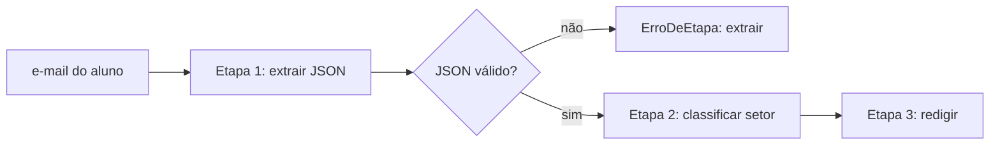

## Passo 1 · Leitura · O que a cadeia de pensamento faz (e o que não faz)

No Nível 6 você viu que, para gerar **cada** token, o Transformer passa pelo mesmo número fixo de camadas. Se o prompt pede só `ELEGIVEL` ou `INELEGIVEL` para um aluno com cinco parcelas de créditos, toda a conta precisa acontecer dentro das poucas passagens que geram aquela palavra. Quando o prompt pede para **escrever os passos antes do veredito** ("raciocine passo a passo"), cada soma parcial vira texto no contexto, e os tokens seguintes leem o resultado em vez de refazer tudo de uma vez. Isso é a **cadeia de pensamento** (*chain of thought*): tokens gerados a mais, usados como memória de trabalho.

```text
Soma parcial: 0 + 8 = 8.
Soma parcial: 8 + 6 = 14.
Soma parcial: 14 + 4 = 18.
Comparando: 18 >= 16.
RESPOSTA_FINAL: ELEGIVEL
```

O que esperar dela, sem exagero:

- **Tende a ajudar** em tarefas com várias etapas dependentes: contas, regras encadeadas, várias condições combinadas.
- **Não ajuda** em decisões de um passo só (o assunto de um e-mail, o nome de um aluno): a acurácia fica igual e a conta sobe. Modelos "de raciocínio" já geram esses passos por conta própria, e cobram por eles; pedir de novo costuma acrescentar pouco.
- **O tamanho do ganho depende do modelo e da tarefa**, e pode ser zero. Só a medição no seu conjunto de casos responde.
- **O texto do raciocínio não é uma prova.** Ele pode ser plausível e estar errado, ou chegar ao veredito certo por um caminho que não confere. Quando a conta pode ser refeita em código, refaça; quando ela é determinística, nem precise do modelo para isso.

E o custo é concreto. O raciocínio é saída, e saída costuma ter o preço por token mais alto; além disso, a latência cresce com cada token gerado (módulo 1):

$$C = \frac{E}{10^6}\,p_{\text{in}} + \frac{S}{10^6}\,p_{\text{out}}, \qquad L = \text{TTFT} + S \cdot t_{\text{token}}$$

Se a cadeia multiplica $S$ por 5, o custo de saída e o tempo de geração também crescem cerca de 5 vezes.

Para o programa ler só o veredito, o prompt exige uma linha final com um marcador fixo, como `RESPOSTA_FINAL:`, e o código separa essa linha do rascunho. O rascunho fica no log para depuração; o aluno vê só a resposta.

## Passo 2 · Exercício · Separe o veredito do rascunho
modo: ordenar

Monte `extrair_resposta_final(texto, marcador="RESPOSTA_FINAL:")`. Regras:

- sem o marcador no texto, devolva `None`;
- use a **última** ocorrência do marcador, porque o raciocínio pode citar o marcador antes ("vou terminar com RESPOSTA_FINAL: quando tiver certeza");
- do que vem depois dele, devolva só a **primeira linha não vazia**, sem espaços nas pontas: o modelo pode escrever uma observação na linha seguinte, ou pôr o veredito na linha de baixo;
- se não sobrar nada depois do marcador (resposta cortada), devolva `None`.

Exemplo: `extrair_resposta_final("Soma 18.\nRESPOSTA_FINAL:  ELEGIVEL \nConfira o histórico.")` devolve `'ELEGIVEL'`. Duas linhas estão sobrando.

### Instruções
1. Devolva `None` quando o marcador não aparece no texto.
2. Pegue o trecho depois da última ocorrência do marcador.
3. Devolva a primeira linha desse trecho, limpa, ou `None` se ele estiver vazio.

### Solução
```python
def extrair_resposta_final(texto, marcador="RESPOSTA_FINAL:"):
    if marcador not in texto:
        return None
    depois = texto.rsplit(marcador, 1)[1]
    linhas = depois.strip().splitlines()
    if not linhas:
        return None
    return linhas[0].strip()
```

### Distratores
```python
depois = texto.split(marcador, 1)[1]
return linhas[-1].strip()
```

### Dicas
1. `rsplit(sep, 1)` corta na última ocorrência; `split(sep, 1)`, na primeira.
2. Tire os espaços e quebras das pontas **antes** de separar as linhas; assim a primeira linha é a do veredito, mesmo que ele esteja na linha de baixo.
3. `"   ".strip().splitlines()` é uma lista vazia.

### Verificação
```json
[
  { "id": "basico", "checkpoint": 3, "kind": "call", "function": "extrair_resposta_final",
    "args": ["Soma parcial: 0 + 4 = 4.\nSoma parcial: 4 + 8 = 12.\nRESPOSTA_FINAL: DEFERIDO"], "expected": "DEFERIDO",
    "name": "Veredito depois de um raciocínio de várias linhas" },
  { "id": "sem-marcador", "checkpoint": 1, "kind": "call", "function": "extrair_resposta_final",
    "args": ["Pensei bastante, mas esqueci a linha final."], "expected": null,
    "name": "Sem o marcador, devolve None" },
  { "id": "marcador-citado-antes", "checkpoint": 2, "kind": "call", "function": "extrair_resposta_final",
    "args": ["Vou terminar com RESPOSTA_FINAL: quando tiver certeza.\nSoma 18 contra 16.\nRESPOSTA_FINAL: ELEGIVEL"], "expected": "ELEGIVEL",
    "name": "Usa a última ocorrência quando o raciocínio cita o marcador",
    "hint": "A primeira ocorrência pode estar no meio do rascunho." },
  { "id": "observacao-depois", "checkpoint": 3, "kind": "call", "function": "extrair_resposta_final",
    "args": ["Soma 10.\nRESPOSTA_FINAL:  INELEGIVEL  \nObservação: confira o histórico."], "expected": "INELEGIVEL",
    "name": "Ignora a observação na linha de baixo" },
  { "id": "veredito-na-linha-de-baixo", "checkpoint": 3, "kind": "call", "function": "extrair_resposta_final",
    "args": ["Soma 21.\nRESPOSTA_FINAL:\n  ELEGIVEL\n"], "expected": "ELEGIVEL",
    "name": "Veredito na linha seguinte ao marcador" },
  { "id": "cortada", "checkpoint": 3, "kind": "call", "function": "extrair_resposta_final",
    "args": ["Soma parcial: 6 + 6 = 12.\nRESPOSTA_FINAL:   "], "expected": null,
    "name": "Nada depois do marcador devolve None, não texto vazio" },
  { "id": "outro-marcador", "checkpoint": 2, "kind": "call", "function": "extrair_resposta_final",
    "args": ["Conta: 10 + 5 = 15.\nVEREDITO:   15  ", "VEREDITO:"], "expected": "15",
    "name": "Funciona com outro marcador" }
]
```

### Soluções erradas
```python name="usa a primeira ocorrência do marcador"
def extrair_resposta_final(texto, marcador="RESPOSTA_FINAL:"):
    if marcador not in texto:
        return None
    depois = texto.split(marcador, 1)[1]
    linhas = depois.strip().splitlines()
    if not linhas:
        return None
    return linhas[0].strip()
```
```python name="devolve tudo depois do marcador"
def extrair_resposta_final(texto, marcador="RESPOSTA_FINAL:"):
    if marcador not in texto:
        return None
    return texto.rsplit(marcador, 1)[1].strip()
```
```python name="pega a última linha"
def extrair_resposta_final(texto, marcador="RESPOSTA_FINAL:"):
    if marcador not in texto:
        return None
    depois = texto.rsplit(marcador, 1)[1]
    linhas = depois.strip().splitlines()
    if not linhas:
        return None
    return linhas[-1].strip()
```
```python name="separa as linhas antes de limpar"
def extrair_resposta_final(texto, marcador="RESPOSTA_FINAL:"):
    if marcador not in texto:
        return None
    depois = texto.rsplit(marcador, 1)[1]
    linhas = depois.splitlines()
    if not linhas:
        return None
    return linhas[0].strip()
```
```python name="devolve texto vazio na resposta cortada"
def extrair_resposta_final(texto, marcador="RESPOSTA_FINAL:"):
    if marcador not in texto:
        return None
    depois = texto.rsplit(marcador, 1)[1]
    return (depois.strip().splitlines() or [""])[0].strip()
```

## Passo 3 · Previsão · Acerto contra custo

O programa compara dois "modelos" de brinquedo em quatro problemas de créditos. O modo direto responde de uma vez e usa um atalho: olha só as duas primeiras parcelas. O modo passo a passo escreve cada soma parcial. Cada linha escrita custa saída. Leia sem executar e digite o que ele imprime.

### Código
```python
problemas = [([8, 6], 12), ([4, 4, 4], 12), ([10, 2, 2], 16), ([6, 6, 6, 6], 20)]


def direto(creditos, minimo):
    soma = sum(creditos[:2])
    return ["ELEGIVEL" if soma >= minimo else "INELEGIVEL"]


def passo_a_passo(creditos, minimo):
    linhas, soma = [], 0
    for c in creditos:
        soma += c
        linhas.append(f"parcial {soma}")
    linhas.append("ELEGIVEL" if soma >= minimo else "INELEGIVEL")
    return linhas


for modo in [direto, passo_a_passo]:
    acertos = 0
    linhas_geradas = 0
    for creditos, minimo in problemas:
        saida = modo(creditos, minimo)
        certo = "ELEGIVEL" if sum(creditos) >= minimo else "INELEGIVEL"
        if saida[-1] == certo:
            acertos += 1
        linhas_geradas += len(saida)
    print(modo.__name__, acertos, linhas_geradas)
```

### Dicas
1. O atalho só erra quando as parcelas depois da segunda mudam o veredito.
2. No terceiro problema o atalho soma 12 e a soma real é 14: as duas ficam abaixo de 16.
3. O modo passo a passo gera uma linha por parcela mais a linha do veredito.

### Saída esperada
```text
direto 2 4
passo_a_passo 4 16
```

## Passo 4 · Exercício · Meça o efeito da cadeia de pensamento

O atalho da previsão é uma caricatura: um modelo real não "soma só as duas primeiras", mas erra mais quando precisa responder de uma vez a uma conta de muitas etapas. O cliente é o `llm_simulado.py` do módulo 1; o texto que ele devolve vem da função `responder` de `modelo_secretaria.py` (`ClienteLLM(responder)`), que imita esse comportamento com regras fixas, descritas no topo do arquivo. O tokenizador de brinquedo do cliente junta os tokens com espaços, então o raciocínio chega numa linha só; o marcador continua separando o veredito. Agora você mede, com a interface `completar(mensagens, max_tokens=...)`, a acurácia **e** o custo de cada modo.

Escreva `avaliar_modo(cliente, problemas, modo, max_tokens=200)`:

- `problemas`: lista de `{"id": str, "creditos": [int], "minimo": int, "esperado": str}`. Lista vazia levanta `ValueError`; `modo` fora de `PROMPTS` também.
- Para cada problema, envie `[{"role": "system", "content": PROMPTS[modo]}, {"role": "user", "content": "creditos: 8, 6, 4 | minimo: 16"}]` (os créditos separados por vírgula e espaço) com `max_tokens=max_tokens`.
- Some `resposta.usage["completion_tokens"]` de **todas** as chamadas em `tokens_saida`.
- Resposta com `finish_reason == "length"` foi cortada: conta em `truncadas` e é erro, mesmo que o texto cortado contenha um veredito.
- Nas demais, o acerto é `extrair_resposta_final(resposta.conteudo) == problema["esperado"]`.
- Devolva `{"acuracia": float, "tokens_saida": int, "truncadas": int, "erros": [ids na ordem]}`.

No `main.py`, o modo direto acerta 2 de 4 com 27 tokens de saída; o passo a passo acerta 4 de 4 com 145, mais de 5 vezes.

### Instruções
1. Monte a mensagem `user` no formato do simulador e envie o prompt do modo pedido; recuse modo desconhecido e lista vazia com `ValueError`.
2. Some os tokens de saída de todas as chamadas e trate a resposta truncada como erro.
3. Extraia o veredito com `extrair_resposta_final` e devolva acurácia, tokens, truncadas e erros.

### Código inicial
```python
from llm_simulado import ClienteLLM, Resposta
from modelo_secretaria import responder

PROMPTS = {
    "direto": ("Responda imediatamente, sem explicar. Use só a linha "
               "RESPOSTA_FINAL: ELEGIVEL ou RESPOSTA_FINAL: INELEGIVEL."),
    "passo_a_passo": ("Raciocine passo a passo: some os créditos um a um e compare com o mínimo. "
                      "Termine com a linha RESPOSTA_FINAL: ELEGIVEL ou RESPOSTA_FINAL: INELEGIVEL."),
}


def extrair_resposta_final(texto, marcador="RESPOSTA_FINAL:"):
    if marcador not in texto:
        return None
    depois = texto.rsplit(marcador, 1)[1]
    linhas = depois.strip().splitlines()
    if not linhas:
        return None
    return linhas[0].strip()


def avaliar_modo(cliente, problemas, modo, max_tokens=200):
    pass


if __name__ == "__main__":
    problemas = [
        {"id": "p1", "creditos": [8, 6], "minimo": 12, "esperado": "ELEGIVEL"},
        {"id": "p2", "creditos": [4, 4, 4], "minimo": 12, "esperado": "ELEGIVEL"},
        {"id": "p3", "creditos": [10, 2, 2], "minimo": 16, "esperado": "INELEGIVEL"},
        {"id": "p4", "creditos": [6, 6, 6, 6], "minimo": 20, "esperado": "ELEGIVEL"},
    ]
    cliente = ClienteLLM(responder)
    print(avaliar_modo(cliente, problemas, "direto"))
    print(avaliar_modo(cliente, problemas, "passo_a_passo"))
    print(avaliar_modo(cliente, problemas, "passo_a_passo", max_tokens=30))
```
```python path=llm_simulado.py
"""Cliente de LLM simulado do curso: a interface de um SDK real, sem rede.

Aproximações declaradas (tudo reproduzível):
- tokens: brinquedo, cada palavra vira pedaços de até 4 caracteres;
  o tokenizador de um modelo real dá outros números;
- preços: fictícios, em R$ por milhão de tokens;
- latência: TTFT + ms por token de saída, somada a um relógio falso;
- sorteio: random.Random(seed); com temperature > 0 a resposta pode variar;
- falhas: fila programada (429, 503, "timeout", 400), consumida em ordem.
"""
import random

PRECO_ENTRADA = 2.0  # R$ por milhão de tokens de entrada (fictício)
PRECO_SAIDA = 8.0  # R$ por milhão de tokens de saída (fictício)
SOBRECARGA_POR_MENSAGEM = 4  # tokens de formatação de cada mensagem


class ErroDeTaxa(Exception):  # HTTP 429: transitório
    def __init__(self, mensagem="429 Too Many Requests", retry_after=None):
        super().__init__(mensagem)
        self.retry_after = retry_after  # espera sugerida pelo servidor, em s


class ErroDeServidor(Exception):  # HTTP 5xx: transitório
    pass


class ErroDeTimeout(Exception):  # resposta não chegou no prazo: transitório
    pass


class ErroDeRequisicao(Exception):  # HTTP 400/401: permanente, não repita
    pass


def tokenizar(texto):
    tokens = []
    for i, palavra in enumerate(texto.split()):
        pedacos = [palavra[j:j + 4] for j in range(0, len(palavra), 4)]
        if i > 0:
            pedacos[0] = " " + pedacos[0]
        tokens.extend(pedacos)
    return tokens


def contar_tokens(texto):
    return len(tokenizar(texto))


class Resposta:
    def __init__(self, conteudo, finish_reason, prompt_tokens, completion_tokens,
                 latencia_ms=0, tool_calls=None):
        self.conteudo = conteudo
        self.finish_reason = finish_reason  # "stop", "length" ou "tool_calls"
        self.usage = {"prompt_tokens": prompt_tokens,
                      "completion_tokens": completion_tokens,
                      "total_tokens": prompt_tokens + completion_tokens}
        self.latencia_ms = latencia_ms
        self.tool_calls = tool_calls or []


class Relogio:  # relógio falso: só anda quando alguém manda
    def __init__(self):
        self.agora_ms = 0

    def avancar(self, ms):
        self.agora_ms += ms


class ClienteLLM:
    """respostas: lista de textos candidatos, ou função(mensagens) que devolve
    um texto ou uma lista de tool_calls."""

    def __init__(self, respostas, seed=None, falhas=(), relogio=None,
                 ttft_ms=300, ms_por_token=20):
        self.respostas = respostas
        self.rng = random.Random(seed)
        self.falhas = list(falhas)
        self.relogio = relogio or Relogio()
        self.ttft_ms = ttft_ms
        self.ms_por_token = ms_por_token
        self.chamadas = 0

    def _preparar(self, mensagens, temperature):
        self.chamadas += 1
        falha = self.falhas.pop(0) if self.falhas else None
        if falha == 429:
            raise ErroDeTaxa(retry_after=2.0)
        if falha == 503:
            raise ErroDeServidor("503 Service Unavailable")
        if falha == "timeout":
            self.relogio.avancar(10_000)
            raise ErroDeTimeout("sem resposta em 10 s")
        if falha == 400:
            raise ErroDeRequisicao("400 Bad Request")
        if callable(self.respostas):
            return self.respostas(mensagens)
        if temperature == 0:
            return self.respostas[0]  # num servidor real, nem isso é garantido
        return self.rng.choice(self.respostas)

    def completar(self, mensagens, max_tokens=256, temperature=1.0):
        gerado = self._preparar(mensagens, temperature)
        entrada = sum(contar_tokens(m["content"]) + SOBRECARGA_POR_MENSAGEM
                      for m in mensagens)
        if isinstance(gerado, list):  # o modelo pediu ferramentas
            self.relogio.avancar(self.ttft_ms)
            return Resposta("", "tool_calls", entrada, 10, self.ttft_ms, gerado)
        tokens, motivo = tokenizar(gerado), "stop"
        if len(tokens) > max_tokens:
            tokens, motivo = tokens[:max_tokens], "length"
        latencia = self.ttft_ms + len(tokens) * self.ms_por_token
        self.relogio.avancar(latencia)
        return Resposta("".join(tokens), motivo, entrada, len(tokens), latencia)

    def completar_stream(self, mensagens, max_tokens=256, temperature=1.0, cair_apos=None):
        """Gera eventos {"delta": texto}; o último traz "finish_reason".
        cair_apos=n: a conexão cai depois de n tokens, sem o evento final."""
        tokens, motivo = tokenizar(self._preparar(mensagens, temperature)), "stop"
        if len(tokens) > max_tokens:
            tokens, motivo = tokens[:max_tokens], "length"
        self.relogio.avancar(self.ttft_ms)
        for i, token in enumerate(tokens):
            if i == cair_apos:
                return
            self.relogio.avancar(self.ms_por_token)
            yield {"delta": token}
        yield {"delta": "", "finish_reason": motivo}
```
```python path=modelo_secretaria.py
"""Comportamento do modelo simulado da secretaria: ClienteLLM(responder).

O llm_simulado.py é o cliente do módulo 1; esta função decide o texto que ele
devolve, com regras fixas:
1. Problema de créditos ("creditos: 8, 6, 4 | minimo: 16" na mensagem user):
   - com "passo a passo" no system, escreve as somas parciais, a comparação e
     a linha "RESPOSTA_FINAL: ELEGIVEL" ou "RESPOSTA_FINAL: INELEGIVEL";
   - sem isso, responde de uma vez e usa um atalho: soma só os dois primeiros
     valores (caricatura de um modelo que erra contas de muitas etapas).
2. Etapas de pipeline (system começa com "ETAPA extrair", "ETAPA classificar"
   ou "ETAPA redigir"): ver as funções _extrair, _classificar e _redigir.
Atenção: o tokenizador de brinquedo do cliente junta os tokens com espaços, então
as quebras de linha do texto gerado viram espaços na resposta.
"""
import json
import re


def _creditos(sistema, usuario):
    achado = re.search(r"creditos: ([\d, ]+) \| minimo: (\d+)", usuario)
    if not achado:
        return "Não encontrei os créditos no pedido."
    valores = [int(v) for v in achado.group(1).split(",")]
    minimo = int(achado.group(2))
    if "passo a passo" not in sistema:
        soma = sum(valores[:2])
        return "RESPOSTA_FINAL: " + ("ELEGIVEL" if soma >= minimo else "INELEGIVEL")
    linhas, soma = [], 0
    for valor in valores:
        linhas.append(f"Soma parcial: {soma} + {valor} = {soma + valor}.")
        soma += valor
    sinal = ">=" if soma >= minimo else "<"
    linhas.append(f"Comparando: {soma} {sinal} {minimo}.")
    linhas.append("RESPOSTA_FINAL: " + ("ELEGIVEL" if soma >= minimo else "INELEGIVEL"))
    return "\n".join(linhas)


def _extrair(usuario):
    aluno = re.search(r"[Ss]ou (?:a|o) (\w+)", usuario)
    disciplina = re.search(r"[A-Z]{3}\d{4}", usuario)
    texto = usuario.lower()
    acao = None
    if "trancar" in texto or "trancamento" in texto:
        acao = "trancamento"
    elif "matricul" in texto or "inscrever" in texto:
        acao = "matricula"
    elif "histórico" in texto or "historico" in texto:
        acao = "historico"
    if not aluno and not disciplina and acao is None:
        return "Desculpe, não consegui identificar o pedido."
    return json.dumps({
        "aluno": aluno.group(1) if aluno else None,
        "disciplina": disciplina.group(0) if disciplina else None,
        "acao": acao,
    }, ensure_ascii=False)


def _classificar(usuario):
    try:
        dados = json.loads(usuario)
    except json.JSONDecodeError:
        return "COMISSAO_DE_GRADUACAO"
    setores = {"trancamento": "SECAO_DE_ALUNOS", "matricula": "COMISSAO_DE_GRADUACAO",
               "historico": "ARQUIVO_ACADEMICO"}
    return setores.get(dados.get("acao"), "NAO_SEI")


def _redigir(usuario):
    dados = json.loads(usuario)
    destino = dados.get("setor", "o setor responsável")
    return (f"Olá, {dados['aluno']}. Seu pedido de {dados['acao']} em "
            f"{dados['disciplina']} foi encaminhado para {destino}.")


def responder(mensagens):
    sistema = mensagens[0]["content"] if mensagens[0]["role"] == "system" else ""
    usuario = mensagens[-1]["content"]
    if sistema.startswith("ETAPA extrair"):
        return _extrair(usuario)
    if sistema.startswith("ETAPA classificar"):
        return _classificar(usuario)
    if sistema.startswith("ETAPA redigir"):
        return _redigir(usuario)
    return _creditos(sistema.lower(), usuario)
```

### Solução
```python
from llm_simulado import ClienteLLM, Resposta
from modelo_secretaria import responder

PROMPTS = {
    "direto": ("Responda imediatamente, sem explicar. Use só a linha "
               "RESPOSTA_FINAL: ELEGIVEL ou RESPOSTA_FINAL: INELEGIVEL."),
    "passo_a_passo": ("Raciocine passo a passo: some os créditos um a um e compare com o mínimo. "
                      "Termine com a linha RESPOSTA_FINAL: ELEGIVEL ou RESPOSTA_FINAL: INELEGIVEL."),
}


def extrair_resposta_final(texto, marcador="RESPOSTA_FINAL:"):
    if marcador not in texto:
        return None
    depois = texto.rsplit(marcador, 1)[1]
    linhas = depois.strip().splitlines()
    if not linhas:
        return None
    return linhas[0].strip()


def avaliar_modo(cliente, problemas, modo, max_tokens=200):
    if modo not in PROMPTS:
        raise ValueError(f"modo desconhecido: {modo}")
    if not problemas:
        raise ValueError("sem problemas")
    erros = []
    tokens_saida = 0
    truncadas = 0
    for problema in problemas:
        creditos = ", ".join(str(c) for c in problema["creditos"])
        mensagens = [
            {"role": "system", "content": PROMPTS[modo]},
            {"role": "user", "content": f"creditos: {creditos} | minimo: {problema['minimo']}"},
        ]
        resposta = cliente.completar(mensagens, max_tokens=max_tokens)
        tokens_saida += resposta.usage["completion_tokens"]
        if resposta.finish_reason == "length":
            truncadas += 1
            erros.append(problema["id"])
        elif extrair_resposta_final(resposta.conteudo) != problema["esperado"]:
            erros.append(problema["id"])
    acuracia = (len(problemas) - len(erros)) / len(problemas)
    return {"acuracia": acuracia, "tokens_saida": tokens_saida, "truncadas": truncadas, "erros": erros}


if __name__ == "__main__":
    problemas = [
        {"id": "p1", "creditos": [8, 6], "minimo": 12, "esperado": "ELEGIVEL"},
        {"id": "p2", "creditos": [4, 4, 4], "minimo": 12, "esperado": "ELEGIVEL"},
        {"id": "p3", "creditos": [10, 2, 2], "minimo": 16, "esperado": "INELEGIVEL"},
        {"id": "p4", "creditos": [6, 6, 6, 6], "minimo": 20, "esperado": "ELEGIVEL"},
    ]
    cliente = ClienteLLM(responder)
    print(avaliar_modo(cliente, problemas, "direto"))
    print(avaliar_modo(cliente, problemas, "passo_a_passo"))
    print(avaliar_modo(cliente, problemas, "passo_a_passo", max_tokens=30))
```
```python path=llm_simulado.py
"""Cliente de LLM simulado do curso: a interface de um SDK real, sem rede.

Aproximações declaradas (tudo reproduzível):
- tokens: brinquedo, cada palavra vira pedaços de até 4 caracteres;
  o tokenizador de um modelo real dá outros números;
- preços: fictícios, em R$ por milhão de tokens;
- latência: TTFT + ms por token de saída, somada a um relógio falso;
- sorteio: random.Random(seed); com temperature > 0 a resposta pode variar;
- falhas: fila programada (429, 503, "timeout", 400), consumida em ordem.
"""
import random

PRECO_ENTRADA = 2.0  # R$ por milhão de tokens de entrada (fictício)
PRECO_SAIDA = 8.0  # R$ por milhão de tokens de saída (fictício)
SOBRECARGA_POR_MENSAGEM = 4  # tokens de formatação de cada mensagem


class ErroDeTaxa(Exception):  # HTTP 429: transitório
    def __init__(self, mensagem="429 Too Many Requests", retry_after=None):
        super().__init__(mensagem)
        self.retry_after = retry_after  # espera sugerida pelo servidor, em s


class ErroDeServidor(Exception):  # HTTP 5xx: transitório
    pass


class ErroDeTimeout(Exception):  # resposta não chegou no prazo: transitório
    pass


class ErroDeRequisicao(Exception):  # HTTP 400/401: permanente, não repita
    pass


def tokenizar(texto):
    tokens = []
    for i, palavra in enumerate(texto.split()):
        pedacos = [palavra[j:j + 4] for j in range(0, len(palavra), 4)]
        if i > 0:
            pedacos[0] = " " + pedacos[0]
        tokens.extend(pedacos)
    return tokens


def contar_tokens(texto):
    return len(tokenizar(texto))


class Resposta:
    def __init__(self, conteudo, finish_reason, prompt_tokens, completion_tokens,
                 latencia_ms=0, tool_calls=None):
        self.conteudo = conteudo
        self.finish_reason = finish_reason  # "stop", "length" ou "tool_calls"
        self.usage = {"prompt_tokens": prompt_tokens,
                      "completion_tokens": completion_tokens,
                      "total_tokens": prompt_tokens + completion_tokens}
        self.latencia_ms = latencia_ms
        self.tool_calls = tool_calls or []


class Relogio:  # relógio falso: só anda quando alguém manda
    def __init__(self):
        self.agora_ms = 0

    def avancar(self, ms):
        self.agora_ms += ms


class ClienteLLM:
    """respostas: lista de textos candidatos, ou função(mensagens) que devolve
    um texto ou uma lista de tool_calls."""

    def __init__(self, respostas, seed=None, falhas=(), relogio=None,
                 ttft_ms=300, ms_por_token=20):
        self.respostas = respostas
        self.rng = random.Random(seed)
        self.falhas = list(falhas)
        self.relogio = relogio or Relogio()
        self.ttft_ms = ttft_ms
        self.ms_por_token = ms_por_token
        self.chamadas = 0

    def _preparar(self, mensagens, temperature):
        self.chamadas += 1
        falha = self.falhas.pop(0) if self.falhas else None
        if falha == 429:
            raise ErroDeTaxa(retry_after=2.0)
        if falha == 503:
            raise ErroDeServidor("503 Service Unavailable")
        if falha == "timeout":
            self.relogio.avancar(10_000)
            raise ErroDeTimeout("sem resposta em 10 s")
        if falha == 400:
            raise ErroDeRequisicao("400 Bad Request")
        if callable(self.respostas):
            return self.respostas(mensagens)
        if temperature == 0:
            return self.respostas[0]  # num servidor real, nem isso é garantido
        return self.rng.choice(self.respostas)

    def completar(self, mensagens, max_tokens=256, temperature=1.0):
        gerado = self._preparar(mensagens, temperature)
        entrada = sum(contar_tokens(m["content"]) + SOBRECARGA_POR_MENSAGEM
                      for m in mensagens)
        if isinstance(gerado, list):  # o modelo pediu ferramentas
            self.relogio.avancar(self.ttft_ms)
            return Resposta("", "tool_calls", entrada, 10, self.ttft_ms, gerado)
        tokens, motivo = tokenizar(gerado), "stop"
        if len(tokens) > max_tokens:
            tokens, motivo = tokens[:max_tokens], "length"
        latencia = self.ttft_ms + len(tokens) * self.ms_por_token
        self.relogio.avancar(latencia)
        return Resposta("".join(tokens), motivo, entrada, len(tokens), latencia)

    def completar_stream(self, mensagens, max_tokens=256, temperature=1.0, cair_apos=None):
        """Gera eventos {"delta": texto}; o último traz "finish_reason".
        cair_apos=n: a conexão cai depois de n tokens, sem o evento final."""
        tokens, motivo = tokenizar(self._preparar(mensagens, temperature)), "stop"
        if len(tokens) > max_tokens:
            tokens, motivo = tokens[:max_tokens], "length"
        self.relogio.avancar(self.ttft_ms)
        for i, token in enumerate(tokens):
            if i == cair_apos:
                return
            self.relogio.avancar(self.ms_por_token)
            yield {"delta": token}
        yield {"delta": "", "finish_reason": motivo}
```
```python path=modelo_secretaria.py
"""Comportamento do modelo simulado da secretaria: ClienteLLM(responder).

O llm_simulado.py é o cliente do módulo 1; esta função decide o texto que ele
devolve, com regras fixas:
1. Problema de créditos ("creditos: 8, 6, 4 | minimo: 16" na mensagem user):
   - com "passo a passo" no system, escreve as somas parciais, a comparação e
     a linha "RESPOSTA_FINAL: ELEGIVEL" ou "RESPOSTA_FINAL: INELEGIVEL";
   - sem isso, responde de uma vez e usa um atalho: soma só os dois primeiros
     valores (caricatura de um modelo que erra contas de muitas etapas).
2. Etapas de pipeline (system começa com "ETAPA extrair", "ETAPA classificar"
   ou "ETAPA redigir"): ver as funções _extrair, _classificar e _redigir.
Atenção: o tokenizador de brinquedo do cliente junta os tokens com espaços, então
as quebras de linha do texto gerado viram espaços na resposta.
"""
import json
import re


def _creditos(sistema, usuario):
    achado = re.search(r"creditos: ([\d, ]+) \| minimo: (\d+)", usuario)
    if not achado:
        return "Não encontrei os créditos no pedido."
    valores = [int(v) for v in achado.group(1).split(",")]
    minimo = int(achado.group(2))
    if "passo a passo" not in sistema:
        soma = sum(valores[:2])
        return "RESPOSTA_FINAL: " + ("ELEGIVEL" if soma >= minimo else "INELEGIVEL")
    linhas, soma = [], 0
    for valor in valores:
        linhas.append(f"Soma parcial: {soma} + {valor} = {soma + valor}.")
        soma += valor
    sinal = ">=" if soma >= minimo else "<"
    linhas.append(f"Comparando: {soma} {sinal} {minimo}.")
    linhas.append("RESPOSTA_FINAL: " + ("ELEGIVEL" if soma >= minimo else "INELEGIVEL"))
    return "\n".join(linhas)


def _extrair(usuario):
    aluno = re.search(r"[Ss]ou (?:a|o) (\w+)", usuario)
    disciplina = re.search(r"[A-Z]{3}\d{4}", usuario)
    texto = usuario.lower()
    acao = None
    if "trancar" in texto or "trancamento" in texto:
        acao = "trancamento"
    elif "matricul" in texto or "inscrever" in texto:
        acao = "matricula"
    elif "histórico" in texto or "historico" in texto:
        acao = "historico"
    if not aluno and not disciplina and acao is None:
        return "Desculpe, não consegui identificar o pedido."
    return json.dumps({
        "aluno": aluno.group(1) if aluno else None,
        "disciplina": disciplina.group(0) if disciplina else None,
        "acao": acao,
    }, ensure_ascii=False)


def _classificar(usuario):
    try:
        dados = json.loads(usuario)
    except json.JSONDecodeError:
        return "COMISSAO_DE_GRADUACAO"
    setores = {"trancamento": "SECAO_DE_ALUNOS", "matricula": "COMISSAO_DE_GRADUACAO",
               "historico": "ARQUIVO_ACADEMICO"}
    return setores.get(dados.get("acao"), "NAO_SEI")


def _redigir(usuario):
    dados = json.loads(usuario)
    destino = dados.get("setor", "o setor responsável")
    return (f"Olá, {dados['aluno']}. Seu pedido de {dados['acao']} em "
            f"{dados['disciplina']} foi encaminhado para {destino}.")


def responder(mensagens):
    sistema = mensagens[0]["content"] if mensagens[0]["role"] == "system" else ""
    usuario = mensagens[-1]["content"]
    if sistema.startswith("ETAPA extrair"):
        return _extrair(usuario)
    if sistema.startswith("ETAPA classificar"):
        return _classificar(usuario)
    if sistema.startswith("ETAPA redigir"):
        return _redigir(usuario)
    return _creditos(sistema.lower(), usuario)
```

### Dicas
1. Os tokens de saída vêm de `resposta.usage`, não do tamanho do texto: um tokenizador real não conta palavras.
2. Teste `finish_reason` antes de olhar o conteúdo: uma resposta cortada pode não ter o marcador, e `rsplit(...)[1]` estoura.
3. Com `max_tokens` pequeno, o modo passo a passo é cortado antes do veredito; isso precisa aparecer em `truncadas`, não derrubar a função.

### Verificação
```json
[
  { "id": "passos-acerta", "checkpoint": 3, "kind": "expr",
    "setup": "S = [{'id': 'q1', 'creditos': [5, 5, 5], 'minimo': 15, 'esperado': 'ELEGIVEL'}, {'id': 'q2', 'creditos': [9, 1, 1, 1], 'minimo': 13, 'esperado': 'INELEGIVEL'}, {'id': 'q3', 'creditos': [2, 2, 10], 'minimo': 12, 'esperado': 'ELEGIVEL'}, {'id': 'q4', 'creditos': [7, 7], 'minimo': 15, 'esperado': 'INELEGIVEL'}]",
    "expr": "avaliar_modo(ClienteLLM(responder), S, 'passo_a_passo')",
    "expected": { "acuracia": 1.0, "tokens_saida": 146, "truncadas": 0, "erros": [] }, "tolerance": 1e-9,
    "name": "Passo a passo: acurácia, tokens de saída e nenhum corte" },
  { "id": "direto-erra", "checkpoint": 1, "kind": "expr",
    "setup": "S = [{'id': 'q1', 'creditos': [5, 5, 5], 'minimo': 15, 'esperado': 'ELEGIVEL'}, {'id': 'q2', 'creditos': [9, 1, 1, 1], 'minimo': 13, 'esperado': 'INELEGIVEL'}, {'id': 'q3', 'creditos': [2, 2, 10], 'minimo': 12, 'esperado': 'ELEGIVEL'}, {'id': 'q4', 'creditos': [7, 7], 'minimo': 15, 'esperado': 'INELEGIVEL'}]",
    "expr": "avaliar_modo(ClienteLLM(responder), S, 'direto')",
    "expected": { "acuracia": 0.5, "tokens_saida": 28, "truncadas": 0, "erros": ["q1", "q3"] }, "tolerance": 1e-9,
    "name": "Direto: erra os problemas em que a terceira parcela decide",
    "hint": "Cada modo usa o seu próprio prompt de PROMPTS." },
  { "id": "duas-parcelas", "checkpoint": 2, "kind": "expr",
    "setup": "D = [{'id': 'd1', 'creditos': [8, 4], 'minimo': 12, 'esperado': 'ELEGIVEL'}, {'id': 'd2', 'creditos': [3, 4], 'minimo': 10, 'esperado': 'INELEGIVEL'}]\na = avaliar_modo(ClienteLLM(responder), D, 'direto')\nb = avaliar_modo(ClienteLLM(responder), D, 'passo_a_passo')",
    "expr": "[a['acuracia'], a['tokens_saida'], b['acuracia'], b['tokens_saida']]",
    "expected": [1.0, 13, 1.0, 57], "tolerance": 1e-9,
    "name": "Em contas de um passo, a cadeia só custa mais: mesma acurácia, mais de 4 vezes os tokens",
    "hint": "Some usage['completion_tokens'] de cada chamada." },
  { "id": "truncadas", "checkpoint": 2, "kind": "expr",
    "setup": "S = [{'id': 'q1', 'creditos': [5, 5, 5], 'minimo': 15, 'esperado': 'ELEGIVEL'}, {'id': 'q2', 'creditos': [9, 1, 1, 1], 'minimo': 13, 'esperado': 'INELEGIVEL'}, {'id': 'q3', 'creditos': [2, 2, 10], 'minimo': 12, 'esperado': 'ELEGIVEL'}, {'id': 'q4', 'creditos': [7, 7], 'minimo': 15, 'esperado': 'INELEGIVEL'}]",
    "expr": "avaliar_modo(ClienteLLM(responder), S, 'passo_a_passo', max_tokens=40)",
    "expected": { "acuracia": 0.75, "tokens_saida": 141, "truncadas": 1, "erros": ["q2"] }, "tolerance": 1e-9,
    "name": "Com max_tokens=40, o raciocínio mais longo é cortado antes do veredito",
    "hint": "Resposta cortada conta como erro e como truncada, sem exceção." },
  { "id": "cortada-com-veredito", "checkpoint": 2, "kind": "expr",
    "setup": "class Cortado:\n    def completar(self, mensagens, max_tokens=200):\n        return Resposta('RESPOSTA_FINAL: ELEGIVEL', 'length', 30, max_tokens)\nP = [{'id': 'x', 'creditos': [10, 10], 'minimo': 15, 'esperado': 'ELEGIVEL'}]",
    "expr": "avaliar_modo(Cortado(), P, 'direto', max_tokens=7)",
    "expected": { "acuracia": 0.0, "tokens_saida": 7, "truncadas": 1, "erros": ["x"] }, "tolerance": 1e-9,
    "name": "Resposta com finish_reason length é erro mesmo com veredito no texto" },
  { "id": "mensagens-enviadas", "checkpoint": 1, "kind": "expr",
    "setup": "class Gravador:\n    def __init__(self):\n        self.recebidas = []\n    def completar(self, mensagens, max_tokens=200):\n        self.recebidas.append([mensagens, max_tokens])\n        return Resposta('RESPOSTA_FINAL: ELEGIVEL', 'stop', 10, 5)\ng = Gravador()\navaliar_modo(g, [{'id': 'x', 'creditos': [3, 9, 1], 'minimo': 13, 'esperado': 'ELEGIVEL'}], 'passo_a_passo', max_tokens=90)",
    "expr": "g.recebidas", "expected": [[[{ "role": "system", "content": "Raciocine passo a passo: some os créditos um a um e compare com o mínimo. Termine com a linha RESPOSTA_FINAL: ELEGIVEL ou RESPOSTA_FINAL: INELEGIVEL." }, { "role": "user", "content": "creditos: 3, 9, 1 | minimo: 13" }], 90]],
    "name": "Envia o prompt do modo, o problema no formato pedido e o max_tokens recebido" },
  { "id": "modo-invalido", "checkpoint": 1, "kind": "expr",
    "expr": "avaliar_modo(ClienteLLM(responder), [{'id': 'x', 'creditos': [1], 'minimo': 1, 'esperado': 'ELEGIVEL'}], 'intuitivo')",
    "raises": "ValueError", "name": "Modo desconhecido levanta ValueError" },
  { "id": "vazio", "checkpoint": 1, "kind": "expr",
    "expr": "avaliar_modo(ClienteLLM(responder), [], 'direto')", "raises": "ValueError",
    "name": "Lista de problemas vazia levanta ValueError" }
]
```

### Soluções erradas
```python name="compara o texto inteiro, sem extrair o veredito"
from llm_simulado import ClienteLLM, Resposta
from modelo_secretaria import responder

PROMPTS = {
    "direto": ("Responda imediatamente, sem explicar. Use só a linha "
               "RESPOSTA_FINAL: ELEGIVEL ou RESPOSTA_FINAL: INELEGIVEL."),
    "passo_a_passo": ("Raciocine passo a passo: some os créditos um a um e compare com o mínimo. "
                      "Termine com a linha RESPOSTA_FINAL: ELEGIVEL ou RESPOSTA_FINAL: INELEGIVEL."),
}


def avaliar_modo(cliente, problemas, modo, max_tokens=200):
    if modo not in PROMPTS or not problemas:
        raise ValueError("entrada inválida")
    erros, tokens_saida, truncadas = [], 0, 0
    for problema in problemas:
        creditos = ", ".join(str(c) for c in problema["creditos"])
        mensagens = [
            {"role": "system", "content": PROMPTS[modo]},
            {"role": "user", "content": f"creditos: {creditos} | minimo: {problema['minimo']}"},
        ]
        resposta = cliente.completar(mensagens, max_tokens=max_tokens)
        tokens_saida += resposta.usage["completion_tokens"]
        if resposta.finish_reason == "length":
            truncadas += 1
            erros.append(problema["id"])
        elif resposta.conteudo.strip() != problema["esperado"]:
            erros.append(problema["id"])
    acuracia = (len(problemas) - len(erros)) / len(problemas)
    return {"acuracia": acuracia, "tokens_saida": tokens_saida, "truncadas": truncadas, "erros": erros}
```
```python name="não trata a resposta cortada"
from llm_simulado import ClienteLLM, Resposta
from modelo_secretaria import responder

PROMPTS = {
    "direto": ("Responda imediatamente, sem explicar. Use só a linha "
               "RESPOSTA_FINAL: ELEGIVEL ou RESPOSTA_FINAL: INELEGIVEL."),
    "passo_a_passo": ("Raciocine passo a passo: some os créditos um a um e compare com o mínimo. "
                      "Termine com a linha RESPOSTA_FINAL: ELEGIVEL ou RESPOSTA_FINAL: INELEGIVEL."),
}


def avaliar_modo(cliente, problemas, modo, max_tokens=200):
    if modo not in PROMPTS or not problemas:
        raise ValueError("entrada inválida")
    erros, tokens_saida = [], 0
    for problema in problemas:
        creditos = ", ".join(str(c) for c in problema["creditos"])
        mensagens = [
            {"role": "system", "content": PROMPTS[modo]},
            {"role": "user", "content": f"creditos: {creditos} | minimo: {problema['minimo']}"},
        ]
        resposta = cliente.completar(mensagens, max_tokens=max_tokens)
        tokens_saida += resposta.usage["completion_tokens"]
        veredito = resposta.conteudo.rsplit("RESPOSTA_FINAL:", 1)[1].strip()
        if veredito != problema["esperado"]:
            erros.append(problema["id"])
    acuracia = (len(problemas) - len(erros)) / len(problemas)
    return {"acuracia": acuracia, "tokens_saida": tokens_saida, "truncadas": 0, "erros": erros}
```
```python name="aceita resposta cortada que tem veredito"
from llm_simulado import ClienteLLM, Resposta
from modelo_secretaria import responder

PROMPTS = {
    "direto": ("Responda imediatamente, sem explicar. Use só a linha "
               "RESPOSTA_FINAL: ELEGIVEL ou RESPOSTA_FINAL: INELEGIVEL."),
    "passo_a_passo": ("Raciocine passo a passo: some os créditos um a um e compare com o mínimo. "
                      "Termine com a linha RESPOSTA_FINAL: ELEGIVEL ou RESPOSTA_FINAL: INELEGIVEL."),
}


def extrair_resposta_final(texto, marcador="RESPOSTA_FINAL:"):
    if marcador not in texto:
        return None
    depois = texto.rsplit(marcador, 1)[1]
    linhas = depois.strip().splitlines()
    if not linhas:
        return None
    return linhas[0].strip()


def avaliar_modo(cliente, problemas, modo, max_tokens=200):
    if modo not in PROMPTS or not problemas:
        raise ValueError("entrada inválida")
    erros, tokens_saida, truncadas = [], 0, 0
    for problema in problemas:
        creditos = ", ".join(str(c) for c in problema["creditos"])
        mensagens = [
            {"role": "system", "content": PROMPTS[modo]},
            {"role": "user", "content": f"creditos: {creditos} | minimo: {problema['minimo']}"},
        ]
        resposta = cliente.completar(mensagens, max_tokens=max_tokens)
        tokens_saida += resposta.usage["completion_tokens"]
        if resposta.finish_reason == "length":
            truncadas += 1
        if extrair_resposta_final(resposta.conteudo) != problema["esperado"]:
            erros.append(problema["id"])
    acuracia = (len(problemas) - len(erros)) / len(problemas)
    return {"acuracia": acuracia, "tokens_saida": tokens_saida, "truncadas": truncadas, "erros": erros}
```
```python name="conta palavras no lugar dos tokens"
from llm_simulado import ClienteLLM, Resposta
from modelo_secretaria import responder

PROMPTS = {
    "direto": ("Responda imediatamente, sem explicar. Use só a linha "
               "RESPOSTA_FINAL: ELEGIVEL ou RESPOSTA_FINAL: INELEGIVEL."),
    "passo_a_passo": ("Raciocine passo a passo: some os créditos um a um e compare com o mínimo. "
                      "Termine com a linha RESPOSTA_FINAL: ELEGIVEL ou RESPOSTA_FINAL: INELEGIVEL."),
}


def extrair_resposta_final(texto, marcador="RESPOSTA_FINAL:"):
    if marcador not in texto:
        return None
    depois = texto.rsplit(marcador, 1)[1]
    linhas = depois.strip().splitlines()
    if not linhas:
        return None
    return linhas[0].strip()


def avaliar_modo(cliente, problemas, modo, max_tokens=200):
    if modo not in PROMPTS or not problemas:
        raise ValueError("entrada inválida")
    erros, tokens_saida, truncadas = [], 0, 0
    for problema in problemas:
        creditos = ", ".join(str(c) for c in problema["creditos"])
        mensagens = [
            {"role": "system", "content": PROMPTS[modo]},
            {"role": "user", "content": f"creditos: {creditos} | minimo: {problema['minimo']}"},
        ]
        resposta = cliente.completar(mensagens, max_tokens=max_tokens)
        tokens_saida += len(resposta.conteudo.split())
        if resposta.finish_reason == "length":
            truncadas += 1
            erros.append(problema["id"])
        elif extrair_resposta_final(resposta.conteudo) != problema["esperado"]:
            erros.append(problema["id"])
    acuracia = (len(problemas) - len(erros)) / len(problemas)
    return {"acuracia": acuracia, "tokens_saida": tokens_saida, "truncadas": truncadas, "erros": erros}
```
```python name="usa o mesmo prompt nos dois modos"
from llm_simulado import ClienteLLM, Resposta
from modelo_secretaria import responder

PROMPTS = {
    "direto": ("Responda imediatamente, sem explicar. Use só a linha "
               "RESPOSTA_FINAL: ELEGIVEL ou RESPOSTA_FINAL: INELEGIVEL."),
    "passo_a_passo": ("Raciocine passo a passo: some os créditos um a um e compare com o mínimo. "
                      "Termine com a linha RESPOSTA_FINAL: ELEGIVEL ou RESPOSTA_FINAL: INELEGIVEL."),
}


def extrair_resposta_final(texto, marcador="RESPOSTA_FINAL:"):
    if marcador not in texto:
        return None
    depois = texto.rsplit(marcador, 1)[1]
    linhas = depois.strip().splitlines()
    if not linhas:
        return None
    return linhas[0].strip()


def avaliar_modo(cliente, problemas, modo, max_tokens=200):
    if modo not in PROMPTS or not problemas:
        raise ValueError("entrada inválida")
    erros, tokens_saida, truncadas = [], 0, 0
    for problema in problemas:
        creditos = ", ".join(str(c) for c in problema["creditos"])
        mensagens = [
            {"role": "system", "content": PROMPTS["passo_a_passo"]},
            {"role": "user", "content": f"creditos: {creditos} | minimo: {problema['minimo']}"},
        ]
        resposta = cliente.completar(mensagens, max_tokens=max_tokens)
        tokens_saida += resposta.usage["completion_tokens"]
        if resposta.finish_reason == "length":
            truncadas += 1
            erros.append(problema["id"])
        elif extrair_resposta_final(resposta.conteudo) != problema["esperado"]:
            erros.append(problema["id"])
    acuracia = (len(problemas) - len(erros)) / len(problemas)
    return {"acuracia": acuracia, "tokens_saida": tokens_saida, "truncadas": truncadas, "erros": erros}
```

## Passo 5 · Leitura · Uma chamada grande ou várias pequenas

A secretaria quer, a partir do e-mail do aluno, (1) extrair aluno, disciplina e ação, (2) decidir o setor responsável e (3) redigir a resposta. Dá para pedir tudo num prompt só. A alternativa é **decompor** em etapas encadeadas, cada uma com um prompt curto:



O que a decomposição compra:

- **Teste por etapa.** Cada prompt tem entrada e saída pequenas, com casos próprios. Quando a resposta final sai errada, você sabe qual etapa errou.
- **Validação no meio.** O código confere o JSON da etapa 1 antes de seguir. Um erro para ali, com o nome da etapa, em vez de virar uma resposta educada e errada no fim.
- **Modelo por etapa.** Extrair e classificar podem ir para um modelo barato; só o que precisa de mais capacidade vai para o caro. Uma etapa determinística (somar créditos, consultar uma tabela) nem precisa de modelo: vira código.

O que ela custa:

- **Mais chamadas em sequência**: as latências se somam, e cada chamada reenvia as instruções da sua etapa.
- **Erros se compõem.** Se as etapas acertam com probabilidades independentes $p_1, \dots, p_k$, a cadeia inteira acerta com o produto delas; três etapas de 95 % dão cerca de 86 %:

$$P_{\text{cadeia}} = \prod_{i=1}^{k} p_i, \qquad C_{\text{cadeia}} = \sum_{i=1}^{k} \left(\frac{E_i}{10^6}\,p_{\text{in},i} + \frac{S_i}{10^6}\,p_{\text{out},i}\right)$$

- **Contexto perdido.** Cada chamada é independente e sem memória: a etapa 2 só sabe o que o seu código mandar para ela. Mandar o e-mail bruto em vez do JSON extraído desperdiça a etapa 1.

```python
dados = json.loads(saida_etapa_1)                       # valida antes de seguir
setor = classificar(json.dumps(dados))                  # etapa 2 recebe os dados
texto = redigir(json.dumps({**dados, "setor": setor}))  # etapa 3 recebe tudo
```

Tarefa simples e curta (classificar um assunto) não ganha nada com três chamadas. Decomponha quando as etapas são de naturezas diferentes, quando você precisa validar o meio do caminho ou quando o custo por etapa muda a conta.

## Passo 6 · Exercício · Pipeline com validação entre etapas

Implemente o pipeline do passo anterior com o cliente simulado e a função de custo.

`executar_pipeline(cliente, mensagem)`:

1. **Extrair**: envie `[system SISTEMA_EXTRAIR, user mensagem]`. A saída (sem espaços nas pontas) precisa ser um JSON de objeto com `aluno`, `disciplina` e `acao` preenchidos (nem ausentes, nem `null`, nem vazios). Senão, levante `ErroDeEtapa("extrair", motivo)` **sem chamar as etapas seguintes**.
2. **Classificar**: envie `[system SISTEMA_CLASSIFICAR, user json.dumps(dados, ensure_ascii=False)]`. O setor (sem espaços nas pontas) precisa estar em `SETORES`; senão, `ErroDeEtapa("classificar", motivo)`.
3. **Redigir**: envie `[system SISTEMA_REDIGIR, user json.dumps({**dados, "setor": setor}, ensure_ascii=False)]`.
4. Devolva `{"dados": dados, "setor": setor, "resposta": texto_limpo, "tokens_entrada": int, "tokens_saida": int}`, somando `prompt_tokens` e `completion_tokens` das chamadas feitas.

`custo_de_pipeline(etapas, precos)`: `etapas` é uma lista de `{"modelo": str, "tokens_entrada": int, "tokens_saida": int}` e `precos[modelo]` é `{"entrada_por_milhao": float, "saida_por_milhao": float}` (valores fictícios). Devolve o custo total em `float`, `0.0` para lista vazia.

Exemplo: `executar_pipeline(ClienteLLM(responder), "Sou a Bia, quero trancar MAE0119.")` devolve setor `SECAO_DE_ALUNOS`, resposta `Olá, Bia. Seu pedido de trancamento em MAE0119 foi encaminhado para SECAO_DE_ALUNOS.`, 138 tokens de entrada e 43 de saída.

### Instruções
1. Faça a extração e valide o JSON e os três campos, parando com `ErroDeEtapa("extrair", ...)`.
2. Classifique a partir dos dados extraídos, valide o setor e redija com dados e setor.
3. Some os tokens de entrada e de saída de todas as chamadas feitas.
4. Calcule o custo do pipeline com o preço de cada modelo, separado para entrada e saída.

### Código inicial
```python
import json

from llm_simulado import ClienteLLM, Resposta
from modelo_secretaria import responder

SETORES = {"SECAO_DE_ALUNOS", "COMISSAO_DE_GRADUACAO", "ARQUIVO_ACADEMICO"}
SISTEMA_EXTRAIR = "ETAPA extrair: devolva só um objeto JSON com aluno, disciplina e acao."
SISTEMA_CLASSIFICAR = "ETAPA classificar: devolva só o setor responsável pelo pedido descrito no JSON."
SISTEMA_REDIGIR = "ETAPA redigir: escreva uma frase curta ao aluno a partir do JSON."


class ErroDeEtapa(Exception):
    def __init__(self, etapa, motivo):
        super().__init__(f"etapa {etapa}: {motivo}")
        self.etapa = etapa


def executar_pipeline(cliente, mensagem):
    pass


def custo_de_pipeline(etapas, precos):
    pass


if __name__ == "__main__":
    cliente = ClienteLLM(responder)
    print(executar_pipeline(cliente, "Sou a Bia, quero trancar MAE0119."))
    try:
        executar_pipeline(cliente, "Sou a Eva e quero trancar")
    except ErroDeEtapa as erro:
        print(erro)
```
```python path=llm_simulado.py
"""Cliente de LLM simulado do curso: a interface de um SDK real, sem rede.

Aproximações declaradas (tudo reproduzível):
- tokens: brinquedo, cada palavra vira pedaços de até 4 caracteres;
  o tokenizador de um modelo real dá outros números;
- preços: fictícios, em R$ por milhão de tokens;
- latência: TTFT + ms por token de saída, somada a um relógio falso;
- sorteio: random.Random(seed); com temperature > 0 a resposta pode variar;
- falhas: fila programada (429, 503, "timeout", 400), consumida em ordem.
"""
import random

PRECO_ENTRADA = 2.0  # R$ por milhão de tokens de entrada (fictício)
PRECO_SAIDA = 8.0  # R$ por milhão de tokens de saída (fictício)
SOBRECARGA_POR_MENSAGEM = 4  # tokens de formatação de cada mensagem


class ErroDeTaxa(Exception):  # HTTP 429: transitório
    def __init__(self, mensagem="429 Too Many Requests", retry_after=None):
        super().__init__(mensagem)
        self.retry_after = retry_after  # espera sugerida pelo servidor, em s


class ErroDeServidor(Exception):  # HTTP 5xx: transitório
    pass


class ErroDeTimeout(Exception):  # resposta não chegou no prazo: transitório
    pass


class ErroDeRequisicao(Exception):  # HTTP 400/401: permanente, não repita
    pass


def tokenizar(texto):
    tokens = []
    for i, palavra in enumerate(texto.split()):
        pedacos = [palavra[j:j + 4] for j in range(0, len(palavra), 4)]
        if i > 0:
            pedacos[0] = " " + pedacos[0]
        tokens.extend(pedacos)
    return tokens


def contar_tokens(texto):
    return len(tokenizar(texto))


class Resposta:
    def __init__(self, conteudo, finish_reason, prompt_tokens, completion_tokens,
                 latencia_ms=0, tool_calls=None):
        self.conteudo = conteudo
        self.finish_reason = finish_reason  # "stop", "length" ou "tool_calls"
        self.usage = {"prompt_tokens": prompt_tokens,
                      "completion_tokens": completion_tokens,
                      "total_tokens": prompt_tokens + completion_tokens}
        self.latencia_ms = latencia_ms
        self.tool_calls = tool_calls or []


class Relogio:  # relógio falso: só anda quando alguém manda
    def __init__(self):
        self.agora_ms = 0

    def avancar(self, ms):
        self.agora_ms += ms


class ClienteLLM:
    """respostas: lista de textos candidatos, ou função(mensagens) que devolve
    um texto ou uma lista de tool_calls."""

    def __init__(self, respostas, seed=None, falhas=(), relogio=None,
                 ttft_ms=300, ms_por_token=20):
        self.respostas = respostas
        self.rng = random.Random(seed)
        self.falhas = list(falhas)
        self.relogio = relogio or Relogio()
        self.ttft_ms = ttft_ms
        self.ms_por_token = ms_por_token
        self.chamadas = 0

    def _preparar(self, mensagens, temperature):
        self.chamadas += 1
        falha = self.falhas.pop(0) if self.falhas else None
        if falha == 429:
            raise ErroDeTaxa(retry_after=2.0)
        if falha == 503:
            raise ErroDeServidor("503 Service Unavailable")
        if falha == "timeout":
            self.relogio.avancar(10_000)
            raise ErroDeTimeout("sem resposta em 10 s")
        if falha == 400:
            raise ErroDeRequisicao("400 Bad Request")
        if callable(self.respostas):
            return self.respostas(mensagens)
        if temperature == 0:
            return self.respostas[0]  # num servidor real, nem isso é garantido
        return self.rng.choice(self.respostas)

    def completar(self, mensagens, max_tokens=256, temperature=1.0):
        gerado = self._preparar(mensagens, temperature)
        entrada = sum(contar_tokens(m["content"]) + SOBRECARGA_POR_MENSAGEM
                      for m in mensagens)
        if isinstance(gerado, list):  # o modelo pediu ferramentas
            self.relogio.avancar(self.ttft_ms)
            return Resposta("", "tool_calls", entrada, 10, self.ttft_ms, gerado)
        tokens, motivo = tokenizar(gerado), "stop"
        if len(tokens) > max_tokens:
            tokens, motivo = tokens[:max_tokens], "length"
        latencia = self.ttft_ms + len(tokens) * self.ms_por_token
        self.relogio.avancar(latencia)
        return Resposta("".join(tokens), motivo, entrada, len(tokens), latencia)

    def completar_stream(self, mensagens, max_tokens=256, temperature=1.0, cair_apos=None):
        """Gera eventos {"delta": texto}; o último traz "finish_reason".
        cair_apos=n: a conexão cai depois de n tokens, sem o evento final."""
        tokens, motivo = tokenizar(self._preparar(mensagens, temperature)), "stop"
        if len(tokens) > max_tokens:
            tokens, motivo = tokens[:max_tokens], "length"
        self.relogio.avancar(self.ttft_ms)
        for i, token in enumerate(tokens):
            if i == cair_apos:
                return
            self.relogio.avancar(self.ms_por_token)
            yield {"delta": token}
        yield {"delta": "", "finish_reason": motivo}
```
```python path=modelo_secretaria.py
"""Comportamento do modelo simulado da secretaria: ClienteLLM(responder).

O llm_simulado.py é o cliente do módulo 1; esta função decide o texto que ele
devolve, com regras fixas:
1. Problema de créditos ("creditos: 8, 6, 4 | minimo: 16" na mensagem user):
   - com "passo a passo" no system, escreve as somas parciais, a comparação e
     a linha "RESPOSTA_FINAL: ELEGIVEL" ou "RESPOSTA_FINAL: INELEGIVEL";
   - sem isso, responde de uma vez e usa um atalho: soma só os dois primeiros
     valores (caricatura de um modelo que erra contas de muitas etapas).
2. Etapas de pipeline (system começa com "ETAPA extrair", "ETAPA classificar"
   ou "ETAPA redigir"): ver as funções _extrair, _classificar e _redigir.
Atenção: o tokenizador de brinquedo do cliente junta os tokens com espaços, então
as quebras de linha do texto gerado viram espaços na resposta.
"""
import json
import re


def _creditos(sistema, usuario):
    achado = re.search(r"creditos: ([\d, ]+) \| minimo: (\d+)", usuario)
    if not achado:
        return "Não encontrei os créditos no pedido."
    valores = [int(v) for v in achado.group(1).split(",")]
    minimo = int(achado.group(2))
    if "passo a passo" not in sistema:
        soma = sum(valores[:2])
        return "RESPOSTA_FINAL: " + ("ELEGIVEL" if soma >= minimo else "INELEGIVEL")
    linhas, soma = [], 0
    for valor in valores:
        linhas.append(f"Soma parcial: {soma} + {valor} = {soma + valor}.")
        soma += valor
    sinal = ">=" if soma >= minimo else "<"
    linhas.append(f"Comparando: {soma} {sinal} {minimo}.")
    linhas.append("RESPOSTA_FINAL: " + ("ELEGIVEL" if soma >= minimo else "INELEGIVEL"))
    return "\n".join(linhas)


def _extrair(usuario):
    aluno = re.search(r"[Ss]ou (?:a|o) (\w+)", usuario)
    disciplina = re.search(r"[A-Z]{3}\d{4}", usuario)
    texto = usuario.lower()
    acao = None
    if "trancar" in texto or "trancamento" in texto:
        acao = "trancamento"
    elif "matricul" in texto or "inscrever" in texto:
        acao = "matricula"
    elif "histórico" in texto or "historico" in texto:
        acao = "historico"
    if not aluno and not disciplina and acao is None:
        return "Desculpe, não consegui identificar o pedido."
    return json.dumps({
        "aluno": aluno.group(1) if aluno else None,
        "disciplina": disciplina.group(0) if disciplina else None,
        "acao": acao,
    }, ensure_ascii=False)


def _classificar(usuario):
    try:
        dados = json.loads(usuario)
    except json.JSONDecodeError:
        return "COMISSAO_DE_GRADUACAO"
    setores = {"trancamento": "SECAO_DE_ALUNOS", "matricula": "COMISSAO_DE_GRADUACAO",
               "historico": "ARQUIVO_ACADEMICO"}
    return setores.get(dados.get("acao"), "NAO_SEI")


def _redigir(usuario):
    dados = json.loads(usuario)
    destino = dados.get("setor", "o setor responsável")
    return (f"Olá, {dados['aluno']}. Seu pedido de {dados['acao']} em "
            f"{dados['disciplina']} foi encaminhado para {destino}.")


def responder(mensagens):
    sistema = mensagens[0]["content"] if mensagens[0]["role"] == "system" else ""
    usuario = mensagens[-1]["content"]
    if sistema.startswith("ETAPA extrair"):
        return _extrair(usuario)
    if sistema.startswith("ETAPA classificar"):
        return _classificar(usuario)
    if sistema.startswith("ETAPA redigir"):
        return _redigir(usuario)
    return _creditos(sistema.lower(), usuario)
```

### Solução
```python
import json

from llm_simulado import ClienteLLM, Resposta
from modelo_secretaria import responder

SETORES = {"SECAO_DE_ALUNOS", "COMISSAO_DE_GRADUACAO", "ARQUIVO_ACADEMICO"}
SISTEMA_EXTRAIR = "ETAPA extrair: devolva só um objeto JSON com aluno, disciplina e acao."
SISTEMA_CLASSIFICAR = "ETAPA classificar: devolva só o setor responsável pelo pedido descrito no JSON."
SISTEMA_REDIGIR = "ETAPA redigir: escreva uma frase curta ao aluno a partir do JSON."


class ErroDeEtapa(Exception):
    def __init__(self, etapa, motivo):
        super().__init__(f"etapa {etapa}: {motivo}")
        self.etapa = etapa


def _chamar(cliente, sistema, usuario, uso):
    resposta = cliente.completar([
        {"role": "system", "content": sistema},
        {"role": "user", "content": usuario},
    ])
    uso["tokens_entrada"] += resposta.usage["prompt_tokens"]
    uso["tokens_saida"] += resposta.usage["completion_tokens"]
    return resposta.conteudo.strip()


def executar_pipeline(cliente, mensagem):
    uso = {"tokens_entrada": 0, "tokens_saida": 0}
    bruto = _chamar(cliente, SISTEMA_EXTRAIR, mensagem, uso)
    try:
        dados = json.loads(bruto)
    except json.JSONDecodeError:
        raise ErroDeEtapa("extrair", "a saída não é JSON")
    if not isinstance(dados, dict):
        raise ErroDeEtapa("extrair", "a saída não é um objeto")
    for campo in ("aluno", "disciplina", "acao"):
        if not dados.get(campo):
            raise ErroDeEtapa("extrair", f"campo ausente: {campo}")
    setor = _chamar(cliente, SISTEMA_CLASSIFICAR, json.dumps(dados, ensure_ascii=False), uso)
    if setor not in SETORES:
        raise ErroDeEtapa("classificar", f"setor inválido: {setor}")
    texto = _chamar(cliente, SISTEMA_REDIGIR, json.dumps({**dados, "setor": setor}, ensure_ascii=False), uso)
    return {"dados": dados, "setor": setor, "resposta": texto, **uso}


def custo_de_pipeline(etapas, precos):
    total = 0.0
    for etapa in etapas:
        preco = precos[etapa["modelo"]]
        total += etapa["tokens_entrada"] / 1_000_000 * preco["entrada_por_milhao"]
        total += etapa["tokens_saida"] / 1_000_000 * preco["saida_por_milhao"]
    return total


if __name__ == "__main__":
    cliente = ClienteLLM(responder)
    print(executar_pipeline(cliente, "Sou a Bia, quero trancar MAE0119."))
    try:
        executar_pipeline(cliente, "Sou a Eva e quero trancar")
    except ErroDeEtapa as erro:
        print(erro)
```
```python path=llm_simulado.py
"""Cliente de LLM simulado do curso: a interface de um SDK real, sem rede.

Aproximações declaradas (tudo reproduzível):
- tokens: brinquedo, cada palavra vira pedaços de até 4 caracteres;
  o tokenizador de um modelo real dá outros números;
- preços: fictícios, em R$ por milhão de tokens;
- latência: TTFT + ms por token de saída, somada a um relógio falso;
- sorteio: random.Random(seed); com temperature > 0 a resposta pode variar;
- falhas: fila programada (429, 503, "timeout", 400), consumida em ordem.
"""
import random

PRECO_ENTRADA = 2.0  # R$ por milhão de tokens de entrada (fictício)
PRECO_SAIDA = 8.0  # R$ por milhão de tokens de saída (fictício)
SOBRECARGA_POR_MENSAGEM = 4  # tokens de formatação de cada mensagem


class ErroDeTaxa(Exception):  # HTTP 429: transitório
    def __init__(self, mensagem="429 Too Many Requests", retry_after=None):
        super().__init__(mensagem)
        self.retry_after = retry_after  # espera sugerida pelo servidor, em s


class ErroDeServidor(Exception):  # HTTP 5xx: transitório
    pass


class ErroDeTimeout(Exception):  # resposta não chegou no prazo: transitório
    pass


class ErroDeRequisicao(Exception):  # HTTP 400/401: permanente, não repita
    pass


def tokenizar(texto):
    tokens = []
    for i, palavra in enumerate(texto.split()):
        pedacos = [palavra[j:j + 4] for j in range(0, len(palavra), 4)]
        if i > 0:
            pedacos[0] = " " + pedacos[0]
        tokens.extend(pedacos)
    return tokens


def contar_tokens(texto):
    return len(tokenizar(texto))


class Resposta:
    def __init__(self, conteudo, finish_reason, prompt_tokens, completion_tokens,
                 latencia_ms=0, tool_calls=None):
        self.conteudo = conteudo
        self.finish_reason = finish_reason  # "stop", "length" ou "tool_calls"
        self.usage = {"prompt_tokens": prompt_tokens,
                      "completion_tokens": completion_tokens,
                      "total_tokens": prompt_tokens + completion_tokens}
        self.latencia_ms = latencia_ms
        self.tool_calls = tool_calls or []


class Relogio:  # relógio falso: só anda quando alguém manda
    def __init__(self):
        self.agora_ms = 0

    def avancar(self, ms):
        self.agora_ms += ms


class ClienteLLM:
    """respostas: lista de textos candidatos, ou função(mensagens) que devolve
    um texto ou uma lista de tool_calls."""

    def __init__(self, respostas, seed=None, falhas=(), relogio=None,
                 ttft_ms=300, ms_por_token=20):
        self.respostas = respostas
        self.rng = random.Random(seed)
        self.falhas = list(falhas)
        self.relogio = relogio or Relogio()
        self.ttft_ms = ttft_ms
        self.ms_por_token = ms_por_token
        self.chamadas = 0

    def _preparar(self, mensagens, temperature):
        self.chamadas += 1
        falha = self.falhas.pop(0) if self.falhas else None
        if falha == 429:
            raise ErroDeTaxa(retry_after=2.0)
        if falha == 503:
            raise ErroDeServidor("503 Service Unavailable")
        if falha == "timeout":
            self.relogio.avancar(10_000)
            raise ErroDeTimeout("sem resposta em 10 s")
        if falha == 400:
            raise ErroDeRequisicao("400 Bad Request")
        if callable(self.respostas):
            return self.respostas(mensagens)
        if temperature == 0:
            return self.respostas[0]  # num servidor real, nem isso é garantido
        return self.rng.choice(self.respostas)

    def completar(self, mensagens, max_tokens=256, temperature=1.0):
        gerado = self._preparar(mensagens, temperature)
        entrada = sum(contar_tokens(m["content"]) + SOBRECARGA_POR_MENSAGEM
                      for m in mensagens)
        if isinstance(gerado, list):  # o modelo pediu ferramentas
            self.relogio.avancar(self.ttft_ms)
            return Resposta("", "tool_calls", entrada, 10, self.ttft_ms, gerado)
        tokens, motivo = tokenizar(gerado), "stop"
        if len(tokens) > max_tokens:
            tokens, motivo = tokens[:max_tokens], "length"
        latencia = self.ttft_ms + len(tokens) * self.ms_por_token
        self.relogio.avancar(latencia)
        return Resposta("".join(tokens), motivo, entrada, len(tokens), latencia)

    def completar_stream(self, mensagens, max_tokens=256, temperature=1.0, cair_apos=None):
        """Gera eventos {"delta": texto}; o último traz "finish_reason".
        cair_apos=n: a conexão cai depois de n tokens, sem o evento final."""
        tokens, motivo = tokenizar(self._preparar(mensagens, temperature)), "stop"
        if len(tokens) > max_tokens:
            tokens, motivo = tokens[:max_tokens], "length"
        self.relogio.avancar(self.ttft_ms)
        for i, token in enumerate(tokens):
            if i == cair_apos:
                return
            self.relogio.avancar(self.ms_por_token)
            yield {"delta": token}
        yield {"delta": "", "finish_reason": motivo}
```
```python path=modelo_secretaria.py
"""Comportamento do modelo simulado da secretaria: ClienteLLM(responder).

O llm_simulado.py é o cliente do módulo 1; esta função decide o texto que ele
devolve, com regras fixas:
1. Problema de créditos ("creditos: 8, 6, 4 | minimo: 16" na mensagem user):
   - com "passo a passo" no system, escreve as somas parciais, a comparação e
     a linha "RESPOSTA_FINAL: ELEGIVEL" ou "RESPOSTA_FINAL: INELEGIVEL";
   - sem isso, responde de uma vez e usa um atalho: soma só os dois primeiros
     valores (caricatura de um modelo que erra contas de muitas etapas).
2. Etapas de pipeline (system começa com "ETAPA extrair", "ETAPA classificar"
   ou "ETAPA redigir"): ver as funções _extrair, _classificar e _redigir.
Atenção: o tokenizador de brinquedo do cliente junta os tokens com espaços, então
as quebras de linha do texto gerado viram espaços na resposta.
"""
import json
import re


def _creditos(sistema, usuario):
    achado = re.search(r"creditos: ([\d, ]+) \| minimo: (\d+)", usuario)
    if not achado:
        return "Não encontrei os créditos no pedido."
    valores = [int(v) for v in achado.group(1).split(",")]
    minimo = int(achado.group(2))
    if "passo a passo" not in sistema:
        soma = sum(valores[:2])
        return "RESPOSTA_FINAL: " + ("ELEGIVEL" if soma >= minimo else "INELEGIVEL")
    linhas, soma = [], 0
    for valor in valores:
        linhas.append(f"Soma parcial: {soma} + {valor} = {soma + valor}.")
        soma += valor
    sinal = ">=" if soma >= minimo else "<"
    linhas.append(f"Comparando: {soma} {sinal} {minimo}.")
    linhas.append("RESPOSTA_FINAL: " + ("ELEGIVEL" if soma >= minimo else "INELEGIVEL"))
    return "\n".join(linhas)


def _extrair(usuario):
    aluno = re.search(r"[Ss]ou (?:a|o) (\w+)", usuario)
    disciplina = re.search(r"[A-Z]{3}\d{4}", usuario)
    texto = usuario.lower()
    acao = None
    if "trancar" in texto or "trancamento" in texto:
        acao = "trancamento"
    elif "matricul" in texto or "inscrever" in texto:
        acao = "matricula"
    elif "histórico" in texto or "historico" in texto:
        acao = "historico"
    if not aluno and not disciplina and acao is None:
        return "Desculpe, não consegui identificar o pedido."
    return json.dumps({
        "aluno": aluno.group(1) if aluno else None,
        "disciplina": disciplina.group(0) if disciplina else None,
        "acao": acao,
    }, ensure_ascii=False)


def _classificar(usuario):
    try:
        dados = json.loads(usuario)
    except json.JSONDecodeError:
        return "COMISSAO_DE_GRADUACAO"
    setores = {"trancamento": "SECAO_DE_ALUNOS", "matricula": "COMISSAO_DE_GRADUACAO",
               "historico": "ARQUIVO_ACADEMICO"}
    return setores.get(dados.get("acao"), "NAO_SEI")


def _redigir(usuario):
    dados = json.loads(usuario)
    destino = dados.get("setor", "o setor responsável")
    return (f"Olá, {dados['aluno']}. Seu pedido de {dados['acao']} em "
            f"{dados['disciplina']} foi encaminhado para {destino}.")


def responder(mensagens):
    sistema = mensagens[0]["content"] if mensagens[0]["role"] == "system" else ""
    usuario = mensagens[-1]["content"]
    if sistema.startswith("ETAPA extrair"):
        return _extrair(usuario)
    if sistema.startswith("ETAPA classificar"):
        return _classificar(usuario)
    if sistema.startswith("ETAPA redigir"):
        return _redigir(usuario)
    return _creditos(sistema.lower(), usuario)
```

### Dicas
1. Uma função auxiliar que chama o cliente e acumula o `usage` evita repetir o mesmo código três vezes.
2. `json.loads` levanta `json.JSONDecodeError` em texto que não é JSON; capture e transforme em `ErroDeEtapa`. Um JSON válido ainda pode ter `null` num campo.
3. A etapa 2 precisa dos dados da etapa 1, e a etapa 3 precisa dos dados e do setor.

### Verificação
```json
[
  { "id": "trancamento", "checkpoint": 2, "kind": "expr",
    "expr": "executar_pipeline(ClienteLLM(responder), 'Sou o Davi, quero me matricular em MAC0121.')",
    "expected": { "dados": { "aluno": "Davi", "disciplina": "MAC0121", "acao": "matricula" }, "setor": "COMISSAO_DE_GRADUACAO",
      "resposta": "Olá, Davi. Seu pedido de matricula em MAC0121 foi encaminhado para COMISSAO_DE_GRADUACAO.",
      "tokens_entrada": 141, "tokens_saida": 47 },
    "name": "Pipeline completo de um pedido de matrícula" },
  { "id": "historico", "checkpoint": 2, "kind": "expr",
    "expr": "executar_pipeline(ClienteLLM(responder), 'Sou a Eva, quero o histórico de MAE0119')['setor']",
    "expected": "ARQUIVO_ACADEMICO", "name": "A etapa 2 decide a partir dos dados extraídos",
    "hint": "Mande para a classificação o JSON da etapa 1, não o e-mail bruto." },
  { "id": "nao-e-json", "checkpoint": 1, "kind": "expr",
    "expr": "executar_pipeline(ClienteLLM(responder), '???')", "raises": "ErroDeEtapa", "message_contains": "extrair",
    "name": "Extração que não é JSON levanta ErroDeEtapa da etapa extrair" },
  { "id": "para-cedo", "checkpoint": 1, "kind": "expr",
    "setup": "c = ClienteLLM(responder)\ntry:\n    executar_pipeline(c, 'Sou a Eva e quero trancar')\nexcept ErroDeEtapa:\n    pass",
    "expr": "c.chamadas", "expected": 1, "name": "Campo nulo na extração para o pipeline sem chamar as outras etapas" },
  { "id": "campo-nulo", "checkpoint": 1, "kind": "expr",
    "expr": "executar_pipeline(ClienteLLM(responder), 'Quero trancar MAC0110')", "raises": "ErroDeEtapa", "message_contains": "extrair",
    "name": "Aluno não identificado levanta ErroDeEtapa" },
  { "id": "setor-invalido", "checkpoint": 2, "kind": "expr",
    "setup": "class Confuso(ClienteLLM):\n    def completar(self, mensagens, max_tokens=200):\n        if mensagens[0]['content'].startswith('ETAPA classificar'):\n            return Resposta('FINANCEIRO', 'stop', 20, 3)\n        return super().completar(mensagens, max_tokens)",
    "expr": "executar_pipeline(Confuso(responder), 'Sou a Bia, quero trancar MAE0119.')", "raises": "ErroDeEtapa", "message_contains": "classificar",
    "name": "Setor fora da lista levanta ErroDeEtapa da etapa classificar" },
  { "id": "tokens-somados", "checkpoint": 3, "kind": "expr",
    "setup": "class Fixo:\n    def __init__(self):\n        self.saidas = iter(['{\"aluno\": \"Ana\", \"disciplina\": \"MAC0110\", \"acao\": \"trancamento\"}', 'SECAO_DE_ALUNOS', 'Feito.'])\n    def completar(self, mensagens, max_tokens=200):\n        return Resposta(next(self.saidas), 'stop', 100, 7)\nr = executar_pipeline(Fixo(), 'qualquer')",
    "expr": "[r['tokens_entrada'], r['tokens_saida'], r['resposta']]", "expected": [300, 21, "Feito."],
    "name": "Soma os tokens das três chamadas" },
  { "id": "custo", "checkpoint": 4, "kind": "call", "function": "custo_de_pipeline",
    "args": [
      [{ "modelo": "leve", "tokens_entrada": 500, "tokens_saida": 50 }, { "modelo": "leve", "tokens_entrada": 100, "tokens_saida": 10 },
       { "modelo": "pro", "tokens_entrada": 300, "tokens_saida": 200 }],
      { "leve": { "entrada_por_milhao": 0.2, "saida_por_milhao": 0.8 }, "pro": { "entrada_por_milhao": 2.0, "saida_por_milhao": 8.0 } }
    ],
    "expected": 0.002368, "tolerance": 1e-9, "name": "Custo com modelos e preços diferentes por etapa" },
  { "id": "custo-vazio", "checkpoint": 4, "kind": "call", "function": "custo_de_pipeline",
    "args": [[], { "leve": { "entrada_por_milhao": 0.2, "saida_por_milhao": 0.8 } }], "expected": 0.0, "type": "float",
    "tolerance": 1e-12, "name": "Pipeline sem etapas custa 0.0" }
]
```

### Soluções erradas
```python name="classifica a partir do e-mail bruto"
import json

from llm_simulado import ClienteLLM, Resposta
from modelo_secretaria import responder

SETORES = {"SECAO_DE_ALUNOS", "COMISSAO_DE_GRADUACAO", "ARQUIVO_ACADEMICO"}
SISTEMA_EXTRAIR = "ETAPA extrair: devolva só um objeto JSON com aluno, disciplina e acao."
SISTEMA_CLASSIFICAR = "ETAPA classificar: devolva só o setor responsável pelo pedido descrito no JSON."
SISTEMA_REDIGIR = "ETAPA redigir: escreva uma frase curta ao aluno a partir do JSON."


class ErroDeEtapa(Exception):
    def __init__(self, etapa, motivo):
        super().__init__(f"etapa {etapa}: {motivo}")
        self.etapa = etapa


def _chamar(cliente, sistema, usuario, uso):
    resposta = cliente.completar([{"role": "system", "content": sistema}, {"role": "user", "content": usuario}])
    uso["tokens_entrada"] += resposta.usage["prompt_tokens"]
    uso["tokens_saida"] += resposta.usage["completion_tokens"]
    return resposta.conteudo.strip()


def executar_pipeline(cliente, mensagem):
    uso = {"tokens_entrada": 0, "tokens_saida": 0}
    try:
        dados = json.loads(_chamar(cliente, SISTEMA_EXTRAIR, mensagem, uso))
    except json.JSONDecodeError:
        raise ErroDeEtapa("extrair", "a saída não é JSON")
    for campo in ("aluno", "disciplina", "acao"):
        if not dados.get(campo):
            raise ErroDeEtapa("extrair", f"campo ausente: {campo}")
    setor = _chamar(cliente, SISTEMA_CLASSIFICAR, mensagem, uso)
    if setor not in SETORES:
        raise ErroDeEtapa("classificar", f"setor inválido: {setor}")
    texto = _chamar(cliente, SISTEMA_REDIGIR, json.dumps({**dados, "setor": setor}, ensure_ascii=False), uso)
    return {"dados": dados, "setor": setor, "resposta": texto, **uso}


def custo_de_pipeline(etapas, precos):
    total = 0.0
    for etapa in etapas:
        preco = precos[etapa["modelo"]]
        total += etapa["tokens_entrada"] / 1_000_000 * preco["entrada_por_milhao"]
        total += etapa["tokens_saida"] / 1_000_000 * preco["saida_por_milhao"]
    return total
```
```python name="não valida a saída da extração"
import json

from llm_simulado import ClienteLLM, Resposta
from modelo_secretaria import responder

SETORES = {"SECAO_DE_ALUNOS", "COMISSAO_DE_GRADUACAO", "ARQUIVO_ACADEMICO"}
SISTEMA_EXTRAIR = "ETAPA extrair: devolva só um objeto JSON com aluno, disciplina e acao."
SISTEMA_CLASSIFICAR = "ETAPA classificar: devolva só o setor responsável pelo pedido descrito no JSON."
SISTEMA_REDIGIR = "ETAPA redigir: escreva uma frase curta ao aluno a partir do JSON."


class ErroDeEtapa(Exception):
    def __init__(self, etapa, motivo):
        super().__init__(f"etapa {etapa}: {motivo}")
        self.etapa = etapa


def _chamar(cliente, sistema, usuario, uso):
    resposta = cliente.completar([{"role": "system", "content": sistema}, {"role": "user", "content": usuario}])
    uso["tokens_entrada"] += resposta.usage["prompt_tokens"]
    uso["tokens_saida"] += resposta.usage["completion_tokens"]
    return resposta.conteudo.strip()


def executar_pipeline(cliente, mensagem):
    uso = {"tokens_entrada": 0, "tokens_saida": 0}
    dados = json.loads(_chamar(cliente, SISTEMA_EXTRAIR, mensagem, uso))
    setor = _chamar(cliente, SISTEMA_CLASSIFICAR, json.dumps(dados, ensure_ascii=False), uso)
    if setor not in SETORES:
        raise ErroDeEtapa("classificar", f"setor inválido: {setor}")
    texto = _chamar(cliente, SISTEMA_REDIGIR, json.dumps({**dados, "setor": setor}, ensure_ascii=False), uso)
    return {"dados": dados, "setor": setor, "resposta": texto, **uso}


def custo_de_pipeline(etapas, precos):
    total = 0.0
    for etapa in etapas:
        preco = precos[etapa["modelo"]]
        total += etapa["tokens_entrada"] / 1_000_000 * preco["entrada_por_milhao"]
        total += etapa["tokens_saida"] / 1_000_000 * preco["saida_por_milhao"]
    return total
```
```python name="aceita qualquer setor"
import json

from llm_simulado import ClienteLLM, Resposta
from modelo_secretaria import responder

SETORES = {"SECAO_DE_ALUNOS", "COMISSAO_DE_GRADUACAO", "ARQUIVO_ACADEMICO"}
SISTEMA_EXTRAIR = "ETAPA extrair: devolva só um objeto JSON com aluno, disciplina e acao."
SISTEMA_CLASSIFICAR = "ETAPA classificar: devolva só o setor responsável pelo pedido descrito no JSON."
SISTEMA_REDIGIR = "ETAPA redigir: escreva uma frase curta ao aluno a partir do JSON."


class ErroDeEtapa(Exception):
    def __init__(self, etapa, motivo):
        super().__init__(f"etapa {etapa}: {motivo}")
        self.etapa = etapa


def _chamar(cliente, sistema, usuario, uso):
    resposta = cliente.completar([{"role": "system", "content": sistema}, {"role": "user", "content": usuario}])
    uso["tokens_entrada"] += resposta.usage["prompt_tokens"]
    uso["tokens_saida"] += resposta.usage["completion_tokens"]
    return resposta.conteudo.strip()


def executar_pipeline(cliente, mensagem):
    uso = {"tokens_entrada": 0, "tokens_saida": 0}
    try:
        dados = json.loads(_chamar(cliente, SISTEMA_EXTRAIR, mensagem, uso))
    except json.JSONDecodeError:
        raise ErroDeEtapa("extrair", "a saída não é JSON")
    for campo in ("aluno", "disciplina", "acao"):
        if not dados.get(campo):
            raise ErroDeEtapa("extrair", f"campo ausente: {campo}")
    setor = _chamar(cliente, SISTEMA_CLASSIFICAR, json.dumps(dados, ensure_ascii=False), uso)
    texto = _chamar(cliente, SISTEMA_REDIGIR, json.dumps({**dados, "setor": setor}, ensure_ascii=False), uso)
    return {"dados": dados, "setor": setor, "resposta": texto, **uso}


def custo_de_pipeline(etapas, precos):
    total = 0.0
    for etapa in etapas:
        preco = precos[etapa["modelo"]]
        total += etapa["tokens_entrada"] / 1_000_000 * preco["entrada_por_milhao"]
        total += etapa["tokens_saida"] / 1_000_000 * preco["saida_por_milhao"]
    return total
```
```python name="redige sem o setor"
import json

from llm_simulado import ClienteLLM, Resposta
from modelo_secretaria import responder

SETORES = {"SECAO_DE_ALUNOS", "COMISSAO_DE_GRADUACAO", "ARQUIVO_ACADEMICO"}
SISTEMA_EXTRAIR = "ETAPA extrair: devolva só um objeto JSON com aluno, disciplina e acao."
SISTEMA_CLASSIFICAR = "ETAPA classificar: devolva só o setor responsável pelo pedido descrito no JSON."
SISTEMA_REDIGIR = "ETAPA redigir: escreva uma frase curta ao aluno a partir do JSON."


class ErroDeEtapa(Exception):
    def __init__(self, etapa, motivo):
        super().__init__(f"etapa {etapa}: {motivo}")
        self.etapa = etapa


def _chamar(cliente, sistema, usuario, uso):
    resposta = cliente.completar([{"role": "system", "content": sistema}, {"role": "user", "content": usuario}])
    uso["tokens_entrada"] += resposta.usage["prompt_tokens"]
    uso["tokens_saida"] += resposta.usage["completion_tokens"]
    return resposta.conteudo.strip()


def executar_pipeline(cliente, mensagem):
    uso = {"tokens_entrada": 0, "tokens_saida": 0}
    try:
        dados = json.loads(_chamar(cliente, SISTEMA_EXTRAIR, mensagem, uso))
    except json.JSONDecodeError:
        raise ErroDeEtapa("extrair", "a saída não é JSON")
    for campo in ("aluno", "disciplina", "acao"):
        if not dados.get(campo):
            raise ErroDeEtapa("extrair", f"campo ausente: {campo}")
    setor = _chamar(cliente, SISTEMA_CLASSIFICAR, json.dumps(dados, ensure_ascii=False), uso)
    if setor not in SETORES:
        raise ErroDeEtapa("classificar", f"setor inválido: {setor}")
    texto = _chamar(cliente, SISTEMA_REDIGIR, json.dumps(dados, ensure_ascii=False), uso)
    return {"dados": dados, "setor": setor, "resposta": texto, **uso}


def custo_de_pipeline(etapas, precos):
    total = 0.0
    for etapa in etapas:
        preco = precos[etapa["modelo"]]
        total += etapa["tokens_entrada"] / 1_000_000 * preco["entrada_por_milhao"]
        total += etapa["tokens_saida"] / 1_000_000 * preco["saida_por_milhao"]
    return total
```
```python name="conta só os tokens da última etapa"
import json

from llm_simulado import ClienteLLM, Resposta
from modelo_secretaria import responder

SETORES = {"SECAO_DE_ALUNOS", "COMISSAO_DE_GRADUACAO", "ARQUIVO_ACADEMICO"}
SISTEMA_EXTRAIR = "ETAPA extrair: devolva só um objeto JSON com aluno, disciplina e acao."
SISTEMA_CLASSIFICAR = "ETAPA classificar: devolva só o setor responsável pelo pedido descrito no JSON."
SISTEMA_REDIGIR = "ETAPA redigir: escreva uma frase curta ao aluno a partir do JSON."


class ErroDeEtapa(Exception):
    def __init__(self, etapa, motivo):
        super().__init__(f"etapa {etapa}: {motivo}")
        self.etapa = etapa


def _chamar(cliente, sistema, usuario, uso):
    resposta = cliente.completar([{"role": "system", "content": sistema}, {"role": "user", "content": usuario}])
    uso["tokens_entrada"] = resposta.usage["prompt_tokens"]
    uso["tokens_saida"] = resposta.usage["completion_tokens"]
    return resposta.conteudo.strip()


def executar_pipeline(cliente, mensagem):
    uso = {"tokens_entrada": 0, "tokens_saida": 0}
    try:
        dados = json.loads(_chamar(cliente, SISTEMA_EXTRAIR, mensagem, uso))
    except json.JSONDecodeError:
        raise ErroDeEtapa("extrair", "a saída não é JSON")
    for campo in ("aluno", "disciplina", "acao"):
        if not dados.get(campo):
            raise ErroDeEtapa("extrair", f"campo ausente: {campo}")
    setor = _chamar(cliente, SISTEMA_CLASSIFICAR, json.dumps(dados, ensure_ascii=False), uso)
    if setor not in SETORES:
        raise ErroDeEtapa("classificar", f"setor inválido: {setor}")
    texto = _chamar(cliente, SISTEMA_REDIGIR, json.dumps({**dados, "setor": setor}, ensure_ascii=False), uso)
    return {"dados": dados, "setor": setor, "resposta": texto, **uso}


def custo_de_pipeline(etapas, precos):
    total = 0.0
    for etapa in etapas:
        preco = precos[etapa["modelo"]]
        total += etapa["tokens_entrada"] / 1_000_000 * preco["entrada_por_milhao"]
        total += etapa["tokens_saida"] / 1_000_000 * preco["saida_por_milhao"]
    return total
```
```python name="usa o preço de entrada para a saída"
import json

from llm_simulado import ClienteLLM, Resposta
from modelo_secretaria import responder

SETORES = {"SECAO_DE_ALUNOS", "COMISSAO_DE_GRADUACAO", "ARQUIVO_ACADEMICO"}
SISTEMA_EXTRAIR = "ETAPA extrair: devolva só um objeto JSON com aluno, disciplina e acao."
SISTEMA_CLASSIFICAR = "ETAPA classificar: devolva só o setor responsável pelo pedido descrito no JSON."
SISTEMA_REDIGIR = "ETAPA redigir: escreva uma frase curta ao aluno a partir do JSON."


class ErroDeEtapa(Exception):
    def __init__(self, etapa, motivo):
        super().__init__(f"etapa {etapa}: {motivo}")
        self.etapa = etapa


def _chamar(cliente, sistema, usuario, uso):
    resposta = cliente.completar([{"role": "system", "content": sistema}, {"role": "user", "content": usuario}])
    uso["tokens_entrada"] += resposta.usage["prompt_tokens"]
    uso["tokens_saida"] += resposta.usage["completion_tokens"]
    return resposta.conteudo.strip()


def executar_pipeline(cliente, mensagem):
    uso = {"tokens_entrada": 0, "tokens_saida": 0}
    try:
        dados = json.loads(_chamar(cliente, SISTEMA_EXTRAIR, mensagem, uso))
    except json.JSONDecodeError:
        raise ErroDeEtapa("extrair", "a saída não é JSON")
    for campo in ("aluno", "disciplina", "acao"):
        if not dados.get(campo):
            raise ErroDeEtapa("extrair", f"campo ausente: {campo}")
    setor = _chamar(cliente, SISTEMA_CLASSIFICAR, json.dumps(dados, ensure_ascii=False), uso)
    if setor not in SETORES:
        raise ErroDeEtapa("classificar", f"setor inválido: {setor}")
    texto = _chamar(cliente, SISTEMA_REDIGIR, json.dumps({**dados, "setor": setor}, ensure_ascii=False), uso)
    return {"dados": dados, "setor": setor, "resposta": texto, **uso}


def custo_de_pipeline(etapas, precos):
    total = 0.0
    for etapa in etapas:
        preco = precos[etapa["modelo"]]
        total += (etapa["tokens_entrada"] + etapa["tokens_saida"]) / 1_000_000 * preco["entrada_por_milhao"]
    return total
```

## Passo 7 · Quiz · Quando pensar em voz alta e quando dividir

### Pergunta
Em qual destas tarefas pedir "raciocine passo a passo" tem **menos** chance de melhorar a acurácia?
- [x] Classificar o assunto de um e-mail curto em uma de três categorias.
- [ ] Verificar se o aluno cumpre quatro regras do regimento que dependem de somas de créditos.
- [ ] Calcular a média ponderada de seis disciplinas com pesos diferentes.
- [ ] Decidir se um pedido está no prazo contando dias úteis entre duas datas.
> Classificar um assunto é uma decisão de um passo: escrever etapas só acrescenta tokens de saída, custo e latência. As outras três têm várias etapas dependentes, que é onde a cadeia tende a ajudar (e onde, melhor ainda, a parte determinística pode virar código).

### Pergunta
Um pipeline tem três etapas que, medidas separadamente, acertam 95 %, 95 % e 90 % dos casos, com erros independentes. Qual a acurácia esperada da cadeia inteira?
- [ ] 95 %, a da melhor etapa.
- [ ] 93,3 %, a média das três.
- [x] Cerca de 81 %, o produto das três.
- [ ] 90 %, a da pior etapa.
> Para a cadeia acertar, as três etapas precisam acertar: $0{,}95 \times 0{,}95 \times 0{,}90 \approx 0{,}81$. Validar a saída de cada etapa não muda essa conta, mas faz o erro parar no lugar certo, com o nome da etapa, em vez de chegar ao aluno.

### Pergunta
O modelo escreve: *"Soma: 8 + 6 + 4 = 18. Como 18 < 16, o aluno é elegível. RESPOSTA_FINAL: ELEGIVEL"*. O veredito por acaso está certo. O que essa saída ensina?
- [ ] Nada: o veredito final está certo, então o raciocínio não importa.
- [ ] O extrator de `RESPOSTA_FINAL:` está com defeito.
- [x] O texto do raciocínio não garante como o modelo decidiu; a parte que dá para conferir (a soma e a comparação) deve ser refeita em código.
- [ ] Basta aumentar a temperatura para o modelo revisar o próprio raciocínio.
> O raciocínio escrito pode ser inconsistente com o veredito, e um veredito certo apoiado num passo errado vai falhar no próximo caso. Conta de créditos é determinística: o código calcula a soma e compara; o modelo fica com o que só ele faz, como entender o pedido em texto livre.
