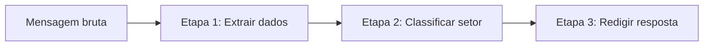

## Passo 1 · Leitura · Pensar passo a passo e dividir para conquistar

No Nível 6 você viu que um Transformer aplica um número fixo de camadas de atenção para produzir **cada** token. Se você pedir ao modelo que responda imediatamente `"APROVADO"` ou `"REPROVADO"` a um problema com quatro regras do regimento e três contas de créditos, toda a computação precisa caber na geração daquele primeiro token — e o modelo frequentemente erra.

Quando instruímos o modelo a **raciocinar passo a passo antes de dar o veredito** (*Chain-of-Thought* / cadeia de pensamento), cada etapa intermediária escrita na saída entra no contexto e serve de memória de trabalho para os tokens seguintes. Para que o seu programa consiga extrair apenas o veredito sem misturá-lo com o texto do raciocínio, exigimos um marcador explícito na última linha, como `RESPOSTA_FINAL: <valor>`.

Quando a tarefa envolve responsabilidades muito distintas — por exemplo, (1) extrair dados estruturados do texto livre do aluno, (2) classificar o setor responsável pelas regras do regimento e (3) redigir um e-mail padronizado —, tentar fazer tudo em um único mega-prompt cria um gargalo: você fica preso a um modelo grande e caro para a chamada inteira e não sabe qual etapa falhou quando a resposta sai errada. A alternativa de engenharia é **decompor em um pipeline de chamadas encadeadas**:



No pipeline, cada etapa tem um prompt curto, fácil de testar isoladamente, e pode usar o modelo mais econômico para aquela subtarefa (por exemplo, um modelo leve para extrair e classificar, e um modelo mais capaz apenas se a etapa exigir raciocínio complexo). Se o pipeline tem $k$ etapas, onde a etapa $i$ consome $E_i$ tokens de entrada e $S_i$ tokens de saída no modelo de preços $(p_{\text{in}, i}, p_{\text{out}, i})$, o custo total é:

$$C_{\text{pipeline}} = \sum_{i=1}^{k} \left(\frac{E_i}{10^6} \cdot p_{\text{in}, i} + \frac{S_i}{10^6} \cdot p_{\text{out}, i}\right)$$

Cuidado com dois erros clássicos ao construir cadeias:
1. **Esquecer de separar o raciocínio da resposta final**, exibindo o rascunho interno inteiro para o usuário ou quebrando o parser seguinte.
2. **Perder contexto entre etapas**, deixando de passar para a Etapa 2 ou 3 os campos extraídos na Etapa 1.

## Passo 2 · Exercício · Extraindo a resposta final depois do raciocínio

modo: ordenar

Ordene as linhas para implementar `extrair_resposta_final(texto, marcador="RESPOSTA_FINAL:")`. Se o `marcador` não estiver presente em `texto`, retorne `None`; caso contrário, separe o texto na última ocorrência do marcador com `rsplit(marcador, 1)` e retorne a parte final sem espaços nas pontas (`strip()`).

### Instruções

1. Verifique se `marcador not in texto` e retorne `None` nesse caso.
2. Divida `texto` com `texto.rsplit(marcador, 1)` para obter o trecho após o marcador.
3. Retorne o trecho final limpo com `.strip()`.

### Solução

```python
def extrair_resposta_final(texto, marcador="RESPOSTA_FINAL:"):
    if marcador not in texto:
        return None
    partes = texto.rsplit(marcador, 1)
    return partes[1].strip()
```

### Dicas

1. Comece com `def extrair_resposta_final(texto, marcador="RESPOSTA_FINAL:"):`.
2. Trate primeiro o caso em que o marcador não aparece (`if marcador not in texto: return None`).
3. Após `partes = texto.rsplit(marcador, 1)`, o texto depois do marcador está em `partes[1]`.

### Verificação

```json
[
  {
    "id": "extrai-apos-raciocinio",
    "name": "Extrai apenas o valor após RESPOSTA_FINAL:",
    "checkpoint": 3,
    "kind": "call",
    "function": "extrair_resposta_final",
    "args": ["Passo 1: 4 creditos.\nPasso 2: soma 12.\nRESPOSTA_FINAL: DEFERIDO"],
    "expected": "DEFERIDO"
  },
  {
    "id": "marcador-ausente",
    "name": "Retorna None quando o marcador não está no texto",
    "checkpoint": 1,
    "kind": "call",
    "function": "extrair_resposta_final",
    "args": ["Raciocinei bastante mas esqueci o marcador"],
    "expected": null
  },
  {
    "id": "marcador-customizado",
    "name": "Respeita marcador customizado e remove espaços extras",
    "checkpoint": 2,
    "kind": "call",
    "function": "extrair_resposta_final",
    "args": ["Calculo: 10 + 5 = 15. VEREDITO:   15  ", "VEREDITO:"],
    "expected": "15"
  }
]
```

### Soluções erradas

```python name="Devolve o texto inteiro sem isolar o trecho após o marcador"
def extrair_resposta_final(texto, marcador="RESPOSTA_FINAL:"):
    if marcador not in texto:
        return None
    return texto.strip()
```

```python name="Retorna a parte anterior ao marcador (partes[0]) em vez da final"
def extrair_resposta_final(texto, marcador="RESPOSTA_FINAL:"):
    if marcador not in texto:
        return None
    partes = texto.rsplit(marcador, 1)
    return partes[0].strip()
```

## Passo 3 · Exercício · Raciocínio em etapas vs resposta direta

Nosso `ClienteRaciocinioSimulado` avalia pedidos de análise de pré-requisitos e créditos da secretaria:
- Se o prompt pedir resposta direta (sem a instrução `"passo a passo"` e `"RESPOSTA_FINAL:"`), ele chuta com base apenas no primeiro número que vê e erra os problemas de múltiplas etapas.
- Quando o prompt inclui `"passo a passo"` e pede `"RESPOSTA_FINAL:"`, ele executa o raciocínio intermediário e emite `RESPOSTA_FINAL: ELEGIVEL` ou `RESPOSTA_FINAL: INELEGIVEL`.

Além disso, adicionaremos **autoverificação**: após extrair o veredito, você deve chamar `cliente.verificar(problema, veredito)`, que confere se o veredito é consistente com os dados do problema e devolve o veredito corrigido caso detecte contradição.

### Instruções

1. Implemente `resolver_com_passos(cliente, problema)` montando um prompt que contenha o texto de `problema`, a expressão `"passo a passo"` e a instrução `"RESPOSTA_FINAL:"`.
2. Chame `texto = cliente.completar(prompt)` e extraia o valor após `"RESPOSTA_FINAL:"` (usando `rsplit("RESPOSTA_FINAL:", 1)[1].strip()`).
3. Passe o veredito extraído por `cliente.verificar(problema, veredito)` e retorne o resultado final.

### Código inicial

```python
class ClienteRaciocinioSimulado:
    def completar(self, prompt):
        p_low = prompt.lower()
        if "passo a passo" not in p_low or "resposta_final:" not in p_low:
            return "RESPOSTA_FINAL: ELEGIVEL"
        # Simula raciocínio sobre créditos concluídos vs exigidos
        if "concluiu 18" in p_low and "minimo 20" in p_low:
            return "Passo 1: aluno tem 18.\nPasso 2: 18 < 20.\nRESPOSTA_FINAL: INELEGIVEL"
        if "trancamentos: 5" in p_low and "limite: 4" in p_low:
            return "Passo 1: 5 > 4.\nRESPOSTA_FINAL: ELEGIVEL"
        return "Passo 1: requisitos atendidos.\nRESPOSTA_FINAL: ELEGIVEL"

    def verificar(self, problema, veredito):
        p_low = problema.lower()
        if "trancamentos: 5" in p_low and "limite: 4" in p_low:
            return "INELEGIVEL"
        return veredito


def resolver_com_passos(cliente, problema):
    # Peça raciocínio passo a passo com RESPOSTA_FINAL:, extraia o veredito e chame cliente.verificar
    pass


if __name__ == "__main__":
    cli = ClienteRaciocinioSimulado()
    print(resolver_com_passos(cli, "Aluno concluiu 18 creditos, minimo 20 exigidos."))
    print(resolver_com_passos(cli, "Aluno tem trancamentos: 5, limite: 4 no curso."))
```

### Solução

```python
class ClienteRaciocinioSimulado:
    def completar(self, prompt):
        p_low = prompt.lower()
        if "passo a passo" not in p_low or "resposta_final:" not in p_low:
            return "RESPOSTA_FINAL: ELEGIVEL"
        if "concluiu 18" in p_low and "minimo 20" in p_low:
            return "Passo 1: aluno tem 18.\nPasso 2: 18 < 20.\nRESPOSTA_FINAL: INELEGIVEL"
        if "trancamentos: 5" in p_low and "limite: 4" in p_low:
            return "Passo 1: 5 > 4.\nRESPOSTA_FINAL: ELEGIVEL"
        return "Passo 1: requisitos atendidos.\nRESPOSTA_FINAL: ELEGIVEL"

    def verificar(self, problema, veredito):
        p_low = problema.lower()
        if "trancamentos: 5" in p_low and "limite: 4" in p_low:
            return "INELEGIVEL"
        return veredito


def resolver_com_passos(cliente, problema):
    prompt = (
        f"Problema: {problema}\n"
        "Raciocine passo a passo e termine com RESPOSTA_FINAL: <veredito>"
    )
    saida = cliente.completar(prompt)
    veredito = saida.rsplit("RESPOSTA_FINAL:", 1)[1].strip()
    return cliente.verificar(problema, veredito)


if __name__ == "__main__":
    cli = ClienteRaciocinioSimulado()
    print(resolver_com_passos(cli, "Aluno concluiu 18 creditos, minimo 20 exigidos."))
    print(resolver_com_passos(cli, "Aluno tem trancamentos: 5, limite: 4 no curso."))
```

### Dicas

1. Certifique-se de incluir `"passo a passo"` e `"RESPOSTA_FINAL:"` no prompt enviado a `cliente.completar`.
2. Não devolva a string `saida` inteira: isole apenas o veredito após `"RESPOSTA_FINAL:"` e passe-o para `cliente.verificar(problema, veredito)`.

### Verificação

```json
[
  {
    "id": "resolve-multiplas-etapas",
    "name": "Acerta todos os casos usando cadeia de pensamento e autoverificação",
    "checkpoint": 3,
    "kind": "expr",
    "setup": "cli = ClienteRaciocinioSimulado()\ncasos = ['Aluno concluiu 18 creditos, minimo 20 exigidos.', 'Aluno tem trancamentos: 5, limite: 4 no curso.', 'Aluno concluiu 24 creditos, minimo 20 exigidos.']",
    "expr": "[resolver_com_passos(cli, c) for c in casos]",
    "expected": ["INELEGIVEL", "INELEGIVEL", "ELEGIVEL"]
  }
]
```

### Soluções erradas

```python name="Não pede raciocínio passo a passo no prompt"
class ClienteRaciocinioSimulado:
    def completar(self, prompt):
        p_low = prompt.lower()
        if "passo a passo" not in p_low or "resposta_final:" not in p_low:
            return "RESPOSTA_FINAL: ELEGIVEL"
        if "concluiu 18" in p_low and "minimo 20" in p_low:
            return "Passo 1: aluno tem 18.\nPasso 2: 18 < 20.\nRESPOSTA_FINAL: INELEGIVEL"
        return "Passo 1: ok.\nRESPOSTA_FINAL: ELEGIVEL"

    def verificar(self, problema, veredito):
        return veredito


def resolver_com_passos(cliente, problema):
    saida = cliente.completar(problema)
    return saida.rsplit("RESPOSTA_FINAL:", 1)[-1].strip()
```

```python name="Pula a etapa de autoverificação com cliente.verificar"
class ClienteRaciocinioSimulado:
    def completar(self, prompt):
        p_low = prompt.lower()
        if "passo a passo" not in p_low or "resposta_final:" not in p_low:
            return "RESPOSTA_FINAL: ELEGIVEL"
        if "concluiu 18" in p_low and "minimo 20" in p_low:
            return "Passo 1: aluno tem 18.\nPasso 2: 18 < 20.\nRESPOSTA_FINAL: INELEGIVEL"
        if "trancamentos: 5" in p_low and "limite: 4" in p_low:
            return "Passo 1: 5 > 4.\nRESPOSTA_FINAL: ELEGIVEL"
        return "Passo 1: ok.\nRESPOSTA_FINAL: ELEGIVEL"

    def verificar(self, problema, veredito):
        if "trancamentos: 5" in problema.lower():
            return "INELEGIVEL"
        return veredito


def resolver_com_passos(cliente, problema):
    prompt = f"{problema}\nRaciocine passo a passo e use RESPOSTA_FINAL:"
    saida = cliente.completar(prompt)
    return saida.rsplit("RESPOSTA_FINAL:", 1)[1].strip()
```

## Passo 4 · Exercício · Pipeline de atendimento e custo por etapa

Vamos implementar um pipeline de 3 etapas para a secretaria acadêmica e a função que calcula o custo financeiro de qualquer pipeline:

1. `pipeline_de_atendimento(cliente, mensagem)`:
   - **Etapa 1 (Extração):** chama `dados = cliente.extrair(mensagem)`, que devolve um dicionário `{"aluno": str, "disciplina": str, "acao": str}`.
   - **Etapa 2 (Classificação de setor):** chama `setor = cliente.classificar_setor(dados)`, passando o dicionário `dados` extraído na Etapa 1.
   - **Etapa 3 (Redação):** chama `texto = cliente.redigir(dados, setor)`, passando **ambos** `dados` e `setor`.
   - Retorna o dicionário consolidado `{"aluno": dados["aluno"], "disciplina": dados["disciplina"], "acao": dados["acao"], "setor": setor, "resposta": texto}`.
2. `custo_de_pipeline(etapas, precos)`:
   - `etapas` é uma lista de dicionários `[{"modelo": str, "tokens_entrada": int, "tokens_saida": int}]`.
   - `precos` mapeia o nome de cada modelo para `{"entrada_por_milhao": float, "saida_por_milhao": float}`.
   - Retorna a soma dos custos de todas as etapas como `float`.

### Instruções

1. Em `pipeline_de_atendimento(cliente, mensagem)`, encadeie `cliente.extrair(mensagem)`, `cliente.classificar_setor(dados)` e `cliente.redigir(dados, setor)` sem perder os dados entre as etapas.
2. Em `custo_de_pipeline(etapas, precos)`, some o custo de entrada e de saída de cada etapa consultando a tarifa do respectivo `etapa["modelo"]` em `precos`.

### Código inicial

```python
class ClientePipelineSimulado:
    def extrair(self, mensagem):
        partes = [p.strip() for p in mensagem.split("|")]
        return {"aluno": partes[0], "disciplina": partes[1], "acao": partes[2]}

    def classificar_setor(self, dados):
        if dados["acao"] == "trancar":
            return "SECAO_ALUNOS"
        return "COMISSAO_GRADUACAO"

    def redigir(self, dados, setor):
        return (
            f"Olá {dados['aluno']}, seu pedido de {dados['acao']} em "
            f"{dados['disciplina']} foi encaminhado para {setor}."
        )


def pipeline_de_atendimento(cliente, mensagem):
    # Execute as 3 etapas passando o contexto adiante e devolva o dicionário completo
    pass


def custo_de_pipeline(etapas, precos):
    # Some o custo de cada etapa de acordo com o modelo usado nela
    pass


if __name__ == "__main__":
    cli = ClientePipelineSimulado()
    print(pipeline_de_atendimento(cli, "Ana | MAC0110 | trancar"))
```

### Solução

```python
class ClientePipelineSimulado:
    def extrair(self, mensagem):
        partes = [p.strip() for p in mensagem.split("|")]
        return {"aluno": partes[0], "disciplina": partes[1], "acao": partes[2]}

    def classificar_setor(self, dados):
        if dados["acao"] == "trancar":
            return "SECAO_ALUNOS"
        return "COMISSAO_GRADUACAO"

    def redigir(self, dados, setor):
        return (
            f"Olá {dados['aluno']}, seu pedido de {dados['acao']} em "
            f"{dados['disciplina']} foi encaminhado para {setor}."
        )


def pipeline_de_atendimento(cliente, mensagem):
    dados = cliente.extrair(mensagem)
    setor = cliente.classificar_setor(dados)
    resposta = cliente.redigir(dados, setor)
    return {
        "aluno": dados["aluno"],
        "disciplina": dados["disciplina"],
        "acao": dados["acao"],
        "setor": setor,
        "resposta": resposta,
    }


def custo_de_pipeline(etapas, precos):
    total = 0.0
    for etapa in etapas:
        tab = precos[etapa["modelo"]]
        c_in = (etapa["tokens_entrada"] / 1_000_000) * tab["entrada_por_milhao"]
        c_out = (etapa["tokens_saida"] / 1_000_000) * tab["saida_por_milhao"]
        total += c_in + c_out
    return float(total)


if __name__ == "__main__":
    cli = ClientePipelineSimulado()
    print(pipeline_de_atendimento(cli, "Ana | MAC0110 | trancar"))
```

### Dicas

1. O retorno de `pipeline_de_atendimento` deve conter as 5 chaves: `"aluno"`, `"disciplina"`, `"acao"`, `"setor"` e `"resposta"`.
2. Em `custo_de_pipeline`, cada etapa pode usar um `"modelo"` diferente, então busque `precos[etapa["modelo"]]` dentro do laço.

### Verificação

```json
[
  {
    "id": "pipeline-trancar",
    "name": "Executa as 3 etapas do pipeline repassando dados e setor",
    "checkpoint": 1,
    "kind": "expr",
    "setup": "cli = ClientePipelineSimulado()",
    "expr": "pipeline_de_atendimento(cli, 'Bruno | MAC0121 | trancar')",
    "expected": {
      "aluno": "Bruno",
      "disciplina": "MAC0121",
      "acao": "trancar",
      "setor": "SECAO_ALUNOS",
      "resposta": "Olá Bruno, seu pedido de trancar em MAC0121 foi encaminhado para SECAO_ALUNOS."
    }
  },
  {
    "id": "pipeline-equivalencia",
    "name": "Encaminha ações que não são trancamento para COMISSAO_GRADUACAO",
    "checkpoint": 1,
    "kind": "expr",
    "setup": "cli = ClientePipelineSimulado()",
    "expr": "pipeline_de_atendimento(cli, 'Carla | MAE0119 | equivalencia')['setor']",
    "expected": "COMISSAO_GRADUACAO"
  },
  {
    "id": "custo-multi-modelo",
    "name": "Calcula custo combinando modelos leves e pesados nas etapas",
    "checkpoint": 2,
    "kind": "call",
    "function": "custo_de_pipeline",
    "args": [
      [
        {"modelo": "leve", "tokens_entrada": 500, "tokens_saida": 50},
        {"modelo": "leve", "tokens_entrada": 100, "tokens_saida": 10},
        {"modelo": "pro", "tokens_entrada": 300, "tokens_saida": 200}
      ],
      {
        "leve": {"entrada_por_milhao": 0.2, "saida_por_milhao": 0.8},
        "pro": {"entrada_por_milhao": 2.0, "saida_por_milhao": 8.0}
      }
    ],
    "expected": 0.002368,
    "tolerance": 1e-8
  }
]
```

### Soluções erradas

```python name="Passa dicionário vazio para a etapa de classificação de setor"
class ClientePipelineSimulado:
    def extrair(self, mensagem):
        partes = [p.strip() for p in mensagem.split("|")]
        return {"aluno": partes[0], "disciplina": partes[1], "acao": partes[2]}

    def classificar_setor(self, dados):
        if dados.get("acao") == "trancar":
            return "SECAO_ALUNOS"
        return "COMISSAO_GRADUACAO"

    def redigir(self, dados, setor):
        return f"Olá {dados['aluno']}, encaminhado para {setor}."


def pipeline_de_atendimento(cliente, mensagem):
    dados = cliente.extrair(mensagem)
    setor = cliente.classificar_setor({})
    resposta = cliente.redigir(dados, setor)
    return {
        "aluno": dados["aluno"],
        "disciplina": dados["disciplina"],
        "acao": dados["acao"],
        "setor": setor,
        "resposta": resposta,
    }


def custo_de_pipeline(etapas, precos):
    return 0.0
```

```python name="Usa apenas o preço de entrada para todos os tokens do pipeline"
def pipeline_de_atendimento(cliente, mensagem):
    dados = cliente.extrair(mensagem)
    setor = cliente.classificar_setor(dados)
    resposta = cliente.redigir(dados, setor)
    return {
        "aluno": dados["aluno"],
        "disciplina": dados["disciplina"],
        "acao": dados["acao"],
        "setor": setor,
        "resposta": resposta,
    }


def custo_de_pipeline(etapas, precos):
    total = 0.0
    for etapa in etapas:
        tab = precos[etapa["modelo"]]
        total += (
            (etapa["tokens_entrada"] + etapa["tokens_saida"]) / 1_000_000
        ) * tab["entrada_por_milhao"]
    return float(total)
```

## Passo 5 · Quiz · Cadeia de pensamento e pipelines

### Pergunta

Ao usar cadeia de pensamento (*Chain-of-Thought*) em uma etapa intermediária do sistema, por que pedimos um marcador explícito como `RESPOSTA_FINAL:` no fim da geração?

- [ ] Porque sem esse marcador a GPU não consegue calcular o *prefill*.
- [x] Para que o código Python possa separar de forma determinística o veredito final do rascunho de raciocínio gerado pelo modelo.
- [ ] Porque os tokens antes de `RESPOSTA_FINAL:` são gratuitos e não são cobrados pela API.
- [ ] Para desativar o tokenizador do modelo.

> Os passos de raciocínio ajudam o modelo a chegar na resposta certa, mas quem consome o resultado (uma função Python ou o usuário final) geralmente precisa apenas do veredito limpo após o marcador.

### Pergunta

Em que situação decompor uma chamada única em um pipeline de 3 etapas curtas pode reduzir o custo total de operação?

- [ ] Nunca: fazer 3 chamadas é sempre 3 vezes mais caro do que fazer 1 chamada.
- [x] Quando as primeiras etapas (como filtragem e extração simples) podem rodar em modelos pequenos e baratos, evitando enviar prompts gigantes com todas as instruções e exemplos para um modelo de fronteira caro.
- [ ] Quando todas as 3 etapas reenviam o banco de dados inteiro no modelo mais caro.
- [ ] Apenas quando `max_tokens` é configurado como infinito.

> Um mega-prompt único obriga a pagar a tarifa do modelo mais caro sobre todas as instruções e todos os exemplos em todas as chamadas. Em um pipeline, etapas simples usam modelos $10\times$ mais baratos e prompts enxutos.

### Pergunta

Qual é a consequência de uma Etapa 2 de um pipeline não receber os campos estruturados extraídos na Etapa 1?

- [ ] O modelo da Etapa 2 lê automaticamente a memória RAM da Etapa 1 no servidor da API.
- [x] O pipeline perde informação pelo caminho e a Etapa 2 toma decisões sem os dados já extraídos, causando respostas inconsistentes ou genéricas.
- [ ] O Python levanta `SyntaxError` antes de iniciar o programa.
- [ ] A latência cai para zero.

> Como cada chamada ao LLM é independente e sem estado, cabe ao código orquestrador do pipeline passar explicitamente os dados extraídos de uma etapa para o prompt da etapa seguinte.
