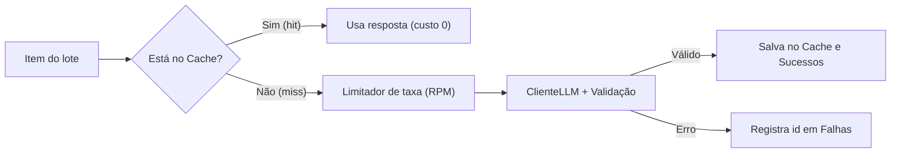

## Passo 1 · Leitura · De uma chamada para dez mil: falhas isoladas, cache e limites de taxa

Fazer uma única chamada funcionar no seu computador é fácil. O desafio de engenharia começa quando a secretaria acadêmica precisa classificar e extrair dados de **5 000 requerimentos acumulados no semestre**. Nessa escala, três problemas surgem inevitavelmente:

1. **Falhas individuais não podem derrubar o lote:** no item $3\,412$, o modelo pode devolver um JSON truncado ou inválido mesmo após tentativa de reparo. Se o seu laço `for` não capturar a falha por item, você perderá o progresso do lote inteiro. O processador de lote deve isolar cada item em um bloco `try/except`, separando `sucessos` e `falhas` (sempre registrando o `id` do item e o motivo do erro para reprocessamento posterior).
2. **Perguntas e textos repetidos desperdiçam dinheiro e tempo:** em lotes reais, muitos itens são idênticos (por exemplo, centenas de mensagens padrão *"Solicito comprovante de matrícula"*). Um **cache determinístico** armazena a resposta indexada pelo hash SHA-256 da chave completa `f"{modelo}|{temperatura}|{prompt}"`. Repare que **o nome do modelo e a temperatura precisam fazer parte da chave do cache**: se você trocar para um modelo melhor ou mudar a temperatura, um cache indexado apenas pelo `prompt` devolveria a resposta antiga do modelo errado!
3. **Limites de taxa (*Rate Limits* — RPM/TPM):** provedores limitam quantas chamadas por minuto (RPM) sua conta pode fazer. Um controlador em janela deslizante de 60 segundos acompanha os instantes das chamadas recentes e aguarda o tempo necessário antes de disparar a próxima:



Se um lote de $N_{\text{total}}$ itens obtém $N_{\text{hits}}$ respostas do cache, apenas $N_{\text{chamadas}} = N_{\text{total}} - N_{\text{hits}}$ vão à API. A taxa de acerto do cache e o tempo mínimo estimado sob um limite de $\text{RPM}$ chamadas por minuto são:

$$\text{Taxa de acerto} = \frac{N_{\text{hits}}}{N_{\text{total}}}, \qquad T_{\text{estimado (s)}} = \frac{N_{\text{total}} - N_{\text{hits}}}{\text{RPM}} \times 60$$

Acompanhe no visualizador o processamento de um lote com cache e isolamento de falhas:

```python visualizar
import hashlib

cache = {}
sucessos = []
falhas = []
hits = 0

lote = [
    {"id": 1, "texto": "Trancar MAC0110"},
    {"id": 2, "texto": "ERRO_JSON"},
    {"id": 3, "texto": "Trancar MAC0110"},
]

for item in lote:
    chave = hashlib.sha256(f"leve|0.0|{item['texto']}".encode()).hexdigest()[:10]
    if chave in cache:
        hits += 1
        sucessos.append({"id": item["id"], "dados": cache[chave]})
    elif item["texto"] == "ERRO_JSON":
        falhas.append({"id": item["id"], "erro": "JSON inválido"})
    else:
        resp = {"acao": "trancar"}
        cache[chave] = resp
        sucessos.append({"id": item["id"], "dados": resp})
```

## Passo 2 · Exercício · Cache de respostas por hash completo

Implemente a classe `CacheLLM` para armazenar respostas de chamadas determinísticas e medir a taxa de economia:

- `chave(self, prompt, modelo="padrao", temperatura=0.0)`: retorna o `hexdigest()` SHA-256 da string `f"{modelo}|{temperatura}|{prompt}"` codificada em UTF-8.
- `obter(self, prompt, modelo="padrao", temperatura=0.0)`: calcula a chave; se estiver no dicionário interno, incrementa `self.hits += 1` e retorna o valor armazenado; se não estiver, incrementa `self.misses += 1` e retorna `None`.
- `guardar(self, prompt, resposta, modelo="padrao", temperatura=0.0)`: salva `resposta` na chave correspondente (sem alterar `hits` nem `misses`).
- `estatisticas(self)`: retorna `{"hits": self.hits, "misses": self.misses, "taxa_acerto": float}` onde `taxa_acerto` é `hits / (hits + misses)` (ou `0.0` se `hits + misses == 0`).

### Instruções

1. Implemente `chave(self, prompt, modelo="padrao", temperatura=0.0)` gerando o SHA-256 hexadecimal de `f"{modelo}|{temperatura}|{prompt}"`.
2. Implemente `obter` e `guardar` atualizando os contadores `self.hits` e `self.misses` em `obter`.
3. Implemente `estatisticas(self)` retornando `{"hits": ..., "misses": ..., "taxa_acerto": ...}` com proteção para divisão por zero quando nenhuma consulta ainda foi feita.

### Código inicial

```python
import hashlib


class CacheLLM:
    def __init__(self):
        self._dados = {}
        self.hits = 0
        self.misses = 0

    def chave(self, prompt, modelo="padrao", temperatura=0.0):
        # Gere o SHA-256 incluindo modelo, temperatura e prompt
        pass

    def obter(self, prompt, modelo="padrao", temperatura=0.0):
        # Consulte o cache e atualize self.hits ou self.misses
        pass

    def guardar(self, prompt, resposta, modelo="padrao", temperatura=0.0):
        # Armazene a resposta na chave correspondente
        pass

    def estatisticas(self):
        # Retorne {"hits": ..., "misses": ..., "taxa_acerto": ...}
        pass


if __name__ == "__main__":
    c = CacheLLM()
    print(c.obter("Prazo matrícula"))
    c.guardar("Prazo matrícula", "Até sexta-feira")
    print(c.obter("Prazo matrícula"))
    print(c.estatisticas())
```

### Solução

```python
import hashlib


class CacheLLM:
    def __init__(self):
        self._dados = {}
        self.hits = 0
        self.misses = 0

    def chave(self, prompt, modelo="padrao", temperatura=0.0):
        bruto = f"{modelo}|{temperatura}|{prompt}".encode("utf-8")
        return hashlib.sha256(bruto).hexdigest()

    def obter(self, prompt, modelo="padrao", temperatura=0.0):
        k = self.chave(prompt, modelo=modelo, temperatura=temperatura)
        if k in self._dados:
            self.hits += 1
            return self._dados[k]
        self.misses += 1
        return None

    def guardar(self, prompt, resposta, modelo="padrao", temperatura=0.0):
        k = self.chave(prompt, modelo=modelo, temperatura=temperatura)
        self._dados[k] = resposta

    def estatisticas(self):
        total = self.hits + self.misses
        taxa = float(self.hits / total) if total > 0 else 0.0
        return {
            "hits": self.hits,
            "misses": self.misses,
            "taxa_acerto": taxa,
        }


if __name__ == "__main__":
    c = CacheLLM()
    print(c.obter("Prazo matrícula"))
    c.guardar("Prazo matrícula", "Até sexta-feira")
    print(c.obter("Prazo matrícula"))
    print(c.estatisticas())
```

### Dicas

1. Em `chave`, concatene `f"{modelo}|{temperatura}|{prompt}"` antes de chamar `.encode("utf-8")` para que mudanças de modelo ou temperatura produzam chaves distintas.
2. Em `estatisticas`, se `self.hits + self.misses == 0`, `taxa_acerto` deve ser `0.0`.

### Verificação

```json
[
  {
    "id": "cache-hit-miss",
    "name": "Registra miss na 1a consulta, hit na 2a e calcula taxa_acerto",
    "checkpoint": 2,
    "kind": "expr",
    "setup": "c = CacheLLM()\nr1 = c.obter('P1')\nc.guardar('P1', 'Resp1')\nr2 = c.obter('P1')\nr3 = c.obter('P1')",
    "expr": "[r1, r2, r3, c.estatisticas()]",
    "expected": [
      null,
      "Resp1",
      "Resp1",
      {"hits": 2, "misses": 1, "taxa_acerto": 0.6666666666666666}
    ],
    "tolerance": 1e-6
  },
  {
    "id": "cache-separa-modelo-e-temperatura",
    "name": "Não mistura entradas de modelos ou temperaturas diferentes",
    "checkpoint": 1,
    "kind": "expr",
    "setup": "c = CacheLLM()\nc.guardar('Oi', 'R_leve', modelo='leve', temperatura=0.0)",
    "expr": "[c.obter('Oi', modelo='leve', temperatura=0.0), c.obter('Oi', modelo='pro', temperatura=0.0), c.obter('Oi', modelo='leve', temperatura=0.7)]",
    "expected": ["R_leve", null, null]
  },
  {
    "id": "cache-vazio-sem-divisao-por-zero",
    "name": "Retorna taxa_acerto 0.0 quando ainda não houve consultas",
    "checkpoint": 3,
    "kind": "expr",
    "expr": "CacheLLM().estatisticas()",
    "expected": {"hits": 0, "misses": 0, "taxa_acerto": 0.0}
  }
]
```

### Soluções erradas

```python name="Calcula o hash apenas do prompt ignorando modelo e temperatura"
import hashlib


class CacheLLM:
    def __init__(self):
        self._dados = {}
        self.hits = 0
        self.misses = 0

    def chave(self, prompt, modelo="padrao", temperatura=0.0):
        return hashlib.sha256(prompt.encode("utf-8")).hexdigest()

    def obter(self, prompt, modelo="padrao", temperatura=0.0):
        k = self.chave(prompt, modelo, temperatura)
        if k in self._dados:
            self.hits += 1
            return self._dados[k]
        self.misses += 1
        return None

    def guardar(self, prompt, resposta, modelo="padrao", temperatura=0.0):
        self._dados[self.chave(prompt, modelo, temperatura)] = resposta

    def estatisticas(self):
        total = self.hits + self.misses
        return {"hits": self.hits, "misses": self.misses, "taxa_acerto": self.hits / total if total else 0.0}
```

```python name="Divide por zero em estatisticas quando o cache está vazio"
import hashlib


class CacheLLM:
    def __init__(self):
        self._dados = {}
        self.hits = 0
        self.misses = 0

    def chave(self, prompt, modelo="padrao", temperatura=0.0):
        return hashlib.sha256(f"{modelo}|{temperatura}|{prompt}".encode("utf-8")).hexdigest()

    def obter(self, prompt, modelo="padrao", temperatura=0.0):
        k = self.chave(prompt, modelo, temperatura)
        if k in self._dados:
            self.hits += 1
            return self._dados[k]
        self.misses += 1
        return None

    def guardar(self, prompt, resposta, modelo="padrao", temperatura=0.0):
        self._dados[self.chave(prompt, modelo, temperatura)] = resposta

    def estatisticas(self):
        return {
            "hits": self.hits,
            "misses": self.misses,
            "taxa_acerto": self.hits / (self.hits + self.misses),
        }
```

## Passo 3 · Exercício · Processamento de lote tolerante a falhas

Implemente `processar_lote(cliente, itens, campos_obrigatorios)` que percorre uma lista `itens` (`[{"id": ..., "texto": str}]`), chama `cliente.completar(item["texto"])`, faz o `json.loads` da string retornada e verifica se o resultado é um `dict` que contém todas as chaves de `campos_obrigatorios`.

- Se o item for válido, adicione `{"id": item["id"], "dados": dados}` à lista `"sucessos"`.
- Se ocorrer qualquer erro (`json.JSONDecodeError`, resultado não ser `dict` ou faltar campo obrigatório), o lote **não deve parar**: adicione `{"id": item["id"], "erro": mensagem_de_erro}` à lista `"falhas"`.
- Retorne `{"sucessos": sucessos, "falhas": falhas}`.

### Instruções

1. Para cada `item` em `itens`, chame `resposta = cliente.completar(item["texto"])` dentro de um bloco `try/except`.
2. Faça `dados = json.loads(resposta)`, confirme que `isinstance(dados, dict)` e que todo `campo` de `campos_obrigatorios` está em `dados` (levantando `ValueError(f"Campo ausente: {campo}")` caso falte).
3. Colete os itens válidos em `"sucessos"` e os inválidos em `"falhas"` preservando o `"id"` de cada item.

### Código inicial

```python
import json


def processar_lote(cliente, itens, campos_obrigatorios):
    # Processe todos os itens isolando falhas por item
    pass


if __name__ == "__main__":
    class CliLote:
        def completar(self, t):
            if "quebrado" in t:
                return "{json ruim"
            if "incompleto" in t:
                return '{"setor": "Graduacao"}'
            return '{"setor": "Graduacao", "urgente": false}'

    lote_teste = [
        {"id": 10, "texto": "pedido normal"},
        {"id": 11, "texto": "pedido quebrado"},
        {"id": 12, "texto": "pedido incompleto"},
        {"id": 13, "texto": "outro normal"},
    ]
    print(processar_lote(CliLote(), lote_teste, ["setor", "urgente"]))
```

### Solução

```python
import json


def processar_lote(cliente, itens, campos_obrigatorios):
    sucessos = []
    falhas = []
    for item in itens:
        try:
            bruto = cliente.completar(item["texto"])
            dados = json.loads(bruto)
            if not isinstance(dados, dict):
                raise ValueError("A saída JSON não é um objeto")
            for campo in campos_obrigatorios:
                if campo not in dados:
                    raise ValueError(f"Campo obrigatório ausente: {campo}")
            sucessos.append({"id": item["id"], "dados": dados})
        except (json.JSONDecodeError, ValueError, TypeError) as exc:
            falhas.append({"id": item["id"], "erro": str(exc)})
    return {"sucessos": sucessos, "falhas": falhas}


if __name__ == "__main__":
    class CliLote:
        def completar(self, t):
            if "quebrado" in t:
                return "{json ruim"
            if "incompleto" in t:
                return '{"setor": "Graduacao"}'
            return '{"setor": "Graduacao", "urgente": false}'

    lote_teste = [
        {"id": 10, "texto": "pedido normal"},
        {"id": 11, "texto": "pedido quebrado"},
        {"id": 12, "texto": "pedido incompleto"},
        {"id": 13, "texto": "outro normal"},
    ]
    print(processar_lote(CliLote(), lote_teste, ["setor", "urgente"]))
```

### Dicas

1. Envolva o processamento de cada `item` dentro do laço `for` em um `try ... except (json.JSONDecodeError, ValueError, TypeError) as exc:` para que um erro no item 2 não impeça o processamento do item 3.
2. Verifique se cada `campo` de `campos_obrigatorios` está presente no dicionário `dados`.

### Verificação

```json
[
  {
    "id": "lote-misto-continua",
    "name": "Processa lote misto até o fim separando sucessos e falhas por id",
    "checkpoint": 3,
    "kind": "expr",
    "setup": "class C:\n    def completar(self, t):\n        if t == 'err1': return 'nao json'\n        if t == 'err2': return '{\"a\": 1}'\n        return '{\"a\": 1, \"b\": 2}'\nitens = [{'id': 'i1', 'texto': 'ok'}, {'id': 'i2', 'texto': 'err1'}, {'id': 'i3', 'texto': 'err2'}, {'id': 'i4', 'texto': 'ok'}]\nres = processar_lote(C(), itens, ['a', 'b'])",
    "expr": "[[x['id'] for x in res['sucessos']], [x['id'] for x in res['falhas']], res['sucessos'][0]['dados']]",
    "expected": [["i1", "i4"], ["i2", "i3"], {"a": 1, "b": 2}]
  }
]
```

### Soluções erradas

```python name="Deixa a exceção abortar o lote inteiro no primeiro item inválido"
import json


def processar_lote(cliente, itens, campos_obrigatorios):
    sucessos = []
    for item in itens:
        dados = json.loads(cliente.completar(item["texto"]))
        sucessos.append({"id": item["id"], "dados": dados})
    return {"sucessos": sucessos, "falhas": []}
```

```python name="Não verifica se os campos obrigatórios estão presentes no JSON"
import json


def processar_lote(cliente, itens, campos_obrigatorios):
    sucessos = []
    falhas = []
    for item in itens:
        try:
            dados = json.loads(cliente.completar(item["texto"]))
            sucessos.append({"id": item["id"], "dados": dados})
        except json.JSONDecodeError as exc:
            falhas.append({"id": item["id"], "erro": str(exc)})
    return {"sucessos": sucessos, "falhas": falhas}
```

## Passo 4 · Exercício · Limitador de taxa e relatório de lote

Para concluir o módulo, implementaremos o `LimitadorDeTaxa` em janela deslizante de 60 segundos e o consolidador `relatorio_de_lote`:

1. `LimitadorDeTaxa(limite_por_minuto, relogio, dormir)`:
   - Guarda uma lista ou fila de instantes (`timestamps` em segundos) das chamadas realizadas.
   - No método `aguardar_vez(self)`:
     - Lê o tempo atual `agora = self.relogio()`.
     - Remove do histórico todos os instantes `t` que já saíram da janela de 60 segundos (`agora - t >= 60.0`).
     - Se a quantidade de chamadas restantes na janela já atingiu `self.limite_por_minuto`, calcula quanto falta para a chamada mais antiga da janela completar 60 segundos (`espera = 60.0 - (agora - mais_antiga)`), chama `self.dormir(espera)`, atualiza `agora = self.relogio()` e limpa novamente os instantes com `agora - t >= 60.0`.
     - Registra `agora` na lista de instantes e retorna `agora`.
2. `relatorio_de_lote(resultado_lote, custo_por_chamada, hits_cache)`:
   - Recebe `resultado_lote` (`{"sucessos": [...], "falhas": [...]}`), `custo_por_chamada` (`float`) e `hits_cache` (`int`).
   - Calcula `total = len(sucessos) + len(falhas)` e `taxa_falha = len(falhas) / total` (ou `0.0` se `total == 0`).
   - Calcula o número de chamadas reais que foram à API: `chamadas_reais = max(0, total - hits_cache)` e `custo_total = chamadas_reais * custo_por_chamada`.
   - Retorna `{"total": total, "sucessos": len(sucessos), "falhas": len(falhas), "taxa_falha": float(taxa_falha), "custo_total": float(custo_total)}`.

### Instruções

1. Implemente `LimitadorDeTaxa(limite_por_minuto, relogio, dormir)` e seu método `aguardar_vez(self)` respeitando a janela deslizante de `60.0` segundos.
2. Implemente `relatorio_de_lote(resultado_lote, custo_por_chamada, hits_cache)` descontando `hits_cache` do total de itens ao calcular `custo_total`.

### Código inicial

```python
class LimitadorDeTaxa:
    def __init__(self, limite_por_minuto, relogio, dormir):
        # Inicialize atributos e histórico de timestamps
        pass

    def aguardar_vez(self):
        # Limpe chamadas com mais de 60s, durma se atingiu o limite e registre a chamada atual
        pass


def relatorio_de_lote(resultado_lote, custo_por_chamada, hits_cache):
    # Consolide total, sucessos, falhas, taxa_falha e custo_total
    pass


if __name__ == "__main__":
    tempo = {"t": 0.0}
    esperas = []

    def dormir_sim(s):
        esperas.append(s)
        tempo["t"] += s

    lim = LimitadorDeTaxa(2, lambda: tempo["t"], dormir_sim)
    lim.aguardar_vez()
    tempo["t"] = 10.0
    lim.aguardar_vez()
    tempo["t"] = 15.0
    lim.aguardar_vez()
    print("Esperas:", esperas, "Tempo atual:", tempo["t"])
```

### Solução

```python
class LimitadorDeTaxa:
    def __init__(self, limite_por_minuto, relogio, dormir):
        self.limite_por_minuto = limite_por_minuto
        self.relogio = relogio
        self.dormir = dormir
        self.instantes = []

    def aguardar_vez(self):
        agora = float(self.relogio())
        self.instantes = [t for t in self.instantes if agora - t < 60.0]
        if len(self.instantes) >= self.limite_por_minuto:
            mais_antiga = self.instantes[0]
            espera = 60.0 - (agora - mais_antiga)
            if espera > 0:
                self.dormir(float(espera))
                agora = float(self.relogio())
            self.instantes = [t for t in self.instantes if agora - t < 60.0]
        self.instantes.append(agora)
        return agora


def relatorio_de_lote(resultado_lote, custo_por_chamada, hits_cache):
    n_suc = len(resultado_lote["sucessos"])
    n_fal = len(resultado_lote["falhas"])
    total = n_suc + n_fal
    taxa_falha = float(n_fal / total) if total > 0 else 0.0
    chamadas_reais = max(0, total - hits_cache)
    custo_total = float(chamadas_reais * custo_por_chamada)
    return {
        "total": total,
        "sucessos": n_suc,
        "falhas": n_fal,
        "taxa_falha": taxa_falha,
        "custo_total": custo_total,
    }


if __name__ == "__main__":
    tempo = {"t": 0.0}
    esperas = []

    def dormir_sim(s):
        esperas.append(s)
        tempo["t"] += s

    lim = LimitadorDeTaxa(2, lambda: tempo["t"], dormir_sim)
    lim.aguardar_vez()
    tempo["t"] = 10.0
    lim.aguardar_vez()
    tempo["t"] = 15.0
    lim.aguardar_vez()
    print("Esperas:", esperas, "Tempo atual:", tempo["t"])
```

### Dicas

1. Em `aguardar_vez`, quando `len(self.instantes) >= self.limite_por_minuto`, a chamada mais antiga na janela é `self.instantes[0]`, e o tempo que falta para ela expirar é `60.0 - (agora - self.instantes[0])`.
2. Em `relatorio_de_lote`, itens atendidos pelo cache (`hits_cache`) têm custo zero de API, logo `chamadas_reais = max(0, total - hits_cache)`.

### Verificação

```json
[
  {
    "id": "limitador-espera-janela",
    "name": "LimitadorDeTaxa aguarda o tempo restante da janela de 60s quando lotado",
    "checkpoint": 1,
    "kind": "expr",
    "setup": "relogio_estado = {'t': 0.0}\ndormidas = []\ndef dormir_fn(s):\n    dormidas.append(s)\n    relogio_estado['t'] += s\nlim = LimitadorDeTaxa(2, lambda: relogio_estado['t'], dormir_fn)\nlim.aguardar_vez()\nrelogio_estado['t'] = 10.0\nlim.aguardar_vez()\nrelogio_estado['t'] = 25.0\nlim.aguardar_vez()",
    "expr": "[dormidas, relogio_estado['t']]",
    "expected": [[35.0], 60.0],
    "tolerance": 1e-6
  },
  {
    "id": "relatorio-desconta-cache",
    "name": "relatorio_de_lote calcula taxa_falha e desconta hits_cache do custo_total",
    "checkpoint": 2,
    "kind": "call",
    "function": "relatorio_de_lote",
    "args": [
      {
        "sucessos": [{"id": 1}, {"id": 2}, {"id": 3}, {"id": 4}],
        "falhas": [{"id": 5}]
      },
      0.02,
      2
    ],
    "expected": {
      "total": 5,
      "sucessos": 4,
      "falhas": 1,
      "taxa_falha": 0.2,
      "custo_total": 0.06
    },
    "tolerance": 1e-6
  }
]
```

### Soluções erradas

```python name="Não chama dormir quando o limite por minuto é atingido"
class LimitadorDeTaxa:
    def __init__(self, limite_por_minuto, relogio, dormir):
        self.relogio = relogio
        self.dormir = dormir

    def aguardar_vez(self):
        return float(self.relogio())


def relatorio_de_lote(resultado_lote, custo_por_chamada, hits_cache):
    n_suc = len(resultado_lote["sucessos"])
    n_fal = len(resultado_lote["falhas"])
    total = n_suc + n_fal
    return {
        "total": total,
        "sucessos": n_suc,
        "falhas": n_fal,
        "taxa_falha": n_fal / total if total else 0.0,
        "custo_total": max(0, total - hits_cache) * custo_por_chamada,
    }
```

```python name="Cobra custo de API também pelos itens atendidos pelo cache"
class LimitadorDeTaxa:
    def __init__(self, limite_por_minuto, relogio, dormir):
        self.limite_por_minuto = limite_por_minuto
        self.relogio = relogio
        self.dormir = dormir
        self.instantes = []

    def aguardar_vez(self):
        agora = float(self.relogio())
        self.instantes = [t for t in self.instantes if agora - t < 60.0]
        if len(self.instantes) >= self.limite_por_minuto:
            espera = 60.0 - (agora - self.instantes[0])
            self.dormir(espera)
            agora = float(self.relogio())
            self.instantes = [t for t in self.instantes if agora - t < 60.0]
        self.instantes.append(agora)
        return agora


def relatorio_de_lote(resultado_lote, custo_por_chamada, hits_cache):
    n_suc = len(resultado_lote["sucessos"])
    n_fal = len(resultado_lote["falhas"])
    total = n_suc + n_fal
    return {
        "total": total,
        "sucessos": n_suc,
        "falhas": n_fal,
        "taxa_falha": n_fal / total if total else 0.0,
        "custo_total": total * custo_por_chamada,
    }
```

## Passo 5 · Quiz · Lotes, cache e limites de taxa

### Pergunta

Por que a chave de um cache de respostas de LLM deve ser calculada sobre `modelo + temperatura + prompt` em vez de apenas sobre a string do `prompt`?

- [ ] Porque a função `hashlib.sha256` exige pelo menos duas barras verticais `|` na entrada.
- [x] Porque o mesmo prompt enviado a um modelo diferente (ou com temperatura diferente) produz respostas diferentes; omitir esses parâmetros faria o cache devolver saídas defasadas ao trocar de modelo.
- [ ] Porque incluir o nome do modelo reduz o tamanho do hash de 64 para 8 caracteres.
- [ ] Porque o cache só funciona quando `temperature = 1.0`.

> A resposta de uma chamada é função tanto do prompt quanto do modelo e dos hiperparâmetros de geração. Todos os fatores que determinam a saída precisam compor a chave do cache.

### Pergunta

Qual configuração de temperatura é a mais adequada quando você deseja maximizar a reprodutibilidade e o aproveitamento de cache em um pipeline de extração de dados em lote?

- [ ] `temperature = 1.2`
- [ ] `temperature = 0.8`
- [x] `temperature = 0.0`
- [ ] Qualquer temperatura acima de `2.0`.

> Em tarefas de extração estruturada e classificação com cache, buscamos comportamento determinístico (`temperature = 0.0`), onde a mesma entrada deve produzir sempre a mesma estrutura validada.

### Pergunta

Durante o processamento noturno de um lote de 2 000 requerimentos, o item de índice 140 devolve um JSON inválido mesmo após as tentativas de reparo. Qual é o comportamento correto do processador de lote?

- [ ] Levantar uma exceção não tratada e abortar imediatamente os 1 860 itens restantes.
- [ ] Preencher os campos do item 140 com valores aleatórios e salvá-lo como sucesso.
- [x] Capturar a exceção daquele item, registrar seu `id` e a mensagem de erro na lista de `falhas` para revisão ou reprocessamento e continuar o lote normalmente no item 141.
- [ ] Apagar o cache inteiro e reiniciar desde o item 1.

> Em processamento em lote, falhas individuais são isoladas e registradas em uma fila/relatório de falhas (*dead-letter queue*), garantindo que o restante do lote seja concluído.
