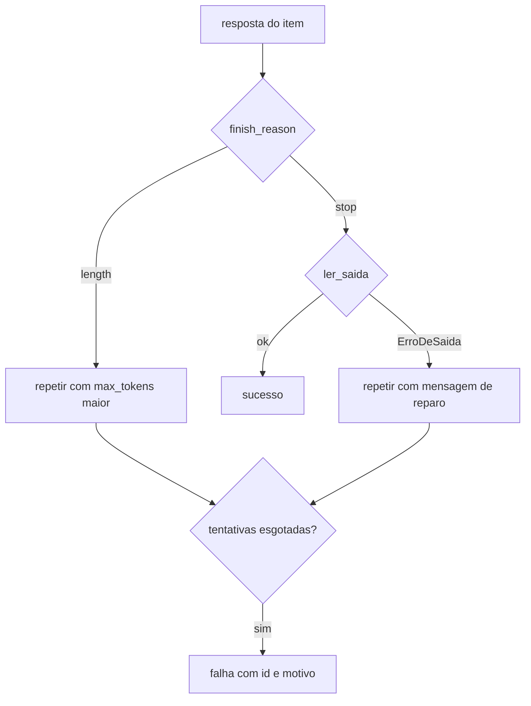

## Passo 1 · Leitura · Um lote não é um laço de chamadas

A secretaria acumulou 5 000 pedidos do semestre e quer, para cada um, um JSON com a ação e a sigla da disciplina. No módulo 1 você validou **uma** resposta e pediu reparo quando ela veio errada. Em lote, três coisas mudam.

**Uma falha não pode derrubar as outras 4 999.** Cada item é processado isolado: o que deu certo vai para `sucessos`, o que esgotou as tentativas vai para `falhas` com o `id` e o motivo, para alguém revisar ou reprocessar depois. Um `for` com `json.loads` solto para no primeiro item ruim e perde o resto do trabalho.

**Cada tipo de falha pede um remédio diferente.** O `finish_reason` e o erro de leitura dizem qual:



- Resposta **truncada** (`length`) não é culpa do modelo: o JSON não coube. Mandar uma mensagem "corrija o JSON" e o mesmo `max_tokens` produz o mesmo corte. O remédio é mais espaço (ou pedir uma saída menor).
- Resposta **completa mas inválida** (texto antes do JSON, campo faltando) melhora com uma mensagem de reparo que diz o que estava errado, como no módulo 1.
- Erros de rede e 429 são do módulo 1: retentativa com espera, em outra camada.

**Toda tentativa custa, inclusive as que falham.** Os tokens de uma resposta truncada ou inválida são cobrados igual. Se o relatório de custo soma só os sucessos, ele mente justamente nos lotes problemáticos.

Antes de qualquer retentativa, o código precisa **ler** a saída de um jeito que diga o que deu errado:

```python
try:
    dados = json.loads(texto)
except json.JSONDecodeError as erro:
    raise ErroDeSaida(f"JSON inválido: {erro.msg}")
if not isinstance(dados, dict):
    raise ErroDeSaida("esperava um objeto JSON")
```

`erro.msg` é a descrição curta do problema (`Expecting value`, `Unterminated string starting at`), e `erro.pos` é a posição no texto em que o parser desistiu. Uma armadilha comum: `json.loads('["trancar"]')` funciona e devolve uma **lista**. JSON válido não quer dizer o formato que você pediu.

## Passo 2 · Previsão · Onde o JSON quebra

Cinco saídas que um modelo pode devolver para o mesmo pedido. Leia o programa sem executar e digite exatamente o que ele imprime.

### Código
```python
import json

saidas = [
    '{"acao": "trancar", "sigla": "PRG102"}',
    '```json\n{"acao": "trancar"}\n```',
    '{"acao": "trancar", "sigla": "PRG10',
    'Claro! {"acao": "trancar"}',
    '["trancar", "PRG102"]',
]
for texto in saidas:
    try:
        dados = json.loads(texto)
        print("ok", type(dados).__name__)
    except json.JSONDecodeError as erro:
        print("erro:", erro.msg, "na posição", erro.pos)
```

### Dicas
1. O parser lê da esquerda para a direita e desiste no primeiro caractere que não pode iniciar um valor JSON; a crase e a letra `C` não podem.
2. Na terceira saída, a string `"PRG10` começa na posição 29 e nunca é fechada.
3. A última saída é JSON válido; o problema dela não é de sintaxe.

### Saída esperada
```text
ok dict
erro: Expecting value na posição 0
erro: Unterminated string starting at na posição 29
erro: Expecting value na posição 0
ok list
```

## Passo 3 · Exercício · Leia a saída sem adivinhar

Modelos costumam embrulhar o JSON numa cerca de Markdown (` ```json ` na primeira linha e ` ``` ` na última), mesmo quando o prompt pede "só JSON". Essa forma é previsível e dá para aceitar com segurança. Já texto livre em volta do JSON ("Claro! Aqui está: {...}") é recusado: recortar "do primeiro `{` ao último `}`" funciona até o dia em que a frase também tem chaves, e aí você aceita um objeto errado sem perceber. Recusar e pedir reparo é mais seguro.

Escreva `ler_saida(texto, campos)`:

1. Tire os espaços das pontas. Se o texto começa com ` ``` `, tire essas três crases e, se vier logo em seguida, a palavra `json`; tire os espaços de novo e, se o texto terminar com ` ``` `, tire também essas crases. Não dependa de quebras de linha: a cerca pode vir numa linha só (` ```json {...} ``` `).
2. Faça `json.loads`. Em `json.JSONDecodeError`, levante `ErroDeSaida(f"JSON inválido: {erro.msg}")`.
3. Se o resultado não for `dict`, levante `ErroDeSaida("esperava um objeto JSON")`.
4. `campos` é um dicionário `nome -> tipo` (`{"acao": str, "sigla": str}`). Campo ausente levanta `ErroDeSaida(f"campo ausente: {nome}")`; valor de outro tipo levanta `ErroDeSaida(f"tipo errado em {nome}")`. Lembre que `True` passa em `isinstance(True, int)`: um booleano só vale onde o tipo pedido é `bool`. Campos a mais são aceitos.
5. Devolva o dicionário.

### Instruções
1. Remova a cerca de Markdown quando ela existir.
2. Transforme `JSONDecodeError` e resultado que não é objeto em `ErroDeSaida` com as mensagens pedidas.
3. Confira presença e tipo de cada campo, sem aceitar booleano como número.

### Código inicial
```python
import json


class ErroDeSaida(Exception):
    pass


def ler_saida(texto, campos):
    pass


if __name__ == "__main__":
    print(ler_saida('```json\n{"acao": "trancar", "sigla": "PRG102"}\n```', {"acao": str, "sigla": str}))
    try:
        ler_saida('Claro! {"acao": "trancar"}', {"acao": str})
    except ErroDeSaida as erro:
        print(erro)
```

### Solução
```python
import json


class ErroDeSaida(Exception):
    pass


def ler_saida(texto, campos):
    limpo = texto.strip()
    if limpo.startswith("```"):
        limpo = limpo[3:]
        if limpo.startswith("json"):
            limpo = limpo[4:]
        limpo = limpo.strip()
        if limpo.endswith("```"):
            limpo = limpo[:-3]
    try:
        dados = json.loads(limpo)
    except json.JSONDecodeError as erro:
        raise ErroDeSaida(f"JSON inválido: {erro.msg}")
    if not isinstance(dados, dict):
        raise ErroDeSaida("esperava um objeto JSON")
    for nome, tipo in campos.items():
        if nome not in dados:
            raise ErroDeSaida(f"campo ausente: {nome}")
        valor = dados[nome]
        if not isinstance(valor, tipo) or (isinstance(valor, bool) and tipo is not bool):
            raise ErroDeSaida(f"tipo errado em {nome}")
    return dados


if __name__ == "__main__":
    print(ler_saida('```json\n{"acao": "trancar", "sigla": "PRG102"}\n```', {"acao": str, "sigla": str}))
    try:
        ler_saida('Claro! {"acao": "trancar"}', {"acao": str})
    except ErroDeSaida as erro:
        print(erro)
```

### Dicas
1. Fatias resolvem a cerca: `limpo[3:]` tira as crases do começo, `limpo[:-3]` as do fim; `startswith` e `endswith` dizem se elas estão lá.
2. Capture `json.JSONDecodeError` e levante a sua exceção; o `erro.msg` vai na mensagem.
3. `bool` é subclasse de `int` em Python: teste `isinstance(valor, bool)` à parte.

### Verificação
```json
[
  { "id": "simples", "checkpoint": 3, "kind": "call", "function": "ler_saida",
    "args": ["  {\"acao\": \"historico\", \"sigla\": \"EST202\", \"extra\": 1}\n", { }],
    "expected": { "acao": "historico", "sigla": "EST202", "extra": 1 }, "name": "JSON com espaços nas pontas e campo a mais" },
  { "id": "cerca-json", "checkpoint": 1, "kind": "expr",
    "expr": "ler_saida('```json\\n{\"acao\": \"matricula\", \"sigla\": \"PRG101\"}\\n```', {'acao': str, 'sigla': str})",
    "expected": { "acao": "matricula", "sigla": "PRG101" }, "name": "Aceita a cerca ```json" },
  { "id": "cerca-sem-linguagem", "checkpoint": 1, "kind": "expr",
    "expr": "ler_saida('```\\n{\"n\": 3}\\n```\\n', {'n': int})",
    "expected": { "n": 3 }, "name": "Aceita a cerca sem nome de linguagem" },
  { "id": "cerca-uma-linha", "checkpoint": 1, "kind": "expr",
    "expr": "ler_saida('```json {\"acao\": \"historico\", \"sigla\": \"PRG102\"} ```', {'acao': str, 'sigla': str})",
    "expected": { "acao": "historico", "sigla": "PRG102" }, "name": "Aceita a cerca numa linha só" },
  { "id": "truncado", "checkpoint": 2, "kind": "expr",
    "expr": "ler_saida('{\"acao\": \"trancar\", \"sigla\": \"PRG10', {'acao': str})",
    "raises": "ErroDeSaida", "message_contains": "JSON inválido: Unterminated string", "name": "JSON cortado levanta ErroDeSaida com a causa" },
  { "id": "texto-antes", "checkpoint": 2, "kind": "expr",
    "expr": "ler_saida('Claro! Aqui está: {\"acao\": \"trancar\"}', {'acao': str})",
    "raises": "ErroDeSaida", "message_contains": "JSON inválido", "name": "Texto livre antes do JSON é recusado" },
  { "id": "lista", "checkpoint": 2, "kind": "expr",
    "expr": "ler_saida('[\"trancar\", \"PRG102\"]', {'acao': str})",
    "raises": "ErroDeSaida", "message_contains": "objeto", "name": "Lista JSON não é o objeto pedido" },
  { "id": "ausente", "checkpoint": 3, "kind": "expr",
    "expr": "ler_saida('{\"acao\": \"trancar\"}', {'acao': str, 'sigla': str})",
    "raises": "ErroDeSaida", "message_contains": "campo ausente: sigla", "name": "Campo ausente aponta o nome" },
  { "id": "booleano", "checkpoint": 3, "kind": "expr",
    "expr": "ler_saida('{\"creditos\": true}', {'creditos': int})",
    "raises": "ErroDeSaida", "message_contains": "tipo errado em creditos", "name": "true não vale como inteiro",
    "hint": "isinstance(True, int) é True." },
  { "id": "booleano-pedido", "checkpoint": 3, "kind": "expr",
    "expr": "ler_saida('{\"urgente\": false, \"creditos\": 4}', {'urgente': bool, 'creditos': int})",
    "expected": { "urgente": false, "creditos": 4 }, "name": "Booleano vale onde o tipo pedido é bool" }
]
```

### Soluções erradas
```python name="não remove a cerca de Markdown"
import json


class ErroDeSaida(Exception):
    pass


def ler_saida(texto, campos):
    try:
        dados = json.loads(texto.strip())
    except json.JSONDecodeError as erro:
        raise ErroDeSaida(f"JSON inválido: {erro.msg}")
    if not isinstance(dados, dict):
        raise ErroDeSaida("esperava um objeto JSON")
    for nome, tipo in campos.items():
        if nome not in dados:
            raise ErroDeSaida(f"campo ausente: {nome}")
        valor = dados[nome]
        if not isinstance(valor, tipo) or (isinstance(valor, bool) and tipo is not bool):
            raise ErroDeSaida(f"tipo errado em {nome}")
    return dados
```
```python name="tira só as crases"
import json


class ErroDeSaida(Exception):
    pass


def ler_saida(texto, campos):
    try:
        dados = json.loads(texto.strip().strip("`"))
    except json.JSONDecodeError as erro:
        raise ErroDeSaida(f"JSON inválido: {erro.msg}")
    if not isinstance(dados, dict):
        raise ErroDeSaida("esperava um objeto JSON")
    for nome, tipo in campos.items():
        if nome not in dados:
            raise ErroDeSaida(f"campo ausente: {nome}")
        valor = dados[nome]
        if not isinstance(valor, tipo) or (isinstance(valor, bool) and tipo is not bool):
            raise ErroDeSaida(f"tipo errado em {nome}")
    return dados
```
```python name="recorta do primeiro { ao último }"
import json


class ErroDeSaida(Exception):
    pass


def ler_saida(texto, campos):
    inicio, fim = texto.find("{"), texto.rfind("}")
    try:
        dados = json.loads(texto[inicio:fim + 1])
    except json.JSONDecodeError as erro:
        raise ErroDeSaida(f"JSON inválido: {erro.msg}")
    if not isinstance(dados, dict):
        raise ErroDeSaida("esperava um objeto JSON")
    for nome, tipo in campos.items():
        if nome not in dados:
            raise ErroDeSaida(f"campo ausente: {nome}")
        valor = dados[nome]
        if not isinstance(valor, tipo) or (isinstance(valor, bool) and tipo is not bool):
            raise ErroDeSaida(f"tipo errado em {nome}")
    return dados
```
```python name="deixa o JSONDecodeError escapar"
import json


class ErroDeSaida(Exception):
    pass


def ler_saida(texto, campos):
    limpo = texto.strip()
    if limpo.startswith("```"):
        limpo = limpo[3:]
        if limpo.startswith("json"):
            limpo = limpo[4:]
        limpo = limpo.strip()
        if limpo.endswith("```"):
            limpo = limpo[:-3]
    dados = json.loads(limpo)
    if not isinstance(dados, dict):
        raise ErroDeSaida("esperava um objeto JSON")
    for nome, tipo in campos.items():
        if nome not in dados:
            raise ErroDeSaida(f"campo ausente: {nome}")
        valor = dados[nome]
        if not isinstance(valor, tipo) or (isinstance(valor, bool) and tipo is not bool):
            raise ErroDeSaida(f"tipo errado em {nome}")
    return dados
```
```python name="aceita lista"
import json


class ErroDeSaida(Exception):
    pass


def ler_saida(texto, campos):
    limpo = texto.strip()
    if limpo.startswith("```"):
        limpo = limpo[3:]
        if limpo.startswith("json"):
            limpo = limpo[4:]
        limpo = limpo.strip()
        if limpo.endswith("```"):
            limpo = limpo[:-3]
    try:
        dados = json.loads(limpo)
    except json.JSONDecodeError as erro:
        raise ErroDeSaida(f"JSON inválido: {erro.msg}")
    for nome, tipo in campos.items():
        if nome not in dados:
            raise ErroDeSaida(f"campo ausente: {nome}")
        valor = dados[nome]
        if not isinstance(valor, tipo) or (isinstance(valor, bool) and tipo is not bool):
            raise ErroDeSaida(f"tipo errado em {nome}")
    return dados
```
```python name="aceita booleano como inteiro"
import json


class ErroDeSaida(Exception):
    pass


def ler_saida(texto, campos):
    limpo = texto.strip()
    if limpo.startswith("```"):
        limpo = limpo[3:]
        if limpo.startswith("json"):
            limpo = limpo[4:]
        limpo = limpo.strip()
        if limpo.endswith("```"):
            limpo = limpo[:-3]
    try:
        dados = json.loads(limpo)
    except json.JSONDecodeError as erro:
        raise ErroDeSaida(f"JSON inválido: {erro.msg}")
    if not isinstance(dados, dict):
        raise ErroDeSaida("esperava um objeto JSON")
    for nome, tipo in campos.items():
        if nome not in dados:
            raise ErroDeSaida(f"campo ausente: {nome}")
        if not isinstance(dados[nome], tipo):
            raise ErroDeSaida(f"tipo errado em {nome}")
    return dados
```

## Passo 4 · Exercício · Lote com retentativa por tipo de falha

Escreva `processar_lote(cliente, itens, campos, max_tentativas=3, max_tokens=40)`. `itens` é uma lista de `{"id": str, "texto": str}`; `ler_saida`, `SISTEMA` e `CAMPOS` já estão no `main.py`, o `llm_simulado.py` é o cliente do módulo 1 e o `modelo_extracao.py` descreve no topo como `responder` (passada em `ClienteLLM(responder)`) reage a cada tipo de pedido.

Para cada item:

1. Comece com `mensagens = [{"role": "system", "content": SISTEMA}, {"role": "user", "content": f"<entrada>{texto}</entrada>"}]` e o limite `max_tokens` recebido.
2. Faça até `max_tentativas` chamadas `cliente.completar(mensagens, max_tokens=limite)`, somando `prompt_tokens` e `completion_tokens` de **todas** elas.
3. `finish_reason == "length"`: motivo `"resposta truncada"`; dobre o limite e repita com as **mesmas** mensagens.
4. `ler_saida` levanta `ErroDeSaida`: motivo `str(erro)`; acrescente às mensagens a resposta (`{"role": "assistant", "content": resposta.conteudo}`) e o pedido de reparo `{"role": "user", "content": f"Sua resposta foi inválida ({erro}). Responda só com o objeto JSON pedido."}` e repita.
5. Leu com sucesso: `{"id", "dados", "tentativas"}` vai para `sucessos`. Esgotou: `{"id", "erro": último motivo, "tentativas": max_tentativas}` vai para `falhas`.

Devolva `{"sucessos": [...], "falhas": [...], "tokens": {"entrada": int, "saida": int}}`, com os itens na ordem do lote.

No `main.py`, `r1` e `r2` saem na primeira tentativa, `r3`, `r4` e `r5` na segunda, e `r6` falha com `JSON inválido: Expecting value` depois de 3 tentativas.

### Instruções
1. Processe cada item isolado, sem que a falha de um interrompa os outros, separando sucessos e falhas com id, tentativas e motivo.
2. Repita a resposta truncada com o dobro de `max_tokens` e as mesmas mensagens.
3. Repita a saída inválida com a resposta e a mensagem de reparo acrescentadas à conversa.
4. Some os tokens de entrada e de saída de todas as tentativas, inclusive as que falharam.

### Código inicial
```python
import json

from llm_simulado import ClienteLLM, Resposta
from modelo_extracao import responder

SISTEMA = "Extraia do pedido a acao e a sigla da disciplina. Responda só com um objeto JSON."
CAMPOS = {"acao": str, "sigla": str}


class ErroDeSaida(Exception):
    pass


def ler_saida(texto, campos):
    limpo = texto.strip()
    if limpo.startswith("```"):
        limpo = limpo[3:]
        if limpo.startswith("json"):
            limpo = limpo[4:]
        limpo = limpo.strip()
        if limpo.endswith("```"):
            limpo = limpo[:-3]
    try:
        dados = json.loads(limpo)
    except json.JSONDecodeError as erro:
        raise ErroDeSaida(f"JSON inválido: {erro.msg}")
    if not isinstance(dados, dict):
        raise ErroDeSaida("esperava um objeto JSON")
    for nome, tipo in campos.items():
        if nome not in dados:
            raise ErroDeSaida(f"campo ausente: {nome}")
        valor = dados[nome]
        if not isinstance(valor, tipo) or (isinstance(valor, bool) and tipo is not bool):
            raise ErroDeSaida(f"tipo errado em {nome}")
    return dados


def processar_lote(cliente, itens, campos, max_tentativas=3, max_tokens=40):
    pass


if __name__ == "__main__":
    lote = [
        {"id": "r1", "texto": "Quero trancar PRG102"},
        {"id": "r2", "texto": "cerca: matricula em EST202"},
        {"id": "r3", "texto": "confuso: historico de PRG101"},
        {"id": "r4", "texto": "pressa: trancar PRG101"},
        {"id": "r5", "texto": "anexo: trancar EST202"},
        {"id": "r6", "texto": "ilegivel"},
    ]
    resultado = processar_lote(ClienteLLM(responder), lote, CAMPOS)
    for sucesso in resultado["sucessos"]:
        print(sucesso["id"], sucesso["tentativas"], sucesso["dados"]["acao"])
    print(resultado["falhas"])
    print(resultado["tokens"])
```
```python path=llm_simulado.py
"""Cliente de LLM simulado do curso: a interface de um SDK real, sem rede.

Aproximações declaradas (tudo reproduzível):
- tokens: brinquedo, cada palavra vira pedaços de até 4 caracteres;
  o espaço em branco (quebras de linha inclusive) não conta à parte:
  vai colado no pedaço seguinte, ou no último quando fecha o texto,
  então "".join(tokenizar(t)) == t; o tokenizador real dá outros números;
- preços: fictícios, em R$ por milhão de tokens;
- latência: TTFT + ms por token de saída, somada a um relógio falso;
- sorteio: random.Random(seed); com temperature > 0 a resposta pode variar;
- falhas: fila programada (429, 503, "timeout", 400), consumida em ordem.
"""
import random
import re

PRECO_ENTRADA = 2.0  # R$ por milhão de tokens de entrada (fictício)
PRECO_SAIDA = 8.0  # R$ por milhão de tokens de saída (fictício)
SOBRECARGA_POR_MENSAGEM = 4  # tokens de formatação de cada mensagem


class ErroDeTaxa(Exception):  # HTTP 429: transitório
    def __init__(self, mensagem="429 Too Many Requests", retry_after=None):
        super().__init__(mensagem)
        self.retry_after = retry_after  # espera sugerida pelo servidor, em s


class ErroDeServidor(Exception):  # HTTP 5xx: transitório
    pass


class ErroDeTimeout(Exception):  # resposta não chegou no prazo: transitório
    pass


class ErroDeRequisicao(Exception):  # HTTP 400/401: permanente, não repita
    pass


def tokenizar(texto):
    return re.findall(r"\s*\S{1,4}(?:\s+\Z)?|\s+\Z", texto)


def contar_tokens(texto):
    return len(tokenizar(texto))


class Resposta:
    def __init__(self, conteudo, finish_reason, prompt_tokens, completion_tokens,
                 latencia_ms=0, tool_calls=None):
        self.conteudo = conteudo
        self.finish_reason = finish_reason  # "stop", "length" ou "tool_calls"
        self.usage = {"prompt_tokens": prompt_tokens,
                      "completion_tokens": completion_tokens,
                      "total_tokens": prompt_tokens + completion_tokens}
        self.latencia_ms = latencia_ms
        self.tool_calls = tool_calls or []


class Relogio:  # relógio falso: só anda quando alguém manda
    def __init__(self):
        self.agora_ms = 0

    def avancar(self, ms):
        self.agora_ms += ms


class ClienteLLM:
    """respostas: lista de textos candidatos, ou função(mensagens) que devolve
    um texto ou uma lista de tool_calls."""

    def __init__(self, respostas, seed=None, falhas=(), relogio=None,
                 ttft_ms=300, ms_por_token=20):
        self.respostas = respostas
        self.rng = random.Random(seed)
        self.falhas = list(falhas)
        self.relogio = relogio or Relogio()
        self.ttft_ms = ttft_ms
        self.ms_por_token = ms_por_token
        self.chamadas = 0

    def _preparar(self, mensagens, temperature):
        self.chamadas += 1
        falha = self.falhas.pop(0) if self.falhas else None
        if falha == 429:
            raise ErroDeTaxa(retry_after=2.0)
        if falha == 503:
            raise ErroDeServidor("503 Service Unavailable")
        if falha == "timeout":
            self.relogio.avancar(10_000)
            raise ErroDeTimeout("sem resposta em 10 s")
        if falha == 400:
            raise ErroDeRequisicao("400 Bad Request")
        if callable(self.respostas):
            return self.respostas(mensagens)
        if temperature == 0:
            return self.respostas[0]  # num servidor real, nem isso é garantido
        return self.rng.choice(self.respostas)

    def completar(self, mensagens, max_tokens=256, temperature=1.0):
        gerado = self._preparar(mensagens, temperature)
        entrada = sum(contar_tokens(m["content"]) + SOBRECARGA_POR_MENSAGEM
                      for m in mensagens)
        if isinstance(gerado, list):  # o modelo pediu ferramentas
            self.relogio.avancar(self.ttft_ms)
            return Resposta("", "tool_calls", entrada, 10, self.ttft_ms, gerado)
        tokens, motivo = tokenizar(gerado), "stop"
        if len(tokens) > max_tokens:
            tokens, motivo = tokens[:max_tokens], "length"
        latencia = self.ttft_ms + len(tokens) * self.ms_por_token
        self.relogio.avancar(latencia)
        return Resposta("".join(tokens), motivo, entrada, len(tokens), latencia)

    def completar_stream(self, mensagens, max_tokens=256, temperature=1.0, cair_apos=None):
        """Gera eventos {"delta": texto}; o último traz "finish_reason".
        cair_apos=n: a conexão cai depois de n tokens, sem o evento final."""
        tokens, motivo = tokenizar(self._preparar(mensagens, temperature)), "stop"
        if len(tokens) > max_tokens:
            tokens, motivo = tokens[:max_tokens], "length"
        self.relogio.avancar(self.ttft_ms)
        for i, token in enumerate(tokens):
            if i == cair_apos:
                return
            self.relogio.avancar(self.ms_por_token)
            yield {"delta": token}
        yield {"delta": "", "finish_reason": motivo}
```
```python path=modelo_extracao.py
"""Comportamento do modelo simulado de extração: ClienteLLM(responder).

O llm_simulado.py é o cliente do módulo 1; esta função decide o texto que ele
devolve, pelo pedido (entre <entrada> e </entrada> na primeira mensagem user):
- normal: o JSON {"acao": ..., "sigla": ...};
- "anexo": o JSON tem uma observação longa (uns 75 tokens de saída); com
  max_tokens menor, o cliente corta a resposta e finish_reason vira "length";
- "cerca": o JSON vem dentro de uma cerca de Markdown (```json ... ```);
- "confuso": a primeira resposta tem texto antes do JSON; depois de uma
  mensagem user de reparo (com a palavra "inválida"), vem o JSON certo;
- "pressa": a primeira resposta não tem "sigla"; depois do reparo, vem completa;
- "ilegivel": nunca devolve JSON válido.
O tokenizador do cliente preserva o espaço em branco: a cerca chega com as
quebras de linha que o modelo escreveu.
"""
import json
import re


def _dados(pedido):
    texto = pedido.lower()
    acao = "outro"
    for palavra, nome in (("tranc", "trancamento"), ("matric", "matricula"), ("hist", "historico")):
        if palavra in texto:
            acao = nome
            break
    sigla = re.search(r"[A-Z]{3}\d{3}", pedido)
    return {"acao": acao, "sigla": sigla.group(0) if sigla else "N/D"}


def responder(mensagens):
    usuarios = [m["content"] for m in mensagens if m["role"] == "user"]
    achado = re.search(r"<entrada>(.*?)</entrada>", usuarios[0], re.S)
    pedido = achado.group(1) if achado else usuarios[0]
    reparo = any("inválida" in u for u in usuarios[1:])
    dados = _dados(pedido)
    if "ilegivel" in pedido:
        return "Não sei responder em JSON."
    if "pressa" in pedido and not reparo:
        return json.dumps({"acao": dados["acao"]}, ensure_ascii=False)
    if "confuso" in pedido and not reparo:
        return "Claro! Aqui está: " + json.dumps(dados, ensure_ascii=False)
    if "cerca" in pedido:
        return "```json\n" + json.dumps(dados, ensure_ascii=False) + "\n```"
    if "anexo" in pedido:
        dados["obs"] = "O aluno anexou documentos; conferir a data de cada um. " * 4
    return json.dumps(dados, ensure_ascii=False)
```

### Solução
```python
import json

from llm_simulado import ClienteLLM, Resposta
from modelo_extracao import responder

SISTEMA = "Extraia do pedido a acao e a sigla da disciplina. Responda só com um objeto JSON."
CAMPOS = {"acao": str, "sigla": str}


class ErroDeSaida(Exception):
    pass


def ler_saida(texto, campos):
    limpo = texto.strip()
    if limpo.startswith("```"):
        limpo = limpo[3:]
        if limpo.startswith("json"):
            limpo = limpo[4:]
        limpo = limpo.strip()
        if limpo.endswith("```"):
            limpo = limpo[:-3]
    try:
        dados = json.loads(limpo)
    except json.JSONDecodeError as erro:
        raise ErroDeSaida(f"JSON inválido: {erro.msg}")
    if not isinstance(dados, dict):
        raise ErroDeSaida("esperava um objeto JSON")
    for nome, tipo in campos.items():
        if nome not in dados:
            raise ErroDeSaida(f"campo ausente: {nome}")
        valor = dados[nome]
        if not isinstance(valor, tipo) or (isinstance(valor, bool) and tipo is not bool):
            raise ErroDeSaida(f"tipo errado em {nome}")
    return dados


def processar_item(cliente, item, campos, max_tentativas, max_tokens, tokens):
    mensagens = [
        {"role": "system", "content": SISTEMA},
        {"role": "user", "content": f"<entrada>{item['texto']}</entrada>"},
    ]
    limite = max_tokens
    motivo = ""
    for tentativa in range(1, max_tentativas + 1):
        resposta = cliente.completar(mensagens, max_tokens=limite)
        tokens["entrada"] += resposta.usage["prompt_tokens"]
        tokens["saida"] += resposta.usage["completion_tokens"]
        if resposta.finish_reason == "length":
            motivo = "resposta truncada"
            limite *= 2
            continue
        try:
            dados = ler_saida(resposta.conteudo, campos)
        except ErroDeSaida as erro:
            motivo = str(erro)
            mensagens = mensagens + [
                {"role": "assistant", "content": resposta.conteudo},
                {"role": "user", "content": f"Sua resposta foi inválida ({erro}). Responda só com o objeto JSON pedido."},
            ]
            continue
        return {"id": item["id"], "dados": dados, "tentativas": tentativa}
    return {"id": item["id"], "erro": motivo, "tentativas": max_tentativas}


def processar_lote(cliente, itens, campos, max_tentativas=3, max_tokens=40):
    sucessos, falhas = [], []
    tokens = {"entrada": 0, "saida": 0}
    for item in itens:
        resultado = processar_item(cliente, item, campos, max_tentativas, max_tokens, tokens)
        if "dados" in resultado:
            sucessos.append(resultado)
        else:
            falhas.append(resultado)
    return {"sucessos": sucessos, "falhas": falhas, "tokens": tokens}


if __name__ == "__main__":
    lote = [
        {"id": "r1", "texto": "Quero trancar PRG102"},
        {"id": "r2", "texto": "cerca: matricula em EST202"},
        {"id": "r3", "texto": "confuso: historico de PRG101"},
        {"id": "r4", "texto": "pressa: trancar PRG101"},
        {"id": "r5", "texto": "anexo: trancar EST202"},
        {"id": "r6", "texto": "ilegivel"},
    ]
    resultado = processar_lote(ClienteLLM(responder), lote, CAMPOS)
    for sucesso in resultado["sucessos"]:
        print(sucesso["id"], sucesso["tentativas"], sucesso["dados"]["acao"])
    print(resultado["falhas"])
    print(resultado["tokens"])
```
```python path=llm_simulado.py
"""Cliente de LLM simulado do curso: a interface de um SDK real, sem rede.

Aproximações declaradas (tudo reproduzível):
- tokens: brinquedo, cada palavra vira pedaços de até 4 caracteres;
  o espaço em branco (quebras de linha inclusive) não conta à parte:
  vai colado no pedaço seguinte, ou no último quando fecha o texto,
  então "".join(tokenizar(t)) == t; o tokenizador real dá outros números;
- preços: fictícios, em R$ por milhão de tokens;
- latência: TTFT + ms por token de saída, somada a um relógio falso;
- sorteio: random.Random(seed); com temperature > 0 a resposta pode variar;
- falhas: fila programada (429, 503, "timeout", 400), consumida em ordem.
"""
import random
import re

PRECO_ENTRADA = 2.0  # R$ por milhão de tokens de entrada (fictício)
PRECO_SAIDA = 8.0  # R$ por milhão de tokens de saída (fictício)
SOBRECARGA_POR_MENSAGEM = 4  # tokens de formatação de cada mensagem


class ErroDeTaxa(Exception):  # HTTP 429: transitório
    def __init__(self, mensagem="429 Too Many Requests", retry_after=None):
        super().__init__(mensagem)
        self.retry_after = retry_after  # espera sugerida pelo servidor, em s


class ErroDeServidor(Exception):  # HTTP 5xx: transitório
    pass


class ErroDeTimeout(Exception):  # resposta não chegou no prazo: transitório
    pass


class ErroDeRequisicao(Exception):  # HTTP 400/401: permanente, não repita
    pass


def tokenizar(texto):
    return re.findall(r"\s*\S{1,4}(?:\s+\Z)?|\s+\Z", texto)


def contar_tokens(texto):
    return len(tokenizar(texto))


class Resposta:
    def __init__(self, conteudo, finish_reason, prompt_tokens, completion_tokens,
                 latencia_ms=0, tool_calls=None):
        self.conteudo = conteudo
        self.finish_reason = finish_reason  # "stop", "length" ou "tool_calls"
        self.usage = {"prompt_tokens": prompt_tokens,
                      "completion_tokens": completion_tokens,
                      "total_tokens": prompt_tokens + completion_tokens}
        self.latencia_ms = latencia_ms
        self.tool_calls = tool_calls or []


class Relogio:  # relógio falso: só anda quando alguém manda
    def __init__(self):
        self.agora_ms = 0

    def avancar(self, ms):
        self.agora_ms += ms


class ClienteLLM:
    """respostas: lista de textos candidatos, ou função(mensagens) que devolve
    um texto ou uma lista de tool_calls."""

    def __init__(self, respostas, seed=None, falhas=(), relogio=None,
                 ttft_ms=300, ms_por_token=20):
        self.respostas = respostas
        self.rng = random.Random(seed)
        self.falhas = list(falhas)
        self.relogio = relogio or Relogio()
        self.ttft_ms = ttft_ms
        self.ms_por_token = ms_por_token
        self.chamadas = 0

    def _preparar(self, mensagens, temperature):
        self.chamadas += 1
        falha = self.falhas.pop(0) if self.falhas else None
        if falha == 429:
            raise ErroDeTaxa(retry_after=2.0)
        if falha == 503:
            raise ErroDeServidor("503 Service Unavailable")
        if falha == "timeout":
            self.relogio.avancar(10_000)
            raise ErroDeTimeout("sem resposta em 10 s")
        if falha == 400:
            raise ErroDeRequisicao("400 Bad Request")
        if callable(self.respostas):
            return self.respostas(mensagens)
        if temperature == 0:
            return self.respostas[0]  # num servidor real, nem isso é garantido
        return self.rng.choice(self.respostas)

    def completar(self, mensagens, max_tokens=256, temperature=1.0):
        gerado = self._preparar(mensagens, temperature)
        entrada = sum(contar_tokens(m["content"]) + SOBRECARGA_POR_MENSAGEM
                      for m in mensagens)
        if isinstance(gerado, list):  # o modelo pediu ferramentas
            self.relogio.avancar(self.ttft_ms)
            return Resposta("", "tool_calls", entrada, 10, self.ttft_ms, gerado)
        tokens, motivo = tokenizar(gerado), "stop"
        if len(tokens) > max_tokens:
            tokens, motivo = tokens[:max_tokens], "length"
        latencia = self.ttft_ms + len(tokens) * self.ms_por_token
        self.relogio.avancar(latencia)
        return Resposta("".join(tokens), motivo, entrada, len(tokens), latencia)

    def completar_stream(self, mensagens, max_tokens=256, temperature=1.0, cair_apos=None):
        """Gera eventos {"delta": texto}; o último traz "finish_reason".
        cair_apos=n: a conexão cai depois de n tokens, sem o evento final."""
        tokens, motivo = tokenizar(self._preparar(mensagens, temperature)), "stop"
        if len(tokens) > max_tokens:
            tokens, motivo = tokens[:max_tokens], "length"
        self.relogio.avancar(self.ttft_ms)
        for i, token in enumerate(tokens):
            if i == cair_apos:
                return
            self.relogio.avancar(self.ms_por_token)
            yield {"delta": token}
        yield {"delta": "", "finish_reason": motivo}
```
```python path=modelo_extracao.py
"""Comportamento do modelo simulado de extração: ClienteLLM(responder).

O llm_simulado.py é o cliente do módulo 1; esta função decide o texto que ele
devolve, pelo pedido (entre <entrada> e </entrada> na primeira mensagem user):
- normal: o JSON {"acao": ..., "sigla": ...};
- "anexo": o JSON tem uma observação longa (uns 75 tokens de saída); com
  max_tokens menor, o cliente corta a resposta e finish_reason vira "length";
- "cerca": o JSON vem dentro de uma cerca de Markdown (```json ... ```);
- "confuso": a primeira resposta tem texto antes do JSON; depois de uma
  mensagem user de reparo (com a palavra "inválida"), vem o JSON certo;
- "pressa": a primeira resposta não tem "sigla"; depois do reparo, vem completa;
- "ilegivel": nunca devolve JSON válido.
O tokenizador do cliente preserva o espaço em branco: a cerca chega com as
quebras de linha que o modelo escreveu.
"""
import json
import re


def _dados(pedido):
    texto = pedido.lower()
    acao = "outro"
    for palavra, nome in (("tranc", "trancamento"), ("matric", "matricula"), ("hist", "historico")):
        if palavra in texto:
            acao = nome
            break
    sigla = re.search(r"[A-Z]{3}\d{3}", pedido)
    return {"acao": acao, "sigla": sigla.group(0) if sigla else "N/D"}


def responder(mensagens):
    usuarios = [m["content"] for m in mensagens if m["role"] == "user"]
    achado = re.search(r"<entrada>(.*?)</entrada>", usuarios[0], re.S)
    pedido = achado.group(1) if achado else usuarios[0]
    reparo = any("inválida" in u for u in usuarios[1:])
    dados = _dados(pedido)
    if "ilegivel" in pedido:
        return "Não sei responder em JSON."
    if "pressa" in pedido and not reparo:
        return json.dumps({"acao": dados["acao"]}, ensure_ascii=False)
    if "confuso" in pedido and not reparo:
        return "Claro! Aqui está: " + json.dumps(dados, ensure_ascii=False)
    if "cerca" in pedido:
        return "```json\n" + json.dumps(dados, ensure_ascii=False) + "\n```"
    if "anexo" in pedido:
        dados["obs"] = "O aluno anexou documentos; conferir a data de cada um. " * 4
    return json.dumps(dados, ensure_ascii=False)
```

### Dicas
1. Uma função para um item só (com o laço de tentativas) e outra para o lote deixam o código legível; o `return` dentro do laço encerra as tentativas no primeiro sucesso.
2. Truncada: muda o limite, não a conversa. Inválida: muda a conversa, não o limite.
3. Some o `usage` logo depois de cada chamada, antes de decidir se ela deu certo.

### Verificação
```json
[
  { "id": "lote-misto", "checkpoint": 1, "kind": "expr",
    "setup": "T = [{'id': 'a', 'texto': 'anexo: matricula em PRG102'}, {'id': 'b', 'texto': 'Preciso trancar EST202'}, {'id': 'c', 'texto': 'pressa: historico PRG101'}, {'id': 'd', 'texto': 'ilegivel: trancar'}, {'id': 'e', 'texto': 'cerca: trancar PRG102'}, {'id': 'f', 'texto': 'confuso: matricula EST202'}]\nr = processar_lote(ClienteLLM(responder), T, CAMPOS)",
    "expr": "[[(s['id'], s['tentativas']) for s in r['sucessos']], r['falhas']]",
    "expected": [[["a", 2], ["b", 1], ["c", 2], ["e", 1], ["f", 2]], [{ "id": "d", "erro": "JSON inválido: Expecting value", "tentativas": 3 }]],
    "name": "Lote misto: cinco sucessos com o número de tentativas e uma falha com motivo",
    "hint": "Uma falha registrada não interrompe os itens seguintes." },
  { "id": "dados", "checkpoint": 1, "kind": "expr",
    "setup": "T = [{'id': 'c', 'texto': 'pressa: historico PRG101'}, {'id': 'e', 'texto': 'cerca: trancar PRG102'}]\nr = processar_lote(ClienteLLM(responder), T, CAMPOS)",
    "expr": "[s['dados'] for s in r['sucessos']]",
    "expected": [{ "acao": "historico", "sigla": "PRG101" }, { "acao": "trancamento", "sigla": "PRG102" }],
    "name": "Os dados lidos vão para o sucesso" },
  { "id": "truncada-dobra", "checkpoint": 2, "kind": "expr",
    "setup": "r = processar_lote(ClienteLLM(responder), [{'id': 'a', 'texto': 'anexo: trancar EST202'}], CAMPOS)",
    "expr": "[r['sucessos'][0]['tentativas'], r['sucessos'][0]['dados']['sigla']]", "expected": [2, "EST202"],
    "name": "Resposta truncada passa na segunda tentativa com o dobro de tokens",
    "hint": "Pedir reparo não aumenta o espaço da resposta." },
  { "id": "limite-por-item", "checkpoint": 2, "kind": "expr",
    "setup": "class Medidor(ClienteLLM):\n    def __init__(self):\n        super().__init__(responder)\n        self.limites = []\n    def completar(self, mensagens, max_tokens=40):\n        self.limites.append(max_tokens)\n        return super().completar(mensagens, max_tokens)\nm = Medidor()\nprocessar_lote(m, [{'id': 'a', 'texto': 'anexo: trancar EST202'}, {'id': 'b', 'texto': 'Quero trancar PRG101'}], CAMPOS)",
    "expr": "m.limites", "expected": [40, 80, 40],
    "name": "O limite dobrado vale só para o item que foi cortado",
    "hint": "Cada item começa com o max_tokens recebido." },
  { "id": "truncada-esgota", "checkpoint": 2, "kind": "expr",
    "setup": "r = processar_lote(ClienteLLM(responder), [{'id': 'a', 'texto': 'anexo: trancar EST202'}], CAMPOS, max_tokens=10)",
    "expr": "r['falhas']", "expected": [{ "id": "a", "erro": "resposta truncada", "tentativas": 3 }],
    "name": "Com 10, 20 e 40 tokens a resposta não cabe: falha por truncamento" },
  { "id": "reparo", "checkpoint": 3, "kind": "expr",
    "setup": "class Gravador(ClienteLLM):\n    def __init__(self):\n        super().__init__(responder)\n        self.conversas = []\n    def completar(self, mensagens, max_tokens=40):\n        self.conversas.append([m['role'] for m in mensagens])\n        return super().completar(mensagens, max_tokens)\ng = Gravador()\nr = processar_lote(g, [{'id': 'f', 'texto': 'confuso: matricula EST202'}], CAMPOS)",
    "expr": "[g.conversas, r['sucessos'][0]['tentativas']]", "expected": [[["system", "user"], ["system", "user", "assistant", "user"]], 2],
    "name": "A segunda tentativa leva a resposta inválida e o pedido de reparo" },
  { "id": "uma-tentativa", "checkpoint": 1, "kind": "expr",
    "setup": "T = [{'id': 'a', 'texto': 'anexo: matricula em PRG102'}, {'id': 'b', 'texto': 'Preciso trancar EST202'}, {'id': 'c', 'texto': 'pressa: historico PRG101'}, {'id': 'f', 'texto': 'confuso: matricula EST202'}]\nr = processar_lote(ClienteLLM(responder), T, CAMPOS, max_tentativas=1)",
    "expr": "r['falhas']",
    "expected": [{ "id": "a", "erro": "resposta truncada", "tentativas": 1 }, { "id": "c", "erro": "campo ausente: sigla", "tentativas": 1 }, { "id": "f", "erro": "JSON inválido: Expecting value", "tentativas": 1 }],
    "name": "Com uma tentativa só, cada falha guarda o seu motivo" },
  { "id": "tokens-lote", "checkpoint": 4, "kind": "expr",
    "setup": "T = [{'id': 'a', 'texto': 'anexo: matricula em PRG102'}, {'id': 'b', 'texto': 'Preciso trancar EST202'}, {'id': 'c', 'texto': 'pressa: historico PRG101'}, {'id': 'd', 'texto': 'ilegivel: trancar'}, {'id': 'e', 'texto': 'cerca: trancar PRG102'}, {'id': 'f', 'texto': 'confuso: matricula EST202'}]\nr = processar_lote(ClienteLLM(responder), T, CAMPOS)",
    "expr": "r['tokens']", "expected": { "entrada": 682, "saida": 202 },
    "name": "Tokens de todas as tentativas do lote" },
  { "id": "tokens-da-falha", "checkpoint": 4, "kind": "expr",
    "setup": "r = processar_lote(ClienteLLM(responder), [{'id': 'd', 'texto': 'ilegivel: trancar'}], CAMPOS)",
    "expr": "[r['sucessos'], r['tokens']]", "expected": [[], { "entrada": 252, "saida": 24 }],
    "name": "As três tentativas de um item que falhou também custam",
    "hint": "Some o usage antes de saber se a tentativa deu certo." }
]
```

### Soluções erradas
```python name="pede reparo também quando a resposta foi cortada"
import json

from llm_simulado import ClienteLLM, Resposta
from modelo_extracao import responder

SISTEMA = "Extraia do pedido a acao e a sigla da disciplina. Responda só com um objeto JSON."
CAMPOS = {"acao": str, "sigla": str}


class ErroDeSaida(Exception):
    pass


def ler_saida(texto, campos):
    limpo = texto.strip()
    if limpo.startswith("```"):
        limpo = limpo[3:]
        if limpo.startswith("json"):
            limpo = limpo[4:]
        limpo = limpo.strip()
        if limpo.endswith("```"):
            limpo = limpo[:-3]
    try:
        dados = json.loads(limpo)
    except json.JSONDecodeError as erro:
        raise ErroDeSaida(f"JSON inválido: {erro.msg}")
    if not isinstance(dados, dict):
        raise ErroDeSaida("esperava um objeto JSON")
    for nome, tipo in campos.items():
        if nome not in dados:
            raise ErroDeSaida(f"campo ausente: {nome}")
        valor = dados[nome]
        if not isinstance(valor, tipo) or (isinstance(valor, bool) and tipo is not bool):
            raise ErroDeSaida(f"tipo errado em {nome}")
    return dados


def processar_lote(cliente, itens, campos, max_tentativas=3, max_tokens=40):
    sucessos, falhas = [], []
    tokens = {"entrada": 0, "saida": 0}
    for item in itens:
        mensagens = [{"role": "system", "content": SISTEMA}, {"role": "user", "content": f"<entrada>{item['texto']}</entrada>"}]
        motivo, feito = "", None
        for tentativa in range(1, max_tentativas + 1):
            resposta = cliente.completar(mensagens, max_tokens=max_tokens)
            tokens["entrada"] += resposta.usage["prompt_tokens"]
            tokens["saida"] += resposta.usage["completion_tokens"]
            try:
                dados = ler_saida(resposta.conteudo, campos)
            except ErroDeSaida as erro:
                motivo = str(erro)
                mensagens = mensagens + [
                    {"role": "assistant", "content": resposta.conteudo},
                    {"role": "user", "content": f"Sua resposta foi inválida ({erro}). Responda só com o objeto JSON pedido."},
                ]
                continue
            feito = {"id": item["id"], "dados": dados, "tentativas": tentativa}
            break
        if feito:
            sucessos.append(feito)
        else:
            falhas.append({"id": item["id"], "erro": motivo, "tentativas": max_tentativas})
    return {"sucessos": sucessos, "falhas": falhas, "tokens": tokens}
```
```python name="repete sem dizer o que estava errado"
import json

from llm_simulado import ClienteLLM, Resposta
from modelo_extracao import responder

SISTEMA = "Extraia do pedido a acao e a sigla da disciplina. Responda só com um objeto JSON."
CAMPOS = {"acao": str, "sigla": str}


class ErroDeSaida(Exception):
    pass


def ler_saida(texto, campos):
    limpo = texto.strip()
    if limpo.startswith("```"):
        limpo = limpo[3:]
        if limpo.startswith("json"):
            limpo = limpo[4:]
        limpo = limpo.strip()
        if limpo.endswith("```"):
            limpo = limpo[:-3]
    try:
        dados = json.loads(limpo)
    except json.JSONDecodeError as erro:
        raise ErroDeSaida(f"JSON inválido: {erro.msg}")
    if not isinstance(dados, dict):
        raise ErroDeSaida("esperava um objeto JSON")
    for nome, tipo in campos.items():
        if nome not in dados:
            raise ErroDeSaida(f"campo ausente: {nome}")
        valor = dados[nome]
        if not isinstance(valor, tipo) or (isinstance(valor, bool) and tipo is not bool):
            raise ErroDeSaida(f"tipo errado em {nome}")
    return dados


def processar_lote(cliente, itens, campos, max_tentativas=3, max_tokens=40):
    sucessos, falhas = [], []
    tokens = {"entrada": 0, "saida": 0}
    for item in itens:
        mensagens = [{"role": "system", "content": SISTEMA}, {"role": "user", "content": f"<entrada>{item['texto']}</entrada>"}]
        limite, motivo, feito = max_tokens, "", None
        for tentativa in range(1, max_tentativas + 1):
            resposta = cliente.completar(mensagens, max_tokens=limite)
            tokens["entrada"] += resposta.usage["prompt_tokens"]
            tokens["saida"] += resposta.usage["completion_tokens"]
            if resposta.finish_reason == "length":
                motivo = "resposta truncada"
                limite *= 2
                continue
            try:
                dados = ler_saida(resposta.conteudo, campos)
            except ErroDeSaida as erro:
                motivo = str(erro)
                continue
            feito = {"id": item["id"], "dados": dados, "tentativas": tentativa}
            break
        if feito:
            sucessos.append(feito)
        else:
            falhas.append({"id": item["id"], "erro": motivo, "tentativas": max_tentativas})
    return {"sucessos": sucessos, "falhas": falhas, "tokens": tokens}
```
```python name="o primeiro item ruim derruba o lote"
import json

from llm_simulado import ClienteLLM, Resposta
from modelo_extracao import responder

SISTEMA = "Extraia do pedido a acao e a sigla da disciplina. Responda só com um objeto JSON."
CAMPOS = {"acao": str, "sigla": str}


class ErroDeSaida(Exception):
    pass


def ler_saida(texto, campos):
    limpo = texto.strip()
    if limpo.startswith("```"):
        limpo = limpo[3:]
        if limpo.startswith("json"):
            limpo = limpo[4:]
        limpo = limpo.strip()
        if limpo.endswith("```"):
            limpo = limpo[:-3]
    try:
        dados = json.loads(limpo)
    except json.JSONDecodeError as erro:
        raise ErroDeSaida(f"JSON inválido: {erro.msg}")
    if not isinstance(dados, dict):
        raise ErroDeSaida("esperava um objeto JSON")
    for nome, tipo in campos.items():
        if nome not in dados:
            raise ErroDeSaida(f"campo ausente: {nome}")
        valor = dados[nome]
        if not isinstance(valor, tipo) or (isinstance(valor, bool) and tipo is not bool):
            raise ErroDeSaida(f"tipo errado em {nome}")
    return dados


def processar_lote(cliente, itens, campos, max_tentativas=3, max_tokens=40):
    sucessos = []
    tokens = {"entrada": 0, "saida": 0}
    for item in itens:
        mensagens = [{"role": "system", "content": SISTEMA}, {"role": "user", "content": f"<entrada>{item['texto']}</entrada>"}]
        limite = max_tokens
        for tentativa in range(1, max_tentativas + 1):
            resposta = cliente.completar(mensagens, max_tokens=limite)
            tokens["entrada"] += resposta.usage["prompt_tokens"]
            tokens["saida"] += resposta.usage["completion_tokens"]
            if resposta.finish_reason == "length":
                limite *= 2
                continue
            try:
                dados = ler_saida(resposta.conteudo, campos)
            except ErroDeSaida as erro:
                if tentativa == max_tentativas:
                    raise
                mensagens = mensagens + [
                    {"role": "assistant", "content": resposta.conteudo},
                    {"role": "user", "content": f"Sua resposta foi inválida ({erro}). Responda só com o objeto JSON pedido."},
                ]
                continue
            sucessos.append({"id": item["id"], "dados": dados, "tentativas": tentativa})
            break
    return {"sucessos": sucessos, "falhas": [], "tokens": tokens}
```
```python name="conta só os tokens da tentativa que deu certo"
import json

from llm_simulado import ClienteLLM, Resposta
from modelo_extracao import responder

SISTEMA = "Extraia do pedido a acao e a sigla da disciplina. Responda só com um objeto JSON."
CAMPOS = {"acao": str, "sigla": str}


class ErroDeSaida(Exception):
    pass


def ler_saida(texto, campos):
    limpo = texto.strip()
    if limpo.startswith("```"):
        limpo = limpo[3:]
        if limpo.startswith("json"):
            limpo = limpo[4:]
        limpo = limpo.strip()
        if limpo.endswith("```"):
            limpo = limpo[:-3]
    try:
        dados = json.loads(limpo)
    except json.JSONDecodeError as erro:
        raise ErroDeSaida(f"JSON inválido: {erro.msg}")
    if not isinstance(dados, dict):
        raise ErroDeSaida("esperava um objeto JSON")
    for nome, tipo in campos.items():
        if nome not in dados:
            raise ErroDeSaida(f"campo ausente: {nome}")
        valor = dados[nome]
        if not isinstance(valor, tipo) or (isinstance(valor, bool) and tipo is not bool):
            raise ErroDeSaida(f"tipo errado em {nome}")
    return dados


def processar_lote(cliente, itens, campos, max_tentativas=3, max_tokens=40):
    sucessos, falhas = [], []
    tokens = {"entrada": 0, "saida": 0}
    for item in itens:
        mensagens = [{"role": "system", "content": SISTEMA}, {"role": "user", "content": f"<entrada>{item['texto']}</entrada>"}]
        limite, motivo, feito = max_tokens, "", None
        for tentativa in range(1, max_tentativas + 1):
            resposta = cliente.completar(mensagens, max_tokens=limite)
            if resposta.finish_reason == "length":
                motivo = "resposta truncada"
                limite *= 2
                continue
            try:
                dados = ler_saida(resposta.conteudo, campos)
            except ErroDeSaida as erro:
                motivo = str(erro)
                mensagens = mensagens + [
                    {"role": "assistant", "content": resposta.conteudo},
                    {"role": "user", "content": f"Sua resposta foi inválida ({erro}). Responda só com o objeto JSON pedido."},
                ]
                continue
            tokens["entrada"] += resposta.usage["prompt_tokens"]
            tokens["saida"] += resposta.usage["completion_tokens"]
            feito = {"id": item["id"], "dados": dados, "tentativas": tentativa}
            break
        if feito:
            sucessos.append(feito)
        else:
            falhas.append({"id": item["id"], "erro": motivo, "tentativas": max_tentativas})
    return {"sucessos": sucessos, "falhas": falhas, "tokens": tokens}
```
```python name="o limite dobrado vaza para os itens seguintes"
import json

from llm_simulado import ClienteLLM, Resposta
from modelo_extracao import responder

SISTEMA = "Extraia do pedido a acao e a sigla da disciplina. Responda só com um objeto JSON."
CAMPOS = {"acao": str, "sigla": str}


class ErroDeSaida(Exception):
    pass


def ler_saida(texto, campos):
    limpo = texto.strip()
    if limpo.startswith("```"):
        limpo = limpo[3:]
        if limpo.startswith("json"):
            limpo = limpo[4:]
        limpo = limpo.strip()
        if limpo.endswith("```"):
            limpo = limpo[:-3]
    try:
        dados = json.loads(limpo)
    except json.JSONDecodeError as erro:
        raise ErroDeSaida(f"JSON inválido: {erro.msg}")
    if not isinstance(dados, dict):
        raise ErroDeSaida("esperava um objeto JSON")
    for nome, tipo in campos.items():
        if nome not in dados:
            raise ErroDeSaida(f"campo ausente: {nome}")
        valor = dados[nome]
        if not isinstance(valor, tipo) or (isinstance(valor, bool) and tipo is not bool):
            raise ErroDeSaida(f"tipo errado em {nome}")
    return dados


def processar_lote(cliente, itens, campos, max_tentativas=3, max_tokens=40):
    sucessos, falhas = [], []
    tokens = {"entrada": 0, "saida": 0}
    for item in itens:
        mensagens = [{"role": "system", "content": SISTEMA}, {"role": "user", "content": f"<entrada>{item['texto']}</entrada>"}]
        motivo, feito = "", None
        for tentativa in range(1, max_tentativas + 1):
            resposta = cliente.completar(mensagens, max_tokens=max_tokens)
            tokens["entrada"] += resposta.usage["prompt_tokens"]
            tokens["saida"] += resposta.usage["completion_tokens"]
            if resposta.finish_reason == "length":
                motivo = "resposta truncada"
                max_tokens *= 2
                continue
            try:
                dados = ler_saida(resposta.conteudo, campos)
            except ErroDeSaida as erro:
                motivo = str(erro)
                mensagens = mensagens + [
                    {"role": "assistant", "content": resposta.conteudo},
                    {"role": "user", "content": f"Sua resposta foi inválida ({erro}). Responda só com o objeto JSON pedido."},
                ]
                continue
            feito = {"id": item["id"], "dados": dados, "tentativas": tentativa}
            break
        if feito:
            sucessos.append(feito)
        else:
            falhas.append({"id": item["id"], "erro": motivo, "tentativas": max_tentativas})
    return {"sucessos": sucessos, "falhas": falhas, "tokens": tokens}
```

## Passo 5 · Exercício · Cache com a chave completa

Num lote real, muitos pedidos se repetem palavra por palavra ("Solicito comprovante de matrícula"). Um **cache** guarda a resposta de uma chamada e a devolve, sem custo, quando a mesma chamada aparece de novo. A pergunta difícil é o que conta como "a mesma chamada": tudo o que influencia a resposta precisa entrar na chave. Isso inclui o modelo, **todas** as mensagens (o `system` muda com a versão do prompt) e os parâmetros (`temperatura`, `max_tokens`). Faltou um, e o cache devolve a resposta de outra configuração.

A chave é o SHA-256 de um texto que represente esses três itens sem ambiguidade. `str(params)` não serve: dois dicionários iguais com as chaves inseridas em ordem diferente viram textos diferentes. `json.dumps(..., sort_keys=True)` ordena as chaves e dá sempre o mesmo texto. Clique em **Visualizar** e compare as duas chaves de cada jeito.

```python visualizar
import hashlib
import json

a = {"temperatura": 0, "max_tokens": 40}
b = {"max_tokens": 40, "temperatura": 0}
print(a == b)
print(str(a) == str(b))


def chave(modelo, mensagens, params):
    bruto = json.dumps({"modelo": modelo, "mensagens": mensagens, "params": params},
                       sort_keys=True, ensure_ascii=False)
    return hashlib.sha256(bruto.encode("utf-8")).hexdigest()[:12]


m = [{"role": "user", "content": "Solicito comprovante de matrícula"}]
print(chave("leve", m, a), chave("leve", m, b))
print(chave("leve", m, a), chave("pro", m, a))
```

Duas respostas **não** entram no cache: a truncada (`finish_reason` diferente de `"stop"`), que guardaria um erro para sempre, e a gerada com `temperatura` acima de 0. Quem pede temperatura alta quer variação; o cache entregaria sempre a mesma amostra.

Escreva `CacheDeRespostas` com:

- `chave(modelo, mensagens, params)`: hexdigest do SHA-256 de `json.dumps({"modelo": modelo, "mensagens": mensagens, "params": params}, sort_keys=True, ensure_ascii=False)` em UTF-8.
- `guardar(modelo, mensagens, params, resposta)`: guarda `resposta.conteudo` e `resposta.usage["total_tokens"]` e devolve `True`; devolve `False` sem guardar se `resposta.finish_reason != "stop"` ou `params.get("temperatura", 0) > 0`.
- `obter(modelo, mensagens, params)`: devolve o conteúdo guardado e conta um *hit* (somando os tokens guardados em `tokens_economizados`), ou devolve `None` e conta um *miss*.
- `estatisticas()`: `{"hits", "misses", "taxa_acerto", "tokens_economizados"}`, com `taxa_acerto` igual a `0.0` antes de qualquer consulta.

### Instruções
1. Calcule a chave com modelo, mensagens e parâmetros serializados com as chaves ordenadas.
2. Guarde só respostas completas e com temperatura 0, devolvendo se guardou.
3. Conte hits, misses e tokens economizados e calcule a taxa de acerto sem dividir por zero.

### Código inicial
```python
import hashlib
import json


class Resposta:
    def __init__(self, conteudo, finish_reason, prompt_tokens, completion_tokens):
        self.conteudo = conteudo
        self.finish_reason = finish_reason
        self.usage = {
            "prompt_tokens": prompt_tokens,
            "completion_tokens": completion_tokens,
            "total_tokens": prompt_tokens + completion_tokens,
        }


class CacheDeRespostas:
    def __init__(self):
        self._dados = {}
        self.hits = 0
        self.misses = 0
        self.tokens_economizados = 0

    def chave(self, modelo, mensagens, params):
        pass

    def obter(self, modelo, mensagens, params):
        pass

    def guardar(self, modelo, mensagens, params, resposta):
        pass

    def estatisticas(self):
        pass


if __name__ == "__main__":
    cache = CacheDeRespostas()
    pedido = [{"role": "user", "content": "Solicito comprovante de matrícula"}]
    print(cache.obter("leve", pedido, {"temperatura": 0}))
    print(cache.guardar("leve", pedido, {"temperatura": 0}, Resposta('{"acao": "matricula"}', "stop", 12, 6)))
    print(cache.obter("leve", pedido, {"temperatura": 0}))
    print(cache.estatisticas())
```

### Solução
```python
import hashlib
import json


class Resposta:
    def __init__(self, conteudo, finish_reason, prompt_tokens, completion_tokens):
        self.conteudo = conteudo
        self.finish_reason = finish_reason
        self.usage = {
            "prompt_tokens": prompt_tokens,
            "completion_tokens": completion_tokens,
            "total_tokens": prompt_tokens + completion_tokens,
        }


class CacheDeRespostas:
    def __init__(self):
        self._dados = {}
        self.hits = 0
        self.misses = 0
        self.tokens_economizados = 0

    def chave(self, modelo, mensagens, params):
        bruto = json.dumps({"modelo": modelo, "mensagens": mensagens, "params": params},
                           sort_keys=True, ensure_ascii=False)
        return hashlib.sha256(bruto.encode("utf-8")).hexdigest()

    def obter(self, modelo, mensagens, params):
        guardado = self._dados.get(self.chave(modelo, mensagens, params))
        if guardado is None:
            self.misses += 1
            return None
        self.hits += 1
        self.tokens_economizados += guardado["tokens"]
        return guardado["conteudo"]

    def guardar(self, modelo, mensagens, params, resposta):
        if resposta.finish_reason != "stop" or params.get("temperatura", 0) > 0:
            return False
        self._dados[self.chave(modelo, mensagens, params)] = {
            "conteudo": resposta.conteudo,
            "tokens": resposta.usage["total_tokens"],
        }
        return True

    def estatisticas(self):
        consultas = self.hits + self.misses
        return {
            "hits": self.hits,
            "misses": self.misses,
            "taxa_acerto": self.hits / consultas if consultas else 0.0,
            "tokens_economizados": self.tokens_economizados,
        }


if __name__ == "__main__":
    cache = CacheDeRespostas()
    pedido = [{"role": "user", "content": "Solicito comprovante de matrícula"}]
    print(cache.obter("leve", pedido, {"temperatura": 0}))
    print(cache.guardar("leve", pedido, {"temperatura": 0}, Resposta('{"acao": "matricula"}', "stop", 12, 6)))
    print(cache.obter("leve", pedido, {"temperatura": 0}))
    print(cache.estatisticas())
```

### Dicas
1. Guarde no dicionário interno um pequeno registro com o conteúdo e os tokens, não o objeto `Resposta` inteiro.
2. `sort_keys=True` ordena as chaves de todos os dicionários aninhados, inclusive os de `params`.
3. Uma consulta que devolve `None` também conta, como *miss*.

### Verificação
```json
[
  { "id": "miss-depois-hit", "checkpoint": 3, "kind": "expr",
    "setup": "c = CacheDeRespostas()\nm = [{'role': 'system', 'content': 'S'}, {'role': 'user', 'content': 'Quero meu boletim'}]\np = {'temperatura': 0, 'max_tokens': 40}\nr1 = c.obter('leve', m, p)\ng = c.guardar('leve', m, p, Resposta('HISTORICO', 'stop', 20, 3))\nr2 = c.obter('leve', m, p)\nr3 = c.obter('leve', m, p)",
    "expr": "[r1, g, r2, r3, c.estatisticas()]",
    "expected": [null, true, "HISTORICO", "HISTORICO", { "hits": 2, "misses": 1, "taxa_acerto": 0.6666666667, "tokens_economizados": 46 }], "tolerance": 1e-6,
    "name": "Miss, guarda, dois hits e tokens economizados" },
  { "id": "ordem-dos-params", "checkpoint": 1, "kind": "expr",
    "setup": "c = CacheDeRespostas()\nm = [{'role': 'user', 'content': 'x'}]\nc.guardar('leve', m, {'temperatura': 0, 'max_tokens': 40}, Resposta('R', 'stop', 5, 1))",
    "expr": "c.obter('leve', m, {'max_tokens': 40, 'temperatura': 0})", "expected": "R",
    "name": "Mesmos parâmetros em outra ordem dão a mesma chave", "hint": "str(dict) depende da ordem de inserção." },
  { "id": "modelo-e-params", "checkpoint": 1, "kind": "expr",
    "setup": "c = CacheDeRespostas()\nm = [{'role': 'user', 'content': 'x'}]\nc.guardar('leve', m, {'temperatura': 0, 'max_tokens': 40}, Resposta('R', 'stop', 5, 1))",
    "expr": "[c.obter('pro', m, {'temperatura': 0, 'max_tokens': 40}), c.obter('leve', m, {'temperatura': 0, 'max_tokens': 80})]",
    "expected": [null, null], "name": "Outro modelo ou outro max_tokens não aproveita a resposta" },
  { "id": "system-diferente", "checkpoint": 1, "kind": "expr",
    "setup": "c = CacheDeRespostas()\nc.guardar('leve', [{'role': 'system', 'content': 'versão 1.0'}, {'role': 'user', 'content': 'x'}], {}, Resposta('R', 'stop', 5, 1))",
    "expr": "c.obter('leve', [{'role': 'system', 'content': 'versão 1.1'}, {'role': 'user', 'content': 'x'}], {})", "expected": null,
    "name": "Mesmo pedido com outro system (outra versão do prompt) não aproveita",
    "hint": "Todas as mensagens entram na chave, não só a última." },
  { "id": "chave-sha256", "checkpoint": 1, "kind": "expr",
    "setup": "import hashlib, json\nm = [{'role': 'user', 'content': 'matrícula'}]\nesperada = hashlib.sha256(json.dumps({'modelo': 'leve', 'mensagens': m, 'params': {'b': 1, 'a': 2}}, sort_keys=True, ensure_ascii=False).encode('utf-8')).hexdigest()",
    "expr": "CacheDeRespostas().chave('leve', m, {'b': 1, 'a': 2}) == esperada", "expected": true,
    "name": "A chave é o SHA-256 do JSON ordenado" },
  { "id": "nao-guarda-truncada", "checkpoint": 2, "kind": "expr",
    "setup": "c = CacheDeRespostas()\nm = [{'role': 'user', 'content': 'x'}]\ng = c.guardar('leve', m, {}, Resposta('{\"acao\": \"tran', 'length', 5, 4))",
    "expr": "[g, c.obter('leve', m, {})]", "expected": [false, null], "name": "Resposta truncada não é guardada" },
  { "id": "nao-guarda-temperatura", "checkpoint": 2, "kind": "expr",
    "setup": "c = CacheDeRespostas()\nm = [{'role': 'user', 'content': 'x'}]\ng = c.guardar('leve', m, {'temperatura': 0.7}, Resposta('R', 'stop', 5, 1))",
    "expr": "[g, c.obter('leve', m, {'temperatura': 0.7})]", "expected": [false, null], "name": "Resposta com temperatura acima de 0 não é guardada" },
  { "id": "vazio", "checkpoint": 3, "kind": "expr",
    "expr": "CacheDeRespostas().estatisticas()", "expected": { "hits": 0, "misses": 0, "taxa_acerto": 0.0, "tokens_economizados": 0 },
    "name": "Estatísticas antes de qualquer consulta" }
]
```

### Soluções erradas
```python name="chave só com a última mensagem"
import hashlib
import json


class Resposta:
    def __init__(self, conteudo, finish_reason, prompt_tokens, completion_tokens):
        self.conteudo = conteudo
        self.finish_reason = finish_reason
        self.usage = {"prompt_tokens": prompt_tokens, "completion_tokens": completion_tokens,
                      "total_tokens": prompt_tokens + completion_tokens}


class CacheDeRespostas:
    def __init__(self):
        self._dados = {}
        self.hits = 0
        self.misses = 0
        self.tokens_economizados = 0

    def chave(self, modelo, mensagens, params):
        bruto = json.dumps({"modelo": modelo, "pedido": mensagens[-1]["content"], "params": params}, sort_keys=True)
        return hashlib.sha256(bruto.encode("utf-8")).hexdigest()

    def obter(self, modelo, mensagens, params):
        guardado = self._dados.get(self.chave(modelo, mensagens, params))
        if guardado is None:
            self.misses += 1
            return None
        self.hits += 1
        self.tokens_economizados += guardado["tokens"]
        return guardado["conteudo"]

    def guardar(self, modelo, mensagens, params, resposta):
        if resposta.finish_reason != "stop" or params.get("temperatura", 0) > 0:
            return False
        self._dados[self.chave(modelo, mensagens, params)] = {"conteudo": resposta.conteudo, "tokens": resposta.usage["total_tokens"]}
        return True

    def estatisticas(self):
        consultas = self.hits + self.misses
        return {"hits": self.hits, "misses": self.misses,
                "taxa_acerto": self.hits / consultas if consultas else 0.0,
                "tokens_economizados": self.tokens_economizados}
```
```python name="chave com str(params)"
import hashlib
import json


class Resposta:
    def __init__(self, conteudo, finish_reason, prompt_tokens, completion_tokens):
        self.conteudo = conteudo
        self.finish_reason = finish_reason
        self.usage = {"prompt_tokens": prompt_tokens, "completion_tokens": completion_tokens,
                      "total_tokens": prompt_tokens + completion_tokens}


class CacheDeRespostas:
    def __init__(self):
        self._dados = {}
        self.hits = 0
        self.misses = 0
        self.tokens_economizados = 0

    def chave(self, modelo, mensagens, params):
        bruto = f"{modelo}|{mensagens}|{params}"
        return hashlib.sha256(bruto.encode("utf-8")).hexdigest()

    def obter(self, modelo, mensagens, params):
        guardado = self._dados.get(self.chave(modelo, mensagens, params))
        if guardado is None:
            self.misses += 1
            return None
        self.hits += 1
        self.tokens_economizados += guardado["tokens"]
        return guardado["conteudo"]

    def guardar(self, modelo, mensagens, params, resposta):
        if resposta.finish_reason != "stop" or params.get("temperatura", 0) > 0:
            return False
        self._dados[self.chave(modelo, mensagens, params)] = {"conteudo": resposta.conteudo, "tokens": resposta.usage["total_tokens"]}
        return True

    def estatisticas(self):
        consultas = self.hits + self.misses
        return {"hits": self.hits, "misses": self.misses,
                "taxa_acerto": self.hits / consultas if consultas else 0.0,
                "tokens_economizados": self.tokens_economizados}
```
```python name="guarda resposta truncada"
import hashlib
import json


class Resposta:
    def __init__(self, conteudo, finish_reason, prompt_tokens, completion_tokens):
        self.conteudo = conteudo
        self.finish_reason = finish_reason
        self.usage = {"prompt_tokens": prompt_tokens, "completion_tokens": completion_tokens,
                      "total_tokens": prompt_tokens + completion_tokens}


class CacheDeRespostas:
    def __init__(self):
        self._dados = {}
        self.hits = 0
        self.misses = 0
        self.tokens_economizados = 0

    def chave(self, modelo, mensagens, params):
        bruto = json.dumps({"modelo": modelo, "mensagens": mensagens, "params": params}, sort_keys=True, ensure_ascii=False)
        return hashlib.sha256(bruto.encode("utf-8")).hexdigest()

    def obter(self, modelo, mensagens, params):
        guardado = self._dados.get(self.chave(modelo, mensagens, params))
        if guardado is None:
            self.misses += 1
            return None
        self.hits += 1
        self.tokens_economizados += guardado["tokens"]
        return guardado["conteudo"]

    def guardar(self, modelo, mensagens, params, resposta):
        if params.get("temperatura", 0) > 0:
            return False
        self._dados[self.chave(modelo, mensagens, params)] = {"conteudo": resposta.conteudo, "tokens": resposta.usage["total_tokens"]}
        return True

    def estatisticas(self):
        consultas = self.hits + self.misses
        return {"hits": self.hits, "misses": self.misses,
                "taxa_acerto": self.hits / consultas if consultas else 0.0,
                "tokens_economizados": self.tokens_economizados}
```
```python name="guarda com qualquer temperatura"
import hashlib
import json


class Resposta:
    def __init__(self, conteudo, finish_reason, prompt_tokens, completion_tokens):
        self.conteudo = conteudo
        self.finish_reason = finish_reason
        self.usage = {"prompt_tokens": prompt_tokens, "completion_tokens": completion_tokens,
                      "total_tokens": prompt_tokens + completion_tokens}


class CacheDeRespostas:
    def __init__(self):
        self._dados = {}
        self.hits = 0
        self.misses = 0
        self.tokens_economizados = 0

    def chave(self, modelo, mensagens, params):
        bruto = json.dumps({"modelo": modelo, "mensagens": mensagens, "params": params}, sort_keys=True, ensure_ascii=False)
        return hashlib.sha256(bruto.encode("utf-8")).hexdigest()

    def obter(self, modelo, mensagens, params):
        guardado = self._dados.get(self.chave(modelo, mensagens, params))
        if guardado is None:
            self.misses += 1
            return None
        self.hits += 1
        self.tokens_economizados += guardado["tokens"]
        return guardado["conteudo"]

    def guardar(self, modelo, mensagens, params, resposta):
        if resposta.finish_reason != "stop":
            return False
        self._dados[self.chave(modelo, mensagens, params)] = {"conteudo": resposta.conteudo, "tokens": resposta.usage["total_tokens"]}
        return True

    def estatisticas(self):
        consultas = self.hits + self.misses
        return {"hits": self.hits, "misses": self.misses,
                "taxa_acerto": self.hits / consultas if consultas else 0.0,
                "tokens_economizados": self.tokens_economizados}
```
```python name="divide por zero sem consultas"
import hashlib
import json


class Resposta:
    def __init__(self, conteudo, finish_reason, prompt_tokens, completion_tokens):
        self.conteudo = conteudo
        self.finish_reason = finish_reason
        self.usage = {"prompt_tokens": prompt_tokens, "completion_tokens": completion_tokens,
                      "total_tokens": prompt_tokens + completion_tokens}


class CacheDeRespostas:
    def __init__(self):
        self._dados = {}
        self.hits = 0
        self.misses = 0
        self.tokens_economizados = 0

    def chave(self, modelo, mensagens, params):
        bruto = json.dumps({"modelo": modelo, "mensagens": mensagens, "params": params}, sort_keys=True, ensure_ascii=False)
        return hashlib.sha256(bruto.encode("utf-8")).hexdigest()

    def obter(self, modelo, mensagens, params):
        guardado = self._dados.get(self.chave(modelo, mensagens, params))
        if guardado is None:
            self.misses += 1
            return None
        self.hits += 1
        self.tokens_economizados += guardado["tokens"]
        return guardado["conteudo"]

    def guardar(self, modelo, mensagens, params, resposta):
        if resposta.finish_reason != "stop" or params.get("temperatura", 0) > 0:
            return False
        self._dados[self.chave(modelo, mensagens, params)] = {"conteudo": resposta.conteudo, "tokens": resposta.usage["total_tokens"]}
        return True

    def estatisticas(self):
        return {"hits": self.hits, "misses": self.misses,
                "taxa_acerto": self.hits / (self.hits + self.misses),
                "tokens_economizados": self.tokens_economizados}
```

## Passo 6 · Exercício · Limitador de taxa e o tempo do lote

O provedor limita quantas chamadas por minuto (RPM) a sua conta faz; passou disso, ele responde 429. Melhor do que tomar o 429 e esperar (módulo 1) é não passar do limite. Um **limitador em janela deslizante** guarda os instantes das chamadas dos últimos 60 segundos; se a janela está cheia, ele dorme até a chamada **mais antiga** sair dela.

Com cache, só os *misses* viram chamada. Se o lote tem $N$ itens e a taxa de acerto do cache é $h$, o número de chamadas e uma estimativa do tempo são

$$N_{\text{chamadas}} = N\,(1 - h), \qquad T \approx \frac{N_{\text{chamadas}}}{\text{RPM}} \times 60\ \text{s}$$

Essa estimativa mede vazão. Com chamadas instantâneas e janela deslizante, as primeiras $\text{RPM}$ chamadas saem no instante 0, as próximas $\text{RPM}$ no instante 60, e assim por diante; a última das $n$ chamadas começa em

$$t_{\text{última}} = \left\lfloor \frac{n - 1}{\text{RPM}} \right\rfloor \times 60\ \text{s}$$

Escreva:

- `LimitadorDeTaxa(limite_por_minuto, relogio, dormir)`, em que `relogio()` devolve o instante atual em segundos e `dormir(s)` espera `s` segundos (os dois são injetados, para o teste controlar o tempo). O método `aguardar_vez()` descarta os instantes com `agora - t >= 60`; se ainda restam `limite_por_minuto` instantes, chama `dormir(60 - (agora - mais_antigo))`, **lê o relógio de novo** e descarta outra vez; por fim registra o instante atual e o devolve. Nunca chame `dormir` com tempo zero ou negativo.
- `inicio_da_ultima_chamada(n_chamadas, rpm)`: a fórmula acima, em `float`; `0.0` para `n_chamadas <= 0`; `ValueError` se `rpm <= 0`.

### Instruções
1. Descarte da janela os instantes com 60 segundos ou mais.
2. Com a janela cheia, durma até a chamada mais antiga sair, releia o relógio e registre o instante.
3. Calcule o início da última chamada de um lote com a fórmula, validando `rpm`.

### Código inicial
```python
class LimitadorDeTaxa:
    def __init__(self, limite_por_minuto, relogio, dormir):
        self.limite_por_minuto = limite_por_minuto
        self.relogio = relogio
        self.dormir = dormir
        self.instantes = []

    def aguardar_vez(self):
        pass


def inicio_da_ultima_chamada(n_chamadas, rpm):
    pass


if __name__ == "__main__":
    tempo = {"agora": 0.0}
    esperas = []

    def dormir(segundos):
        esperas.append(segundos)
        tempo["agora"] += segundos

    limitador = LimitadorDeTaxa(3, lambda: tempo["agora"], dormir)
    print([limitador.aguardar_vez() for _ in range(7)])
    print(esperas, inicio_da_ultima_chamada(7, 3))
```

### Solução
```python
class LimitadorDeTaxa:
    def __init__(self, limite_por_minuto, relogio, dormir):
        self.limite_por_minuto = limite_por_minuto
        self.relogio = relogio
        self.dormir = dormir
        self.instantes = []

    def aguardar_vez(self):
        agora = self.relogio()
        self.instantes = [t for t in self.instantes if agora - t < 60.0]
        if len(self.instantes) >= self.limite_por_minuto:
            espera = 60.0 - (agora - self.instantes[0])
            if espera > 0:
                self.dormir(espera)
                agora = self.relogio()
            self.instantes = [t for t in self.instantes if agora - t < 60.0]
        self.instantes.append(agora)
        return agora


def inicio_da_ultima_chamada(n_chamadas, rpm):
    if rpm <= 0:
        raise ValueError("rpm precisa ser positivo")
    if n_chamadas <= 0:
        return 0.0
    return float((n_chamadas - 1) // rpm * 60)


if __name__ == "__main__":
    tempo = {"agora": 0.0}
    esperas = []

    def dormir(segundos):
        esperas.append(segundos)
        tempo["agora"] += segundos

    limitador = LimitadorDeTaxa(3, lambda: tempo["agora"], dormir)
    print([limitador.aguardar_vez() for _ in range(7)])
    print(esperas, inicio_da_ultima_chamada(7, 3))
```

### Dicas
1. Os instantes são registrados em ordem crescente, então o mais antigo da janela é o primeiro da lista.
2. Depois de dormir, o tempo andou: o valor antigo de `agora` está desatualizado.
3. Na fórmula, a chamada de número $n$ (contando de 1) está na rodada $\lfloor (n-1)/\text{RPM} \rfloor$; use divisão inteira.

### Verificação
```json
[
  { "id": "janela-cheia", "checkpoint": 2, "kind": "expr",
    "setup": "t = {'v': 0.0}\nd = []\ndef dormir(s):\n    d.append(s)\n    t['v'] += s\nlim = LimitadorDeTaxa(2, lambda: t['v'], dormir)\nr = [lim.aguardar_vez()]\nt['v'] = 10.0\nr.append(lim.aguardar_vez())\nt['v'] = 25.0\nr.append(lim.aguardar_vez())",
    "expr": "[r, d]", "expected": [[0.0, 10.0, 60.0], [35.0]], "tolerance": 1e-9,
    "name": "Terceira chamada em 25 s espera 35 s e sai em 60 s" },
  { "id": "mais-antiga", "checkpoint": 2, "kind": "expr",
    "setup": "t = {'v': 0.0}\nd = []\ndef dormir(s):\n    d.append(s)\n    t['v'] += s\nlim = LimitadorDeTaxa(2, lambda: t['v'], dormir)\nlim.aguardar_vez()\nt['v'] = 50.0\nlim.aguardar_vez()\nt['v'] = 55.0\nr = lim.aguardar_vez()",
    "expr": "[r, d]", "expected": [60.0, [5.0]], "tolerance": 1e-9,
    "name": "A espera é contada a partir da chamada mais antiga", "hint": "Esperar pela mais recente atrasa o lote à toa." },
  { "id": "borda-60", "checkpoint": 1, "kind": "expr",
    "setup": "t = {'v': 0.0}\nd = []\ndef dormir(s):\n    d.append(s)\n    t['v'] += s\nlim = LimitadorDeTaxa(1, lambda: t['v'], dormir)\nlim.aguardar_vez()\nt['v'] = 60.0\nr = lim.aguardar_vez()",
    "expr": "[r, d, lim.instantes]", "expected": [60.0, [], [60.0]], "tolerance": 1e-9,
    "name": "Uma chamada de exatamente 60 s atrás já saiu da janela" },
  { "id": "rajada", "checkpoint": 2, "kind": "expr",
    "setup": "t = {'v': 0.0}\nd = []\ndef dormir(s):\n    d.append(s)\n    t['v'] += s\nlim = LimitadorDeTaxa(3, lambda: t['v'], dormir)\nr = [lim.aguardar_vez() for _ in range(7)]",
    "expr": "[r, d]", "expected": [[0.0, 0.0, 0.0, 60.0, 60.0, 60.0, 120.0], [60.0, 60.0]], "tolerance": 1e-9,
    "name": "Rajada de 7 chamadas com limite 3 por minuto" },
  { "id": "ocioso", "checkpoint": 1, "kind": "expr",
    "setup": "t = {'v': 0.0}\nd = []\ndef dormir(s):\n    d.append(s)\n    t['v'] += s\nlim = LimitadorDeTaxa(2, lambda: t['v'], dormir)\nlim.aguardar_vez()\nlim.aguardar_vez()\nt['v'] = 300.0\nr = lim.aguardar_vez()",
    "expr": "[r, d, lim.instantes]", "expected": [300.0, [], [300.0]], "tolerance": 1e-9,
    "name": "Depois de uma pausa longa, a janela está vazia" },
  { "id": "formula", "checkpoint": 3, "kind": "expr",
    "expr": "[inicio_da_ultima_chamada(7, 3), inicio_da_ultima_chamada(1, 3), inicio_da_ultima_chamada(3, 3), inicio_da_ultima_chamada(1800, 60), inicio_da_ultima_chamada(0, 5)]",
    "expected": [120.0, 0.0, 0.0, 1740.0, 0.0], "tolerance": 1e-9,
    "name": "Início da última chamada para vários lotes" },
  { "id": "rpm-invalido", "checkpoint": 3, "kind": "expr",
    "expr": "inicio_da_ultima_chamada(10, 0)", "raises": "ValueError", "name": "RPM zero levanta ValueError" }
]
```

### Soluções erradas
```python name="não dorme quando a janela enche"
class LimitadorDeTaxa:
    def __init__(self, limite_por_minuto, relogio, dormir):
        self.limite_por_minuto = limite_por_minuto
        self.relogio = relogio
        self.dormir = dormir
        self.instantes = []

    def aguardar_vez(self):
        agora = self.relogio()
        self.instantes = [t for t in self.instantes if agora - t < 60.0]
        self.instantes.append(agora)
        return agora


def inicio_da_ultima_chamada(n_chamadas, rpm):
    if rpm <= 0:
        raise ValueError("rpm precisa ser positivo")
    if n_chamadas <= 0:
        return 0.0
    return float((n_chamadas - 1) // rpm * 60)
```
```python name="espera pela chamada mais recente"
class LimitadorDeTaxa:
    def __init__(self, limite_por_minuto, relogio, dormir):
        self.limite_por_minuto = limite_por_minuto
        self.relogio = relogio
        self.dormir = dormir
        self.instantes = []

    def aguardar_vez(self):
        agora = self.relogio()
        self.instantes = [t for t in self.instantes if agora - t < 60.0]
        if len(self.instantes) >= self.limite_por_minuto:
            espera = 60.0 - (agora - self.instantes[-1])
            if espera > 0:
                self.dormir(espera)
                agora = self.relogio()
            self.instantes = [t for t in self.instantes if agora - t < 60.0]
        self.instantes.append(agora)
        return agora


def inicio_da_ultima_chamada(n_chamadas, rpm):
    if rpm <= 0:
        raise ValueError("rpm precisa ser positivo")
    if n_chamadas <= 0:
        return 0.0
    return float((n_chamadas - 1) // rpm * 60)
```
```python name="não relê o relógio depois de dormir"
class LimitadorDeTaxa:
    def __init__(self, limite_por_minuto, relogio, dormir):
        self.limite_por_minuto = limite_por_minuto
        self.relogio = relogio
        self.dormir = dormir
        self.instantes = []

    def aguardar_vez(self):
        agora = self.relogio()
        self.instantes = [t for t in self.instantes if agora - t < 60.0]
        if len(self.instantes) >= self.limite_por_minuto:
            espera = 60.0 - (agora - self.instantes[0])
            if espera > 0:
                self.dormir(espera)
            self.instantes = self.instantes[1:]
        self.instantes.append(agora)
        return agora


def inicio_da_ultima_chamada(n_chamadas, rpm):
    if rpm <= 0:
        raise ValueError("rpm precisa ser positivo")
    if n_chamadas <= 0:
        return 0.0
    return float((n_chamadas - 1) // rpm * 60)
```
```python name="mantém na janela a chamada de 60 s atrás"
class LimitadorDeTaxa:
    def __init__(self, limite_por_minuto, relogio, dormir):
        self.limite_por_minuto = limite_por_minuto
        self.relogio = relogio
        self.dormir = dormir
        self.instantes = []

    def aguardar_vez(self):
        agora = self.relogio()
        self.instantes = [t for t in self.instantes if agora - t <= 60.0]
        if len(self.instantes) >= self.limite_por_minuto:
            self.dormir(60.0 - (agora - self.instantes[0]))
            agora = self.relogio()
            self.instantes = [t for t in self.instantes if agora - t <= 60.0]
        self.instantes.append(agora)
        return agora


def inicio_da_ultima_chamada(n_chamadas, rpm):
    if rpm <= 0:
        raise ValueError("rpm precisa ser positivo")
    if n_chamadas <= 0:
        return 0.0
    return float((n_chamadas - 1) // rpm * 60)
```
```python name="usa a estimativa de vazão no lugar do início"
class LimitadorDeTaxa:
    def __init__(self, limite_por_minuto, relogio, dormir):
        self.limite_por_minuto = limite_por_minuto
        self.relogio = relogio
        self.dormir = dormir
        self.instantes = []

    def aguardar_vez(self):
        agora = self.relogio()
        self.instantes = [t for t in self.instantes if agora - t < 60.0]
        if len(self.instantes) >= self.limite_por_minuto:
            espera = 60.0 - (agora - self.instantes[0])
            if espera > 0:
                self.dormir(espera)
                agora = self.relogio()
            self.instantes = [t for t in self.instantes if agora - t < 60.0]
        self.instantes.append(agora)
        return agora


def inicio_da_ultima_chamada(n_chamadas, rpm):
    if rpm <= 0:
        raise ValueError("rpm precisa ser positivo")
    if n_chamadas <= 0:
        return 0.0
    return n_chamadas / rpm * 60
```

## Passo 7 · Quiz · Lotes no cenário

### Pergunta
No lote noturno, o item 140 volta com `finish_reason == "length"` e um JSON pela metade. O que fazer com ele?
- [ ] Mandar "seu JSON está inválido, corrija" com o mesmo `max_tokens` até dar certo.
- [x] Repetir com `max_tokens` maior (ou pedir uma saída mais curta) e, esgotadas as tentativas, registrar a falha com o id e seguir para o item 141.
- [ ] Completar o JSON fechando as aspas e as chaves no código e salvar como sucesso.
- [ ] Interromper o lote para não gastar mais tokens.
> A resposta foi cortada por falta de espaço; uma mensagem de reparo não muda o limite, e a próxima resposta é cortada no mesmo ponto. "Consertar" o JSON no código inventa dados que o modelo não escreveu. A falha de um item é registrada e o lote continua.

### Pergunta
Depois da troca do modelo `leve-1` pelo `leve-2`, as respostas do lote ficaram idênticas às antigas por uma semana, inclusive nos pedidos em que o `leve-2` deveria acertar mais. Qual é o defeito mais provável?
- [ ] O `leve-2` é igual ao `leve-1`.
- [x] A chave do cache não inclui o nome do modelo, e as respostas do `leve-1` continuam sendo servidas.
- [ ] A temperatura estava em 0, o que impede mudanças de resposta.
- [ ] O limitador de taxa reaproveita respostas antigas.
> Se o modelo não entra na chave, a mesma chamada com outro modelo dá *hit* e devolve a resposta antiga. Tudo o que influencia a resposta (modelo, todas as mensagens, parâmetros) precisa compor a chave.

### Pergunta
Um lote tem 3 000 pedidos, o cache acerta 40 % deles e a conta permite 60 chamadas por minuto. Ignorando a duração de cada chamada, quanto tempo o lote leva, aproximadamente?
- [ ] 50 minutos.
- [x] 30 minutos.
- [ ] 20 minutos.
- [ ] 3 minutos.
> Só os *misses* viram chamada: $3000 \times (1 - 0{,}4) = 1800$ chamadas; a 60 por minuto, 30 minutos. Sem cache seriam 50 minutos. Contar os acertos do cache como chamadas, ou o contrário, dá as outras alternativas.
