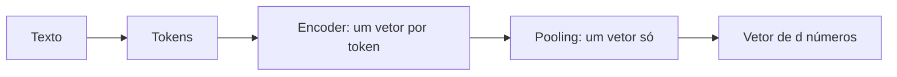

## Passo 1 · Leitura · Um vetor para o texto inteiro

No Nível 6 cada token tinha o seu vetor numa tabela de embeddings, e o vetor de "trancar" mudava durante o treino até ficar perto do de palavras usadas em contextos parecidos. Para buscar documentos você precisa de outra coisa: **um único vetor para uma frase ou um parágrafo inteiro**, de modo que textos com o mesmo assunto fiquem próximos, mesmo sem palavras em comum.

Um **modelo de embedding de texto** faz isso em três etapas:



O encoder é um Transformer que lê todos os tokens ao mesmo tempo, com atenção nos dois sentidos, então o vetor de cada token já carrega o contexto da frase. O *pooling* junta esses vetores num só: a média deles (*mean pooling*) ou o vetor de um token especial do início. O modelo foi treinado com pares de textos que deveriam ficar perto (pergunta e resposta, duas paráfrases) e pares que deveriam ficar longe.

O resultado é um vetor de **dimensão fixa** $d$, que costuma ficar entre algumas centenas e alguns milhares, conforme o modelo. Três consequências práticas:

- **Uma coordenada sozinha não significa nada.** O que tem significado é a *direção* do vetor em relação aos outros vetores do mesmo modelo.
- **Só compare vetores do mesmo modelo.** Dois modelos com $d = 768$ produzem espaços diferentes: a coordenada 17 de um não tem relação com a coordenada 17 do outro. Trocar de modelo exige embutir de novo todos os documentos.
- **A consulta e os documentos passam pelo mesmo modelo**, e o índice precisa registrar qual foi.

Na prática, um provedor ou uma biblioteca local expõe uma função que recebe uma **lista** de textos e devolve uma matriz, uma linha por texto. Mandar em lote é mais barato e mais rápido que um texto por chamada:

```python
matriz = modelo.embutir(["Como trancar a disciplina?", "Prazo de matrícula"])
matriz.shape       # (2, d): uma linha por texto
```

Todo o código deste módulo recebe o `modelo` como parâmetro e só usa `modelo.embutir(textos)`. Por isso, trocar o simulador do curso por um modelo real muda uma linha: a que cria o `modelo`.

## Passo 2 · Leitura · O modelo de embedding simulado do curso

O executor do curso não tem rede nem pesos de modelo, então usamos um **modelo simulado**, no arquivo `embedder_simulado.py`. Ele tem a mesma interface de um modelo real (`embutir(textos)` devolve uma matriz), mas **não aprendeu nada**. É importante saber exatamente o que ele faz, para não tirar conclusões erradas:

1. Quebra o texto em palavras minúsculas, sem acento e sem pontuação.
2. Descarta palavras vazias (`de`, `o`, `para`…) e troca sinônimos de um mapa fixo pela forma canônica: `cancelar` e `desistir` viram `trancar`; `notas` e `boletim` viram `historico`.
3. Cada palavra vira um vetor pseudoaleatório fixo, tirado do hash da palavra **e do nome do modelo**.
4. O vetor do texto é a **soma** dos vetores das palavras.

| | Modelo real | Simulador do curso |
|---|---|---|
| Ordem das palavras | conta | não conta (saco de palavras) |
| Sinônimos | aprendidos no treino | só os do mapa `SINONIMOS` |
| Frases sem palavra em comum | podem ficar próximas | ficam quase ortogonais (cosseno perto de 0) |
| "Não" | muda um pouco o vetor | é só mais uma palavra |
| Mesma entrada, mesmo modelo | mesmo vetor | mesmo vetor |
| Vetor devolvido | normalizado ou não, conforme o provedor | **sem normalizar** |

```python
from embedder_simulado import EmbedderSimulado, tokenizar

modelo = EmbedderSimulado(dim=64)
tokenizar("Quero cancelar a matéria")   # ['quero', 'trancar', 'disciplina']
E = modelo.embutir(["Quero cancelar a matéria", "Quero trancar a disciplina"])
E.shape                                 # (2, 64)
```

As duas frases do exemplo viram exatamente as mesmas palavras canônicas, então recebem o mesmo vetor. "Como pedir o boletim de notas?" e "Emitir histórico escolar" dividem só `historico` e dão cosseno de cerca de 0,27; um modelo real as aproximaria mais.

Repare na última linha da tabela. Como o vetor é uma soma, **um texto com mais palavras tem um vetor mais comprido**. Um texto só de palavras vazias, como `"de da do"`, vira o **vetor nulo**: todas as coordenadas iguais a zero. As duas situações acontecem com modelos reais também e são o assunto dos próximos passos.

## Passo 3 · Previsão · Comprimento não é significado

A consulta e os dois documentos abaixo estão em três dimensões, para dar para fazer a conta de cabeça. O documento `curto` aponta exatamente na direção da consulta; o `longo` aponta para outro lado, mas é comprido. Leia sem executar e digite o que o programa imprime.

### Código
```python
import numpy as np

consulta = np.array([1.0, 1.0, 0.0])
docs = {
    "curto": np.array([2.0, 2.0, 0.0]),
    "longo": np.array([6.0, 2.0, 3.0]),
}
for nome, v in docs.items():
    produto = float(consulta @ v)
    cosseno = produto / float(np.linalg.norm(consulta) * np.linalg.norm(v))
    print(nome, produto, round(cosseno, 2))

print(max(docs, key=lambda n: consulta @ docs[n]))
```

### Dicas
1. `consulta @ v` soma os produtos coordenada a coordenada: só as duas primeiras coordenadas contam.
2. A norma de `[6, 2, 3]` é $\sqrt{36 + 4 + 9} = 7$; a da consulta é $\sqrt{2}$.
3. Vetores na mesma direção têm cosseno 1, qualquer que seja o comprimento.

### Saída esperada
```text
curto 4.0 1.0
longo 8.0 0.81
longo
```

## Passo 4 · Leitura · Cosseno, normalização L2 e o vetor nulo

O passo anterior mostrou o problema: pelo **produto interno** o documento `longo` ganha só por ser comprido. No simulador, comprimento é número de palavras; num modelo real, a norma também varia com o texto e não mede relevância. Para comparar **direções**, use a **similaridade de cosseno**, que você calculou no Nível 5:

$$
\cos(a, b) = \frac{a \cdot b}{\|a\|_2 \, \|b\|_2} \in [-1, 1]
$$

Dividir cada vetor pela sua norma é a **normalização L2**: o resultado tem norma 1 e a mesma direção. Entre vetores normalizados, o cosseno vira um produto interno puro:

$$
\hat{v} = \frac{v}{\|v\|_2}, \qquad \cos(a, b) = \hat{a} \cdot \hat{b}
$$

É por isso que sistemas de busca **normalizam uma vez, ao indexar**, e guardam os vetores unitários. Na hora da busca, a pontuação de todos os documentos contra a consulta é uma multiplicação de matriz. Com os $N$ documentos normalizados nas linhas de $E$ (forma $N \times d$), a matriz $S = E E^\top$ (forma $N \times N$) traz na posição $(i, j)$ o cosseno entre os textos $i$ e $j$, todos de uma vez.

#### Dois erros que aparecem em produção

**Normalizar na direção errada.** Em `np.linalg.norm(E, axis=1, keepdims=True)`, `axis=1` calcula uma norma por **linha** (por texto), e `keepdims=True` mantém a forma `(N, 1)`, que divide cada linha pela sua norma. Sem `keepdims`, a forma vira `(N,)` e o numpy divide cada **coluna** por um número diferente: numa matriz quadrada, isso nem dá erro, só dá o resultado errado.

**O vetor nulo.** Um texto vazio, ou só com palavras vazias, tem norma 0. Dividir por zero no numpy não levanta exceção: emite `RuntimeWarning: invalid value encountered in divide` e devolve `nan`, que contamina toda conta seguinte e bagunça qualquer ordenação. A convenção mais simples é deixar o vetor nulo como está (cosseno 0 com qualquer outro).

Veja as normas por linha e a linha nula preservada:

```python visualizar
import numpy as np

E = np.array([
    [3.0, 4.0],
    [6.0, 8.0],
    [0.0, 0.0],
    [0.0, 2.0],
])
normas = np.linalg.norm(E, axis=1, keepdims=True)
seguras = np.where(normas == 0, 1.0, normas)
unitarios = E / seguras
print(normas.ravel().tolist())
print(unitarios.tolist())
S = unitarios @ unitarios.T
print(S.round(2).tolist())
```

## Passo 5 · Exercício · Normalizar em lote e comparar
modo: lacunas

Complete as lacunas (`___`) das duas funções:

- `normalizar_linhas(matriz)` devolve um array numpy em que cada **linha** foi dividida pela sua norma L2. Linhas nulas continuam nulas (sem `nan`).
- `matriz_cosseno(a, b)` recebe duas matrizes com uma linha por texto (`a` com $M$ linhas, `b` com $N$ linhas, mesma dimensão) e devolve, como lista de listas, a matriz $M \times N$ dos cossenos: a posição `[i][j]` compara a linha `i` de `a` com a linha `j` de `b`.

### Instruções
1. Calcule uma norma por linha, mantendo a forma de coluna para a divisão.
   Dica: confira a forma de `normas` numa matriz 3 × 2.
2. Troque as normas iguais a zero por um valor que deixe a linha nula como está.
3. Em `matriz_cosseno`, normalize as duas matrizes e multiplique de modo que o resultado tenha forma $M \times N$.

### Código inicial
```python
import numpy as np


def normalizar_linhas(matriz):
    arr = np.asarray(matriz, dtype=float)
    normas = np.linalg.norm(arr, axis=___, keepdims=___)
    normas = np.where(normas == 0, ___, normas)
    return arr / normas


def matriz_cosseno(a, b):
    return (normalizar_linhas(a) @ normalizar_linhas(b).___).tolist()
```

### Solução
```python
import numpy as np


def normalizar_linhas(matriz):
    arr = np.asarray(matriz, dtype=float)
    normas = np.linalg.norm(arr, axis=1, keepdims=True)
    normas = np.where(normas == 0, 1.0, normas)
    return arr / normas


def matriz_cosseno(a, b):
    return (normalizar_linhas(a) @ normalizar_linhas(b).T).tolist()
```

### Dicas
1. `axis=1` percorre as colunas de cada linha, ou seja, dá uma norma por texto.
2. Dividir um vetor nulo por 1 não muda nada.
3. Se `a` é $M \times d$ e `b` é $N \times d$, qual das duas precisa ser transposta para o produto dar $M \times N$?

### Verificação
```json
[
  { "id": "norma-basica", "checkpoint": 1, "kind": "expr", "expr": "normalizar_linhas([[3.0, 4.0], [0.0, 5.0]]).tolist()",
    "expected": [[0.6, 0.8], [0.0, 1.0]], "tolerance": 1e-9, "name": "Cada linha passa a ter norma 1" },
  { "id": "norma-retangular", "checkpoint": 1, "kind": "expr",
    "expr": "[list(normalizar_linhas([[1.0, 0.0], [0.0, 2.0], [3.0, 4.0]]).shape), np.linalg.norm(normalizar_linhas([[1.0, 0.0], [0.0, 2.0], [3.0, 4.0]]), axis=1).round(9).tolist()]",
    "expected": [[3, 2], [1.0, 1.0, 1.0]], "name": "Matriz 3 × 2: forma preservada e norma 1 em cada linha",
    "hint": "A norma é por linha; a divisão precisa de normas na forma (3, 1)." },
  { "id": "norma-quadrada", "checkpoint": 1, "kind": "expr", "expr": "normalizar_linhas([[1.0, 0.0], [1.0, 1.0]]).tolist()",
    "expected": [[1.0, 0.0], [0.70710678, 0.70710678]], "tolerance": 1e-6,
    "name": "Matriz quadrada: cada linha dividida pela própria norma",
    "hint": "Numa matriz quadrada, normas na forma errada não dão erro, só o resultado errado." },
  { "id": "linha-nula", "checkpoint": 2, "kind": "expr", "expr": "normalizar_linhas([[0.0, 0.0], [6.0, 8.0]]).tolist()",
    "expected": [[0.0, 0.0], [0.6, 0.8]], "tolerance": 1e-9, "name": "Linha nula continua nula, sem nan",
    "hint": "Dividir por zero dá nan no numpy." },
  { "id": "cos-forma", "checkpoint": 3, "kind": "expr",
    "expr": "[len(matriz_cosseno([[1.0, 0.0], [0.0, 1.0]], [[1.0, 0.0], [0.0, 3.0], [1.0, 1.0]])), len(matriz_cosseno([[1.0, 0.0], [0.0, 1.0]], [[1.0, 0.0], [0.0, 3.0], [1.0, 1.0]])[0])]",
    "expected": [2, 3], "name": "a com 2 linhas e b com 3 dão uma matriz 2 × 3" },
  { "id": "cos-escala", "checkpoint": 3, "kind": "call", "function": "matriz_cosseno",
    "args": [[[1.0, 2.0]], [[10.0, 20.0], [-1.0, -2.0], [2.0, -1.0]]], "expected": [[1.0, -1.0, 0.0]], "tolerance": 1e-9,
    "name": "O cosseno ignora o comprimento: mesma direção 1, oposta -1, ortogonal 0",
    "hint": "As duas matrizes precisam ser normalizadas." },
  { "id": "cos-nulo", "checkpoint": 2, "kind": "call", "function": "matriz_cosseno",
    "args": [[[0.0, 0.0], [3.0, 4.0]], [[4.0, 3.0]]], "expected": [[0.0], [0.96]], "tolerance": 1e-9,
    "name": "Texto com vetor nulo tem cosseno 0 com qualquer outro" }
]
```

### Soluções erradas
```python name="norma por coluna (axis=0)"
import numpy as np


def normalizar_linhas(matriz):
    arr = np.asarray(matriz, dtype=float)
    normas = np.linalg.norm(arr, axis=0, keepdims=True)
    normas = np.where(normas == 0, 1.0, normas)
    return arr / normas


def matriz_cosseno(a, b):
    return (normalizar_linhas(a) @ normalizar_linhas(b).T).tolist()
```
```python name="sem keepdims: divide as colunas"
import numpy as np


def normalizar_linhas(matriz):
    arr = np.asarray(matriz, dtype=float)
    normas = np.linalg.norm(arr, axis=1)
    normas = np.where(normas == 0, 1.0, normas)
    return arr / normas


def matriz_cosseno(a, b):
    return (normalizar_linhas(a) @ normalizar_linhas(b).T).tolist()
```
```python name="divide por zero e devolve nan"
import numpy as np


def normalizar_linhas(matriz):
    arr = np.asarray(matriz, dtype=float)
    normas = np.linalg.norm(arr, axis=1, keepdims=True)
    return arr / normas


def matriz_cosseno(a, b):
    return (normalizar_linhas(a) @ normalizar_linhas(b).T).tolist()
```
```python name="normaliza só os documentos"
import numpy as np


def normalizar_linhas(matriz):
    arr = np.asarray(matriz, dtype=float)
    normas = np.linalg.norm(arr, axis=1, keepdims=True)
    normas = np.where(normas == 0, 1.0, normas)
    return arr / normas


def matriz_cosseno(a, b):
    return (np.asarray(a, dtype=float) @ normalizar_linhas(b).T).tolist()
```
```python name="produto interno sem normalizar"
import numpy as np


def normalizar_linhas(matriz):
    arr = np.asarray(matriz, dtype=float)
    normas = np.linalg.norm(arr, axis=1, keepdims=True)
    normas = np.where(normas == 0, 1.0, normas)
    return arr / normas


def matriz_cosseno(a, b):
    return (np.asarray(a, dtype=float) @ np.asarray(b, dtype=float).T).tolist()
```

## Passo 6 · Exercício · Busca semântica com um modelo trocável

Agora use um modelo de verdade, ou quase: escreva `mais_similares(modelo, consulta, documentos, k)`, que devolve os `k` documentos mais parecidos com a `consulta` como uma lista de pares `[indice, score]`, do maior score para o menor. O `score` é o cosseno arredondado com `round(..., 4)`.

A função só pode usar `modelo.embutir(textos)`: assim ela funciona com o `EmbedderSimulado` e, sem mudar nada, com um modelo real. A verificação usa os dois, e também um modelo falso com vetores escolhidos a dedo.

Regras:
- Em caso de empate no score, vem primeiro o documento de **menor índice**.
- Se `k` for maior que o número de documentos, devolva todos; sem documentos, devolva `[]`.
- Um documento com vetor nulo tem score `0.0`.
- Embuta os documentos **numa chamada só** (em lote): a função pode chamar `modelo.embutir` no máximo duas vezes, uma para os documentos e uma para a consulta.

Exemplo, com o simulador: `mais_similares(modelo, "Quero cancelar a matéria", ["Emitir histórico escolar", "Trancar disciplina no semestre"], 1)` devolve `[[1, 0.5855]]`: as duas frases dividem `trancar` e `disciplina`, mas não `quero` nem `semestre`.

### Instruções
1. Embuta os documentos em lote e a consulta, e normalize os dois lados.
2. Calcule os cossenos e ordene do maior para o menor, com os empates pelo menor índice.
   Dica: `np.argsort(..., kind="stable")` mantém a ordem original entre iguais.
3. Devolva os `k` primeiros como `[int(indice), round(float(score), 4)]`.

### Código inicial
```python
import numpy as np

from embedder_simulado import EmbedderSimulado


def normalizar_linhas(matriz):
    arr = np.asarray(matriz, dtype=float)
    normas = np.linalg.norm(arr, axis=1, keepdims=True)
    normas = np.where(normas == 0, 1.0, normas)
    return arr / normas


def mais_similares(modelo, consulta, documentos, k):
    pass


if __name__ == "__main__":
    modelo = EmbedderSimulado()
    docs = ["Emitir histórico escolar", "Trancar disciplina no semestre", "Horário da biblioteca"]
    print(mais_similares(modelo, "Quero cancelar a matéria", docs, 2))
```
```python path=embedder_simulado.py
"""Modelo de embedding SIMULADO do curso. Não é um modelo treinado.

O que ele faz:
- quebra o texto em palavras minúsculas e sem acento;
- descarta palavras vazias ("de", "o", "para"...) e troca os sinônimos de
  SINONIMOS pela forma canônica ("cancelar" vira "trancar");
- cada palavra vira um vetor pseudoaleatório fixo de `dim` números, tirado do
  hash da palavra junto com o nome do modelo;
- o vetor do texto é a SOMA dos vetores das palavras (saco de palavras).

O que um modelo real faz diferente: lê o texto inteiro com atenção (ordem e
contexto contam), aprendeu paráfrases no treino em vez de usar um mapa fixo e
aproxima frases sem nenhuma palavra em comum.

Como alguns provedores, devolve os vetores SEM normalizar.
"""
import hashlib
import unicodedata

import numpy as np

SINONIMOS = {
    "cancelar": "trancar",
    "desistir": "trancar",
    "trancamento": "trancar",
    "inscrever": "matricular",
    "inscricao": "matricular",
    "matricula": "matricular",
    "boletim": "historico",
    "notas": "historico",
    "materia": "disciplina",
}
PALAVRAS_VAZIAS = {
    "a", "o", "as", "os", "de", "da", "do", "das", "dos", "e", "em", "no",
    "na", "nos", "nas", "um", "uma", "para", "por", "com", "que", "meu", "minha",
}


def tokenizar(texto):
    decomposto = unicodedata.normalize("NFD", texto.lower())
    sem_acento = "".join(c for c in decomposto if not unicodedata.combining(c))
    limpo = "".join(c if c.isalnum() else " " for c in sem_acento)
    return [SINONIMOS.get(p, p) for p in limpo.split() if p not in PALAVRAS_VAZIAS]


class EmbedderSimulado:
    def __init__(self, dim=64, nome="emb-simulado-v1"):
        self.dim = dim
        self.nome = nome
        self.chamadas = 0

    def vetor_da_palavra(self, palavra):
        bruto = hashlib.shake_256(f"{self.nome}:{palavra}".encode("utf-8")).digest(self.dim)
        return np.frombuffer(bruto, dtype=np.uint8) / 127.5 - 1.0

    def embutir(self, textos):
        """Uma linha por texto: matriz (len(textos), dim), sem normalizar."""
        self.chamadas += 1
        matriz = np.zeros((len(textos), self.dim))
        for i, texto in enumerate(textos):
            for palavra in tokenizar(texto):
                matriz[i] += self.vetor_da_palavra(palavra)
        return matriz
```

### Solução
```python
import numpy as np

from embedder_simulado import EmbedderSimulado


def normalizar_linhas(matriz):
    arr = np.asarray(matriz, dtype=float)
    normas = np.linalg.norm(arr, axis=1, keepdims=True)
    normas = np.where(normas == 0, 1.0, normas)
    return arr / normas


def mais_similares(modelo, consulta, documentos, k):
    if not documentos or k <= 0:
        return []
    D = normalizar_linhas(modelo.embutir(documentos))
    q = normalizar_linhas(modelo.embutir([consulta]))[0]
    scores = D @ q
    ordem = np.argsort(-scores, kind="stable")[:k]
    return [[int(i), round(float(scores[i]), 4)] for i in ordem]


if __name__ == "__main__":
    modelo = EmbedderSimulado()
    docs = ["Emitir histórico escolar", "Trancar disciplina no semestre", "Horário da biblioteca"]
    print(mais_similares(modelo, "Quero cancelar a matéria", docs, 2))
```
```python path=embedder_simulado.py
"""Modelo de embedding SIMULADO do curso. Não é um modelo treinado.

O que ele faz:
- quebra o texto em palavras minúsculas e sem acento;
- descarta palavras vazias ("de", "o", "para"...) e troca os sinônimos de
  SINONIMOS pela forma canônica ("cancelar" vira "trancar");
- cada palavra vira um vetor pseudoaleatório fixo de `dim` números, tirado do
  hash da palavra junto com o nome do modelo;
- o vetor do texto é a SOMA dos vetores das palavras (saco de palavras).

O que um modelo real faz diferente: lê o texto inteiro com atenção (ordem e
contexto contam), aprendeu paráfrases no treino em vez de usar um mapa fixo e
aproxima frases sem nenhuma palavra em comum.

Como alguns provedores, devolve os vetores SEM normalizar.
"""
import hashlib
import unicodedata

import numpy as np

SINONIMOS = {
    "cancelar": "trancar",
    "desistir": "trancar",
    "trancamento": "trancar",
    "inscrever": "matricular",
    "inscricao": "matricular",
    "matricula": "matricular",
    "boletim": "historico",
    "notas": "historico",
    "materia": "disciplina",
}
PALAVRAS_VAZIAS = {
    "a", "o", "as", "os", "de", "da", "do", "das", "dos", "e", "em", "no",
    "na", "nos", "nas", "um", "uma", "para", "por", "com", "que", "meu", "minha",
}


def tokenizar(texto):
    decomposto = unicodedata.normalize("NFD", texto.lower())
    sem_acento = "".join(c for c in decomposto if not unicodedata.combining(c))
    limpo = "".join(c if c.isalnum() else " " for c in sem_acento)
    return [SINONIMOS.get(p, p) for p in limpo.split() if p not in PALAVRAS_VAZIAS]


class EmbedderSimulado:
    def __init__(self, dim=64, nome="emb-simulado-v1"):
        self.dim = dim
        self.nome = nome
        self.chamadas = 0

    def vetor_da_palavra(self, palavra):
        bruto = hashlib.shake_256(f"{self.nome}:{palavra}".encode("utf-8")).digest(self.dim)
        return np.frombuffer(bruto, dtype=np.uint8) / 127.5 - 1.0

    def embutir(self, textos):
        """Uma linha por texto: matriz (len(textos), dim), sem normalizar."""
        self.chamadas += 1
        matriz = np.zeros((len(textos), self.dim))
        for i, texto in enumerate(textos):
            for palavra in tokenizar(texto):
                matriz[i] += self.vetor_da_palavra(palavra)
        return matriz
```

### Dicas
1. `modelo.embutir([consulta])` devolve uma matriz de uma linha; pegue a linha `[0]`.
2. `np.argsort` ordena do menor para o maior. Inverter o resultado com `[::-1]` também inverte a ordem dos empates.
3. A `normalizar_linhas` do código inicial já trata o vetor nulo.

### Verificação
```json
[
  { "id": "normaliza", "checkpoint": 1, "kind": "expr",
    "setup": "import numpy as np\nclass ModeloFixo:\n    def __init__(self, vetores):\n        self.vetores = vetores\n        self.chamadas = 0\n    def embutir(self, textos):\n        self.chamadas += 1\n        return np.array([self.vetores[t] for t in textos], dtype=float)\nm = ModeloFixo({'q': [1, 1, 0], 'curto': [2, 2, 0], 'longo': [6, 2, 3], 'outro': [0, 0, 5]})",
    "expr": "mais_similares(m, 'q', ['longo', 'curto', 'outro'], 2)", "expected": [[1, 1.0], [0, 0.8081]], "tolerance": 1e-6,
    "name": "O documento comprido não ganha só pelo comprimento",
    "hint": "Compare direções: normalize documentos e consulta." },
  { "id": "decrescente", "checkpoint": 2, "kind": "expr",
    "setup": "import numpy as np\nclass ModeloFixo:\n    def __init__(self, vetores):\n        self.vetores = vetores\n        self.chamadas = 0\n    def embutir(self, textos):\n        self.chamadas += 1\n        return np.array([self.vetores[t] for t in textos], dtype=float)\nm = ModeloFixo({'q': [1, 0], 'a': [0.2, 1], 'b': [1, 0.1], 'c': [1, 1], 'd': [-1, 0]})",
    "expr": "mais_similares(m, 'q', ['a', 'b', 'c', 'd'], 3)", "expected": [[1, 0.995], [2, 0.7071], [0, 0.1961]], "tolerance": 1e-6,
    "name": "Os k melhores, do maior score para o menor" },
  { "id": "empate", "checkpoint": 2, "kind": "expr",
    "setup": "import numpy as np\nclass ModeloFixo:\n    def __init__(self, vetores):\n        self.vetores = vetores\n        self.chamadas = 0\n    def embutir(self, textos):\n        self.chamadas += 1\n        return np.array([self.vetores[t] for t in textos], dtype=float)\nm = ModeloFixo({'q': [1, 0], 'x': [1, 0], 'y': [2, 0], 'z': [0, 1]})",
    "expr": "mais_similares(m, 'q', ['z', 'x', 'y'], 2)", "expected": [[1, 1.0], [2, 1.0]], "tolerance": 1e-6,
    "name": "Empate no score: o menor índice vem primeiro",
    "hint": "Inverter um argsort crescente também inverte os empates." },
  { "id": "k-grande", "checkpoint": 3, "kind": "expr",
    "setup": "import numpy as np\nclass ModeloFixo:\n    def __init__(self, vetores):\n        self.vetores = vetores\n        self.chamadas = 0\n    def embutir(self, textos):\n        self.chamadas += 1\n        return np.array([self.vetores[t] for t in textos], dtype=float)\nm = ModeloFixo({'q': [0, 1], 'a': [3, 4], 'b': [0, 2]})",
    "expr": "[mais_similares(m, 'q', ['a', 'b'], 10), mais_similares(m, 'q', [], 3)]", "expected": [[[1, 1.0], [0, 0.8]], []], "tolerance": 1e-6,
    "name": "k maior que o número de documentos devolve todos; sem documentos, []" },
  { "id": "nulo", "checkpoint": 1, "kind": "expr",
    "setup": "import numpy as np\nclass ModeloFixo:\n    def __init__(self, vetores):\n        self.vetores = vetores\n        self.chamadas = 0\n    def embutir(self, textos):\n        self.chamadas += 1\n        return np.array([self.vetores[t] for t in textos], dtype=float)\nm = ModeloFixo({'q': [1, 0], 'vazio': [0, 0], 'oposto': [-1, 0]})",
    "expr": "mais_similares(m, 'q', ['oposto', 'vazio'], 2)", "expected": [[1, 0.0], [0, -1.0]], "tolerance": 1e-6,
    "name": "Documento com vetor nulo tem score 0.0, não nan",
    "hint": "Um texto só com palavras vazias vira o vetor nulo." },
  { "id": "lote", "checkpoint": 1, "kind": "expr",
    "setup": "modelo = EmbedderSimulado()\ndocs = ['Emitir histórico escolar', 'Trancar disciplina no semestre', 'Horário da biblioteca', 'Prazo de matrícula', 'Bolsas de estudo']\nres = mais_similares(modelo, 'Quero cancelar a matéria', docs, 2)",
    "expr": "modelo.chamadas <= 2", "expected": true,
    "name": "Os documentos são embutidos em lote (no máximo 2 chamadas ao modelo)",
    "hint": "Um texto por chamada custa uma ida ao provedor por documento." },
  { "id": "simulado", "checkpoint": 2, "kind": "expr",
    "setup": "modelo = EmbedderSimulado()\ndocs = ['Horário da biblioteca', 'Como pedir o boletim de notas', 'Desistir da disciplina de cálculo']\nres = mais_similares(modelo, 'Quero trancar uma matéria', docs, 3)",
    "expr": "[len(res), res[0][0]]", "expected": [3, 2],
    "name": "Com o simulador, o pedido de trancamento acha o texto sobre desistir da disciplina" }
]
```

### Soluções erradas
```python name="produto interno sem normalizar"
import numpy as np

from embedder_simulado import EmbedderSimulado


def mais_similares(modelo, consulta, documentos, k):
    if not documentos or k <= 0:
        return []
    D = np.asarray(modelo.embutir(documentos), dtype=float)
    q = np.asarray(modelo.embutir([consulta]), dtype=float)[0]
    scores = D @ q
    ordem = np.argsort(-scores, kind="stable")[:k]
    return [[int(i), round(float(scores[i]), 4)] for i in ordem]
```
```python name="argsort crescente"
import numpy as np

from embedder_simulado import EmbedderSimulado


def normalizar_linhas(matriz):
    arr = np.asarray(matriz, dtype=float)
    normas = np.linalg.norm(arr, axis=1, keepdims=True)
    normas = np.where(normas == 0, 1.0, normas)
    return arr / normas


def mais_similares(modelo, consulta, documentos, k):
    if not documentos or k <= 0:
        return []
    D = normalizar_linhas(modelo.embutir(documentos))
    q = normalizar_linhas(modelo.embutir([consulta]))[0]
    scores = D @ q
    ordem = np.argsort(scores, kind="stable")[:k]
    return [[int(i), round(float(scores[i]), 4)] for i in ordem]
```
```python name="inverte o argsort e inverte os empates"
import numpy as np

from embedder_simulado import EmbedderSimulado


def normalizar_linhas(matriz):
    arr = np.asarray(matriz, dtype=float)
    normas = np.linalg.norm(arr, axis=1, keepdims=True)
    normas = np.where(normas == 0, 1.0, normas)
    return arr / normas


def mais_similares(modelo, consulta, documentos, k):
    if not documentos or k <= 0:
        return []
    D = normalizar_linhas(modelo.embutir(documentos))
    q = normalizar_linhas(modelo.embutir([consulta]))[0]
    scores = D @ q
    ordem = np.argsort(scores, kind="stable")[::-1][:k]
    return [[int(i), round(float(scores[i]), 4)] for i in ordem]
```
```python name="um documento por chamada"
import numpy as np

from embedder_simulado import EmbedderSimulado


def normalizar_linhas(matriz):
    arr = np.asarray(matriz, dtype=float)
    normas = np.linalg.norm(arr, axis=1, keepdims=True)
    normas = np.where(normas == 0, 1.0, normas)
    return arr / normas


def mais_similares(modelo, consulta, documentos, k):
    if not documentos or k <= 0:
        return []
    D = normalizar_linhas(np.vstack([modelo.embutir([d])[0] for d in documentos]))
    q = normalizar_linhas(modelo.embutir([consulta]))[0]
    scores = D @ q
    ordem = np.argsort(-scores, kind="stable")[:k]
    return [[int(i), round(float(scores[i]), 4)] for i in ordem]
```
```python name="normaliza dividindo direto pela norma"
import numpy as np

from embedder_simulado import EmbedderSimulado


def mais_similares(modelo, consulta, documentos, k):
    if not documentos or k <= 0:
        return []
    D = np.asarray(modelo.embutir(documentos), dtype=float)
    D = D / np.linalg.norm(D, axis=1, keepdims=True)
    q = np.asarray(modelo.embutir([consulta]), dtype=float)[0]
    q = q / np.linalg.norm(q)
    scores = D @ q
    ordem = np.argsort(-scores, kind="stable")[:k]
    return [[int(i), round(float(scores[i]), 4)] for i in ordem]
```

## Passo 7 · Exercício · Encontrar quase duplicatas

A secretaria acadêmica tem centenas de perguntas frequentes escritas por pessoas diferentes ao longo dos anos, e muitas dizem a mesma coisa com outras palavras. Com a matriz $S = E E^\top$ você acha todos os pares parecidos de uma vez.

Escreva `pares_duplicados(modelo, textos, limiar)`, que devolve a lista `[i, j, sim]` de todos os pares com `i < j` cuja similaridade de cosseno, arredondada com `round(..., 4)`, é **maior ou igual** a `limiar`. Cada par aparece uma vez só, nunca um texto com ele mesmo, e a lista sai ordenada por `i` e depois por `j`. Embuta os textos numa chamada só.

Exemplo, com vetores escolhidos a dedo: textos com vetores `[1, 0]`, `[2, 0]` e `[0, 1]` e `limiar = 0.9` dão `[[0, 1, 1.0]]`.

### Instruções
1. Embuta os textos em lote, normalize e calcule a matriz de similaridade.
2. Percorra só os pares com `i < j`.
3. Guarde `[i, j, sim]` quando a similaridade arredondada for maior ou igual ao limiar, na ordem de `i` e `j`.

### Código inicial
```python
import numpy as np

from embedder_simulado import EmbedderSimulado


def normalizar_linhas(matriz):
    arr = np.asarray(matriz, dtype=float)
    normas = np.linalg.norm(arr, axis=1, keepdims=True)
    normas = np.where(normas == 0, 1.0, normas)
    return arr / normas


def pares_duplicados(modelo, textos, limiar):
    pass


if __name__ == "__main__":
    modelo = EmbedderSimulado()
    perguntas = [
        "Como cancelar a matrícula?",
        "Quero trancar a matrícula",
        "Onde vejo meu boletim?",
        "Como consultar as notas?",
    ]
    print(pares_duplicados(modelo, perguntas, 0.6))
```
```python path=embedder_simulado.py
"""Modelo de embedding SIMULADO do curso. Não é um modelo treinado.

O que ele faz:
- quebra o texto em palavras minúsculas e sem acento;
- descarta palavras vazias ("de", "o", "para"...) e troca os sinônimos de
  SINONIMOS pela forma canônica ("cancelar" vira "trancar");
- cada palavra vira um vetor pseudoaleatório fixo de `dim` números, tirado do
  hash da palavra junto com o nome do modelo;
- o vetor do texto é a SOMA dos vetores das palavras (saco de palavras).

O que um modelo real faz diferente: lê o texto inteiro com atenção (ordem e
contexto contam), aprendeu paráfrases no treino em vez de usar um mapa fixo e
aproxima frases sem nenhuma palavra em comum.

Como alguns provedores, devolve os vetores SEM normalizar.
"""
import hashlib
import unicodedata

import numpy as np

SINONIMOS = {
    "cancelar": "trancar",
    "desistir": "trancar",
    "trancamento": "trancar",
    "inscrever": "matricular",
    "inscricao": "matricular",
    "matricula": "matricular",
    "boletim": "historico",
    "notas": "historico",
    "materia": "disciplina",
}
PALAVRAS_VAZIAS = {
    "a", "o", "as", "os", "de", "da", "do", "das", "dos", "e", "em", "no",
    "na", "nos", "nas", "um", "uma", "para", "por", "com", "que", "meu", "minha",
}


def tokenizar(texto):
    decomposto = unicodedata.normalize("NFD", texto.lower())
    sem_acento = "".join(c for c in decomposto if not unicodedata.combining(c))
    limpo = "".join(c if c.isalnum() else " " for c in sem_acento)
    return [SINONIMOS.get(p, p) for p in limpo.split() if p not in PALAVRAS_VAZIAS]


class EmbedderSimulado:
    def __init__(self, dim=64, nome="emb-simulado-v1"):
        self.dim = dim
        self.nome = nome
        self.chamadas = 0

    def vetor_da_palavra(self, palavra):
        bruto = hashlib.shake_256(f"{self.nome}:{palavra}".encode("utf-8")).digest(self.dim)
        return np.frombuffer(bruto, dtype=np.uint8) / 127.5 - 1.0

    def embutir(self, textos):
        """Uma linha por texto: matriz (len(textos), dim), sem normalizar."""
        self.chamadas += 1
        matriz = np.zeros((len(textos), self.dim))
        for i, texto in enumerate(textos):
            for palavra in tokenizar(texto):
                matriz[i] += self.vetor_da_palavra(palavra)
        return matriz
```

### Solução
```python
import numpy as np

from embedder_simulado import EmbedderSimulado


def normalizar_linhas(matriz):
    arr = np.asarray(matriz, dtype=float)
    normas = np.linalg.norm(arr, axis=1, keepdims=True)
    normas = np.where(normas == 0, 1.0, normas)
    return arr / normas


def pares_duplicados(modelo, textos, limiar):
    if len(textos) < 2:
        return []
    E = normalizar_linhas(modelo.embutir(textos))
    S = E @ E.T
    pares = []
    for i in range(len(textos)):
        for j in range(i + 1, len(textos)):
            sim = round(float(S[i, j]), 4)
            if sim >= limiar:
                pares.append([i, j, sim])
    return pares


if __name__ == "__main__":
    modelo = EmbedderSimulado()
    perguntas = [
        "Como cancelar a matrícula?",
        "Quero trancar a matrícula",
        "Onde vejo meu boletim?",
        "Como consultar as notas?",
    ]
    print(pares_duplicados(modelo, perguntas, 0.6))
```
```python path=embedder_simulado.py
"""Modelo de embedding SIMULADO do curso. Não é um modelo treinado.

O que ele faz:
- quebra o texto em palavras minúsculas e sem acento;
- descarta palavras vazias ("de", "o", "para"...) e troca os sinônimos de
  SINONIMOS pela forma canônica ("cancelar" vira "trancar");
- cada palavra vira um vetor pseudoaleatório fixo de `dim` números, tirado do
  hash da palavra junto com o nome do modelo;
- o vetor do texto é a SOMA dos vetores das palavras (saco de palavras).

O que um modelo real faz diferente: lê o texto inteiro com atenção (ordem e
contexto contam), aprendeu paráfrases no treino em vez de usar um mapa fixo e
aproxima frases sem nenhuma palavra em comum.

Como alguns provedores, devolve os vetores SEM normalizar.
"""
import hashlib
import unicodedata

import numpy as np

SINONIMOS = {
    "cancelar": "trancar",
    "desistir": "trancar",
    "trancamento": "trancar",
    "inscrever": "matricular",
    "inscricao": "matricular",
    "matricula": "matricular",
    "boletim": "historico",
    "notas": "historico",
    "materia": "disciplina",
}
PALAVRAS_VAZIAS = {
    "a", "o", "as", "os", "de", "da", "do", "das", "dos", "e", "em", "no",
    "na", "nos", "nas", "um", "uma", "para", "por", "com", "que", "meu", "minha",
}


def tokenizar(texto):
    decomposto = unicodedata.normalize("NFD", texto.lower())
    sem_acento = "".join(c for c in decomposto if not unicodedata.combining(c))
    limpo = "".join(c if c.isalnum() else " " for c in sem_acento)
    return [SINONIMOS.get(p, p) for p in limpo.split() if p not in PALAVRAS_VAZIAS]


class EmbedderSimulado:
    def __init__(self, dim=64, nome="emb-simulado-v1"):
        self.dim = dim
        self.nome = nome
        self.chamadas = 0

    def vetor_da_palavra(self, palavra):
        bruto = hashlib.shake_256(f"{self.nome}:{palavra}".encode("utf-8")).digest(self.dim)
        return np.frombuffer(bruto, dtype=np.uint8) / 127.5 - 1.0

    def embutir(self, textos):
        """Uma linha por texto: matriz (len(textos), dim), sem normalizar."""
        self.chamadas += 1
        matriz = np.zeros((len(textos), self.dim))
        for i, texto in enumerate(textos):
            for palavra in tokenizar(texto):
                matriz[i] += self.vetor_da_palavra(palavra)
        return matriz
```

### Dicas
1. A diagonal de $S$ compara cada texto com ele mesmo e vale 1: não é duplicata.
2. Com o segundo laço começando em `i + 1`, cada par aparece uma vez só e já na ordem pedida.
3. "Maior ou igual" decide o operador; arredonde antes de comparar.

### Verificação
```json
[
  { "id": "pares", "checkpoint": 3, "kind": "expr",
    "setup": "import numpy as np\nclass ModeloFixo:\n    def __init__(self, vetores):\n        self.vetores = vetores\n        self.chamadas = 0\n    def embutir(self, textos):\n        self.chamadas += 1\n        return np.array([self.vetores[t] for t in textos], dtype=float)\nm = ModeloFixo({'a': [1, 0], 'b': [2, 0], 'c': [0, 1], 'd': [0.6, 0.8]})",
    "expr": "pares_duplicados(m, ['a', 'b', 'c', 'd'], 0.6)", "expected": [[0, 1, 1.0], [0, 3, 0.6], [1, 3, 0.6], [2, 3, 0.8]], "tolerance": 1e-6,
    "name": "Todos os pares acima do limiar, cada um uma vez, ordenados por i e j",
    "hint": "Similaridade igual ao limiar entra." },
  { "id": "sem-diagonal", "checkpoint": 2, "kind": "expr",
    "setup": "import numpy as np\nclass ModeloFixo:\n    def __init__(self, vetores):\n        self.vetores = vetores\n        self.chamadas = 0\n    def embutir(self, textos):\n        self.chamadas += 1\n        return np.array([self.vetores[t] for t in textos], dtype=float)\nm = ModeloFixo({'a': [1, 0], 'b': [0, 1]})",
    "expr": "[pares_duplicados(m, ['a', 'a'], 0.9), pares_duplicados(m, ['a'], 0.5), pares_duplicados(m, ['a', 'b'], 0.5)]",
    "expected": [[[0, 1, 1.0]], [], []], "tolerance": 1e-6,
    "name": "Um texto não é duplicata dele mesmo",
    "hint": "A diagonal de E @ E.T é sempre 1." },
  { "id": "normaliza", "checkpoint": 1, "kind": "expr",
    "setup": "import numpy as np\nclass ModeloFixo:\n    def __init__(self, vetores):\n        self.vetores = vetores\n        self.chamadas = 0\n    def embutir(self, textos):\n        self.chamadas += 1\n        return np.array([self.vetores[t] for t in textos], dtype=float)\nm = ModeloFixo({'a': [3, 4], 'b': [6, 8], 'c': [-4, 3]})",
    "expr": "pares_duplicados(m, ['a', 'b', 'c'], -1.0)", "expected": [[0, 1, 1.0], [0, 2, 0.0], [1, 2, 0.0]], "tolerance": 1e-6,
    "name": "A similaridade é o cosseno, entre -1 e 1",
    "hint": "Normalize antes do produto." },
  { "id": "acima", "checkpoint": 3, "kind": "expr",
    "setup": "import numpy as np\nclass ModeloFixo:\n    def __init__(self, vetores):\n        self.vetores = vetores\n        self.chamadas = 0\n    def embutir(self, textos):\n        self.chamadas += 1\n        return np.array([self.vetores[t] for t in textos], dtype=float)\nm = ModeloFixo({'a': [1, 0], 'b': [1, 0], 'c': [0.8, 0.6]})",
    "expr": "[pares_duplicados(m, ['a', 'b', 'c'], 0.8), pares_duplicados(m, ['a', 'b', 'c'], 1.01)]",
    "expected": [[[0, 1, 1.0], [0, 2, 0.8], [1, 2, 0.8]], []], "tolerance": 1e-6,
    "name": "Limiar na borda entra; limiar acima de 1 não acha nada" },
  { "id": "simulado", "checkpoint": 3, "kind": "expr",
    "setup": "modelo = EmbedderSimulado()\nres = pares_duplicados(modelo, ['Quero cancelar a matéria', 'Horário da biblioteca', 'Quero trancar a disciplina'], 0.95)",
    "expr": "[[p[0], p[1]] for p in res]", "expected": [[0, 2]],
    "name": "Com o simulador, as duas formas de pedir trancamento são duplicatas" },
  { "id": "lote", "checkpoint": 1, "kind": "expr",
    "setup": "modelo = EmbedderSimulado()\nres = pares_duplicados(modelo, ['Prazo de matrícula', 'Bolsas de estudo', 'Horário da biblioteca', 'Prazo para inscrição'], 0.5)",
    "expr": "[[[p[0], p[1]] for p in res], modelo.chamadas]", "expected": [[[0, 3]], 1],
    "name": "Uma chamada ao modelo para todos os textos" }
]
```

### Soluções erradas
```python name="inclui a diagonal"
import numpy as np

from embedder_simulado import EmbedderSimulado


def normalizar_linhas(matriz):
    arr = np.asarray(matriz, dtype=float)
    normas = np.linalg.norm(arr, axis=1, keepdims=True)
    normas = np.where(normas == 0, 1.0, normas)
    return arr / normas


def pares_duplicados(modelo, textos, limiar):
    if len(textos) < 2:
        return []
    E = normalizar_linhas(modelo.embutir(textos))
    S = E @ E.T
    pares = []
    for i in range(len(textos)):
        for j in range(i, len(textos)):
            sim = round(float(S[i, j]), 4)
            if sim >= limiar:
                pares.append([i, j, sim])
    return pares
```
```python name="cada par nas duas ordens"
import numpy as np

from embedder_simulado import EmbedderSimulado


def normalizar_linhas(matriz):
    arr = np.asarray(matriz, dtype=float)
    normas = np.linalg.norm(arr, axis=1, keepdims=True)
    normas = np.where(normas == 0, 1.0, normas)
    return arr / normas


def pares_duplicados(modelo, textos, limiar):
    if len(textos) < 2:
        return []
    E = normalizar_linhas(modelo.embutir(textos))
    S = E @ E.T
    pares = []
    for i in range(len(textos)):
        for j in range(len(textos)):
            sim = round(float(S[i, j]), 4)
            if i != j and sim >= limiar:
                pares.append([i, j, sim])
    return pares
```
```python name="maior estrito perde a borda"
import numpy as np

from embedder_simulado import EmbedderSimulado


def normalizar_linhas(matriz):
    arr = np.asarray(matriz, dtype=float)
    normas = np.linalg.norm(arr, axis=1, keepdims=True)
    normas = np.where(normas == 0, 1.0, normas)
    return arr / normas


def pares_duplicados(modelo, textos, limiar):
    if len(textos) < 2:
        return []
    E = normalizar_linhas(modelo.embutir(textos))
    S = E @ E.T
    pares = []
    for i in range(len(textos)):
        for j in range(i + 1, len(textos)):
            sim = round(float(S[i, j]), 4)
            if sim > limiar:
                pares.append([i, j, sim])
    return pares
```
```python name="produto interno sem normalizar"
import numpy as np

from embedder_simulado import EmbedderSimulado


def pares_duplicados(modelo, textos, limiar):
    if len(textos) < 2:
        return []
    E = np.asarray(modelo.embutir(textos), dtype=float)
    S = E @ E.T
    pares = []
    for i in range(len(textos)):
        for j in range(i + 1, len(textos)):
            sim = round(float(S[i, j]), 4)
            if sim >= limiar:
                pares.append([i, j, sim])
    return pares
```
```python name="ordena pela similaridade"
import numpy as np

from embedder_simulado import EmbedderSimulado


def normalizar_linhas(matriz):
    arr = np.asarray(matriz, dtype=float)
    normas = np.linalg.norm(arr, axis=1, keepdims=True)
    normas = np.where(normas == 0, 1.0, normas)
    return arr / normas


def pares_duplicados(modelo, textos, limiar):
    if len(textos) < 2:
        return []
    E = normalizar_linhas(modelo.embutir(textos))
    S = E @ E.T
    pares = []
    for i in range(len(textos)):
        for j in range(i + 1, len(textos)):
            sim = round(float(S[i, j]), 4)
            if sim >= limiar:
                pares.append([i, j, sim])
    return sorted(pares, key=lambda p: -p[2])
```

## Passo 8 · Quiz · Embeddings na prática

### Pergunta
O índice da secretaria tem 50 000 trechos embutidos com o modelo `emb-v1` (dimensão 768). O time passa a embutir as **perguntas** com o `emb-v2`, também de dimensão 768, e a busca começa a devolver trechos sem relação com a pergunta. O que fazer?
- [ ] Nada no índice: a dimensão é a mesma, então basta normalizar de novo os vetores antigos.
- [ ] Embutir com o `emb-v2` só os trechos novos, a partir de agora.
- [x] Embutir de novo todos os trechos com o `emb-v2` (ou voltar as perguntas para o `emb-v1`) e guardar no índice o nome do modelo usado.
- [ ] Aumentar `k` para compensar a queda de qualidade.
> Modelos treinados separadamente produzem espaços diferentes; a mesma dimensão não torna as coordenadas comparáveis. Normalizar não muda direções, e misturar trechos dos dois modelos no mesmo índice só piora a busca. Registrar o modelo no índice evita o erro.

### Pergunta
No simulador, "Quero trancar PRG101" e "Não quero trancar PRG101" têm cosseno 0,87; "Quero trancar PRG101" e "Quero trancar EST202" têm 0,72. Num modelo real os números seriam outros, mas o padrão costuma se repetir. Qual conclusão está certa?
- [ ] Um limiar de similaridade de 0,85 basta para decidir se o aluno quer ou não trancar.
- [x] Embeddings medem proximidade de assunto: negação e códigos exatos mudam pouco o vetor, então decisões desse tipo precisam de outra checagem (regra, busca por palavra exata ou o próprio LLM).
- [ ] O modelo errou: frases com sentidos opostos deveriam ter cosseno -1.
- [ ] Basta aumentar a dimensão do modelo para resolver negação e códigos.
> Cosseno alto quer dizer "falam da mesma coisa", não "dizem a mesma coisa". Frases opostas sobre o mesmo assunto ficam próximas, e trocar um código de disciplina mexe em uma palavra entre várias. A busca lexical para códigos aparece no módulo de RAG.

### Pergunta
Um colega indexou os trechos guardando `modelo.embutir(trechos)` direto e pontua com `scores = E @ q`. O artigo mais longo do regimento aparece em primeiro lugar em quase toda busca. Qual é a causa mais provável?
- [ ] O `argsort` está em ordem crescente.
- [ ] O modelo de embedding é ruim para textos longos e precisa ser trocado.
- [x] Os vetores não foram normalizados: o produto interno cresce com a norma, e textos longos têm normas maiores.
- [ ] Faltou multiplicar `scores` pela dimensão $d$.
> Com vetores sem normalizar, `E @ q` mistura direção e comprimento. Normalizar os trechos ao indexar (e a consulta na busca) transforma o produto interno no cosseno, que só compara direções.
