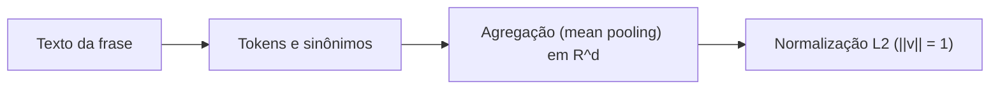

## Passo 1 · Leitura · Representando significado como direção no espaço

No Nível 6, cada token individual era associado a um vetor de parâmetros em $\mathbb{R}^d$. Mas para buscar documentos relevantes em uma base da secretaria acadêmica, não queremos comparar palavras isoladas: queremos um **único vetor que represente o sentido de uma frase ou parágrafo inteiro**. Modelos de *embedding de texto* recebem uma sequência de tokens, passam-na por camadas de atenção bidirecional e aplicam uma agregação (tipicamente *mean pooling*, a média dos vetores dos tokens na última camada) seguida de **normalização L2**.



Por que normalizar cada vetor $v \in \mathbb{R}^d$ para ter norma unitária $\|\hat{v}\|_2 = 1$? Porque a métrica padrão para comparar embeddings é a **similaridade de cosseno**, que mede o cosseno do ângulo entre dois vetores $a$ e $b$, ignorando seus comprimentos. Quando ambos os vetores já estão normalizados ($\|\hat{a}\|_2 = \|\hat{b}\|_2 = 1$), a similaridade de cosseno reduz-se a um simples **produto interno**:

$$\hat{v} = \frac{v}{\|v\|_2}, \qquad \cos(a, b) = \frac{a \cdot b}{\|a\|_2 \, \|b\|_2} = \hat{a} \cdot \hat{b}$$

E se empilharmos $N$ embeddings normalizados nas linhas de uma matriz $E \in \mathbb{R}^{N \times d}$, a matriz $S = E E^\top \in \mathbb{R}^{N \times N}$ contém, na posição $(i, j)$, a similaridade de cosseno entre o texto $i$ e o texto $j$ calculada de uma só vez!

Nos exercícios deste módulo, usamos a função `embedding_simulado(texto, dim=8)`: ela normaliza sinônimos acadêmicos (por exemplo, `"cancelar"` e `"desistir"` convergem para `"trancar"`; `"inscrever"` converge para `"matricular"`) e projeta os tokens em $\mathbb{R}^{\text{dim}}$ de forma 100 % determinística. Em produção, basta substituir essa função pela chamada ao endpoint `/embeddings` do seu provedor ou biblioteca local.

Três cuidados fundamentais com embeddings:
1. **Incompatibilidade entre modelos:** um vetor de dimensão 768 do Modelo A e um vetor de dimensão 768 do Modelo B vivem em sistemas de coordenadas diferentes. Trocar o modelo de embedding exige **reindexar todos os documentos**.
2. **Limitações com negação e códigos exatos:** frases como *"Quero cursar MAC0110"* e *"Não quero cursar MAC0110"* têm similaridade de cosseno altíssima porque compartilham quase o mesmo contexto; e códigos exatos (`MAC0110` vs `MAC0121`) muitas vezes precisam do apoio de busca lexical (que veremos no Módulo 4).

Veja no visualizador como a normalização L2 transforma as linhas de uma matriz em vetores unitários:

```python visualizar
import numpy as np

brutos = np.array([
    [3.0, 4.0, 0.0],
    [6.0, 8.0, 0.0],
    [0.0, 0.0, 5.0],
])

normas = np.linalg.norm(brutos, axis=1, keepdims=True)
unitarios = brutos / normas
matriz_sim = (unitarios @ unitarios.T).round(4).tolist()
```

## Passo 2 · Previsão · Cosseno antes e depois de normalizar

Observe o que acontece com o produto interno bruto (`np.dot`) e com a similaridade de cosseno quando multiplicamos um vetor por $10$ (o que muda seu módulo, mas mantém sua direção).

### Código

```python
import numpy as np

a = np.array([3.0, 4.0])
b = np.array([30.0, 40.0])

dot_bruto = float(np.dot(a, b))

a_norm = a / np.linalg.norm(a)
b_norm = b / np.linalg.norm(b)
cosseno = float(np.dot(a_norm, b_norm))

print("Norma de a:", float(np.linalg.norm(a)))
print("Norma de b:", float(np.linalg.norm(b)))
print("Dot bruto:", dot_bruto)
print("Cosseno:", round(cosseno, 4))
```

### Dicas

1. A norma euclidiana de $(3, 4)$ é $\sqrt{3^2 + 4^2} = 5{,}0$, e a de $(30, 40)$ é $50{,}0$.
2. Como $b = 10 \cdot a$, os dois vetores apontam exatamente na mesma direção, logo $\cos(a, b) = 1{,}0$.

### Saída esperada

```text
Norma de a: 5.0
Norma de b: 50.0
Dot bruto: 250.0
Cosseno: 1.0
```

## Passo 3 · Exercício · Normalização L2 e similaridade

modo: lacunas

Complete as funções `normalizar_linhas(matriz)` e `similaridade(a, b)`:
- Em `normalizar_linhas(matriz)`, converta a entrada para `np.asarray(..., dtype=float)`, calcule a norma L2 de cada linha (`axis=1, keepdims=True`), proteja contra divisão por zero com `np.maximum(normas, 1e-12)` e retorne `(arr / normas_seguras).tolist()`.
- Em `similaridade(a, b)`, retorne a similaridade de cosseno entre os vetores `a` e `b` como um `float` nativo do Python (ou `0.0` se alguma das normas for zero).

### Instruções

1. Em `normalizar_linhas(matriz)`, passe `axis=1` e `keepdims=True` para `np.linalg.norm` e divida `arr` por `normas_seguras`.
2. Em `similaridade(a, b)`, divida `np.dot(va, vb)` pelo produto `na * nb` e converta para `float(...)`.

### Código inicial

```python
import numpy as np


def normalizar_linhas(matriz):
    arr = np.asarray(matriz, dtype=float)
    normas = np.linalg.norm(arr, axis=___, keepdims=True)
    normas_seguras = np.maximum(normas, 1e-12)
    return (arr / ___).tolist()


def similaridade(a, b):
    va = np.asarray(a, dtype=float)
    vb = np.asarray(b, dtype=float)
    na = np.linalg.norm(va)
    nb = np.linalg.norm(vb)
    if na == 0 or nb == 0:
        return 0.0
    return float(np.dot(va, vb) / (___ * ___))


if __name__ == "__main__":
    print(normalizar_linhas([[3.0, 4.0], [0.0, 2.0]]))
    print(similaridade([1.0, 2.0], [2.0, 4.0]))
```

### Solução

```python
import numpy as np


def normalizar_linhas(matriz):
    arr = np.asarray(matriz, dtype=float)
    normas = np.linalg.norm(arr, axis=1, keepdims=True)
    normas_seguras = np.maximum(normas, 1e-12)
    return (arr / normas_seguras).tolist()


def similaridade(a, b):
    va = np.asarray(a, dtype=float)
    vb = np.asarray(b, dtype=float)
    na = np.linalg.norm(va)
    nb = np.linalg.norm(vb)
    if na == 0 or nb == 0:
        return 0.0
    return float(np.dot(va, vb) / (na * nb))


if __name__ == "__main__":
    print(normalizar_linhas([[3.0, 4.0], [0.0, 2.0]]))
    print(similaridade([1.0, 2.0], [2.0, 4.0]))
```

### Dicas

1. Como cada documento é uma linha da matriz, a norma L2 deve ser calculada ao longo das colunas de cada linha (`axis=1`).
2. A similaridade de cosseno divide o produto interno `np.dot(va, vb)` pelo produto das normas `(na * nb)`.

### Verificação

```json
[
  {
    "id": "normaliza-linhas-3-4",
    "name": "Normaliza cada linha para ter norma L2 igual a 1",
    "checkpoint": 1,
    "kind": "call",
    "function": "normalizar_linhas",
    "args": [[[3.0, 4.0], [0.0, 5.0]]],
    "expected": [[0.6, 0.8], [0.0, 1.0]],
    "tolerance": 1e-6
  },
  {
    "id": "sim-paralelos",
    "name": "Similaridade de cosseno entre vetores na mesma direção é 1.0",
    "checkpoint": 2,
    "kind": "call",
    "function": "similaridade",
    "args": [[1.0, 2.0, 3.0], [2.0, 4.0, 6.0]],
    "expected": 1.0,
    "tolerance": 1e-6
  },
  {
    "id": "sim-ortogonais",
    "name": "Similaridade entre vetores ortogonais é 0.0",
    "checkpoint": 2,
    "kind": "call",
    "function": "similaridade",
    "args": [[1.0, 0.0], [0.0, 7.0]],
    "expected": 0.0,
    "tolerance": 1e-6
  }
]
```

### Soluções erradas

```python name="Normaliza ao longo do eixo 0 (colunas) em vez das linhas"
import numpy as np


def normalizar_linhas(matriz):
    arr = np.asarray(matriz, dtype=float)
    normas = np.linalg.norm(arr, axis=0, keepdims=True)
    normas_seguras = np.maximum(normas, 1e-12)
    return (arr / normas_seguras).tolist()


def similaridade(a, b):
    va = np.asarray(a, dtype=float)
    vb = np.asarray(b, dtype=float)
    return float(np.dot(va, vb) / (np.linalg.norm(va) * np.linalg.norm(vb)))
```

```python name="Retorna o produto interno bruto sem dividir pelas normas"
import numpy as np


def normalizar_linhas(matriz):
    arr = np.asarray(matriz, dtype=float)
    normas = np.linalg.norm(arr, axis=1, keepdims=True)
    return (arr / np.maximum(normas, 1e-12)).tolist()


def similaridade(a, b):
    va = np.asarray(a, dtype=float)
    vb = np.asarray(b, dtype=float)
    return float(np.dot(va, vb))
```

## Passo 4 · Exercício · Embutir textos e matriz de similaridade

Usando a função `embedding_simulado(texto)` fornecida no código inicial, implemente:
1. `embutir(textos)`: aplica `embedding_simulado(t)` para cada string `t` de `textos`, normaliza todas as linhas para norma L2 unitária e retorna uma lista de listas de `float` (`list[list[float]]`).
2. `matriz_de_similaridade(textos)`: obtém a matriz normalizada $E$ dos `textos` e retorna a matriz de similaridades $(E E^\top)$ como lista de listas de `float` (`.tolist()`).

### Instruções

1. Em `embutir(textos)`, gere a matriz de vetores com `embedding_simulado`, normalize cada linha pela sua norma L2 e retorne `.tolist()`.
2. Em `matriz_de_similaridade(textos)`, multiplique a matriz normalizada $E$ pela sua transposta $E^\top$ (`E @ E.T`) e retorne `.tolist()`.

### Código inicial

```python
import hashlib
import numpy as np

SINONIMOS = {
    "cancelar": "trancar",
    "desistir": "trancar",
    "trancamento": "trancar",
    "inscrever": "matricular",
    "inscricao": "matricular",
    "matricula": "matricular",
    "boletim": "historico",
    "notas": "historico",
}


def embedding_simulado(texto, dim=8):
    vetor = np.zeros(dim, dtype=float)
    limpo = "".join(c.lower() if c.isalnum() else " " for c in texto)
    for token in limpo.split():
        canon = SINONIMOS.get(token, token)
        h = hashlib.sha256(canon.encode("utf-8")).digest()
        for j in range(dim):
            sinal = 1.0 if (h[j] % 2 == 0) else -1.0
            peso = 1.0 + (h[j + dim] / 255.0)
            vetor[j] += sinal * peso
    norma = np.linalg.norm(vetor)
    if norma > 0:
        vetor = vetor / norma
    return vetor


def embutir(textos):
    # Gere os embeddings normalizados para a lista de textos e devolva .tolist()
    pass


def matriz_de_similaridade(textos):
    # Calcule a matriz N x N de similaridades de cosseno e devolva .tolist()
    pass


if __name__ == "__main__":
    frases = [
        "Quero trancar a disciplina",
        "Desejo cancelar a materia",
        "Pedir boletim de notas",
    ]
    print(np.round(matriz_de_similaridade(frases), 3))
```

### Solução

```python
import hashlib
import numpy as np

SINONIMOS = {
    "cancelar": "trancar",
    "desistir": "trancar",
    "trancamento": "trancar",
    "inscrever": "matricular",
    "inscricao": "matricular",
    "matricula": "matricular",
    "boletim": "historico",
    "notas": "historico",
}


def embedding_simulado(texto, dim=8):
    vetor = np.zeros(dim, dtype=float)
    limpo = "".join(c.lower() if c.isalnum() else " " for c in texto)
    for token in limpo.split():
        canon = SINONIMOS.get(token, token)
        h = hashlib.sha256(canon.encode("utf-8")).digest()
        for j in range(dim):
            sinal = 1.0 if (h[j] % 2 == 0) else -1.0
            peso = 1.0 + (h[j + dim] / 255.0)
            vetor[j] += sinal * peso
    norma = np.linalg.norm(vetor)
    if norma > 0:
        vetor = vetor / norma
    return vetor


def embutir(textos):
    if not textos:
        return []
    mat = np.vstack([embedding_simulado(t) for t in textos])
    normas = np.linalg.norm(mat, axis=1, keepdims=True)
    normas = np.maximum(normas, 1e-12)
    return (mat / normas).tolist()


def matriz_de_similaridade(textos):
    mat = np.asarray(embutir(textos), dtype=float)
    return (mat @ mat.T).tolist()


if __name__ == "__main__":
    frases = [
        "Quero trancar a disciplina",
        "Desejo cancelar a materia",
        "Pedir boletim de notas",
    ]
    print(np.round(matriz_de_similaridade(frases), 3))
```

### Dicas

1. Use `np.asarray(embutir(textos), dtype=float)` para ter a matriz $E$ com linhas de norma 1.
2. O produto matricial `mat @ mat.T` calcula todos os produtos internos par a par de uma só vez. Não se esqueça de chamar `.tolist()` no retorno.

### Verificação

```json
[
  {
    "id": "embutir-norma-unitaria",
    "name": "embutir devolve vetores com norma L2 igual a 1.0",
    "checkpoint": 1,
    "kind": "expr",
    "setup": "E = np.asarray(embutir(['Trancar MAC0110', 'Emitir historico escolar']))",
    "expr": "[list(E.shape), [round(float(x), 6) for x in np.linalg.norm(E, axis=1)]]",
    "expected": [[2, 8], [1.0, 1.0]]
  },
  {
    "id": "matriz-simetrica-e-sinonimos",
    "name": "matriz_de_similaridade tem diagonal 1.0 e dá maior score a frases sinônimas",
    "checkpoint": 2,
    "kind": "expr",
    "setup": "S = matriz_de_similaridade(['trancar disciplina', 'cancelar disciplina', 'emitir boletim'])",
    "expr": "[round(S[0][0], 5), round(S[1][1], 5), S[0][1] > S[0][2], round(S[0][1] - S[1][0], 6)]",
    "expected": [1.0, 1.0, true, 0.0]
  }
]
```

### Soluções erradas

```python name="Não normaliza os vetores e retorna soma em vez de produto matricial"
import hashlib
import numpy as np


def embedding_simulado(texto, dim=8):
    return np.ones(dim, dtype=float) * len(texto)


def embutir(textos):
    return [embedding_simulado(t).tolist() for t in textos]


def matriz_de_similaridade(textos):
    mat = np.asarray(embutir(textos), dtype=float)
    return (mat @ mat.T).tolist()
```

```python name="Retorna matriz identidade fixa sem comparar os embeddings"
import numpy as np


def embutir(textos):
    return np.ones((len(textos), 8)).tolist()


def matriz_de_similaridade(textos):
    return np.eye(len(textos)).tolist()
```

## Passo 5 · Exercício · Mais similares e pares próximos

Com os embeddings normalizados, podemos responder a duas perguntas recorrentes em sistemas de IA:
1. **Busca semântica (`mais_similares(consulta, textos, k)`):** dado o texto `consulta` e uma lista `textos`, devolve os `k` índices (`list[int]`) de `textos` mais similares à `consulta`, ordenados da **maior para a menor** similaridade.
2. **Deduplicação semântica (`pares_proximos(textos, limiar)`):** encontra todos os pares distintos `(i, j)` com `0 <= i < j < len(textos)` cuja similaridade de cosseno seja `>= limiar`, retornando uma lista de listas `[i, j, round(float(sim), 6)]` ordenada por `(i, j)`.

### Instruções

1. Implemente `mais_similares(consulta, textos, k)` calculando a similaridade de cosseno entre `embedding_simulado(consulta)` e cada item de `textos` e retornando os `k` índices (`int`) de maior similaridade em ordem decrescente.
2. Implemente `pares_proximos(textos, limiar)` percorrendo apenas os pares com `i < j` (sem incluir a diagonal `i == j` nem repetir `(j, i)`) e retornando `[i, j, round(float(sim), 6)]` para aqueles com `sim >= limiar`.

### Código inicial

```python
import hashlib
import numpy as np

SINONIMOS = {
    "cancelar": "trancar",
    "desistir": "trancar",
    "trancamento": "trancar",
    "inscrever": "matricular",
    "inscricao": "matricular",
    "matricula": "matricular",
    "boletim": "historico",
    "notas": "historico",
}


def embedding_simulado(texto, dim=8):
    vetor = np.zeros(dim, dtype=float)
    limpo = "".join(c.lower() if c.isalnum() else " " for c in texto)
    for token in limpo.split():
        canon = SINONIMOS.get(token, token)
        h = hashlib.sha256(canon.encode("utf-8")).digest()
        for j in range(dim):
            sinal = 1.0 if (h[j] % 2 == 0) else -1.0
            peso = 1.0 + (h[j + dim] / 255.0)
            vetor[j] += sinal * peso
    norma = np.linalg.norm(vetor)
    if norma > 0:
        vetor = vetor / norma
    return vetor


def mais_similares(consulta, textos, k):
    # Retorne os k índices (int) mais similares à consulta em ordem decrescente
    pass


def pares_proximos(textos, limiar):
    # Retorne [[i, j, round(float(sim), 6)], ...] para i < j com sim >= limiar
    pass


if __name__ == "__main__":
    docs = [
        "Emitir boletim de notas",
        "Trancar matricula no semestre",
        "Cancelar inscricao no semestre",
    ]
    print("Top 2:", mais_similares("Quero desistir da matricula", docs, 2))
    print("Pares >= 0.8:", pares_proximos(docs, 0.8))
```

### Solução

```python
import hashlib
import numpy as np

SINONIMOS = {
    "cancelar": "trancar",
    "desistir": "trancar",
    "trancamento": "trancar",
    "inscrever": "matricular",
    "inscricao": "matricular",
    "matricula": "matricular",
    "boletim": "historico",
    "notas": "historico",
}


def embedding_simulado(texto, dim=8):
    vetor = np.zeros(dim, dtype=float)
    limpo = "".join(c.lower() if c.isalnum() else " " for c in texto)
    for token in limpo.split():
        canon = SINONIMOS.get(token, token)
        h = hashlib.sha256(canon.encode("utf-8")).digest()
        for j in range(dim):
            sinal = 1.0 if (h[j] % 2 == 0) else -1.0
            peso = 1.0 + (h[j + dim] / 255.0)
            vetor[j] += sinal * peso
    norma = np.linalg.norm(vetor)
    if norma > 0:
        vetor = vetor / norma
    return vetor


def mais_similares(consulta, textos, k):
    q = embedding_simulado(consulta)
    mat = np.vstack([embedding_simulado(t) for t in textos])
    scores = mat @ q
    ordem = np.argsort(-scores)[:k]
    return [int(idx) for idx in ordem]


def pares_proximos(textos, limiar):
    mat = np.vstack([embedding_simulado(t) for t in textos])
    sim_mat = mat @ mat.T
    n = len(textos)
    pares = []
    for i in range(n):
        for j in range(i + 1, n):
            s = float(sim_mat[i, j])
            if s >= limiar:
                pares.append([int(i), int(j), round(s, 6)])
    return pares


if __name__ == "__main__":
    docs = [
        "Emitir boletim de notas",
        "Trancar matricula no semestre",
        "Cancelar inscricao no semestre",
    ]
    print("Top 2:", mais_similares("Quero desistir da matricula", docs, 2))
    print("Pares >= 0.8:", pares_proximos(docs, 0.8))
```

### Dicas

1. Em `mais_similares`, converta cada índice de `np.argsort(-scores)[:k]` com `int(idx)` para devolver inteiros nativos do Python.
2. Em `pares_proximos`, o segundo laço deve começar em `range(i + 1, n)` para excluir a diagonal `i == i` e evitar pares duplicados `[j, i]`.

### Verificação

```json
[
  {
    "id": "top-k-sinonimos",
    "name": "mais_similares posiciona os documentos sobre trancamento no topo",
    "checkpoint": 1,
    "kind": "call",
    "function": "mais_similares",
    "args": [
      "cancelar matricula",
      [
        "emitir historico escolar",
        "trancar inscricao",
        "cancelar matricula no semestre"
      ],
      2
    ],
    "expected": [1, 2]
  },
  {
    "id": "pares-proximos-sem-diagonal",
    "name": "pares_proximos identifica duplicatas semânticas apenas para i < j",
    "checkpoint": 2,
    "kind": "call",
    "function": "pares_proximos",
    "args": [
      [
        "trancar matricula",
        "emitir boletim",
        "cancelar inscricao"
      ],
      0.95
    ],
    "expected": [[0, 2, 1.0]],
    "tolerance": 1e-6
  }
]
```

### Soluções erradas

```python name="Ordena os índices do menos similar para o mais similar"
import hashlib
import numpy as np

SINONIMOS = {
    "cancelar": "trancar",
    "desistir": "trancar",
    "trancamento": "trancar",
    "inscrever": "matricular",
    "inscricao": "matricular",
    "matricula": "matricular",
    "boletim": "historico",
    "notas": "historico",
}


def embedding_simulado(texto, dim=8):
    vetor = np.zeros(dim, dtype=float)
    limpo = "".join(c.lower() if c.isalnum() else " " for c in texto)
    for token in limpo.split():
        canon = SINONIMOS.get(token, token)
        h = hashlib.sha256(canon.encode("utf-8")).digest()
        for j in range(dim):
            sinal = 1.0 if (h[j] % 2 == 0) else -1.0
            peso = 1.0 + (h[j + dim] / 255.0)
            vetor[j] += sinal * peso
    norma = np.linalg.norm(vetor)
    return vetor / norma if norma > 0 else vetor


def mais_similares(consulta, textos, k):
    q = embedding_simulado(consulta)
    mat = np.vstack([embedding_simulado(t) for t in textos])
    scores = mat @ q
    return [int(idx) for idx in np.argsort(scores)[:k]]


def pares_proximos(textos, limiar):
    return []
```

```python name="Inclui a diagonal i == j em pares_proximos"
import hashlib
import numpy as np

SINONIMOS = {
    "cancelar": "trancar",
    "desistir": "trancar",
    "trancamento": "trancar",
    "inscrever": "matricular",
    "inscricao": "matricular",
    "matricula": "matricular",
    "boletim": "historico",
    "notas": "historico",
}


def embedding_simulado(texto, dim=8):
    vetor = np.zeros(dim, dtype=float)
    limpo = "".join(c.lower() if c.isalnum() else " " for c in texto)
    for token in limpo.split():
        canon = SINONIMOS.get(token, token)
        h = hashlib.sha256(canon.encode("utf-8")).digest()
        for j in range(dim):
            sinal = 1.0 if (h[j] % 2 == 0) else -1.0
            peso = 1.0 + (h[j + dim] / 255.0)
            vetor[j] += sinal * peso
    norma = np.linalg.norm(vetor)
    return vetor / norma if norma > 0 else vetor


def mais_similares(consulta, textos, k):
    q = embedding_simulado(consulta)
    mat = np.vstack([embedding_simulado(t) for t in textos])
    scores = mat @ q
    return [int(idx) for idx in np.argsort(-scores)[:k]]


def pares_proximos(textos, limiar):
    mat = np.vstack([embedding_simulado(t) for t in textos])
    sim_mat = mat @ mat.T
    n = len(textos)
    pares = []
    for i in range(n):
        for j in range(i, n):
            if sim_mat[i, j] >= limiar:
                pares.append([int(i), int(j), round(float(sim_mat[i, j]), 6)])
    return pares
```

## Passo 6 · Quiz · Embeddings, normalização e similaridade

### Pergunta

Quando todos os vetores de um índice foram previamente normalizados para ter norma euclidiana $\|\hat{v}\|_2 = 1$, a similaridade de cosseno $\cos(\hat{a}, \hat{b})$ é matematicamente igual a qual operação?

- [ ] À soma dos quadrados das diferenças $\sum (\hat{a}_j - \hat{b}_j)^2$.
- [x] Ao produto interno $\hat{a} \cdot \hat{b}$.
- [ ] Ao determinante da matriz $\hat{a} \hat{b}^\top$.
- [ ] Ao máximo entre $\hat{a}$ e $\hat{b}$.

> Pela definição $\cos(a, b) = \frac{a \cdot b}{\|a\|_2 \|b\|_2}$, quando $\|a\|_2 = \|b\|_2 = 1$, o denominador vale $1$ e a similaridade de cosseno coincide exatamente com o produto interno.

### Pergunta

Você indexou 50 000 documentos da universidade com o modelo de embedding `emb-v1` (dimensão 768). Agora decidiu atualizar o código da busca para embutir as perguntas dos alunos com um novo modelo `emb-v2` (também de dimensão 768). O que você precisa fazer?

- [ ] Nada: como ambos têm 768 dimensões, os vetores são diretamente compatíveis.
- [x] Reindexar todos os 50 000 documentos com o `emb-v2`, pois modelos diferentes aprendem rotações e espaços vetoriais incompatíveis entre si.
- [ ] Apenas multiplicar os vetores antigos por $-1$.
- [ ] Ordenar as coordenadas de cada vetor em ordem crescente.

> As coordenadas de modelos treinados separadamente não têm correspondência semântica entre si, mesmo quando a dimensão coincide. Consulta e documentos precisam sempre ser embutidos pelo mesmo modelo.

### Pergunta

Em qual tipo de consulta os embeddings densos sozinhos costumam apresentar maior dificuldade, exigindo o complemento de busca lexical (como BM25)?

- [ ] Encontrar sinônimos como `"cancelar"` e `"desistir"`.
- [ ] Agrupar parágrafos sobre o mesmo tema geral.
- [x] Buscar códigos alfanuméricos exatos, números de protocolo ou siglas raras (como `"MAC0121"` vs `"MAC0110"`).
- [ ] Medir proximidade temática entre dois resumos.

> Embeddings comprimem o sentido geral da frase em um vetor contínuo e podem aproximar códigos parecidos (`MAC0110` e `MAC0121`) ou diluir um identificador exato no meio do parágrafo.
