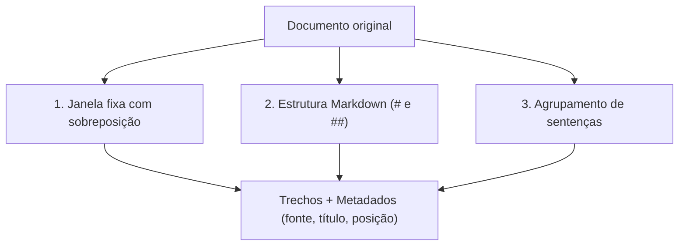

## Passo 1 · Leitura · Por que e como fatiar documentos antes de indexar

O regimento de graduação da USP tem dezenas de páginas. Se você tentar transformar um documento inteiro de 40 páginas em um único vetor de embedding, dois problemas acontecem: primeiro, ele estoura o limite de entrada do modelo de embedding; segundo, a média (*pooling*) de milhares de frases sobre assuntos diferentes — matrícula, trancamento, jubilamento, colação de grau — produz um vetor "morno" que não é especificamente similar a nenhuma pergunta pontual.

Por isso, antes de indexar documentos para um sistema RAG, nós os dividimos em trechos menores chamados **chunks**. Escolher a estratégia de *chunking* envolve equilibrar um dilema fundamental:
- **Trechos curtos demais** perdem o contexto: uma frase isolada como *"O prazo máximo é de 60 dias"* não diz a que procedimento esse prazo se refere!
- **Trechos longos demais** diluem a representação vetorial e desperdiçam espaço na janela de contexto do LLM com parágrafos irrelevantes.



Três estratégias complementares são essenciais na caixa de ferramentas:

1. **Tamanho fixo com sobreposição (*overlap*):** desliza uma janela de tamanho $T$ avançando de $P = T - S$ em $P$ unidades (onde $S < T$ é a sobreposição). A faixa de sobreposição garante que uma frase importante que caia bem na fronteira do corte apareça inteira em pelo menos um dos dois trechos consecutivos.
2. **Por estrutura Markdown (`#` e `##`):** corta o documento nas divisões lógicas escritas pelo autor e **injeta o título da seção dentro do texto do trecho e nos metadados**. Assim, o trecho *"Trancamento Parcial: O prazo máximo é de 60 dias"* carrega consigo o assunto a que pertence.
3. **Por sentenças:** agrupa frases completas (`"."`, `"!"`, `"?"`) até atingir um limite `max_chars`, sem nunca cortar uma palavra ou frase ao meio.

Veja no visualizador como a janela com `tamanho = 20` e `sobreposicao = 5` caminha com `passo = 15`:

```python visualizar
texto = "Artigo 10: O trancamento parcial exige 12 creditos."
tamanho = 20
sobreposicao = 5
passo = tamanho - sobreposicao

trechos = []
for inicio in range(0, len(texto), passo):
    fatia = texto[inicio : inicio + tamanho]
    trechos.append((inicio, inicio + len(fatia), fatia))
    if inicio + tamanho >= len(texto):
        break
```

## Passo 2 · Exercício · Chunking de tamanho fixo com sobreposição

modo: lacunas

Complete `chunk_fixo(texto, tamanho, sobreposicao=0)`:
- Se `tamanho <= 0` ou `sobreposicao < 0` ou `sobreposicao >= tamanho`, levante `ValueError("Parâmetros de janela inválidos")` (pois `sobreposicao >= tamanho` resultaria em `passo <= 0`, travando em laço infinito!).
- Caso contrário, avance com `passo = tamanho - sobreposicao`, coletando fatias `texto[i : i + tamanho]` e parando assim que `i + tamanho >= len(texto)`.

### Instruções

1. Valide `sobreposicao >= tamanho` para levantar `ValueError` e calcule `passo = tamanho - sobreposicao`.
2. Recorte `texto[i : i + tamanho]` em cada passo da janela.

### Código inicial

```python
def chunk_fixo(texto, tamanho, sobreposicao=0):
    if tamanho <= 0 or sobreposicao < 0 or sobreposicao >= ___:
        raise ValueError("Parâmetros de janela inválidos")
    if not texto:
        return []
    passo = tamanho - ___
    trechos = []
    for i in range(0, len(texto), passo):
        trechos.append(texto[i : i + ___])
        if i + tamanho >= len(texto):
            break
    return trechos


if __name__ == "__main__":
    print(chunk_fixo("ABCDEFGHIJ", 4, 1))
```

### Solução

```python
def chunk_fixo(texto, tamanho, sobreposicao=0):
    if tamanho <= 0 or sobreposicao < 0 or sobreposicao >= tamanho:
        raise ValueError("Parâmetros de janela inválidos")
    if not texto:
        return []
    passo = tamanho - sobreposicao
    trechos = []
    for i in range(0, len(texto), passo):
        trechos.append(texto[i : i + tamanho])
        if i + tamanho >= len(texto):
            break
    return trechos


if __name__ == "__main__":
    print(chunk_fixo("ABCDEFGHIJ", 4, 1))
```

### Dicas

1. A sobreposição nunca pode ser maior ou igual a `tamanho`; caso contrário, `passo = tamanho - sobreposicao` seria zero ou negativo.
2. Cada fatia começa em `i` e termina em `i + tamanho`.

### Verificação

```json
[
  {
    "id": "janela-com-overlap",
    "name": "Fatia texto respeitando tamanho e sobreposição",
    "checkpoint": 2,
    "kind": "call",
    "function": "chunk_fixo",
    "args": ["ABCDEFGHIJ", 4, 1],
    "expected": ["ABCD", "DEFG", "GHIJ"]
  },
  {
    "id": "rejeita-overlap-invalido",
    "name": "Levanta ValueError quando sobreposicao >= tamanho",
    "checkpoint": 1,
    "kind": "expr",
    "expr": "chunk_fixo('Texto de teste', 5, 5)",
    "raises": "ValueError"
  }
]
```

### Soluções erradas

```python name="Avança de tamanho em tamanho ignorando a sobreposição"
def chunk_fixo(texto, tamanho, sobreposicao=0):
    if tamanho <= 0 or sobreposicao < 0 or sobreposicao >= tamanho:
        raise ValueError("Inválido")
    return [texto[i : i + tamanho] for i in range(0, len(texto), tamanho)]
```

```python name="Não valida sobreposicao >= tamanho"
def chunk_fixo(texto, tamanho, sobreposicao=0):
    passo = max(1, tamanho - sobreposicao)
    return [texto[i : i + tamanho] for i in range(0, len(texto), passo)]
```

## Passo 3 · Exercício · Chunking por estrutura Markdown com metadados

Documentos normativos da universidade costumam ser estruturados com títulos `#` e `##`. Implemente `chunk_por_markdown(texto, fonte)` que divide um documento Markdown por suas seções e anexa metadados completos para citação:

- Percorra `texto.splitlines()`. Sempre que encontrar uma linha que (após `.strip()`) comece com `"#"` (como `"# Regimento"` ou `"## Matrícula"`), extraia o título removendo os caracteres `"#"` da esquerda e espaços (`linha.lstrip("#").strip()`).
- As demais linhas não vazias pertencem ao corpo da seção atual (junte as linhas do corpo da mesma seção com um espaço `" "`). Se houver linhas antes do primeiro cabeçalho, use `"Introdução"` como título.
- Ignore seções que tenham corpo vazio (por exemplo, um título `# Geral` seguido imediatamente de `## Específico` sem parágrafos entre eles).
- Para cada seção com conteúdo, adicione um dicionário:
  `{"fonte": fonte, "titulo": titulo_atual, "posicao": idx, "texto": f"{titulo_atual}: {corpo}"}` onde `idx` é a posição sequencial `0, 1, 2...` entre os trechos gerados.

### Instruções

1. Identifique cabeçalhos Markdown (`linha.strip().startswith("#")`) para atualizar `titulo_atual = linha.strip().lstrip("#").strip()`.
2. Agrupe as linhas não vazias abaixo de cada cabeçalho formando o `corpo` da seção.
3. Para cada seção com corpo não vazio, gere `{"fonte": fonte, "titulo": titulo, "posicao": posicao, "texto": f"{titulo}: {corpo}"}`.

### Código inicial

```python
def chunk_por_markdown(texto, fonte):
    # Divida o documento por cabeçalhos # e ## preservando título e metadados
    pass


if __name__ == "__main__":
    doc = (
        "# Regimento USP\n"
        "## Matrícula\n"
        "O aluno deve se inscrever em no mínimo 12 créditos.\n"
        "## Trancamento\n"
        "O trancamento parcial ocorre até o 60o dia letivo."
    )
    print(chunk_por_markdown(doc, "regimento.md"))
```

### Solução

```python
def chunk_por_markdown(texto, fonte):
    secoes = []
    titulo_atual = "Introdução"
    linhas_corpo = []

    for linha in texto.splitlines():
        limpa = linha.strip()
        if not limpa:
            continue
        if limpa.startswith("#"):
            if linhas_corpo:
                corpo = " ".join(linhas_corpo)
                secoes.append((titulo_atual, corpo))
                linhas_corpo = []
            titulo_atual = limpa.lstrip("#").strip()
        else:
            linhas_corpo.append(limpa)

    if linhas_corpo:
        secoes.append((titulo_atual, " ".join(linhas_corpo)))

    resultado = []
    for idx, (titulo, corpo) in enumerate(secoes):
        resultado.append(
            {
                "fonte": fonte,
                "titulo": titulo,
                "posicao": idx,
                "texto": f"{titulo}: {corpo}",
            }
        )
    return resultado


if __name__ == "__main__":
    doc = (
        "# Regimento USP\n"
        "## Matrícula\n"
        "O aluno deve se inscrever em no mínimo 12 créditos.\n"
        "## Trancamento\n"
        "O trancamento parcial ocorre até o 60o dia letivo."
    )
    print(chunk_por_markdown(doc, "regimento.md"))
```

### Dicas

1. Quando encontrar uma nova linha começando com `"#"`, se `linhas_corpo` já tiver texto acumulado, feche a seção anterior antes de trocar `titulo_atual`.
2. Incluir `f"{titulo}: {corpo}"` no campo `"texto"` garante que o modelo de embedding saiba a qual seção aquela regra pertence!

### Verificação

```json
[
  {
    "id": "markdown-secoes-e-metadados",
    "name": "Extrai seções Markdown com fonte, título, posição e prefixo no texto",
    "checkpoint": 3,
    "kind": "call",
    "function": "chunk_por_markdown",
    "args": [
      "# Regimento\n## Matrícula\nMinimo de 12 creditos.\nSempre pelo sistema.\n## Trancamento\nPrazo de 60 dias.",
      "regimento.md"
    ],
    "expected": [
      {
        "fonte": "regimento.md",
        "titulo": "Matrícula",
        "posicao": 0,
        "texto": "Matrícula: Minimo de 12 creditos. Sempre pelo sistema."
      },
      {
        "fonte": "regimento.md",
        "titulo": "Trancamento",
        "posicao": 1,
        "texto": "Trancamento: Prazo de 60 dias."
      }
    ]
  }
]
```

### Soluções erradas

```python name="Não inclui o título da seção no campo texto do trecho"
def chunk_por_markdown(texto, fonte):
    secoes = []
    titulo_atual = "Introdução"
    linhas_corpo = []
    for linha in texto.splitlines():
        limpa = linha.strip()
        if not limpa:
            continue
        if limpa.startswith("#"):
            if linhas_corpo:
                secoes.append((titulo_atual, " ".join(linhas_corpo)))
                linhas_corpo = []
            titulo_atual = limpa.lstrip("#").strip()
        else:
            linhas_corpo.append(limpa)
    if linhas_corpo:
        secoes.append((titulo_atual, " ".join(linhas_corpo)))
    return [
        {"fonte": fonte, "titulo": t, "posicao": i, "texto": c}
        for i, (t, c) in enumerate(secoes)
    ]
```

```python name="Cria trechos vazios para cabeçalhos sem corpo"
def chunk_por_markdown(texto, fonte):
    partes = texto.split("#")
    res = []
    for i, p in enumerate(partes):
        if p.strip():
            linhas = p.strip().splitlines()
            t = linhas[0].strip()
            c = " ".join(linhas[1:]).strip()
            res.append({"fonte": fonte, "titulo": t, "posicao": i, "texto": f"{t}: {c}"})
    return res
```

## Passo 4 · Exercício · Chunking por sentenças e avaliação na recuperação

Para textos corridos sem cabeçalhos Markdown, dividimos em sentenças completas e agrupamos sentenças consecutivas enquanto couberem em `max_chars`. Em seguida, medimos como a estratégia de *chunking* afeta o `recall@3` na recuperação!

Implemente:
1. `chunk_por_sentencas(texto, max_chars)`:
   - Separe `texto` em sentenças usando `re.split(r"(?<=[.!?])\s+", texto.strip())` (filtrando sentenças vazias).
   - Agrupe sentenças consecutivas separadas por `" "` enquanto `len(atual) + 1 + len(sentenca) <= max_chars`. Quando a próxima sentença fizer estourar `max_chars`, feche o trecho atual e inicie um novo com `sentenca`.
   - Retorne a lista de strings dos trechos formados.
2. `avaliar_chunking(estrategia, corpus, perguntas)`:
   - `corpus` é uma lista de strings (documentos); aplica `estrategia(doc)` a cada documento para formar uma lista única `todos_trechos` (`list[str]`).
   - Embute cada trecho usando `embedding_simulado(trecho)` fornecido.
   - Para cada item de `perguntas` (`{"pergunta": str, "termo_esperado": str}`), busca os **3 trechos mais similares** à pergunta e considera acerto se `item["termo_esperado"].lower()` aparecer em pelo menos um desses 3 trechos.
   - Retorna a fração de perguntas acertadas (`acertos / len(perguntas)`) como `float`.

### Instruções

1. Implemente `chunk_por_sentencas(texto, max_chars)` agrupando sentenças completas sem ultrapassar `max_chars` (quando já houver sentença no grupo atual).
2. Implemente `avaliar_chunking(estrategia, corpus, perguntas)` medindo o `recall@3` por presença de `termo_esperado` nos 3 trechos mais similares.

### Código inicial

```python
import hashlib
import re
import numpy as np


def embedding_simulado(texto, dim=12):
    vetor = np.zeros(dim, dtype=float)
    palavras = "".join(c.lower() if c.isalnum() else " " for c in texto).split()
    for p in palavras:
        h = hashlib.sha256(p.encode("utf-8")).digest()
        for j in range(dim):
            vetor[j] += (1.0 if h[j] % 2 == 0 else -1.0)
    n = np.linalg.norm(vetor)
    return vetor / n if n > 0 else vetor


def chunk_por_sentencas(texto, max_chars):
    # Divida em sentenças e agrupe sem estourar max_chars
    pass


def avaliar_chunking(estrategia, corpus, perguntas):
    # Gere os trechos com estrategia, recupere top-3 para cada pergunta e calcule o recall@3
    pass


if __name__ == "__main__":
    txt = "A matricula abre na segunda. O prazo termina na sexta. O trancamento exige 12 creditos."
    print(chunk_por_sentencas(txt, 60))
```

### Solução

```python
import hashlib
import re
import numpy as np


def embedding_simulado(texto, dim=12):
    vetor = np.zeros(dim, dtype=float)
    palavras = "".join(c.lower() if c.isalnum() else " " for c in texto).split()
    for p in palavras:
        h = hashlib.sha256(p.encode("utf-8")).digest()
        for j in range(dim):
            vetor[j] += (1.0 if h[j] % 2 == 0 else -1.0)
    n = np.linalg.norm(vetor)
    return vetor / n if n > 0 else vetor


def chunk_por_sentencas(texto, max_chars):
    limpo = texto.strip()
    if not limpo:
        return []
    sentencas = [s.strip() for s in re.split(r"(?<=[.!?])\s+", limpo) if s.strip()]
    trechos = []
    atual = ""
    for s in sentencas:
        if not atual:
            atual = s
        elif len(atual) + 1 + len(s) <= max_chars:
            atual = f"{atual} {s}"
        else:
            trechos.append(atual)
            atual = s
    if atual:
        trechos.append(atual)
    return trechos


def avaliar_chunking(estrategia, corpus, perguntas):
    if not perguntas:
        return 0.0
    todos_trechos = []
    for doc in corpus:
        todos_trechos.extend(estrategia(doc))
    if not todos_trechos:
        return 0.0

    mat = np.vstack([embedding_simulado(t) for t in todos_trechos])
    acertos = 0
    for item in perguntas:
        q = embedding_simulado(item["pergunta"])
        scores = mat @ q
        top3 = np.argsort(-scores)[:3]
        alvo = item["termo_esperado"].lower()
        if any(alvo in todos_trechos[int(i)].lower() for i in top3):
            acertos += 1
    return float(acertos / len(perguntas))


if __name__ == "__main__":
    txt = "A matricula abre na segunda. O prazo termina na sexta. O trancamento exige 12 creditos."
    print(chunk_por_sentencas(txt, 60))
```

### Dicas

1. Em `chunk_por_sentencas`, ao testar se a próxima sentença `s` cabe no trecho `atual`, lembre-se do espaço `" "` entre elas: `len(atual) + 1 + len(s) <= max_chars`.
2. Não se esqueça de adicionar o último `atual` em `trechos` após o término do laço `for`.

### Verificação

```json
[
  {
    "id": "sentencas-agrupadas",
    "name": "Agrupa sentenças completas sem cortar palavras nem estourar max_chars",
    "checkpoint": 1,
    "kind": "call",
    "function": "chunk_por_sentencas",
    "args": [
      "Primeira frase curta. Segunda frase media. Terceira frase final.",
      45
    ],
    "expected": [
      "Primeira frase curta. Segunda frase media.",
      "Terceira frase final."
    ]
  },
  {
    "id": "avalia-estrategia-recuperacao",
    "name": "avaliar_chunking mede o recall@3 superior do chunking por sentenças sobre documento inteiro",
    "checkpoint": 2,
    "kind": "expr",
    "setup": "doc = 'A disciplina MAC0110 ensina introducao a computacao em Python. O trancamento parcial exige manter doze creditos matriculados. O restaurante universitario abre para almoco as onze horas. A biblioteca funciona ate as vinte e duas horas.'\npergs = [{'pergunta': 'quantos creditos manter no trancamento parcial', 'termo_esperado': 'doze'}, {'pergunta': 'ate que horas funciona a biblioteca', 'termo_esperado': 'vinte'}]\nr_bom = avaliar_chunking(lambda d: chunk_por_sentencas(d, 70), [doc], pergs)",
    "expr": "r_bom",
    "expected": 1.0,
    "tolerance": 1e-6
  }
]
```

### Soluções erradas

```python name="Corta o texto em caracteres fixos quebrando palavras e sentenças ao meio"
def chunk_por_sentencas(texto, max_chars):
    return [texto[i : i + max_chars] for i in range(0, len(texto), max_chars)]


def avaliar_chunking(estrategia, corpus, perguntas):
    return 0.0
```

```python name="Junta todas as sentenças em um único trecho ignorando max_chars"
import re


def chunk_por_sentencas(texto, max_chars):
    sentencas = [s.strip() for s in re.split(r"(?<=[.!?])\s+", texto.strip()) if s.strip()]
    return [" ".join(sentencas)]


def avaliar_chunking(estrategia, corpus, perguntas):
    return 1.0
```

## Passo 5 · Quiz · Estratégias de chunking e metadados

### Pergunta

No *chunking* de tamanho fixo com janela deslizante, por que a sobreposição (`sobreposicao`) precisa ser estritamente menor que o tamanho do trecho (`tamanho`)?

- [ ] Porque o modelo de embedding só aceita números primos.
- [x] Porque o passo de avanço da janela é `passo = tamanho - sobreposicao`; se `sobreposicao >= tamanho`, a janela não avança (passo $\le 0$), gerando um laço infinito ou trechos duplicados.
- [ ] Porque qualquer sobreposição maior que zero apaga os metadados.
- [ ] Porque `numpy` não permite fatiar strings.

> A cada iteração a janela avança `tamanho - sobreposicao` posições. Uma sobreposição de $10\%$ a $20\%$ do tamanho do trecho preserva o contexto nas bordas mantendo avanço positivo.

### Pergunta

Por que em `chunk_por_markdown` concatenamos o título da seção (`"Trancamento: Prazo de 60 dias."`) dentro do texto do próprio trecho antes de gerar o embedding?

- [ ] Apenas para gastar mais tokens na chamada de API.
- [x] Porque o parágrafo isolado pode omitir o sujeito a que se refere; incluir o título da seção no texto garante que o embedding capture tanto o tópico (`"Trancamento"`) quanto a regra (`"60 dias"`).
- [ ] Porque o Markdown proíbe guardar o título nos metadados.
- [ ] Para impedir que o trecho seja citado pelo LLM.

> Em documentos hierárquicos, o cabeçalho da seção contém o contexto semântico que desambigua prazos, valores e regras descritos nos parágrafos filhos.

### Pergunta

O que costuma acontecer com a qualidade da busca vetorial quando cada *chunk* tem $5\,000$ palavras misturando dezenas de assuntos diferentes?

- [ ] A busca fica mais precisa para perguntas específicas de uma linha.
- [x] O vetor resultante da agregação (*pooling*) mistura muitos temas distintos, diluindo o sinal de uma informação específica e reduzindo a similaridade com perguntas pontuais.
- [ ] A dimensão $d$ do vetor é multiplicada por $5\,000$.
- [ ] O índice vetorial deixa de precisar de normalização L2.

> Um embedding de dimensão fixa tem capacidade limitada: quanto mais assuntos desconexos são comprimidos no mesmo vetor, menor a resolução para recuperar um fato específico.
