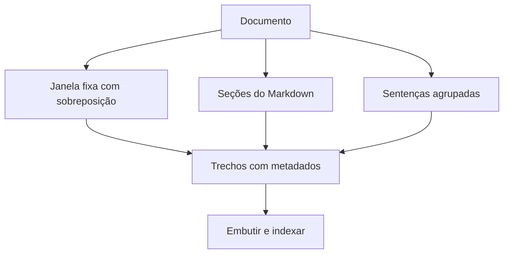

## Passo 1 · Leitura · Por que fatiar antes de indexar

O regimento de graduação tem dezenas de páginas: matrícula, trancamento, jubilamento, colação de grau. Embutir o documento inteiro num vetor só dá errado de três jeitos:

1. **Limite de entrada.** Todo modelo de embedding aceita um número máximo de tokens por texto. Passou disso, a API recusa ou, pior, **corta em silêncio** e embute só o começo.
2. **Vetor diluído.** O vetor de um texto é uma espécie de média do que ele diz. A média de vinte assuntos não fica perto de nenhuma pergunta específica: "qual o prazo de trancamento?" acha o regimento inteiro meio parecido, e mais nada.
3. **Contexto do LLM.** No RAG (próximo módulo), o que a busca devolve vai para o prompt. Devolver 40 páginas para responder uma linha custa tokens, tempo e atenção do modelo.

Por isso os documentos são cortados em **trechos** (*chunks*) antes de indexar. O tamanho é um compromisso: trecho curto demais perde o contexto ("O prazo é de 60 dias." prazo de quê?); trecho longo demais volta a diluir o vetor.



As três estratégias desta lição respeitam cada vez mais a estrutura do texto. A **janela fixa** corta a cada tantos caracteres, sem olhar o conteúdo; a **sobreposição** repete o fim de um trecho no começo do seguinte, para que uma frase cortada na fronteira apareça inteira em pelo menos um deles. O corte **por sentenças** nunca parte uma frase. O corte **por seções** usa os títulos que o autor escreveu.

Todo trecho carrega **metadados**: de que arquivo veio, em que seção, em que posição. Eles servem para citar a fonte na resposta, para filtrar a busca (lição 02) e para achar o trecho vizinho quando o contexto faltar.

```python
{"fonte": "regimento.md", "titulo": "Regimento > Trancamento", "posicao": 7,
 "texto": "Regimento > Trancamento: O trancamento parcial pode ser pedido até o 60º dia letivo."}
```

Nesta lição o tamanho é medido em **caracteres**, para as contas ficarem simples. Em produção, meça em tokens do tokenizador do modelo de embedding, que é o que o limite de entrada conta.

## Passo 2 · Exercício · Janela fixa com sobreposição
modo: lacunas

Complete as lacunas (`___`) de `chunk_fixo(texto, tamanho, sobreposicao=0)`. Ela devolve uma lista de trechos `{"inicio": i, "fim": f, "texto": texto[i:f]}`, cada um com até `tamanho` caracteres, em que cada trecho começa `sobreposicao` caracteres antes do fim do anterior. O último trecho termina exatamente no fim do texto, e nenhum trecho fica inteiro dentro do anterior. Texto vazio dá `[]`.

Parâmetros inválidos levantam `ValueError("a sobreposição precisa ficar entre 0 e tamanho - 1")`: com `sobreposicao >= tamanho`, o passo seria zero ou negativo e o laço nunca terminaria.

Exemplo: `chunk_fixo("ABCDEFGHIJK", 4, 1)` dá os textos `ABCD`, `DEFG`, `GHIJ` e `JK`, com `inicio` 0, 3, 6 e 9.

### Instruções
1. Recuse `sobreposicao` fora do intervalo de 0 a `tamanho - 1` e calcule o passo da janela.
2. Limite o fim de cada trecho ao tamanho do texto.
3. Pare assim que um trecho alcançar o fim do texto.

### Código inicial
```python
def chunk_fixo(texto, tamanho, sobreposicao=0):
    if tamanho <= 0 or not 0 <= sobreposicao < ___:
        raise ValueError("a sobreposição precisa ficar entre 0 e tamanho - 1")
    passo = tamanho - ___
    trechos = []
    inicio = 0
    while inicio < len(texto):
        fim = min(inicio + tamanho, ___)
        trechos.append({"inicio": inicio, "fim": fim, "texto": texto[inicio:fim]})
        if fim == ___:
            break
        inicio += passo
    return trechos
```

### Solução
```python
def chunk_fixo(texto, tamanho, sobreposicao=0):
    if tamanho <= 0 or not 0 <= sobreposicao < tamanho:
        raise ValueError("a sobreposição precisa ficar entre 0 e tamanho - 1")
    passo = tamanho - sobreposicao
    trechos = []
    inicio = 0
    while inicio < len(texto):
        fim = min(inicio + tamanho, len(texto))
        trechos.append({"inicio": inicio, "fim": fim, "texto": texto[inicio:fim]})
        if fim == len(texto):
            break
        inicio += passo
    return trechos
```

### Dicas
1. A janela anda `tamanho - sobreposicao` caracteres por vez.
2. Sem limitar o `fim`, o último trecho diria que termina depois do fim do texto.
3. Sem a parada, a janela daria mais um passo e criaria um trecho que já está inteiro dentro do anterior.

### Verificação
```json
[
  { "id": "exemplo", "checkpoint": 1, "kind": "expr", "expr": "[t['texto'] for t in chunk_fixo('ABCDEFGHIJ', 4, 1)]",
    "expected": ["ABCD", "DEFG", "GHIJ"], "name": "Janela de 4 com sobreposição de 1" },
  { "id": "posicoes", "checkpoint": 2, "kind": "expr", "expr": "[[t['inicio'], t['fim']] for t in chunk_fixo('ABCDEFGHIJK', 4, 1)]",
    "expected": [[0, 4], [3, 7], [6, 10], [9, 11]], "name": "O último trecho é mais curto e termina no fim do texto",
    "hint": "O fim de um trecho nunca passa do tamanho do texto." },
  { "id": "sem-sobra", "checkpoint": 3, "kind": "expr", "expr": "[t['texto'] for t in chunk_fixo('ABCDEFG', 4, 1)]",
    "expected": ["ABCD", "DEFG"], "name": "Quando um trecho chega ao fim, não sobra um trecho repetido",
    "hint": "Um trecho só com o G estaria inteiro dentro de DEFG." },
  { "id": "sem-sobreposicao", "checkpoint": 1, "kind": "expr", "expr": "[t['texto'] for t in chunk_fixo('ABCDEFGH', 4)]",
    "expected": ["ABCD", "EFGH"], "name": "Sobreposição 0: trechos encostados" },
  { "id": "curto-e-vazio", "checkpoint": 2, "kind": "expr", "expr": "[chunk_fixo('Oi', 10, 3), chunk_fixo('', 5, 1)]",
    "expected": [[{ "inicio": 0, "fim": 2, "texto": "Oi" }], []], "name": "Texto menor que a janela vira um trecho; texto vazio, nenhum" },
  { "id": "cobertura", "checkpoint": 3, "kind": "expr",
    "setup": "texto = 'O trancamento parcial pode ser pedido até o 60º dia letivo, pelo sistema acadêmico.'\nts = chunk_fixo(texto, 20, 5)",
    "expr": "[ts[0]['inicio'] == 0, ts[-1]['fim'] == len(texto), all(b['inicio'] == a['fim'] - 5 for a, b in zip(ts, ts[1:])), ''.join(t['texto'][5 if i else 0:] for i, t in enumerate(ts)) == texto]",
    "expected": [true, true, true, true], "name": "Os trechos cobrem o texto inteiro, sem buraco, com 5 caracteres repetidos em cada emenda" },
  { "id": "invalida-igual", "checkpoint": 1, "kind": "expr", "expr": "chunk_fixo('Texto de teste', 5, 5)", "raises": "ValueError",
    "message_contains": "sobreposição", "name": "Sobreposição igual ao tamanho é recusada" },
  { "id": "invalida-negativa", "checkpoint": 1, "kind": "expr", "expr": "chunk_fixo('Texto de teste', 5, -1)", "raises": "ValueError",
    "message_contains": "sobreposição", "name": "Sobreposição negativa é recusada" }
]
```

### Soluções erradas
```python name="passo igual ao tamanho"
def chunk_fixo(texto, tamanho, sobreposicao=0):
    if tamanho <= 0 or not 0 <= sobreposicao < tamanho:
        raise ValueError("a sobreposição precisa ficar entre 0 e tamanho - 1")
    passo = tamanho
    trechos = []
    inicio = 0
    while inicio < len(texto):
        fim = min(inicio + tamanho, len(texto))
        trechos.append({"inicio": inicio, "fim": fim, "texto": texto[inicio:fim]})
        if fim == len(texto):
            break
        inicio += passo
    return trechos
```
```python name="só janelas completas: perde o fim do texto"
def chunk_fixo(texto, tamanho, sobreposicao=0):
    if tamanho <= 0 or not 0 <= sobreposicao < tamanho:
        raise ValueError("a sobreposição precisa ficar entre 0 e tamanho - 1")
    passo = tamanho - sobreposicao
    trechos = []
    inicio = 0
    while inicio + tamanho <= len(texto):
        trechos.append({"inicio": inicio, "fim": inicio + tamanho, "texto": texto[inicio:inicio + tamanho]})
        inicio += passo
    return trechos
```
```python name="sem parada: trecho repetido no fim"
def chunk_fixo(texto, tamanho, sobreposicao=0):
    if tamanho <= 0 or not 0 <= sobreposicao < tamanho:
        raise ValueError("a sobreposição precisa ficar entre 0 e tamanho - 1")
    passo = tamanho - sobreposicao
    trechos = []
    inicio = 0
    while inicio < len(texto):
        fim = min(inicio + tamanho, len(texto))
        trechos.append({"inicio": inicio, "fim": fim, "texto": texto[inicio:fim]})
        inicio += passo
    return trechos
```
```python name="fim sem limite"
def chunk_fixo(texto, tamanho, sobreposicao=0):
    if tamanho <= 0 or not 0 <= sobreposicao < tamanho:
        raise ValueError("a sobreposição precisa ficar entre 0 e tamanho - 1")
    passo = tamanho - sobreposicao
    trechos = []
    inicio = 0
    while inicio < len(texto):
        fim = inicio + tamanho
        trechos.append({"inicio": inicio, "fim": fim, "texto": texto[inicio:fim]})
        if fim >= len(texto):
            break
        inicio += passo
    return trechos
```
```python name="aceita sobreposição negativa"
def chunk_fixo(texto, tamanho, sobreposicao=0):
    if tamanho <= 0 or sobreposicao >= tamanho:
        raise ValueError("a sobreposição precisa ficar entre 0 e tamanho - 1")
    passo = tamanho - sobreposicao
    trechos = []
    inicio = 0
    while inicio < len(texto):
        fim = min(inicio + tamanho, len(texto))
        trechos.append({"inicio": inicio, "fim": fim, "texto": texto[inicio:fim]})
        if fim == len(texto):
            break
        inicio += passo
    return trechos
```

## Passo 3 · Leitura · Respeitar as fronteiras do texto

A janela fixa não sabe o que é uma palavra. Com 30 caracteres, "O aluno deve se inscrever em no mínimo 12 créditos." vira "O aluno deve se inscrever em n" e "o mínimo 12 créditos.": nenhum dos dois trechos responde "quantos créditos no mínimo?" sozinho. A sobreposição ameniza, mas o remédio de verdade é **cortar onde o texto já se divide**.

#### Sentenças

A ideia simples é cortar depois de `.`, `!` ou `?` seguido de espaço. Em texto normativo ela quebra justamente onde não deve: "Art. 5", "Prof. Ana", "inc. II". Um divisor melhor anda palavra por palavra e só fecha a sentença quando a palavra termina em pontuação final **e não é uma abreviação conhecida**. Um número como `2.50` não tem espaço depois do ponto, então não corta.

Com as sentenças separadas, o **agrupamento guloso** junta sentenças vizinhas enquanto o trecho couber em `max_chars`, contando o espaço entre elas; a sentença que não cabe abre um trecho novo. Uma sentença maior que `max_chars` vira um trecho sozinha: é melhor um trecho um pouco grande do que uma frase partida ao meio.

#### Seções

Documentos em Markdown já dizem onde os assuntos mudam: os títulos `#`, `##`, `###`. Cortar por seção dá trechos que tratam de um assunto só. E há um ganho extra: o título **entra no texto do trecho**. Um parágrafo como "O prazo é de 60 dias letivos." não diz de que prazo fala; com o caminho de títulos na frente, "Regimento > Trancamento: O prazo é de 60 dias letivos.", o vetor carrega o assunto e a busca por "prazo de trancamento" o encontra.

O caminho respeita os níveis: um `##` novo troca o `##` anterior e mantém o `#` de cima; um `#` novo zera tudo abaixo dele. E só é título a linha com `#` seguido de **espaço**: `#5` ou `#hashtag` são texto.

Veja o agrupamento guloso de sentenças em ação:

```python visualizar
sentencas = [
    "A matrícula abre na segunda.",
    "O prazo termina na sexta.",
    "Pedidos atrasados vão para a secretaria.",
    "O mínimo é de 12 créditos.",
]
max_chars = 60
trechos = []
atual = ""
for s in sentencas:
    if not atual:
        atual = s
    elif len(atual) + 1 + len(s) <= max_chars:
        atual = atual + " " + s
    else:
        trechos.append(atual)
        atual = s
trechos.append(atual)
for t in trechos:
    print(len(t), t)
```

## Passo 4 · Previsão · Onde o ponto engana

O programa usa o corte ingênuo por pontuação seguida de espaço. Leia sem executar e digite o que ele imprime.

### Código
```python
import re

texto = "Conforme o Art. 5, o prazo é de 30 dias. A taxa é de R$ 2.50 por via. Fale com a Prof. Ana!"
partes = re.split(r"(?<=[.!?])\s+", texto)
print(len(partes))
for parte in partes:
    print(parte)
```

### Dicas
1. `(?<=[.!?])\s+` corta nos espaços que vêm logo depois de `.`, `!` ou `?`; a pontuação fica no pedaço da esquerda.
2. Em `2.50` o ponto não é seguido de espaço.
3. O regex não sabe o que é uma abreviação.

### Saída esperada
```text
5
Conforme o Art.
5, o prazo é de 30 dias.
A taxa é de R$ 2.50 por via.
Fale com a Prof.
Ana!
```

## Passo 5 · Exercício · Sentenças inteiras até max_chars

Escreva duas funções:

1. `dividir_sentencas(texto)`: percorre as palavras de `texto.split()` e fecha uma sentença depois da palavra que termina em `.`, `!` ou `?`, **exceto** quando a palavra termina em `.` e, sem o ponto e em minúsculas, está em `ABREVIACOES` (já no código inicial). As palavras de cada sentença são unidas por um espaço; o que sobrar no fim, mesmo sem pontuação, é a última sentença.
2. `chunk_por_sentencas(texto, max_chars)`: junta sentenças vizinhas, separadas por um espaço, enquanto o trecho tiver no máximo `max_chars` caracteres; a sentença que não cabe abre um trecho novo; uma sentença maior que `max_chars` fica sozinha num trecho. `max_chars <= 0` levanta `ValueError`. Texto vazio dá `[]`.

Exemplo: `chunk_por_sentencas("Primeira frase curta. Segunda frase media. Terceira frase final.", 45)` dá `["Primeira frase curta. Segunda frase media.", "Terceira frase final."]`: o primeiro trecho tem 42 caracteres e, com a terceira, teria 64.

### Instruções
1. Em `dividir_sentencas`, feche a sentença na pontuação final, menos depois de uma abreviação.
2. Em `chunk_por_sentencas`, junte as sentenças enquanto o trecho, contando o espaço, couber em `max_chars`.
3. Deixe sozinha, sem cortar, a sentença maior que `max_chars`, e não esqueça o último trecho.

### Código inicial
```python
ABREVIACOES = {"art", "prof", "profa", "dr", "dra", "sr", "sra", "inc", "n"}


def dividir_sentencas(texto):
    pass


def chunk_por_sentencas(texto, max_chars):
    pass


if __name__ == "__main__":
    texto = "Conforme o Art. 5, o prazo é de 30 dias. A taxa é de R$ 2.50 por via. Fale com a Prof. Ana!"
    print(dividir_sentencas(texto))
    print(chunk_por_sentencas(texto, 60))
```

### Solução
```python
ABREVIACOES = {"art", "prof", "profa", "dr", "dra", "sr", "sra", "inc", "n"}


def dividir_sentencas(texto):
    sentencas = []
    atual = []
    for palavra in texto.split():
        atual.append(palavra)
        termina = palavra[-1] in ".!?"
        abreviacao = palavra.endswith(".") and palavra[:-1].lower() in ABREVIACOES
        if termina and not abreviacao:
            sentencas.append(" ".join(atual))
            atual = []
    if atual:
        sentencas.append(" ".join(atual))
    return sentencas


def chunk_por_sentencas(texto, max_chars):
    if max_chars <= 0:
        raise ValueError("max_chars precisa ser positivo")
    trechos = []
    atual = ""
    for sentenca in dividir_sentencas(texto):
        if not atual:
            atual = sentenca
        elif len(atual) + 1 + len(sentenca) <= max_chars:
            atual = atual + " " + sentenca
        else:
            trechos.append(atual)
            atual = sentenca
    if atual:
        trechos.append(atual)
    return trechos


if __name__ == "__main__":
    texto = "Conforme o Art. 5, o prazo é de 30 dias. A taxa é de R$ 2.50 por via. Fale com a Prof. Ana!"
    print(dividir_sentencas(texto))
    print(chunk_por_sentencas(texto, 60))
```

### Dicas
1. `palavra[:-1].lower()` tira o ponto final e deixa a comparação com `ABREVIACOES` independente de maiúsculas.
2. O tamanho do trecho depois de juntar é `len(atual) + 1 + len(sentenca)`: o 1 é o espaço.
3. Começar cada trecho com a sentença atual, quando ele está vazio, evita criar um trecho vazio antes de uma sentença comprida.

### Verificação
```json
[
  { "id": "basico", "checkpoint": 1, "kind": "call", "function": "dividir_sentencas",
    "args": ["A matrícula abre na segunda. O prazo termina na sexta! Dúvidas?"],
    "expected": ["A matrícula abre na segunda.", "O prazo termina na sexta!", "Dúvidas?"], "name": "Corta em ponto, exclamação e interrogação" },
  { "id": "abreviacao", "checkpoint": 1, "kind": "call", "function": "dividir_sentencas",
    "args": ["Conforme o Art. 5, o prazo é de 30 dias. Fale com a Prof. Ana!"],
    "expected": ["Conforme o Art. 5, o prazo é de 30 dias.", "Fale com a Prof. Ana!"], "name": "Não corta depois de Art. nem de Prof.",
    "hint": "Compare a palavra sem o ponto, em minúsculas, com ABREVIACOES." },
  { "id": "espacos", "checkpoint": 1, "kind": "call", "function": "dividir_sentencas",
    "args": ["A taxa é 2.50 reais.\n\nPague   até sexta.\nSem multa"],
    "expected": ["A taxa é 2.50 reais.", "Pague até sexta.", "Sem multa"], "name": "Decimal não corta, quebras de linha viram espaço e a sobra final é uma sentença" },
  { "id": "agrupa", "checkpoint": 2, "kind": "call", "function": "chunk_por_sentencas",
    "args": ["Primeira frase curta. Segunda frase media. Terceira frase final.", 45],
    "expected": ["Primeira frase curta. Segunda frase media.", "Terceira frase final."], "name": "Agrupa enquanto cabe em max_chars" },
  { "id": "borda", "checkpoint": 2, "kind": "call", "function": "chunk_por_sentencas",
    "args": ["Primeira frase curta. Segunda frase media. Terceira frase final.", 42],
    "expected": ["Primeira frase curta. Segunda frase media.", "Terceira frase final."], "name": "Trecho com exatamente max_chars caracteres cabe" },
  { "id": "espaco-conta", "checkpoint": 2, "kind": "call", "function": "chunk_por_sentencas",
    "args": ["Primeira frase curta. Segunda frase media. Terceira frase final.", 41],
    "expected": ["Primeira frase curta.", "Segunda frase media.", "Terceira frase final."], "name": "O espaço entre as sentenças conta no tamanho",
    "hint": "21 + 1 + 20 = 42 caracteres." },
  { "id": "longa-sozinha", "checkpoint": 3, "kind": "call", "function": "chunk_por_sentencas",
    "args": ["O trancamento total exige parecer da coordenação do curso. Curta. Outra curta.", 20],
    "expected": ["O trancamento total exige parecer da coordenação do curso.", "Curta. Outra curta."],
    "name": "Sentença maior que max_chars fica sozinha e inteira, sem trecho vazio antes",
    "hint": "Nunca corte uma sentença no meio." },
  { "id": "abreviacao-no-trecho", "checkpoint": 2, "kind": "call", "function": "chunk_por_sentencas",
    "args": ["Veja o Art. 12 do regimento. O prazo é curto.", 30],
    "expected": ["Veja o Art. 12 do regimento.", "O prazo é curto."], "name": "A abreviação não vira fronteira de trecho" },
  { "id": "vazio-invalido", "checkpoint": 3, "kind": "expr", "expr": "chunk_por_sentencas('   ', 50)", "expected": [],
    "name": "Texto vazio dá []" },
  { "id": "max-invalido", "checkpoint": 3, "kind": "expr", "expr": "chunk_por_sentencas('Oi.', 0)", "raises": "ValueError",
    "name": "max_chars zero é recusado" }
]
```

### Soluções erradas
```python name="regex ingênuo corta nas abreviações"
import re

ABREVIACOES = {"art", "prof", "profa", "dr", "dra", "sr", "sra", "inc", "n"}


def dividir_sentencas(texto):
    return [s for s in re.split(r"(?<=[.!?])\s+", texto.strip()) if s]


def chunk_por_sentencas(texto, max_chars):
    if max_chars <= 0:
        raise ValueError("max_chars precisa ser positivo")
    trechos = []
    atual = ""
    for sentenca in dividir_sentencas(texto):
        if not atual:
            atual = sentenca
        elif len(atual) + 1 + len(sentenca) <= max_chars:
            atual = atual + " " + sentenca
        else:
            trechos.append(atual)
            atual = sentenca
    if atual:
        trechos.append(atual)
    return trechos
```
```python name="menor estrito recusa a borda"
ABREVIACOES = {"art", "prof", "profa", "dr", "dra", "sr", "sra", "inc", "n"}


def dividir_sentencas(texto):
    sentencas = []
    atual = []
    for palavra in texto.split():
        atual.append(palavra)
        termina = palavra[-1] in ".!?"
        abreviacao = palavra.endswith(".") and palavra[:-1].lower() in ABREVIACOES
        if termina and not abreviacao:
            sentencas.append(" ".join(atual))
            atual = []
    if atual:
        sentencas.append(" ".join(atual))
    return sentencas


def chunk_por_sentencas(texto, max_chars):
    if max_chars <= 0:
        raise ValueError("max_chars precisa ser positivo")
    trechos = []
    atual = ""
    for sentenca in dividir_sentencas(texto):
        if not atual:
            atual = sentenca
        elif len(atual) + 1 + len(sentenca) < max_chars:
            atual = atual + " " + sentenca
        else:
            trechos.append(atual)
            atual = sentenca
    if atual:
        trechos.append(atual)
    return trechos
```
```python name="não conta o espaço entre sentenças"
ABREVIACOES = {"art", "prof", "profa", "dr", "dra", "sr", "sra", "inc", "n"}


def dividir_sentencas(texto):
    sentencas = []
    atual = []
    for palavra in texto.split():
        atual.append(palavra)
        termina = palavra[-1] in ".!?"
        abreviacao = palavra.endswith(".") and palavra[:-1].lower() in ABREVIACOES
        if termina and not abreviacao:
            sentencas.append(" ".join(atual))
            atual = []
    if atual:
        sentencas.append(" ".join(atual))
    return sentencas


def chunk_por_sentencas(texto, max_chars):
    if max_chars <= 0:
        raise ValueError("max_chars precisa ser positivo")
    trechos = []
    atual = ""
    for sentenca in dividir_sentencas(texto):
        if not atual:
            atual = sentenca
        elif len(atual) + len(sentenca) <= max_chars:
            atual = atual + " " + sentenca
        else:
            trechos.append(atual)
            atual = sentenca
    if atual:
        trechos.append(atual)
    return trechos
```
```python name="esquece o último trecho"
ABREVIACOES = {"art", "prof", "profa", "dr", "dra", "sr", "sra", "inc", "n"}


def dividir_sentencas(texto):
    sentencas = []
    atual = []
    for palavra in texto.split():
        atual.append(palavra)
        termina = palavra[-1] in ".!?"
        abreviacao = palavra.endswith(".") and palavra[:-1].lower() in ABREVIACOES
        if termina and not abreviacao:
            sentencas.append(" ".join(atual))
            atual = []
    if atual:
        sentencas.append(" ".join(atual))
    return sentencas


def chunk_por_sentencas(texto, max_chars):
    if max_chars <= 0:
        raise ValueError("max_chars precisa ser positivo")
    trechos = []
    atual = ""
    for sentenca in dividir_sentencas(texto):
        if not atual:
            atual = sentenca
        elif len(atual) + 1 + len(sentenca) <= max_chars:
            atual = atual + " " + sentenca
        else:
            trechos.append(atual)
            atual = sentenca
    return trechos
```
```python name="corta a sentença comprida no meio"
ABREVIACOES = {"art", "prof", "profa", "dr", "dra", "sr", "sra", "inc", "n"}


def dividir_sentencas(texto):
    sentencas = []
    atual = []
    for palavra in texto.split():
        atual.append(palavra)
        termina = palavra[-1] in ".!?"
        abreviacao = palavra.endswith(".") and palavra[:-1].lower() in ABREVIACOES
        if termina and not abreviacao:
            sentencas.append(" ".join(atual))
            atual = []
    if atual:
        sentencas.append(" ".join(atual))
    return sentencas


def chunk_por_sentencas(texto, max_chars):
    if max_chars <= 0:
        raise ValueError("max_chars precisa ser positivo")
    trechos = []
    atual = ""
    for sentenca in dividir_sentencas(texto):
        pedacos = [sentenca[i:i + max_chars] for i in range(0, len(sentenca), max_chars)]
        for pedaco in pedacos:
            if not atual:
                atual = pedaco
            elif len(atual) + 1 + len(pedaco) <= max_chars:
                atual = atual + " " + pedaco
            else:
                trechos.append(atual)
                atual = pedaco
    if atual:
        trechos.append(atual)
    return trechos
```
```python name="trecho vazio antes da sentença comprida"
ABREVIACOES = {"art", "prof", "profa", "dr", "dra", "sr", "sra", "inc", "n"}


def dividir_sentencas(texto):
    sentencas = []
    atual = []
    for palavra in texto.split():
        atual.append(palavra)
        termina = palavra[-1] in ".!?"
        abreviacao = palavra.endswith(".") and palavra[:-1].lower() in ABREVIACOES
        if termina and not abreviacao:
            sentencas.append(" ".join(atual))
            atual = []
    if atual:
        sentencas.append(" ".join(atual))
    return sentencas


def chunk_por_sentencas(texto, max_chars):
    if max_chars <= 0:
        raise ValueError("max_chars precisa ser positivo")
    trechos = []
    atual = ""
    for sentenca in dividir_sentencas(texto):
        if len(atual) + 1 + len(sentenca) <= max_chars:
            atual = (atual + " " + sentenca).strip()
        else:
            trechos.append(atual)
            atual = sentenca
    if atual:
        trechos.append(atual)
    return trechos
```

## Passo 6 · Exercício · Seções do Markdown com caminho de títulos

As normas da secretaria acadêmica estão em Markdown. Escreva `chunk_por_markdown(texto, fonte)`, que devolve um trecho por seção com corpo:

- Uma linha é **título** quando, sem os espaços das pontas, casa com `#{1,6}`, um ou mais espaços e o texto do título (a expressão `TITULO` já está no código inicial). `#5` e `#hashtag` são texto comum.
- O **caminho** de títulos respeita os níveis: um título de nível $n$ substitui o de nível $n$ e descarta os mais profundos, mantendo os de nível menor. O `titulo` do trecho é o caminho unido por `" > "`; antes do primeiro título, o `titulo` é `"Introdução"`.
- O corpo da seção são as linhas não vazias até o próximo título, sem os espaços das pontas, unidas por um espaço. Seção sem corpo não gera trecho.
- Cada trecho é `{"fonte": fonte, "titulo": titulo, "posicao": p, "linha_inicial": n, "texto": f"{titulo}: {corpo}"}`, com `posicao` 0, 1, 2… entre os trechos gerados e `linha_inicial` o número (a partir de 1) da primeira linha do corpo, para a citação apontar o lugar certo.

Exemplo: `"# Regimento\n## Matrícula\nMínimo de 12 créditos.\n## Trancamento\nAté o 60º dia."` dá dois trechos, `"Regimento > Matrícula"` (linha 3) e `"Regimento > Trancamento"` (linha 5).

### Instruções
1. Reconheça os títulos com `TITULO.fullmatch` e mantenha o caminho de títulos pelo nível.
2. Junte as linhas do corpo de cada seção e ignore seções sem corpo.
3. Monte cada trecho com fonte, caminho, posição, linha inicial e o caminho dentro do texto.

### Código inicial
```python
import re

TITULO = re.compile(r"(#{1,6})\s+(.+)")


def chunk_por_markdown(texto, fonte):
    pass


if __name__ == "__main__":
    doc = (
        "# Regimento\n"
        "## Matrícula\n"
        "O aluno deve se inscrever em no mínimo 12 créditos.\n"
        "## Trancamento\n"
        "O trancamento parcial pode ser pedido até o 60º dia letivo.\n"
    )
    for trecho in chunk_por_markdown(doc, "regimento.md"):
        print(trecho)
```

### Solução
```python
import re

TITULO = re.compile(r"(#{1,6})\s+(.+)")


def chunk_por_markdown(texto, fonte):
    secoes = []
    caminho = []
    atual = None
    for numero, linha in enumerate(texto.splitlines(), start=1):
        limpa = linha.strip()
        titulo = TITULO.fullmatch(limpa)
        if titulo:
            nivel = len(titulo.group(1))
            caminho = caminho[: nivel - 1] + [titulo.group(2).strip()]
            atual = None
        elif limpa:
            if atual is None:
                atual = {"titulo": " > ".join(caminho) or "Introdução", "linha_inicial": numero, "linhas": []}
                secoes.append(atual)
            atual["linhas"].append(limpa)
    return [
        {
            "fonte": fonte,
            "titulo": secao["titulo"],
            "posicao": posicao,
            "linha_inicial": secao["linha_inicial"],
            "texto": f"{secao['titulo']}: {' '.join(secao['linhas'])}",
        }
        for posicao, secao in enumerate(secoes)
    ]


if __name__ == "__main__":
    doc = (
        "# Regimento\n"
        "## Matrícula\n"
        "O aluno deve se inscrever em no mínimo 12 créditos.\n"
        "## Trancamento\n"
        "O trancamento parcial pode ser pedido até o 60º dia letivo.\n"
    )
    for trecho in chunk_por_markdown(doc, "regimento.md"):
        print(trecho)
```

### Dicas
1. `caminho[: nivel - 1]` mantém só os títulos de nível menor que o novo.
2. Crie a seção na primeira linha de corpo, não no título: assim seção vazia nunca existe e a posição não pula números.
3. `enumerate(..., start=1)` numera as linhas como um editor de texto.

### Verificação
```json
[
  { "id": "exemplo", "checkpoint": 3, "kind": "call", "function": "chunk_por_markdown",
    "args": ["# Regimento\n## Matrícula\nMínimo de 12 créditos.\nSempre pelo sistema.\n## Trancamento\nAté o 60º dia.", "regimento.md"],
    "expected": [
      { "fonte": "regimento.md", "titulo": "Regimento > Matrícula", "posicao": 0, "linha_inicial": 3,
        "texto": "Regimento > Matrícula: Mínimo de 12 créditos. Sempre pelo sistema." },
      { "fonte": "regimento.md", "titulo": "Regimento > Trancamento", "posicao": 1, "linha_inicial": 6,
        "texto": "Regimento > Trancamento: Até o 60º dia." }],
    "name": "Uma seção por trecho, com caminho de títulos, posição, linha e o título no texto" },
  { "id": "niveis", "checkpoint": 1, "kind": "expr",
    "expr": "[t['titulo'] for t in chunk_por_markdown('# A\\n## B\\nx\\n### C\\ny\\n## D\\nz\\n# E\\nw', 'f.md')]",
    "expected": ["A > B", "A > B > C", "A > D", "E"], "name": "Um título novo descarta os de nível igual ou mais profundo",
    "hint": "Um ## novo troca o ## anterior; um # novo zera o caminho." },
  { "id": "nao-titulo", "checkpoint": 1, "kind": "expr",
    "expr": "[t['texto'] for t in chunk_por_markdown('## Taxas\\n#5 é o número do protocolo.\\n#hashtag da campanha', 'f.md')]",
    "expected": ["Taxas: #5 é o número do protocolo. #hashtag da campanha"], "name": "# sem espaço depois não é título",
    "hint": "Título é # seguido de espaço." },
  { "id": "introducao", "checkpoint": 2, "kind": "expr",
    "expr": "[[t['titulo'], t['linha_inicial']] for t in chunk_por_markdown('Texto solto no topo.\\n\\n# Seção\\n\\n   Corpo da seção.   ', 'f.md')]",
    "expected": [["Introdução", 1], ["Seção", 5]], "name": "Texto antes do primeiro título é a Introdução; linhas contam a partir de 1" },
  { "id": "vazias", "checkpoint": 2, "kind": "expr",
    "expr": "[[t['titulo'], t['posicao']] for t in chunk_por_markdown('# Geral\\n## Vazia\\n\\n## Cheia\\nconteúdo\\n## Outra vazia', 'f.md')]",
    "expected": [["Geral > Cheia", 0]], "name": "Seções sem corpo não geram trecho nem pulam posição" },
  { "id": "corpo", "checkpoint": 2, "kind": "expr",
    "expr": "chunk_por_markdown('# Bolsas\\n  Edital próprio.  \\n\\n  12 horas semanais.', 'bolsas.md')[0]['texto']",
    "expected": "Bolsas: Edital próprio. 12 horas semanais.", "name": "Linhas do corpo sem espaços nas pontas, unidas por um espaço" },
  { "id": "vazio", "checkpoint": 3, "kind": "call", "function": "chunk_por_markdown", "args": ["# Só título\n\n", "f.md"], "expected": [],
    "name": "Documento sem corpo dá []" }
]
```

### Soluções erradas
```python name="caminho só acumula títulos"
import re

TITULO = re.compile(r"(#{1,6})\s+(.+)")


def chunk_por_markdown(texto, fonte):
    secoes = []
    caminho = []
    atual = None
    for numero, linha in enumerate(texto.splitlines(), start=1):
        limpa = linha.strip()
        titulo = TITULO.fullmatch(limpa)
        if titulo:
            caminho = caminho + [titulo.group(2).strip()]
            atual = None
        elif limpa:
            if atual is None:
                atual = {"titulo": " > ".join(caminho) or "Introdução", "linha_inicial": numero, "linhas": []}
                secoes.append(atual)
            atual["linhas"].append(limpa)
    return [
        {
            "fonte": fonte,
            "titulo": secao["titulo"],
            "posicao": posicao,
            "linha_inicial": secao["linha_inicial"],
            "texto": f"{secao['titulo']}: {' '.join(secao['linhas'])}",
        }
        for posicao, secao in enumerate(secoes)
    ]
```
```python name="startswith('#') trata #5 como título"
import re

TITULO = re.compile(r"(#{1,6})\s+(.+)")


def chunk_por_markdown(texto, fonte):
    secoes = []
    caminho = []
    atual = None
    for numero, linha in enumerate(texto.splitlines(), start=1):
        limpa = linha.strip()
        if limpa.startswith("#"):
            nivel = len(limpa) - len(limpa.lstrip("#"))
            caminho = caminho[: nivel - 1] + [limpa.lstrip("#").strip()]
            atual = None
        elif limpa:
            if atual is None:
                atual = {"titulo": " > ".join(caminho) or "Introdução", "linha_inicial": numero, "linhas": []}
                secoes.append(atual)
            atual["linhas"].append(limpa)
    return [
        {
            "fonte": fonte,
            "titulo": secao["titulo"],
            "posicao": posicao,
            "linha_inicial": secao["linha_inicial"],
            "texto": f"{secao['titulo']}: {' '.join(secao['linhas'])}",
        }
        for posicao, secao in enumerate(secoes)
    ]
```
```python name="posição conta as seções vazias"
import re

TITULO = re.compile(r"(#{1,6})\s+(.+)")


def chunk_por_markdown(texto, fonte):
    secoes = []
    caminho = []
    atual = None
    for numero, linha in enumerate(texto.splitlines(), start=1):
        limpa = linha.strip()
        titulo = TITULO.fullmatch(limpa)
        if titulo:
            nivel = len(titulo.group(1))
            caminho = caminho[: nivel - 1] + [titulo.group(2).strip()]
            atual = {"titulo": " > ".join(caminho), "linha_inicial": numero + 1, "linhas": []}
            secoes.append(atual)
        elif limpa:
            if atual is None:
                atual = {"titulo": "Introdução", "linha_inicial": numero, "linhas": []}
                secoes.append(atual)
            if not atual["linhas"]:
                atual["linha_inicial"] = numero
            atual["linhas"].append(limpa)
    return [
        {
            "fonte": fonte,
            "titulo": secao["titulo"],
            "posicao": posicao,
            "linha_inicial": secao["linha_inicial"],
            "texto": f"{secao['titulo']}: {' '.join(secao['linhas'])}",
        }
        for posicao, secao in enumerate(secoes)
        if secao["linhas"]
    ]
```
```python name="texto sem o título da seção"
import re

TITULO = re.compile(r"(#{1,6})\s+(.+)")


def chunk_por_markdown(texto, fonte):
    secoes = []
    caminho = []
    atual = None
    for numero, linha in enumerate(texto.splitlines(), start=1):
        limpa = linha.strip()
        titulo = TITULO.fullmatch(limpa)
        if titulo:
            nivel = len(titulo.group(1))
            caminho = caminho[: nivel - 1] + [titulo.group(2).strip()]
            atual = None
        elif limpa:
            if atual is None:
                atual = {"titulo": " > ".join(caminho) or "Introdução", "linha_inicial": numero, "linhas": []}
                secoes.append(atual)
            atual["linhas"].append(limpa)
    return [
        {
            "fonte": fonte,
            "titulo": secao["titulo"],
            "posicao": posicao,
            "linha_inicial": secao["linha_inicial"],
            "texto": " ".join(secao["linhas"]),
        }
        for posicao, secao in enumerate(secoes)
    ]
```
```python name="linhas contadas a partir de 0"
import re

TITULO = re.compile(r"(#{1,6})\s+(.+)")


def chunk_por_markdown(texto, fonte):
    secoes = []
    caminho = []
    atual = None
    for numero, linha in enumerate(texto.splitlines()):
        limpa = linha.strip()
        titulo = TITULO.fullmatch(limpa)
        if titulo:
            nivel = len(titulo.group(1))
            caminho = caminho[: nivel - 1] + [titulo.group(2).strip()]
            atual = None
        elif limpa:
            if atual is None:
                atual = {"titulo": " > ".join(caminho) or "Introdução", "linha_inicial": numero, "linhas": []}
                secoes.append(atual)
            atual["linhas"].append(limpa)
    return [
        {
            "fonte": fonte,
            "titulo": secao["titulo"],
            "posicao": posicao,
            "linha_inicial": secao["linha_inicial"],
            "texto": f"{secao['titulo']}: {' '.join(secao['linhas'])}",
        }
        for posicao, secao in enumerate(secoes)
    ]
```
```python name="só o último título, sem o caminho"
import re

TITULO = re.compile(r"(#{1,6})\s+(.+)")


def chunk_por_markdown(texto, fonte):
    secoes = []
    ultimo = "Introdução"
    atual = None
    for numero, linha in enumerate(texto.splitlines(), start=1):
        limpa = linha.strip()
        titulo = TITULO.fullmatch(limpa)
        if titulo:
            ultimo = titulo.group(2).strip()
            atual = None
        elif limpa:
            if atual is None:
                atual = {"titulo": ultimo, "linha_inicial": numero, "linhas": []}
                secoes.append(atual)
            atual["linhas"].append(limpa)
    return [
        {
            "fonte": fonte,
            "titulo": secao["titulo"],
            "posicao": posicao,
            "linha_inicial": secao["linha_inicial"],
            "texto": f"{secao['titulo']}: {' '.join(secao['linhas'])}",
        }
        for posicao, secao in enumerate(secoes)
    ]
```

## Passo 7 · Exercício · Medindo o efeito do chunking na recuperação

Qual estratégia usar não se decide no gosto: mede-se. Monte um pequeno conjunto de avaliação, perguntas reais com o pedaço de texto que responde cada uma, e veja com que frequência a busca traz esse pedaço entre os `k` primeiros trechos.

Escreva `avaliar_chunking(modelo, estrategia, documentos, perguntas, k=3)`:

- `documentos` é um dicionário `{fonte: texto}`; `estrategia(texto)` devolve a lista de trechos (strings) de um texto.
- Junte os trechos de todos os documentos, na ordem do dicionário, e embuta todos **numa chamada** a `modelo.embutir`; as perguntas, em outra. Normalize os dois lados.
- Cada item de `perguntas` é `{"pergunta": str, "trecho_esperado": str}`. Há **acerto** quando algum dos `k` trechos mais parecidos com a pergunta (pela regra de `top_k`) contém `trecho_esperado`, sem diferenciar maiúsculas de minúsculas. Cada pergunta acerta no máximo uma vez.
- Devolva `{"acerto": a, "trechos": n, "media_caracteres": m}`: a fração de perguntas com acerto (`round(..., 4)`), o total de trechos e o tamanho médio deles em caracteres (`round(..., 1)`). Sem trechos ou sem perguntas, `acerto` e `media_caracteres` valem `0.0`.

O tamanho médio vai junto por um motivo: um trecho do tamanho do documento inteiro "acerta" quase tudo, porque contém tudo. Compare as estratégias pelo acerto **e** pelo tamanho do que vai parar no prompt.

### Instruções
1. Gere os trechos de todos os documentos e embuta-os em lote, normalizados.
2. Para cada pergunta, veja se o trecho esperado aparece em algum dos `k` melhores trechos.
3. Devolva o acerto, o número de trechos e o tamanho médio.

### Código inicial
```python
import numpy as np

from embedder_simulado import EmbedderSimulado


def top_k(scores, k):
    s = np.asarray(scores, dtype=float)
    k = min(k, len(s))
    if k <= 0:
        return []
    limiar = s[np.argpartition(-s, k - 1)[k - 1]]
    candidatos = np.flatnonzero(s >= limiar)
    ordem = candidatos[np.argsort(-s[candidatos], kind="stable")]
    return ordem[:k].tolist()


def normalizar_linhas(matriz):
    arr = np.asarray(matriz, dtype=float)
    normas = np.linalg.norm(arr, axis=1, keepdims=True)
    return arr / np.where(normas == 0, 1.0, normas)


def avaliar_chunking(modelo, estrategia, documentos, perguntas, k=3):
    pass


if __name__ == "__main__":
    documentos = {
        "trancamento.md": "O trancamento parcial pode ser pedido até o 60º dia letivo. O trancamento total exige parecer da coordenação.",
        "biblioteca.md": "A biblioteca funciona das 8h às 22h. O empréstimo vale por 14 dias.",
    }
    perguntas = [{"pergunta": "Por quantos dias vale o empréstimo?", "trecho_esperado": "14 dias"}]
    inteiro = lambda texto: [texto]
    por_frase = lambda texto: [f.strip() + "." for f in texto.split(".") if f.strip()]
    for estrategia in [inteiro, por_frase]:
        print(avaliar_chunking(EmbedderSimulado(), estrategia, documentos, perguntas, k=1))
```
```python path=embedder_simulado.py
"""Modelo de embedding SIMULADO do curso. Não é um modelo treinado.

O que ele faz:
- quebra o texto em palavras minúsculas e sem acento;
- descarta palavras vazias ("de", "o", "para"...) e troca os sinônimos de
  SINONIMOS pela forma canônica ("cancelar" vira "trancar");
- cada palavra vira um vetor pseudoaleatório fixo de `dim` números, tirado do
  hash da palavra junto com o nome do modelo;
- o vetor do texto é a SOMA dos vetores das palavras (saco de palavras).

O que um modelo real faz diferente: lê o texto inteiro com atenção (ordem e
contexto contam), aprendeu paráfrases no treino em vez de usar um mapa fixo e
aproxima frases sem nenhuma palavra em comum.

Como alguns provedores, devolve os vetores SEM normalizar.
"""
import hashlib
import unicodedata

import numpy as np

SINONIMOS = {
    "cancelar": "trancar",
    "desistir": "trancar",
    "trancamento": "trancar",
    "inscrever": "matricular",
    "inscricao": "matricular",
    "matricula": "matricular",
    "boletim": "historico",
    "notas": "historico",
    "materia": "disciplina",
}
PALAVRAS_VAZIAS = {
    "a", "o", "as", "os", "de", "da", "do", "das", "dos", "e", "em", "no",
    "na", "nos", "nas", "um", "uma", "para", "por", "com", "que", "meu", "minha",
}


def tokenizar(texto):
    decomposto = unicodedata.normalize("NFD", texto.lower())
    sem_acento = "".join(c for c in decomposto if not unicodedata.combining(c))
    limpo = "".join(c if c.isalnum() else " " for c in sem_acento)
    return [SINONIMOS.get(p, p) for p in limpo.split() if p not in PALAVRAS_VAZIAS]


class EmbedderSimulado:
    def __init__(self, dim=64, nome="emb-simulado-v1"):
        self.dim = dim
        self.nome = nome
        self.chamadas = 0

    def vetor_da_palavra(self, palavra):
        bruto = hashlib.shake_256(f"{self.nome}:{palavra}".encode("utf-8")).digest(self.dim)
        return np.frombuffer(bruto, dtype=np.uint8) / 127.5 - 1.0

    def embutir(self, textos):
        """Uma linha por texto: matriz (len(textos), dim), sem normalizar."""
        self.chamadas += 1
        matriz = np.zeros((len(textos), self.dim))
        for i, texto in enumerate(textos):
            for palavra in tokenizar(texto):
                matriz[i] += self.vetor_da_palavra(palavra)
        return matriz
```

### Solução
```python
import numpy as np

from embedder_simulado import EmbedderSimulado


def top_k(scores, k):
    s = np.asarray(scores, dtype=float)
    k = min(k, len(s))
    if k <= 0:
        return []
    limiar = s[np.argpartition(-s, k - 1)[k - 1]]
    candidatos = np.flatnonzero(s >= limiar)
    ordem = candidatos[np.argsort(-s[candidatos], kind="stable")]
    return ordem[:k].tolist()


def normalizar_linhas(matriz):
    arr = np.asarray(matriz, dtype=float)
    normas = np.linalg.norm(arr, axis=1, keepdims=True)
    return arr / np.where(normas == 0, 1.0, normas)


def avaliar_chunking(modelo, estrategia, documentos, perguntas, k=3):
    trechos = [trecho for texto in documentos.values() for trecho in estrategia(texto)]
    if not trechos or not perguntas:
        return {"acerto": 0.0, "trechos": len(trechos), "media_caracteres": 0.0}
    E = normalizar_linhas(modelo.embutir(trechos))
    Q = normalizar_linhas(modelo.embutir([p["pergunta"] for p in perguntas]))
    acertos = 0
    for q, item in zip(Q, perguntas):
        alvo = item["trecho_esperado"].lower()
        if any(alvo in trechos[i].lower() for i in top_k(E @ q, k)):
            acertos += 1
    return {
        "acerto": round(acertos / len(perguntas), 4),
        "trechos": len(trechos),
        "media_caracteres": round(sum(len(t) for t in trechos) / len(trechos), 1),
    }


if __name__ == "__main__":
    documentos = {
        "trancamento.md": "O trancamento parcial pode ser pedido até o 60º dia letivo. O trancamento total exige parecer da coordenação.",
        "biblioteca.md": "A biblioteca funciona das 8h às 22h. O empréstimo vale por 14 dias.",
    }
    perguntas = [{"pergunta": "Por quantos dias vale o empréstimo?", "trecho_esperado": "14 dias"}]
    inteiro = lambda texto: [texto]
    por_frase = lambda texto: [f.strip() + "." for f in texto.split(".") if f.strip()]
    for estrategia in [inteiro, por_frase]:
        print(avaliar_chunking(EmbedderSimulado(), estrategia, documentos, perguntas, k=1))
```
```python path=embedder_simulado.py
"""Modelo de embedding SIMULADO do curso. Não é um modelo treinado.

O que ele faz:
- quebra o texto em palavras minúsculas e sem acento;
- descarta palavras vazias ("de", "o", "para"...) e troca os sinônimos de
  SINONIMOS pela forma canônica ("cancelar" vira "trancar");
- cada palavra vira um vetor pseudoaleatório fixo de `dim` números, tirado do
  hash da palavra junto com o nome do modelo;
- o vetor do texto é a SOMA dos vetores das palavras (saco de palavras).

O que um modelo real faz diferente: lê o texto inteiro com atenção (ordem e
contexto contam), aprendeu paráfrases no treino em vez de usar um mapa fixo e
aproxima frases sem nenhuma palavra em comum.

Como alguns provedores, devolve os vetores SEM normalizar.
"""
import hashlib
import unicodedata

import numpy as np

SINONIMOS = {
    "cancelar": "trancar",
    "desistir": "trancar",
    "trancamento": "trancar",
    "inscrever": "matricular",
    "inscricao": "matricular",
    "matricula": "matricular",
    "boletim": "historico",
    "notas": "historico",
    "materia": "disciplina",
}
PALAVRAS_VAZIAS = {
    "a", "o", "as", "os", "de", "da", "do", "das", "dos", "e", "em", "no",
    "na", "nos", "nas", "um", "uma", "para", "por", "com", "que", "meu", "minha",
}


def tokenizar(texto):
    decomposto = unicodedata.normalize("NFD", texto.lower())
    sem_acento = "".join(c for c in decomposto if not unicodedata.combining(c))
    limpo = "".join(c if c.isalnum() else " " for c in sem_acento)
    return [SINONIMOS.get(p, p) for p in limpo.split() if p not in PALAVRAS_VAZIAS]


class EmbedderSimulado:
    def __init__(self, dim=64, nome="emb-simulado-v1"):
        self.dim = dim
        self.nome = nome
        self.chamadas = 0

    def vetor_da_palavra(self, palavra):
        bruto = hashlib.shake_256(f"{self.nome}:{palavra}".encode("utf-8")).digest(self.dim)
        return np.frombuffer(bruto, dtype=np.uint8) / 127.5 - 1.0

    def embutir(self, textos):
        """Uma linha por texto: matriz (len(textos), dim), sem normalizar."""
        self.chamadas += 1
        matriz = np.zeros((len(textos), self.dim))
        for i, texto in enumerate(textos):
            for palavra in tokenizar(texto):
                matriz[i] += self.vetor_da_palavra(palavra)
        return matriz
```

### Dicas
1. Os `k` melhores trechos de uma pergunta são `top_k(E @ q, k)`: posições na lista de trechos.
2. Compare `trecho_esperado.lower()` com `trecho.lower()`; `any(...)` conta a pergunta uma vez só.
3. Sem normalizar, o trecho mais comprido tende a ganhar todas as buscas.

### Verificação
```json
[
  { "id": "normaliza", "checkpoint": 2, "kind": "expr",
    "setup": "import numpy as np\nclass ModeloFixo:\n    def __init__(self, vetores):\n        self.vetores = vetores\n        self.chamadas = 0\n    def embutir(self, textos):\n        self.chamadas += 1\n        return np.array([self.vetores[t] for t in textos], dtype=float)\nm = ModeloFixo({'regra longa sobre tudo': [10, 2], 'prazo de 30 dias': [0.1, 1], 'quando?': [0, 1]})\nres = avaliar_chunking(m, lambda t: t.split('|'), {'a.md': 'regra longa sobre tudo|prazo de 30 dias'}, [{'pergunta': 'quando?', 'trecho_esperado': '30 dias'}], k=1)",
    "expr": "res", "expected": { "acerto": 1.0, "trechos": 2, "media_caracteres": 19.0 }, "tolerance": 1e-6,
    "name": "O trecho comprido não ganha só pelo comprimento",
    "hint": "Normalize os trechos e as perguntas." },
  { "id": "maiusculas", "checkpoint": 2, "kind": "expr",
    "setup": "import numpy as np\nclass ModeloFixo:\n    def __init__(self, vetores):\n        self.vetores = vetores\n        self.chamadas = 0\n    def embutir(self, textos):\n        self.chamadas += 1\n        return np.array([self.vetores[t] for t in textos], dtype=float)\nm = ModeloFixo({'Prazo de 30 Dias letivos': [1, 0], 'Outro assunto': [0, 1], 'q': [1, 0.1]})\nres = avaliar_chunking(m, lambda t: t.split('|'), {'a.md': 'Prazo de 30 Dias letivos|Outro assunto'}, [{'pergunta': 'q', 'trecho_esperado': '30 dias'}], k=1)",
    "expr": "res['acerto']", "expected": 1.0, "tolerance": 1e-6, "name": "A comparação ignora maiúsculas e minúsculas" },
  { "id": "k-e-uma-vez", "checkpoint": 2, "kind": "expr",
    "setup": "import numpy as np\nclass ModeloFixo:\n    def __init__(self, vetores):\n        self.vetores = vetores\n        self.chamadas = 0\n    def embutir(self, textos):\n        self.chamadas += 1\n        return np.array([self.vetores[t] for t in textos], dtype=float)\nm = ModeloFixo({'x 12 horas': [1, 0], 'y 12 horas': [0.9, 0.1], 'z sem resposta': [0.8, 0.2], 'q1': [1, 0], 'q2': [0, 1]})\ndocs = {'a.md': 'x 12 horas|y 12 horas', 'b.md': 'z sem resposta'}\nps = [{'pergunta': 'q1', 'trecho_esperado': '12 horas'}, {'pergunta': 'q2', 'trecho_esperado': '12 horas'}]\nres = [avaliar_chunking(m, lambda t: t.split('|'), docs, ps, k=1), avaliar_chunking(m, lambda t: t.split('|'), docs, ps, k=3)]",
    "expr": "[r['acerto'] for r in res]", "expected": [0.5, 1.0], "tolerance": 1e-6,
    "name": "Cada pergunta acerta no máximo uma vez, e k maior olha mais trechos",
    "hint": "Dois trechos certos para a mesma pergunta ainda são um acerto." },
  { "id": "estatisticas", "checkpoint": 3, "kind": "expr",
    "setup": "import numpy as np\nclass ModeloFixo:\n    def __init__(self, vetores):\n        self.vetores = vetores\n        self.chamadas = 0\n    def embutir(self, textos):\n        self.chamadas += 1\n        return np.array([self.vetores.get(t, [1, 1]) for t in textos], dtype=float)\nm = ModeloFixo({})\nres = [avaliar_chunking(m, lambda t: t.split('|'), {'a.md': 'abc|defgh', 'b.md': 'ij'}, [{'pergunta': 'q', 'trecho_esperado': 'zz'}]), avaliar_chunking(m, lambda t: [], {'a.md': 'abc'}, [{'pergunta': 'q', 'trecho_esperado': 'a'}])]",
    "expr": "res", "expected": [{ "acerto": 0.0, "trechos": 3, "media_caracteres": 3.3 }, { "acerto": 0.0, "trechos": 0, "media_caracteres": 0.0 }],
    "tolerance": 1e-6, "name": "Número de trechos e tamanho médio dos trechos (não dos documentos)" },
  { "id": "lote", "checkpoint": 1, "kind": "expr",
    "setup": "modelo = EmbedderSimulado()\ndocs = {'a.md': 'O empréstimo vale por 14 dias. A biblioteca abre às 8h. Multas são cobradas por dia.'}\nres = avaliar_chunking(modelo, lambda t: [f.strip() + '.' for f in t.split('.') if f.strip()], docs, [{'pergunta': 'Por quantos dias vale o empréstimo?', 'trecho_esperado': '14 dias'}, {'pergunta': 'Que horas abre a biblioteca?', 'trecho_esperado': '8h'}], k=1)",
    "expr": "[res['acerto'], res['trechos'], modelo.chamadas <= 2]", "expected": [1.0, 3, true], "tolerance": 1e-6,
    "name": "Trechos embutidos em lote: no máximo uma chamada para os trechos e outra para as perguntas" },
  { "id": "estrategias", "checkpoint": 3, "kind": "expr",
    "setup": "docs = {\n    'matricula.md': 'A matrícula é feita pelo sistema acadêmico na primeira semana. O aluno deve se inscrever em no mínimo 12 créditos. Pedidos fora do prazo vão para a secretaria acadêmica.',\n    'trancamento.md': 'O trancamento parcial pode ser pedido até o 60º dia letivo. O trancamento total exige parecer da coordenação. Disciplinas trancadas não contam para o histórico.',\n    'biblioteca.md': 'A biblioteca funciona das 8h às 22h. O empréstimo vale por 14 dias. Multas por atraso são cobradas por dia.',\n    'bolsas.md': 'As bolsas de monitoria têm edital próprio. O bolsista cumpre 12 horas semanais. O pagamento sai no quinto dia útil.',\n}\nps = [\n    {'pergunta': 'Até quando posso pedir trancamento parcial?', 'trecho_esperado': '60º dia'},\n    {'pergunta': 'Quantos créditos mínimos na matrícula?', 'trecho_esperado': '12 créditos'},\n    {'pergunta': 'Por quantos dias vale o empréstimo da biblioteca?', 'trecho_esperado': '14 dias'},\n    {'pergunta': 'Quantas horas o bolsista de monitoria cumpre?', 'trecho_esperado': '12 horas'},\n    {'pergunta': 'Disciplina trancada entra no histórico?', 'trecho_esperado': 'não contam'},\n]\nsentencas = lambda t: [s if s.endswith('.') else s + '.' for s in t.rstrip('.').split('. ')]\njanela = lambda t: [t[i:i + 30] for i in range(0, len(t), 30)]\nres = [avaliar_chunking(EmbedderSimulado(), e, docs, ps, k=1) for e in [lambda t: [t], sentencas, janela]]",
    "expr": "res", "expected": [
      { "acerto": 1.0, "trechos": 4, "media_caracteres": 137.8 },
      { "acerto": 1.0, "trechos": 12, "media_caracteres": 45.2 },
      { "acerto": 0.0, "trechos": 20, "media_caracteres": 27.6 }], "tolerance": 1e-6,
    "name": "Documento inteiro, sentenças e janela de 30 caracteres no mesmo conjunto de perguntas" }
]
```

### Soluções erradas
```python name="pontua sem normalizar"
import numpy as np

from embedder_simulado import EmbedderSimulado


def top_k(scores, k):
    s = np.asarray(scores, dtype=float)
    k = min(k, len(s))
    if k <= 0:
        return []
    limiar = s[np.argpartition(-s, k - 1)[k - 1]]
    candidatos = np.flatnonzero(s >= limiar)
    ordem = candidatos[np.argsort(-s[candidatos], kind="stable")]
    return ordem[:k].tolist()


def avaliar_chunking(modelo, estrategia, documentos, perguntas, k=3):
    trechos = [trecho for texto in documentos.values() for trecho in estrategia(texto)]
    if not trechos or not perguntas:
        return {"acerto": 0.0, "trechos": len(trechos), "media_caracteres": 0.0}
    E = np.asarray(modelo.embutir(trechos), dtype=float)
    Q = np.asarray(modelo.embutir([p["pergunta"] for p in perguntas]), dtype=float)
    acertos = 0
    for q, item in zip(Q, perguntas):
        alvo = item["trecho_esperado"].lower()
        if any(alvo in trechos[i].lower() for i in top_k(E @ q, k)):
            acertos += 1
    return {
        "acerto": round(acertos / len(perguntas), 4),
        "trechos": len(trechos),
        "media_caracteres": round(sum(len(t) for t in trechos) / len(trechos), 1),
    }
```
```python name="diferencia maiúsculas"
import numpy as np

from embedder_simulado import EmbedderSimulado


def top_k(scores, k):
    s = np.asarray(scores, dtype=float)
    k = min(k, len(s))
    if k <= 0:
        return []
    limiar = s[np.argpartition(-s, k - 1)[k - 1]]
    candidatos = np.flatnonzero(s >= limiar)
    ordem = candidatos[np.argsort(-s[candidatos], kind="stable")]
    return ordem[:k].tolist()


def normalizar_linhas(matriz):
    arr = np.asarray(matriz, dtype=float)
    normas = np.linalg.norm(arr, axis=1, keepdims=True)
    return arr / np.where(normas == 0, 1.0, normas)


def avaliar_chunking(modelo, estrategia, documentos, perguntas, k=3):
    trechos = [trecho for texto in documentos.values() for trecho in estrategia(texto)]
    if not trechos or not perguntas:
        return {"acerto": 0.0, "trechos": len(trechos), "media_caracteres": 0.0}
    E = normalizar_linhas(modelo.embutir(trechos))
    Q = normalizar_linhas(modelo.embutir([p["pergunta"] for p in perguntas]))
    acertos = 0
    for q, item in zip(Q, perguntas):
        if any(item["trecho_esperado"] in trechos[i] for i in top_k(E @ q, k)):
            acertos += 1
    return {
        "acerto": round(acertos / len(perguntas), 4),
        "trechos": len(trechos),
        "media_caracteres": round(sum(len(t) for t in trechos) / len(trechos), 1),
    }
```
```python name="conta um acerto por trecho certo"
import numpy as np

from embedder_simulado import EmbedderSimulado


def top_k(scores, k):
    s = np.asarray(scores, dtype=float)
    k = min(k, len(s))
    if k <= 0:
        return []
    limiar = s[np.argpartition(-s, k - 1)[k - 1]]
    candidatos = np.flatnonzero(s >= limiar)
    ordem = candidatos[np.argsort(-s[candidatos], kind="stable")]
    return ordem[:k].tolist()


def normalizar_linhas(matriz):
    arr = np.asarray(matriz, dtype=float)
    normas = np.linalg.norm(arr, axis=1, keepdims=True)
    return arr / np.where(normas == 0, 1.0, normas)


def avaliar_chunking(modelo, estrategia, documentos, perguntas, k=3):
    trechos = [trecho for texto in documentos.values() for trecho in estrategia(texto)]
    if not trechos or not perguntas:
        return {"acerto": 0.0, "trechos": len(trechos), "media_caracteres": 0.0}
    E = normalizar_linhas(modelo.embutir(trechos))
    Q = normalizar_linhas(modelo.embutir([p["pergunta"] for p in perguntas]))
    acertos = 0
    for q, item in zip(Q, perguntas):
        alvo = item["trecho_esperado"].lower()
        acertos += sum(1 for i in top_k(E @ q, k) if alvo in trechos[i].lower())
    return {
        "acerto": round(acertos / len(perguntas), 4),
        "trechos": len(trechos),
        "media_caracteres": round(sum(len(t) for t in trechos) / len(trechos), 1),
    }
```
```python name="embute um trecho por chamada"
import numpy as np

from embedder_simulado import EmbedderSimulado


def top_k(scores, k):
    s = np.asarray(scores, dtype=float)
    k = min(k, len(s))
    if k <= 0:
        return []
    limiar = s[np.argpartition(-s, k - 1)[k - 1]]
    candidatos = np.flatnonzero(s >= limiar)
    ordem = candidatos[np.argsort(-s[candidatos], kind="stable")]
    return ordem[:k].tolist()


def normalizar_linhas(matriz):
    arr = np.asarray(matriz, dtype=float)
    normas = np.linalg.norm(arr, axis=1, keepdims=True)
    return arr / np.where(normas == 0, 1.0, normas)


def avaliar_chunking(modelo, estrategia, documentos, perguntas, k=3):
    trechos = [trecho for texto in documentos.values() for trecho in estrategia(texto)]
    if not trechos or not perguntas:
        return {"acerto": 0.0, "trechos": len(trechos), "media_caracteres": 0.0}
    E = normalizar_linhas(np.vstack([modelo.embutir([t])[0] for t in trechos]))
    Q = normalizar_linhas(modelo.embutir([p["pergunta"] for p in perguntas]))
    acertos = 0
    for q, item in zip(Q, perguntas):
        alvo = item["trecho_esperado"].lower()
        if any(alvo in trechos[i].lower() for i in top_k(E @ q, k)):
            acertos += 1
    return {
        "acerto": round(acertos / len(perguntas), 4),
        "trechos": len(trechos),
        "media_caracteres": round(sum(len(t) for t in trechos) / len(trechos), 1),
    }
```
```python name="tamanho médio dos documentos"
import numpy as np

from embedder_simulado import EmbedderSimulado


def top_k(scores, k):
    s = np.asarray(scores, dtype=float)
    k = min(k, len(s))
    if k <= 0:
        return []
    limiar = s[np.argpartition(-s, k - 1)[k - 1]]
    candidatos = np.flatnonzero(s >= limiar)
    ordem = candidatos[np.argsort(-s[candidatos], kind="stable")]
    return ordem[:k].tolist()


def normalizar_linhas(matriz):
    arr = np.asarray(matriz, dtype=float)
    normas = np.linalg.norm(arr, axis=1, keepdims=True)
    return arr / np.where(normas == 0, 1.0, normas)


def avaliar_chunking(modelo, estrategia, documentos, perguntas, k=3):
    trechos = [trecho for texto in documentos.values() for trecho in estrategia(texto)]
    if not trechos or not perguntas:
        return {"acerto": 0.0, "trechos": len(trechos), "media_caracteres": 0.0}
    E = normalizar_linhas(modelo.embutir(trechos))
    Q = normalizar_linhas(modelo.embutir([p["pergunta"] for p in perguntas]))
    acertos = 0
    for q, item in zip(Q, perguntas):
        alvo = item["trecho_esperado"].lower()
        if any(alvo in trechos[i].lower() for i in top_k(E @ q, k)):
            acertos += 1
    return {
        "acerto": round(acertos / len(perguntas), 4),
        "trechos": len(trechos),
        "media_caracteres": round(sum(len(t) for t in documentos.values()) / len(documentos), 1),
    }
```

## Passo 8 · Quiz · Tamanho, sobreposição e avaliação

### Pergunta
Um documento de 10 000 caracteres é cortado com `chunk_fixo(texto, 500, 100)`. Quantos trechos saem, e quantos caracteres são embutidos ao todo, aproximadamente?
- [ ] 20 trechos e 10 000 caracteres, porque a sobreposição não muda nada.
- [x] 25 trechos e cerca de 12 500 caracteres: a janela anda 400 por vez, e cada emenda repete 100 caracteres.
- [ ] 25 trechos e 10 000 caracteres, porque os repetidos são descontados.
- [ ] 100 trechos, um a cada 100 caracteres.
> O passo é $500 - 100 = 400$. Os inícios são $0, 400, \dots, 9600$: 25 trechos, o último de 400 caracteres. São $24 \cdot 500 + 400 = 12\,400$ caracteres, cerca de 25 % a mais para embutir e guardar. Sobreposição protege as fronteiras, mas custa.

### Pergunta
O trecho "O prazo é de 60 dias letivos." é recuperado para perguntas sobre colação de grau, bolsas e trancamento, sem distinção. Qual mudança no chunking mais ajuda?
- [ ] Diminuir o trecho para "60 dias letivos."
- [x] Colocar o caminho de títulos da seção no texto embutido, como em "Regimento > Trancamento: O prazo é de 60 dias letivos."
- [ ] Guardar o título só nos metadados, fora do texto embutido.
- [ ] Aumentar a sobreposição para 50 %.
> O vetor só sabe o que está no texto embutido. Sem o título, a frase fala de "um prazo" qualquer. Metadados servem para citar e filtrar, mas não mudam o vetor; o título dentro do texto muda.

### Pergunta
No conjunto de avaliação da secretaria, a estratégia A (um trecho por documento) acerta 0,95 das perguntas com trechos de 12 000 caracteres em média; a estratégia B (sentenças agrupadas) acerta 0,90 com trechos de 400 caracteres. Qual leitura está certa?
- [ ] A é melhor, porque acerta mais.
- [ ] As duas são equivalentes, porque a diferença de acerto é pequena.
- [x] O acerto de A é inflado: um trecho que contém o documento inteiro sempre "contém a resposta". B manda ao LLM 30 vezes menos texto por trecho; vale testar B com `k` um pouco maior antes de decidir.
- [ ] B é pior, porque trechos curtos sempre perdem contexto.
> "O trecho esperado está entre os recuperados" é uma métrica que trechos gigantes vencem de graça. Compare acerto e tamanho juntos: o que importa para o RAG é trazer a resposta com pouco texto irrelevante em volta.
