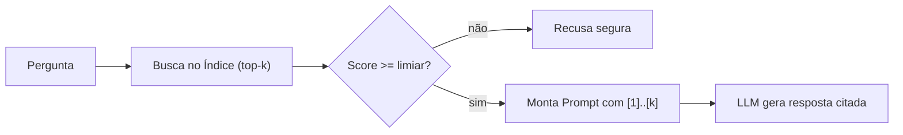

## Passo 1 · Leitura · Indexar, recuperar, aterrar e citar

Mesmo um modelo de linguagem grande desconhece documentos internos — como o regimento atualizado da secretaria acadêmica ou uma portaria publicada ontem — e, quando questionado sem apoio, tende a inventar prazos e artigos plausíveis. A **geração aumentada por recuperação** (*Retrieval-Augmented Generation*, ou **RAG**) resolve esse problema fornecendo os trechos relevantes diretamente no prompt antes de pedir a resposta.



Um pipeline RAG confiável depende de quatro engrenagens:

1. **Indexação com metadados:** cada documento ou trecho é armazenado junto com sua `fonte` (ex.: `"Regimento Art. 42"`) e seu vetor de embedding normalizado ($\|\hat{v}\|_2 = 1$).
2. **Orçamento de contexto:** como a janela de entrada tem custo e limite de tokens, selecionamos os trechos recuperados na ordem de relevância até preencher um orçamento máximo de palavras/tokens, sem cortar um trecho ao meio nem perder sua fonte.
3. **Aterramento (*grounding*) e citação:** cada trecho recebe um identificador numérico (`[1]`, `[2]`, ...) no prompt, acompanhado da instrução explícita de responder **somente** com base nos trechos fornecidos e citar `[n]`.
4. **Recusa por limiar:** se até mesmo o trecho mais similar tiver similaridade abaixo de um `limiar` mínimo (por exemplo, quando um aluno pergunta sobre cardápio de restaurante para o assistente da secretaria), o sistema recusa responder em vez de forçar o modelo a improvisar.

Veja no visualizador como o controle de orçamento percorre os trechos na ordem de relevância e interrompe a seleção assim que o próximo trecho ultrapassaria o limite de tokens:

```python visualizar
trechos = [
    {"fonte": "Art. 12", "texto": "O trancamento exige matricula ativa no semestre"},
    {"fonte": "Art. 15", "texto": "O prazo maximo para solicitar trancamento e maio"},
    {"fonte": "Art. 19", "texto": "Documentos adicionais devem ser entregues na secretaria"},
]

limite_tokens = 16
selecionados = []
usados = 0

for t in trechos:
    n_tokens = len(t["texto"].split())
    if usados + n_tokens > limite_tokens:
        break
    selecionados.append(t["fonte"])
    usados += n_tokens
```

## Passo 2 · Previsão · Orçamento de contexto e citações

Analise o código abaixo e determine o que será impresso ao filtrar os trechos pelo orçamento e enumerar o bloco final.

### Código

```python
trechos = [
    {"fonte": "Art. 10", "texto": "A matricula ocorre em fevereiro"},
    {"fonte": "Art. 11", "texto": "O ajuste de disciplinas dura cinco dias uteis"},
    {"fonte": "Art. 12", "texto": "A carteira estudantil e emitida apos a confirmacao"},
]

limite = 10
escolhidos = []
total = 0
for t in trechos:
    palavras = len(t["texto"].split())
    if total + palavras > limite:
        break
    escolhidos.append(t)
    total += palavras

for i, t in enumerate(escolhidos, start=1):
    print(f"[{i}] ({t['fonte']}) {len(t['texto'].split())} palavras")
```

### Dicas

1. Conte quantas palavras separadas por espaço há em cada `"texto"`: o primeiro tem `5` e o segundo tem `8`.
2. Como `5 + 8 = 13 > 10`, o laço para no `break` antes de adicionar o segundo trecho.

### Saída esperada

```text
[1] (Art. 10) 5 palavras
```

## Passo 3 · Exercício · Montando o prompt aterrado com citações

modo: lacunas

Complete a função `montar_prompt_rag(pergunta, trechos)` para construir o prompt que será enviado ao modelo gerador, numerando cada trecho a partir de `1` e incluindo a regra de aterramento e recusa.

### Instruções

1. Em `montar_prompt_rag(pergunta, trechos)`, crie uma lista `linhas_trechos` percorrendo `enumerate(trechos, start=1)` e formatando cada item `t` como `f"[{i}] ({t['fonte']}) {t['texto']}"`.
2. Junte `linhas_trechos` com quebras de linha `"\n"` na variável `bloco_contexto` e finalize o prompt com `Pergunta: {pergunta}`.

### Código inicial

```python
def montar_prompt_rag(pergunta, trechos):
    linhas_trechos = []
    for i, t in enumerate(trechos, start=___):
        linhas_trechos.append(f"[{i}] ({t['___']}) {t['___']}")
    bloco_contexto = "\n".join(linhas_trechos)
    instrucao = (
        "Instrucao: Responda apenas com base nos trechos acima, citando [n]. "
        "Se nao houver informacao suficiente, diga: Nao ha informacao suficiente nos documentos."
    )
    return f"Contexto:\n{bloco_contexto}\n{instrucao}\nPergunta: {___}"
```

### Solução

```python
def montar_prompt_rag(pergunta, trechos):
    linhas_trechos = []
    for i, t in enumerate(trechos, start=1):
        linhas_trechos.append(f"[{i}] ({t['fonte']}) {t['texto']}")
    bloco_contexto = "\n".join(linhas_trechos)
    instrucao = (
        "Instrucao: Responda apenas com base nos trechos acima, citando [n]. "
        "Se nao houver informacao suficiente, diga: Nao ha informacao suficiente nos documentos."
    )
    return f"Contexto:\n{bloco_contexto}\n{instrucao}\nPergunta: {pergunta}"
```

### Dicas

1. As citações começam em `[1]`, portanto `start=1`.
2. Cada dicionário de `trechos` possui as chaves `'fonte'` e `'texto'`, e a última linha recebe `pergunta`.

### Verificação

```json
[
  {
    "id": "prompt-um-trecho",
    "name": "Monta prompt com um trecho numerado e fonte",
    "checkpoint": 1,
    "kind": "call",
    "function": "montar_prompt_rag",
    "args": [
      "Qual o prazo?",
      [
        {
          "fonte": "Art. 12",
          "texto": "O prazo e de 15 dias."
        }
      ]
    ],
    "expected": "Contexto:\n[1] (Art. 12) O prazo e de 15 dias.\nInstrucao: Responda apenas com base nos trechos acima, citando [n]. Se nao houver informacao suficiente, diga: Nao ha informacao suficiente nos documentos.\nPergunta: Qual o prazo?"
  },
  {
    "id": "prompt-dois-trechos",
    "name": "Numera múltiplos trechos sequencialmente a partir de 1",
    "checkpoint": 2,
    "kind": "call",
    "function": "montar_prompt_rag",
    "args": [
      "Quantos creditos?",
      [
        {
          "fonte": "Art. 5",
          "texto": "Minimo de 12 creditos por semestre."
        },
        {
          "fonte": "Art. 6",
          "texto": "Maximo de 40 creditos por semestre."
        }
      ]
    ],
    "expected": "Contexto:\n[1] (Art. 5) Minimo de 12 creditos por semestre.\n[2] (Art. 6) Maximo de 40 creditos por semestre.\nInstrucao: Responda apenas com base nos trechos acima, citando [n]. Se nao houver informacao suficiente, diga: Nao ha informacao suficiente nos documentos.\nPergunta: Quantos creditos?"
  }
]
```

### Soluções erradas

```python name="Começa a numeração dos trechos em 0"
def montar_prompt_rag(pergunta, trechos):
    linhas_trechos = []
    for i, t in enumerate(trechos, start=0):
        linhas_trechos.append(f"[{i}] ({t['fonte']}) {t['texto']}")
    bloco_contexto = "\n".join(linhas_trechos)
    instrucao = (
        "Instrucao: Responda apenas com base nos trechos acima, citando [n]. "
        "Se nao houver informacao suficiente, diga: Nao ha informacao suficiente nos documentos."
    )
    return f"Contexto:\n{bloco_contexto}\n{instrucao}\nPergunta: {pergunta}"
```

```python name="Repete a fonte no lugar do texto do trecho"
def montar_prompt_rag(pergunta, trechos):
    linhas_trechos = []
    for i, t in enumerate(trechos, start=1):
        linhas_trechos.append(f"[{i}] ({t['fonte']}) {t['fonte']}")
    bloco_contexto = "\n".join(linhas_trechos)
    instrucao = (
        "Instrucao: Responda apenas com base nos trechos acima, citando [n]. "
        "Se nao houver informacao suficiente, diga: Nao ha informacao suficiente nos documentos."
    )
    return f"Contexto:\n{bloco_contexto}\n{instrucao}\nPergunta: {pergunta}"
```

## Passo 4 · Exercício · Orçamento de tokens para trechos

Antes de montar o prompt, precisamos garantir que os trechos selecionados caibam no orçamento de contexto sem truncar metadados nem alterar a ordem de relevância.

### Instruções

1. Implemente `respeitar_orcamento(trechos, limite_tokens)` que recebe uma lista `trechos` (ordenada do mais relevante ao menos relevante, onde cada item é um dicionário com `"texto"`) e um inteiro `limite_tokens`.
2. Percorra `trechos` na ordem recebida, contando o custo de cada trecho como `len(t["texto"].split())`.
3. Acumule os trechos em uma nova lista enquanto a soma de tokens não ultrapassar `limite_tokens`. Se a adição do trecho atual fizer o total ultrapassar `limite_tokens`, interrompa o laço (`break`) e devolva a lista acumulada até aquele ponto.

### Código inicial

```python
def respeitar_orcamento(trechos, limite_tokens):
    # Seleciona os trechos em ordem de relevância até o limite de tokens
    pass
```

### Solução

```python
def respeitar_orcamento(trechos, limite_tokens):
    selecionados = []
    usados = 0
    for t in trechos:
        custo = len(t["texto"].split())
        if usados + custo > limite_tokens:
            break
        selecionados.append(t)
        usados += custo
    return selecionados
```

### Dicas

1. Use `len(t["texto"].split())` para medir o número de palavras/tokens do trecho.
2. Mantenha um acumulador `usados` e verifique `if usados + custo > limite_tokens: break` antes de adicionar o item.

### Verificação

```json
[
  {
    "id": "orcamento-parcial",
    "name": "Inclui apenas os primeiros trechos que cabem no orçamento",
    "checkpoint": 2,
    "kind": "call",
    "function": "respeitar_orcamento",
    "args": [
      [
        {
          "fonte": "Art. 1",
          "texto": "Prazo de quinze dias uteis"
        },
        {
          "fonte": "Art. 2",
          "texto": "Requer assinatura do orientador"
        },
        {
          "fonte": "Art. 3",
          "texto": "Entrega exclusivamente pelo sistema Jupiter"
        }
      ],
      10
    ],
    "expected": [
      {
        "fonte": "Art. 1",
        "texto": "Prazo de quinze dias uteis"
      },
      {
        "fonte": "Art. 2",
        "texto": "Requer assinatura do orientador"
      }
    ]
  },
  {
    "id": "orcamento-zero-ou-curto",
    "name": "Devolve lista vazia quando o primeiro trecho já excede o limite",
    "checkpoint": 3,
    "kind": "call",
    "function": "respeitar_orcamento",
    "args": [
      [
        {
          "fonte": "Art. 1",
          "texto": "Prazo de quinze dias uteis para protocolo"
        }
      ],
      4
    ],
    "expected": []
  }
]
```

### Soluções erradas

```python name="Ordena por tamanho em vez de preservar a ordem de relevância"
def respeitar_orcamento(trechos, limite_tokens):
    ordenados = sorted(trechos, key=lambda t: len(t["texto"].split()))
    selecionados = []
    usados = 0
    for t in ordenados:
        custo = len(t["texto"].split())
        if usados + custo > limite_tokens:
            break
        selecionados.append(t)
        usados += custo
    return selecionados
```

```python name="Devolve todos os trechos ignorando o limite de tokens"
def respeitar_orcamento(trechos, limite_tokens):
    return list(trechos)
```

## Passo 5 · Exercício · Classe RAG com citação e recusa abaixo do limiar

Agora você vai juntar a indexação vetorial, a recuperação top-$k$, a verificação de limiar e a geração com citações na classe `RAG`.

### Instruções

1. Implemente a classe `RAG(cliente, limiar=0.25)` armazenando `self.cliente = cliente`, `self.limiar = float(limiar)`, `self.documentos = []` e `self.vetores = None`.
2. Implemente `indexar(self, documentos)` que recebe uma lista de dicionários `{"fonte": str, "texto": str}`, guarda uma cópia em `self.documentos` e calcula a matriz `self.vetores` aplicando `embedding_simulado(d["texto"])` a cada documento.
3. Implemente `responder(self, pergunta, k=3)` que:
   - Calcula o vetor de `pergunta` com `embedding_simulado(pergunta)` e pontua todos os documentos por produto interno (`self.vetores @ q`).
   - Seleciona os `min(k, len(self.documentos))` documentos de maior pontuação em ordem decrescente de `score`, montando a lista `trechos` onde cada item é `{"fonte": doc["fonte"], "texto": doc["texto"], "score": float(score)}`.
   - Se `trechos` estiver vazia ou `trechos[0]["score"] < self.limiar`, devolve imediatamente sem chamar o cliente:
     `{"resposta": "Nao ha informacao suficiente nos documentos.", "fontes": [], "trechos": trechos, "recusou": True}`.
   - Caso contrário, monta o prompt com `montar_prompt_rag(pergunta, trechos)`, chama `resposta = self.cliente.gerar(prompt)` e devolve:
     `{"resposta": resposta, "fontes": [t["fonte"] for t in trechos], "trechos": trechos, "recusou": False}`.

### Código inicial

```python
import re
import numpy as np

VOCABULARIO = [
    ["trancamento", "trancar", "interrupcao", "semestre"],
    ["matricula", "inscricao", "disciplina", "creditos"],
    ["jubilamento", "desligamento", "prazo", "maximo"],
    ["aproveitamento", "equivalencia", "externa", "cursada"],
    ["frequencia", "presenca", "faltas", "setenta", "reprovacao"],
    ["historico", "atestado", "certidao", "emissao", "documento"],
    ["recurso", "revisao", "nota", "prova", "avaliacao"],
    ["estagio", "convenio", "horas", "relatorio", "supervisao"],
]


def embedding_simulado(texto):
    tokens = re.findall(r"[a-z0-9]+", texto.lower())
    v = np.zeros(len(VOCABULARIO), dtype=float)
    for idx, grupo in enumerate(VOCABULARIO):
        for tok in tokens:
            if any(tok.startswith(rad[:5]) for rad in grupo):
                v[idx] += 1.0
    norma = float(np.linalg.norm(v))
    if norma > 1e-12:
        v = v / norma
    return v


def montar_prompt_rag(pergunta, trechos):
    linhas = [f"[{i}] ({t['fonte']}) {t['texto']}" for i, t in enumerate(trechos, start=1)]
    bloco = "\n".join(linhas)
    instrucao = (
        "Instrucao: Responda apenas com base nos trechos acima, citando [n]. "
        "Se nao houver informacao suficiente, diga: Nao ha informacao suficiente nos documentos."
    )
    return f"Contexto:\n{bloco}\n{instrucao}\nPergunta: {pergunta}"


class ClienteRAGSimulado:
    def __init__(self):
        self.chamadas = 0

    def gerar(self, prompt):
        self.chamadas += 1
        linhas = prompt.splitlines()
        trechos = []
        pergunta = ""
        for linha in linhas:
            m = re.match(r"^\[(\d+)\]\s*\(([^)]+)\)\s*(.+)$", linha)
            if m:
                trechos.append((int(m.group(1)), m.group(2), m.group(3)))
            elif linha.startswith("Pergunta:"):
                pergunta = linha.split("Pergunta:", 1)[1].strip()
        if not trechos:
            return "Nao ha informacao suficiente nos documentos."
        q_vec = embedding_simulado(pergunta)
        melhor_idx, _, melhor_texto = max(
            trechos,
            key=lambda item: float(np.dot(embedding_simulado(item[2]), q_vec)),
        )
        return f"{melhor_texto} [{melhor_idx}]"


class RAG:
    def __init__(self, cliente, limiar=0.25):
        # Inicialize os atributos do pipeline RAG
        pass

    def indexar(self, documentos):
        # Indexe os documentos e seus vetores normalizados
        pass

    def responder(self, pergunta, k=3):
        # Recupere os top-k, aplique o limiar e gere a resposta citada
        pass
```

### Solução

```python
import re
import numpy as np

VOCABULARIO = [
    ["trancamento", "trancar", "interrupcao", "semestre"],
    ["matricula", "inscricao", "disciplina", "creditos"],
    ["jubilamento", "desligamento", "prazo", "maximo"],
    ["aproveitamento", "equivalencia", "externa", "cursada"],
    ["frequencia", "presenca", "faltas", "setenta", "reprovacao"],
    ["historico", "atestado", "certidao", "emissao", "documento"],
    ["recurso", "revisao", "nota", "prova", "avaliacao"],
    ["estagio", "convenio", "horas", "relatorio", "supervisao"],
]


def embedding_simulado(texto):
    tokens = re.findall(r"[a-z0-9]+", texto.lower())
    v = np.zeros(len(VOCABULARIO), dtype=float)
    for idx, grupo in enumerate(VOCABULARIO):
        for tok in tokens:
            if any(tok.startswith(rad[:5]) for rad in grupo):
                v[idx] += 1.0
    norma = float(np.linalg.norm(v))
    if norma > 1e-12:
        v = v / norma
    return v


def montar_prompt_rag(pergunta, trechos):
    linhas = [f"[{i}] ({t['fonte']}) {t['texto']}" for i, t in enumerate(trechos, start=1)]
    bloco = "\n".join(linhas)
    instrucao = (
        "Instrucao: Responda apenas com base nos trechos acima, citando [n]. "
        "Se nao houver informacao suficiente, diga: Nao ha informacao suficiente nos documentos."
    )
    return f"Contexto:\n{bloco}\n{instrucao}\nPergunta: {pergunta}"


class ClienteRAGSimulado:
    def __init__(self):
        self.chamadas = 0

    def gerar(self, prompt):
        self.chamadas += 1
        linhas = prompt.splitlines()
        trechos = []
        pergunta = ""
        for linha in linhas:
            m = re.match(r"^\[(\d+)\]\s*\(([^)]+)\)\s*(.+)$", linha)
            if m:
                trechos.append((int(m.group(1)), m.group(2), m.group(3)))
            elif linha.startswith("Pergunta:"):
                pergunta = linha.split("Pergunta:", 1)[1].strip()
        if not trechos:
            return "Nao ha informacao suficiente nos documentos."
        q_vec = embedding_simulado(pergunta)
        melhor_idx, _, melhor_texto = max(
            trechos,
            key=lambda item: float(np.dot(embedding_simulado(item[2]), q_vec)),
        )
        return f"{melhor_texto} [{melhor_idx}]"


class RAG:
    def __init__(self, cliente, limiar=0.25):
        self.cliente = cliente
        self.limiar = float(limiar)
        self.documentos = []
        self.vetores = None

    def indexar(self, documentos):
        self.documentos = list(documentos)
        if self.documentos:
            self.vetores = np.array([embedding_simulado(d["texto"]) for d in self.documentos], dtype=float)
        else:
            self.vetores = np.zeros((0, len(VOCABULARIO)), dtype=float)

    def responder(self, pergunta, k=3):
        if not self.documentos or self.vetores is None or len(self.documentos) == 0:
            return {
                "resposta": "Nao ha informacao suficiente nos documentos.",
                "fontes": [],
                "trechos": [],
                "recusou": True,
            }
        q_vec = embedding_simulado(pergunta)
        scores = self.vetores @ q_vec
        ordem = np.argsort(-scores)[: min(k, len(self.documentos))]
        trechos = [
            {
                "fonte": self.documentos[int(i)]["fonte"],
                "texto": self.documentos[int(i)]["texto"],
                "score": float(scores[int(i)]),
            }
            for i in ordem
        ]
        if not trechos or trechos[0]["score"] < self.limiar:
            return {
                "resposta": "Nao ha informacao suficiente nos documentos.",
                "fontes": [],
                "trechos": trechos,
                "recusou": True,
            }
        prompt = montar_prompt_rag(pergunta, trechos)
        resposta = self.cliente.gerar(prompt)
        return {
            "resposta": resposta,
            "fontes": [t["fonte"] for t in trechos],
            "trechos": trechos,
            "recusou": False,
        }
```

### Dicas

1. Em `indexar`, construa `self.vetores = np.array([embedding_simulado(d["texto"]) for d in self.documentos])`.
2. Para ordenar os documentos em ordem decrescente de similaridade, use `np.argsort(-scores)[:k]`.
3. Se `trechos[0]["score"] < self.limiar`, retorne a recusa imediatamente sem chamar `self.cliente.gerar`.

### Verificação

```json
[
  {
    "id": "rag-responde-com-citacao",
    "name": "Responde pergunta do regimento com citação [1] e lista as fontes",
    "checkpoint": 2,
    "kind": "expr",
    "setup": "c = ClienteRAGSimulado(); r = RAG(c, limiar=0.25); r.indexar([{'fonte': 'Art. 12', 'texto': 'O trancamento de semestre exige matricula ativa.'}, {'fonte': 'Art. 30', 'texto': 'A frequencia minima para aprovacao e setenta por cento de presenca.'}, {'fonte': 'Art. 45', 'texto': 'O recurso de revisao de nota deve ser pedido em cinco dias.'}]); out = r.responder('Como funciona o trancamento de semestre?', k=2)",
    "expr": "{'recusou': out['recusou'], 'tem_citacao': '[1]' in out['resposta'], 'primeira_fonte': out['fontes'][0], 'chamadas': c.chamadas}",
    "expected": {
      "recusou": false,
      "tem_citacao": true,
      "primeira_fonte": "Art. 12",
      "chamadas": 1
    }
  },
  {
    "id": "rag-recusa-abaixo-do-limiar",
    "name": "Recusa pergunta fora do escopo sem acionar o cliente gerador",
    "checkpoint": 3,
    "kind": "expr",
    "setup": "c = ClienteRAGSimulado(); r = RAG(c, limiar=0.25); r.indexar([{'fonte': 'Art. 12', 'texto': 'O trancamento de semestre exige matricula ativa.'}, {'fonte': 'Art. 30', 'texto': 'A frequencia minima e setenta por cento.'}]); out = r.responder('Qual o cardapio do restaurante hoje?', k=2)",
    "expr": "{'recusou': out['recusou'], 'fontes': out['fontes'], 'chamadas': c.chamadas}",
    "expected": {
      "recusou": true,
      "fontes": [],
      "chamadas": 0
    }
  }
]
```

### Soluções erradas

```python name="Chama o gerador mesmo quando o melhor score está abaixo do limiar"
import re
import numpy as np

VOCABULARIO = [
    ["trancamento", "trancar", "interrupcao", "semestre"],
    ["matricula", "inscricao", "disciplina", "creditos"],
    ["jubilamento", "desligamento", "prazo", "maximo"],
    ["aproveitamento", "equivalencia", "externa", "cursada"],
    ["frequencia", "presenca", "faltas", "setenta", "reprovacao"],
    ["historico", "atestado", "certidao", "emissao", "documento"],
    ["recurso", "revisao", "nota", "prova", "avaliacao"],
    ["estagio", "convenio", "horas", "relatorio", "supervisao"],
]


def embedding_simulado(texto):
    tokens = re.findall(r"[a-z0-9]+", texto.lower())
    v = np.zeros(len(VOCABULARIO), dtype=float)
    for idx, grupo in enumerate(VOCABULARIO):
        for tok in tokens:
            if any(tok.startswith(rad[:5]) for rad in grupo):
                v[idx] += 1.0
    norma = float(np.linalg.norm(v))
    return v / norma if norma > 1e-12 else v


def montar_prompt_rag(pergunta, trechos):
    linhas = [f"[{i}] ({t['fonte']}) {t['texto']}" for i, t in enumerate(trechos, start=1)]
    return "\n".join(["Contexto:", *linhas, f"Pergunta: {pergunta}"])


class ClienteRAGSimulado:
    def __init__(self):
        self.chamadas = 0

    def gerar(self, prompt):
        self.chamadas += 1
        return "Resposta [1]"


class RAG:
    def __init__(self, cliente, limiar=0.25):
        self.cliente = cliente
        self.limiar = float(limiar)
        self.documentos = []
        self.vetores = None

    def indexar(self, documentos):
        self.documentos = list(documentos)
        self.vetores = np.array([embedding_simulado(d["texto"]) for d in self.documentos], dtype=float)

    def responder(self, pergunta, k=3):
        q_vec = embedding_simulado(pergunta)
        scores = self.vetores @ q_vec
        ordem = np.argsort(-scores)[: min(k, len(self.documentos))]
        trechos = [
            {
                "fonte": self.documentos[int(i)]["fonte"],
                "texto": self.documentos[int(i)]["texto"],
                "score": float(scores[int(i)]),
            }
            for i in ordem
        ]
        prompt = montar_prompt_rag(pergunta, trechos)
        resposta = self.cliente.gerar(prompt)
        return {
            "resposta": resposta,
            "fontes": [t["fonte"] for t in trechos],
            "trechos": trechos,
            "recusou": False,
        }
```

```python name="Esquece de registrar as fontes dos trechos usados"
import re
import numpy as np

VOCABULARIO = [
    ["trancamento", "trancar", "interrupcao", "semestre"],
    ["matricula", "inscricao", "disciplina", "creditos"],
    ["jubilamento", "desligamento", "prazo", "maximo"],
    ["aproveitamento", "equivalencia", "externa", "cursada"],
    ["frequencia", "presenca", "faltas", "setenta", "reprovacao"],
    ["historico", "atestado", "certidao", "emissao", "documento"],
    ["recurso", "revisao", "nota", "prova", "avaliacao"],
    ["estagio", "convenio", "horas", "relatorio", "supervisao"],
]


def embedding_simulado(texto):
    tokens = re.findall(r"[a-z0-9]+", texto.lower())
    v = np.zeros(len(VOCABULARIO), dtype=float)
    for idx, grupo in enumerate(VOCABULARIO):
        for tok in tokens:
            if any(tok.startswith(rad[:5]) for rad in grupo):
                v[idx] += 1.0
    norma = float(np.linalg.norm(v))
    return v / norma if norma > 1e-12 else v


class ClienteRAGSimulado:
    def __init__(self):
        self.chamadas = 0

    def gerar(self, prompt):
        self.chamadas += 1
        return "Resposta [1]"


class RAG:
    def __init__(self, cliente, limiar=0.25):
        self.cliente = cliente
        self.limiar = float(limiar)
        self.documentos = []
        self.vetores = None

    def indexar(self, documentos):
        self.documentos = list(documentos)
        self.vetores = np.array([embedding_simulado(d["texto"]) for d in self.documentos], dtype=float)

    def responder(self, pergunta, k=3):
        q_vec = embedding_simulado(pergunta)
        scores = self.vetores @ q_vec
        ordem = np.argsort(-scores)[: min(k, len(self.documentos))]
        trechos = [
            {
                "fonte": self.documentos[int(i)]["fonte"],
                "texto": self.documentos[int(i)]["texto"],
                "score": float(scores[int(i)]),
            }
            for i in ordem
        ]
        if not trechos or trechos[0]["score"] < self.limiar:
            return {
                "resposta": "Nao ha informacao suficiente nos documentos.",
                "fontes": [],
                "trechos": trechos,
                "recusou": True,
            }
        return {
            "resposta": self.cliente.gerar("prompt"),
            "fontes": [],
            "trechos": trechos,
            "recusou": False,
        }
```

## Passo 6 · Quiz · Pipeline RAG e aterramento

### Pergunta

Por que cada trecho recuperado deve receber um identificador numérico explícito (`[1]`, `[2]`, ...) acompanhado da fonte ao montar o prompt de um sistema RAG?

- [ ] Para reduzir o número de dimensões do vetor de embedding durante a busca.
- [x] Para permitir que o modelo referencie exatamente qual documento apoia cada afirmação e que a aplicação audite essas citações.
- [ ] Porque modelos de linguagem só conseguem ler textos que começam com colchetes.
- [ ] Para substituir a necessidade de calcular similaridade de cosseno no índice.

> Sem identificadores únicos por trecho no prompt, o modelo não tem como apontar de onde tirou cada regra nem o sistema consegue mapear `[1]` de volta aos metadados do documento original.

### Pergunta

O que um pipeline RAG deve fazer quando a pergunta do usuário tem similaridade máxima abaixo do limiar configurado para todos os documentos do índice?

- [ ] Aumentar a temperatura do gerador para `1.5` para que ele tente deduzir uma resposta aproximada.
- [ ] Multiplicar os vetores por `10` até que a similaridade ultrapasse o limiar.
- [x] Recusar a geração (ou devolver a mensagem padrão de informação insuficiente) sem inventar fatos fora do corpus.
- [ ] Concatenar todos os documentos do banco no prompt independentemente do score.

> Quando nenhum trecho atinge o limiar mínimo de relevância, enviar trechos desconexos ao gerador só desperdiça tokens e aumenta o risco de alucinação.

### Pergunta

Por que configurar um $k$ exageradamente alto (por exemplo, enviar $k = 100$ trechos no prompt) costuma piorar um sistema RAG em vez de melhorá-lo?

- [ ] Porque a similaridade de cosseno passa a retornar números complexos quando $k > 20$.
- [x] Porque encarece a chamada, pode estourar o orçamento da janela de contexto e dilui os trechos realmente relevantes em meio a dezenas de trechos ruidosos.
- [ ] Porque o índice vetorial apaga automaticamente os documentos após serem lidos.
- [ ] Porque impede o modelo de gerar o caractere de colchete `[1]`.

> Mais trechos significam maior custo de entrada, maior latência de *prefill* e mais distrações (*lost in the middle*), prejudicando a precisão da resposta.
