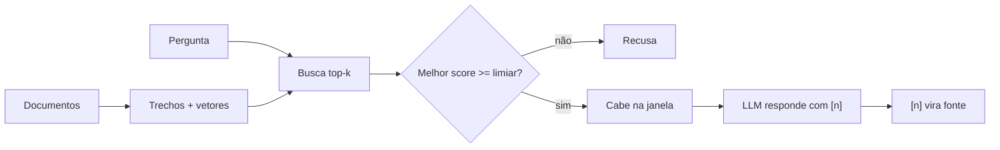

## Passo 1 · Leitura · Recuperar antes de gerar

Pergunte a um LLM "até quando posso trancar uma disciplina?" e ele responde com segurança: "até 30 dias depois do início das aulas". O número é plausível e inventado. O modelo não leu o regimento desta universidade, não sabe da portaria publicada ontem e não tem como dizer de onde tirou a frase.

Treinar o modelo de novo com os documentos (*fine-tuning*) não resolve bem: custa caro, precisa ser refeito a cada mudança de regra e o modelo continua sem saber citar a fonte. A saída usada na prática é a **geração aumentada por recuperação** (RAG, de *retrieval-augmented generation*): a cada pergunta, o sistema **busca** os trechos relevantes e os **entrega no prompt**, mandando o modelo responder só com eles.



O pipeline tem duas metades. A **indexação** roda antes, uma vez por versão dos documentos, e você já a construiu no módulo 3: fatiar em trechos com metadados, embutir em lote, normalizar e guardar. A **consulta** roda a cada pergunta, e é o assunto desta lição:

1. embutir a pergunta com o **mesmo** modelo dos trechos e pegar os `k` mais parecidos;
2. se nem o melhor passa do `limiar`, recusar sem chamar o LLM;
3. escolher quantos trechos cabem na janela de contexto;
4. montar o prompt com os trechos numerados `[1]`, `[2]`… e a instrução de citar;
5. chamar o modelo e traduzir cada `[n]` da resposta de volta para a fonte.

O resultado que a aplicação recebe não é só um texto:

```python
{"resposta": "O trancamento parcial vai até o 60º dia letivo. [1]",
 "recusou": False,
 "enviados": ["reg-12", "reg-13"],
 "fontes": ["Regimento, art. 12"]}
```

`enviados` registra o que o modelo viu; `fontes` é o que a interface mostra ao aluno como "de onde veio". Guardar as duas coisas é o que permite, na lição 02, descobrir se um erro veio da busca ou da geração.

## Passo 2 · Leitura · O prompt aterrado

**Aterrar** (*grounding*) a resposta é amarrá-la a um texto que a aplicação controla. O prompt faz isso em três partes, cada uma no lugar certo.

**A instrução vai na mensagem `system`**: responder só com os trechos, citar o número de cada um e, se eles não trazem a resposta, devolver uma **frase de recusa exata**. Exata porque o código precisa reconhecê-la: `resposta == RECUSA` é confiável; adivinhar se "infelizmente não encontrei" é uma recusa não é.

**Os trechos vão na mensagem `user`, como dados**, um por linha, no formato `[n] (fonte) texto`. O número é curto e não tem ambiguidade; a fonte ajuda o modelo e quem lê o prompt num log. Duas regras evitam bugs:

- numere **na ordem recebida**, que é a ordem de relevância, começando em 1;
- deixe cada trecho numa linha só: um trecho com quebra de linha pode ter uma linha que começa com `[3]` e parece outro trecho.

```text
Trechos:
[1] (Regimento, art. 12) O trancamento parcial vai até o 60º dia letivo.
[2] (FAQ da secretaria) O pedido é feito pelo sistema acadêmico.

Pergunta: Até quando posso trancar uma disciplina?
```

O `[2]` da resposta só tem sentido junto com **a lista que gerou o prompt**. Se a aplicação traduzir `[2]` pelo segundo trecho do índice, ou de uma lista reordenada depois, ela mostra a fonte errada com toda a confiança.

Neste módulo o gerador é o `ClienteLLM` do módulo 1 com o comportamento do arquivo `modelo_rag.py`. As regras dele estão no topo do arquivo: ele copia o trecho com mais palavras em comum com a pergunta e acrescenta `[n]`; sem palavra em comum, devolve a recusa. E, se a instrução "apenas com base nos trechos" faltar, ele **inventa** uma frase plausível sem citação — o comportamento que o aterramento existe para evitar. Um modelo real parafraseia e junta trechos; o simulador só copia, para que cada saída seja explicável.

A recusa tem duas camadas. O **limiar** recusa antes de chamar o modelo, de graça, quando a busca não achou nada parecido. A **instrução** cobre o caso em que a busca trouxe trechos parecidos que não respondem a pergunta.

## Passo 3 · Exercício · Montar o prompt com trechos numerados
modo: lacunas

Complete as lacunas (`___`) de `montar_prompt(pergunta, trechos)`. Ela recebe a pergunta e a lista de trechos `{"fonte": ..., "texto": ...}`, em ordem de relevância, e devolve as duas mensagens do `ClienteLLM`:

- `{"role": "system", "content": SISTEMA}` — a instrução, já pronta no código;
- `{"role": "user", "content": ...}` — `Trechos:`, uma linha `[n] (fonte) texto` por trecho, uma linha em branco e `Pergunta: ` seguida da pergunta sem espaços nas pontas.

O texto de cada trecho entra numa linha só: quebras de linha e espaços repetidos viram um espaço. A lista recebida não pode ser alterada. O `main.py` mostra o prompt e a resposta do gerador simulado.

### Instruções
1. Numere os trechos a partir de 1, na ordem recebida, no formato `[n] (fonte) texto`.
2. Deixe o texto de cada trecho numa linha só, sem alterar o trecho recebido.
3. Ponha a instrução na mensagem `system` e os trechos com a pergunta na mensagem `user`.

### Código inicial
```python
from llm_simulado import ClienteLLM
from modelo_rag import RECUSA, responder

SISTEMA = (
    "Você é o assistente da secretaria acadêmica.\n"
    "Responda apenas com base nos trechos numerados enviados pelo usuário.\n"
    "Cite o número do trecho que apoia cada frase, como [1].\n"
    f"Se os trechos não trazem a resposta, responda exatamente: {RECUSA}"
)


def montar_prompt(pergunta, trechos):
    linhas = []
    for n, t in enumerate(trechos, start=___):
        texto = " ".join(t["texto"].___())
        linhas.append(f"[{___}] ({t['fonte']}) {texto}")
    usuario = "Trechos:\n" + "\n".join(linhas) + "\n\nPergunta: " + ___
    return [{"role": "system", "content": ___}, {"role": "user", "content": usuario}]


if __name__ == "__main__":
    trechos = [
        {"fonte": "Regimento, art. 20", "texto": "A matrícula exige no mínimo\n12 créditos por semestre."},
        {"fonte": "Regimento, art. 12", "texto": "O trancamento parcial vai até o 60º dia letivo."},
    ]
    mensagens = montar_prompt("Até quando vai o trancamento parcial?", trechos)
    print(mensagens[1]["content"])
    print(ClienteLLM(responder).completar(mensagens, temperature=0).conteudo)
```
```python path=llm_simulado.py
"""Cliente de LLM simulado do curso: a interface de um SDK real, sem rede.

Aproximações declaradas (tudo reproduzível):
- tokens: brinquedo, cada palavra vira pedaços de até 4 caracteres;
  o tokenizador de um modelo real dá outros números;
- preços: fictícios, em R$ por milhão de tokens;
- latência: TTFT + ms por token de saída, somada a um relógio falso;
- sorteio: random.Random(seed); com temperature > 0 a resposta pode variar;
- falhas: fila programada (429, 503, "timeout", 400), consumida em ordem.
"""
import random

PRECO_ENTRADA = 2.0  # R$ por milhão de tokens de entrada (fictício)
PRECO_SAIDA = 8.0  # R$ por milhão de tokens de saída (fictício)
SOBRECARGA_POR_MENSAGEM = 4  # tokens de formatação de cada mensagem


class ErroDeTaxa(Exception):  # HTTP 429: transitório
    def __init__(self, mensagem="429 Too Many Requests", retry_after=None):
        super().__init__(mensagem)
        self.retry_after = retry_after  # espera sugerida pelo servidor, em s


class ErroDeServidor(Exception):  # HTTP 5xx: transitório
    pass


class ErroDeTimeout(Exception):  # resposta não chegou no prazo: transitório
    pass


class ErroDeRequisicao(Exception):  # HTTP 400/401: permanente, não repita
    pass


def tokenizar(texto):
    tokens = []
    for i, palavra in enumerate(texto.split()):
        pedacos = [palavra[j:j + 4] for j in range(0, len(palavra), 4)]
        if i > 0:
            pedacos[0] = " " + pedacos[0]
        tokens.extend(pedacos)
    return tokens


def contar_tokens(texto):
    return len(tokenizar(texto))


class Resposta:
    def __init__(self, conteudo, finish_reason, prompt_tokens, completion_tokens,
                 latencia_ms=0, tool_calls=None):
        self.conteudo = conteudo
        self.finish_reason = finish_reason  # "stop", "length" ou "tool_calls"
        self.usage = {"prompt_tokens": prompt_tokens,
                      "completion_tokens": completion_tokens,
                      "total_tokens": prompt_tokens + completion_tokens}
        self.latencia_ms = latencia_ms
        self.tool_calls = tool_calls or []


class Relogio:  # relógio falso: só anda quando alguém manda
    def __init__(self):
        self.agora_ms = 0

    def avancar(self, ms):
        self.agora_ms += ms


class ClienteLLM:
    """respostas: lista de textos candidatos, ou função(mensagens) que devolve
    um texto ou uma lista de tool_calls."""

    def __init__(self, respostas, seed=None, falhas=(), relogio=None,
                 ttft_ms=300, ms_por_token=20):
        self.respostas = respostas
        self.rng = random.Random(seed)
        self.falhas = list(falhas)
        self.relogio = relogio or Relogio()
        self.ttft_ms = ttft_ms
        self.ms_por_token = ms_por_token
        self.chamadas = 0

    def _preparar(self, mensagens, temperature):
        self.chamadas += 1
        falha = self.falhas.pop(0) if self.falhas else None
        if falha == 429:
            raise ErroDeTaxa(retry_after=2.0)
        if falha == 503:
            raise ErroDeServidor("503 Service Unavailable")
        if falha == "timeout":
            self.relogio.avancar(10_000)
            raise ErroDeTimeout("sem resposta em 10 s")
        if falha == 400:
            raise ErroDeRequisicao("400 Bad Request")
        if callable(self.respostas):
            return self.respostas(mensagens)
        if temperature == 0:
            return self.respostas[0]  # num servidor real, nem isso é garantido
        return self.rng.choice(self.respostas)

    def completar(self, mensagens, max_tokens=256, temperature=1.0):
        gerado = self._preparar(mensagens, temperature)
        entrada = sum(contar_tokens(m["content"]) + SOBRECARGA_POR_MENSAGEM
                      for m in mensagens)
        if isinstance(gerado, list):  # o modelo pediu ferramentas
            self.relogio.avancar(self.ttft_ms)
            return Resposta("", "tool_calls", entrada, 10, self.ttft_ms, gerado)
        tokens, motivo = tokenizar(gerado), "stop"
        if len(tokens) > max_tokens:
            tokens, motivo = tokens[:max_tokens], "length"
        latencia = self.ttft_ms + len(tokens) * self.ms_por_token
        self.relogio.avancar(latencia)
        return Resposta("".join(tokens), motivo, entrada, len(tokens), latencia)

    def completar_stream(self, mensagens, max_tokens=256, temperature=1.0, cair_apos=None):
        """Gera eventos {"delta": texto}; o último traz "finish_reason".
        cair_apos=n: a conexão cai depois de n tokens, sem o evento final."""
        tokens, motivo = tokenizar(self._preparar(mensagens, temperature)), "stop"
        if len(tokens) > max_tokens:
            tokens, motivo = tokens[:max_tokens], "length"
        self.relogio.avancar(self.ttft_ms)
        for i, token in enumerate(tokens):
            if i == cair_apos:
                return
            self.relogio.avancar(self.ms_por_token)
            yield {"delta": token}
        yield {"delta": "", "finish_reason": motivo}
```
```python path=modelo_rag.py
"""Comportamento do gerador SIMULADO do módulo de RAG: ClienteLLM(responder).

O llm_simulado.py é o cliente do módulo 1; esta função decide o texto que ele
devolve, com regras fixas, para você poder explicar cada saída:
1. Na última mensagem "user", cada linha "[n] (fonte) texto" é um trecho e a
   linha que começa com "Pergunta:" é a pergunta.
2. O trecho escolhido é o que tem mais palavras em comum com a pergunta
   (palavras de 4 letras ou mais, sem acento); empate fica com o menor n.
3. Se o system manda responder "apenas com base nos trechos":
   - nenhum trecho com palavra em comum: devolve a frase de RECUSA, exata;
   - senão: devolve o texto do trecho escolhido seguido de " [n]".
4. Sem essa instrução, o modelo completa "de memória": devolve uma frase
   plausível, inventada e sem citação, como um modelo real que não foi
   mandado se limitar ao contexto.
Um modelo real parafraseia, junta vários trechos, se distrai com trechos do
meio de um contexto longo e às vezes cita o número errado; este só copia.
"""
import re
import unicodedata

RECUSA = "Não há informação suficiente nos documentos."
INVENTADA = "O prazo é de 30 dias corridos, conforme o regimento."


def palavras(texto):
    sem_acento = unicodedata.normalize("NFKD", texto.lower()).encode("ascii", "ignore").decode()
    return set(re.findall(r"[a-z0-9]{4,}", sem_acento))


def responder(mensagens):
    sistema = mensagens[0]["content"].lower() if mensagens[0]["role"] == "system" else ""
    trechos, pergunta = [], ""
    for linha in mensagens[-1]["content"].splitlines():
        achado = re.match(r"\[(\d+)\] \((.*?)\) (.*)", linha)
        if achado:
            trechos.append((int(achado.group(1)), achado.group(3)))
        elif linha.startswith("Pergunta:"):
            pergunta = linha[len("Pergunta:"):]
    if "apenas com base nos trechos" not in sistema:
        return INVENTADA
    alvo = palavras(pergunta)
    melhor, escolhido = 0, None
    for n, texto in trechos:
        comuns = len(alvo & palavras(texto))
        if comuns > melhor:
            melhor, escolhido = comuns, (n, texto)
    if escolhido is None:
        return RECUSA
    return f"{escolhido[1]} [{escolhido[0]}]"
```

### Solução
```python
from llm_simulado import ClienteLLM
from modelo_rag import RECUSA, responder

SISTEMA = (
    "Você é o assistente da secretaria acadêmica.\n"
    "Responda apenas com base nos trechos numerados enviados pelo usuário.\n"
    "Cite o número do trecho que apoia cada frase, como [1].\n"
    f"Se os trechos não trazem a resposta, responda exatamente: {RECUSA}"
)


def montar_prompt(pergunta, trechos):
    linhas = []
    for n, t in enumerate(trechos, start=1):
        texto = " ".join(t["texto"].split())
        linhas.append(f"[{n}] ({t['fonte']}) {texto}")
    usuario = "Trechos:\n" + "\n".join(linhas) + "\n\nPergunta: " + pergunta.strip()
    return [{"role": "system", "content": SISTEMA}, {"role": "user", "content": usuario}]


if __name__ == "__main__":
    trechos = [
        {"fonte": "Regimento, art. 20", "texto": "A matrícula exige no mínimo\n12 créditos por semestre."},
        {"fonte": "Regimento, art. 12", "texto": "O trancamento parcial vai até o 60º dia letivo."},
    ]
    mensagens = montar_prompt("Até quando vai o trancamento parcial?", trechos)
    print(mensagens[1]["content"])
    print(ClienteLLM(responder).completar(mensagens, temperature=0).conteudo)
```
```python path=llm_simulado.py
"""Cliente de LLM simulado do curso: a interface de um SDK real, sem rede.

Aproximações declaradas (tudo reproduzível):
- tokens: brinquedo, cada palavra vira pedaços de até 4 caracteres;
  o tokenizador de um modelo real dá outros números;
- preços: fictícios, em R$ por milhão de tokens;
- latência: TTFT + ms por token de saída, somada a um relógio falso;
- sorteio: random.Random(seed); com temperature > 0 a resposta pode variar;
- falhas: fila programada (429, 503, "timeout", 400), consumida em ordem.
"""
import random

PRECO_ENTRADA = 2.0  # R$ por milhão de tokens de entrada (fictício)
PRECO_SAIDA = 8.0  # R$ por milhão de tokens de saída (fictício)
SOBRECARGA_POR_MENSAGEM = 4  # tokens de formatação de cada mensagem


class ErroDeTaxa(Exception):  # HTTP 429: transitório
    def __init__(self, mensagem="429 Too Many Requests", retry_after=None):
        super().__init__(mensagem)
        self.retry_after = retry_after  # espera sugerida pelo servidor, em s


class ErroDeServidor(Exception):  # HTTP 5xx: transitório
    pass


class ErroDeTimeout(Exception):  # resposta não chegou no prazo: transitório
    pass


class ErroDeRequisicao(Exception):  # HTTP 400/401: permanente, não repita
    pass


def tokenizar(texto):
    tokens = []
    for i, palavra in enumerate(texto.split()):
        pedacos = [palavra[j:j + 4] for j in range(0, len(palavra), 4)]
        if i > 0:
            pedacos[0] = " " + pedacos[0]
        tokens.extend(pedacos)
    return tokens


def contar_tokens(texto):
    return len(tokenizar(texto))


class Resposta:
    def __init__(self, conteudo, finish_reason, prompt_tokens, completion_tokens,
                 latencia_ms=0, tool_calls=None):
        self.conteudo = conteudo
        self.finish_reason = finish_reason  # "stop", "length" ou "tool_calls"
        self.usage = {"prompt_tokens": prompt_tokens,
                      "completion_tokens": completion_tokens,
                      "total_tokens": prompt_tokens + completion_tokens}
        self.latencia_ms = latencia_ms
        self.tool_calls = tool_calls or []


class Relogio:  # relógio falso: só anda quando alguém manda
    def __init__(self):
        self.agora_ms = 0

    def avancar(self, ms):
        self.agora_ms += ms


class ClienteLLM:
    """respostas: lista de textos candidatos, ou função(mensagens) que devolve
    um texto ou uma lista de tool_calls."""

    def __init__(self, respostas, seed=None, falhas=(), relogio=None,
                 ttft_ms=300, ms_por_token=20):
        self.respostas = respostas
        self.rng = random.Random(seed)
        self.falhas = list(falhas)
        self.relogio = relogio or Relogio()
        self.ttft_ms = ttft_ms
        self.ms_por_token = ms_por_token
        self.chamadas = 0

    def _preparar(self, mensagens, temperature):
        self.chamadas += 1
        falha = self.falhas.pop(0) if self.falhas else None
        if falha == 429:
            raise ErroDeTaxa(retry_after=2.0)
        if falha == 503:
            raise ErroDeServidor("503 Service Unavailable")
        if falha == "timeout":
            self.relogio.avancar(10_000)
            raise ErroDeTimeout("sem resposta em 10 s")
        if falha == 400:
            raise ErroDeRequisicao("400 Bad Request")
        if callable(self.respostas):
            return self.respostas(mensagens)
        if temperature == 0:
            return self.respostas[0]  # num servidor real, nem isso é garantido
        return self.rng.choice(self.respostas)

    def completar(self, mensagens, max_tokens=256, temperature=1.0):
        gerado = self._preparar(mensagens, temperature)
        entrada = sum(contar_tokens(m["content"]) + SOBRECARGA_POR_MENSAGEM
                      for m in mensagens)
        if isinstance(gerado, list):  # o modelo pediu ferramentas
            self.relogio.avancar(self.ttft_ms)
            return Resposta("", "tool_calls", entrada, 10, self.ttft_ms, gerado)
        tokens, motivo = tokenizar(gerado), "stop"
        if len(tokens) > max_tokens:
            tokens, motivo = tokens[:max_tokens], "length"
        latencia = self.ttft_ms + len(tokens) * self.ms_por_token
        self.relogio.avancar(latencia)
        return Resposta("".join(tokens), motivo, entrada, len(tokens), latencia)

    def completar_stream(self, mensagens, max_tokens=256, temperature=1.0, cair_apos=None):
        """Gera eventos {"delta": texto}; o último traz "finish_reason".
        cair_apos=n: a conexão cai depois de n tokens, sem o evento final."""
        tokens, motivo = tokenizar(self._preparar(mensagens, temperature)), "stop"
        if len(tokens) > max_tokens:
            tokens, motivo = tokens[:max_tokens], "length"
        self.relogio.avancar(self.ttft_ms)
        for i, token in enumerate(tokens):
            if i == cair_apos:
                return
            self.relogio.avancar(self.ms_por_token)
            yield {"delta": token}
        yield {"delta": "", "finish_reason": motivo}
```
```python path=modelo_rag.py
"""Comportamento do gerador SIMULADO do módulo de RAG: ClienteLLM(responder).

O llm_simulado.py é o cliente do módulo 1; esta função decide o texto que ele
devolve, com regras fixas, para você poder explicar cada saída:
1. Na última mensagem "user", cada linha "[n] (fonte) texto" é um trecho e a
   linha que começa com "Pergunta:" é a pergunta.
2. O trecho escolhido é o que tem mais palavras em comum com a pergunta
   (palavras de 4 letras ou mais, sem acento); empate fica com o menor n.
3. Se o system manda responder "apenas com base nos trechos":
   - nenhum trecho com palavra em comum: devolve a frase de RECUSA, exata;
   - senão: devolve o texto do trecho escolhido seguido de " [n]".
4. Sem essa instrução, o modelo completa "de memória": devolve uma frase
   plausível, inventada e sem citação, como um modelo real que não foi
   mandado se limitar ao contexto.
Um modelo real parafraseia, junta vários trechos, se distrai com trechos do
meio de um contexto longo e às vezes cita o número errado; este só copia.
"""
import re
import unicodedata

RECUSA = "Não há informação suficiente nos documentos."
INVENTADA = "O prazo é de 30 dias corridos, conforme o regimento."


def palavras(texto):
    sem_acento = unicodedata.normalize("NFKD", texto.lower()).encode("ascii", "ignore").decode()
    return set(re.findall(r"[a-z0-9]{4,}", sem_acento))


def responder(mensagens):
    sistema = mensagens[0]["content"].lower() if mensagens[0]["role"] == "system" else ""
    trechos, pergunta = [], ""
    for linha in mensagens[-1]["content"].splitlines():
        achado = re.match(r"\[(\d+)\] \((.*?)\) (.*)", linha)
        if achado:
            trechos.append((int(achado.group(1)), achado.group(3)))
        elif linha.startswith("Pergunta:"):
            pergunta = linha[len("Pergunta:"):]
    if "apenas com base nos trechos" not in sistema:
        return INVENTADA
    alvo = palavras(pergunta)
    melhor, escolhido = 0, None
    for n, texto in trechos:
        comuns = len(alvo & palavras(texto))
        if comuns > melhor:
            melhor, escolhido = comuns, (n, texto)
    if escolhido is None:
        return RECUSA
    return f"{escolhido[1]} [{escolhido[0]}]"
```

### Dicas
1. Citação começa em `[1]`, como numa lista de referências.
2. `str.split()` sem argumento separa em qualquer espaço em branco, inclusive `\n`, e descarta os vazios.
3. Dado que o usuário manda (trechos e pergunta) não vai no `system`.

### Verificação
```json
[
  {"id": "formato", "checkpoint": 1, "kind": "expr", "expr": "montar_prompt('Até quando vai o trancamento?', [{'fonte': 'Regimento, art. 12', 'texto': 'O trancamento parcial vai até o 60º dia letivo.'}, {'fonte': 'FAQ da secretaria', 'texto': 'O pedido é feito pelo sistema acadêmico.'}])[1]['content']", "name": "Trechos numerados [1], [2] com a fonte, e a pergunta no fim", "expected": "Trechos:\n[1] (Regimento, art. 12) O trancamento parcial vai até o 60º dia letivo.\n[2] (FAQ da secretaria) O pedido é feito pelo sistema acadêmico.\n\nPergunta: Até quando vai o trancamento?"},
  {"id": "ordem-recebida", "checkpoint": 1, "kind": "expr", "expr": "montar_prompt('Qual o horário?', [{'fonte': 'Portaria 9', 'texto': 'Abre às 8h.'}, {'fonte': 'Calendário', 'texto': 'Fecha às 22h.'}, {'fonte': 'Ata 3', 'texto': 'Sábado fechado.'}])[1]['content'].splitlines()[1:4]", "name": "O número segue a ordem recebida (a ordem de relevância), não a fonte", "hint": "O trecho mais relevante é o [1]; não reordene.", "expected": ["[1] (Portaria 9) Abre às 8h.", "[2] (Calendário) Fecha às 22h.", "[3] (Ata 3) Sábado fechado."]},
  {"id": "uma-linha", "checkpoint": 2, "kind": "expr", "expr": "montar_prompt('Quantos créditos?', [{'fonte': 'Regimento, art. 20', 'texto': 'A matrícula exige\\n  no mínimo   12 créditos.\\n'}])[1]['content']", "name": "Quebras de linha e espaços repetidos do trecho viram um espaço", "hint": "Cada trecho precisa caber numa linha do prompt.", "expected": "Trechos:\n[1] (Regimento, art. 20) A matrícula exige no mínimo 12 créditos.\n\nPergunta: Quantos créditos?"},
  {"id": "nao-muta", "checkpoint": 2, "kind": "expr", "setup": "import copy\nts = [{'fonte': 'FAQ', 'texto': 'Linha um\\nlinha dois'}]\nantes = copy.deepcopy(ts)\nmontar_prompt('Oi?', ts)", "expr": "ts == antes", "expected": true, "name": "Os trechos recebidos não são alterados"},
  {"id": "papeis", "checkpoint": 3, "kind": "expr", "setup": "ms = montar_prompt('Até quando vai o trancamento?', [{'fonte': 'Regimento, art. 12', 'texto': 'O trancamento parcial vai até o 60º dia letivo.'}, {'fonte': 'FAQ da secretaria', 'texto': 'O pedido é feito pelo sistema acadêmico.'}])", "expr": "[[m['role'] for m in ms], ms[0]['content'] == SISTEMA, 'Pergunta:' in ms[0]['content'], 'Trechos:' in ms[1]['content']]", "expected": [["system", "user"], true, false, true], "name": "Instrução no system; trechos e pergunta no user"},
  {"id": "pergunta-limpa", "checkpoint": 3, "kind": "expr", "expr": "montar_prompt('  Qual o prazo?\\n', [])[1]['content'].endswith('\\nPergunta: Qual o prazo?')", "expected": true, "name": "A pergunta entra sem espaços e quebras nas pontas"},
  {"id": "gerador-cita", "checkpoint": 1, "kind": "expr", "expr": "ClienteLLM(responder).completar(montar_prompt('Quantos créditos exige a matrícula?', [{'fonte': 'Regimento, art. 12', 'texto': 'O trancamento parcial vai até o 60º dia letivo.'}, {'fonte': 'Regimento, art. 20', 'texto': 'A matrícula exige no mínimo\\n12 créditos por semestre.'}]), temperature=0).conteudo", "name": "Com o prompt montado, o gerador simulado responde e cita o trecho certo", "expected": "A matrícula exige no mínimo 12 créditos por semestre. [2]"}
]
```

### Soluções erradas
```python name="numera a partir de 0"
from llm_simulado import ClienteLLM
from modelo_rag import RECUSA, responder

SISTEMA = (
    "Você é o assistente da secretaria acadêmica.\n"
    "Responda apenas com base nos trechos numerados enviados pelo usuário.\n"
    "Cite o número do trecho que apoia cada frase, como [1].\n"
    f"Se os trechos não trazem a resposta, responda exatamente: {RECUSA}"
)


def montar_prompt(pergunta, trechos):
    linhas = []
    for n, t in enumerate(trechos, start=0):
        texto = " ".join(t["texto"].split())
        linhas.append(f"[{n}] ({t['fonte']}) {texto}")
    usuario = "Trechos:\n" + "\n".join(linhas) + "\n\nPergunta: " + pergunta.strip()
    return [{"role": "system", "content": SISTEMA}, {"role": "user", "content": usuario}]


if __name__ == "__main__":
    trechos = [
        {"fonte": "Regimento, art. 20", "texto": "A matrícula exige no mínimo\n12 créditos por semestre."},
        {"fonte": "Regimento, art. 12", "texto": "O trancamento parcial vai até o 60º dia letivo."},
    ]
    mensagens = montar_prompt("Até quando vai o trancamento parcial?", trechos)
    print(mensagens[1]["content"])
    print(ClienteLLM(responder).completar(mensagens, temperature=0).conteudo)
```
```python name="deixa as quebras de linha do trecho"
from llm_simulado import ClienteLLM
from modelo_rag import RECUSA, responder

SISTEMA = (
    "Você é o assistente da secretaria acadêmica.\n"
    "Responda apenas com base nos trechos numerados enviados pelo usuário.\n"
    "Cite o número do trecho que apoia cada frase, como [1].\n"
    f"Se os trechos não trazem a resposta, responda exatamente: {RECUSA}"
)


def montar_prompt(pergunta, trechos):
    linhas = []
    for n, t in enumerate(trechos, start=1):
        texto = t["texto"]
        linhas.append(f"[{n}] ({t['fonte']}) {texto}")
    usuario = "Trechos:\n" + "\n".join(linhas) + "\n\nPergunta: " + pergunta.strip()
    return [{"role": "system", "content": SISTEMA}, {"role": "user", "content": usuario}]


if __name__ == "__main__":
    trechos = [
        {"fonte": "Regimento, art. 20", "texto": "A matrícula exige no mínimo\n12 créditos por semestre."},
        {"fonte": "Regimento, art. 12", "texto": "O trancamento parcial vai até o 60º dia letivo."},
    ]
    mensagens = montar_prompt("Até quando vai o trancamento parcial?", trechos)
    print(mensagens[1]["content"])
    print(ClienteLLM(responder).completar(mensagens, temperature=0).conteudo)
```
```python name="instrução e trechos numa mensagem só"
from llm_simulado import ClienteLLM
from modelo_rag import RECUSA, responder

SISTEMA = (
    "Você é o assistente da secretaria acadêmica.\n"
    "Responda apenas com base nos trechos numerados enviados pelo usuário.\n"
    "Cite o número do trecho que apoia cada frase, como [1].\n"
    f"Se os trechos não trazem a resposta, responda exatamente: {RECUSA}"
)


def montar_prompt(pergunta, trechos):
    linhas = []
    for n, t in enumerate(trechos, start=1):
        texto = " ".join(t["texto"].split())
        linhas.append(f"[{n}] ({t['fonte']}) {texto}")
    usuario = "Trechos:\n" + "\n".join(linhas) + "\n\nPergunta: " + pergunta.strip()
    return [{"role": "user", "content": SISTEMA + "\n\n" + usuario}]


if __name__ == "__main__":
    trechos = [
        {"fonte": "Regimento, art. 20", "texto": "A matrícula exige no mínimo\n12 créditos por semestre."},
        {"fonte": "Regimento, art. 12", "texto": "O trancamento parcial vai até o 60º dia letivo."},
    ]
    mensagens = montar_prompt("Até quando vai o trancamento parcial?", trechos)
    print(mensagens[1]["content"])
    print(ClienteLLM(responder).completar(mensagens, temperature=0).conteudo)
```
```python name="ordena os trechos pela fonte"
from llm_simulado import ClienteLLM
from modelo_rag import RECUSA, responder

SISTEMA = (
    "Você é o assistente da secretaria acadêmica.\n"
    "Responda apenas com base nos trechos numerados enviados pelo usuário.\n"
    "Cite o número do trecho que apoia cada frase, como [1].\n"
    f"Se os trechos não trazem a resposta, responda exatamente: {RECUSA}"
)


def montar_prompt(pergunta, trechos):
    linhas = []
    for n, t in enumerate(sorted(trechos, key=lambda t: t["fonte"]), start=1):
        texto = " ".join(t["texto"].split())
        linhas.append(f"[{n}] ({t['fonte']}) {texto}")
    usuario = "Trechos:\n" + "\n".join(linhas) + "\n\nPergunta: " + pergunta.strip()
    return [{"role": "system", "content": SISTEMA}, {"role": "user", "content": usuario}]


if __name__ == "__main__":
    trechos = [
        {"fonte": "Regimento, art. 20", "texto": "A matrícula exige no mínimo\n12 créditos por semestre."},
        {"fonte": "Regimento, art. 12", "texto": "O trancamento parcial vai até o 60º dia letivo."},
    ]
    mensagens = montar_prompt("Até quando vai o trancamento parcial?", trechos)
    print(mensagens[1]["content"])
    print(ClienteLLM(responder).completar(mensagens, temperature=0).conteudo)
```
```python name="limpa o texto alterando o trecho recebido"
from llm_simulado import ClienteLLM
from modelo_rag import RECUSA, responder

SISTEMA = (
    "Você é o assistente da secretaria acadêmica.\n"
    "Responda apenas com base nos trechos numerados enviados pelo usuário.\n"
    "Cite o número do trecho que apoia cada frase, como [1].\n"
    f"Se os trechos não trazem a resposta, responda exatamente: {RECUSA}"
)


def montar_prompt(pergunta, trechos):
    linhas = []
    for n, t in enumerate(trechos, start=1):
        t["texto"] = " ".join(t["texto"].split())
        texto = t["texto"]
        linhas.append(f"[{n}] ({t['fonte']}) {texto}")
    usuario = "Trechos:\n" + "\n".join(linhas) + "\n\nPergunta: " + pergunta.strip()
    return [{"role": "system", "content": SISTEMA}, {"role": "user", "content": usuario}]


if __name__ == "__main__":
    trechos = [
        {"fonte": "Regimento, art. 20", "texto": "A matrícula exige no mínimo\n12 créditos por semestre."},
        {"fonte": "Regimento, art. 12", "texto": "O trancamento parcial vai até o 60º dia letivo."},
    ]
    mensagens = montar_prompt("Até quando vai o trancamento parcial?", trechos)
    print(mensagens[1]["content"])
    print(ClienteLLM(responder).completar(mensagens, temperature=0).conteudo)
```
```python name="não limpa a pergunta"
from llm_simulado import ClienteLLM
from modelo_rag import RECUSA, responder

SISTEMA = (
    "Você é o assistente da secretaria acadêmica.\n"
    "Responda apenas com base nos trechos numerados enviados pelo usuário.\n"
    "Cite o número do trecho que apoia cada frase, como [1].\n"
    f"Se os trechos não trazem a resposta, responda exatamente: {RECUSA}"
)


def montar_prompt(pergunta, trechos):
    linhas = []
    for n, t in enumerate(trechos, start=1):
        texto = " ".join(t["texto"].split())
        linhas.append(f"[{n}] ({t['fonte']}) {texto}")
    usuario = "Trechos:\n" + "\n".join(linhas) + "\n\nPergunta: " + pergunta
    return [{"role": "system", "content": SISTEMA}, {"role": "user", "content": usuario}]


if __name__ == "__main__":
    trechos = [
        {"fonte": "Regimento, art. 20", "texto": "A matrícula exige no mínimo\n12 créditos por semestre."},
        {"fonte": "Regimento, art. 12", "texto": "O trancamento parcial vai até o 60º dia letivo."},
    ]
    mensagens = montar_prompt("Até quando vai o trancamento parcial?", trechos)
    print(mensagens[1]["content"])
    print(ClienteLLM(responder).completar(mensagens, temperature=0).conteudo)
```

## Passo 4 · Leitura · Quanto contexto cabe

A janela de contexto do modelo é dividida entre a entrada e a saída. Tudo que vai no prompt conta: a instrução, a pergunta, cada trecho **com** o seu `[n] (fonte)` e a sobrecarga de formatação de cada mensagem. E o espaço reservado para a resposta (`max_tokens`) também precisa caber:

$$
\sum_{m \in \text{mensagens}} \big(T(m) + s\big) \; + \; \texttt{max\_tokens} \;\le\; \text{janela}
$$

$T(m)$ é o número de tokens do conteúdo e $s$ a sobrecarga por mensagem (4 no `llm_simulado.py`). Tokens não são palavras: o tokenizador do curso corta cada palavra em pedaços de até 4 caracteres, então "coordenação" custa 3 tokens. O tokenizador de um modelo real dá outros números, mas a regra é a mesma: **meça com o contador do modelo que vai receber o prompt**, nunca com `len(texto.split())`.

```python visualizar
def contar_tokens(texto):
    return sum((len(p) + 3) // 4 for p in texto.split())


linha = "[1] (Regimento, art. 13) O trancamento total exige parecer da coordenação."
total = 0
for palavra in linha.split():
    custo = (len(palavra) + 3) // 4
    total += custo
    print(palavra, custo, total)
print("palavras:", len(linha.split()), "tokens:", contar_tokens(linha))
```

Com a regra de conta definida, falta a **política**. A desta lição: percorrer os trechos na ordem de relevância e **parar no primeiro que não cabe**. O contexto enviado é sempre um prefixo do ranking (os `m` melhores), o que facilita avaliar e explicar. Pular o trecho grande e pegar um menor depois dele também é defensável, mas troca um trecho mais relevante por um menos relevante; seja qual for, é uma decisão escrita, não um efeito colateral.

Duas coisas nunca se fazem. **Cortar um trecho ao meio** para caber: o pedaço que some costuma ser o número ("…até o 60º dia" perde o "letivo, salvo…") e a citação passa a apontar para um texto que o modelo não viu inteiro. E **mandar tudo que cabe só porque cabe**: cada trecho a mais custa dinheiro e tempo de *prefill*, e modelos reais aproveitam pior a informação enterrada no meio de um contexto longo. Por isso `k` pequeno e um orçamento explícito.

## Passo 5 · Previsão · Parar ou pular

O programa aplica as duas políticas aos mesmos três trechos recuperados, em ordem de relevância, com orçamento de 30 tokens só para os trechos. A contagem é a do tokenizador do curso. Leia sem executar e digite o que ele imprime.

### Código
```python
def contar_tokens(texto):
    return sum((len(p) + 3) // 4 for p in texto.split())


trechos = [
    ("art-12", "O trancamento parcial vai até o 60º dia letivo."),
    ("art-13", "O trancamento total do semestre exige parecer da coordenação do curso."),
    ("faq-02", "Pedidos pelo sistema."),
]
orcamento = 30

for politica in ("para", "pula"):
    usados, escolhidos = 0, []
    for ident, texto in trechos:
        custo = contar_tokens(texto)
        if usados + custo > orcamento:
            if politica == "para":
                break
            continue
        escolhidos.append(ident)
        usados += custo
    print(politica, escolhidos, usados)
print("palavras:", sum(len(t.split()) for _, t in trechos))
```

### Dicas
1. Cada palavra custa `(len(palavra) + 3) // 4` tokens: "trancamento" (11 letras) custa 3, "letivo." (7 caracteres, com o ponto) custa 2.
2. O primeiro trecho custa 13 tokens e o segundo, 20.
3. Com `continue`, o laço segue para o próximo trecho em vez de terminar.

### Saída esperada
```text
para ['art-12'] 13
pula ['art-12', 'faq-02'] 18
palavras: 23
```

## Passo 6 · Exercício · Caber na janela sem cortar trechos

Escreva duas funções. `montar_prompt` e `SISTEMA` já estão no código inicial.

- `tokens_do_prompt(mensagens)`: os tokens de entrada do prompt, contados **como o cliente conta**: para cada mensagem, `contar_tokens(conteúdo) + SOBRECARGA_POR_MENSAGEM` (os dois vêm de `llm_simulado.py`). O valor tem de bater com `usage["prompt_tokens"]` da resposta.
- `caber_na_janela(pergunta, trechos, janela, max_tokens)`: devolve a maior lista de trechos, **do começo de `trechos` e na mesma ordem**, tal que o prompt montado com eles mais `max_tokens` caiba em `janela` (igual cabe). Para no primeiro trecho que não cabe e nunca corta um trecho. Se nem o prompt sem trechos cabe, levanta `ValueError("a pergunta sozinha não cabe na janela")`.

Exemplo: com a pergunta "Até quando posso trancar uma disciplina?", o prompt sem trechos tem 97 tokens e cada trecho do regimento acrescenta cerca de 26; com `janela=240` e `max_tokens=80` cabem dois.

### Instruções
1. Conte os tokens do prompt exatamente como o `ClienteLLM` cobra.
2. Reserve `max_tokens` e acumule trechos enquanto o prompt inteiro couber.
3. Pare no primeiro trecho que não cabe e recuse a pergunta que sozinha estoura a janela.

### Código inicial
```python
from llm_simulado import SOBRECARGA_POR_MENSAGEM, ClienteLLM, contar_tokens
from modelo_rag import RECUSA, responder

SISTEMA = (
    "Você é o assistente da secretaria acadêmica.\n"
    "Responda apenas com base nos trechos numerados enviados pelo usuário.\n"
    "Cite o número do trecho que apoia cada frase, como [1].\n"
    f"Se os trechos não trazem a resposta, responda exatamente: {RECUSA}"
)


def montar_prompt(pergunta, trechos):
    linhas = []
    for n, t in enumerate(trechos, start=1):
        texto = " ".join(t["texto"].split())
        linhas.append(f"[{n}] ({t['fonte']}) {texto}")
    usuario = "Trechos:\n" + "\n".join(linhas) + "\n\nPergunta: " + pergunta.strip()
    return [{"role": "system", "content": SISTEMA}, {"role": "user", "content": usuario}]


def tokens_do_prompt(mensagens):
    pass


def caber_na_janela(pergunta, trechos, janela, max_tokens):
    pass


if __name__ == "__main__":
    recuperados = [
        {"fonte": "Regimento, art. 12", "texto": "O trancamento parcial de disciplina pode ser pedido até o 60º dia letivo."},
        {"fonte": "Regimento, art. 13", "texto": "O trancamento total do semestre exige parecer da coordenação do curso."},
        {"fonte": "FAQ da secretaria", "texto": "O pedido de trancamento é feito pelo sistema acadêmico."},
    ]
    pergunta = "Até quando posso trancar uma disciplina?"
    enviados = caber_na_janela(pergunta, recuperados, janela=240, max_tokens=80)
    print(len(enviados), "trechos cabem")
    resposta = ClienteLLM(responder).completar(montar_prompt(pergunta, enviados), max_tokens=80, temperature=0)
    print(resposta.usage, resposta.conteudo)
```
```python path=llm_simulado.py
"""Cliente de LLM simulado do curso: a interface de um SDK real, sem rede.

Aproximações declaradas (tudo reproduzível):
- tokens: brinquedo, cada palavra vira pedaços de até 4 caracteres;
  o tokenizador de um modelo real dá outros números;
- preços: fictícios, em R$ por milhão de tokens;
- latência: TTFT + ms por token de saída, somada a um relógio falso;
- sorteio: random.Random(seed); com temperature > 0 a resposta pode variar;
- falhas: fila programada (429, 503, "timeout", 400), consumida em ordem.
"""
import random

PRECO_ENTRADA = 2.0  # R$ por milhão de tokens de entrada (fictício)
PRECO_SAIDA = 8.0  # R$ por milhão de tokens de saída (fictício)
SOBRECARGA_POR_MENSAGEM = 4  # tokens de formatação de cada mensagem


class ErroDeTaxa(Exception):  # HTTP 429: transitório
    def __init__(self, mensagem="429 Too Many Requests", retry_after=None):
        super().__init__(mensagem)
        self.retry_after = retry_after  # espera sugerida pelo servidor, em s


class ErroDeServidor(Exception):  # HTTP 5xx: transitório
    pass


class ErroDeTimeout(Exception):  # resposta não chegou no prazo: transitório
    pass


class ErroDeRequisicao(Exception):  # HTTP 400/401: permanente, não repita
    pass


def tokenizar(texto):
    tokens = []
    for i, palavra in enumerate(texto.split()):
        pedacos = [palavra[j:j + 4] for j in range(0, len(palavra), 4)]
        if i > 0:
            pedacos[0] = " " + pedacos[0]
        tokens.extend(pedacos)
    return tokens


def contar_tokens(texto):
    return len(tokenizar(texto))


class Resposta:
    def __init__(self, conteudo, finish_reason, prompt_tokens, completion_tokens,
                 latencia_ms=0, tool_calls=None):
        self.conteudo = conteudo
        self.finish_reason = finish_reason  # "stop", "length" ou "tool_calls"
        self.usage = {"prompt_tokens": prompt_tokens,
                      "completion_tokens": completion_tokens,
                      "total_tokens": prompt_tokens + completion_tokens}
        self.latencia_ms = latencia_ms
        self.tool_calls = tool_calls or []


class Relogio:  # relógio falso: só anda quando alguém manda
    def __init__(self):
        self.agora_ms = 0

    def avancar(self, ms):
        self.agora_ms += ms


class ClienteLLM:
    """respostas: lista de textos candidatos, ou função(mensagens) que devolve
    um texto ou uma lista de tool_calls."""

    def __init__(self, respostas, seed=None, falhas=(), relogio=None,
                 ttft_ms=300, ms_por_token=20):
        self.respostas = respostas
        self.rng = random.Random(seed)
        self.falhas = list(falhas)
        self.relogio = relogio or Relogio()
        self.ttft_ms = ttft_ms
        self.ms_por_token = ms_por_token
        self.chamadas = 0

    def _preparar(self, mensagens, temperature):
        self.chamadas += 1
        falha = self.falhas.pop(0) if self.falhas else None
        if falha == 429:
            raise ErroDeTaxa(retry_after=2.0)
        if falha == 503:
            raise ErroDeServidor("503 Service Unavailable")
        if falha == "timeout":
            self.relogio.avancar(10_000)
            raise ErroDeTimeout("sem resposta em 10 s")
        if falha == 400:
            raise ErroDeRequisicao("400 Bad Request")
        if callable(self.respostas):
            return self.respostas(mensagens)
        if temperature == 0:
            return self.respostas[0]  # num servidor real, nem isso é garantido
        return self.rng.choice(self.respostas)

    def completar(self, mensagens, max_tokens=256, temperature=1.0):
        gerado = self._preparar(mensagens, temperature)
        entrada = sum(contar_tokens(m["content"]) + SOBRECARGA_POR_MENSAGEM
                      for m in mensagens)
        if isinstance(gerado, list):  # o modelo pediu ferramentas
            self.relogio.avancar(self.ttft_ms)
            return Resposta("", "tool_calls", entrada, 10, self.ttft_ms, gerado)
        tokens, motivo = tokenizar(gerado), "stop"
        if len(tokens) > max_tokens:
            tokens, motivo = tokens[:max_tokens], "length"
        latencia = self.ttft_ms + len(tokens) * self.ms_por_token
        self.relogio.avancar(latencia)
        return Resposta("".join(tokens), motivo, entrada, len(tokens), latencia)

    def completar_stream(self, mensagens, max_tokens=256, temperature=1.0, cair_apos=None):
        """Gera eventos {"delta": texto}; o último traz "finish_reason".
        cair_apos=n: a conexão cai depois de n tokens, sem o evento final."""
        tokens, motivo = tokenizar(self._preparar(mensagens, temperature)), "stop"
        if len(tokens) > max_tokens:
            tokens, motivo = tokens[:max_tokens], "length"
        self.relogio.avancar(self.ttft_ms)
        for i, token in enumerate(tokens):
            if i == cair_apos:
                return
            self.relogio.avancar(self.ms_por_token)
            yield {"delta": token}
        yield {"delta": "", "finish_reason": motivo}
```
```python path=modelo_rag.py
"""Comportamento do gerador SIMULADO do módulo de RAG: ClienteLLM(responder).

O llm_simulado.py é o cliente do módulo 1; esta função decide o texto que ele
devolve, com regras fixas, para você poder explicar cada saída:
1. Na última mensagem "user", cada linha "[n] (fonte) texto" é um trecho e a
   linha que começa com "Pergunta:" é a pergunta.
2. O trecho escolhido é o que tem mais palavras em comum com a pergunta
   (palavras de 4 letras ou mais, sem acento); empate fica com o menor n.
3. Se o system manda responder "apenas com base nos trechos":
   - nenhum trecho com palavra em comum: devolve a frase de RECUSA, exata;
   - senão: devolve o texto do trecho escolhido seguido de " [n]".
4. Sem essa instrução, o modelo completa "de memória": devolve uma frase
   plausível, inventada e sem citação, como um modelo real que não foi
   mandado se limitar ao contexto.
Um modelo real parafraseia, junta vários trechos, se distrai com trechos do
meio de um contexto longo e às vezes cita o número errado; este só copia.
"""
import re
import unicodedata

RECUSA = "Não há informação suficiente nos documentos."
INVENTADA = "O prazo é de 30 dias corridos, conforme o regimento."


def palavras(texto):
    sem_acento = unicodedata.normalize("NFKD", texto.lower()).encode("ascii", "ignore").decode()
    return set(re.findall(r"[a-z0-9]{4,}", sem_acento))


def responder(mensagens):
    sistema = mensagens[0]["content"].lower() if mensagens[0]["role"] == "system" else ""
    trechos, pergunta = [], ""
    for linha in mensagens[-1]["content"].splitlines():
        achado = re.match(r"\[(\d+)\] \((.*?)\) (.*)", linha)
        if achado:
            trechos.append((int(achado.group(1)), achado.group(3)))
        elif linha.startswith("Pergunta:"):
            pergunta = linha[len("Pergunta:"):]
    if "apenas com base nos trechos" not in sistema:
        return INVENTADA
    alvo = palavras(pergunta)
    melhor, escolhido = 0, None
    for n, texto in trechos:
        comuns = len(alvo & palavras(texto))
        if comuns > melhor:
            melhor, escolhido = comuns, (n, texto)
    if escolhido is None:
        return RECUSA
    return f"{escolhido[1]} [{escolhido[0]}]"
```

### Solução
```python
from llm_simulado import SOBRECARGA_POR_MENSAGEM, ClienteLLM, contar_tokens
from modelo_rag import RECUSA, responder

SISTEMA = (
    "Você é o assistente da secretaria acadêmica.\n"
    "Responda apenas com base nos trechos numerados enviados pelo usuário.\n"
    "Cite o número do trecho que apoia cada frase, como [1].\n"
    f"Se os trechos não trazem a resposta, responda exatamente: {RECUSA}"
)


def montar_prompt(pergunta, trechos):
    linhas = []
    for n, t in enumerate(trechos, start=1):
        texto = " ".join(t["texto"].split())
        linhas.append(f"[{n}] ({t['fonte']}) {texto}")
    usuario = "Trechos:\n" + "\n".join(linhas) + "\n\nPergunta: " + pergunta.strip()
    return [{"role": "system", "content": SISTEMA}, {"role": "user", "content": usuario}]


def tokens_do_prompt(mensagens):
    return sum(contar_tokens(m["content"]) + SOBRECARGA_POR_MENSAGEM for m in mensagens)


def caber_na_janela(pergunta, trechos, janela, max_tokens):
    limite = janela - max_tokens
    if tokens_do_prompt(montar_prompt(pergunta, [])) > limite:
        raise ValueError("a pergunta sozinha não cabe na janela")
    escolhidos = []
    for t in trechos:
        if tokens_do_prompt(montar_prompt(pergunta, escolhidos + [t])) > limite:
            break
        escolhidos.append(t)
    return escolhidos


if __name__ == "__main__":
    recuperados = [
        {"fonte": "Regimento, art. 12", "texto": "O trancamento parcial de disciplina pode ser pedido até o 60º dia letivo."},
        {"fonte": "Regimento, art. 13", "texto": "O trancamento total do semestre exige parecer da coordenação do curso."},
        {"fonte": "FAQ da secretaria", "texto": "O pedido de trancamento é feito pelo sistema acadêmico."},
    ]
    pergunta = "Até quando posso trancar uma disciplina?"
    enviados = caber_na_janela(pergunta, recuperados, janela=240, max_tokens=80)
    print(len(enviados), "trechos cabem")
    resposta = ClienteLLM(responder).completar(montar_prompt(pergunta, enviados), max_tokens=80, temperature=0)
    print(resposta.usage, resposta.conteudo)
```
```python path=llm_simulado.py
"""Cliente de LLM simulado do curso: a interface de um SDK real, sem rede.

Aproximações declaradas (tudo reproduzível):
- tokens: brinquedo, cada palavra vira pedaços de até 4 caracteres;
  o tokenizador de um modelo real dá outros números;
- preços: fictícios, em R$ por milhão de tokens;
- latência: TTFT + ms por token de saída, somada a um relógio falso;
- sorteio: random.Random(seed); com temperature > 0 a resposta pode variar;
- falhas: fila programada (429, 503, "timeout", 400), consumida em ordem.
"""
import random

PRECO_ENTRADA = 2.0  # R$ por milhão de tokens de entrada (fictício)
PRECO_SAIDA = 8.0  # R$ por milhão de tokens de saída (fictício)
SOBRECARGA_POR_MENSAGEM = 4  # tokens de formatação de cada mensagem


class ErroDeTaxa(Exception):  # HTTP 429: transitório
    def __init__(self, mensagem="429 Too Many Requests", retry_after=None):
        super().__init__(mensagem)
        self.retry_after = retry_after  # espera sugerida pelo servidor, em s


class ErroDeServidor(Exception):  # HTTP 5xx: transitório
    pass


class ErroDeTimeout(Exception):  # resposta não chegou no prazo: transitório
    pass


class ErroDeRequisicao(Exception):  # HTTP 400/401: permanente, não repita
    pass


def tokenizar(texto):
    tokens = []
    for i, palavra in enumerate(texto.split()):
        pedacos = [palavra[j:j + 4] for j in range(0, len(palavra), 4)]
        if i > 0:
            pedacos[0] = " " + pedacos[0]
        tokens.extend(pedacos)
    return tokens


def contar_tokens(texto):
    return len(tokenizar(texto))


class Resposta:
    def __init__(self, conteudo, finish_reason, prompt_tokens, completion_tokens,
                 latencia_ms=0, tool_calls=None):
        self.conteudo = conteudo
        self.finish_reason = finish_reason  # "stop", "length" ou "tool_calls"
        self.usage = {"prompt_tokens": prompt_tokens,
                      "completion_tokens": completion_tokens,
                      "total_tokens": prompt_tokens + completion_tokens}
        self.latencia_ms = latencia_ms
        self.tool_calls = tool_calls or []


class Relogio:  # relógio falso: só anda quando alguém manda
    def __init__(self):
        self.agora_ms = 0

    def avancar(self, ms):
        self.agora_ms += ms


class ClienteLLM:
    """respostas: lista de textos candidatos, ou função(mensagens) que devolve
    um texto ou uma lista de tool_calls."""

    def __init__(self, respostas, seed=None, falhas=(), relogio=None,
                 ttft_ms=300, ms_por_token=20):
        self.respostas = respostas
        self.rng = random.Random(seed)
        self.falhas = list(falhas)
        self.relogio = relogio or Relogio()
        self.ttft_ms = ttft_ms
        self.ms_por_token = ms_por_token
        self.chamadas = 0

    def _preparar(self, mensagens, temperature):
        self.chamadas += 1
        falha = self.falhas.pop(0) if self.falhas else None
        if falha == 429:
            raise ErroDeTaxa(retry_after=2.0)
        if falha == 503:
            raise ErroDeServidor("503 Service Unavailable")
        if falha == "timeout":
            self.relogio.avancar(10_000)
            raise ErroDeTimeout("sem resposta em 10 s")
        if falha == 400:
            raise ErroDeRequisicao("400 Bad Request")
        if callable(self.respostas):
            return self.respostas(mensagens)
        if temperature == 0:
            return self.respostas[0]  # num servidor real, nem isso é garantido
        return self.rng.choice(self.respostas)

    def completar(self, mensagens, max_tokens=256, temperature=1.0):
        gerado = self._preparar(mensagens, temperature)
        entrada = sum(contar_tokens(m["content"]) + SOBRECARGA_POR_MENSAGEM
                      for m in mensagens)
        if isinstance(gerado, list):  # o modelo pediu ferramentas
            self.relogio.avancar(self.ttft_ms)
            return Resposta("", "tool_calls", entrada, 10, self.ttft_ms, gerado)
        tokens, motivo = tokenizar(gerado), "stop"
        if len(tokens) > max_tokens:
            tokens, motivo = tokens[:max_tokens], "length"
        latencia = self.ttft_ms + len(tokens) * self.ms_por_token
        self.relogio.avancar(latencia)
        return Resposta("".join(tokens), motivo, entrada, len(tokens), latencia)

    def completar_stream(self, mensagens, max_tokens=256, temperature=1.0, cair_apos=None):
        """Gera eventos {"delta": texto}; o último traz "finish_reason".
        cair_apos=n: a conexão cai depois de n tokens, sem o evento final."""
        tokens, motivo = tokenizar(self._preparar(mensagens, temperature)), "stop"
        if len(tokens) > max_tokens:
            tokens, motivo = tokens[:max_tokens], "length"
        self.relogio.avancar(self.ttft_ms)
        for i, token in enumerate(tokens):
            if i == cair_apos:
                return
            self.relogio.avancar(self.ms_por_token)
            yield {"delta": token}
        yield {"delta": "", "finish_reason": motivo}
```
```python path=modelo_rag.py
"""Comportamento do gerador SIMULADO do módulo de RAG: ClienteLLM(responder).

O llm_simulado.py é o cliente do módulo 1; esta função decide o texto que ele
devolve, com regras fixas, para você poder explicar cada saída:
1. Na última mensagem "user", cada linha "[n] (fonte) texto" é um trecho e a
   linha que começa com "Pergunta:" é a pergunta.
2. O trecho escolhido é o que tem mais palavras em comum com a pergunta
   (palavras de 4 letras ou mais, sem acento); empate fica com o menor n.
3. Se o system manda responder "apenas com base nos trechos":
   - nenhum trecho com palavra em comum: devolve a frase de RECUSA, exata;
   - senão: devolve o texto do trecho escolhido seguido de " [n]".
4. Sem essa instrução, o modelo completa "de memória": devolve uma frase
   plausível, inventada e sem citação, como um modelo real que não foi
   mandado se limitar ao contexto.
Um modelo real parafraseia, junta vários trechos, se distrai com trechos do
meio de um contexto longo e às vezes cita o número errado; este só copia.
"""
import re
import unicodedata

RECUSA = "Não há informação suficiente nos documentos."
INVENTADA = "O prazo é de 30 dias corridos, conforme o regimento."


def palavras(texto):
    sem_acento = unicodedata.normalize("NFKD", texto.lower()).encode("ascii", "ignore").decode()
    return set(re.findall(r"[a-z0-9]{4,}", sem_acento))


def responder(mensagens):
    sistema = mensagens[0]["content"].lower() if mensagens[0]["role"] == "system" else ""
    trechos, pergunta = [], ""
    for linha in mensagens[-1]["content"].splitlines():
        achado = re.match(r"\[(\d+)\] \((.*?)\) (.*)", linha)
        if achado:
            trechos.append((int(achado.group(1)), achado.group(3)))
        elif linha.startswith("Pergunta:"):
            pergunta = linha[len("Pergunta:"):]
    if "apenas com base nos trechos" not in sistema:
        return INVENTADA
    alvo = palavras(pergunta)
    melhor, escolhido = 0, None
    for n, texto in trechos:
        comuns = len(alvo & palavras(texto))
        if comuns > melhor:
            melhor, escolhido = comuns, (n, texto)
    if escolhido is None:
        return RECUSA
    return f"{escolhido[1]} [{escolhido[0]}]"
```

### Dicas
1. O limite para o prompt é `janela - max_tokens`.
2. Meça o prompt montado com `montar_prompt(pergunta, escolhidos + [t])`: assim o `[n] (fonte)` de cada trecho entra na conta.
3. `break`, não `continue`: depois do primeiro que não cabe, nenhum outro entra.

### Verificação
```json
[
  {"id": "conta-como-cliente", "checkpoint": 1, "kind": "expr", "setup": "CORPUS = [\n    {'id': 'reg-12', 'fonte': 'Regimento, art. 12', 'texto': 'O trancamento parcial de disciplina pode ser pedido até o 60º dia letivo.'},\n    {'id': 'reg-13', 'fonte': 'Regimento, art. 13', 'texto': 'O trancamento total do semestre exige parecer da coordenação do curso.'},\n    {'id': 'reg-20', 'fonte': 'Regimento, art. 20', 'texto': 'A matrícula exige inscrição em no mínimo 12 créditos por semestre.'},\n    {'id': 'faq-03', 'fonte': 'FAQ da secretaria', 'texto': 'O histórico escolar é emitido pelo sistema acadêmico em até dois dias úteis.'},\n    {'id': 'cal-01', 'fonte': 'Calendário 2026', 'texto': 'As aulas do segundo semestre começam em 3 de agosto.'},\n]\nP = 'Até quando posso trancar uma disciplina?'\n", "expr": "[tokens_do_prompt(montar_prompt(P, CORPUS[:n])) == ClienteLLM(responder).completar(montar_prompt(P, CORPUS[:n]), temperature=0).usage['prompt_tokens'] for n in (0, 2, 5)]", "expected": [true, true, true], "name": "tokens_do_prompt dá o mesmo prompt_tokens que o cliente cobra", "hint": "Cada mensagem custa os tokens do conteúdo mais a sobrecarga fixa."},
  {"id": "tokens-3", "checkpoint": 1, "kind": "expr", "setup": "CORPUS = [\n    {'id': 'reg-12', 'fonte': 'Regimento, art. 12', 'texto': 'O trancamento parcial de disciplina pode ser pedido até o 60º dia letivo.'},\n    {'id': 'reg-13', 'fonte': 'Regimento, art. 13', 'texto': 'O trancamento total do semestre exige parecer da coordenação do curso.'},\n    {'id': 'reg-20', 'fonte': 'Regimento, art. 20', 'texto': 'A matrícula exige inscrição em no mínimo 12 créditos por semestre.'},\n    {'id': 'faq-03', 'fonte': 'FAQ da secretaria', 'texto': 'O histórico escolar é emitido pelo sistema acadêmico em até dois dias úteis.'},\n    {'id': 'cal-01', 'fonte': 'Calendário 2026', 'texto': 'As aulas do segundo semestre começam em 3 de agosto.'},\n]\nP = 'Até quando posso trancar uma disciplina?'\n", "expr": "tokens_do_prompt(montar_prompt(P, CORPUS[:3]))", "name": "Prompt com três trechos", "expected": 175},
  {"id": "reserva", "checkpoint": 2, "kind": "expr", "setup": "CORPUS = [\n    {'id': 'reg-12', 'fonte': 'Regimento, art. 12', 'texto': 'O trancamento parcial de disciplina pode ser pedido até o 60º dia letivo.'},\n    {'id': 'reg-13', 'fonte': 'Regimento, art. 13', 'texto': 'O trancamento total do semestre exige parecer da coordenação do curso.'},\n    {'id': 'reg-20', 'fonte': 'Regimento, art. 20', 'texto': 'A matrícula exige inscrição em no mínimo 12 créditos por semestre.'},\n    {'id': 'faq-03', 'fonte': 'FAQ da secretaria', 'texto': 'O histórico escolar é emitido pelo sistema acadêmico em até dois dias úteis.'},\n    {'id': 'cal-01', 'fonte': 'Calendário 2026', 'texto': 'As aulas do segundo semestre começam em 3 de agosto.'},\n]\nP = 'Até quando posso trancar uma disciplina?'\n", "expr": "[t['id'] for t in caber_na_janela(P, CORPUS, 260, 80)]", "name": "A janela de 260 com 80 reservados para a resposta comporta três trechos", "hint": "A resposta também ocupa a janela.", "expected": ["reg-12", "reg-13", "reg-20"]},
  {"id": "borda", "checkpoint": 2, "kind": "expr", "setup": "CORPUS = [\n    {'id': 'reg-12', 'fonte': 'Regimento, art. 12', 'texto': 'O trancamento parcial de disciplina pode ser pedido até o 60º dia letivo.'},\n    {'id': 'reg-13', 'fonte': 'Regimento, art. 13', 'texto': 'O trancamento total do semestre exige parecer da coordenação do curso.'},\n    {'id': 'reg-20', 'fonte': 'Regimento, art. 20', 'texto': 'A matrícula exige inscrição em no mínimo 12 créditos por semestre.'},\n    {'id': 'faq-03', 'fonte': 'FAQ da secretaria', 'texto': 'O histórico escolar é emitido pelo sistema acadêmico em até dois dias úteis.'},\n    {'id': 'cal-01', 'fonte': 'Calendário 2026', 'texto': 'As aulas do segundo semestre começam em 3 de agosto.'},\n]\nP = 'Até quando posso trancar uma disciplina?'\n", "expr": "[t['id'] for t in caber_na_janela(P, CORPUS, 255, 80)]", "name": "Prompt que ocupa exatamente o limite cabe", "expected": ["reg-12", "reg-13", "reg-20"]},
  {"id": "rotulos-contam", "checkpoint": 2, "kind": "expr", "setup": "CORPUS = [\n    {'id': 'reg-12', 'fonte': 'Regimento, art. 12', 'texto': 'O trancamento parcial de disciplina pode ser pedido até o 60º dia letivo.'},\n    {'id': 'reg-13', 'fonte': 'Regimento, art. 13', 'texto': 'O trancamento total do semestre exige parecer da coordenação do curso.'},\n    {'id': 'reg-20', 'fonte': 'Regimento, art. 20', 'texto': 'A matrícula exige inscrição em no mínimo 12 créditos por semestre.'},\n    {'id': 'faq-03', 'fonte': 'FAQ da secretaria', 'texto': 'O histórico escolar é emitido pelo sistema acadêmico em até dois dias úteis.'},\n    {'id': 'cal-01', 'fonte': 'Calendário 2026', 'texto': 'As aulas do segundo semestre começam em 3 de agosto.'},\n]\nP = 'Até quando posso trancar uma disciplina?'\n", "expr": "[t['id'] for t in caber_na_janela(P, CORPUS, 250, 80)]", "name": "O número e a fonte de cada trecho também gastam tokens", "hint": "Meça o prompt inteiro, não só o texto dos trechos.", "expected": ["reg-12", "reg-13"]},
  {"id": "prefixo", "checkpoint": 3, "kind": "expr", "setup": "CORPUS = [\n    {'id': 'reg-12', 'fonte': 'Regimento, art. 12', 'texto': 'O trancamento parcial de disciplina pode ser pedido até o 60º dia letivo.'},\n    {'id': 'reg-13', 'fonte': 'Regimento, art. 13', 'texto': 'O trancamento total do semestre exige parecer da coordenação do curso.'},\n    {'id': 'reg-20', 'fonte': 'Regimento, art. 20', 'texto': 'A matrícula exige inscrição em no mínimo 12 créditos por semestre.'},\n    {'id': 'faq-03', 'fonte': 'FAQ da secretaria', 'texto': 'O histórico escolar é emitido pelo sistema acadêmico em até dois dias úteis.'},\n    {'id': 'cal-01', 'fonte': 'Calendário 2026', 'texto': 'As aulas do segundo semestre começam em 3 de agosto.'},\n]\nP = 'Até quando posso trancar uma disciplina?'\nLONGO = {'id': 'reg-14', 'fonte': 'Regimento, art. 14', 'texto': 'Disciplinas trancadas permanecem registradas no histórico com a anotação de trancamento e não contam para o cálculo da média ponderada nem para o limite de reprovações por frequência.'}\n", "expr": "[t['id'] for t in caber_na_janela(P, [CORPUS[0], LONGO, CORPUS[4]], 240, 80)]", "name": "Para no primeiro trecho que não cabe, sem trocar um mais relevante por um menos relevante", "expected": ["reg-12"]},
  {"id": "intactos", "checkpoint": 3, "kind": "expr", "setup": "CORPUS = [\n    {'id': 'reg-12', 'fonte': 'Regimento, art. 12', 'texto': 'O trancamento parcial de disciplina pode ser pedido até o 60º dia letivo.'},\n    {'id': 'reg-13', 'fonte': 'Regimento, art. 13', 'texto': 'O trancamento total do semestre exige parecer da coordenação do curso.'},\n    {'id': 'reg-20', 'fonte': 'Regimento, art. 20', 'texto': 'A matrícula exige inscrição em no mínimo 12 créditos por semestre.'},\n    {'id': 'faq-03', 'fonte': 'FAQ da secretaria', 'texto': 'O histórico escolar é emitido pelo sistema acadêmico em até dois dias úteis.'},\n    {'id': 'cal-01', 'fonte': 'Calendário 2026', 'texto': 'As aulas do segundo semestre começam em 3 de agosto.'},\n]\nP = 'Até quando posso trancar uma disciplina?'\nr = caber_na_janela(P, CORPUS, 400, 80)", "expr": "[len(r), r == CORPUS]", "name": "Com folga, todos entram inteiros e na ordem", "expected": [5, true]},
  {"id": "vazia", "checkpoint": 2, "kind": "expr", "setup": "CORPUS = [\n    {'id': 'reg-12', 'fonte': 'Regimento, art. 12', 'texto': 'O trancamento parcial de disciplina pode ser pedido até o 60º dia letivo.'},\n    {'id': 'reg-13', 'fonte': 'Regimento, art. 13', 'texto': 'O trancamento total do semestre exige parecer da coordenação do curso.'},\n    {'id': 'reg-20', 'fonte': 'Regimento, art. 20', 'texto': 'A matrícula exige inscrição em no mínimo 12 créditos por semestre.'},\n    {'id': 'faq-03', 'fonte': 'FAQ da secretaria', 'texto': 'O histórico escolar é emitido pelo sistema acadêmico em até dois dias úteis.'},\n    {'id': 'cal-01', 'fonte': 'Calendário 2026', 'texto': 'As aulas do segundo semestre começam em 3 de agosto.'},\n]\nP = 'Até quando posso trancar uma disciplina?'\n", "expr": "caber_na_janela(P, [], 300, 80)", "name": "Sem trechos recuperados, nada a enviar", "expected": []},
  {"id": "nao-cabe", "checkpoint": 3, "kind": "expr", "setup": "CORPUS = [\n    {'id': 'reg-12', 'fonte': 'Regimento, art. 12', 'texto': 'O trancamento parcial de disciplina pode ser pedido até o 60º dia letivo.'},\n    {'id': 'reg-13', 'fonte': 'Regimento, art. 13', 'texto': 'O trancamento total do semestre exige parecer da coordenação do curso.'},\n    {'id': 'reg-20', 'fonte': 'Regimento, art. 20', 'texto': 'A matrícula exige inscrição em no mínimo 12 créditos por semestre.'},\n    {'id': 'faq-03', 'fonte': 'FAQ da secretaria', 'texto': 'O histórico escolar é emitido pelo sistema acadêmico em até dois dias úteis.'},\n    {'id': 'cal-01', 'fonte': 'Calendário 2026', 'texto': 'As aulas do segundo semestre começam em 3 de agosto.'},\n]\nP = 'Até quando posso trancar uma disciplina?'\n", "expr": "caber_na_janela(P, CORPUS, 150, 80)", "raises": "ValueError", "message_contains": "não cabe", "name": "Pergunta que sozinha estoura a janela é um erro, não uma lista vazia"}
]
```

### Soluções erradas
```python name="esquece a reserva de max_tokens"
from llm_simulado import SOBRECARGA_POR_MENSAGEM, ClienteLLM, contar_tokens
from modelo_rag import RECUSA, responder

SISTEMA = (
    "Você é o assistente da secretaria acadêmica.\n"
    "Responda apenas com base nos trechos numerados enviados pelo usuário.\n"
    "Cite o número do trecho que apoia cada frase, como [1].\n"
    f"Se os trechos não trazem a resposta, responda exatamente: {RECUSA}"
)


def montar_prompt(pergunta, trechos):
    linhas = []
    for n, t in enumerate(trechos, start=1):
        texto = " ".join(t["texto"].split())
        linhas.append(f"[{n}] ({t['fonte']}) {texto}")
    usuario = "Trechos:\n" + "\n".join(linhas) + "\n\nPergunta: " + pergunta.strip()
    return [{"role": "system", "content": SISTEMA}, {"role": "user", "content": usuario}]


def tokens_do_prompt(mensagens):
    return sum(contar_tokens(m["content"]) + SOBRECARGA_POR_MENSAGEM for m in mensagens)


def caber_na_janela(pergunta, trechos, janela, max_tokens):
    limite = janela
    if tokens_do_prompt(montar_prompt(pergunta, [])) > limite:
        raise ValueError("a pergunta sozinha não cabe na janela")
    escolhidos = []
    for t in trechos:
        if tokens_do_prompt(montar_prompt(pergunta, escolhidos + [t])) > limite:
            break
        escolhidos.append(t)
    return escolhidos


if __name__ == "__main__":
    recuperados = [
        {"fonte": "Regimento, art. 12", "texto": "O trancamento parcial de disciplina pode ser pedido até o 60º dia letivo."},
        {"fonte": "Regimento, art. 13", "texto": "O trancamento total do semestre exige parecer da coordenação do curso."},
        {"fonte": "FAQ da secretaria", "texto": "O pedido de trancamento é feito pelo sistema acadêmico."},
    ]
    pergunta = "Até quando posso trancar uma disciplina?"
    enviados = caber_na_janela(pergunta, recuperados, janela=240, max_tokens=80)
    print(len(enviados), "trechos cabem")
    resposta = ClienteLLM(responder).completar(montar_prompt(pergunta, enviados), max_tokens=80, temperature=0)
    print(resposta.usage, resposta.conteudo)
```
```python name="conta palavras em vez de tokens"
from llm_simulado import SOBRECARGA_POR_MENSAGEM, ClienteLLM, contar_tokens
from modelo_rag import RECUSA, responder

SISTEMA = (
    "Você é o assistente da secretaria acadêmica.\n"
    "Responda apenas com base nos trechos numerados enviados pelo usuário.\n"
    "Cite o número do trecho que apoia cada frase, como [1].\n"
    f"Se os trechos não trazem a resposta, responda exatamente: {RECUSA}"
)


def montar_prompt(pergunta, trechos):
    linhas = []
    for n, t in enumerate(trechos, start=1):
        texto = " ".join(t["texto"].split())
        linhas.append(f"[{n}] ({t['fonte']}) {texto}")
    usuario = "Trechos:\n" + "\n".join(linhas) + "\n\nPergunta: " + pergunta.strip()
    return [{"role": "system", "content": SISTEMA}, {"role": "user", "content": usuario}]


def tokens_do_prompt(mensagens):
    return sum(len(m["content"].split()) + SOBRECARGA_POR_MENSAGEM for m in mensagens)


def caber_na_janela(pergunta, trechos, janela, max_tokens):
    limite = janela - max_tokens
    if tokens_do_prompt(montar_prompt(pergunta, [])) > limite:
        raise ValueError("a pergunta sozinha não cabe na janela")
    escolhidos = []
    for t in trechos:
        if tokens_do_prompt(montar_prompt(pergunta, escolhidos + [t])) > limite:
            break
        escolhidos.append(t)
    return escolhidos


if __name__ == "__main__":
    recuperados = [
        {"fonte": "Regimento, art. 12", "texto": "O trancamento parcial de disciplina pode ser pedido até o 60º dia letivo."},
        {"fonte": "Regimento, art. 13", "texto": "O trancamento total do semestre exige parecer da coordenação do curso."},
        {"fonte": "FAQ da secretaria", "texto": "O pedido de trancamento é feito pelo sistema acadêmico."},
    ]
    pergunta = "Até quando posso trancar uma disciplina?"
    enviados = caber_na_janela(pergunta, recuperados, janela=240, max_tokens=80)
    print(len(enviados), "trechos cabem")
    resposta = ClienteLLM(responder).completar(montar_prompt(pergunta, enviados), max_tokens=80, temperature=0)
    print(resposta.usage, resposta.conteudo)
```
```python name="conta só o texto dos trechos"
from llm_simulado import SOBRECARGA_POR_MENSAGEM, ClienteLLM, contar_tokens
from modelo_rag import RECUSA, responder

SISTEMA = (
    "Você é o assistente da secretaria acadêmica.\n"
    "Responda apenas com base nos trechos numerados enviados pelo usuário.\n"
    "Cite o número do trecho que apoia cada frase, como [1].\n"
    f"Se os trechos não trazem a resposta, responda exatamente: {RECUSA}"
)


def montar_prompt(pergunta, trechos):
    linhas = []
    for n, t in enumerate(trechos, start=1):
        texto = " ".join(t["texto"].split())
        linhas.append(f"[{n}] ({t['fonte']}) {texto}")
    usuario = "Trechos:\n" + "\n".join(linhas) + "\n\nPergunta: " + pergunta.strip()
    return [{"role": "system", "content": SISTEMA}, {"role": "user", "content": usuario}]


def tokens_do_prompt(mensagens):
    return sum(contar_tokens(m["content"]) + SOBRECARGA_POR_MENSAGEM for m in mensagens)


def caber_na_janela(pergunta, trechos, janela, max_tokens):
    limite = janela - max_tokens
    if tokens_do_prompt(montar_prompt(pergunta, [])) > limite:
        raise ValueError("a pergunta sozinha não cabe na janela")
    escolhidos = []
    usados = tokens_do_prompt(montar_prompt(pergunta, []))
    for t in trechos:
        custo = contar_tokens(t["texto"])
        if usados + custo > limite:
            break
        escolhidos.append(t)
        usados += custo
    return escolhidos


if __name__ == "__main__":
    recuperados = [
        {"fonte": "Regimento, art. 12", "texto": "O trancamento parcial de disciplina pode ser pedido até o 60º dia letivo."},
        {"fonte": "Regimento, art. 13", "texto": "O trancamento total do semestre exige parecer da coordenação do curso."},
        {"fonte": "FAQ da secretaria", "texto": "O pedido de trancamento é feito pelo sistema acadêmico."},
    ]
    pergunta = "Até quando posso trancar uma disciplina?"
    enviados = caber_na_janela(pergunta, recuperados, janela=240, max_tokens=80)
    print(len(enviados), "trechos cabem")
    resposta = ClienteLLM(responder).completar(montar_prompt(pergunta, enviados), max_tokens=80, temperature=0)
    print(resposta.usage, resposta.conteudo)
```
```python name="pula o trecho que não cabe e continua"
from llm_simulado import SOBRECARGA_POR_MENSAGEM, ClienteLLM, contar_tokens
from modelo_rag import RECUSA, responder

SISTEMA = (
    "Você é o assistente da secretaria acadêmica.\n"
    "Responda apenas com base nos trechos numerados enviados pelo usuário.\n"
    "Cite o número do trecho que apoia cada frase, como [1].\n"
    f"Se os trechos não trazem a resposta, responda exatamente: {RECUSA}"
)


def montar_prompt(pergunta, trechos):
    linhas = []
    for n, t in enumerate(trechos, start=1):
        texto = " ".join(t["texto"].split())
        linhas.append(f"[{n}] ({t['fonte']}) {texto}")
    usuario = "Trechos:\n" + "\n".join(linhas) + "\n\nPergunta: " + pergunta.strip()
    return [{"role": "system", "content": SISTEMA}, {"role": "user", "content": usuario}]


def tokens_do_prompt(mensagens):
    return sum(contar_tokens(m["content"]) + SOBRECARGA_POR_MENSAGEM for m in mensagens)


def caber_na_janela(pergunta, trechos, janela, max_tokens):
    limite = janela - max_tokens
    if tokens_do_prompt(montar_prompt(pergunta, [])) > limite:
        raise ValueError("a pergunta sozinha não cabe na janela")
    escolhidos = []
    for t in trechos:
        if tokens_do_prompt(montar_prompt(pergunta, escolhidos + [t])) > limite:
            continue
        escolhidos.append(t)
    return escolhidos


if __name__ == "__main__":
    recuperados = [
        {"fonte": "Regimento, art. 12", "texto": "O trancamento parcial de disciplina pode ser pedido até o 60º dia letivo."},
        {"fonte": "Regimento, art. 13", "texto": "O trancamento total do semestre exige parecer da coordenação do curso."},
        {"fonte": "FAQ da secretaria", "texto": "O pedido de trancamento é feito pelo sistema acadêmico."},
    ]
    pergunta = "Até quando posso trancar uma disciplina?"
    enviados = caber_na_janela(pergunta, recuperados, janela=240, max_tokens=80)
    print(len(enviados), "trechos cabem")
    resposta = ClienteLLM(responder).completar(montar_prompt(pergunta, enviados), max_tokens=80, temperature=0)
    print(resposta.usage, resposta.conteudo)
```
```python name="recusa o trecho que cabe exatamente"
from llm_simulado import SOBRECARGA_POR_MENSAGEM, ClienteLLM, contar_tokens
from modelo_rag import RECUSA, responder

SISTEMA = (
    "Você é o assistente da secretaria acadêmica.\n"
    "Responda apenas com base nos trechos numerados enviados pelo usuário.\n"
    "Cite o número do trecho que apoia cada frase, como [1].\n"
    f"Se os trechos não trazem a resposta, responda exatamente: {RECUSA}"
)


def montar_prompt(pergunta, trechos):
    linhas = []
    for n, t in enumerate(trechos, start=1):
        texto = " ".join(t["texto"].split())
        linhas.append(f"[{n}] ({t['fonte']}) {texto}")
    usuario = "Trechos:\n" + "\n".join(linhas) + "\n\nPergunta: " + pergunta.strip()
    return [{"role": "system", "content": SISTEMA}, {"role": "user", "content": usuario}]


def tokens_do_prompt(mensagens):
    return sum(contar_tokens(m["content"]) + SOBRECARGA_POR_MENSAGEM for m in mensagens)


def caber_na_janela(pergunta, trechos, janela, max_tokens):
    limite = janela - max_tokens
    if tokens_do_prompt(montar_prompt(pergunta, [])) > limite:
        raise ValueError("a pergunta sozinha não cabe na janela")
    escolhidos = []
    for t in trechos:
        if tokens_do_prompt(montar_prompt(pergunta, escolhidos + [t])) >= limite:
            break
        escolhidos.append(t)
    return escolhidos


if __name__ == "__main__":
    recuperados = [
        {"fonte": "Regimento, art. 12", "texto": "O trancamento parcial de disciplina pode ser pedido até o 60º dia letivo."},
        {"fonte": "Regimento, art. 13", "texto": "O trancamento total do semestre exige parecer da coordenação do curso."},
        {"fonte": "FAQ da secretaria", "texto": "O pedido de trancamento é feito pelo sistema acadêmico."},
    ]
    pergunta = "Até quando posso trancar uma disciplina?"
    enviados = caber_na_janela(pergunta, recuperados, janela=240, max_tokens=80)
    print(len(enviados), "trechos cabem")
    resposta = ClienteLLM(responder).completar(montar_prompt(pergunta, enviados), max_tokens=80, temperature=0)
    print(resposta.usage, resposta.conteudo)
```
```python name="devolve lista vazia quando nem a pergunta cabe"
from llm_simulado import SOBRECARGA_POR_MENSAGEM, ClienteLLM, contar_tokens
from modelo_rag import RECUSA, responder

SISTEMA = (
    "Você é o assistente da secretaria acadêmica.\n"
    "Responda apenas com base nos trechos numerados enviados pelo usuário.\n"
    "Cite o número do trecho que apoia cada frase, como [1].\n"
    f"Se os trechos não trazem a resposta, responda exatamente: {RECUSA}"
)


def montar_prompt(pergunta, trechos):
    linhas = []
    for n, t in enumerate(trechos, start=1):
        texto = " ".join(t["texto"].split())
        linhas.append(f"[{n}] ({t['fonte']}) {texto}")
    usuario = "Trechos:\n" + "\n".join(linhas) + "\n\nPergunta: " + pergunta.strip()
    return [{"role": "system", "content": SISTEMA}, {"role": "user", "content": usuario}]


def tokens_do_prompt(mensagens):
    return sum(contar_tokens(m["content"]) + SOBRECARGA_POR_MENSAGEM for m in mensagens)


def caber_na_janela(pergunta, trechos, janela, max_tokens):
    limite = janela - max_tokens
    escolhidos = []
    for t in trechos:
        if tokens_do_prompt(montar_prompt(pergunta, escolhidos + [t])) > limite:
            break
        escolhidos.append(t)
    return escolhidos


if __name__ == "__main__":
    recuperados = [
        {"fonte": "Regimento, art. 12", "texto": "O trancamento parcial de disciplina pode ser pedido até o 60º dia letivo."},
        {"fonte": "Regimento, art. 13", "texto": "O trancamento total do semestre exige parecer da coordenação do curso."},
        {"fonte": "FAQ da secretaria", "texto": "O pedido de trancamento é feito pelo sistema acadêmico."},
    ]
    pergunta = "Até quando posso trancar uma disciplina?"
    enviados = caber_na_janela(pergunta, recuperados, janela=240, max_tokens=80)
    print(len(enviados), "trechos cabem")
    resposta = ClienteLLM(responder).completar(montar_prompt(pergunta, enviados), max_tokens=80, temperature=0)
    print(resposta.usage, resposta.conteudo)
```

## Passo 7 · Exercício · O pipeline inteiro, com recusa e fontes

Junte tudo na classe `PipelineRAG(modelo, cliente, limiar=0.3, janela=400, max_tokens=80)`. `modelo` tem `embutir(textos)` (o `EmbedderSimulado` do módulo 3, ou outro com a mesma interface) e `cliente` é um `ClienteLLM`. As funções das etapas anteriores, `top_k` e `normalizar_linhas` (módulo 3) estão no código inicial.

- `indexar(trechos)`: guarda uma cópia da lista de trechos `{"id", "fonte", "texto"}` e a matriz dos vetores normalizados, embutindo todos os textos **numa chamada**.
- `responder(pergunta, k=3)` devolve `{"resposta", "recusou", "enviados", "fontes"}`:
  1. embute e normaliza a pergunta, pontua por cosseno e pega `top_k(scores, k)`;
  2. índice vazio ou melhor score abaixo de `self.limiar`: recusa **sem chamar o cliente** (`resposta` = `RECUSA`, `recusou` = `True`, `enviados` e `fontes` vazios); o mesmo se nenhum trecho couber na janela;
  3. senão, envia os trechos que cabem (`caber_na_janela`) com `cliente.completar(montar_prompt(...), max_tokens=self.max_tokens, temperature=0)`;
  4. `finish_reason == "length"`: levanta `RuntimeError("resposta truncada: aumente max_tokens")`;
  5. `enviados` são os ids dos trechos enviados, na ordem do prompt. Se o modelo devolveu a `RECUSA`, `recusou` é `True` e `fontes` fica vazia; senão, `fontes` traz a fonte de cada `[n]` citado (sem repetir, em ordem crescente de `n`, ignorando números fora de `1..len(enviados)`).

### Instruções
1. Indexe em lote, com vetores normalizados, e recupere por cosseno.
2. Recuse sem chamar o modelo quando a busca não passa do limiar ou nada cabe na janela.
3. Gere com o prompt aterrado, trate a resposta truncada e traduza cada `[n]` pela lista enviada.

### Código inicial
```python
import re

import numpy as np

from embedder_simulado import EmbedderSimulado
from llm_simulado import SOBRECARGA_POR_MENSAGEM, ClienteLLM, contar_tokens
from modelo_rag import RECUSA, responder

SISTEMA = (
    "Você é o assistente da secretaria acadêmica.\n"
    "Responda apenas com base nos trechos numerados enviados pelo usuário.\n"
    "Cite o número do trecho que apoia cada frase, como [1].\n"
    f"Se os trechos não trazem a resposta, responda exatamente: {RECUSA}"
)


def montar_prompt(pergunta, trechos):
    linhas = []
    for n, t in enumerate(trechos, start=1):
        texto = " ".join(t["texto"].split())
        linhas.append(f"[{n}] ({t['fonte']}) {texto}")
    usuario = "Trechos:\n" + "\n".join(linhas) + "\n\nPergunta: " + pergunta.strip()
    return [{"role": "system", "content": SISTEMA}, {"role": "user", "content": usuario}]


def tokens_do_prompt(mensagens):
    return sum(contar_tokens(m["content"]) + SOBRECARGA_POR_MENSAGEM for m in mensagens)


def caber_na_janela(pergunta, trechos, janela, max_tokens):
    limite = janela - max_tokens
    if tokens_do_prompt(montar_prompt(pergunta, [])) > limite:
        raise ValueError("a pergunta sozinha não cabe na janela")
    escolhidos = []
    for t in trechos:
        if tokens_do_prompt(montar_prompt(pergunta, escolhidos + [t])) > limite:
            break
        escolhidos.append(t)
    return escolhidos


def top_k(scores, k):
    s = np.asarray(scores, dtype=float)
    k = min(k, len(s))
    if k <= 0:
        return []
    limiar = s[np.argpartition(-s, k - 1)[k - 1]]
    candidatos = np.flatnonzero(s >= limiar)
    ordem = candidatos[np.argsort(-s[candidatos], kind="stable")]
    return ordem[:k].tolist()


def normalizar_linhas(matriz):
    arr = np.asarray(matriz, dtype=float)
    normas = np.linalg.norm(arr, axis=1, keepdims=True)
    return arr / np.where(normas == 0, 1.0, normas)


class PipelineRAG:
    def __init__(self, modelo, cliente, limiar=0.3, janela=400, max_tokens=80):
        pass

    def indexar(self, trechos):
        pass

    def responder(self, pergunta, k=3):
        pass


if __name__ == "__main__":
    corpus = [
        {"id": "reg-12", "fonte": "Regimento, art. 12", "texto": "O trancamento parcial de disciplina pode ser pedido até o 60º dia letivo."},
        {"id": "reg-13", "fonte": "Regimento, art. 13", "texto": "O trancamento total do semestre exige parecer da coordenação do curso."},
        {"id": "reg-20", "fonte": "Regimento, art. 20", "texto": "A matrícula exige inscrição em no mínimo 12 créditos por semestre."},
        {"id": "faq-03", "fonte": "FAQ da secretaria", "texto": "O histórico escolar é emitido pelo sistema acadêmico em até dois dias úteis."},
        {"id": "cal-01", "fonte": "Calendário 2026", "texto": "As aulas do segundo semestre começam em 3 de agosto."},
    ]
    rag = PipelineRAG(EmbedderSimulado(), ClienteLLM(responder))
    rag.indexar(corpus)
    for pergunta in ["Quantos créditos preciso na matrícula?", "Qual o cardápio do restaurante?"]:
        print(rag.responder(pergunta))
```
```python path=llm_simulado.py
"""Cliente de LLM simulado do curso: a interface de um SDK real, sem rede.

Aproximações declaradas (tudo reproduzível):
- tokens: brinquedo, cada palavra vira pedaços de até 4 caracteres;
  o tokenizador de um modelo real dá outros números;
- preços: fictícios, em R$ por milhão de tokens;
- latência: TTFT + ms por token de saída, somada a um relógio falso;
- sorteio: random.Random(seed); com temperature > 0 a resposta pode variar;
- falhas: fila programada (429, 503, "timeout", 400), consumida em ordem.
"""
import random

PRECO_ENTRADA = 2.0  # R$ por milhão de tokens de entrada (fictício)
PRECO_SAIDA = 8.0  # R$ por milhão de tokens de saída (fictício)
SOBRECARGA_POR_MENSAGEM = 4  # tokens de formatação de cada mensagem


class ErroDeTaxa(Exception):  # HTTP 429: transitório
    def __init__(self, mensagem="429 Too Many Requests", retry_after=None):
        super().__init__(mensagem)
        self.retry_after = retry_after  # espera sugerida pelo servidor, em s


class ErroDeServidor(Exception):  # HTTP 5xx: transitório
    pass


class ErroDeTimeout(Exception):  # resposta não chegou no prazo: transitório
    pass


class ErroDeRequisicao(Exception):  # HTTP 400/401: permanente, não repita
    pass


def tokenizar(texto):
    tokens = []
    for i, palavra in enumerate(texto.split()):
        pedacos = [palavra[j:j + 4] for j in range(0, len(palavra), 4)]
        if i > 0:
            pedacos[0] = " " + pedacos[0]
        tokens.extend(pedacos)
    return tokens


def contar_tokens(texto):
    return len(tokenizar(texto))


class Resposta:
    def __init__(self, conteudo, finish_reason, prompt_tokens, completion_tokens,
                 latencia_ms=0, tool_calls=None):
        self.conteudo = conteudo
        self.finish_reason = finish_reason  # "stop", "length" ou "tool_calls"
        self.usage = {"prompt_tokens": prompt_tokens,
                      "completion_tokens": completion_tokens,
                      "total_tokens": prompt_tokens + completion_tokens}
        self.latencia_ms = latencia_ms
        self.tool_calls = tool_calls or []


class Relogio:  # relógio falso: só anda quando alguém manda
    def __init__(self):
        self.agora_ms = 0

    def avancar(self, ms):
        self.agora_ms += ms


class ClienteLLM:
    """respostas: lista de textos candidatos, ou função(mensagens) que devolve
    um texto ou uma lista de tool_calls."""

    def __init__(self, respostas, seed=None, falhas=(), relogio=None,
                 ttft_ms=300, ms_por_token=20):
        self.respostas = respostas
        self.rng = random.Random(seed)
        self.falhas = list(falhas)
        self.relogio = relogio or Relogio()
        self.ttft_ms = ttft_ms
        self.ms_por_token = ms_por_token
        self.chamadas = 0

    def _preparar(self, mensagens, temperature):
        self.chamadas += 1
        falha = self.falhas.pop(0) if self.falhas else None
        if falha == 429:
            raise ErroDeTaxa(retry_after=2.0)
        if falha == 503:
            raise ErroDeServidor("503 Service Unavailable")
        if falha == "timeout":
            self.relogio.avancar(10_000)
            raise ErroDeTimeout("sem resposta em 10 s")
        if falha == 400:
            raise ErroDeRequisicao("400 Bad Request")
        if callable(self.respostas):
            return self.respostas(mensagens)
        if temperature == 0:
            return self.respostas[0]  # num servidor real, nem isso é garantido
        return self.rng.choice(self.respostas)

    def completar(self, mensagens, max_tokens=256, temperature=1.0):
        gerado = self._preparar(mensagens, temperature)
        entrada = sum(contar_tokens(m["content"]) + SOBRECARGA_POR_MENSAGEM
                      for m in mensagens)
        if isinstance(gerado, list):  # o modelo pediu ferramentas
            self.relogio.avancar(self.ttft_ms)
            return Resposta("", "tool_calls", entrada, 10, self.ttft_ms, gerado)
        tokens, motivo = tokenizar(gerado), "stop"
        if len(tokens) > max_tokens:
            tokens, motivo = tokens[:max_tokens], "length"
        latencia = self.ttft_ms + len(tokens) * self.ms_por_token
        self.relogio.avancar(latencia)
        return Resposta("".join(tokens), motivo, entrada, len(tokens), latencia)

    def completar_stream(self, mensagens, max_tokens=256, temperature=1.0, cair_apos=None):
        """Gera eventos {"delta": texto}; o último traz "finish_reason".
        cair_apos=n: a conexão cai depois de n tokens, sem o evento final."""
        tokens, motivo = tokenizar(self._preparar(mensagens, temperature)), "stop"
        if len(tokens) > max_tokens:
            tokens, motivo = tokens[:max_tokens], "length"
        self.relogio.avancar(self.ttft_ms)
        for i, token in enumerate(tokens):
            if i == cair_apos:
                return
            self.relogio.avancar(self.ms_por_token)
            yield {"delta": token}
        yield {"delta": "", "finish_reason": motivo}
```
```python path=modelo_rag.py
"""Comportamento do gerador SIMULADO do módulo de RAG: ClienteLLM(responder).

O llm_simulado.py é o cliente do módulo 1; esta função decide o texto que ele
devolve, com regras fixas, para você poder explicar cada saída:
1. Na última mensagem "user", cada linha "[n] (fonte) texto" é um trecho e a
   linha que começa com "Pergunta:" é a pergunta.
2. O trecho escolhido é o que tem mais palavras em comum com a pergunta
   (palavras de 4 letras ou mais, sem acento); empate fica com o menor n.
3. Se o system manda responder "apenas com base nos trechos":
   - nenhum trecho com palavra em comum: devolve a frase de RECUSA, exata;
   - senão: devolve o texto do trecho escolhido seguido de " [n]".
4. Sem essa instrução, o modelo completa "de memória": devolve uma frase
   plausível, inventada e sem citação, como um modelo real que não foi
   mandado se limitar ao contexto.
Um modelo real parafraseia, junta vários trechos, se distrai com trechos do
meio de um contexto longo e às vezes cita o número errado; este só copia.
"""
import re
import unicodedata

RECUSA = "Não há informação suficiente nos documentos."
INVENTADA = "O prazo é de 30 dias corridos, conforme o regimento."


def palavras(texto):
    sem_acento = unicodedata.normalize("NFKD", texto.lower()).encode("ascii", "ignore").decode()
    return set(re.findall(r"[a-z0-9]{4,}", sem_acento))


def responder(mensagens):
    sistema = mensagens[0]["content"].lower() if mensagens[0]["role"] == "system" else ""
    trechos, pergunta = [], ""
    for linha in mensagens[-1]["content"].splitlines():
        achado = re.match(r"\[(\d+)\] \((.*?)\) (.*)", linha)
        if achado:
            trechos.append((int(achado.group(1)), achado.group(3)))
        elif linha.startswith("Pergunta:"):
            pergunta = linha[len("Pergunta:"):]
    if "apenas com base nos trechos" not in sistema:
        return INVENTADA
    alvo = palavras(pergunta)
    melhor, escolhido = 0, None
    for n, texto in trechos:
        comuns = len(alvo & palavras(texto))
        if comuns > melhor:
            melhor, escolhido = comuns, (n, texto)
    if escolhido is None:
        return RECUSA
    return f"{escolhido[1]} [{escolhido[0]}]"
```
```python path=embedder_simulado.py
"""Modelo de embedding SIMULADO do curso. Não é um modelo treinado.

O que ele faz:
- quebra o texto em palavras minúsculas e sem acento;
- descarta palavras vazias ("de", "o", "para"...) e troca os sinônimos de
  SINONIMOS pela forma canônica ("cancelar" vira "trancar");
- cada palavra vira um vetor pseudoaleatório fixo de `dim` números, tirado do
  hash da palavra junto com o nome do modelo;
- o vetor do texto é a SOMA dos vetores das palavras (saco de palavras).

O que um modelo real faz diferente: lê o texto inteiro com atenção (ordem e
contexto contam), aprendeu paráfrases no treino em vez de usar um mapa fixo e
aproxima frases sem nenhuma palavra em comum.

Como alguns provedores, devolve os vetores SEM normalizar.
"""
import hashlib
import unicodedata

import numpy as np

SINONIMOS = {
    "cancelar": "trancar",
    "desistir": "trancar",
    "trancamento": "trancar",
    "inscrever": "matricular",
    "inscricao": "matricular",
    "matricula": "matricular",
    "boletim": "historico",
    "notas": "historico",
    "materia": "disciplina",
}
PALAVRAS_VAZIAS = {
    "a", "o", "as", "os", "de", "da", "do", "das", "dos", "e", "em", "no",
    "na", "nos", "nas", "um", "uma", "para", "por", "com", "que", "meu", "minha",
}


def tokenizar(texto):
    decomposto = unicodedata.normalize("NFD", texto.lower())
    sem_acento = "".join(c for c in decomposto if not unicodedata.combining(c))
    limpo = "".join(c if c.isalnum() else " " for c in sem_acento)
    return [SINONIMOS.get(p, p) for p in limpo.split() if p not in PALAVRAS_VAZIAS]


class EmbedderSimulado:
    def __init__(self, dim=64, nome="emb-simulado-v1"):
        self.dim = dim
        self.nome = nome
        self.chamadas = 0

    def vetor_da_palavra(self, palavra):
        bruto = hashlib.shake_256(f"{self.nome}:{palavra}".encode("utf-8")).digest(self.dim)
        return np.frombuffer(bruto, dtype=np.uint8) / 127.5 - 1.0

    def embutir(self, textos):
        """Uma linha por texto: matriz (len(textos), dim), sem normalizar."""
        self.chamadas += 1
        matriz = np.zeros((len(textos), self.dim))
        for i, texto in enumerate(textos):
            for palavra in tokenizar(texto):
                matriz[i] += self.vetor_da_palavra(palavra)
        return matriz
```

### Solução
```python
import re

import numpy as np

from embedder_simulado import EmbedderSimulado
from llm_simulado import SOBRECARGA_POR_MENSAGEM, ClienteLLM, contar_tokens
from modelo_rag import RECUSA, responder

SISTEMA = (
    "Você é o assistente da secretaria acadêmica.\n"
    "Responda apenas com base nos trechos numerados enviados pelo usuário.\n"
    "Cite o número do trecho que apoia cada frase, como [1].\n"
    f"Se os trechos não trazem a resposta, responda exatamente: {RECUSA}"
)


def montar_prompt(pergunta, trechos):
    linhas = []
    for n, t in enumerate(trechos, start=1):
        texto = " ".join(t["texto"].split())
        linhas.append(f"[{n}] ({t['fonte']}) {texto}")
    usuario = "Trechos:\n" + "\n".join(linhas) + "\n\nPergunta: " + pergunta.strip()
    return [{"role": "system", "content": SISTEMA}, {"role": "user", "content": usuario}]


def tokens_do_prompt(mensagens):
    return sum(contar_tokens(m["content"]) + SOBRECARGA_POR_MENSAGEM for m in mensagens)


def caber_na_janela(pergunta, trechos, janela, max_tokens):
    limite = janela - max_tokens
    if tokens_do_prompt(montar_prompt(pergunta, [])) > limite:
        raise ValueError("a pergunta sozinha não cabe na janela")
    escolhidos = []
    for t in trechos:
        if tokens_do_prompt(montar_prompt(pergunta, escolhidos + [t])) > limite:
            break
        escolhidos.append(t)
    return escolhidos


def top_k(scores, k):
    s = np.asarray(scores, dtype=float)
    k = min(k, len(s))
    if k <= 0:
        return []
    limiar = s[np.argpartition(-s, k - 1)[k - 1]]
    candidatos = np.flatnonzero(s >= limiar)
    ordem = candidatos[np.argsort(-s[candidatos], kind="stable")]
    return ordem[:k].tolist()


def normalizar_linhas(matriz):
    arr = np.asarray(matriz, dtype=float)
    normas = np.linalg.norm(arr, axis=1, keepdims=True)
    return arr / np.where(normas == 0, 1.0, normas)


class PipelineRAG:
    def __init__(self, modelo, cliente, limiar=0.3, janela=400, max_tokens=80):
        self.modelo = modelo
        self.cliente = cliente
        self.limiar = limiar
        self.janela = janela
        self.max_tokens = max_tokens
        self.trechos = []
        self.matriz = None

    def indexar(self, trechos):
        self.trechos = [dict(t) for t in trechos]
        self.matriz = normalizar_linhas(self.modelo.embutir([t["texto"] for t in self.trechos]))

    def responder(self, pergunta, k=3):
        recusa = {"resposta": RECUSA, "recusou": True, "enviados": [], "fontes": []}
        if not self.trechos:
            return recusa
        q = normalizar_linhas(self.modelo.embutir([pergunta]))[0]
        scores = self.matriz @ q
        melhores = top_k(scores, k)
        if scores[melhores[0]] < self.limiar:
            return recusa
        candidatos = [self.trechos[i] for i in melhores]
        enviados = caber_na_janela(pergunta, candidatos, self.janela, self.max_tokens)
        if not enviados:
            return recusa
        r = self.cliente.completar(montar_prompt(pergunta, enviados),
                                   max_tokens=self.max_tokens, temperature=0)
        if r.finish_reason == "length":
            raise RuntimeError("resposta truncada: aumente max_tokens")
        ids = [t["id"] for t in enviados]
        if r.conteudo.strip() == RECUSA:
            return {"resposta": RECUSA, "recusou": True, "enviados": ids, "fontes": []}
        citados = sorted({int(n) for n in re.findall(r"\[(\d+)\]", r.conteudo)})
        fontes = [enviados[n - 1]["fonte"] for n in citados if 1 <= n <= len(enviados)]
        return {"resposta": r.conteudo, "recusou": False, "enviados": ids, "fontes": fontes}


if __name__ == "__main__":
    corpus = [
        {"id": "reg-12", "fonte": "Regimento, art. 12", "texto": "O trancamento parcial de disciplina pode ser pedido até o 60º dia letivo."},
        {"id": "reg-13", "fonte": "Regimento, art. 13", "texto": "O trancamento total do semestre exige parecer da coordenação do curso."},
        {"id": "reg-20", "fonte": "Regimento, art. 20", "texto": "A matrícula exige inscrição em no mínimo 12 créditos por semestre."},
        {"id": "faq-03", "fonte": "FAQ da secretaria", "texto": "O histórico escolar é emitido pelo sistema acadêmico em até dois dias úteis."},
        {"id": "cal-01", "fonte": "Calendário 2026", "texto": "As aulas do segundo semestre começam em 3 de agosto."},
    ]
    rag = PipelineRAG(EmbedderSimulado(), ClienteLLM(responder))
    rag.indexar(corpus)
    for pergunta in ["Quantos créditos preciso na matrícula?", "Qual o cardápio do restaurante?"]:
        print(rag.responder(pergunta))
```
```python path=llm_simulado.py
"""Cliente de LLM simulado do curso: a interface de um SDK real, sem rede.

Aproximações declaradas (tudo reproduzível):
- tokens: brinquedo, cada palavra vira pedaços de até 4 caracteres;
  o tokenizador de um modelo real dá outros números;
- preços: fictícios, em R$ por milhão de tokens;
- latência: TTFT + ms por token de saída, somada a um relógio falso;
- sorteio: random.Random(seed); com temperature > 0 a resposta pode variar;
- falhas: fila programada (429, 503, "timeout", 400), consumida em ordem.
"""
import random

PRECO_ENTRADA = 2.0  # R$ por milhão de tokens de entrada (fictício)
PRECO_SAIDA = 8.0  # R$ por milhão de tokens de saída (fictício)
SOBRECARGA_POR_MENSAGEM = 4  # tokens de formatação de cada mensagem


class ErroDeTaxa(Exception):  # HTTP 429: transitório
    def __init__(self, mensagem="429 Too Many Requests", retry_after=None):
        super().__init__(mensagem)
        self.retry_after = retry_after  # espera sugerida pelo servidor, em s


class ErroDeServidor(Exception):  # HTTP 5xx: transitório
    pass


class ErroDeTimeout(Exception):  # resposta não chegou no prazo: transitório
    pass


class ErroDeRequisicao(Exception):  # HTTP 400/401: permanente, não repita
    pass


def tokenizar(texto):
    tokens = []
    for i, palavra in enumerate(texto.split()):
        pedacos = [palavra[j:j + 4] for j in range(0, len(palavra), 4)]
        if i > 0:
            pedacos[0] = " " + pedacos[0]
        tokens.extend(pedacos)
    return tokens


def contar_tokens(texto):
    return len(tokenizar(texto))


class Resposta:
    def __init__(self, conteudo, finish_reason, prompt_tokens, completion_tokens,
                 latencia_ms=0, tool_calls=None):
        self.conteudo = conteudo
        self.finish_reason = finish_reason  # "stop", "length" ou "tool_calls"
        self.usage = {"prompt_tokens": prompt_tokens,
                      "completion_tokens": completion_tokens,
                      "total_tokens": prompt_tokens + completion_tokens}
        self.latencia_ms = latencia_ms
        self.tool_calls = tool_calls or []


class Relogio:  # relógio falso: só anda quando alguém manda
    def __init__(self):
        self.agora_ms = 0

    def avancar(self, ms):
        self.agora_ms += ms


class ClienteLLM:
    """respostas: lista de textos candidatos, ou função(mensagens) que devolve
    um texto ou uma lista de tool_calls."""

    def __init__(self, respostas, seed=None, falhas=(), relogio=None,
                 ttft_ms=300, ms_por_token=20):
        self.respostas = respostas
        self.rng = random.Random(seed)
        self.falhas = list(falhas)
        self.relogio = relogio or Relogio()
        self.ttft_ms = ttft_ms
        self.ms_por_token = ms_por_token
        self.chamadas = 0

    def _preparar(self, mensagens, temperature):
        self.chamadas += 1
        falha = self.falhas.pop(0) if self.falhas else None
        if falha == 429:
            raise ErroDeTaxa(retry_after=2.0)
        if falha == 503:
            raise ErroDeServidor("503 Service Unavailable")
        if falha == "timeout":
            self.relogio.avancar(10_000)
            raise ErroDeTimeout("sem resposta em 10 s")
        if falha == 400:
            raise ErroDeRequisicao("400 Bad Request")
        if callable(self.respostas):
            return self.respostas(mensagens)
        if temperature == 0:
            return self.respostas[0]  # num servidor real, nem isso é garantido
        return self.rng.choice(self.respostas)

    def completar(self, mensagens, max_tokens=256, temperature=1.0):
        gerado = self._preparar(mensagens, temperature)
        entrada = sum(contar_tokens(m["content"]) + SOBRECARGA_POR_MENSAGEM
                      for m in mensagens)
        if isinstance(gerado, list):  # o modelo pediu ferramentas
            self.relogio.avancar(self.ttft_ms)
            return Resposta("", "tool_calls", entrada, 10, self.ttft_ms, gerado)
        tokens, motivo = tokenizar(gerado), "stop"
        if len(tokens) > max_tokens:
            tokens, motivo = tokens[:max_tokens], "length"
        latencia = self.ttft_ms + len(tokens) * self.ms_por_token
        self.relogio.avancar(latencia)
        return Resposta("".join(tokens), motivo, entrada, len(tokens), latencia)

    def completar_stream(self, mensagens, max_tokens=256, temperature=1.0, cair_apos=None):
        """Gera eventos {"delta": texto}; o último traz "finish_reason".
        cair_apos=n: a conexão cai depois de n tokens, sem o evento final."""
        tokens, motivo = tokenizar(self._preparar(mensagens, temperature)), "stop"
        if len(tokens) > max_tokens:
            tokens, motivo = tokens[:max_tokens], "length"
        self.relogio.avancar(self.ttft_ms)
        for i, token in enumerate(tokens):
            if i == cair_apos:
                return
            self.relogio.avancar(self.ms_por_token)
            yield {"delta": token}
        yield {"delta": "", "finish_reason": motivo}
```
```python path=modelo_rag.py
"""Comportamento do gerador SIMULADO do módulo de RAG: ClienteLLM(responder).

O llm_simulado.py é o cliente do módulo 1; esta função decide o texto que ele
devolve, com regras fixas, para você poder explicar cada saída:
1. Na última mensagem "user", cada linha "[n] (fonte) texto" é um trecho e a
   linha que começa com "Pergunta:" é a pergunta.
2. O trecho escolhido é o que tem mais palavras em comum com a pergunta
   (palavras de 4 letras ou mais, sem acento); empate fica com o menor n.
3. Se o system manda responder "apenas com base nos trechos":
   - nenhum trecho com palavra em comum: devolve a frase de RECUSA, exata;
   - senão: devolve o texto do trecho escolhido seguido de " [n]".
4. Sem essa instrução, o modelo completa "de memória": devolve uma frase
   plausível, inventada e sem citação, como um modelo real que não foi
   mandado se limitar ao contexto.
Um modelo real parafraseia, junta vários trechos, se distrai com trechos do
meio de um contexto longo e às vezes cita o número errado; este só copia.
"""
import re
import unicodedata

RECUSA = "Não há informação suficiente nos documentos."
INVENTADA = "O prazo é de 30 dias corridos, conforme o regimento."


def palavras(texto):
    sem_acento = unicodedata.normalize("NFKD", texto.lower()).encode("ascii", "ignore").decode()
    return set(re.findall(r"[a-z0-9]{4,}", sem_acento))


def responder(mensagens):
    sistema = mensagens[0]["content"].lower() if mensagens[0]["role"] == "system" else ""
    trechos, pergunta = [], ""
    for linha in mensagens[-1]["content"].splitlines():
        achado = re.match(r"\[(\d+)\] \((.*?)\) (.*)", linha)
        if achado:
            trechos.append((int(achado.group(1)), achado.group(3)))
        elif linha.startswith("Pergunta:"):
            pergunta = linha[len("Pergunta:"):]
    if "apenas com base nos trechos" not in sistema:
        return INVENTADA
    alvo = palavras(pergunta)
    melhor, escolhido = 0, None
    for n, texto in trechos:
        comuns = len(alvo & palavras(texto))
        if comuns > melhor:
            melhor, escolhido = comuns, (n, texto)
    if escolhido is None:
        return RECUSA
    return f"{escolhido[1]} [{escolhido[0]}]"
```
```python path=embedder_simulado.py
"""Modelo de embedding SIMULADO do curso. Não é um modelo treinado.

O que ele faz:
- quebra o texto em palavras minúsculas e sem acento;
- descarta palavras vazias ("de", "o", "para"...) e troca os sinônimos de
  SINONIMOS pela forma canônica ("cancelar" vira "trancar");
- cada palavra vira um vetor pseudoaleatório fixo de `dim` números, tirado do
  hash da palavra junto com o nome do modelo;
- o vetor do texto é a SOMA dos vetores das palavras (saco de palavras).

O que um modelo real faz diferente: lê o texto inteiro com atenção (ordem e
contexto contam), aprendeu paráfrases no treino em vez de usar um mapa fixo e
aproxima frases sem nenhuma palavra em comum.

Como alguns provedores, devolve os vetores SEM normalizar.
"""
import hashlib
import unicodedata

import numpy as np

SINONIMOS = {
    "cancelar": "trancar",
    "desistir": "trancar",
    "trancamento": "trancar",
    "inscrever": "matricular",
    "inscricao": "matricular",
    "matricula": "matricular",
    "boletim": "historico",
    "notas": "historico",
    "materia": "disciplina",
}
PALAVRAS_VAZIAS = {
    "a", "o", "as", "os", "de", "da", "do", "das", "dos", "e", "em", "no",
    "na", "nos", "nas", "um", "uma", "para", "por", "com", "que", "meu", "minha",
}


def tokenizar(texto):
    decomposto = unicodedata.normalize("NFD", texto.lower())
    sem_acento = "".join(c for c in decomposto if not unicodedata.combining(c))
    limpo = "".join(c if c.isalnum() else " " for c in sem_acento)
    return [SINONIMOS.get(p, p) for p in limpo.split() if p not in PALAVRAS_VAZIAS]


class EmbedderSimulado:
    def __init__(self, dim=64, nome="emb-simulado-v1"):
        self.dim = dim
        self.nome = nome
        self.chamadas = 0

    def vetor_da_palavra(self, palavra):
        bruto = hashlib.shake_256(f"{self.nome}:{palavra}".encode("utf-8")).digest(self.dim)
        return np.frombuffer(bruto, dtype=np.uint8) / 127.5 - 1.0

    def embutir(self, textos):
        """Uma linha por texto: matriz (len(textos), dim), sem normalizar."""
        self.chamadas += 1
        matriz = np.zeros((len(textos), self.dim))
        for i, texto in enumerate(textos):
            for palavra in tokenizar(texto):
                matriz[i] += self.vetor_da_palavra(palavra)
        return matriz
```

### Dicas
1. `re.findall(r"\[(\d+)\]", texto)` devolve os números citados como strings.
2. O `[n]` da resposta é a posição `n - 1` na lista `enviados`, não no índice.
3. Confira o limiar antes de qualquer chamada ao cliente: recusa barata é recusa sem tokens.

### Verificação
```json
[
  {"id": "lote", "checkpoint": 1, "kind": "expr", "setup": "import numpy as np\nclass ModeloFixo:\n    def __init__(self, vetores):\n        self.vetores = vetores\n        self.chamadas = 0\n    def embutir(self, textos):\n        self.chamadas += 1\n        return np.array([self.vetores[t] for t in textos], dtype=float)\nA = {'id': 'a', 'fonte': 'Regimento, art. 12', 'texto': 'O trancamento parcial vai até o 60º dia letivo.'}\nB = {'id': 'b', 'fonte': 'Regimento, art. 20', 'texto': 'A matrícula exige no mínimo 12 créditos.'}\nC = {'id': 'c', 'fonte': 'FAQ da secretaria', 'texto': 'O histórico sai pelo sistema acadêmico.'}\nm = ModeloFixo({A['texto']: [10, 3, 0], B['texto']: [0.2, 1, 0], C['texto']: [0, 0, 1],\n    'Quantos créditos exige a matrícula?': [0.1, 1, 0], 'Até quando vai o trancamento parcial?': [0.3, 0.1, 1],\n    'Qual o cardápio do restaurante?': [-1, 0.1, -0.2], 'Onde fica a cantina?': [0, 0, 1]})\nc = ClienteLLM(responder)\nrag = PipelineRAG(m, c)\nrag.indexar([A, B, C])", "expr": "m.chamadas", "expected": 1, "name": "indexar embute todos os trechos numa chamada só"},
  {"id": "normaliza", "checkpoint": 1, "kind": "expr", "setup": "import numpy as np\nclass ModeloFixo:\n    def __init__(self, vetores):\n        self.vetores = vetores\n        self.chamadas = 0\n    def embutir(self, textos):\n        self.chamadas += 1\n        return np.array([self.vetores[t] for t in textos], dtype=float)\nA = {'id': 'a', 'fonte': 'Regimento, art. 12', 'texto': 'O trancamento parcial vai até o 60º dia letivo.'}\nB = {'id': 'b', 'fonte': 'Regimento, art. 20', 'texto': 'A matrícula exige no mínimo 12 créditos.'}\nC = {'id': 'c', 'fonte': 'FAQ da secretaria', 'texto': 'O histórico sai pelo sistema acadêmico.'}\nm = ModeloFixo({A['texto']: [10, 3, 0], B['texto']: [0.2, 1, 0], C['texto']: [0, 0, 1],\n    'Quantos créditos exige a matrícula?': [0.1, 1, 0], 'Até quando vai o trancamento parcial?': [0.3, 0.1, 1],\n    'Qual o cardápio do restaurante?': [-1, 0.1, -0.2], 'Onde fica a cantina?': [0, 0, 1]})\nc = ClienteLLM(responder)\nrag = PipelineRAG(m, c)\nrag.indexar([A, B, C])\nout = rag.responder('Quantos créditos exige a matrícula?', k=1)", "expr": "out", "name": "O trecho comprido não ganha só pelo tamanho do vetor", "hint": "Compare por cosseno: normalize trechos e pergunta.", "expected": {"resposta": "A matrícula exige no mínimo 12 créditos. [1]", "recusou": false, "enviados": ["b"], "fontes": ["Regimento, art. 20"]}},
  {"id": "limiar", "checkpoint": 2, "kind": "expr", "setup": "import numpy as np\nclass ModeloFixo:\n    def __init__(self, vetores):\n        self.vetores = vetores\n        self.chamadas = 0\n    def embutir(self, textos):\n        self.chamadas += 1\n        return np.array([self.vetores[t] for t in textos], dtype=float)\nA = {'id': 'a', 'fonte': 'Regimento, art. 12', 'texto': 'O trancamento parcial vai até o 60º dia letivo.'}\nB = {'id': 'b', 'fonte': 'Regimento, art. 20', 'texto': 'A matrícula exige no mínimo 12 créditos.'}\nC = {'id': 'c', 'fonte': 'FAQ da secretaria', 'texto': 'O histórico sai pelo sistema acadêmico.'}\nm = ModeloFixo({A['texto']: [10, 3, 0], B['texto']: [0.2, 1, 0], C['texto']: [0, 0, 1],\n    'Quantos créditos exige a matrícula?': [0.1, 1, 0], 'Até quando vai o trancamento parcial?': [0.3, 0.1, 1],\n    'Qual o cardápio do restaurante?': [-1, 0.1, -0.2], 'Onde fica a cantina?': [0, 0, 1]})\nc = ClienteLLM(responder)\nrag = PipelineRAG(m, c)\nrag.indexar([A, B, C])\nout = rag.responder('Qual o cardápio do restaurante?')", "expr": "[out['recusou'], out['enviados'], out['fontes'], c.chamadas]", "expected": [true, [], [], 0], "name": "Abaixo do limiar recusa sem gastar uma chamada ao modelo"},
  {"id": "ids-enviados", "checkpoint": 3, "kind": "expr", "setup": "import numpy as np\nclass ModeloFixo:\n    def __init__(self, vetores):\n        self.vetores = vetores\n        self.chamadas = 0\n    def embutir(self, textos):\n        self.chamadas += 1\n        return np.array([self.vetores[t] for t in textos], dtype=float)\nA = {'id': 'a', 'fonte': 'Regimento, art. 12', 'texto': 'O trancamento parcial vai até o 60º dia letivo.'}\nB = {'id': 'b', 'fonte': 'Regimento, art. 20', 'texto': 'A matrícula exige no mínimo 12 créditos.'}\nC = {'id': 'c', 'fonte': 'FAQ da secretaria', 'texto': 'O histórico sai pelo sistema acadêmico.'}\nm = ModeloFixo({A['texto']: [10, 3, 0], B['texto']: [0.2, 1, 0], C['texto']: [0, 0, 1],\n    'Quantos créditos exige a matrícula?': [0.1, 1, 0], 'Até quando vai o trancamento parcial?': [0.3, 0.1, 1],\n    'Qual o cardápio do restaurante?': [-1, 0.1, -0.2], 'Onde fica a cantina?': [0, 0, 1]})\nc = ClienteLLM(responder)\nrag = PipelineRAG(m, c)\nrag.indexar([A, B, C])\nout = rag.responder('Até quando vai o trancamento parcial?', k=2)", "expr": "out", "name": "[n] aponta para o n-ésimo trecho enviado no prompt", "hint": "A numeração do prompt segue a ordem de relevância, não a ordem do índice.", "expected": {"resposta": "O trancamento parcial vai até o 60º dia letivo. [2]", "recusou": false, "enviados": ["c", "a"], "fontes": ["Regimento, art. 12"]}},
  {"id": "modelo-recusa", "checkpoint": 3, "kind": "expr", "setup": "import numpy as np\nclass ModeloFixo:\n    def __init__(self, vetores):\n        self.vetores = vetores\n        self.chamadas = 0\n    def embutir(self, textos):\n        self.chamadas += 1\n        return np.array([self.vetores[t] for t in textos], dtype=float)\nA = {'id': 'a', 'fonte': 'Regimento, art. 12', 'texto': 'O trancamento parcial vai até o 60º dia letivo.'}\nB = {'id': 'b', 'fonte': 'Regimento, art. 20', 'texto': 'A matrícula exige no mínimo 12 créditos.'}\nC = {'id': 'c', 'fonte': 'FAQ da secretaria', 'texto': 'O histórico sai pelo sistema acadêmico.'}\nm = ModeloFixo({A['texto']: [10, 3, 0], B['texto']: [0.2, 1, 0], C['texto']: [0, 0, 1],\n    'Quantos créditos exige a matrícula?': [0.1, 1, 0], 'Até quando vai o trancamento parcial?': [0.3, 0.1, 1],\n    'Qual o cardápio do restaurante?': [-1, 0.1, -0.2], 'Onde fica a cantina?': [0, 0, 1]})\nc = ClienteLLM(responder)\nrag = PipelineRAG(m, c)\nrag.indexar([A, B, C])\nout = rag.responder('Onde fica a cantina?', k=1)", "expr": "[out['recusou'], out['enviados'], out['fontes'], c.chamadas]", "expected": [true, ["c"], [], 1], "name": "Quando o próprio modelo recusa, nenhuma fonte é citada"},
  {"id": "truncada", "checkpoint": 3, "kind": "expr", "setup": "import numpy as np\nclass ModeloFixo:\n    def __init__(self, vetores):\n        self.vetores = vetores\n        self.chamadas = 0\n    def embutir(self, textos):\n        self.chamadas += 1\n        return np.array([self.vetores[t] for t in textos], dtype=float)\nA = {'id': 'a', 'fonte': 'Regimento, art. 12', 'texto': 'O trancamento parcial vai até o 60º dia letivo.'}\nB = {'id': 'b', 'fonte': 'Regimento, art. 20', 'texto': 'A matrícula exige no mínimo 12 créditos.'}\nC = {'id': 'c', 'fonte': 'FAQ da secretaria', 'texto': 'O histórico sai pelo sistema acadêmico.'}\nm = ModeloFixo({A['texto']: [10, 3, 0], B['texto']: [0.2, 1, 0], C['texto']: [0, 0, 1],\n    'Quantos créditos exige a matrícula?': [0.1, 1, 0], 'Até quando vai o trancamento parcial?': [0.3, 0.1, 1],\n    'Qual o cardápio do restaurante?': [-1, 0.1, -0.2], 'Onde fica a cantina?': [0, 0, 1]})\nc = ClienteLLM(responder)\nrag = PipelineRAG(m, c, max_tokens=5)\nrag.indexar([A, B, C])", "expr": "rag.responder('Quantos créditos exige a matrícula?')", "raises": "RuntimeError", "message_contains": "truncada", "name": "Resposta cortada por max_tokens não é entregue como se estivesse completa"},
  {"id": "nada-cabe", "checkpoint": 2, "kind": "expr", "setup": "import numpy as np\nclass ModeloFixo:\n    def __init__(self, vetores):\n        self.vetores = vetores\n        self.chamadas = 0\n    def embutir(self, textos):\n        self.chamadas += 1\n        return np.array([self.vetores[t] for t in textos], dtype=float)\nA = {'id': 'a', 'fonte': 'Regimento, art. 12', 'texto': 'O trancamento parcial vai até o 60º dia letivo.'}\nB = {'id': 'b', 'fonte': 'Regimento, art. 20', 'texto': 'A matrícula exige no mínimo 12 créditos.'}\nC = {'id': 'c', 'fonte': 'FAQ da secretaria', 'texto': 'O histórico sai pelo sistema acadêmico.'}\nm = ModeloFixo({A['texto']: [10, 3, 0], B['texto']: [0.2, 1, 0], C['texto']: [0, 0, 1],\n    'Quantos créditos exige a matrícula?': [0.1, 1, 0], 'Até quando vai o trancamento parcial?': [0.3, 0.1, 1],\n    'Qual o cardápio do restaurante?': [-1, 0.1, -0.2], 'Onde fica a cantina?': [0, 0, 1]})\nc = ClienteLLM(responder)\nrag = PipelineRAG(m, c, janela=160, max_tokens=60)\nrag.indexar([A, B, C])\nout = rag.responder('Onde fica a cantina?')", "expr": "[out['recusou'], out['enviados'], c.chamadas]", "expected": [true, [], 0], "name": "Se nenhum trecho cabe na janela, recusa sem chamar o modelo"},
  {"id": "simulador", "checkpoint": 2, "kind": "expr", "setup": "CORPUS = [\n    {'id': 'reg-12', 'fonte': 'Regimento, art. 12', 'texto': 'O trancamento parcial de disciplina pode ser pedido até o 60º dia letivo.'},\n    {'id': 'reg-13', 'fonte': 'Regimento, art. 13', 'texto': 'O trancamento total do semestre exige parecer da coordenação do curso.'},\n    {'id': 'reg-20', 'fonte': 'Regimento, art. 20', 'texto': 'A matrícula exige inscrição em no mínimo 12 créditos por semestre.'},\n    {'id': 'faq-03', 'fonte': 'FAQ da secretaria', 'texto': 'O histórico escolar é emitido pelo sistema acadêmico em até dois dias úteis.'},\n    {'id': 'cal-01', 'fonte': 'Calendário 2026', 'texto': 'As aulas do segundo semestre começam em 3 de agosto.'},\n]\nP = 'Até quando posso trancar uma disciplina?'\nfrom embedder_simulado import EmbedderSimulado\nc = ClienteLLM(responder)\nrag = PipelineRAG(EmbedderSimulado(), c)\nrag.indexar(CORPUS)\nr1 = rag.responder('Quantos créditos preciso na matrícula?')\nr2 = rag.responder('Qual o cardápio do restaurante?')", "expr": "[r1['recusou'], r1['fontes'], r2['recusou'], c.chamadas]", "name": "Com o embedder simulado: responde citando o regimento e recusa o que não está nos documentos", "expected": [false, ["Regimento, art. 20"], true, 1]}
]
```

### Soluções erradas
```python name="chama o modelo mesmo abaixo do limiar"
import re

import numpy as np

from embedder_simulado import EmbedderSimulado
from llm_simulado import SOBRECARGA_POR_MENSAGEM, ClienteLLM, contar_tokens
from modelo_rag import RECUSA, responder

SISTEMA = (
    "Você é o assistente da secretaria acadêmica.\n"
    "Responda apenas com base nos trechos numerados enviados pelo usuário.\n"
    "Cite o número do trecho que apoia cada frase, como [1].\n"
    f"Se os trechos não trazem a resposta, responda exatamente: {RECUSA}"
)


def montar_prompt(pergunta, trechos):
    linhas = []
    for n, t in enumerate(trechos, start=1):
        texto = " ".join(t["texto"].split())
        linhas.append(f"[{n}] ({t['fonte']}) {texto}")
    usuario = "Trechos:\n" + "\n".join(linhas) + "\n\nPergunta: " + pergunta.strip()
    return [{"role": "system", "content": SISTEMA}, {"role": "user", "content": usuario}]


def tokens_do_prompt(mensagens):
    return sum(contar_tokens(m["content"]) + SOBRECARGA_POR_MENSAGEM for m in mensagens)


def caber_na_janela(pergunta, trechos, janela, max_tokens):
    limite = janela - max_tokens
    if tokens_do_prompt(montar_prompt(pergunta, [])) > limite:
        raise ValueError("a pergunta sozinha não cabe na janela")
    escolhidos = []
    for t in trechos:
        if tokens_do_prompt(montar_prompt(pergunta, escolhidos + [t])) > limite:
            break
        escolhidos.append(t)
    return escolhidos


def top_k(scores, k):
    s = np.asarray(scores, dtype=float)
    k = min(k, len(s))
    if k <= 0:
        return []
    limiar = s[np.argpartition(-s, k - 1)[k - 1]]
    candidatos = np.flatnonzero(s >= limiar)
    ordem = candidatos[np.argsort(-s[candidatos], kind="stable")]
    return ordem[:k].tolist()


def normalizar_linhas(matriz):
    arr = np.asarray(matriz, dtype=float)
    normas = np.linalg.norm(arr, axis=1, keepdims=True)
    return arr / np.where(normas == 0, 1.0, normas)


class PipelineRAG:
    def __init__(self, modelo, cliente, limiar=0.3, janela=400, max_tokens=80):
        self.modelo = modelo
        self.cliente = cliente
        self.limiar = limiar
        self.janela = janela
        self.max_tokens = max_tokens
        self.trechos = []
        self.matriz = None

    def indexar(self, trechos):
        self.trechos = [dict(t) for t in trechos]
        self.matriz = normalizar_linhas(self.modelo.embutir([t["texto"] for t in self.trechos]))

    def responder(self, pergunta, k=3):
        recusa = {"resposta": RECUSA, "recusou": True, "enviados": [], "fontes": []}
        if not self.trechos:
            return recusa
        q = normalizar_linhas(self.modelo.embutir([pergunta]))[0]
        scores = self.matriz @ q
        melhores = top_k(scores, k)
        candidatos = [self.trechos[i] for i in melhores]
        enviados = caber_na_janela(pergunta, candidatos, self.janela, self.max_tokens)
        if not enviados:
            return recusa
        r = self.cliente.completar(montar_prompt(pergunta, enviados),
                                   max_tokens=self.max_tokens, temperature=0)
        if r.finish_reason == "length":
            raise RuntimeError("resposta truncada: aumente max_tokens")
        ids = [t["id"] for t in enviados]
        if r.conteudo.strip() == RECUSA:
            return {"resposta": RECUSA, "recusou": True, "enviados": ids, "fontes": []}
        citados = sorted({int(n) for n in re.findall(r"\[(\d+)\]", r.conteudo)})
        fontes = [enviados[n - 1]["fonte"] for n in citados if 1 <= n <= len(enviados)]
        return {"resposta": r.conteudo, "recusou": False, "enviados": ids, "fontes": fontes}


if __name__ == "__main__":
    corpus = [
        {"id": "reg-12", "fonte": "Regimento, art. 12", "texto": "O trancamento parcial de disciplina pode ser pedido até o 60º dia letivo."},
        {"id": "reg-13", "fonte": "Regimento, art. 13", "texto": "O trancamento total do semestre exige parecer da coordenação do curso."},
        {"id": "reg-20", "fonte": "Regimento, art. 20", "texto": "A matrícula exige inscrição em no mínimo 12 créditos por semestre."},
        {"id": "faq-03", "fonte": "FAQ da secretaria", "texto": "O histórico escolar é emitido pelo sistema acadêmico em até dois dias úteis."},
        {"id": "cal-01", "fonte": "Calendário 2026", "texto": "As aulas do segundo semestre começam em 3 de agosto."},
    ]
    rag = PipelineRAG(EmbedderSimulado(), ClienteLLM(responder))
    rag.indexar(corpus)
    for pergunta in ["Quantos créditos preciso na matrícula?", "Qual o cardápio do restaurante?"]:
        print(rag.responder(pergunta))
```
```python name="pontua sem normalizar"
import re

import numpy as np

from embedder_simulado import EmbedderSimulado
from llm_simulado import SOBRECARGA_POR_MENSAGEM, ClienteLLM, contar_tokens
from modelo_rag import RECUSA, responder

SISTEMA = (
    "Você é o assistente da secretaria acadêmica.\n"
    "Responda apenas com base nos trechos numerados enviados pelo usuário.\n"
    "Cite o número do trecho que apoia cada frase, como [1].\n"
    f"Se os trechos não trazem a resposta, responda exatamente: {RECUSA}"
)


def montar_prompt(pergunta, trechos):
    linhas = []
    for n, t in enumerate(trechos, start=1):
        texto = " ".join(t["texto"].split())
        linhas.append(f"[{n}] ({t['fonte']}) {texto}")
    usuario = "Trechos:\n" + "\n".join(linhas) + "\n\nPergunta: " + pergunta.strip()
    return [{"role": "system", "content": SISTEMA}, {"role": "user", "content": usuario}]


def tokens_do_prompt(mensagens):
    return sum(contar_tokens(m["content"]) + SOBRECARGA_POR_MENSAGEM for m in mensagens)


def caber_na_janela(pergunta, trechos, janela, max_tokens):
    limite = janela - max_tokens
    if tokens_do_prompt(montar_prompt(pergunta, [])) > limite:
        raise ValueError("a pergunta sozinha não cabe na janela")
    escolhidos = []
    for t in trechos:
        if tokens_do_prompt(montar_prompt(pergunta, escolhidos + [t])) > limite:
            break
        escolhidos.append(t)
    return escolhidos


def top_k(scores, k):
    s = np.asarray(scores, dtype=float)
    k = min(k, len(s))
    if k <= 0:
        return []
    limiar = s[np.argpartition(-s, k - 1)[k - 1]]
    candidatos = np.flatnonzero(s >= limiar)
    ordem = candidatos[np.argsort(-s[candidatos], kind="stable")]
    return ordem[:k].tolist()


def normalizar_linhas(matriz):
    arr = np.asarray(matriz, dtype=float)
    normas = np.linalg.norm(arr, axis=1, keepdims=True)
    return arr / np.where(normas == 0, 1.0, normas)


class PipelineRAG:
    def __init__(self, modelo, cliente, limiar=0.3, janela=400, max_tokens=80):
        self.modelo = modelo
        self.cliente = cliente
        self.limiar = limiar
        self.janela = janela
        self.max_tokens = max_tokens
        self.trechos = []
        self.matriz = None

    def indexar(self, trechos):
        self.trechos = [dict(t) for t in trechos]
        self.matriz = np.asarray(self.modelo.embutir([t["texto"] for t in self.trechos]), dtype=float)

    def responder(self, pergunta, k=3):
        recusa = {"resposta": RECUSA, "recusou": True, "enviados": [], "fontes": []}
        if not self.trechos:
            return recusa
        q = np.asarray(self.modelo.embutir([pergunta]), dtype=float)[0]
        scores = self.matriz @ q
        melhores = top_k(scores, k)
        if scores[melhores[0]] < self.limiar:
            return recusa
        candidatos = [self.trechos[i] for i in melhores]
        enviados = caber_na_janela(pergunta, candidatos, self.janela, self.max_tokens)
        if not enviados:
            return recusa
        r = self.cliente.completar(montar_prompt(pergunta, enviados),
                                   max_tokens=self.max_tokens, temperature=0)
        if r.finish_reason == "length":
            raise RuntimeError("resposta truncada: aumente max_tokens")
        ids = [t["id"] for t in enviados]
        if r.conteudo.strip() == RECUSA:
            return {"resposta": RECUSA, "recusou": True, "enviados": ids, "fontes": []}
        citados = sorted({int(n) for n in re.findall(r"\[(\d+)\]", r.conteudo)})
        fontes = [enviados[n - 1]["fonte"] for n in citados if 1 <= n <= len(enviados)]
        return {"resposta": r.conteudo, "recusou": False, "enviados": ids, "fontes": fontes}


if __name__ == "__main__":
    corpus = [
        {"id": "reg-12", "fonte": "Regimento, art. 12", "texto": "O trancamento parcial de disciplina pode ser pedido até o 60º dia letivo."},
        {"id": "reg-13", "fonte": "Regimento, art. 13", "texto": "O trancamento total do semestre exige parecer da coordenação do curso."},
        {"id": "reg-20", "fonte": "Regimento, art. 20", "texto": "A matrícula exige inscrição em no mínimo 12 créditos por semestre."},
        {"id": "faq-03", "fonte": "FAQ da secretaria", "texto": "O histórico escolar é emitido pelo sistema acadêmico em até dois dias úteis."},
        {"id": "cal-01", "fonte": "Calendário 2026", "texto": "As aulas do segundo semestre começam em 3 de agosto."},
    ]
    rag = PipelineRAG(EmbedderSimulado(), ClienteLLM(responder))
    rag.indexar(corpus)
    for pergunta in ["Quantos créditos preciso na matrícula?", "Qual o cardápio do restaurante?"]:
        print(rag.responder(pergunta))
```
```python name="lista a fonte de todos os enviados"
import re

import numpy as np

from embedder_simulado import EmbedderSimulado
from llm_simulado import SOBRECARGA_POR_MENSAGEM, ClienteLLM, contar_tokens
from modelo_rag import RECUSA, responder

SISTEMA = (
    "Você é o assistente da secretaria acadêmica.\n"
    "Responda apenas com base nos trechos numerados enviados pelo usuário.\n"
    "Cite o número do trecho que apoia cada frase, como [1].\n"
    f"Se os trechos não trazem a resposta, responda exatamente: {RECUSA}"
)


def montar_prompt(pergunta, trechos):
    linhas = []
    for n, t in enumerate(trechos, start=1):
        texto = " ".join(t["texto"].split())
        linhas.append(f"[{n}] ({t['fonte']}) {texto}")
    usuario = "Trechos:\n" + "\n".join(linhas) + "\n\nPergunta: " + pergunta.strip()
    return [{"role": "system", "content": SISTEMA}, {"role": "user", "content": usuario}]


def tokens_do_prompt(mensagens):
    return sum(contar_tokens(m["content"]) + SOBRECARGA_POR_MENSAGEM for m in mensagens)


def caber_na_janela(pergunta, trechos, janela, max_tokens):
    limite = janela - max_tokens
    if tokens_do_prompt(montar_prompt(pergunta, [])) > limite:
        raise ValueError("a pergunta sozinha não cabe na janela")
    escolhidos = []
    for t in trechos:
        if tokens_do_prompt(montar_prompt(pergunta, escolhidos + [t])) > limite:
            break
        escolhidos.append(t)
    return escolhidos


def top_k(scores, k):
    s = np.asarray(scores, dtype=float)
    k = min(k, len(s))
    if k <= 0:
        return []
    limiar = s[np.argpartition(-s, k - 1)[k - 1]]
    candidatos = np.flatnonzero(s >= limiar)
    ordem = candidatos[np.argsort(-s[candidatos], kind="stable")]
    return ordem[:k].tolist()


def normalizar_linhas(matriz):
    arr = np.asarray(matriz, dtype=float)
    normas = np.linalg.norm(arr, axis=1, keepdims=True)
    return arr / np.where(normas == 0, 1.0, normas)


class PipelineRAG:
    def __init__(self, modelo, cliente, limiar=0.3, janela=400, max_tokens=80):
        self.modelo = modelo
        self.cliente = cliente
        self.limiar = limiar
        self.janela = janela
        self.max_tokens = max_tokens
        self.trechos = []
        self.matriz = None

    def indexar(self, trechos):
        self.trechos = [dict(t) for t in trechos]
        self.matriz = normalizar_linhas(self.modelo.embutir([t["texto"] for t in self.trechos]))

    def responder(self, pergunta, k=3):
        recusa = {"resposta": RECUSA, "recusou": True, "enviados": [], "fontes": []}
        if not self.trechos:
            return recusa
        q = normalizar_linhas(self.modelo.embutir([pergunta]))[0]
        scores = self.matriz @ q
        melhores = top_k(scores, k)
        if scores[melhores[0]] < self.limiar:
            return recusa
        candidatos = [self.trechos[i] for i in melhores]
        enviados = caber_na_janela(pergunta, candidatos, self.janela, self.max_tokens)
        if not enviados:
            return recusa
        r = self.cliente.completar(montar_prompt(pergunta, enviados),
                                   max_tokens=self.max_tokens, temperature=0)
        if r.finish_reason == "length":
            raise RuntimeError("resposta truncada: aumente max_tokens")
        ids = [t["id"] for t in enviados]
        if r.conteudo.strip() == RECUSA:
            return {"resposta": RECUSA, "recusou": True, "enviados": ids, "fontes": []}
        citados = sorted({int(n) for n in re.findall(r"\[(\d+)\]", r.conteudo)})
        fontes = [t["fonte"] for t in enviados]
        return {"resposta": r.conteudo, "recusou": False, "enviados": ids, "fontes": fontes}


if __name__ == "__main__":
    corpus = [
        {"id": "reg-12", "fonte": "Regimento, art. 12", "texto": "O trancamento parcial de disciplina pode ser pedido até o 60º dia letivo."},
        {"id": "reg-13", "fonte": "Regimento, art. 13", "texto": "O trancamento total do semestre exige parecer da coordenação do curso."},
        {"id": "reg-20", "fonte": "Regimento, art. 20", "texto": "A matrícula exige inscrição em no mínimo 12 créditos por semestre."},
        {"id": "faq-03", "fonte": "FAQ da secretaria", "texto": "O histórico escolar é emitido pelo sistema acadêmico em até dois dias úteis."},
        {"id": "cal-01", "fonte": "Calendário 2026", "texto": "As aulas do segundo semestre começam em 3 de agosto."},
    ]
    rag = PipelineRAG(EmbedderSimulado(), ClienteLLM(responder))
    rag.indexar(corpus)
    for pergunta in ["Quantos créditos preciso na matrícula?", "Qual o cardápio do restaurante?"]:
        print(rag.responder(pergunta))
```
```python name="traduz [n] pela ordem do índice"
import re

import numpy as np

from embedder_simulado import EmbedderSimulado
from llm_simulado import SOBRECARGA_POR_MENSAGEM, ClienteLLM, contar_tokens
from modelo_rag import RECUSA, responder

SISTEMA = (
    "Você é o assistente da secretaria acadêmica.\n"
    "Responda apenas com base nos trechos numerados enviados pelo usuário.\n"
    "Cite o número do trecho que apoia cada frase, como [1].\n"
    f"Se os trechos não trazem a resposta, responda exatamente: {RECUSA}"
)


def montar_prompt(pergunta, trechos):
    linhas = []
    for n, t in enumerate(trechos, start=1):
        texto = " ".join(t["texto"].split())
        linhas.append(f"[{n}] ({t['fonte']}) {texto}")
    usuario = "Trechos:\n" + "\n".join(linhas) + "\n\nPergunta: " + pergunta.strip()
    return [{"role": "system", "content": SISTEMA}, {"role": "user", "content": usuario}]


def tokens_do_prompt(mensagens):
    return sum(contar_tokens(m["content"]) + SOBRECARGA_POR_MENSAGEM for m in mensagens)


def caber_na_janela(pergunta, trechos, janela, max_tokens):
    limite = janela - max_tokens
    if tokens_do_prompt(montar_prompt(pergunta, [])) > limite:
        raise ValueError("a pergunta sozinha não cabe na janela")
    escolhidos = []
    for t in trechos:
        if tokens_do_prompt(montar_prompt(pergunta, escolhidos + [t])) > limite:
            break
        escolhidos.append(t)
    return escolhidos


def top_k(scores, k):
    s = np.asarray(scores, dtype=float)
    k = min(k, len(s))
    if k <= 0:
        return []
    limiar = s[np.argpartition(-s, k - 1)[k - 1]]
    candidatos = np.flatnonzero(s >= limiar)
    ordem = candidatos[np.argsort(-s[candidatos], kind="stable")]
    return ordem[:k].tolist()


def normalizar_linhas(matriz):
    arr = np.asarray(matriz, dtype=float)
    normas = np.linalg.norm(arr, axis=1, keepdims=True)
    return arr / np.where(normas == 0, 1.0, normas)


class PipelineRAG:
    def __init__(self, modelo, cliente, limiar=0.3, janela=400, max_tokens=80):
        self.modelo = modelo
        self.cliente = cliente
        self.limiar = limiar
        self.janela = janela
        self.max_tokens = max_tokens
        self.trechos = []
        self.matriz = None

    def indexar(self, trechos):
        self.trechos = [dict(t) for t in trechos]
        self.matriz = normalizar_linhas(self.modelo.embutir([t["texto"] for t in self.trechos]))

    def responder(self, pergunta, k=3):
        recusa = {"resposta": RECUSA, "recusou": True, "enviados": [], "fontes": []}
        if not self.trechos:
            return recusa
        q = normalizar_linhas(self.modelo.embutir([pergunta]))[0]
        scores = self.matriz @ q
        melhores = top_k(scores, k)
        if scores[melhores[0]] < self.limiar:
            return recusa
        candidatos = [self.trechos[i] for i in melhores]
        enviados = caber_na_janela(pergunta, candidatos, self.janela, self.max_tokens)
        if not enviados:
            return recusa
        r = self.cliente.completar(montar_prompt(pergunta, enviados),
                                   max_tokens=self.max_tokens, temperature=0)
        if r.finish_reason == "length":
            raise RuntimeError("resposta truncada: aumente max_tokens")
        ids = [t["id"] for t in enviados]
        if r.conteudo.strip() == RECUSA:
            return {"resposta": RECUSA, "recusou": True, "enviados": ids, "fontes": []}
        citados = sorted({int(n) for n in re.findall(r"\[(\d+)\]", r.conteudo)})
        fontes = [self.trechos[n - 1]["fonte"] for n in citados if 1 <= n <= len(self.trechos)]
        return {"resposta": r.conteudo, "recusou": False, "enviados": ids, "fontes": fontes}


if __name__ == "__main__":
    corpus = [
        {"id": "reg-12", "fonte": "Regimento, art. 12", "texto": "O trancamento parcial de disciplina pode ser pedido até o 60º dia letivo."},
        {"id": "reg-13", "fonte": "Regimento, art. 13", "texto": "O trancamento total do semestre exige parecer da coordenação do curso."},
        {"id": "reg-20", "fonte": "Regimento, art. 20", "texto": "A matrícula exige inscrição em no mínimo 12 créditos por semestre."},
        {"id": "faq-03", "fonte": "FAQ da secretaria", "texto": "O histórico escolar é emitido pelo sistema acadêmico em até dois dias úteis."},
        {"id": "cal-01", "fonte": "Calendário 2026", "texto": "As aulas do segundo semestre começam em 3 de agosto."},
    ]
    rag = PipelineRAG(EmbedderSimulado(), ClienteLLM(responder))
    rag.indexar(corpus)
    for pergunta in ["Quantos créditos preciso na matrícula?", "Qual o cardápio do restaurante?"]:
        print(rag.responder(pergunta))
```
```python name="ignora a resposta truncada"
import re

import numpy as np

from embedder_simulado import EmbedderSimulado
from llm_simulado import SOBRECARGA_POR_MENSAGEM, ClienteLLM, contar_tokens
from modelo_rag import RECUSA, responder

SISTEMA = (
    "Você é o assistente da secretaria acadêmica.\n"
    "Responda apenas com base nos trechos numerados enviados pelo usuário.\n"
    "Cite o número do trecho que apoia cada frase, como [1].\n"
    f"Se os trechos não trazem a resposta, responda exatamente: {RECUSA}"
)


def montar_prompt(pergunta, trechos):
    linhas = []
    for n, t in enumerate(trechos, start=1):
        texto = " ".join(t["texto"].split())
        linhas.append(f"[{n}] ({t['fonte']}) {texto}")
    usuario = "Trechos:\n" + "\n".join(linhas) + "\n\nPergunta: " + pergunta.strip()
    return [{"role": "system", "content": SISTEMA}, {"role": "user", "content": usuario}]


def tokens_do_prompt(mensagens):
    return sum(contar_tokens(m["content"]) + SOBRECARGA_POR_MENSAGEM for m in mensagens)


def caber_na_janela(pergunta, trechos, janela, max_tokens):
    limite = janela - max_tokens
    if tokens_do_prompt(montar_prompt(pergunta, [])) > limite:
        raise ValueError("a pergunta sozinha não cabe na janela")
    escolhidos = []
    for t in trechos:
        if tokens_do_prompt(montar_prompt(pergunta, escolhidos + [t])) > limite:
            break
        escolhidos.append(t)
    return escolhidos


def top_k(scores, k):
    s = np.asarray(scores, dtype=float)
    k = min(k, len(s))
    if k <= 0:
        return []
    limiar = s[np.argpartition(-s, k - 1)[k - 1]]
    candidatos = np.flatnonzero(s >= limiar)
    ordem = candidatos[np.argsort(-s[candidatos], kind="stable")]
    return ordem[:k].tolist()


def normalizar_linhas(matriz):
    arr = np.asarray(matriz, dtype=float)
    normas = np.linalg.norm(arr, axis=1, keepdims=True)
    return arr / np.where(normas == 0, 1.0, normas)


class PipelineRAG:
    def __init__(self, modelo, cliente, limiar=0.3, janela=400, max_tokens=80):
        self.modelo = modelo
        self.cliente = cliente
        self.limiar = limiar
        self.janela = janela
        self.max_tokens = max_tokens
        self.trechos = []
        self.matriz = None

    def indexar(self, trechos):
        self.trechos = [dict(t) for t in trechos]
        self.matriz = normalizar_linhas(self.modelo.embutir([t["texto"] for t in self.trechos]))

    def responder(self, pergunta, k=3):
        recusa = {"resposta": RECUSA, "recusou": True, "enviados": [], "fontes": []}
        if not self.trechos:
            return recusa
        q = normalizar_linhas(self.modelo.embutir([pergunta]))[0]
        scores = self.matriz @ q
        melhores = top_k(scores, k)
        if scores[melhores[0]] < self.limiar:
            return recusa
        candidatos = [self.trechos[i] for i in melhores]
        enviados = caber_na_janela(pergunta, candidatos, self.janela, self.max_tokens)
        if not enviados:
            return recusa
        r = self.cliente.completar(montar_prompt(pergunta, enviados),
                                   max_tokens=self.max_tokens, temperature=0)
        ids = [t["id"] for t in enviados]
        if r.conteudo.strip() == RECUSA:
            return {"resposta": RECUSA, "recusou": True, "enviados": ids, "fontes": []}
        citados = sorted({int(n) for n in re.findall(r"\[(\d+)\]", r.conteudo)})
        fontes = [enviados[n - 1]["fonte"] for n in citados if 1 <= n <= len(enviados)]
        return {"resposta": r.conteudo, "recusou": False, "enviados": ids, "fontes": fontes}


if __name__ == "__main__":
    corpus = [
        {"id": "reg-12", "fonte": "Regimento, art. 12", "texto": "O trancamento parcial de disciplina pode ser pedido até o 60º dia letivo."},
        {"id": "reg-13", "fonte": "Regimento, art. 13", "texto": "O trancamento total do semestre exige parecer da coordenação do curso."},
        {"id": "reg-20", "fonte": "Regimento, art. 20", "texto": "A matrícula exige inscrição em no mínimo 12 créditos por semestre."},
        {"id": "faq-03", "fonte": "FAQ da secretaria", "texto": "O histórico escolar é emitido pelo sistema acadêmico em até dois dias úteis."},
        {"id": "cal-01", "fonte": "Calendário 2026", "texto": "As aulas do segundo semestre começam em 3 de agosto."},
    ]
    rag = PipelineRAG(EmbedderSimulado(), ClienteLLM(responder))
    rag.indexar(corpus)
    for pergunta in ["Quantos créditos preciso na matrícula?", "Qual o cardápio do restaurante?"]:
        print(rag.responder(pergunta))
```
```python name="embute um trecho por chamada"
import re

import numpy as np

from embedder_simulado import EmbedderSimulado
from llm_simulado import SOBRECARGA_POR_MENSAGEM, ClienteLLM, contar_tokens
from modelo_rag import RECUSA, responder

SISTEMA = (
    "Você é o assistente da secretaria acadêmica.\n"
    "Responda apenas com base nos trechos numerados enviados pelo usuário.\n"
    "Cite o número do trecho que apoia cada frase, como [1].\n"
    f"Se os trechos não trazem a resposta, responda exatamente: {RECUSA}"
)


def montar_prompt(pergunta, trechos):
    linhas = []
    for n, t in enumerate(trechos, start=1):
        texto = " ".join(t["texto"].split())
        linhas.append(f"[{n}] ({t['fonte']}) {texto}")
    usuario = "Trechos:\n" + "\n".join(linhas) + "\n\nPergunta: " + pergunta.strip()
    return [{"role": "system", "content": SISTEMA}, {"role": "user", "content": usuario}]


def tokens_do_prompt(mensagens):
    return sum(contar_tokens(m["content"]) + SOBRECARGA_POR_MENSAGEM for m in mensagens)


def caber_na_janela(pergunta, trechos, janela, max_tokens):
    limite = janela - max_tokens
    if tokens_do_prompt(montar_prompt(pergunta, [])) > limite:
        raise ValueError("a pergunta sozinha não cabe na janela")
    escolhidos = []
    for t in trechos:
        if tokens_do_prompt(montar_prompt(pergunta, escolhidos + [t])) > limite:
            break
        escolhidos.append(t)
    return escolhidos


def top_k(scores, k):
    s = np.asarray(scores, dtype=float)
    k = min(k, len(s))
    if k <= 0:
        return []
    limiar = s[np.argpartition(-s, k - 1)[k - 1]]
    candidatos = np.flatnonzero(s >= limiar)
    ordem = candidatos[np.argsort(-s[candidatos], kind="stable")]
    return ordem[:k].tolist()


def normalizar_linhas(matriz):
    arr = np.asarray(matriz, dtype=float)
    normas = np.linalg.norm(arr, axis=1, keepdims=True)
    return arr / np.where(normas == 0, 1.0, normas)


class PipelineRAG:
    def __init__(self, modelo, cliente, limiar=0.3, janela=400, max_tokens=80):
        self.modelo = modelo
        self.cliente = cliente
        self.limiar = limiar
        self.janela = janela
        self.max_tokens = max_tokens
        self.trechos = []
        self.matriz = None

    def indexar(self, trechos):
        self.trechos = [dict(t) for t in trechos]
        self.matriz = normalizar_linhas(np.vstack([self.modelo.embutir([t["texto"]])[0] for t in self.trechos]))

    def responder(self, pergunta, k=3):
        recusa = {"resposta": RECUSA, "recusou": True, "enviados": [], "fontes": []}
        if not self.trechos:
            return recusa
        q = normalizar_linhas(self.modelo.embutir([pergunta]))[0]
        scores = self.matriz @ q
        melhores = top_k(scores, k)
        if scores[melhores[0]] < self.limiar:
            return recusa
        candidatos = [self.trechos[i] for i in melhores]
        enviados = caber_na_janela(pergunta, candidatos, self.janela, self.max_tokens)
        if not enviados:
            return recusa
        r = self.cliente.completar(montar_prompt(pergunta, enviados),
                                   max_tokens=self.max_tokens, temperature=0)
        if r.finish_reason == "length":
            raise RuntimeError("resposta truncada: aumente max_tokens")
        ids = [t["id"] for t in enviados]
        if r.conteudo.strip() == RECUSA:
            return {"resposta": RECUSA, "recusou": True, "enviados": ids, "fontes": []}
        citados = sorted({int(n) for n in re.findall(r"\[(\d+)\]", r.conteudo)})
        fontes = [enviados[n - 1]["fonte"] for n in citados if 1 <= n <= len(enviados)]
        return {"resposta": r.conteudo, "recusou": False, "enviados": ids, "fontes": fontes}


if __name__ == "__main__":
    corpus = [
        {"id": "reg-12", "fonte": "Regimento, art. 12", "texto": "O trancamento parcial de disciplina pode ser pedido até o 60º dia letivo."},
        {"id": "reg-13", "fonte": "Regimento, art. 13", "texto": "O trancamento total do semestre exige parecer da coordenação do curso."},
        {"id": "reg-20", "fonte": "Regimento, art. 20", "texto": "A matrícula exige inscrição em no mínimo 12 créditos por semestre."},
        {"id": "faq-03", "fonte": "FAQ da secretaria", "texto": "O histórico escolar é emitido pelo sistema acadêmico em até dois dias úteis."},
        {"id": "cal-01", "fonte": "Calendário 2026", "texto": "As aulas do segundo semestre começam em 3 de agosto."},
    ]
    rag = PipelineRAG(EmbedderSimulado(), ClienteLLM(responder))
    rag.indexar(corpus)
    for pergunta in ["Quantos créditos preciso na matrícula?", "Qual o cardápio do restaurante?"]:
        print(rag.responder(pergunta))
```

## Passo 8 · Quiz · Decisões do pipeline

### Pergunta
O assistente responde "O trancamento parcial vai até o 60º dia letivo. [2]" e a tela mostra como fonte "Regimento, art. 20 — Matrícula". O índice guarda os trechos na ordem art. 12, art. 20, art. 13; o prompt foi montado com art. 13 e art. 12, nessa ordem. Qual é o defeito?
- [ ] O modelo citou errado: o trecho certo era o [1].
- [x] A aplicação traduziu `[2]` pela posição no índice; tinha de usar a lista de trechos enviados no prompt, onde o [2] é o art. 12.
- [ ] Falta normalizar os vetores antes de montar o prompt.
- [ ] O limiar está baixo demais e deixou passar um trecho irrelevante.
> A numeração do prompt é a ordem de relevância daquela consulta, não a ordem do índice. Quem traduz `[n]` precisa da mesma lista que montou o prompt — por isso o pipeline devolve `enviados`.

### Pergunta
O modelo tem janela de 8 000 tokens. A instrução, a pergunta e a formatação somam 600 tokens, a resposta tem `max_tokens = 1000` e cada trecho, já com o seu `[n] (fonte)`, custa cerca de 450 tokens. Quantos trechos inteiros cabem?
- [ ] 17, porque $8000 / 450 \approx 17{,}8$.
- [ ] 16, porque $(8000 - 600) / 450 \approx 16{,}4$.
- [x] 14, porque $(8000 - 1000 - 600) / 450 \approx 14{,}2$.
- [ ] 15, arredondando $14{,}2$ para cima e cortando o último trecho.
> A reserva da resposta e a parte fixa do prompt saem da janela antes de contar trechos, e trecho não se corta: são 14. Na prática, você usaria bem menos, porque cada trecho a mais custa e dilui a atenção do modelo.

### Pergunta
Com `limiar = 0.3`, a pergunta "Como pedir meu boletim?" é recusada, embora o FAQ explique como emitir o histórico: o melhor cosseno foi 0,13. O que fazer?
- [ ] Tirar o limiar: a instrução no prompt já faz o modelo recusar quando precisa.
- [ ] Baixar o limiar para 0,1, já que esse caso passaria.
- [x] Ajustar o limiar com um conjunto de perguntas rotuladas, respondíveis e não respondíveis, olhando as duas taxas de erro, e investigar a busca (sinônimos, chunking) desse caso.
- [ ] Aumentar `k` para 10, para o trecho do FAQ entrar no prompt.
> Mexer no limiar por um caso troca recusas indevidas por respostas sem evidência em outros casos. Medir as duas taxas num conjunto rotulado é o assunto da próxima lição. E `k` não muda nada aqui: a recusa vem do melhor score, que continua 0,13.
