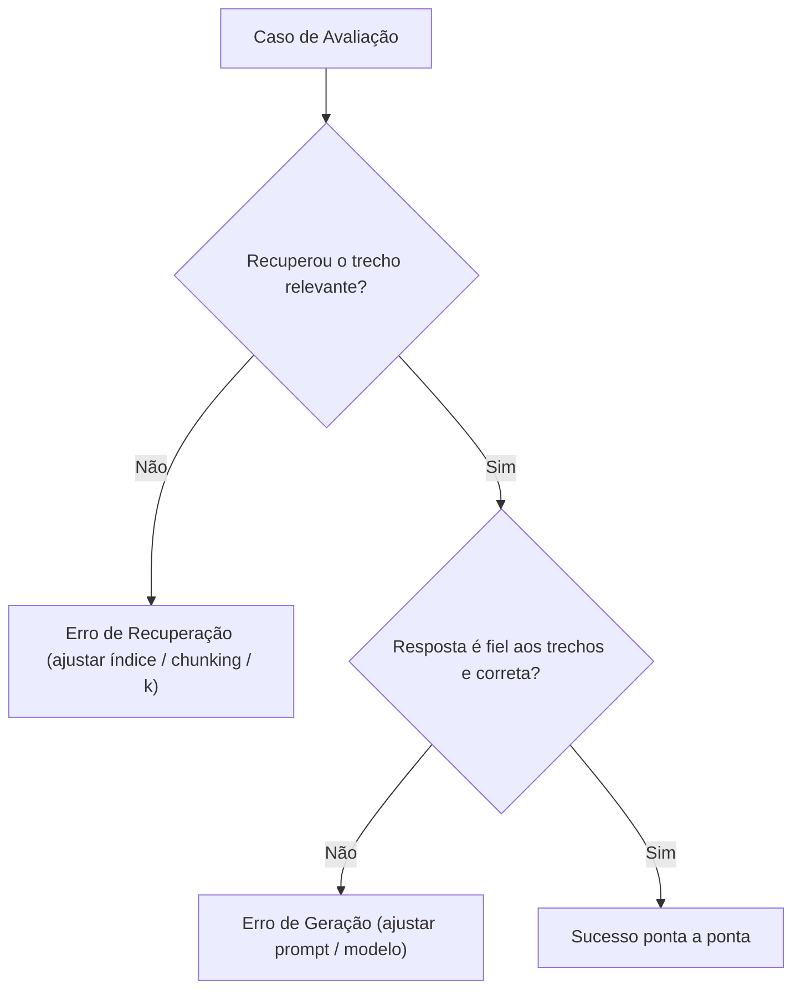

## Passo 1 · Leitura · Separando erros da busca de erros do gerador

Quando um sistema RAG responde errado, de quem foi a culpa: do **índice** que não recuperou o artigo certo do regimento ou do **modelo gerador** que ignorou o trecho recuperado? Se avaliarmos apenas a resposta final, trocaremos o prompt dezenas de vezes quando o defeito real estava no *chunking* ou na busca vetorial.



Por isso, medimos as duas etapas separadamente:

1. **Métricas de recuperação** (comparando a lista `top_k` recuperada com o conjunto de documentos relevantes $R_q$):
   - **Recall@$k$:** fração dos documentos relevantes para a pergunta que apareceram entre os $k$ primeiros.
   - **Precisão@$k$:** fração dos $k$ documentos recuperados que são de fato relevantes.
   - **MRR (*Mean Reciprocal Rank*):** média do inverso da posição ($\text{rank}_q \in \{1, 2, \dots, k\}$) do **primeiro** documento relevante recuperado (ou $0$ se nenhum relevante aparecer no top-$k$).

$$\text{MRR} = \frac{1}{|Q|} \sum_{q=1}^{|Q|} \frac{1}{\text{rank}_q}, \qquad \text{Precisão@}k = \frac{|\text{Relevantes nos top-}k|}{k}$$

2. **Métricas de geração:**
   - **Fidelidade (*faithfulness*):** a resposta limita-se ao que está escrito nos trechos recuperados, sem inventar fatos externos?
   - **Correção (*answer correctness*):** a resposta contém a informação esperada segundo a resposta de referência (*ground truth*)?

Repare que uma resposta pode ser **fiel** e **incorreta** ao mesmo tempo: se a busca não trouxer o trecho relevante e o modelo disser *"Não há informação suficiente nos documentos"*, o gerador foi 100% fiel aos trechos recebidos — a falha foi da recuperação!

## Passo 2 · Exercício · Métricas de recuperação: Recall@k, Precisão@k e MRR

modo: lacunas

Complete a função `metricas_recuperacao(recuperados, relevantes, k)` para calcular o `recall`, a `precisao` e o *Reciprocal Rank* (`rr`) de uma consulta considerando apenas os `k` primeiros itens recuperados.

### Instruções

1. Fatie `top_k = recuperados[:k]`, crie `rel_set = set(relevantes)` e calcule `recall = acertos / len(rel_set)` e `precisao = acertos / k`.
2. Encontre a primeira posição 1-based (`start=1`) em `top_k` cujo item pertença a `rel_set` e defina `rr = 1.0 / pos` (ou `0.0` se nenhum item relevante aparecer em `top_k`).

### Código inicial

```python
def metricas_recuperacao(recuperados, relevantes, k):
    top_k = recuperados[:k]
    rel_set = set(relevantes)
    acertos = sum(1 for doc_id in top_k if doc_id in rel_set)
    recall = float(acertos / len(___)) if rel_set else 0.0
    precisao = float(acertos / ___) if k > 0 else 0.0
    rr = 0.0
    for pos, doc_id in enumerate(top_k, start=___):
        if doc_id in rel_set:
            rr = float(1.0 / pos)
            break
    return {"recall": recall, "precisao": precisao, "rr": rr}
```

### Solução

```python
def metricas_recuperacao(recuperados, relevantes, k):
    top_k = recuperados[:k]
    rel_set = set(relevantes)
    acertos = sum(1 for doc_id in top_k if doc_id in rel_set)
    recall = float(acertos / len(rel_set)) if rel_set else 0.0
    precisao = float(acertos / k) if k > 0 else 0.0
    rr = 0.0
    for pos, doc_id in enumerate(top_k, start=1):
        if doc_id in rel_set:
            rr = float(1.0 / pos)
            break
    return {"recall": recall, "precisao": precisao, "rr": rr}
```

### Dicas

1. O denominador do `recall` é o total de documentos relevantes (`len(rel_set)`).
2. O denominador da `precisao` em `@k` é `k`.
3. No *Reciprocal Rank*, a primeira posição tem rank `1` (`start=1`), valendo `1.0 / 1 = 1.0`.

### Verificação

```json
[
  {
    "id": "metricas-segundo-lugar",
    "name": "Calcula recall, precisão e RR quando o relevante está na 2ª posição",
    "checkpoint": 1,
    "kind": "call",
    "function": "metricas_recuperacao",
    "args": [
      [
        "doc1",
        "doc2",
        "doc3",
        "doc4"
      ],
      [
        "doc2",
        "doc5"
      ],
      4
    ],
    "expected": {
      "recall": 0.5,
      "precisao": 0.25,
      "rr": 0.5
    },
    "tolerance": 1e-6
  },
  {
    "id": "metricas-sem-acerto",
    "name": "Devolve zeros quando nenhum relevante aparece no top-k",
    "checkpoint": 2,
    "kind": "call",
    "function": "metricas_recuperacao",
    "args": [
      [
        "doc1",
        "doc2",
        "doc3"
      ],
      [
        "doc9"
      ],
      3
    ],
    "expected": {
      "recall": 0.0,
      "precisao": 0.0,
      "rr": 0.0
    },
    "tolerance": 1e-6
  }
]
```

### Soluções erradas

```python name="Divide a precisão pelo total de relevantes em vez de k"
def metricas_recuperacao(recuperados, relevantes, k):
    top_k = recuperados[:k]
    rel_set = set(relevantes)
    acertos = sum(1 for doc_id in top_k if doc_id in rel_set)
    recall = float(acertos / len(rel_set)) if rel_set else 0.0
    precisao = float(acertos / len(rel_set)) if rel_set else 0.0
    rr = 0.0
    for pos, doc_id in enumerate(top_k, start=1):
        if doc_id in rel_set:
            rr = float(1.0 / pos)
            break
    return {"recall": recall, "precisao": precisao, "rr": rr}
```

```python name="Usa a posição diretamente em vez do inverso 1/pos no Reciprocal Rank"
def metricas_recuperacao(recuperados, relevantes, k):
    top_k = recuperados[:k]
    rel_set = set(relevantes)
    acertos = sum(1 for doc_id in top_k if doc_id in rel_set)
    recall = float(acertos / len(rel_set)) if rel_set else 0.0
    precisao = float(acertos / k) if k > 0 else 0.0
    rr = 0.0
    for pos, doc_id in enumerate(top_k, start=1):
        if doc_id in rel_set:
            rr = float(pos)
            break
    return {"recall": recall, "precisao": precisao, "rr": rr}
```

## Passo 3 · Exercício · Fidelidade por sobreposição e juiz simulado

Agora vamos medir a qualidade da resposta gerada: primeiro por uma regra rápida de sobreposição lexical das palavras significativas ($\ge 4$ caracteres) contra os trechos recuperados, e em seguida combinando fidelidade e correção factual contra a resposta de referência.

### Instruções

1. Implemente `fidelidade_por_sobreposicao(resposta, trechos)`:
   - Se `resposta.strip()` for exatamente `"Nao ha informacao suficiente nos documentos."`, devolva `1.0`.
   - Extraia todas as palavras alfanuméricas minúsculas de tamanho $\ge 4$ da `resposta` (`re.findall(r"[a-z0-9]{4,}", resposta.lower())`). Se não houver nenhuma palavra com $\ge 4$ caracteres, devolva `1.0`.
   - Construa o conjunto de todas as palavras de tamanho $\ge 4$ presentes na concatenação dos textos de `trechos` (`t["texto"]` se `t` for dicionário, ou `str(t)`).
   - Devolva como `float` a fração de palavras da `resposta` (com $\ge 4$ caracteres) que aparecem nesse conjunto de palavras dos trechos.
2. Implemente `julgar_resposta(cliente_juiz, pergunta, resposta, trechos, referencia)`:
   - Calcule `fiel = fidelidade_por_sobreposicao(resposta, trechos) >= 0.6`.
   - Use `correta = bool(cliente_juiz.verificar_fatos(resposta, referencia))` para checar se todos os fatos-chave da `referencia` aparecem na `resposta`.
   - Defina `nota` (inteiro de `0` a `2`) somando `1` se `fiel` for verdadeiro e `1` se `correta` for verdadeiro.
   - Devolva `{"fiel": bool(fiel), "correta": bool(correta), "nota": int(nota)}`.

### Código inicial

```python
import re

RECUSA_PADRAO = "Nao ha informacao suficiente nos documentos."


class JuizSimulado:
    def verificar_fatos(self, resposta, referencia):
        palavras_ref = set(re.findall(r"[a-z0-9]{4,}", referencia.lower()))
        if not palavras_ref:
            return True
        palavras_resp = set(re.findall(r"[a-z0-9]{4,}", resposta.lower()))
        cobertura = len(palavras_ref & palavras_resp) / len(palavras_ref)
        return cobertura >= 0.6


def fidelidade_por_sobreposicao(resposta, trechos):
    # Calcule a fração de palavras significativas (>= 4 letras) apoiadas nos trechos
    pass


def julgar_resposta(cliente_juiz, pergunta, resposta, trechos, referencia):
    # Avalie fidelidade, correção e nota de 0 a 2
    pass
```

### Solução

```python
import re

RECUSA_PADRAO = "Nao ha informacao suficiente nos documentos."


class JuizSimulado:
    def verificar_fatos(self, resposta, referencia):
        palavras_ref = set(re.findall(r"[a-z0-9]{4,}", referencia.lower()))
        if not palavras_ref:
            return True
        palavras_resp = set(re.findall(r"[a-z0-9]{4,}", resposta.lower()))
        cobertura = len(palavras_ref & palavras_resp) / len(palavras_ref)
        return cobertura >= 0.6


def fidelidade_por_sobreposicao(resposta, trechos):
    if resposta.strip() == RECUSA_PADRAO:
        return 1.0
    palavras_resp = re.findall(r"[a-z0-9]{4,}", resposta.lower())
    if not palavras_resp:
        return 1.0
    texto_trechos = " ".join(t["texto"] if isinstance(t, dict) else str(t) for t in trechos)
    vocab_trechos = set(re.findall(r"[a-z0-9]{4,}", texto_trechos.lower()))
    apoiadas = sum(1 for p in palavras_resp if p in vocab_trechos)
    return float(apoiadas / len(palavras_resp))


def julgar_resposta(cliente_juiz, pergunta, resposta, trechos, referencia):
    fiel = fidelidade_por_sobreposicao(resposta, trechos) >= 0.6
    correta = bool(cliente_juiz.verificar_fatos(resposta, referencia))
    nota = int(fiel) + int(correta)
    return {
        "fiel": bool(fiel),
        "correta": bool(correta),
        "nota": int(nota),
    }
```

### Dicas

1. Use `re.findall(r"[a-z0-9]{4,}", texto.lower())` tanto na resposta quanto nos trechos para extrair palavras de 4 ou mais caracteres.
2. Em `fidelidade_por_sobreposicao`, trate primeiro o caso em que `resposta.strip() == RECUSA_PADRAO`, devolvendo `1.0`.
3. Em `julgar_resposta`, `nota` vale `int(fiel) + int(correta)`.

### Verificação

```json
[
  {
    "id": "fidelidade-alta-e-baixa",
    "name": "Calcula sobreposição de palavras significativas contra os trechos",
    "checkpoint": 1,
    "kind": "call",
    "function": "fidelidade_por_sobreposicao",
    "args": [
      "O prazo maximo para trancamento e quinze dias.",
      [
        {
          "fonte": "Art. 12",
          "texto": "O prazo maximo para trancamento no semestre e de quinze dias uteis."
        }
      ]
    ],
    "expected": 1.0,
    "tolerance": 1e-6
  },
  {
    "id": "julgamento-fiel-mas-incorreto",
    "name": "Distingue resposta fiel (recusa sem trecho relevante) de resposta correta",
    "checkpoint": 2,
    "kind": "expr",
    "expr": "[julgar_resposta(JuizSimulado(), 'Qual o prazo?', 'Nao ha informacao suficiente nos documentos.', [{'fonte': 'Art. 9', 'texto': 'Estagio supervisionado dura um semestre.'}], 'O prazo e quinze dias.'), julgar_resposta(JuizSimulado(), 'Qual o prazo?', 'O prazo e quinze dias [1]', [{'fonte': 'Art. 12', 'texto': 'O prazo e quinze dias uteis.'}], 'O prazo e quinze dias.')]",
    "expected": [
      {
        "fiel": true,
        "correta": false,
        "nota": 1
      },
      {
        "fiel": true,
        "correta": true,
        "nota": 2
      }
    ]
  }
]
```

### Soluções erradas

```python name="Considera fiel qualquer resposta correta mesmo sem apoio nos trechos"
import re

RECUSA_PADRAO = "Nao ha informacao suficiente nos documentos."


class JuizSimulado:
    def verificar_fatos(self, resposta, referencia):
        palavras_ref = set(re.findall(r"[a-z0-9]{4,}", referencia.lower()))
        palavras_resp = set(re.findall(r"[a-z0-9]{4,}", resposta.lower()))
        return (len(palavras_ref & palavras_resp) / len(palavras_ref)) >= 0.6


def fidelidade_por_sobreposicao(resposta, trechos):
    return 1.0


def julgar_resposta(cliente_juiz, pergunta, resposta, trechos, referencia):
    correta = bool(cliente_juiz.verificar_fatos(resposta, referencia))
    return {"fiel": correta, "correta": correta, "nota": 2 if correta else 0}
```

```python name="Penaliza a recusa padrão como infiel quando os trechos não apoiam"
import re


class JuizSimulado:
    def verificar_fatos(self, resposta, referencia):
        palavras_ref = set(re.findall(r"[a-z0-9]{4,}", referencia.lower()))
        palavras_resp = set(re.findall(r"[a-z0-9]{4,}", resposta.lower()))
        return (len(palavras_ref & palavras_resp) / len(palavras_ref)) >= 0.6


def fidelidade_por_sobreposicao(resposta, trechos):
    palavras_resp = re.findall(r"[a-z0-9]{4,}", resposta.lower())
    texto_trechos = " ".join(t["texto"] if isinstance(t, dict) else str(t) for t in trechos)
    vocab_trechos = set(re.findall(r"[a-z0-9]{4,}", texto_trechos.lower()))
    return float(sum(1 for p in palavras_resp if p in vocab_trechos) / len(palavras_resp))


def julgar_resposta(cliente_juiz, pergunta, resposta, trechos, referencia):
    fiel = fidelidade_por_sobreposicao(resposta, trechos) >= 0.6
    correta = bool(cliente_juiz.verificar_fatos(resposta, referencia))
    return {"fiel": bool(fiel), "correta": bool(correta), "nota": int(fiel) + int(correta)}
```

## Passo 4 · Exercício · Relatório completo de avaliação por etapa

Com as métricas de recuperação e de geração prontas, construa `relatorio_de_avaliacao(rag, conjunto)` para diagnosticar exatamente quantos erros vêm do índice e quantos vêm do gerador.

### Instruções

1. Implemente `relatorio_de_avaliacao(rag, conjunto)` onde cada item de `conjunto` é um dicionário `{"pergunta": str, "fontes_esperadas": list[str], "referencia": str}`.
2. Para cada caso do `conjunto`, chame `saida = rag.responder(caso["pergunta"], k=3)`, obtendo `saida["resposta"]` e `saida["trechos"]` (cujas fontes recuperadas são `[t["fonte"] for t in saida["trechos"]]`).
3. Calcule para cada caso:
   - As métricas de recuperação em $k = 3$ sobre as fontes recuperadas vs `caso["fontes_esperadas"]`.
   - A fidelidade da resposta com `fidelidade_por_sobreposicao(saida["resposta"], saida["trechos"])`.
   - Se a resposta está `correta` usando `JuizSimulado().verificar_fatos(saida["resposta"], caso["referencia"])`.
4. Classifique os erros de cada caso em que `correta` for `False`:
   - Se `recall == 0.0` (nenhuma fonte esperada foi recuperada no top-3), incremente `erros_recuperacao`.
   - Se `recall > 0.0` (pelo menos uma fonte esperada estava nos trechos, mas a resposta ainda saiu incorreta), incremente `erros_geracao`.
5. Devolva o dicionário com as médias em `float` e as contagens em `int`:
   `{"recall_em_3": float, "mrr": float, "fidelidade_media": float, "taxa_acerto": float, "erros_recuperacao": int, "erros_geracao": int}`.

### Código inicial

```python
import re

RECUSA_PADRAO = "Nao ha informacao suficiente nos documentos."


class JuizSimulado:
    def verificar_fatos(self, resposta, referencia):
        palavras_ref = set(re.findall(r"[a-z0-9]{4,}", referencia.lower()))
        if not palavras_ref:
            return True
        palavras_resp = set(re.findall(r"[a-z0-9]{4,}", resposta.lower()))
        return (len(palavras_ref & palavras_resp) / len(palavras_ref)) >= 0.6


def metricas_recuperacao(recuperados, relevantes, k):
    top_k = recuperados[:k]
    rel_set = set(relevantes)
    acertos = sum(1 for doc_id in top_k if doc_id in rel_set)
    recall = float(acertos / len(rel_set)) if rel_set else 0.0
    precisao = float(acertos / k) if k > 0 else 0.0
    rr = 0.0
    for pos, doc_id in enumerate(top_k, start=1):
        if doc_id in rel_set:
            rr = float(1.0 / pos)
            break
    return {"recall": recall, "precisao": precisao, "rr": rr}


def fidelidade_por_sobreposicao(resposta, trechos):
    if resposta.strip() == RECUSA_PADRAO:
        return 1.0
    palavras_resp = re.findall(r"[a-z0-9]{4,}", resposta.lower())
    if not palavras_resp:
        return 1.0
    texto_trechos = " ".join(t["texto"] if isinstance(t, dict) else str(t) for t in trechos)
    vocab_trechos = set(re.findall(r"[a-z0-9]{4,}", texto_trechos.lower()))
    return float(sum(1 for p in palavras_resp if p in vocab_trechos) / len(palavras_resp))


def relatorio_de_avaliacao(rag, conjunto):
    # Avalie todos os casos e separe erros de recuperação de erros de geração
    pass
```

### Solução

```python
import re

RECUSA_PADRAO = "Nao ha informacao suficiente nos documentos."


class JuizSimulado:
    def verificar_fatos(self, resposta, referencia):
        palavras_ref = set(re.findall(r"[a-z0-9]{4,}", referencia.lower()))
        if not palavras_ref:
            return True
        palavras_resp = set(re.findall(r"[a-z0-9]{4,}", resposta.lower()))
        return (len(palavras_ref & palavras_resp) / len(palavras_ref)) >= 0.6


def metricas_recuperacao(recuperados, relevantes, k):
    top_k = recuperados[:k]
    rel_set = set(relevantes)
    acertos = sum(1 for doc_id in top_k if doc_id in rel_set)
    recall = float(acertos / len(rel_set)) if rel_set else 0.0
    precisao = float(acertos / k) if k > 0 else 0.0
    rr = 0.0
    for pos, doc_id in enumerate(top_k, start=1):
        if doc_id in rel_set:
            rr = float(1.0 / pos)
            break
    return {"recall": recall, "precisao": precisao, "rr": rr}


def fidelidade_por_sobreposicao(resposta, trechos):
    if resposta.strip() == RECUSA_PADRAO:
        return 1.0
    palavras_resp = re.findall(r"[a-z0-9]{4,}", resposta.lower())
    if not palavras_resp:
        return 1.0
    texto_trechos = " ".join(t["texto"] if isinstance(t, dict) else str(t) for t in trechos)
    vocab_trechos = set(re.findall(r"[a-z0-9]{4,}", texto_trechos.lower()))
    return float(sum(1 for p in palavras_resp if p in vocab_trechos) / len(palavras_resp))


def relatorio_de_avaliacao(rag, conjunto):
    n = len(conjunto)
    if n == 0:
        return {
            "recall_em_3": 0.0,
            "mrr": 0.0,
            "fidelidade_media": 0.0,
            "taxa_acerto": 0.0,
            "erros_recuperacao": 0,
            "erros_geracao": 0,
        }
    juiz = JuizSimulado()
    soma_recall = 0.0
    soma_rr = 0.0
    soma_fid = 0.0
    acertos = 0
    erros_rec = 0
    erros_ger = 0

    for caso in conjunto:
        saida = rag.responder(caso["pergunta"], k=3)
        trechos = saida["trechos"]
        fontes_rec = [t["fonte"] for t in trechos]
        m = metricas_recuperacao(fontes_rec, caso["fontes_esperadas"], 3)
        fid = fidelidade_por_sobreposicao(saida["resposta"], trechos)
        correta = juiz.verificar_fatos(saida["resposta"], caso["referencia"])

        soma_recall += m["recall"]
        soma_rr += m["rr"]
        soma_fid += fid
        if correta:
            acertos += 1
        elif m["recall"] == 0.0:
            erros_rec += 1
        else:
            erros_ger += 1

    return {
        "recall_em_3": float(soma_recall / n),
        "mrr": float(soma_rr / n),
        "fidelidade_media": float(soma_fid / n),
        "taxa_acerto": float(acertos / n),
        "erros_recuperacao": int(erros_rec),
        "erros_geracao": int(erros_ger),
    }
```

### Dicas

1. Extraia a lista de fontes recuperadas com `[t["fonte"] for t in saida["trechos"]]`.
2. Quando `not correta`, verifique `if m["recall"] == 0.0:` para atribuir a falha a `erros_recuperacao`; caso contrário, atribua a `erros_geracao`.

### Verificação

```json
[
  {
    "id": "relatorio-diagnostico-rag",
    "name": "Separa acerto, falha de recuperação e falha de geração em 3 casos",
    "checkpoint": 5,
    "kind": "expr",
    "expr": "relatorio_de_avaliacao(type('RAGStub', (), {'responder': lambda self, p, k=3: {'resposta': 'O prazo de trancamento e quinze dias [1]', 'trechos': [{'fonte': 'Art. 12', 'texto': 'O prazo de trancamento e quinze dias uteis.'}]} if 'trancamento' in p else ({'resposta': 'Nao ha informacao suficiente nos documentos.', 'trechos': [{'fonte': 'Art. 1', 'texto': 'Texto sem relacao.'}]} if 'jubilamento' in p else {'resposta': 'Resposta incompleta sem numero.', 'trechos': [{'fonte': 'Art. 1', 'texto': 'Texto qualquer.'}, {'fonte': 'Art. 30', 'texto': 'A frequencia minima e setenta por cento.'}]})})(), [{'pergunta': 'Qual o prazo de trancamento?', 'fontes_esperadas': ['Art. 12'], 'referencia': 'O prazo de trancamento e quinze dias.'}, {'pergunta': 'Quando ocorre jubilamento?', 'fontes_esperadas': ['Art. 50'], 'referencia': 'Ocorre apos dez semestres.'}, {'pergunta': 'Qual a frequencia minima?', 'fontes_esperadas': ['Art. 30'], 'referencia': 'A frequencia minima e setenta por cento.'}])",
    "expected": {
      "recall_em_3": 0.6666666666666666,
      "mrr": 0.5,
      "fidelidade_media": 0.6666666666666666,
      "taxa_acerto": 0.3333333333333333,
      "erros_recuperacao": 1,
      "erros_geracao": 1
    },
    "tolerance": 1e-6
  }
]
```

### Soluções erradas

```python name="Classifica todas as respostas incorretas como erro de geração"
import re

RECUSA_PADRAO = "Nao ha informacao suficiente nos documentos."


class JuizSimulado:
    def verificar_fatos(self, resposta, referencia):
        palavras_ref = set(re.findall(r"[a-z0-9]{4,}", referencia.lower()))
        palavras_resp = set(re.findall(r"[a-z0-9]{4,}", resposta.lower()))
        return (len(palavras_ref & palavras_resp) / len(palavras_ref)) >= 0.6


def metricas_recuperacao(recuperados, relevantes, k):
    top_k = recuperados[:k]
    rel_set = set(relevantes)
    acertos = sum(1 for doc_id in top_k if doc_id in rel_set)
    recall = float(acertos / len(rel_set)) if rel_set else 0.0
    precisao = float(acertos / k) if k > 0 else 0.0
    rr = 0.0
    for pos, doc_id in enumerate(top_k, start=1):
        if doc_id in rel_set:
            rr = float(1.0 / pos)
            break
    return {"recall": recall, "precisao": precisao, "rr": rr}


def fidelidade_por_sobreposicao(resposta, trechos):
    if resposta.strip() == RECUSA_PADRAO:
        return 1.0
    palavras_resp = re.findall(r"[a-z0-9]{4,}", resposta.lower())
    texto_trechos = " ".join(t["texto"] if isinstance(t, dict) else str(t) for t in trechos)
    vocab_trechos = set(re.findall(r"[a-z0-9]{4,}", texto_trechos.lower()))
    return float(sum(1 for p in palavras_resp if p in vocab_trechos) / len(palavras_resp))


def relatorio_de_avaliacao(rag, conjunto):
    n = len(conjunto)
    juiz = JuizSimulado()
    soma_recall = soma_rr = soma_fid = 0.0
    acertos = erros_ger = 0
    for caso in conjunto:
        saida = rag.responder(caso["pergunta"], k=3)
        trechos = saida["trechos"]
        m = metricas_recuperacao([t["fonte"] for t in trechos], caso["fontes_esperadas"], 3)
        fid = fidelidade_por_sobreposicao(saida["resposta"], trechos)
        correta = juiz.verificar_fatos(saida["resposta"], caso["referencia"])
        soma_recall += m["recall"]
        soma_rr += m["rr"]
        soma_fid += fid
        if correta:
            acertos += 1
        else:
            erros_ger += 1
    return {
        "recall_em_3": float(soma_recall / n),
        "mrr": float(soma_rr / n),
        "fidelidade_media": float(soma_fid / n),
        "taxa_acerto": float(acertos / n),
        "erros_recuperacao": 0,
        "erros_geracao": int(erros_ger),
    }
```

```python name="Esquece de dividir as somas pelo número de casos do conjunto"
import re

RECUSA_PADRAO = "Nao ha informacao suficiente nos documentos."


class JuizSimulado:
    def verificar_fatos(self, resposta, referencia):
        palavras_ref = set(re.findall(r"[a-z0-9]{4,}", referencia.lower()))
        palavras_resp = set(re.findall(r"[a-z0-9]{4,}", resposta.lower()))
        return (len(palavras_ref & palavras_resp) / len(palavras_ref)) >= 0.6


def metricas_recuperacao(recuperados, relevantes, k):
    top_k = recuperados[:k]
    rel_set = set(relevantes)
    acertos = sum(1 for doc_id in top_k if doc_id in rel_set)
    recall = float(acertos / len(rel_set)) if rel_set else 0.0
    precisao = float(acertos / k) if k > 0 else 0.0
    rr = 0.0
    for pos, doc_id in enumerate(top_k, start=1):
        if doc_id in rel_set:
            rr = float(1.0 / pos)
            break
    return {"recall": recall, "precisao": precisao, "rr": rr}


def fidelidade_por_sobreposicao(resposta, trechos):
    if resposta.strip() == RECUSA_PADRAO:
        return 1.0
    palavras_resp = re.findall(r"[a-z0-9]{4,}", resposta.lower())
    texto_trechos = " ".join(t["texto"] if isinstance(t, dict) else str(t) for t in trechos)
    vocab_trechos = set(re.findall(r"[a-z0-9]{4,}", texto_trechos.lower()))
    return float(sum(1 for p in palavras_resp if p in vocab_trechos) / len(palavras_resp))


def relatorio_de_avaliacao(rag, conjunto):
    juiz = JuizSimulado()
    soma_recall = soma_rr = soma_fid = 0.0
    acertos = erros_rec = erros_ger = 0
    for caso in conjunto:
        saida = rag.responder(caso["pergunta"], k=3)
        trechos = saida["trechos"]
        m = metricas_recuperacao([t["fonte"] for t in trechos], caso["fontes_esperadas"], 3)
        fid = fidelidade_por_sobreposicao(saida["resposta"], trechos)
        correta = juiz.verificar_fatos(saida["resposta"], caso["referencia"])
        soma_recall += m["recall"]
        soma_rr += m["rr"]
        soma_fid += fid
        if correta:
            acertos += 1
        elif m["recall"] == 0.0:
            erros_rec += 1
        else:
            erros_ger += 1
    return {
        "recall_em_3": float(soma_recall),
        "mrr": float(soma_rr),
        "fidelidade_media": float(soma_fid),
        "taxa_acerto": float(acertos),
        "erros_recuperacao": int(erros_rec),
        "erros_geracao": int(erros_ger),
    }
```

## Passo 5 · Quiz · Fidelidade, correção e MRR

### Pergunta

Qual é a diferença entre **fidelidade** (*faithfulness*) e **correção** (*answer correctness*) na avaliação de um sistema RAG?

- [ ] Fidelidade mede a velocidade da busca vetorial e correção mede o custo em dólares.
- [x] Fidelidade verifica se a resposta se apoia exclusivamente nos trechos recuperados (sem inventar fatos), enquanto correção verifica se a resposta responde à pergunta segundo o gabarito de referência.
- [ ] São sinônimos exatos: toda resposta fiel é obrigatoriamente correta.
- [ ] Fidelidade avalia o índice vetorial e correção avalia a tokenização.

> Se a recuperação falhar e trouxer trechos irrelevantes, um gerador que se recusa a inventar produz uma resposta **fiel** aos trechos, porém **incorreta** perante o gabarito — evidenciando que o problema está na busca.

### Pergunta

Em uma consulta de avaliação, o índice retornou 4 documentos `[docA, docB, docC, docD]` e o único documento relevante para a pergunta era `docB`. Qual é o valor do *Reciprocal Rank* (`RR`) dessa consulta?

- [ ] `2.0`
- [ ] `0.25`
- [x] `0.5`
- [ ] `1.0`

> Como `docB` está na 2ª posição da lista ordenada ($\text{rank} = 2$), o *Reciprocal Rank* vale $1 / 2 = 0{,}5$.

### Pergunta

Em um conjunto de 50 perguntas, seu sistema RAG apresentou `recall@3 = 0.96` e `taxa_acerto = 0.52`. Onde você deve concentrar o esforço de melhoria?

- [ ] Trocar o algoritmo de indexação vetorial, pois a busca não está encontrando os documentos.
- [x] Investigar a montagem do prompt e o modelo gerador, pois o trecho relevante já está chegando ao top-3 em 96% dos casos, mas a geração falha em quase metade deles.
- [ ] Reduzir o conjunto de avaliação para apenas 5 perguntas fáceis.
- [ ] Desativar a verificação de citações.

> Um `recall@3` de 96% comprova que a recuperação está cumprindo seu papel; a queda para 52% na resposta final aponta diretamente para a etapa de geração ou formatação do contexto.
