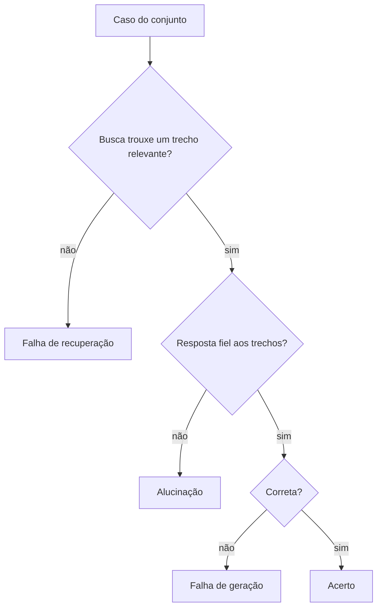

## Passo 1 · Leitura · Duas etapas, duas avaliações

O assistente respondeu errado sobre trancamento. De quem é a culpa? Da **busca**, que não trouxe o artigo certo, ou da **geração**, que recebeu o artigo e respondeu outra coisa? Quem olha só a resposta final não sabe, e passa uma semana reescrevendo o prompt quando o defeito estava no chunking.



Para separar as etapas, o **conjunto de avaliação** precisa de três coisas por pergunta: o texto da pergunta (de preferência tirado de pedidos reais à secretaria), os **ids dos trechos relevantes** — o gabarito da busca — e uma **resposta de referência** — o gabarito da geração. Inclua também perguntas que os documentos **não** respondem, com gabarito de trechos vazio: nelas o comportamento certo é recusar.

A busca de uma pergunta $q$ é medida comparando os $k$ primeiros ids devolvidos, $\text{top}_k(q)$, com o conjunto $R_q$ de relevantes:

$$
\text{recall@}k = \frac{|R_q \cap \text{top}_k(q)|}{|R_q|} \qquad
\text{precisão@}k = \frac{|R_q \cap \text{top}_k(q)|}{k} \qquad
\text{MRR} = \frac{1}{|Q|}\sum_{q \in Q} \frac{1}{\text{pos}_q}
$$

$\text{pos}_q$ é a posição (a partir de 1) do **primeiro** relevante no top-$k$; sem nenhum, a parcela vale 0. Recall pergunta "a evidência chegou?"; precisão, "quanto lixo veio junto?"; MRR, "quão no alto ela chegou?". Num RAG que manda poucos trechos ao modelo, recall@k com o mesmo $k$ do prompt é a métrica que mais importa: se o trecho não está no prompt, nenhum gerador acerta com honestidade.

Pergunta sem trecho relevante não tem recall (seria $0/0$). Ela fica fora das médias da busca e entra na avaliação da geração, onde se confere se o sistema recusou.

```python
{"id": "p7", "pergunta": "Posso trancar uma disciplina depois da prova?",
 "relevantes": ["reg-12"],
 "referencia": "Sim, até o 60º dia letivo, pelo sistema acadêmico."}
```

Os ids do gabarito apontam para trechos de **uma versão** do índice. Mudou o chunking, os ids mudam, e um gabarito velho faz o recall despencar sem que a busca tenha piorado. Conferir que todo id do gabarito existe no índice antes de medir evita esse susto.

## Passo 2 · Previsão · Mais recall, menos MRR

Dois sistemas de busca respondem às mesmas três perguntas. O programa calcula recall@3 e MRR de cada um. Leia sem executar e digite o que ele imprime.

### Código
```python
gabarito = {"p1": ["reg-12"], "p2": ["reg-20", "faq-04"], "p3": ["cal-01"]}
sistemas = {
    "A": {"p1": ["reg-12", "reg-13", "faq-02"], "p2": ["reg-20", "faq-01", "reg-11"],
          "p3": ["reg-30", "faq-09", "reg-02"]},
    "B": {"p1": ["reg-13", "faq-02", "reg-12"], "p2": ["faq-04", "reg-20", "reg-11"],
          "p3": ["faq-09", "cal-01", "reg-02"]},
}
for nome, resultado in sistemas.items():
    recall, rr = 0.0, 0.0
    for p, relevantes in gabarito.items():
        topo = resultado[p][:3]
        recall += len(set(topo) & set(relevantes)) / len(relevantes)
        for pos, ident in enumerate(topo, start=1):
            if ident in relevantes:
                rr += 1 / pos
                break
    print(nome, round(recall / 3, 2), round(rr / 3, 2))
```

### Dicas
1. No sistema A, a p2 tem dois relevantes e só um voltou: recall 0,5 nessa pergunta.
2. O `break` faz cada pergunta contar só o primeiro relevante no MRR.
3. No sistema B, as posições dos primeiros relevantes são 3, 1 e 2.

### Saída esperada
```text
A 0.5 0.67
B 1.0 0.61
```

## Passo 3 · Exercício · Métricas de uma consulta
modo: lacunas

Complete as lacunas (`___`) de `metricas_consulta(recuperados, relevantes, k)`. `recuperados` é a lista de ids devolvida pela busca, em ordem; `relevantes`, a lista de ids do gabarito. Ela devolve `{"recall": ..., "precisao": ..., "rr": ...}` olhando só os `k` primeiros recuperados. A precisão é dividida por `k` mesmo quando a busca devolveu menos itens: faltar resultado não é mérito. Gabarito vazio levanta `ValueError`, porque recall de uma pergunta sem trecho relevante não existe.

### Instruções
1. Considere só os `k` primeiros ids recuperados.
2. Calcule o recall sobre todos os relevantes do gabarito e a precisão sobre `k`.
3. Calcule o RR pela posição, a partir de 1, do primeiro relevante.

### Código inicial
```python
def metricas_consulta(recuperados, relevantes, k):
    if not relevantes:
        raise ValueError("pergunta sem trechos relevantes no gabarito")
    topo = recuperados[:___]
    acertos = len(set(topo) & set(relevantes))
    rr = 0.0
    for pos, ident in enumerate(topo, start=___):
        if ident in relevantes:
            rr = 1 / ___
            break
    return {"recall": acertos / len(___), "precisao": acertos / ___, "rr": rr}


if __name__ == "__main__":
    print(metricas_consulta(["reg-13", "faq-02", "reg-12", "cal-01"], ["reg-12", "faq-02"], 3))
```

### Solução
```python
def metricas_consulta(recuperados, relevantes, k):
    if not relevantes:
        raise ValueError("pergunta sem trechos relevantes no gabarito")
    topo = recuperados[:k]
    acertos = len(set(topo) & set(relevantes))
    rr = 0.0
    for pos, ident in enumerate(topo, start=1):
        if ident in relevantes:
            rr = 1 / pos
            break
    return {"recall": acertos / len(relevantes), "precisao": acertos / k, "rr": rr}


if __name__ == "__main__":
    print(metricas_consulta(["reg-13", "faq-02", "reg-12", "cal-01"], ["reg-12", "faq-02"], 3))
```

### Dicas
1. Os `k` primeiros de uma lista são uma fatia.
2. O denominador do recall é o que **deveria** ter vindo; o da precisão, o que **cabia** vir.
3. RR do relevante na primeira posição é 1; na terceira, um terço.

### Verificação
```json
[
  {"id": "exemplo", "checkpoint": 1, "kind": "call", "function": "metricas_consulta", "args": [["faq-02", "reg-12", "cal-01", "reg-13"], ["reg-12", "reg-13"], 3], "tolerance": 1e-09, "name": "Dois relevantes, um no top-3, na posição 2", "expected": {"recall": 0.5, "precisao": 0.3333333333333333, "rr": 0.5}},
  {"id": "corte-k", "checkpoint": 1, "kind": "call", "function": "metricas_consulta", "args": [["faq-02", "cal-01", "reg-12"], ["reg-12"], 2], "tolerance": 1e-09, "name": "Relevante na posição 3 não conta em k = 2", "hint": "Só os k primeiros entram na conta.", "expected": {"recall": 0.0, "precisao": 0.0, "rr": 0.0}},
  {"id": "recall-todos", "checkpoint": 2, "kind": "call", "function": "metricas_consulta", "args": [["reg-20", "faq-04", "reg-21"], ["reg-20", "reg-21", "faq-07", "faq-08"], 3], "tolerance": 1e-09, "name": "O denominador do recall são todos os relevantes do gabarito", "hint": "Relevante que a busca não trouxe também conta.", "expected": {"recall": 0.5, "precisao": 0.6666666666666666, "rr": 1.0}},
  {"id": "primeiro", "checkpoint": 3, "kind": "call", "function": "metricas_consulta", "args": [["cal-01", "reg-20", "reg-21", "faq-04"], ["reg-21", "reg-20"], 4], "tolerance": 1e-09, "name": "RR usa o PRIMEIRO relevante da lista", "hint": "Achou um relevante, pare.", "expected": {"recall": 1.0, "precisao": 0.5, "rr": 0.5}},
  {"id": "poucos", "checkpoint": 2, "kind": "call", "function": "metricas_consulta", "args": [["reg-12"], ["reg-12"], 5], "tolerance": 1e-09, "name": "Busca devolveu menos que k: a precisão continua dividida por k", "expected": {"recall": 1.0, "precisao": 0.2, "rr": 1.0}},
  {"id": "nenhum", "checkpoint": 3, "kind": "call", "function": "metricas_consulta", "args": [["cal-01", "faq-02"], ["reg-30"], 2], "tolerance": 1e-09, "name": "Nenhum relevante: tudo zero", "expected": {"recall": 0.0, "precisao": 0.0, "rr": 0.0}},
  {"id": "sem-gabarito", "checkpoint": 1, "kind": "expr", "expr": "metricas_consulta(['reg-12'], [], 3)", "raises": "ValueError", "message_contains": "gabarito", "name": "Pergunta sem trecho relevante não tem recall: é erro, não zero"}
]
```

### Soluções erradas
```python name="recall dividido pelo tamanho do topo"
def metricas_consulta(recuperados, relevantes, k):
    if not relevantes:
        raise ValueError("pergunta sem trechos relevantes no gabarito")
    topo = recuperados[:k]
    acertos = len(set(topo) & set(relevantes))
    rr = 0.0
    for pos, ident in enumerate(topo, start=1):
        if ident in relevantes:
            rr = 1 / pos
            break
    return {"recall": acertos / len(topo), "precisao": acertos / k, "rr": rr}


if __name__ == "__main__":
    print(metricas_consulta(["reg-13", "faq-02", "reg-12", "cal-01"], ["reg-12", "faq-02"], 3))
```
```python name="RR do último relevante, sem break"
def metricas_consulta(recuperados, relevantes, k):
    if not relevantes:
        raise ValueError("pergunta sem trechos relevantes no gabarito")
    topo = recuperados[:k]
    acertos = len(set(topo) & set(relevantes))
    rr = 0.0
    for pos, ident in enumerate(topo, start=1):
        if ident in relevantes:
            rr = 1 / pos
    return {"recall": acertos / len(relevantes), "precisao": acertos / k, "rr": rr}


if __name__ == "__main__":
    print(metricas_consulta(["reg-13", "faq-02", "reg-12", "cal-01"], ["reg-12", "faq-02"], 3))
```
```python name="olha a lista inteira, não só os k primeiros"
def metricas_consulta(recuperados, relevantes, k):
    if not relevantes:
        raise ValueError("pergunta sem trechos relevantes no gabarito")
    topo = recuperados
    acertos = len(set(topo) & set(relevantes))
    rr = 0.0
    for pos, ident in enumerate(topo, start=1):
        if ident in relevantes:
            rr = 1 / pos
            break
    return {"recall": acertos / len(relevantes), "precisao": acertos / k, "rr": rr}


if __name__ == "__main__":
    print(metricas_consulta(["reg-13", "faq-02", "reg-12", "cal-01"], ["reg-12", "faq-02"], 3))
```
```python name="precisão dividida pelo que voltou"
def metricas_consulta(recuperados, relevantes, k):
    if not relevantes:
        raise ValueError("pergunta sem trechos relevantes no gabarito")
    topo = recuperados[:k]
    acertos = len(set(topo) & set(relevantes))
    rr = 0.0
    for pos, ident in enumerate(topo, start=1):
        if ident in relevantes:
            rr = 1 / pos
            break
    return {"recall": acertos / len(relevantes), "precisao": acertos / len(topo), "rr": rr}


if __name__ == "__main__":
    print(metricas_consulta(["reg-13", "faq-02", "reg-12", "cal-01"], ["reg-12", "faq-02"], 3))
```
```python name="gabarito vazio vira zero"
def metricas_consulta(recuperados, relevantes, k):
    if not relevantes:
        return {"recall": 0.0, "precisao": 0.0, "rr": 0.0}
    topo = recuperados[:k]
    acertos = len(set(topo) & set(relevantes))
    rr = 0.0
    for pos, ident in enumerate(topo, start=1):
        if ident in relevantes:
            rr = 1 / pos
            break
    return {"recall": acertos / len(relevantes), "precisao": acertos / k, "rr": rr}


if __name__ == "__main__":
    print(metricas_consulta(["reg-13", "faq-02", "reg-12", "cal-01"], ["reg-12", "faq-02"], 3))
```

## Passo 4 · Exercício · Avaliar a busca num conjunto

Escreva `avaliar_recuperacao(buscar, conjunto, ids_validos, k=3)`. `metricas_consulta` já está no código inicial.

- `buscar(pergunta, k)` é a busca que você quer medir: devolve a lista de ids dos trechos, em ordem. Nos testes ela é falsa, para os números serem conhecidos; no projeto, é o seu índice.
- `conjunto` é uma lista de `{"id", "pergunta", "relevantes"}`; `relevantes` vazio quer dizer "os documentos não respondem".
- `ids_validos` são os ids existentes no índice atual. **Antes de qualquer busca**, se algum id de gabarito não estiver lá, levante `ValueError` com uma mensagem que contenha o id da pergunta e o id desconhecido.
- Perguntas sem relevantes não são buscadas nem entram nas médias; conte-as em `sem_gabarito`.
- Devolva `{"recall", "precisao", "mrr", "avaliadas", "sem_gabarito", "falhas"}`: as médias das perguntas avaliadas, com `round(..., 4)` (0.0 se nenhuma foi avaliada), quantas foram avaliadas e, em `falhas`, os ids das perguntas com recall zero, na ordem do conjunto.

### Instruções
1. Confira todos os ids do gabarito contra o índice antes de buscar.
2. Busque cada pergunta com gabarito usando o mesmo `k` das métricas e faça as médias só sobre elas.
3. Liste em `falhas` as perguntas em que nenhum relevante voltou.

### Código inicial
```python
def metricas_consulta(recuperados, relevantes, k):
    if not relevantes:
        raise ValueError("pergunta sem trechos relevantes no gabarito")
    topo = recuperados[:k]
    acertos = len(set(topo) & set(relevantes))
    rr = 0.0
    for pos, ident in enumerate(topo, start=1):
        if ident in relevantes:
            rr = 1 / pos
            break
    return {"recall": acertos / len(relevantes), "precisao": acertos / k, "rr": rr}


def avaliar_recuperacao(buscar, conjunto, ids_validos, k=3):
    pass


if __name__ == "__main__":
    resultados = {
        "Até quando posso trancar uma disciplina?": ["reg-12", "reg-13", "faq-02"],
        "Quantos créditos preciso na matrícula?": ["faq-02", "reg-20", "reg-12"],
        "Qual o cardápio do restaurante?": ["cal-01", "faq-02", "reg-13"],
    }
    conjunto = [
        {"id": "p1", "pergunta": "Até quando posso trancar uma disciplina?", "relevantes": ["reg-12"]},
        {"id": "p2", "pergunta": "Quantos créditos preciso na matrícula?", "relevantes": ["reg-20"]},
        {"id": "p3", "pergunta": "Qual o cardápio do restaurante?", "relevantes": []},
    ]
    validos = {"reg-12", "reg-13", "reg-20", "faq-02", "cal-01"}
    print(avaliar_recuperacao(lambda p, k: resultados[p][:k], conjunto, validos, k=3))
```

### Solução
```python
def metricas_consulta(recuperados, relevantes, k):
    if not relevantes:
        raise ValueError("pergunta sem trechos relevantes no gabarito")
    topo = recuperados[:k]
    acertos = len(set(topo) & set(relevantes))
    rr = 0.0
    for pos, ident in enumerate(topo, start=1):
        if ident in relevantes:
            rr = 1 / pos
            break
    return {"recall": acertos / len(relevantes), "precisao": acertos / k, "rr": rr}


def avaliar_recuperacao(buscar, conjunto, ids_validos, k=3):
    for caso in conjunto:
        for ident in caso["relevantes"]:
            if ident not in ids_validos:
                raise ValueError(f"gabarito desatualizado: {caso['id']} cita {ident}")
    soma = {"recall": 0.0, "precisao": 0.0, "rr": 0.0}
    avaliadas, sem_gabarito, falhas = 0, 0, []
    for caso in conjunto:
        if not caso["relevantes"]:
            sem_gabarito += 1
            continue
        m = metricas_consulta(buscar(caso["pergunta"], k), caso["relevantes"], k)
        for chave in soma:
            soma[chave] += m[chave]
        avaliadas += 1
        if m["recall"] == 0:
            falhas.append(caso["id"])
    media = {chave: round(valor / avaliadas, 4) if avaliadas else 0.0 for chave, valor in soma.items()}
    return {"recall": media["recall"], "precisao": media["precisao"], "mrr": media["rr"],
            "avaliadas": avaliadas, "sem_gabarito": sem_gabarito, "falhas": falhas}


if __name__ == "__main__":
    resultados = {
        "Até quando posso trancar uma disciplina?": ["reg-12", "reg-13", "faq-02"],
        "Quantos créditos preciso na matrícula?": ["faq-02", "reg-20", "reg-12"],
        "Qual o cardápio do restaurante?": ["cal-01", "faq-02", "reg-13"],
    }
    conjunto = [
        {"id": "p1", "pergunta": "Até quando posso trancar uma disciplina?", "relevantes": ["reg-12"]},
        {"id": "p2", "pergunta": "Quantos créditos preciso na matrícula?", "relevantes": ["reg-20"]},
        {"id": "p3", "pergunta": "Qual o cardápio do restaurante?", "relevantes": []},
    ]
    validos = {"reg-12", "reg-13", "reg-20", "faq-02", "cal-01"}
    print(avaliar_recuperacao(lambda p, k: resultados[p][:k], conjunto, validos, k=3))
```

### Dicas
1. Duas passadas pelo conjunto: uma para conferir o gabarito, outra para medir.
2. O denominador das médias é o número de perguntas avaliadas, não o tamanho do conjunto.
3. Recall parcial (um de três relevantes) ainda trouxe evidência; falha é recall zero.

### Verificação
```json
[
  {"id": "medias", "checkpoint": 2, "kind": "expr", "setup": "RES = {\n    'trancar': ['reg-13', 'faq-02', 'reg-12'],\n    'creditos': ['reg-20', 'faq-04', 'reg-21'],\n    'boletim': ['cal-01', 'reg-13', 'faq-02'],\n    'cantina': ['faq-02', 'cal-01', 'reg-12'],\n    'curto': ['reg-30', 'faq-04'],\n}\nchamadas = []\ndef buscar(pergunta, k):\n    chamadas.append((pergunta, k))\n    return RES[pergunta][:k]\nVALIDOS = {'reg-12', 'reg-13', 'reg-20', 'reg-21', 'reg-30', 'faq-02', 'faq-04', 'faq-07', 'cal-01'}\nCONJ = [\n    {'id': 'p1', 'pergunta': 'trancar', 'relevantes': ['reg-12']},\n    {'id': 'p2', 'pergunta': 'creditos', 'relevantes': ['reg-20', 'reg-21', 'faq-07']},\n    {'id': 'p3', 'pergunta': 'boletim', 'relevantes': ['faq-07']},\n    {'id': 'p4', 'pergunta': 'cantina', 'relevantes': []},\n]\n", "expr": "avaliar_recuperacao(buscar, CONJ, VALIDOS, k=3)", "tolerance": 0.0001, "name": "Médias de recall, precisão e MRR só sobre as perguntas com gabarito", "hint": "Pergunta sem trecho relevante entra em sem_gabarito, não na média.", "expected": {"recall": 0.5556, "precisao": 0.3333, "mrr": 0.4444, "avaliadas": 3, "sem_gabarito": 1, "falhas": ["p3"]}},
  {"id": "k-repassado", "checkpoint": 2, "kind": "expr", "setup": "RES = {\n    'trancar': ['reg-13', 'faq-02', 'reg-12'],\n    'creditos': ['reg-20', 'faq-04', 'reg-21'],\n    'boletim': ['cal-01', 'reg-13', 'faq-02'],\n    'cantina': ['faq-02', 'cal-01', 'reg-12'],\n    'curto': ['reg-30', 'faq-04'],\n}\nchamadas = []\ndef buscar(pergunta, k):\n    chamadas.append((pergunta, k))\n    return RES[pergunta][:k]\nVALIDOS = {'reg-12', 'reg-13', 'reg-20', 'reg-21', 'reg-30', 'faq-02', 'faq-04', 'faq-07', 'cal-01'}\nCONJ = [\n    {'id': 'p1', 'pergunta': 'trancar', 'relevantes': ['reg-12']},\n    {'id': 'p2', 'pergunta': 'creditos', 'relevantes': ['reg-20', 'reg-21', 'faq-07']},\n    {'id': 'p3', 'pergunta': 'boletim', 'relevantes': ['faq-07']},\n    {'id': 'p4', 'pergunta': 'cantina', 'relevantes': []},\n]\nr = avaliar_recuperacao(buscar, CONJ, VALIDOS, k=2)", "expr": "[r['recall'], r['mrr'], sorted(set(k for _, k in chamadas))]", "tolerance": 0.0001, "name": "O k pedido é o k usado na busca e nas métricas", "expected": [0.1111, 0.3333, [2]]},
  {"id": "falhas", "checkpoint": 3, "kind": "expr", "setup": "RES = {\n    'trancar': ['reg-13', 'faq-02', 'reg-12'],\n    'creditos': ['reg-20', 'faq-04', 'reg-21'],\n    'boletim': ['cal-01', 'reg-13', 'faq-02'],\n    'cantina': ['faq-02', 'cal-01', 'reg-12'],\n    'curto': ['reg-30', 'faq-04'],\n}\nchamadas = []\ndef buscar(pergunta, k):\n    chamadas.append((pergunta, k))\n    return RES[pergunta][:k]\nVALIDOS = {'reg-12', 'reg-13', 'reg-20', 'reg-21', 'reg-30', 'faq-02', 'faq-04', 'faq-07', 'cal-01'}\nCONJ = [\n    {'id': 'p1', 'pergunta': 'trancar', 'relevantes': ['reg-12']},\n    {'id': 'p2', 'pergunta': 'creditos', 'relevantes': ['reg-20', 'reg-21', 'faq-07']},\n    {'id': 'p3', 'pergunta': 'boletim', 'relevantes': ['faq-07']},\n    {'id': 'p4', 'pergunta': 'cantina', 'relevantes': []},\n]\n", "expr": "avaliar_recuperacao(buscar, CONJ, VALIDOS, k=3)['falhas']", "expected": ["p3"], "name": "falhas lista as perguntas em que nenhum relevante voltou", "hint": "Recall parcial ainda trouxe evidência."},
  {"id": "poucos", "checkpoint": 2, "kind": "expr", "setup": "RES = {\n    'trancar': ['reg-13', 'faq-02', 'reg-12'],\n    'creditos': ['reg-20', 'faq-04', 'reg-21'],\n    'boletim': ['cal-01', 'reg-13', 'faq-02'],\n    'cantina': ['faq-02', 'cal-01', 'reg-12'],\n    'curto': ['reg-30', 'faq-04'],\n}\nchamadas = []\ndef buscar(pergunta, k):\n    chamadas.append((pergunta, k))\n    return RES[pergunta][:k]\nVALIDOS = {'reg-12', 'reg-13', 'reg-20', 'reg-21', 'reg-30', 'faq-02', 'faq-04', 'faq-07', 'cal-01'}\n", "expr": "avaliar_recuperacao(buscar, [{'id': 'p9', 'pergunta': 'curto', 'relevantes': ['reg-30']}], VALIDOS, k=3)['precisao']", "expected": 0.3333, "tolerance": 0.0001, "name": "Busca que devolve menos de k: precisão sobre k"},
  {"id": "desatualizado", "checkpoint": 1, "kind": "expr", "setup": "RES = {\n    'trancar': ['reg-13', 'faq-02', 'reg-12'],\n    'creditos': ['reg-20', 'faq-04', 'reg-21'],\n    'boletim': ['cal-01', 'reg-13', 'faq-02'],\n    'cantina': ['faq-02', 'cal-01', 'reg-12'],\n    'curto': ['reg-30', 'faq-04'],\n}\nchamadas = []\ndef buscar(pergunta, k):\n    chamadas.append((pergunta, k))\n    return RES[pergunta][:k]\nVALIDOS = {'reg-12', 'reg-13', 'reg-20', 'reg-21', 'reg-30', 'faq-02', 'faq-04', 'faq-07', 'cal-01'}\nCONJ = [\n    {'id': 'p1', 'pergunta': 'trancar', 'relevantes': ['reg-12']},\n    {'id': 'p2', 'pergunta': 'creditos', 'relevantes': ['reg-20', 'reg-21', 'faq-07']},\n    {'id': 'p3', 'pergunta': 'boletim', 'relevantes': ['faq-07']},\n    {'id': 'p4', 'pergunta': 'cantina', 'relevantes': []},\n]\n", "expr": "avaliar_recuperacao(buscar, CONJ + [{'id': 'p5', 'pergunta': 'trancar', 'relevantes': ['reg-12-v1']}], VALIDOS)", "raises": "ValueError", "message_contains": "reg-12-v1", "name": "Gabarito que cita um id que não existe mais no índice é recusado"},
  {"id": "confere-antes", "checkpoint": 1, "kind": "expr", "setup": "RES = {\n    'trancar': ['reg-13', 'faq-02', 'reg-12'],\n    'creditos': ['reg-20', 'faq-04', 'reg-21'],\n    'boletim': ['cal-01', 'reg-13', 'faq-02'],\n    'cantina': ['faq-02', 'cal-01', 'reg-12'],\n    'curto': ['reg-30', 'faq-04'],\n}\nchamadas = []\ndef buscar(pergunta, k):\n    chamadas.append((pergunta, k))\n    return RES[pergunta][:k]\nVALIDOS = {'reg-12', 'reg-13', 'reg-20', 'reg-21', 'reg-30', 'faq-02', 'faq-04', 'faq-07', 'cal-01'}\nCONJ = [\n    {'id': 'p1', 'pergunta': 'trancar', 'relevantes': ['reg-12']},\n    {'id': 'p2', 'pergunta': 'creditos', 'relevantes': ['reg-20', 'reg-21', 'faq-07']},\n    {'id': 'p3', 'pergunta': 'boletim', 'relevantes': ['faq-07']},\n    {'id': 'p4', 'pergunta': 'cantina', 'relevantes': []},\n]\ntry:\n    avaliar_recuperacao(buscar, CONJ + [{'id': 'p5', 'pergunta': 'trancar', 'relevantes': ['x']}], VALIDOS)\nexcept ValueError:\n    pass", "expr": "len(chamadas)", "expected": 0, "name": "O gabarito é conferido antes de gastar buscas"},
  {"id": "so-sem-gabarito", "checkpoint": 3, "kind": "expr", "setup": "RES = {\n    'trancar': ['reg-13', 'faq-02', 'reg-12'],\n    'creditos': ['reg-20', 'faq-04', 'reg-21'],\n    'boletim': ['cal-01', 'reg-13', 'faq-02'],\n    'cantina': ['faq-02', 'cal-01', 'reg-12'],\n    'curto': ['reg-30', 'faq-04'],\n}\nchamadas = []\ndef buscar(pergunta, k):\n    chamadas.append((pergunta, k))\n    return RES[pergunta][:k]\nVALIDOS = {'reg-12', 'reg-13', 'reg-20', 'reg-21', 'reg-30', 'faq-02', 'faq-04', 'faq-07', 'cal-01'}\n", "expr": "avaliar_recuperacao(buscar, [{'id': 'p4', 'pergunta': 'cantina', 'relevantes': []}], VALIDOS)", "name": "Só perguntas sem gabarito: médias zero e nada avaliado", "expected": {"recall": 0.0, "precisao": 0.0, "mrr": 0.0, "avaliadas": 0, "sem_gabarito": 1, "falhas": []}}
]
```

### Soluções erradas
```python name="divide pelo total de perguntas"
def metricas_consulta(recuperados, relevantes, k):
    if not relevantes:
        raise ValueError("pergunta sem trechos relevantes no gabarito")
    topo = recuperados[:k]
    acertos = len(set(topo) & set(relevantes))
    rr = 0.0
    for pos, ident in enumerate(topo, start=1):
        if ident in relevantes:
            rr = 1 / pos
            break
    return {"recall": acertos / len(relevantes), "precisao": acertos / k, "rr": rr}


def avaliar_recuperacao(buscar, conjunto, ids_validos, k=3):
    for caso in conjunto:
        for ident in caso["relevantes"]:
            if ident not in ids_validos:
                raise ValueError(f"gabarito desatualizado: {caso['id']} cita {ident}")
    soma = {"recall": 0.0, "precisao": 0.0, "rr": 0.0}
    avaliadas, sem_gabarito, falhas = 0, 0, []
    for caso in conjunto:
        if not caso["relevantes"]:
            sem_gabarito += 1
            continue
        m = metricas_consulta(buscar(caso["pergunta"], k), caso["relevantes"], k)
        for chave in soma:
            soma[chave] += m[chave]
        avaliadas += 1
        if m["recall"] == 0:
            falhas.append(caso["id"])
    media = {chave: round(valor / len(conjunto), 4) if avaliadas else 0.0 for chave, valor in soma.items()}
    return {"recall": media["recall"], "precisao": media["precisao"], "mrr": media["rr"],
            "avaliadas": avaliadas, "sem_gabarito": sem_gabarito, "falhas": falhas}


if __name__ == "__main__":
    resultados = {
        "Até quando posso trancar uma disciplina?": ["reg-12", "reg-13", "faq-02"],
        "Quantos créditos preciso na matrícula?": ["faq-02", "reg-20", "reg-12"],
        "Qual o cardápio do restaurante?": ["cal-01", "faq-02", "reg-13"],
    }
    conjunto = [
        {"id": "p1", "pergunta": "Até quando posso trancar uma disciplina?", "relevantes": ["reg-12"]},
        {"id": "p2", "pergunta": "Quantos créditos preciso na matrícula?", "relevantes": ["reg-20"]},
        {"id": "p3", "pergunta": "Qual o cardápio do restaurante?", "relevantes": []},
    ]
    validos = {"reg-12", "reg-13", "reg-20", "faq-02", "cal-01"}
    print(avaliar_recuperacao(lambda p, k: resultados[p][:k], conjunto, validos, k=3))
```
```python name="não confere o gabarito"
def metricas_consulta(recuperados, relevantes, k):
    if not relevantes:
        raise ValueError("pergunta sem trechos relevantes no gabarito")
    topo = recuperados[:k]
    acertos = len(set(topo) & set(relevantes))
    rr = 0.0
    for pos, ident in enumerate(topo, start=1):
        if ident in relevantes:
            rr = 1 / pos
            break
    return {"recall": acertos / len(relevantes), "precisao": acertos / k, "rr": rr}


def avaliar_recuperacao(buscar, conjunto, ids_validos, k=3):
    soma = {"recall": 0.0, "precisao": 0.0, "rr": 0.0}
    avaliadas, sem_gabarito, falhas = 0, 0, []
    for caso in conjunto:
        if not caso["relevantes"]:
            sem_gabarito += 1
            continue
        m = metricas_consulta(buscar(caso["pergunta"], k), caso["relevantes"], k)
        for chave in soma:
            soma[chave] += m[chave]
        avaliadas += 1
        if m["recall"] == 0:
            falhas.append(caso["id"])
    media = {chave: round(valor / avaliadas, 4) if avaliadas else 0.0 for chave, valor in soma.items()}
    return {"recall": media["recall"], "precisao": media["precisao"], "mrr": media["rr"],
            "avaliadas": avaliadas, "sem_gabarito": sem_gabarito, "falhas": falhas}


if __name__ == "__main__":
    resultados = {
        "Até quando posso trancar uma disciplina?": ["reg-12", "reg-13", "faq-02"],
        "Quantos créditos preciso na matrícula?": ["faq-02", "reg-20", "reg-12"],
        "Qual o cardápio do restaurante?": ["cal-01", "faq-02", "reg-13"],
    }
    conjunto = [
        {"id": "p1", "pergunta": "Até quando posso trancar uma disciplina?", "relevantes": ["reg-12"]},
        {"id": "p2", "pergunta": "Quantos créditos preciso na matrícula?", "relevantes": ["reg-20"]},
        {"id": "p3", "pergunta": "Qual o cardápio do restaurante?", "relevantes": []},
    ]
    validos = {"reg-12", "reg-13", "reg-20", "faq-02", "cal-01"}
    print(avaliar_recuperacao(lambda p, k: resultados[p][:k], conjunto, validos, k=3))
```
```python name="usa como k o tamanho do que voltou"
def metricas_consulta(recuperados, relevantes, k):
    if not relevantes:
        raise ValueError("pergunta sem trechos relevantes no gabarito")
    topo = recuperados[:k]
    acertos = len(set(topo) & set(relevantes))
    rr = 0.0
    for pos, ident in enumerate(topo, start=1):
        if ident in relevantes:
            rr = 1 / pos
            break
    return {"recall": acertos / len(relevantes), "precisao": acertos / k, "rr": rr}


def avaliar_recuperacao(buscar, conjunto, ids_validos, k=3):
    for caso in conjunto:
        for ident in caso["relevantes"]:
            if ident not in ids_validos:
                raise ValueError(f"gabarito desatualizado: {caso['id']} cita {ident}")
    soma = {"recall": 0.0, "precisao": 0.0, "rr": 0.0}
    avaliadas, sem_gabarito, falhas = 0, 0, []
    for caso in conjunto:
        if not caso["relevantes"]:
            sem_gabarito += 1
            continue
        ids = buscar(caso["pergunta"], k)
        m = metricas_consulta(ids, caso["relevantes"], len(ids))
        for chave in soma:
            soma[chave] += m[chave]
        avaliadas += 1
        if m["recall"] == 0:
            falhas.append(caso["id"])
    media = {chave: round(valor / avaliadas, 4) if avaliadas else 0.0 for chave, valor in soma.items()}
    return {"recall": media["recall"], "precisao": media["precisao"], "mrr": media["rr"],
            "avaliadas": avaliadas, "sem_gabarito": sem_gabarito, "falhas": falhas}


if __name__ == "__main__":
    resultados = {
        "Até quando posso trancar uma disciplina?": ["reg-12", "reg-13", "faq-02"],
        "Quantos créditos preciso na matrícula?": ["faq-02", "reg-20", "reg-12"],
        "Qual o cardápio do restaurante?": ["cal-01", "faq-02", "reg-13"],
    }
    conjunto = [
        {"id": "p1", "pergunta": "Até quando posso trancar uma disciplina?", "relevantes": ["reg-12"]},
        {"id": "p2", "pergunta": "Quantos créditos preciso na matrícula?", "relevantes": ["reg-20"]},
        {"id": "p3", "pergunta": "Qual o cardápio do restaurante?", "relevantes": []},
    ]
    validos = {"reg-12", "reg-13", "reg-20", "faq-02", "cal-01"}
    print(avaliar_recuperacao(lambda p, k: resultados[p][:k], conjunto, validos, k=3))
```
```python name="falha é qualquer recall abaixo de 1"
def metricas_consulta(recuperados, relevantes, k):
    if not relevantes:
        raise ValueError("pergunta sem trechos relevantes no gabarito")
    topo = recuperados[:k]
    acertos = len(set(topo) & set(relevantes))
    rr = 0.0
    for pos, ident in enumerate(topo, start=1):
        if ident in relevantes:
            rr = 1 / pos
            break
    return {"recall": acertos / len(relevantes), "precisao": acertos / k, "rr": rr}


def avaliar_recuperacao(buscar, conjunto, ids_validos, k=3):
    for caso in conjunto:
        for ident in caso["relevantes"]:
            if ident not in ids_validos:
                raise ValueError(f"gabarito desatualizado: {caso['id']} cita {ident}")
    soma = {"recall": 0.0, "precisao": 0.0, "rr": 0.0}
    avaliadas, sem_gabarito, falhas = 0, 0, []
    for caso in conjunto:
        if not caso["relevantes"]:
            sem_gabarito += 1
            continue
        m = metricas_consulta(buscar(caso["pergunta"], k), caso["relevantes"], k)
        for chave in soma:
            soma[chave] += m[chave]
        avaliadas += 1
        if m["recall"] < 1:
            falhas.append(caso["id"])
    media = {chave: round(valor / avaliadas, 4) if avaliadas else 0.0 for chave, valor in soma.items()}
    return {"recall": media["recall"], "precisao": media["precisao"], "mrr": media["rr"],
            "avaliadas": avaliadas, "sem_gabarito": sem_gabarito, "falhas": falhas}


if __name__ == "__main__":
    resultados = {
        "Até quando posso trancar uma disciplina?": ["reg-12", "reg-13", "faq-02"],
        "Quantos créditos preciso na matrícula?": ["faq-02", "reg-20", "reg-12"],
        "Qual o cardápio do restaurante?": ["cal-01", "faq-02", "reg-13"],
    }
    conjunto = [
        {"id": "p1", "pergunta": "Até quando posso trancar uma disciplina?", "relevantes": ["reg-12"]},
        {"id": "p2", "pergunta": "Quantos créditos preciso na matrícula?", "relevantes": ["reg-20"]},
        {"id": "p3", "pergunta": "Qual o cardápio do restaurante?", "relevantes": []},
    ]
    validos = {"reg-12", "reg-13", "reg-20", "faq-02", "cal-01"}
    print(avaliar_recuperacao(lambda p, k: resultados[p][:k], conjunto, validos, k=3))
```
```python name="confere o gabarito no meio das buscas"
def metricas_consulta(recuperados, relevantes, k):
    if not relevantes:
        raise ValueError("pergunta sem trechos relevantes no gabarito")
    topo = recuperados[:k]
    acertos = len(set(topo) & set(relevantes))
    rr = 0.0
    for pos, ident in enumerate(topo, start=1):
        if ident in relevantes:
            rr = 1 / pos
            break
    return {"recall": acertos / len(relevantes), "precisao": acertos / k, "rr": rr}


def avaliar_recuperacao(buscar, conjunto, ids_validos, k=3):
    soma = {"recall": 0.0, "precisao": 0.0, "rr": 0.0}
    avaliadas, sem_gabarito, falhas = 0, 0, []
    for caso in conjunto:
        for ident in caso["relevantes"]:
            if ident not in ids_validos:
                raise ValueError(f"gabarito desatualizado: {caso['id']} cita {ident}")
        if not caso["relevantes"]:
            sem_gabarito += 1
            continue
        m = metricas_consulta(buscar(caso["pergunta"], k), caso["relevantes"], k)
        for chave in soma:
            soma[chave] += m[chave]
        avaliadas += 1
        if m["recall"] == 0:
            falhas.append(caso["id"])
    media = {chave: round(valor / avaliadas, 4) if avaliadas else 0.0 for chave, valor in soma.items()}
    return {"recall": media["recall"], "precisao": media["precisao"], "mrr": media["rr"],
            "avaliadas": avaliadas, "sem_gabarito": sem_gabarito, "falhas": falhas}


if __name__ == "__main__":
    resultados = {
        "Até quando posso trancar uma disciplina?": ["reg-12", "reg-13", "faq-02"],
        "Quantos créditos preciso na matrícula?": ["faq-02", "reg-20", "reg-12"],
        "Qual o cardápio do restaurante?": ["cal-01", "faq-02", "reg-13"],
    }
    conjunto = [
        {"id": "p1", "pergunta": "Até quando posso trancar uma disciplina?", "relevantes": ["reg-12"]},
        {"id": "p2", "pergunta": "Quantos créditos preciso na matrícula?", "relevantes": ["reg-20"]},
        {"id": "p3", "pergunta": "Qual o cardápio do restaurante?", "relevantes": []},
    ]
    validos = {"reg-12", "reg-13", "reg-20", "faq-02", "cal-01"}
    print(avaliar_recuperacao(lambda p, k: resultados[p][:k], conjunto, validos, k=3))
```

## Passo 5 · Leitura · Avaliar a resposta, e o juiz que também erra

A resposta é avaliada contra duas referências diferentes. **Fidelidade** compara com os **trechos enviados**: toda afirmação tem apoio neles? **Correção** compara com a **resposta de referência**: o aluno recebeu a informação certa? As duas se separam: se a busca não trouxe o artigo e o modelo recusou, a resposta é fiel e incorreta — e a culpa é da busca. Junto vêm a **citação** (cada `[n]` aponta para um trecho enviado que apoia a frase; a lição 04 confere isso) e a **recusa** (nas perguntas sem gabarito, o certo é recusar).

Regras baratas pegam parte disso: sobreposição de palavras, números que aparecem na resposta e não nos trechos, `[n]` fora do intervalo. Para julgar sentido, usa-se outro LLM como **juiz**: um prompt com uma rubrica curta, os trechos, a pergunta e a resposta, pedindo um veredito em JSON.

```text
system: A resposta é fiel quando toda afirmação dela está apoiada nos trechos.
        Responda só com JSON: {"fiel": true ou false, "motivo": "uma frase"}.
user:   Trechos: [1] (Regimento, art. 12) O trancamento parcial vai até o 60º dia letivo.
        Pergunta: Até quando vai o trancamento?
        Resposta: Até o 90º dia corrido. [1]
```

O juiz é um modelo, com os defeitos de um modelo. Os vieses documentados: prefere respostas **longas** e confiantes; em comparação de pares, prefere a que vem **primeiro**; favorece texto no **estilo do próprio modelo**; e às vezes devolve **JSON inválido** ou cortado por `max_tokens`. Use `temperature=0` para reduzir a variação entre execuções (não zera: servidores reais não garantem determinismo), trate o JSON que não abre como "sem veredito" e nunca conte um veredito inválido como aprovação ou reprovação.

Antes de confiar no juiz, **calibre**: rotule à mão uma amostra (algumas dezenas de casos bastam para começar), rode o juiz nela e meça a concordância e, principalmente, os **falsos aprovados** — respostas infiéis que o juiz deixou passar. Se eles se concentram nas respostas longas, a rubrica precisa mudar. Repita a calibração sempre que trocar o modelo do juiz ou a rubrica.

O juiz deste passo é o `modelo_juiz.py` com o `ClienteLLM`. As regras estão no topo do arquivo, incluindo o viés de verbosidade (aprova qualquer resposta com 25 palavras ou mais) e o JSON quebrado quando a resposta tem aspas.

## Passo 6 · Exercício · Juiz em JSON e calibração contra rótulos humanos

Escreva duas funções. `RUBRICA` já está no código inicial.

- `julgar(cliente, pergunta, resposta, trechos)`: chama `cliente.completar` com `[{"role": "system", "content": RUBRICA}, {"role": "user", "content": ...}]`, `max_tokens=80` e `temperature=0`. O conteúdo do `user` é `Trechos:`, uma linha `[n] (fonte) texto` por trecho (texto numa linha só), uma linha em branco, `Pergunta: ` com a pergunta sem espaços nas pontas e, na linha seguinte, `Resposta: ` com a resposta numa linha só. Devolve o booleano `fiel` do JSON, ou `None` quando a resposta foi cortada (`finish_reason` diferente de `"stop"`), o JSON não abre, não é um objeto ou `fiel` não é `true`/`false`.
- `calibrar(julgamentos, humanos)`: compara os vereditos do juiz (`True`, `False` ou `None`) com os rótulos humanos (`True`/`False`), posição a posição. Devolve `{"validos", "invalidos", "concordancia", "falsos_aprovados", "falsos_reprovados"}`: a concordância é a fração de acertos entre os **válidos** (`round(..., 4)`; 0.0 sem válidos); falso aprovado é o juiz dizer `True` onde o humano disse `False`. Listas de tamanhos diferentes levantam `ValueError`.

### Instruções
1. Monte o prompt do juiz com a rubrica, os trechos numerados, a pergunta e a resposta, com `temperature=0`.
2. Devolva `None` para veredito cortado, JSON inválido ou `fiel` que não seja booleano.
3. Calcule a concordância e os dois tipos de erro só sobre os vereditos válidos.

### Código inicial
```python
import json

from llm_simulado import ClienteLLM
from modelo_juiz import responder

RUBRICA = (
    "Você avalia respostas de um assistente da secretaria acadêmica.\n"
    "A resposta é fiel quando toda afirmação dela está apoiada nos trechos.\n"
    'Responda só com JSON: {"fiel": true ou false, "motivo": "uma frase"}.'
)


def julgar(cliente, pergunta, resposta, trechos):
    pass


def calibrar(julgamentos, humanos):
    pass


if __name__ == "__main__":
    trechos = [{"fonte": "Regimento, art. 12", "texto": "O trancamento parcial vai até o 60º dia letivo."}]
    juiz = ClienteLLM(responder)
    casos = [
        ("O trancamento parcial vai até o 60º dia letivo. [1]", True),
        ("O trancamento parcial vai até o 90º dia corrido. [1]", False),
        ("Pelo regimento, o trancamento parcial pode ser pedido com tranquilidade até o 90º dia corrido, "
         "desde que o aluno procure a secretaria acadêmica e apresente a justificativa por escrito.", False),
    ]
    vereditos = [julgar(juiz, "Até quando vai o trancamento parcial?", resposta, trechos) for resposta, _ in casos]
    print(vereditos)
    print(calibrar(vereditos, [humano for _, humano in casos]))
```
```python path=llm_simulado.py
"""Cliente de LLM simulado do curso: a interface de um SDK real, sem rede.

Aproximações declaradas (tudo reproduzível):
- tokens: brinquedo, cada palavra vira pedaços de até 4 caracteres;
  o espaço em branco (quebras de linha inclusive) não conta à parte:
  vai colado no pedaço seguinte, ou no último quando fecha o texto,
  então "".join(tokenizar(t)) == t; o tokenizador real dá outros números;
- preços: fictícios, em R$ por milhão de tokens;
- latência: TTFT + ms por token de saída, somada a um relógio falso;
- sorteio: random.Random(seed); com temperature > 0 a resposta pode variar;
- falhas: fila programada (429, 503, "timeout", 400), consumida em ordem.
"""
import random
import re

PRECO_ENTRADA = 2.0  # R$ por milhão de tokens de entrada (fictício)
PRECO_SAIDA = 8.0  # R$ por milhão de tokens de saída (fictício)
SOBRECARGA_POR_MENSAGEM = 4  # tokens de formatação de cada mensagem


class ErroDeTaxa(Exception):  # HTTP 429: transitório
    def __init__(self, mensagem="429 Too Many Requests", retry_after=None):
        super().__init__(mensagem)
        self.retry_after = retry_after  # espera sugerida pelo servidor, em s


class ErroDeServidor(Exception):  # HTTP 5xx: transitório
    pass


class ErroDeTimeout(Exception):  # resposta não chegou no prazo: transitório
    pass


class ErroDeRequisicao(Exception):  # HTTP 400/401: permanente, não repita
    pass


def tokenizar(texto):
    return re.findall(r"\s*\S{1,4}(?:\s+\Z)?|\s+\Z", texto)


def contar_tokens(texto):
    return len(tokenizar(texto))


class Resposta:
    def __init__(self, conteudo, finish_reason, prompt_tokens, completion_tokens,
                 latencia_ms=0, tool_calls=None):
        self.conteudo = conteudo
        self.finish_reason = finish_reason  # "stop", "length" ou "tool_calls"
        self.usage = {"prompt_tokens": prompt_tokens,
                      "completion_tokens": completion_tokens,
                      "total_tokens": prompt_tokens + completion_tokens}
        self.latencia_ms = latencia_ms
        self.tool_calls = tool_calls or []


class Relogio:  # relógio falso: só anda quando alguém manda
    def __init__(self):
        self.agora_ms = 0

    def avancar(self, ms):
        self.agora_ms += ms


class ClienteLLM:
    """respostas: lista de textos candidatos, ou função(mensagens) que devolve
    um texto ou uma lista de tool_calls."""

    def __init__(self, respostas, seed=None, falhas=(), relogio=None,
                 ttft_ms=300, ms_por_token=20):
        self.respostas = respostas
        self.rng = random.Random(seed)
        self.falhas = list(falhas)
        self.relogio = relogio or Relogio()
        self.ttft_ms = ttft_ms
        self.ms_por_token = ms_por_token
        self.chamadas = 0

    def _preparar(self, mensagens, temperature):
        self.chamadas += 1
        falha = self.falhas.pop(0) if self.falhas else None
        if falha == 429:
            raise ErroDeTaxa(retry_after=2.0)
        if falha == 503:
            raise ErroDeServidor("503 Service Unavailable")
        if falha == "timeout":
            self.relogio.avancar(10_000)
            raise ErroDeTimeout("sem resposta em 10 s")
        if falha == 400:
            raise ErroDeRequisicao("400 Bad Request")
        if callable(self.respostas):
            return self.respostas(mensagens)
        if temperature == 0:
            return self.respostas[0]  # num servidor real, nem isso é garantido
        return self.rng.choice(self.respostas)

    def completar(self, mensagens, max_tokens=256, temperature=1.0):
        gerado = self._preparar(mensagens, temperature)
        entrada = sum(contar_tokens(m["content"]) + SOBRECARGA_POR_MENSAGEM
                      for m in mensagens)
        if isinstance(gerado, list):  # o modelo pediu ferramentas
            self.relogio.avancar(self.ttft_ms)
            return Resposta("", "tool_calls", entrada, 10, self.ttft_ms, gerado)
        tokens, motivo = tokenizar(gerado), "stop"
        if len(tokens) > max_tokens:
            tokens, motivo = tokens[:max_tokens], "length"
        latencia = self.ttft_ms + len(tokens) * self.ms_por_token
        self.relogio.avancar(latencia)
        return Resposta("".join(tokens), motivo, entrada, len(tokens), latencia)

    def completar_stream(self, mensagens, max_tokens=256, temperature=1.0, cair_apos=None):
        """Gera eventos {"delta": texto}; o último traz "finish_reason".
        cair_apos=n: a conexão cai depois de n tokens, sem o evento final."""
        tokens, motivo = tokenizar(self._preparar(mensagens, temperature)), "stop"
        if len(tokens) > max_tokens:
            tokens, motivo = tokens[:max_tokens], "length"
        self.relogio.avancar(self.ttft_ms)
        for i, token in enumerate(tokens):
            if i == cair_apos:
                return
            self.relogio.avancar(self.ms_por_token)
            yield {"delta": token}
        yield {"delta": "", "finish_reason": motivo}
```
```python path=modelo_juiz.py
"""Comportamento do JUIZ simulado: ClienteLLM(responder).

Regras fixas, para você poder explicar cada veredito:
1. Na última mensagem "user", as linhas "[n] (fonte) texto" são os trechos e a
   linha que começa com "Resposta:" é a resposta a julgar.
2. Viés de verbosidade: resposta com 25 palavras ou mais é aprovada sem
   conferir nada ("parece completa").
3. Senão, a resposta é fiel quando toda palavra de 5 letras ou mais dela
   (sem acento, ignorando as citações [n]) aparece em algum trecho.
4. O juiz devolve JSON {"fiel": ..., "motivo": ...}. O motivo cita o começo da
   resposta entre aspas SEM escapar as aspas internas: se a resposta tiver
   aspas, o JSON sai inválido, como acontece com modelos reais.
Um juiz real lê com mais cuidado, mas tem vieses parecidos (prefere texto
longo, confiante, na primeira posição, ou escrito pelo próprio modelo).
"""
import re
import unicodedata


def _palavras(texto, minimo):
    sem_acento = unicodedata.normalize("NFKD", texto.lower()).encode("ascii", "ignore").decode()
    return set(re.findall(r"[a-z0-9]{%d,}" % minimo, re.sub(r"\[\d+\]", " ", sem_acento)))


def responder(mensagens):
    trechos, resposta = [], ""
    for linha in mensagens[-1]["content"].splitlines():
        achado = re.match(r"\[(\d+)\] \((.*?)\) (.*)", linha)
        if achado:
            trechos.append(achado.group(3))
        elif linha.startswith("Resposta:"):
            resposta = linha[len("Resposta:"):].strip()
    if len(resposta.split()) >= 25:
        fiel, motivo = "true", "resposta completa e detalhada"
    else:
        apoio = set()
        for texto in trechos:
            apoio |= _palavras(texto, 5)
        fiel = "true" if _palavras(resposta, 5) <= apoio else "false"
        motivo = "palavras conferidas nos trechos"
    return '{"fiel": %s, "motivo": "%s: %s"}' % (fiel, motivo, resposta[:30])
```

### Solução
```python
import json

from llm_simulado import ClienteLLM
from modelo_juiz import responder

RUBRICA = (
    "Você avalia respostas de um assistente da secretaria acadêmica.\n"
    "A resposta é fiel quando toda afirmação dela está apoiada nos trechos.\n"
    'Responda só com JSON: {"fiel": true ou false, "motivo": "uma frase"}.'
)


def julgar(cliente, pergunta, resposta, trechos):
    linhas = [f"[{n}] ({t['fonte']}) {' '.join(t['texto'].split())}" for n, t in enumerate(trechos, start=1)]
    usuario = ("Trechos:\n" + "\n".join(linhas) + "\n\nPergunta: " + pergunta.strip()
               + "\nResposta: " + " ".join(resposta.split()))
    r = cliente.completar([{"role": "system", "content": RUBRICA}, {"role": "user", "content": usuario}],
                          max_tokens=80, temperature=0)
    if r.finish_reason != "stop":
        return None
    try:
        veredito = json.loads(r.conteudo)
    except json.JSONDecodeError:
        return None
    if not isinstance(veredito, dict) or not isinstance(veredito.get("fiel"), bool):
        return None
    return veredito["fiel"]


def calibrar(julgamentos, humanos):
    if len(julgamentos) != len(humanos):
        raise ValueError("julgamentos e rótulos humanos precisam ter o mesmo tamanho")
    pares = [(j, h) for j, h in zip(julgamentos, humanos) if j is not None]
    iguais = sum(1 for j, h in pares if j == h)
    return {
        "validos": len(pares),
        "invalidos": len(julgamentos) - len(pares),
        "concordancia": round(iguais / len(pares), 4) if pares else 0.0,
        "falsos_aprovados": sum(1 for j, h in pares if j and not h),
        "falsos_reprovados": sum(1 for j, h in pares if not j and h),
    }


if __name__ == "__main__":
    trechos = [{"fonte": "Regimento, art. 12", "texto": "O trancamento parcial vai até o 60º dia letivo."}]
    juiz = ClienteLLM(responder)
    casos = [
        ("O trancamento parcial vai até o 60º dia letivo. [1]", True),
        ("O trancamento parcial vai até o 90º dia corrido. [1]", False),
        ("Pelo regimento, o trancamento parcial pode ser pedido com tranquilidade até o 90º dia corrido, "
         "desde que o aluno procure a secretaria acadêmica e apresente a justificativa por escrito.", False),
    ]
    vereditos = [julgar(juiz, "Até quando vai o trancamento parcial?", resposta, trechos) for resposta, _ in casos]
    print(vereditos)
    print(calibrar(vereditos, [humano for _, humano in casos]))
```
```python path=llm_simulado.py
"""Cliente de LLM simulado do curso: a interface de um SDK real, sem rede.

Aproximações declaradas (tudo reproduzível):
- tokens: brinquedo, cada palavra vira pedaços de até 4 caracteres;
  o espaço em branco (quebras de linha inclusive) não conta à parte:
  vai colado no pedaço seguinte, ou no último quando fecha o texto,
  então "".join(tokenizar(t)) == t; o tokenizador real dá outros números;
- preços: fictícios, em R$ por milhão de tokens;
- latência: TTFT + ms por token de saída, somada a um relógio falso;
- sorteio: random.Random(seed); com temperature > 0 a resposta pode variar;
- falhas: fila programada (429, 503, "timeout", 400), consumida em ordem.
"""
import random
import re

PRECO_ENTRADA = 2.0  # R$ por milhão de tokens de entrada (fictício)
PRECO_SAIDA = 8.0  # R$ por milhão de tokens de saída (fictício)
SOBRECARGA_POR_MENSAGEM = 4  # tokens de formatação de cada mensagem


class ErroDeTaxa(Exception):  # HTTP 429: transitório
    def __init__(self, mensagem="429 Too Many Requests", retry_after=None):
        super().__init__(mensagem)
        self.retry_after = retry_after  # espera sugerida pelo servidor, em s


class ErroDeServidor(Exception):  # HTTP 5xx: transitório
    pass


class ErroDeTimeout(Exception):  # resposta não chegou no prazo: transitório
    pass


class ErroDeRequisicao(Exception):  # HTTP 400/401: permanente, não repita
    pass


def tokenizar(texto):
    return re.findall(r"\s*\S{1,4}(?:\s+\Z)?|\s+\Z", texto)


def contar_tokens(texto):
    return len(tokenizar(texto))


class Resposta:
    def __init__(self, conteudo, finish_reason, prompt_tokens, completion_tokens,
                 latencia_ms=0, tool_calls=None):
        self.conteudo = conteudo
        self.finish_reason = finish_reason  # "stop", "length" ou "tool_calls"
        self.usage = {"prompt_tokens": prompt_tokens,
                      "completion_tokens": completion_tokens,
                      "total_tokens": prompt_tokens + completion_tokens}
        self.latencia_ms = latencia_ms
        self.tool_calls = tool_calls or []


class Relogio:  # relógio falso: só anda quando alguém manda
    def __init__(self):
        self.agora_ms = 0

    def avancar(self, ms):
        self.agora_ms += ms


class ClienteLLM:
    """respostas: lista de textos candidatos, ou função(mensagens) que devolve
    um texto ou uma lista de tool_calls."""

    def __init__(self, respostas, seed=None, falhas=(), relogio=None,
                 ttft_ms=300, ms_por_token=20):
        self.respostas = respostas
        self.rng = random.Random(seed)
        self.falhas = list(falhas)
        self.relogio = relogio or Relogio()
        self.ttft_ms = ttft_ms
        self.ms_por_token = ms_por_token
        self.chamadas = 0

    def _preparar(self, mensagens, temperature):
        self.chamadas += 1
        falha = self.falhas.pop(0) if self.falhas else None
        if falha == 429:
            raise ErroDeTaxa(retry_after=2.0)
        if falha == 503:
            raise ErroDeServidor("503 Service Unavailable")
        if falha == "timeout":
            self.relogio.avancar(10_000)
            raise ErroDeTimeout("sem resposta em 10 s")
        if falha == 400:
            raise ErroDeRequisicao("400 Bad Request")
        if callable(self.respostas):
            return self.respostas(mensagens)
        if temperature == 0:
            return self.respostas[0]  # num servidor real, nem isso é garantido
        return self.rng.choice(self.respostas)

    def completar(self, mensagens, max_tokens=256, temperature=1.0):
        gerado = self._preparar(mensagens, temperature)
        entrada = sum(contar_tokens(m["content"]) + SOBRECARGA_POR_MENSAGEM
                      for m in mensagens)
        if isinstance(gerado, list):  # o modelo pediu ferramentas
            self.relogio.avancar(self.ttft_ms)
            return Resposta("", "tool_calls", entrada, 10, self.ttft_ms, gerado)
        tokens, motivo = tokenizar(gerado), "stop"
        if len(tokens) > max_tokens:
            tokens, motivo = tokens[:max_tokens], "length"
        latencia = self.ttft_ms + len(tokens) * self.ms_por_token
        self.relogio.avancar(latencia)
        return Resposta("".join(tokens), motivo, entrada, len(tokens), latencia)

    def completar_stream(self, mensagens, max_tokens=256, temperature=1.0, cair_apos=None):
        """Gera eventos {"delta": texto}; o último traz "finish_reason".
        cair_apos=n: a conexão cai depois de n tokens, sem o evento final."""
        tokens, motivo = tokenizar(self._preparar(mensagens, temperature)), "stop"
        if len(tokens) > max_tokens:
            tokens, motivo = tokens[:max_tokens], "length"
        self.relogio.avancar(self.ttft_ms)
        for i, token in enumerate(tokens):
            if i == cair_apos:
                return
            self.relogio.avancar(self.ms_por_token)
            yield {"delta": token}
        yield {"delta": "", "finish_reason": motivo}
```
```python path=modelo_juiz.py
"""Comportamento do JUIZ simulado: ClienteLLM(responder).

Regras fixas, para você poder explicar cada veredito:
1. Na última mensagem "user", as linhas "[n] (fonte) texto" são os trechos e a
   linha que começa com "Resposta:" é a resposta a julgar.
2. Viés de verbosidade: resposta com 25 palavras ou mais é aprovada sem
   conferir nada ("parece completa").
3. Senão, a resposta é fiel quando toda palavra de 5 letras ou mais dela
   (sem acento, ignorando as citações [n]) aparece em algum trecho.
4. O juiz devolve JSON {"fiel": ..., "motivo": ...}. O motivo cita o começo da
   resposta entre aspas SEM escapar as aspas internas: se a resposta tiver
   aspas, o JSON sai inválido, como acontece com modelos reais.
Um juiz real lê com mais cuidado, mas tem vieses parecidos (prefere texto
longo, confiante, na primeira posição, ou escrito pelo próprio modelo).
"""
import re
import unicodedata


def _palavras(texto, minimo):
    sem_acento = unicodedata.normalize("NFKD", texto.lower()).encode("ascii", "ignore").decode()
    return set(re.findall(r"[a-z0-9]{%d,}" % minimo, re.sub(r"\[\d+\]", " ", sem_acento)))


def responder(mensagens):
    trechos, resposta = [], ""
    for linha in mensagens[-1]["content"].splitlines():
        achado = re.match(r"\[(\d+)\] \((.*?)\) (.*)", linha)
        if achado:
            trechos.append(achado.group(3))
        elif linha.startswith("Resposta:"):
            resposta = linha[len("Resposta:"):].strip()
    if len(resposta.split()) >= 25:
        fiel, motivo = "true", "resposta completa e detalhada"
    else:
        apoio = set()
        for texto in trechos:
            apoio |= _palavras(texto, 5)
        fiel = "true" if _palavras(resposta, 5) <= apoio else "false"
        motivo = "palavras conferidas nos trechos"
    return '{"fiel": %s, "motivo": "%s: %s"}' % (fiel, motivo, resposta[:30])
```

### Dicas
1. `json.loads` levanta `json.JSONDecodeError` quando o texto não é JSON.
2. `isinstance(x, bool)` distingue `True` de `"true"` e de `1`.
3. Filtre os pares com veredito `None` antes de contar acertos e erros.

### Verificação
```json
[
  {"id": "fiel", "checkpoint": 1, "kind": "expr", "setup": "T = [{'fonte': 'Regimento, art. 12', 'texto': 'O trancamento parcial vai até o 60º dia letivo.'}]\n", "expr": "[julgar(ClienteLLM(responder), 'Até quando vai o trancamento?', 'O trancamento parcial vai até o 60º dia letivo. [1]', T), julgar(ClienteLLM(responder), 'Até quando vai o trancamento?', 'O trancamento parcial vai até o 90º dia corrido. [1]', T)]", "expected": [true, false], "name": "Devolve o booleano do veredito"},
  {"id": "prompt", "checkpoint": 1, "kind": "expr", "setup": "T = [{'fonte': 'Regimento, art. 12', 'texto': 'O trancamento parcial vai até o 60º dia letivo.'}]\nfrom llm_simulado import ClienteLLM\nfrom modelo_juiz import responder\nclass Espiao(ClienteLLM):\n    def completar(self, mensagens, max_tokens=256, temperature=1.0):\n        self.temp, self.msgs = temperature, mensagens\n        return super().completar(mensagens, max_tokens=max_tokens, temperature=temperature)\ne = Espiao(responder)\njulgar(e, 'Qual o prazo?', 'Até o 60º dia. [1]', T)", "expr": "[e.temp, e.msgs[0]['content'] == RUBRICA, e.msgs[1]['content']]", "name": "Juiz com temperature 0, rubrica no system, trechos, pergunta e resposta no user", "expected": [0, true, "Trechos:\n[1] (Regimento, art. 12) O trancamento parcial vai até o 60º dia letivo.\n\nPergunta: Qual o prazo?\nResposta: Até o 60º dia. [1]"]},
  {"id": "aspas", "checkpoint": 2, "kind": "expr", "setup": "T = [{'fonte': 'Regimento, art. 12', 'texto': 'O trancamento parcial vai até o 60º dia letivo.'}]\n", "expr": "julgar(ClienteLLM(responder), 'Qual o prazo?', 'O regimento diz \"até o 60º dia letivo\" [1]', T)", "expected": null, "name": "JSON inválido vira None, não exceção", "hint": "Resposta com aspas faz o juiz simulado devolver JSON quebrado."},
  {"id": "tipo", "checkpoint": 2, "kind": "expr", "expr": "[julgar(ClienteLLM(lambda ms: '{\"fiel\": \"false\", \"motivo\": \"x\"}'), 'p', 'r', []), julgar(ClienteLLM(lambda ms: '[true]'), 'p', 'r', [])]", "expected": [null, null], "name": "fiel precisa ser booleano de verdade; \"false\" em texto é inválido"},
  {"id": "truncado", "checkpoint": 2, "kind": "expr", "expr": "julgar(ClienteLLM(lambda ms: '{\"fiel\": true, \"motivo\": \"' + 'muito longo ' * 60 + '\"}'), 'p', 'r', [])", "expected": null, "name": "Veredito cortado por max_tokens é descartado"},
  {"id": "calibrar", "checkpoint": 3, "kind": "call", "function": "calibrar", "args": [[true, false, null, true, true, false], [true, false, true, false, false, true]], "tolerance": 0.0001, "name": "Concordância só sobre os vereditos válidos, com os dois tipos de erro", "expected": {"validos": 5, "invalidos": 1, "concordancia": 0.4, "falsos_aprovados": 2, "falsos_reprovados": 1}},
  {"id": "tamanhos", "checkpoint": 3, "kind": "expr", "expr": "calibrar([True], [True, False])", "raises": "ValueError", "name": "Listas de tamanhos diferentes são recusadas"},
  {"id": "todos-invalidos", "checkpoint": 3, "kind": "call", "function": "calibrar", "args": [[null, null], [true, false]], "name": "Nenhum veredito válido: concordância 0.0", "expected": {"validos": 0, "invalidos": 2, "concordancia": 0.0, "falsos_aprovados": 0, "falsos_reprovados": 0}},
  {"id": "vies", "checkpoint": 3, "kind": "expr", "setup": "T = [{'fonte': 'Regimento, art. 12', 'texto': 'O trancamento parcial vai até o 60º dia letivo.'}]\nrs = ['O trancamento parcial vai até o 60º dia letivo. [1]', 'O trancamento parcial vai até o 90º dia corrido. [1]', 'Pelo regimento, o trancamento parcial pode ser pedido com tranquilidade até o 90º dia corrido, desde que o aluno procure a secretaria acadêmica e apresente a justificativa por escrito.', 'Até o 60º dia letivo. [1]', 'Só com parecer da coordenação. [1]']\nhs = [True, False, False, True, False]\njs = [julgar(ClienteLLM(responder), 'Até quando vai o trancamento?', r, T) for r in rs]", "expr": "calibrar(js, hs)", "tolerance": 0.0001, "name": "Calibrando o juiz simulado contra rótulos humanos expõe o viés de verbosidade", "expected": {"validos": 5, "invalidos": 0, "concordancia": 0.8, "falsos_aprovados": 1, "falsos_reprovados": 0}}
]
```

### Soluções erradas
```python name="não trata JSON inválido"
import json

from llm_simulado import ClienteLLM
from modelo_juiz import responder

RUBRICA = (
    "Você avalia respostas de um assistente da secretaria acadêmica.\n"
    "A resposta é fiel quando toda afirmação dela está apoiada nos trechos.\n"
    'Responda só com JSON: {"fiel": true ou false, "motivo": "uma frase"}.'
)


def julgar(cliente, pergunta, resposta, trechos):
    linhas = [f"[{n}] ({t['fonte']}) {' '.join(t['texto'].split())}" for n, t in enumerate(trechos, start=1)]
    usuario = ("Trechos:\n" + "\n".join(linhas) + "\n\nPergunta: " + pergunta.strip()
               + "\nResposta: " + " ".join(resposta.split()))
    r = cliente.completar([{"role": "system", "content": RUBRICA}, {"role": "user", "content": usuario}],
                          max_tokens=80, temperature=0)
    if r.finish_reason != "stop":
        return None
    veredito = json.loads(r.conteudo)
    if not isinstance(veredito, dict) or not isinstance(veredito.get("fiel"), bool):
        return None
    return veredito["fiel"]


def calibrar(julgamentos, humanos):
    if len(julgamentos) != len(humanos):
        raise ValueError("julgamentos e rótulos humanos precisam ter o mesmo tamanho")
    pares = [(j, h) for j, h in zip(julgamentos, humanos) if j is not None]
    iguais = sum(1 for j, h in pares if j == h)
    return {
        "validos": len(pares),
        "invalidos": len(julgamentos) - len(pares),
        "concordancia": round(iguais / len(pares), 4) if pares else 0.0,
        "falsos_aprovados": sum(1 for j, h in pares if j and not h),
        "falsos_reprovados": sum(1 for j, h in pares if not j and h),
    }


if __name__ == "__main__":
    trechos = [{"fonte": "Regimento, art. 12", "texto": "O trancamento parcial vai até o 60º dia letivo."}]
    juiz = ClienteLLM(responder)
    casos = [
        ("O trancamento parcial vai até o 60º dia letivo. [1]", True),
        ("O trancamento parcial vai até o 90º dia corrido. [1]", False),
        ("Pelo regimento, o trancamento parcial pode ser pedido com tranquilidade até o 90º dia corrido, "
         "desde que o aluno procure a secretaria acadêmica e apresente a justificativa por escrito.", False),
    ]
    vereditos = [julgar(juiz, "Até quando vai o trancamento parcial?", resposta, trechos) for resposta, _ in casos]
    print(vereditos)
    print(calibrar(vereditos, [humano for _, humano in casos]))
```
```python name="juiz com a temperatura padrão"
import json

from llm_simulado import ClienteLLM
from modelo_juiz import responder

RUBRICA = (
    "Você avalia respostas de um assistente da secretaria acadêmica.\n"
    "A resposta é fiel quando toda afirmação dela está apoiada nos trechos.\n"
    'Responda só com JSON: {"fiel": true ou false, "motivo": "uma frase"}.'
)


def julgar(cliente, pergunta, resposta, trechos):
    linhas = [f"[{n}] ({t['fonte']}) {' '.join(t['texto'].split())}" for n, t in enumerate(trechos, start=1)]
    usuario = ("Trechos:\n" + "\n".join(linhas) + "\n\nPergunta: " + pergunta.strip()
               + "\nResposta: " + " ".join(resposta.split()))
    r = cliente.completar([{"role": "system", "content": RUBRICA}, {"role": "user", "content": usuario}],
                          max_tokens=80)
    if r.finish_reason != "stop":
        return None
    try:
        veredito = json.loads(r.conteudo)
    except json.JSONDecodeError:
        return None
    if not isinstance(veredito, dict) or not isinstance(veredito.get("fiel"), bool):
        return None
    return veredito["fiel"]


def calibrar(julgamentos, humanos):
    if len(julgamentos) != len(humanos):
        raise ValueError("julgamentos e rótulos humanos precisam ter o mesmo tamanho")
    pares = [(j, h) for j, h in zip(julgamentos, humanos) if j is not None]
    iguais = sum(1 for j, h in pares if j == h)
    return {
        "validos": len(pares),
        "invalidos": len(julgamentos) - len(pares),
        "concordancia": round(iguais / len(pares), 4) if pares else 0.0,
        "falsos_aprovados": sum(1 for j, h in pares if j and not h),
        "falsos_reprovados": sum(1 for j, h in pares if not j and h),
    }


if __name__ == "__main__":
    trechos = [{"fonte": "Regimento, art. 12", "texto": "O trancamento parcial vai até o 60º dia letivo."}]
    juiz = ClienteLLM(responder)
    casos = [
        ("O trancamento parcial vai até o 60º dia letivo. [1]", True),
        ("O trancamento parcial vai até o 90º dia corrido. [1]", False),
        ("Pelo regimento, o trancamento parcial pode ser pedido com tranquilidade até o 90º dia corrido, "
         "desde que o aluno procure a secretaria acadêmica e apresente a justificativa por escrito.", False),
    ]
    vereditos = [julgar(juiz, "Até quando vai o trancamento parcial?", resposta, trechos) for resposta, _ in casos]
    print(vereditos)
    print(calibrar(vereditos, [humano for _, humano in casos]))
```
```python name="aceita qualquer valor em fiel"
import json

from llm_simulado import ClienteLLM
from modelo_juiz import responder

RUBRICA = (
    "Você avalia respostas de um assistente da secretaria acadêmica.\n"
    "A resposta é fiel quando toda afirmação dela está apoiada nos trechos.\n"
    'Responda só com JSON: {"fiel": true ou false, "motivo": "uma frase"}.'
)


def julgar(cliente, pergunta, resposta, trechos):
    linhas = [f"[{n}] ({t['fonte']}) {' '.join(t['texto'].split())}" for n, t in enumerate(trechos, start=1)]
    usuario = ("Trechos:\n" + "\n".join(linhas) + "\n\nPergunta: " + pergunta.strip()
               + "\nResposta: " + " ".join(resposta.split()))
    r = cliente.completar([{"role": "system", "content": RUBRICA}, {"role": "user", "content": usuario}],
                          max_tokens=80, temperature=0)
    if r.finish_reason != "stop":
        return None
    try:
        veredito = json.loads(r.conteudo)
    except json.JSONDecodeError:
        return None
    if not isinstance(veredito, dict) or "fiel" not in veredito:
        return None
    return bool(veredito["fiel"])


def calibrar(julgamentos, humanos):
    if len(julgamentos) != len(humanos):
        raise ValueError("julgamentos e rótulos humanos precisam ter o mesmo tamanho")
    pares = [(j, h) for j, h in zip(julgamentos, humanos) if j is not None]
    iguais = sum(1 for j, h in pares if j == h)
    return {
        "validos": len(pares),
        "invalidos": len(julgamentos) - len(pares),
        "concordancia": round(iguais / len(pares), 4) if pares else 0.0,
        "falsos_aprovados": sum(1 for j, h in pares if j and not h),
        "falsos_reprovados": sum(1 for j, h in pares if not j and h),
    }


if __name__ == "__main__":
    trechos = [{"fonte": "Regimento, art. 12", "texto": "O trancamento parcial vai até o 60º dia letivo."}]
    juiz = ClienteLLM(responder)
    casos = [
        ("O trancamento parcial vai até o 60º dia letivo. [1]", True),
        ("O trancamento parcial vai até o 90º dia corrido. [1]", False),
        ("Pelo regimento, o trancamento parcial pode ser pedido com tranquilidade até o 90º dia corrido, "
         "desde que o aluno procure a secretaria acadêmica e apresente a justificativa por escrito.", False),
    ]
    vereditos = [julgar(juiz, "Até quando vai o trancamento parcial?", resposta, trechos) for resposta, _ in casos]
    print(vereditos)
    print(calibrar(vereditos, [humano for _, humano in casos]))
```
```python name="julga sem mostrar os trechos"
import json

from llm_simulado import ClienteLLM
from modelo_juiz import responder

RUBRICA = (
    "Você avalia respostas de um assistente da secretaria acadêmica.\n"
    "A resposta é fiel quando toda afirmação dela está apoiada nos trechos.\n"
    'Responda só com JSON: {"fiel": true ou false, "motivo": "uma frase"}.'
)


def julgar(cliente, pergunta, resposta, trechos):
    linhas = [f"[{n}] ({t['fonte']}) {' '.join(t['texto'].split())}" for n, t in enumerate(trechos, start=1)]
    usuario = ("Pergunta: " + pergunta.strip()
               + "\nResposta: " + " ".join(resposta.split()))
    r = cliente.completar([{"role": "system", "content": RUBRICA}, {"role": "user", "content": usuario}],
                          max_tokens=80, temperature=0)
    if r.finish_reason != "stop":
        return None
    try:
        veredito = json.loads(r.conteudo)
    except json.JSONDecodeError:
        return None
    if not isinstance(veredito, dict) or not isinstance(veredito.get("fiel"), bool):
        return None
    return veredito["fiel"]


def calibrar(julgamentos, humanos):
    if len(julgamentos) != len(humanos):
        raise ValueError("julgamentos e rótulos humanos precisam ter o mesmo tamanho")
    pares = [(j, h) for j, h in zip(julgamentos, humanos) if j is not None]
    iguais = sum(1 for j, h in pares if j == h)
    return {
        "validos": len(pares),
        "invalidos": len(julgamentos) - len(pares),
        "concordancia": round(iguais / len(pares), 4) if pares else 0.0,
        "falsos_aprovados": sum(1 for j, h in pares if j and not h),
        "falsos_reprovados": sum(1 for j, h in pares if not j and h),
    }


if __name__ == "__main__":
    trechos = [{"fonte": "Regimento, art. 12", "texto": "O trancamento parcial vai até o 60º dia letivo."}]
    juiz = ClienteLLM(responder)
    casos = [
        ("O trancamento parcial vai até o 60º dia letivo. [1]", True),
        ("O trancamento parcial vai até o 90º dia corrido. [1]", False),
        ("Pelo regimento, o trancamento parcial pode ser pedido com tranquilidade até o 90º dia corrido, "
         "desde que o aluno procure a secretaria acadêmica e apresente a justificativa por escrito.", False),
    ]
    vereditos = [julgar(juiz, "Até quando vai o trancamento parcial?", resposta, trechos) for resposta, _ in casos]
    print(vereditos)
    print(calibrar(vereditos, [humano for _, humano in casos]))
```
```python name="concordância sobre todos, inclusive inválidos"
import json

from llm_simulado import ClienteLLM
from modelo_juiz import responder

RUBRICA = (
    "Você avalia respostas de um assistente da secretaria acadêmica.\n"
    "A resposta é fiel quando toda afirmação dela está apoiada nos trechos.\n"
    'Responda só com JSON: {"fiel": true ou false, "motivo": "uma frase"}.'
)


def julgar(cliente, pergunta, resposta, trechos):
    linhas = [f"[{n}] ({t['fonte']}) {' '.join(t['texto'].split())}" for n, t in enumerate(trechos, start=1)]
    usuario = ("Trechos:\n" + "\n".join(linhas) + "\n\nPergunta: " + pergunta.strip()
               + "\nResposta: " + " ".join(resposta.split()))
    r = cliente.completar([{"role": "system", "content": RUBRICA}, {"role": "user", "content": usuario}],
                          max_tokens=80, temperature=0)
    if r.finish_reason != "stop":
        return None
    try:
        veredito = json.loads(r.conteudo)
    except json.JSONDecodeError:
        return None
    if not isinstance(veredito, dict) or not isinstance(veredito.get("fiel"), bool):
        return None
    return veredito["fiel"]


def calibrar(julgamentos, humanos):
    if len(julgamentos) != len(humanos):
        raise ValueError("julgamentos e rótulos humanos precisam ter o mesmo tamanho")
    pares = [(j, h) for j, h in zip(julgamentos, humanos) if j is not None]
    iguais = sum(1 for j, h in pares if j == h)
    return {
        "validos": len(pares),
        "invalidos": len(julgamentos) - len(pares),
        "concordancia": round(iguais / len(julgamentos), 4) if pares else 0.0,
        "falsos_aprovados": sum(1 for j, h in pares if j and not h),
        "falsos_reprovados": sum(1 for j, h in pares if not j and h),
    }


if __name__ == "__main__":
    trechos = [{"fonte": "Regimento, art. 12", "texto": "O trancamento parcial vai até o 60º dia letivo."}]
    juiz = ClienteLLM(responder)
    casos = [
        ("O trancamento parcial vai até o 60º dia letivo. [1]", True),
        ("O trancamento parcial vai até o 90º dia corrido. [1]", False),
        ("Pelo regimento, o trancamento parcial pode ser pedido com tranquilidade até o 90º dia corrido, "
         "desde que o aluno procure a secretaria acadêmica e apresente a justificativa por escrito.", False),
    ]
    vereditos = [julgar(juiz, "Até quando vai o trancamento parcial?", resposta, trechos) for resposta, _ in casos]
    print(vereditos)
    print(calibrar(vereditos, [humano for _, humano in casos]))
```
```python name="veredito inválido conta como reprovação"
import json

from llm_simulado import ClienteLLM
from modelo_juiz import responder

RUBRICA = (
    "Você avalia respostas de um assistente da secretaria acadêmica.\n"
    "A resposta é fiel quando toda afirmação dela está apoiada nos trechos.\n"
    'Responda só com JSON: {"fiel": true ou false, "motivo": "uma frase"}.'
)


def julgar(cliente, pergunta, resposta, trechos):
    linhas = [f"[{n}] ({t['fonte']}) {' '.join(t['texto'].split())}" for n, t in enumerate(trechos, start=1)]
    usuario = ("Trechos:\n" + "\n".join(linhas) + "\n\nPergunta: " + pergunta.strip()
               + "\nResposta: " + " ".join(resposta.split()))
    r = cliente.completar([{"role": "system", "content": RUBRICA}, {"role": "user", "content": usuario}],
                          max_tokens=80, temperature=0)
    if r.finish_reason != "stop":
        return None
    try:
        veredito = json.loads(r.conteudo)
    except json.JSONDecodeError:
        return None
    if not isinstance(veredito, dict) or not isinstance(veredito.get("fiel"), bool):
        return None
    return veredito["fiel"]


def calibrar(julgamentos, humanos):
    if len(julgamentos) != len(humanos):
        raise ValueError("julgamentos e rótulos humanos precisam ter o mesmo tamanho")
    pares = [(bool(j), h) for j, h in zip(julgamentos, humanos)]
    iguais = sum(1 for j, h in pares if j == h)
    return {
        "validos": len(pares),
        "invalidos": len(julgamentos) - len(pares),
        "concordancia": round(iguais / len(pares), 4) if pares else 0.0,
        "falsos_aprovados": sum(1 for j, h in pares if j and not h),
        "falsos_reprovados": sum(1 for j, h in pares if not j and h),
    }


if __name__ == "__main__":
    trechos = [{"fonte": "Regimento, art. 12", "texto": "O trancamento parcial vai até o 60º dia letivo."}]
    juiz = ClienteLLM(responder)
    casos = [
        ("O trancamento parcial vai até o 60º dia letivo. [1]", True),
        ("O trancamento parcial vai até o 90º dia corrido. [1]", False),
        ("Pelo regimento, o trancamento parcial pode ser pedido com tranquilidade até o 90º dia corrido, "
         "desde que o aluno procure a secretaria acadêmica e apresente a justificativa por escrito.", False),
    ]
    vereditos = [julgar(juiz, "Até quando vai o trancamento parcial?", resposta, trechos) for resposta, _ in casos]
    print(vereditos)
    print(calibrar(vereditos, [humano for _, humano in casos]))
```
```python name="troca falsos aprovados e reprovados"
import json

from llm_simulado import ClienteLLM
from modelo_juiz import responder

RUBRICA = (
    "Você avalia respostas de um assistente da secretaria acadêmica.\n"
    "A resposta é fiel quando toda afirmação dela está apoiada nos trechos.\n"
    'Responda só com JSON: {"fiel": true ou false, "motivo": "uma frase"}.'
)


def julgar(cliente, pergunta, resposta, trechos):
    linhas = [f"[{n}] ({t['fonte']}) {' '.join(t['texto'].split())}" for n, t in enumerate(trechos, start=1)]
    usuario = ("Trechos:\n" + "\n".join(linhas) + "\n\nPergunta: " + pergunta.strip()
               + "\nResposta: " + " ".join(resposta.split()))
    r = cliente.completar([{"role": "system", "content": RUBRICA}, {"role": "user", "content": usuario}],
                          max_tokens=80, temperature=0)
    if r.finish_reason != "stop":
        return None
    try:
        veredito = json.loads(r.conteudo)
    except json.JSONDecodeError:
        return None
    if not isinstance(veredito, dict) or not isinstance(veredito.get("fiel"), bool):
        return None
    return veredito["fiel"]


def calibrar(julgamentos, humanos):
    if len(julgamentos) != len(humanos):
        raise ValueError("julgamentos e rótulos humanos precisam ter o mesmo tamanho")
    pares = [(j, h) for j, h in zip(julgamentos, humanos) if j is not None]
    iguais = sum(1 for j, h in pares if j == h)
    return {
        "validos": len(pares),
        "invalidos": len(julgamentos) - len(pares),
        "concordancia": round(iguais / len(pares), 4) if pares else 0.0,
        "falsos_aprovados": sum(1 for j, h in pares if not j and h),
        "falsos_reprovados": sum(1 for j, h in pares if j and not h),
    }


if __name__ == "__main__":
    trechos = [{"fonte": "Regimento, art. 12", "texto": "O trancamento parcial vai até o 60º dia letivo."}]
    juiz = ClienteLLM(responder)
    casos = [
        ("O trancamento parcial vai até o 60º dia letivo. [1]", True),
        ("O trancamento parcial vai até o 90º dia corrido. [1]", False),
        ("Pelo regimento, o trancamento parcial pode ser pedido com tranquilidade até o 90º dia corrido, "
         "desde que o aluno procure a secretaria acadêmica e apresente a justificativa por escrito.", False),
    ]
    vereditos = [julgar(juiz, "Até quando vai o trancamento parcial?", resposta, trechos) for resposta, _ in casos]
    print(vereditos)
    print(calibrar(vereditos, [humano for _, humano in casos]))
```

## Passo 7 · Exercício · Diagnóstico por etapa

Com as medidas por caso em mãos, falta dizer **onde** cada erro nasceu. Cada caso é `{"id", "recall", "recusou", "fiel", "correta"}`, em que `recall` é o recall@k da busca naquela pergunta ou `None` quando o gabarito de trechos é vazio.

Escreva `classificar(caso)`, que devolve uma das categorias de `CATEGORIAS`, conferindo as etapas na ordem em que acontecem:

1. `recall` é `None` (os documentos não respondem): `"ok"` se recusou, `"alucinacao"` se respondeu;
2. `recall` é zero: `"falha_recuperacao"`, recusando ou não — sem evidência, até um acerto é sorte;
3. recusou mesmo com evidência no prompt: `"recusa_indevida"`;
4. não é fiel aos trechos: `"alucinacao"`;
5. fiel mas incorreta: `"falha_geracao"`; senão, `"ok"`.

E `diagnosticar(casos)`, que devolve um dicionário com as cinco categorias como chaves (todas, mesmo vazias) e, em cada uma, a lista dos ids dos casos dela, na ordem de entrada.

### Instruções
1. Trate primeiro as perguntas sem gabarito e as de recall zero.
2. Com evidência no prompt, separe recusa indevida, alucinação e falha de geração, nessa ordem.
3. Agrupe os ids por categoria, com as cinco chaves sempre presentes.

### Código inicial
```python
CATEGORIAS = ["ok", "falha_recuperacao", "recusa_indevida", "alucinacao", "falha_geracao"]


def classificar(caso):
    pass


def diagnosticar(casos):
    pass


if __name__ == "__main__":
    casos = [
        {"id": "p1", "recall": 1.0, "recusou": False, "fiel": True, "correta": True},
        {"id": "p2", "recall": 0.0, "recusou": True, "fiel": True, "correta": False},
        {"id": "p3", "recall": None, "recusou": False, "fiel": False, "correta": False},
    ]
    print(diagnosticar(casos))
```

### Solução
```python
CATEGORIAS = ["ok", "falha_recuperacao", "recusa_indevida", "alucinacao", "falha_geracao"]


def classificar(caso):
    if caso["recall"] is None:
        return "ok" if caso["recusou"] else "alucinacao"
    if caso["recall"] == 0:
        return "falha_recuperacao"
    if caso["recusou"]:
        return "recusa_indevida"
    if not caso["fiel"]:
        return "alucinacao"
    if not caso["correta"]:
        return "falha_geracao"
    return "ok"


def diagnosticar(casos):
    grupos = {categoria: [] for categoria in CATEGORIAS}
    for caso in casos:
        grupos[classificar(caso)].append(caso["id"])
    return grupos


if __name__ == "__main__":
    casos = [
        {"id": "p1", "recall": 1.0, "recusou": False, "fiel": True, "correta": True},
        {"id": "p2", "recall": 0.0, "recusou": True, "fiel": True, "correta": False},
        {"id": "p3", "recall": None, "recusou": False, "fiel": False, "correta": False},
    ]
    print(diagnosticar(casos))
```

### Dicas
1. Compare `recall is None` antes de `recall == 0`: `None` não é zero.
2. A primeira etapa que falhou é a que você conserta primeiro.
3. Comece o resultado com `{categoria: [] for categoria in CATEGORIAS}`.

### Verificação
```json
[
  {"id": "ok", "checkpoint": 1, "kind": "call", "function": "classificar", "args": [{"id": "p", "recall": 0.5, "recusou": false, "fiel": true, "correta": true}], "expected": "ok", "name": "Recuperou, respondeu fiel e certo"},
  {"id": "recuperacao", "checkpoint": 1, "kind": "expr", "expr": "[classificar({'id': 'p', 'recall': 0.0, 'recusou': True, 'fiel': True, 'correta': False}), classificar({'id': 'q', 'recall': 0.0, 'recusou': False, 'fiel': False, 'correta': False})]", "expected": ["falha_recuperacao", "falha_recuperacao"], "name": "Recall zero é falha da busca, mesmo quando o gerador recusou certo", "hint": "Classifique pela primeira etapa que falhou."},
  {"id": "sem-gabarito", "checkpoint": 2, "kind": "expr", "expr": "[classificar({'id': 'p', 'recall': None, 'recusou': True, 'fiel': True, 'correta': False}), classificar({'id': 'q', 'recall': None, 'recusou': False, 'fiel': False, 'correta': False})]", "expected": ["ok", "alucinacao"], "name": "Sem resposta nos documentos: recusar é o certo; responder é alucinar"},
  {"id": "recusa-indevida", "checkpoint": 2, "kind": "call", "function": "classificar", "args": [{"id": "p", "recall": 1.0, "recusou": true, "fiel": true, "correta": false}], "expected": "recusa_indevida", "name": "Recusar com a evidência no prompt é erro da geração"},
  {"id": "ordem", "checkpoint": 2, "kind": "expr", "expr": "[classificar({'id': 'p', 'recall': 1.0, 'recusou': False, 'fiel': False, 'correta': False}), classificar({'id': 'q', 'recall': 1.0, 'recusou': False, 'fiel': True, 'correta': False})]", "expected": ["alucinacao", "falha_geracao"], "name": "Inventar além dos trechos é alucinação; errar com eles, falha de geração"},
  {"id": "grupos", "checkpoint": 3, "kind": "call", "function": "diagnosticar", "args": [[{"id": "a", "recall": 1.0, "recusou": false, "fiel": true, "correta": true}, {"id": "b", "recall": 0.0, "recusou": true, "fiel": true, "correta": false}, {"id": "c", "recall": null, "recusou": false, "fiel": false, "correta": false}, {"id": "d", "recall": 0.5, "recusou": false, "fiel": true, "correta": false}, {"id": "e", "recall": 1.0, "recusou": false, "fiel": true, "correta": true}, {"id": "f", "recall": 0.0, "recusou": false, "fiel": true, "correta": true}]], "name": "Agrupa os ids por categoria, na ordem de entrada", "expected": {"ok": ["a", "e"], "falha_recuperacao": ["b", "f"], "recusa_indevida": [], "alucinacao": ["c"], "falha_geracao": ["d"]}},
  {"id": "todas-as-chaves", "checkpoint": 3, "kind": "call", "function": "diagnosticar", "args": [[]], "name": "As cinco categorias aparecem mesmo vazias", "expected": {"ok": [], "falha_recuperacao": [], "recusa_indevida": [], "alucinacao": [], "falha_geracao": []}}
]
```

### Soluções erradas
```python name="olha só a resposta final"
CATEGORIAS = ["ok", "falha_recuperacao", "recusa_indevida", "alucinacao", "falha_geracao"]


def classificar(caso):
    if caso["recusou"]:
        return "ok" if caso["recall"] is None else "recusa_indevida"
    if not caso["correta"]:
        return "falha_geracao"
    return "ok"


def diagnosticar(casos):
    grupos = {categoria: [] for categoria in CATEGORIAS}
    for caso in casos:
        grupos[classificar(caso)].append(caso["id"])
    return grupos


if __name__ == "__main__":
    casos = [
        {"id": "p1", "recall": 1.0, "recusou": False, "fiel": True, "correta": True},
        {"id": "p2", "recall": 0.0, "recusou": True, "fiel": True, "correta": False},
        {"id": "p3", "recall": None, "recusou": False, "fiel": False, "correta": False},
    ]
    print(diagnosticar(casos))
```
```python name="recusa sem evidência conta como acerto"
CATEGORIAS = ["ok", "falha_recuperacao", "recusa_indevida", "alucinacao", "falha_geracao"]


def classificar(caso):
    if caso["recall"] is None:
        return "ok" if caso["recusou"] else "alucinacao"
    if caso["recall"] == 0:
        return "ok" if caso["recusou"] else "falha_recuperacao"
    if caso["recusou"]:
        return "recusa_indevida"
    if not caso["fiel"]:
        return "alucinacao"
    if not caso["correta"]:
        return "falha_geracao"
    return "ok"


def diagnosticar(casos):
    grupos = {categoria: [] for categoria in CATEGORIAS}
    for caso in casos:
        grupos[classificar(caso)].append(caso["id"])
    return grupos


if __name__ == "__main__":
    casos = [
        {"id": "p1", "recall": 1.0, "recusou": False, "fiel": True, "correta": True},
        {"id": "p2", "recall": 0.0, "recusou": True, "fiel": True, "correta": False},
        {"id": "p3", "recall": None, "recusou": False, "fiel": False, "correta": False},
    ]
    print(diagnosticar(casos))
```
```python name="pergunta sem gabarito vira recall zero"
CATEGORIAS = ["ok", "falha_recuperacao", "recusa_indevida", "alucinacao", "falha_geracao"]


def classificar(caso):
    if (caso["recall"] or 0.0) == 0:
        return "falha_recuperacao"
    if caso["recusou"]:
        return "recusa_indevida"
    if not caso["fiel"]:
        return "alucinacao"
    if not caso["correta"]:
        return "falha_geracao"
    return "ok"


def diagnosticar(casos):
    grupos = {categoria: [] for categoria in CATEGORIAS}
    for caso in casos:
        grupos[classificar(caso)].append(caso["id"])
    return grupos


if __name__ == "__main__":
    casos = [
        {"id": "p1", "recall": 1.0, "recusou": False, "fiel": True, "correta": True},
        {"id": "p2", "recall": 0.0, "recusou": True, "fiel": True, "correta": False},
        {"id": "p3", "recall": None, "recusou": False, "fiel": False, "correta": False},
    ]
    print(diagnosticar(casos))
```
```python name="confere correção antes de fidelidade"
CATEGORIAS = ["ok", "falha_recuperacao", "recusa_indevida", "alucinacao", "falha_geracao"]


def classificar(caso):
    if caso["recall"] is None:
        return "ok" if caso["recusou"] else "alucinacao"
    if caso["recall"] == 0:
        return "falha_recuperacao"
    if caso["recusou"]:
        return "recusa_indevida"
    if not caso["correta"]:
        return "falha_geracao"
    if not caso["fiel"]:
        return "alucinacao"
    return "ok"


def diagnosticar(casos):
    grupos = {categoria: [] for categoria in CATEGORIAS}
    for caso in casos:
        grupos[classificar(caso)].append(caso["id"])
    return grupos


if __name__ == "__main__":
    casos = [
        {"id": "p1", "recall": 1.0, "recusou": False, "fiel": True, "correta": True},
        {"id": "p2", "recall": 0.0, "recusou": True, "fiel": True, "correta": False},
        {"id": "p3", "recall": None, "recusou": False, "fiel": False, "correta": False},
    ]
    print(diagnosticar(casos))
```
```python name="recusa com evidência passa despercebida"
CATEGORIAS = ["ok", "falha_recuperacao", "recusa_indevida", "alucinacao", "falha_geracao"]


def classificar(caso):
    if caso["recall"] is None:
        return "ok" if caso["recusou"] else "alucinacao"
    if caso["recall"] == 0:
        return "falha_recuperacao"
    if not caso["fiel"]:
        return "alucinacao"
    if not caso["correta"]:
        return "falha_geracao"
    return "ok"


def diagnosticar(casos):
    grupos = {categoria: [] for categoria in CATEGORIAS}
    for caso in casos:
        grupos[classificar(caso)].append(caso["id"])
    return grupos


if __name__ == "__main__":
    casos = [
        {"id": "p1", "recall": 1.0, "recusou": False, "fiel": True, "correta": True},
        {"id": "p2", "recall": 0.0, "recusou": True, "fiel": True, "correta": False},
        {"id": "p3", "recall": None, "recusou": False, "fiel": False, "correta": False},
    ]
    print(diagnosticar(casos))
```

## Passo 8 · Quiz · Ler os números da avaliação

### Pergunta
Num conjunto de 80 perguntas com gabarito, o RAG da secretaria tem recall@4 de 0,95 (o prompt leva 4 trechos), fidelidade de 0,60 e correção de 0,55. Onde investir primeiro?
- [ ] No índice: trocar o modelo de embedding e refazer o chunking.
- [x] Na geração: a evidência chega ao prompt em 95% dos casos, mas a resposta sai sem apoio nos trechos em 40%; revisar a instrução, o formato dos trechos e o modelo.
- [ ] Em aumentar `k` para 10, para o recall chegar a 1,0.
- [ ] Em nada: 0,55 de correção é o esperado para RAG.
> Recall alto com fidelidade baixa diz que o gerador recebe a evidência e inventa mesmo assim. Mexer na busca não muda isso, e aumentar `k` só põe mais texto no prompt.

### Pergunta
O juiz aprova 92% das respostas. Você rotula 60 delas à mão e encontra 9 falsos aprovados, 8 deles em respostas com mais de 80 palavras. Qual a conclusão?
- [ ] O juiz está calibrado, porque concorda com você em 85% dos casos.
- [ ] Respostas longas são melhores, e o juiz percebeu isso.
- [x] O juiz tem viés de verbosidade: a taxa de 92% está inflada. Ajuste a rubrica (por exemplo, conferir afirmação por afirmação), recalibre, e não compare versões do sistema por esse número enquanto isso.
- [ ] Rodar o juiz com `temperature=1` para ele variar mais.
> Os falsos aprovados concentrados num tipo de resposta são a assinatura de um viés, não de ruído. Enquanto o juiz não for recalibrado, um sistema que responde mais longo "melhora" no painel sem melhorar de fato.

### Pergunta
Depois de trocar o chunking por seções do Markdown, o recall@3 cai de 0,82 para 0,21 de um dia para o outro, mas as respostas lidas à mão parecem tão boas quanto antes. O que é mais provável?
- [x] O gabarito ainda aponta para os ids do chunking antigo; é preciso remapear os trechos relevantes para os ids novos antes de comparar.
- [ ] O chunking por seções é pior e deve ser revertido.
- [ ] O MRR vai subir para compensar.
- [ ] O modelo de embedding precisa ser trocado junto com o chunking.
> Ids de trecho são de uma versão do índice. Por isso a avaliação confere o gabarito contra os ids válidos antes de medir: um gabarito velho produz um recall falso.
