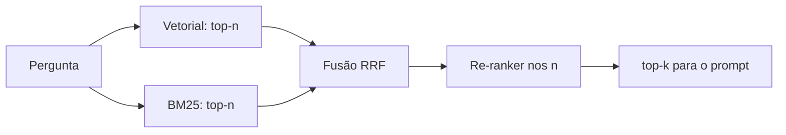

## Passo 1 · Leitura · O que a busca vetorial não vê

A busca vetorial compara significados: "cancelar uma matéria" encontra "trancamento de disciplina" sem nenhuma palavra em comum. O preço é que o vetor resume o texto inteiro, e um detalhe raro se perde no resumo. Pergunte "o aluno do semestre faz PRG102?" e as palavras gerais ("aluno", "semestre") puxam o vetor para qualquer trecho do regimento que fale de alunos e semestres; o código, que é o que importa, pesa como uma palavra entre cinco. Modelos reais têm o mesmo problema com códigos de disciplina, números de artigo, siglas e nomes próprios, que o tokenizador quebra em pedaços sem significado próprio.

A busca **léxica** faz o oposto: casa palavras exatas e dá mais peso às **raras**. O algoritmo padrão é o **BM25**. Para uma consulta $q$ e um documento $d$, soma uma parcela por termo distinto da consulta:

$$
\text{BM25}(q, d) = \sum_{t \in q} \text{IDF}(t) \cdot \frac{f(t, d)\,(k_1 + 1)}{f(t, d) + k_1 \left(1 - b + b \, \frac{|d|}{\text{avgdl}}\right)}
\qquad
\text{IDF}(t) = \ln\!\left(1 + \frac{N - n_t + 0{,}5}{n_t + 0{,}5}\right)
$$

São três ingredientes:

- **IDF**: $N$ documentos, $n_t$ deles com o termo. Termo raro vale muito, termo presente em quase todos vale perto de zero. O `1 +` dentro do logaritmo impede o valor negativo que a fórmula original dá quando $n_t > N/2$ — com ele, "o" e "de" pesam pouco, mas nunca puxam um documento para baixo.
- **Saturação** ($k_1$, em geral entre 1,2 e 2): $f(t, d)$ é quantas vezes o termo aparece no documento. A parcela cresce com $f$, mas nunca passa de $\text{IDF}(t)\,(k_1+1)$: repetir "trancamento" dez vezes não faz um trecho dez vezes mais relevante.
- **Tamanho** ($b$, em geral 0,75): $|d|$ é o número de palavras do documento e $\text{avgdl}$, a média da coleção. Documento mais longo que a média é penalizado, porque tem mais chance de conter qualquer palavra por acaso. Com $b = 0$, o tamanho não conta.

```python
indice = IndiceBM25(["PRG101 Introdução à programação: variáveis e laços.",
                     "PRG102 Programação orientada a objetos: classes e herança.",
                     "A matrícula exige no mínimo 12 créditos por semestre."])
indice.idf("prg102")       # 0.98: aparece em 1 de 3 documentos
indice.idf("programacao")  # 0.47: aparece em 2 de 3
```

Uma regra que derruba muito BM25 na prática: **a consulta passa pela mesma tokenização dos documentos**. Se o índice guardou `prg102` em minúsculas e sem acento, a pergunta "Qual a ementa de PRG102?" precisa virar `prg102` também, e não `PRG102?`.

## Passo 2 · Previsão · Saturação e tamanho

O programa calcula a parcela do BM25 de um termo com IDF 1,5, primeiro variando quantas vezes ele aparece num documento de tamanho médio, depois variando o tamanho do documento com o termo uma vez. Leia sem executar e digite o que ele imprime.

### Código
```python
k1, b = 1.2, 0.75
idf = 1.5
media = 10
for tf in (1, 2, 4, 8):
    parcela = idf * tf * (k1 + 1) / (tf + k1)
    print("tf", tf, round(parcela, 2))
for tamanho in (5, 10, 20):
    norma = 1 - b + b * tamanho / media
    print("tamanho", tamanho, round(idf * (k1 + 1) / (1 + k1 * norma), 2))
```

### Dicas
1. No tamanho médio, `norma` é 1 e a parcela é `idf * tf * 2.2 / (tf + 1.2)`.
2. Com `tf = 1` e tamanho médio, a parcela é exatamente o IDF.
3. Documento com metade do tamanho médio tem `norma = 0.625`; com o dobro, `1.75`.

### Saída esperada
```text
tf 1 1.5
tf 2 2.06
tf 4 2.54
tf 8 2.87
tamanho 5 1.89
tamanho 10 1.5
tamanho 20 1.06
```

## Passo 3 · Exercício · BM25 do zero

Implemente a classe `IndiceBM25(textos, k1=1.2, b=0.75)`. A função `tokenizar` (minúsculas, sem acento, só letras e dígitos) já está no código inicial e vale para documentos **e** consultas.

- `__init__`: guarda `k1` e `b` e, de cada texto, a contagem de termos (`Counter`), o tamanho em palavras (contando repetições), o número de documentos e o tamanho médio (0.0 se não houver documentos); e o `df` de cada termo — em quantos **documentos** ele aparece.
- `idf(termo)`: $\ln\left(1 + \frac{N - n_t + 0{,}5}{n_t + 0{,}5}\right)$, com $n_t = 0$ para termo que não está em nenhum documento.
- `pontuar(consulta)`: lista com o escore BM25 de cada documento, na ordem dos textos. Cada termo **distinto** da consulta conta uma vez. Sem documentos, `[]`.

### Instruções
1. Monte as contagens, os tamanhos, a média e o `df`, e calcule o IDF suavizado.
2. Some, por documento, as parcelas com frequência saturada por `k1` e normalizada pelo tamanho com `b`.
3. Tokenize a consulta como os documentos e use cada termo distinto uma vez.

### Código inicial
```python
import math
import re
import unicodedata
from collections import Counter


def tokenizar(texto):
    sem_acento = unicodedata.normalize("NFKD", texto.lower()).encode("ascii", "ignore").decode()
    return re.findall(r"[a-z0-9]+", sem_acento)


class IndiceBM25:
    def __init__(self, textos, k1=1.2, b=0.75):
        pass

    def idf(self, termo):
        pass

    def pontuar(self, consulta):
        pass


if __name__ == "__main__":
    textos = [
        "PRG101 Introdução à programação: variáveis, laços e funções.",
        "PRG102 Programação orientada a objetos: classes e herança.",
        "A matrícula exige no mínimo 12 créditos por semestre.",
    ]
    indice = IndiceBM25(textos)
    print([round(s, 3) for s in indice.pontuar("Qual a ementa de PRG102?")])
    print(round(indice.idf("prg102"), 3), round(indice.idf("programacao"), 3))
```

### Solução
```python
import math
import re
import unicodedata
from collections import Counter


def tokenizar(texto):
    sem_acento = unicodedata.normalize("NFKD", texto.lower()).encode("ascii", "ignore").decode()
    return re.findall(r"[a-z0-9]+", sem_acento)


class IndiceBM25:
    def __init__(self, textos, k1=1.2, b=0.75):
        self.k1 = k1
        self.b = b
        self.docs = [Counter(tokenizar(t)) for t in textos]
        self.tamanhos = [sum(c.values()) for c in self.docs]
        self.n = len(self.docs)
        self.media = sum(self.tamanhos) / self.n if self.n else 0.0
        self.df = Counter()
        for contagem in self.docs:
            self.df.update(contagem.keys())

    def idf(self, termo):
        n_t = self.df.get(termo, 0)
        return math.log(1 + (self.n - n_t + 0.5) / (n_t + 0.5))

    def pontuar(self, consulta):
        termos = list(dict.fromkeys(tokenizar(consulta)))
        scores = []
        for contagem, tamanho in zip(self.docs, self.tamanhos):
            s = 0.0
            for termo in termos:
                tf = contagem.get(termo, 0)
                if tf:
                    norma = 1 - self.b + self.b * tamanho / self.media
                    s += self.idf(termo) * tf * (self.k1 + 1) / (tf + self.k1 * norma)
            scores.append(s)
        return scores


if __name__ == "__main__":
    textos = [
        "PRG101 Introdução à programação: variáveis, laços e funções.",
        "PRG102 Programação orientada a objetos: classes e herança.",
        "A matrícula exige no mínimo 12 créditos por semestre.",
    ]
    indice = IndiceBM25(textos)
    print([round(s, 3) for s in indice.pontuar("Qual a ementa de PRG102?")])
    print(round(indice.idf("prg102"), 3), round(indice.idf("programacao"), 3))
```

### Dicas
1. `Counter.update(contagem.keys())` soma 1 por documento; `update(contagem)` somaria as repetições.
2. `sum(contagem.values())` é o tamanho com repetições; `len(contagem)`, o número de termos distintos.
3. `dict.fromkeys(lista)` tira as repetições e preserva a ordem.

### Verificação
```json
[
  {"id": "idf", "checkpoint": 1, "kind": "expr", "setup": "ix = IndiceBM25(['O trancamento parcial vai até o 60º dia letivo.', 'O trancamento total exige parecer da coordenação.', 'A matrícula exige 12 créditos e o aluno confirma o horário.', 'PRG102 Programação orientada a objetos: o curso trata de classes e herança.'])\n", "expr": "[ix.idf('prg102'), ix.idf('trancamento'), ix.idf('o'), ix.idf('inexistente')]", "tolerance": 1e-06, "name": "IDF de um termo raro, de um comum, de um quase universal e de um ausente", "hint": "Com o 1 dentro do logaritmo, o IDF nunca fica negativo.", "expected": [1.2039728043259361, 0.6931471805599453, 0.10536051565782635, 2.302585092994046]},
  {"id": "pontuar", "checkpoint": 2, "kind": "expr", "setup": "ix = IndiceBM25(['O trancamento parcial vai até o 60º dia letivo.', 'O trancamento total exige parecer da coordenação.', 'A matrícula exige 12 créditos e o aluno confirma o horário.', 'PRG102 Programação orientada a objetos: o curso trata de classes e herança.'])\n", "expr": "ix.pontuar('trancamento parcial')", "tolerance": 1e-06, "name": "Escores de uma consulta de dois termos", "expected": [1.9587592623731485, 0.7835576823721121, 0.0, 0.0]},
  {"id": "saturacao", "checkpoint": 2, "kind": "expr", "setup": "ix = IndiceBM25(['prazo de trancamento e taxa', 'trancamento trancamento trancamento trancamento taxa', 'taxa de matrícula e prazo', 'taxa da segunda via', 'prazo de trancamento e taxa com formulário próprio e assinatura do orientador'])\n", "expr": "[round(s, 6) for s in ix.pontuar('trancamento')]", "tolerance": 1e-05, "name": "Repetir o termo quatro vezes não quadruplica o escore", "hint": "A frequência entra saturada por k1.", "expected": [0.585343, 0.943763, 0.0, 0.0, 0.389815]},
  {"id": "tamanho", "checkpoint": 2, "kind": "expr", "setup": "ix = IndiceBM25(['prazo de trancamento e taxa', 'trancamento trancamento trancamento trancamento taxa', 'taxa de matrícula e prazo', 'taxa da segunda via', 'prazo de trancamento e taxa com formulário próprio e assinatura do orientador'])\n", "expr": "(lambda s: [s[0] > s[4] > 0, round(s[0], 6), round(s[4], 6)])(ix.pontuar('prazo'))", "tolerance": 1e-05, "name": "Mesmo termo, uma vez: o documento mais longo pontua menos", "expected": [true, 0.585343, 0.389815]},
  {"id": "consulta-igual", "checkpoint": 3, "kind": "expr", "setup": "ix = IndiceBM25(['O trancamento parcial vai até o 60º dia letivo.', 'O trancamento total exige parecer da coordenação.', 'A matrícula exige 12 créditos e o aluno confirma o horário.', 'PRG102 Programação orientada a objetos: o curso trata de classes e herança.'])\n", "expr": "[s > 0 for s in ix.pontuar('Ementa: PRG102?')] + [ix.pontuar('Até quando vai o TRANCAMENTO parcial?') == ix.pontuar('ate quando vai o trancamento parcial')]", "expected": [false, false, false, true, true], "name": "A consulta passa pela mesma tokenização dos documentos", "hint": "Pontuação, acento e maiúscula na pergunta não podem impedir o casamento."},
  {"id": "repetido", "checkpoint": 3, "kind": "expr", "setup": "ix = IndiceBM25(['O trancamento parcial vai até o 60º dia letivo.', 'O trancamento total exige parecer da coordenação.', 'A matrícula exige 12 créditos e o aluno confirma o horário.', 'PRG102 Programação orientada a objetos: o curso trata de classes e herança.'])\n", "expr": "ix.pontuar('trancamento trancamento total') == ix.pontuar('trancamento total')", "expected": true, "name": "Termo repetido na consulta conta uma vez"},
  {"id": "vazio", "checkpoint": 1, "kind": "expr", "expr": "IndiceBM25([]).pontuar('trancamento')", "expected": [], "name": "Índice vazio devolve lista vazia"}
]
```

### Soluções erradas
```python name="IDF sem o 1 dentro do logaritmo"
import math
import re
import unicodedata
from collections import Counter


def tokenizar(texto):
    sem_acento = unicodedata.normalize("NFKD", texto.lower()).encode("ascii", "ignore").decode()
    return re.findall(r"[a-z0-9]+", sem_acento)


class IndiceBM25:
    def __init__(self, textos, k1=1.2, b=0.75):
        self.k1 = k1
        self.b = b
        self.docs = [Counter(tokenizar(t)) for t in textos]
        self.tamanhos = [sum(c.values()) for c in self.docs]
        self.n = len(self.docs)
        self.media = sum(self.tamanhos) / self.n if self.n else 0.0
        self.df = Counter()
        for contagem in self.docs:
            self.df.update(contagem.keys())

    def idf(self, termo):
        n_t = self.df.get(termo, 0)
        return math.log((self.n - n_t + 0.5) / (n_t + 0.5))

    def pontuar(self, consulta):
        termos = list(dict.fromkeys(tokenizar(consulta)))
        scores = []
        for contagem, tamanho in zip(self.docs, self.tamanhos):
            s = 0.0
            for termo in termos:
                tf = contagem.get(termo, 0)
                if tf:
                    norma = 1 - self.b + self.b * tamanho / self.media
                    s += self.idf(termo) * tf * (self.k1 + 1) / (tf + self.k1 * norma)
            scores.append(s)
        return scores


if __name__ == "__main__":
    textos = [
        "PRG101 Introdução à programação: variáveis, laços e funções.",
        "PRG102 Programação orientada a objetos: classes e herança.",
        "A matrícula exige no mínimo 12 créditos por semestre.",
    ]
    indice = IndiceBM25(textos)
    print([round(s, 3) for s in indice.pontuar("Qual a ementa de PRG102?")])
    print(round(indice.idf("prg102"), 3), round(indice.idf("programacao"), 3))
```
```python name="frequência sem saturação"
import math
import re
import unicodedata
from collections import Counter


def tokenizar(texto):
    sem_acento = unicodedata.normalize("NFKD", texto.lower()).encode("ascii", "ignore").decode()
    return re.findall(r"[a-z0-9]+", sem_acento)


class IndiceBM25:
    def __init__(self, textos, k1=1.2, b=0.75):
        self.k1 = k1
        self.b = b
        self.docs = [Counter(tokenizar(t)) for t in textos]
        self.tamanhos = [sum(c.values()) for c in self.docs]
        self.n = len(self.docs)
        self.media = sum(self.tamanhos) / self.n if self.n else 0.0
        self.df = Counter()
        for contagem in self.docs:
            self.df.update(contagem.keys())

    def idf(self, termo):
        n_t = self.df.get(termo, 0)
        return math.log(1 + (self.n - n_t + 0.5) / (n_t + 0.5))

    def pontuar(self, consulta):
        termos = list(dict.fromkeys(tokenizar(consulta)))
        scores = []
        for contagem, tamanho in zip(self.docs, self.tamanhos):
            s = 0.0
            for termo in termos:
                tf = contagem.get(termo, 0)
                if tf:
                    norma = 1 - self.b + self.b * tamanho / self.media
                    s += self.idf(termo) * tf
            scores.append(s)
        return scores


if __name__ == "__main__":
    textos = [
        "PRG101 Introdução à programação: variáveis, laços e funções.",
        "PRG102 Programação orientada a objetos: classes e herança.",
        "A matrícula exige no mínimo 12 créditos por semestre.",
    ]
    indice = IndiceBM25(textos)
    print([round(s, 3) for s in indice.pontuar("Qual a ementa de PRG102?")])
    print(round(indice.idf("prg102"), 3), round(indice.idf("programacao"), 3))
```
```python name="sem normalizar pelo tamanho"
import math
import re
import unicodedata
from collections import Counter


def tokenizar(texto):
    sem_acento = unicodedata.normalize("NFKD", texto.lower()).encode("ascii", "ignore").decode()
    return re.findall(r"[a-z0-9]+", sem_acento)


class IndiceBM25:
    def __init__(self, textos, k1=1.2, b=0.75):
        self.k1 = k1
        self.b = b
        self.docs = [Counter(tokenizar(t)) for t in textos]
        self.tamanhos = [sum(c.values()) for c in self.docs]
        self.n = len(self.docs)
        self.media = sum(self.tamanhos) / self.n if self.n else 0.0
        self.df = Counter()
        for contagem in self.docs:
            self.df.update(contagem.keys())

    def idf(self, termo):
        n_t = self.df.get(termo, 0)
        return math.log(1 + (self.n - n_t + 0.5) / (n_t + 0.5))

    def pontuar(self, consulta):
        termos = list(dict.fromkeys(tokenizar(consulta)))
        scores = []
        for contagem, tamanho in zip(self.docs, self.tamanhos):
            s = 0.0
            for termo in termos:
                tf = contagem.get(termo, 0)
                if tf:
                    norma = 1
                    s += self.idf(termo) * tf * (self.k1 + 1) / (tf + self.k1 * norma)
            scores.append(s)
        return scores


if __name__ == "__main__":
    textos = [
        "PRG101 Introdução à programação: variáveis, laços e funções.",
        "PRG102 Programação orientada a objetos: classes e herança.",
        "A matrícula exige no mínimo 12 créditos por semestre.",
    ]
    indice = IndiceBM25(textos)
    print([round(s, 3) for s in indice.pontuar("Qual a ementa de PRG102?")])
    print(round(indice.idf("prg102"), 3), round(indice.idf("programacao"), 3))
```
```python name="tamanho do documento em palavras distintas"
import math
import re
import unicodedata
from collections import Counter


def tokenizar(texto):
    sem_acento = unicodedata.normalize("NFKD", texto.lower()).encode("ascii", "ignore").decode()
    return re.findall(r"[a-z0-9]+", sem_acento)


class IndiceBM25:
    def __init__(self, textos, k1=1.2, b=0.75):
        self.k1 = k1
        self.b = b
        self.docs = [Counter(tokenizar(t)) for t in textos]
        self.tamanhos = [len(c) for c in self.docs]
        self.n = len(self.docs)
        self.media = sum(self.tamanhos) / self.n if self.n else 0.0
        self.df = Counter()
        for contagem in self.docs:
            self.df.update(contagem.keys())

    def idf(self, termo):
        n_t = self.df.get(termo, 0)
        return math.log(1 + (self.n - n_t + 0.5) / (n_t + 0.5))

    def pontuar(self, consulta):
        termos = list(dict.fromkeys(tokenizar(consulta)))
        scores = []
        for contagem, tamanho in zip(self.docs, self.tamanhos):
            s = 0.0
            for termo in termos:
                tf = contagem.get(termo, 0)
                if tf:
                    norma = 1 - self.b + self.b * tamanho / self.media
                    s += self.idf(termo) * tf * (self.k1 + 1) / (tf + self.k1 * norma)
            scores.append(s)
        return scores


if __name__ == "__main__":
    textos = [
        "PRG101 Introdução à programação: variáveis, laços e funções.",
        "PRG102 Programação orientada a objetos: classes e herança.",
        "A matrícula exige no mínimo 12 créditos por semestre.",
    ]
    indice = IndiceBM25(textos)
    print([round(s, 3) for s in indice.pontuar("Qual a ementa de PRG102?")])
    print(round(indice.idf("prg102"), 3), round(indice.idf("programacao"), 3))
```
```python name="consulta tokenizada com split"
import math
import re
import unicodedata
from collections import Counter


def tokenizar(texto):
    sem_acento = unicodedata.normalize("NFKD", texto.lower()).encode("ascii", "ignore").decode()
    return re.findall(r"[a-z0-9]+", sem_acento)


class IndiceBM25:
    def __init__(self, textos, k1=1.2, b=0.75):
        self.k1 = k1
        self.b = b
        self.docs = [Counter(tokenizar(t)) for t in textos]
        self.tamanhos = [sum(c.values()) for c in self.docs]
        self.n = len(self.docs)
        self.media = sum(self.tamanhos) / self.n if self.n else 0.0
        self.df = Counter()
        for contagem in self.docs:
            self.df.update(contagem.keys())

    def idf(self, termo):
        n_t = self.df.get(termo, 0)
        return math.log(1 + (self.n - n_t + 0.5) / (n_t + 0.5))

    def pontuar(self, consulta):
        termos = list(dict.fromkeys(consulta.lower().split()))
        scores = []
        for contagem, tamanho in zip(self.docs, self.tamanhos):
            s = 0.0
            for termo in termos:
                tf = contagem.get(termo, 0)
                if tf:
                    norma = 1 - self.b + self.b * tamanho / self.media
                    s += self.idf(termo) * tf * (self.k1 + 1) / (tf + self.k1 * norma)
            scores.append(s)
        return scores


if __name__ == "__main__":
    textos = [
        "PRG101 Introdução à programação: variáveis, laços e funções.",
        "PRG102 Programação orientada a objetos: classes e herança.",
        "A matrícula exige no mínimo 12 créditos por semestre.",
    ]
    indice = IndiceBM25(textos)
    print([round(s, 3) for s in indice.pontuar("Qual a ementa de PRG102?")])
    print(round(indice.idf("prg102"), 3), round(indice.idf("programacao"), 3))
```
```python name="termo repetido na consulta conta duas vezes"
import math
import re
import unicodedata
from collections import Counter


def tokenizar(texto):
    sem_acento = unicodedata.normalize("NFKD", texto.lower()).encode("ascii", "ignore").decode()
    return re.findall(r"[a-z0-9]+", sem_acento)


class IndiceBM25:
    def __init__(self, textos, k1=1.2, b=0.75):
        self.k1 = k1
        self.b = b
        self.docs = [Counter(tokenizar(t)) for t in textos]
        self.tamanhos = [sum(c.values()) for c in self.docs]
        self.n = len(self.docs)
        self.media = sum(self.tamanhos) / self.n if self.n else 0.0
        self.df = Counter()
        for contagem in self.docs:
            self.df.update(contagem.keys())

    def idf(self, termo):
        n_t = self.df.get(termo, 0)
        return math.log(1 + (self.n - n_t + 0.5) / (n_t + 0.5))

    def pontuar(self, consulta):
        termos = tokenizar(consulta)
        scores = []
        for contagem, tamanho in zip(self.docs, self.tamanhos):
            s = 0.0
            for termo in termos:
                tf = contagem.get(termo, 0)
                if tf:
                    norma = 1 - self.b + self.b * tamanho / self.media
                    s += self.idf(termo) * tf * (self.k1 + 1) / (tf + self.k1 * norma)
            scores.append(s)
        return scores


if __name__ == "__main__":
    textos = [
        "PRG101 Introdução à programação: variáveis, laços e funções.",
        "PRG102 Programação orientada a objetos: classes e herança.",
        "A matrícula exige no mínimo 12 créditos por semestre.",
    ]
    indice = IndiceBM25(textos)
    print([round(s, 3) for s in indice.pontuar("Qual a ementa de PRG102?")])
    print(round(indice.idf("prg102"), 3), round(indice.idf("programacao"), 3))
```
```python name="df conta ocorrências, não documentos"
import math
import re
import unicodedata
from collections import Counter


def tokenizar(texto):
    sem_acento = unicodedata.normalize("NFKD", texto.lower()).encode("ascii", "ignore").decode()
    return re.findall(r"[a-z0-9]+", sem_acento)


class IndiceBM25:
    def __init__(self, textos, k1=1.2, b=0.75):
        self.k1 = k1
        self.b = b
        self.docs = [Counter(tokenizar(t)) for t in textos]
        self.tamanhos = [sum(c.values()) for c in self.docs]
        self.n = len(self.docs)
        self.media = sum(self.tamanhos) / self.n if self.n else 0.0
        self.df = Counter()
        for contagem in self.docs:
            self.df.update(contagem)

    def idf(self, termo):
        n_t = self.df.get(termo, 0)
        return math.log(1 + (self.n - n_t + 0.5) / (n_t + 0.5))

    def pontuar(self, consulta):
        termos = list(dict.fromkeys(tokenizar(consulta)))
        scores = []
        for contagem, tamanho in zip(self.docs, self.tamanhos):
            s = 0.0
            for termo in termos:
                tf = contagem.get(termo, 0)
                if tf:
                    norma = 1 - self.b + self.b * tamanho / self.media
                    s += self.idf(termo) * tf * (self.k1 + 1) / (tf + self.k1 * norma)
            scores.append(s)
        return scores


if __name__ == "__main__":
    textos = [
        "PRG101 Introdução à programação: variáveis, laços e funções.",
        "PRG102 Programação orientada a objetos: classes e herança.",
        "A matrícula exige no mínimo 12 créditos por semestre.",
    ]
    indice = IndiceBM25(textos)
    print([round(s, 3) for s in indice.pontuar("Qual a ementa de PRG102?")])
    print(round(indice.idf("prg102"), 3), round(indice.idf("programacao"), 3))
```

## Passo 4 · Leitura · Juntar duas listas: escalas, min-max e RRF

Cada busca acerta onde a outra erra, então a busca **híbrida** roda as duas e junta os resultados. Juntar parece fácil — somar os escores — e é onde mora o erro mais comum.



**Os escores estão em escalas diferentes.** O cosseno fica entre −1 e 1, e em muitos modelos os bons resultados se espremem numa faixa estreita dentro disso (a faixa exata depende do modelo). O BM25 não tem teto: depende do tamanho da consulta e da raridade dos termos, e passa de 10 com facilidade. Somando, o BM25 decide sozinho; um trecho com cosseno 0,9 perde para qualquer trecho com uma palavra rara.

**Normalizar antes de somar** ajuda. A normalização min-max leva cada lista para $[0, 1]$:

$$
\hat{s}(d) = \frac{s(d) - \min s}{\max s - \min s}
\qquad
\text{escore}(d) = \alpha\,\hat{s}_{\text{léx}}(d) + (1 - \alpha)\,\hat{s}_{\text{vet}}(d)
$$

Cuidados: lista com todos os escores iguais divide por zero (trate: todos valem 1); um documento que só uma busca trouxe entra com 0 na outra; e o resultado depende de **quais** candidatos vieram, porque um único escore discrepante achata todos os outros perto de zero. O peso $\alpha$ precisa ser ajustado num conjunto de avaliação, e muda quando muda o modelo de embedding.

A **Reciprocal Rank Fusion** (RRF) evita a questão das escalas olhando só as **posições**:

$$
\text{RRF}(d) = \sum_{r \in \text{rankings}} \frac{1}{k + \text{pos}_r(d)}, \qquad k = 60
$$

Documento ausente de uma lista não ganha nada dela. O $k$ suaviza o topo: com $k = 0$, o primeiro lugar de uma lista (parcela 1) vale o dobro do segundo e domina tudo; com $k = 60$, ser bem colocado nas duas listas vale mais que ganhar numa só. O 60 vem do artigo que propôs o método e funciona bem sem ajuste, que é a grande vantagem do RRF. A desvantagem: ele joga fora **quanto** um documento era melhor que o outro.

Clique em **Visualizar** e acompanhe `pontos` crescer a cada lista:

```python visualizar
vetorial = ["reg-12", "faq-03", "reg-13"]
lexica = ["reg-13", "faq-03", "cal-01"]
pontos = {}
for ranking in (vetorial, lexica):
    for pos, ident in enumerate(ranking, start=1):
        pontos[ident] = pontos.get(ident, 0.0) + 1 / (60 + pos)
        print(ident, pos, round(pontos[ident], 5))
print(sorted(pontos, key=lambda i: (-pontos[i], i)))
```

## Passo 5 · Exercício · Reciprocal Rank Fusion
modo: ordenar

Monte `rrf(rankings, k=60)`: recebe uma lista de rankings (listas de ids, do melhor para o pior), soma `1 / (k + pos)` para cada aparição de cada id, com `pos` a partir de 1, e devolve os ids do maior para o menor escore; no empate, id em ordem crescente. Duas linhas estão sobrando.

### Instruções
1. Comece um dicionário de pontos vazio e percorra cada ranking.
2. Some `1 / (k + pos)` aos pontos de cada id, com a posição contada a partir de 1.
3. Devolva os ids por escore decrescente, desempatando pelo id.

### Solução
```python
def rrf(rankings, k=60):
    pontos = {}
    for ranking in rankings:
        for pos, ident in enumerate(ranking, start=1):
            pontos[ident] = pontos.get(ident, 0.0) + 1 / (k + pos)
    return sorted(pontos, key=lambda ident: (-pontos[ident], ident))
```

### Distratores
```python
        for pos, ident in enumerate(ranking):
            pontos[ident] = 1 / (k + pos)
```

### Dicas
1. `pontos.get(ident, 0.0)` devolve 0.0 para id que ainda não apareceu.
2. Uma chave de ordenação `(-escore, id)` ordena o escore do maior para o menor e o id em ordem crescente.

### Verificação
```json
[
  {"id": "consenso", "checkpoint": 2, "kind": "call", "function": "rrf", "args": [[["reg-12", "faq-03", "reg-13"], ["reg-13", "faq-03", "cal-01"]]], "name": "Quem aparece nas duas listas soma as duas parcelas", "expected": ["reg-13", "faq-03", "reg-12", "cal-01"]},
  {"id": "uma-lista", "checkpoint": 3, "kind": "call", "function": "rrf", "args": [[["c", "a", "b"]]], "name": "Com uma lista só, a ordem é preservada", "expected": ["c", "a", "b"]},
  {"id": "k-importa", "checkpoint": 2, "kind": "expr", "expr": "rrf([['x', 'a1', 'y', 'a2', 'a3', 'a4', 'a5', 'a6', 'a7', 'a8'], ['b1', 'b2', 'y', 'b3', 'b4', 'b5', 'b6', 'b7', 'b8', 'x']])[:2]", "name": "Com k = 60, terceiro lugar nas duas listas vence primeiro numa e décimo na outra", "hint": "Sem o k, o primeiro lugar de uma lista só domina a fusão.", "expected": ["y", "x"]},
  {"id": "k-parametro", "checkpoint": 2, "kind": "expr", "expr": "rrf([['a', 'b'], ['b', 'c']], k=0)", "name": "O k recebido é usado (k = 0 é o inverso da posição)", "expected": ["b", "a", "c"]},
  {"id": "empate", "checkpoint": 3, "kind": "call", "function": "rrf", "args": [[["reg-12", "faq-03"], ["faq-03", "reg-12"]]], "name": "Empate no escore: id em ordem crescente", "expected": ["faq-03", "reg-12"]},
  {"id": "vazio", "checkpoint": 1, "kind": "call", "function": "rrf", "args": [[[], []]], "expected": [], "name": "Listas vazias dão lista vazia"}
]
```

### Soluções erradas
```python name="substitui em vez de somar"
def rrf(rankings, k=60):
    pontos = {}
    for ranking in rankings:
        for pos, ident in enumerate(ranking, start=1):
            pontos[ident] = 1 / (k + pos)
    return sorted(pontos, key=lambda ident: (-pontos[ident], ident))
```
```python name="posição a partir de 0"
def rrf(rankings, k=60):
    pontos = {}
    for ranking in rankings:
        for pos, ident in enumerate(ranking):
            pontos[ident] = pontos.get(ident, 0.0) + 1 / (k + pos)
    return sorted(pontos, key=lambda ident: (-pontos[ident], ident))
```
```python name="ordem crescente"
def rrf(rankings, k=60):
    pontos = {}
    for ranking in rankings:
        for pos, ident in enumerate(ranking, start=1):
            pontos[ident] = pontos.get(ident, 0.0) + 1 / (k + pos)
    return sorted(pontos, key=lambda ident: (pontos[ident], ident))
```
```python name="sem a constante k"
def rrf(rankings, k=60):
    pontos = {}
    for ranking in rankings:
        for pos, ident in enumerate(ranking, start=1):
            pontos[ident] = pontos.get(ident, 0.0) + 1 / pos
    return sorted(pontos, key=lambda ident: (-pontos[ident], ident))
```
```python name="sem desempate pelo id"
def rrf(rankings, k=60):
    pontos = {}
    for ranking in rankings:
        for pos, ident in enumerate(ranking, start=1):
            pontos[ident] = pontos.get(ident, 0.0) + 1 / (k + pos)
    return sorted(pontos, key=lambda ident: -pontos[ident])
```

## Passo 6 · Exercício · Fusão ponderada com min-max

Quando o RRF joga fora informação demais (um documento muito à frente dos outros), a alternativa é somar escores **normalizados**. Escreva:

- `normalizar_min_max(escores)`: recebe `{id: escore}` e devolve `{id: escore normalizado}` em $[0, 1]$, pela fórmula do passo 4. Se todos os escores forem iguais (inclusive um só), todos valem 1.0; dicionário vazio dá `{}`.
- `fundir_ponderado(lexicos, vetoriais, alfa=0.5)`: normaliza cada dicionário separadamente, soma `alfa * léxico + (1 - alfa) * vetorial` para cada id que aparece em **qualquer** um deles (o ausente vale 0 naquela busca) e devolve os ids do maior para o menor escore, desempatando pelo id em ordem crescente.

O `main.py` mostra a mesma busca combinada pela soma bruta e por min-max.

### Instruções
1. Normalize um dicionário de escores para o intervalo de 0 a 1, tratando escores todos iguais.
2. Normalize cada busca separadamente e combine com o peso `alfa` da busca léxica.
3. Inclua os ids que só uma das buscas trouxe e ordene o resultado.

### Código inicial
```python
def normalizar_min_max(escores):
    pass


def fundir_ponderado(lexicos, vetoriais, alfa=0.5):
    pass


if __name__ == "__main__":
    bm25 = {"est202": 7.9, "reg-20": 2.1, "reg-12": 1.8}
    cosseno = {"reg-20": 0.62, "reg-12": 0.55, "est202": 0.31}
    print("soma bruta:", sorted(set(bm25) | set(cosseno), key=lambda i: -(bm25.get(i, 0) + cosseno.get(i, 0))))
    print("min-max:   ", fundir_ponderado(bm25, cosseno, alfa=0.5))
```

### Solução
```python
def normalizar_min_max(escores):
    if not escores:
        return {}
    menor, maior = min(escores.values()), max(escores.values())
    if maior == menor:
        return {ident: 1.0 for ident in escores}
    return {ident: (s - menor) / (maior - menor) for ident, s in escores.items()}


def fundir_ponderado(lexicos, vetoriais, alfa=0.5):
    lex = normalizar_min_max(lexicos)
    vet = normalizar_min_max(vetoriais)
    total = {}
    for ident in set(lex) | set(vet):
        total[ident] = alfa * lex.get(ident, 0.0) + (1 - alfa) * vet.get(ident, 0.0)
    return sorted(total, key=lambda ident: (-total[ident], ident))


if __name__ == "__main__":
    bm25 = {"est202": 7.9, "reg-20": 2.1, "reg-12": 1.8}
    cosseno = {"reg-20": 0.62, "reg-12": 0.55, "est202": 0.31}
    print("soma bruta:", sorted(set(bm25) | set(cosseno), key=lambda i: -(bm25.get(i, 0) + cosseno.get(i, 0))))
    print("min-max:   ", fundir_ponderado(bm25, cosseno, alfa=0.5))
```

### Dicas
1. Subtrair o mínimo antes de dividir pela amplitude é o que leva o menor a 0 (inclusive cossenos negativos).
2. `dicionario.get(id, 0.0)` cobre o id que a outra busca não trouxe.
3. `set(a) | set(b)` é a união das chaves.

### Verificação
```json
[
  {"id": "min-max", "checkpoint": 1, "kind": "call", "function": "normalizar_min_max", "args": [{"a": 2.0, "b": 6.0, "c": 4.0}], "tolerance": 1e-09, "name": "Menor vira 0, maior vira 1", "expected": {"a": 0.0, "b": 1.0, "c": 0.5}},
  {"id": "negativos", "checkpoint": 1, "kind": "call", "function": "normalizar_min_max", "args": [{"a": -0.2, "b": 0.6, "c": 0.2}], "tolerance": 1e-09, "name": "Cossenos negativos também vão para [0, 1]", "hint": "Dividir pelo máximo não tira o negativo.", "expected": {"a": 0.0, "b": 1.0, "c": 0.5}},
  {"id": "iguais", "checkpoint": 1, "kind": "expr", "expr": "[normalizar_min_max({'a': 3.0, 'b': 3.0}), normalizar_min_max({'z': -1.0}), normalizar_min_max({})]", "name": "Todos iguais (ou um só): 1.0 para todos; vazio: {}", "expected": [{"a": 1.0, "b": 1.0}, {"z": 1.0}, {}]},
  {"id": "escalas", "checkpoint": 2, "kind": "call", "function": "fundir_ponderado", "args": [{"reg-73": 9.4, "reg-20": 3.0, "faq-03": 2.6}, {"reg-20": 0.71, "faq-03": 0.66, "reg-73": 0.12}, 0.5], "name": "A escala do BM25 não engole a do cosseno", "hint": "Normalize cada busca antes de combinar.", "expected": ["reg-20", "reg-73", "faq-03"]},
  {"id": "alfa", "checkpoint": 3, "kind": "expr", "expr": "[fundir_ponderado({'a': 10.0, 'b': 4.0, 'c': 0.0}, {'a': 0.1, 'b': 0.5, 'c': 0.9}, alfa) for alfa in (0.8, 0.2)]", "name": "alfa é o peso da busca léxica", "expected": [["a", "b", "c"], ["c", "b", "a"]]},
  {"id": "ausente", "checkpoint": 3, "kind": "call", "function": "fundir_ponderado", "args": [{"est202": 5.0, "reg-12": 1.0}, {"reg-12": 0.8, "faq-03": 0.6, "cal-01": 0.2}, 0.5], "name": "Id trazido por uma busca só entra com 0 na outra", "expected": ["est202", "reg-12", "faq-03", "cal-01"]}
]
```

### Soluções erradas
```python name="soma os escores brutos"
def normalizar_min_max(escores):
    if not escores:
        return {}
    menor, maior = min(escores.values()), max(escores.values())
    if maior == menor:
        return {ident: 1.0 for ident in escores}
    return {ident: (s - menor) / (maior - menor) for ident, s in escores.items()}


def fundir_ponderado(lexicos, vetoriais, alfa=0.5):
    lex = dict(lexicos)
    vet = dict(vetoriais)
    total = {}
    for ident in set(lex) | set(vet):
        total[ident] = alfa * lex.get(ident, 0.0) + (1 - alfa) * vet.get(ident, 0.0)
    return sorted(total, key=lambda ident: (-total[ident], ident))


if __name__ == "__main__":
    bm25 = {"est202": 7.9, "reg-20": 2.1, "reg-12": 1.8}
    cosseno = {"reg-20": 0.62, "reg-12": 0.55, "est202": 0.31}
    print("soma bruta:", sorted(set(bm25) | set(cosseno), key=lambda i: -(bm25.get(i, 0) + cosseno.get(i, 0))))
    print("min-max:   ", fundir_ponderado(bm25, cosseno, alfa=0.5))
```
```python name="divide só pelo máximo"
def normalizar_min_max(escores):
    if not escores:
        return {}
    menor, maior = min(escores.values()), max(escores.values())
    if maior == menor:
        return {ident: 1.0 for ident in escores}
    return {ident: s / maior for ident, s in escores.items()}


def fundir_ponderado(lexicos, vetoriais, alfa=0.5):
    lex = normalizar_min_max(lexicos)
    vet = normalizar_min_max(vetoriais)
    total = {}
    for ident in set(lex) | set(vet):
        total[ident] = alfa * lex.get(ident, 0.0) + (1 - alfa) * vet.get(ident, 0.0)
    return sorted(total, key=lambda ident: (-total[ident], ident))


if __name__ == "__main__":
    bm25 = {"est202": 7.9, "reg-20": 2.1, "reg-12": 1.8}
    cosseno = {"reg-20": 0.62, "reg-12": 0.55, "est202": 0.31}
    print("soma bruta:", sorted(set(bm25) | set(cosseno), key=lambda i: -(bm25.get(i, 0) + cosseno.get(i, 0))))
    print("min-max:   ", fundir_ponderado(bm25, cosseno, alfa=0.5))
```
```python name="escores iguais dividem por zero"
def normalizar_min_max(escores):
    if not escores:
        return {}
    menor, maior = min(escores.values()), max(escores.values())
    return {ident: (s - menor) / (maior - menor) for ident, s in escores.items()}


def fundir_ponderado(lexicos, vetoriais, alfa=0.5):
    lex = normalizar_min_max(lexicos)
    vet = normalizar_min_max(vetoriais)
    total = {}
    for ident in set(lex) | set(vet):
        total[ident] = alfa * lex.get(ident, 0.0) + (1 - alfa) * vet.get(ident, 0.0)
    return sorted(total, key=lambda ident: (-total[ident], ident))


if __name__ == "__main__":
    bm25 = {"est202": 7.9, "reg-20": 2.1, "reg-12": 1.8}
    cosseno = {"reg-20": 0.62, "reg-12": 0.55, "est202": 0.31}
    print("soma bruta:", sorted(set(bm25) | set(cosseno), key=lambda i: -(bm25.get(i, 0) + cosseno.get(i, 0))))
    print("min-max:   ", fundir_ponderado(bm25, cosseno, alfa=0.5))
```
```python name="alfa aplicado à busca errada"
def normalizar_min_max(escores):
    if not escores:
        return {}
    menor, maior = min(escores.values()), max(escores.values())
    if maior == menor:
        return {ident: 1.0 for ident in escores}
    return {ident: (s - menor) / (maior - menor) for ident, s in escores.items()}


def fundir_ponderado(lexicos, vetoriais, alfa=0.5):
    lex = normalizar_min_max(lexicos)
    vet = normalizar_min_max(vetoriais)
    total = {}
    for ident in set(lex) | set(vet):
        total[ident] = (1 - alfa) * lex.get(ident, 0.0) + alfa * vet.get(ident, 0.0)
    return sorted(total, key=lambda ident: (-total[ident], ident))


if __name__ == "__main__":
    bm25 = {"est202": 7.9, "reg-20": 2.1, "reg-12": 1.8}
    cosseno = {"reg-20": 0.62, "reg-12": 0.55, "est202": 0.31}
    print("soma bruta:", sorted(set(bm25) | set(cosseno), key=lambda i: -(bm25.get(i, 0) + cosseno.get(i, 0))))
    print("min-max:   ", fundir_ponderado(bm25, cosseno, alfa=0.5))
```
```python name="só os ids que as duas buscas trouxeram"
def normalizar_min_max(escores):
    if not escores:
        return {}
    menor, maior = min(escores.values()), max(escores.values())
    if maior == menor:
        return {ident: 1.0 for ident in escores}
    return {ident: (s - menor) / (maior - menor) for ident, s in escores.items()}


def fundir_ponderado(lexicos, vetoriais, alfa=0.5):
    lex = normalizar_min_max(lexicos)
    vet = normalizar_min_max(vetoriais)
    total = {}
    for ident in set(lex) & set(vet):
        total[ident] = alfa * lex.get(ident, 0.0) + (1 - alfa) * vet.get(ident, 0.0)
    return sorted(total, key=lambda ident: (-total[ident], ident))


if __name__ == "__main__":
    bm25 = {"est202": 7.9, "reg-20": 2.1, "reg-12": 1.8}
    cosseno = {"reg-20": 0.62, "reg-12": 0.55, "est202": 0.31}
    print("soma bruta:", sorted(set(bm25) | set(cosseno), key=lambda i: -(bm25.get(i, 0) + cosseno.get(i, 0))))
    print("min-max:   ", fundir_ponderado(bm25, cosseno, alfa=0.5))
```

## Passo 7 · Exercício · Busca híbrida com re-ranking, escolhida pelos dados

O último estágio é o **re-ranker**. Os embeddings da busca vetorial são de um *bi-encoder*: pergunta e trecho viram vetores separadamente, e os vetores dos trechos são calculados uma vez, na indexação. Um *cross-encoder* lê pergunta e trecho **juntos** e devolve um escore de relevância bem mais preciso, mas nada pode ser pré-calculado: cada par custa uma passada do modelo, na hora da pergunta. Por isso ele roda só nos `n` candidatos da busca híbrida, nunca no corpus inteiro, e com todos os pares numa chamada (em lote). O `reranker_simulado.py` faz esse papel, com as regras no topo do arquivo, e conta em `pares` quantos pares já pontuou.

Implemente `BuscaHibrida(modelo, trechos, reranker, n_candidatos=6)`, com `trechos` no formato `{"id", "texto"}`. `IndiceBM25`, `rrf`, `top_k` e `normalizar_linhas` estão no código inicial.

- `__init__`: guarda uma cópia dos trechos, monta o `IndiceBM25` dos textos e a matriz de vetores normalizados (uma chamada a `modelo.embutir`).
- `vetorial(pergunta, k)`: ids dos `k` trechos de maior cosseno (`top_k`).
- `lexica(pergunta, k)`: ids dos `k` trechos de maior BM25, **só os de escore maior que zero**, com empate na ordem dos trechos.
- `hibrida(pergunta, k)`: `rrf` da lista vetorial e da léxica, **cada uma com `n_candidatos`**, cortado em `k`.
- `reranqueada(pergunta, k)`: pega os `n_candidatos` da híbrida, pontua todos numa chamada `reranker.pontuar(pergunta, textos)` e devolve os `k` de maior escore, com empate na ordem da híbrida.

E `escolher_estrategia(busca, conjunto, k)`: para cada nome de `ESTRATEGIAS`, o recall@k médio (`round(..., 4)`) no `conjunto` (`{"pergunta", "relevantes"}`), e a `"melhor"`: a de maior recall; no empate, a que vem **primeiro** em `ESTRATEGIAS`, que está em ordem de custo.

### Instruções
1. Indexe nas duas formas e implemente as buscas vetorial e léxica.
2. Funda as duas listas de `n_candidatos` com RRF e re-ranqueie esses candidatos numa chamada só.
3. Compare as quatro estratégias pelo recall@k e escolha a melhor, preferindo a mais barata no empate.

### Código inicial
```python
import math
import re
import unicodedata
from collections import Counter

import numpy as np

from embedder_simulado import EmbedderSimulado
from reranker_simulado import RerankerSimulado


def tokenizar(texto):
    sem_acento = unicodedata.normalize("NFKD", texto.lower()).encode("ascii", "ignore").decode()
    return re.findall(r"[a-z0-9]+", sem_acento)


class IndiceBM25:
    def __init__(self, textos, k1=1.2, b=0.75):
        self.k1 = k1
        self.b = b
        self.docs = [Counter(tokenizar(t)) for t in textos]
        self.tamanhos = [sum(c.values()) for c in self.docs]
        self.n = len(self.docs)
        self.media = sum(self.tamanhos) / self.n if self.n else 0.0
        self.df = Counter()
        for contagem in self.docs:
            self.df.update(contagem.keys())

    def idf(self, termo):
        n_t = self.df.get(termo, 0)
        return math.log(1 + (self.n - n_t + 0.5) / (n_t + 0.5))

    def pontuar(self, consulta):
        termos = list(dict.fromkeys(tokenizar(consulta)))
        scores = []
        for contagem, tamanho in zip(self.docs, self.tamanhos):
            s = 0.0
            for termo in termos:
                tf = contagem.get(termo, 0)
                if tf:
                    norma = 1 - self.b + self.b * tamanho / self.media
                    s += self.idf(termo) * tf * (self.k1 + 1) / (tf + self.k1 * norma)
            scores.append(s)
        return scores


def top_k(scores, k):
    s = np.asarray(scores, dtype=float)
    k = min(k, len(s))
    if k <= 0:
        return []
    limiar = s[np.argpartition(-s, k - 1)[k - 1]]
    candidatos = np.flatnonzero(s >= limiar)
    ordem = candidatos[np.argsort(-s[candidatos], kind="stable")]
    return ordem[:k].tolist()


def normalizar_linhas(matriz):
    arr = np.asarray(matriz, dtype=float)
    normas = np.linalg.norm(arr, axis=1, keepdims=True)
    return arr / np.where(normas == 0, 1.0, normas)


def rrf(rankings, k=60):
    pontos = {}
    for ranking in rankings:
        for pos, ident in enumerate(ranking, start=1):
            pontos[ident] = pontos.get(ident, 0.0) + 1 / (k + pos)
    return sorted(pontos, key=lambda ident: (-pontos[ident], ident))


class BuscaHibrida:
    def __init__(self, modelo, trechos, reranker, n_candidatos=6):
        pass

    def vetorial(self, pergunta, k):
        pass

    def lexica(self, pergunta, k):
        pass

    def hibrida(self, pergunta, k):
        pass

    def reranqueada(self, pergunta, k):
        pass


ESTRATEGIAS = ["vetorial", "lexica", "hibrida", "reranqueada"]


def escolher_estrategia(busca, conjunto, k):
    pass


if __name__ == "__main__":
    trechos = [
        {"id": "est202", "texto": "EST202 Estatística: probabilidade, inferência e regressão."},
        {"id": "reg-12", "texto": "O aluno pode pedir o trancamento parcial de disciplina até o 60º dia letivo do semestre."},
        {"id": "reg-20", "texto": "A matrícula do aluno exige no mínimo 12 créditos por semestre."},
        {"id": "faq-03", "texto": "O histórico escolar do aluno sai pelo sistema acadêmico em até dois dias úteis."},
    ]
    busca = BuscaHibrida(EmbedderSimulado(), trechos, RerankerSimulado(), n_candidatos=4)
    for nome in ESTRATEGIAS:
        print(nome, getattr(busca, nome)("Como cancelar uma matéria?", 2))
```
```python path=embedder_simulado.py
"""Modelo de embedding SIMULADO do curso. Não é um modelo treinado.

O que ele faz:
- quebra o texto em palavras minúsculas e sem acento;
- descarta palavras vazias ("de", "o", "para"...) e troca os sinônimos de
  SINONIMOS pela forma canônica ("cancelar" vira "trancar");
- cada palavra vira um vetor pseudoaleatório fixo de `dim` números, tirado do
  hash da palavra junto com o nome do modelo;
- o vetor do texto é a SOMA dos vetores das palavras (saco de palavras).

O que um modelo real faz diferente: lê o texto inteiro com atenção (ordem e
contexto contam), aprendeu paráfrases no treino em vez de usar um mapa fixo e
aproxima frases sem nenhuma palavra em comum.

Como alguns provedores, devolve os vetores SEM normalizar.
"""
import hashlib
import unicodedata

import numpy as np

SINONIMOS = {
    "cancelar": "trancar",
    "desistir": "trancar",
    "trancamento": "trancar",
    "inscrever": "matricular",
    "inscricao": "matricular",
    "matricula": "matricular",
    "boletim": "historico",
    "notas": "historico",
    "materia": "disciplina",
}
PALAVRAS_VAZIAS = {
    "a", "o", "as", "os", "de", "da", "do", "das", "dos", "e", "em", "no",
    "na", "nos", "nas", "um", "uma", "para", "por", "com", "que", "meu", "minha",
}


def tokenizar(texto):
    decomposto = unicodedata.normalize("NFD", texto.lower())
    sem_acento = "".join(c for c in decomposto if not unicodedata.combining(c))
    limpo = "".join(c if c.isalnum() else " " for c in sem_acento)
    return [SINONIMOS.get(p, p) for p in limpo.split() if p not in PALAVRAS_VAZIAS]


class EmbedderSimulado:
    def __init__(self, dim=64, nome="emb-simulado-v1"):
        self.dim = dim
        self.nome = nome
        self.chamadas = 0

    def vetor_da_palavra(self, palavra):
        bruto = hashlib.shake_256(f"{self.nome}:{palavra}".encode("utf-8")).digest(self.dim)
        return np.frombuffer(bruto, dtype=np.uint8) / 127.5 - 1.0

    def embutir(self, textos):
        """Uma linha por texto: matriz (len(textos), dim), sem normalizar."""
        self.chamadas += 1
        matriz = np.zeros((len(textos), self.dim))
        for i, texto in enumerate(textos):
            for palavra in tokenizar(texto):
                matriz[i] += self.vetor_da_palavra(palavra)
        return matriz
```
```python path=reranker_simulado.py
"""Re-ranker SIMULADO (o papel de um cross-encoder): RerankerSimulado().pontuar(pergunta, textos).

Um cross-encoder lê a pergunta e o trecho JUNTOS e devolve um escore de
relevância; por isso não dá para pré-calcular nada, e cada par custa uma
passada do modelo. Esta caricatura, com regras fixas:
1. Usa o tokenizar do embedder_simulado (sem acento, sem palavras vazias,
   sinônimos trocados pela forma canônica).
2. Escore = fração das palavras da pergunta que aparecem no trecho
   + 1.0 se toda palavra da pergunta com dígito (códigos, números) está no trecho.
3. Conta em `pares` quantos pares (pergunta, trecho) já pontuou: é o custo.
Um modelo real entende paráfrase, negação e ordem; este só confere palavras.
"""
from embedder_simulado import tokenizar


class RerankerSimulado:
    def __init__(self):
        self.pares = 0
        self.chamadas = 0

    def pontuar(self, pergunta, textos):
        self.chamadas += 1
        self.pares += len(textos)
        termos = set(tokenizar(pergunta))
        com_digito = {t for t in termos if any(c.isdigit() for c in t)}
        escores = []
        for texto in textos:
            palavras = set(tokenizar(texto))
            fracao = len(termos & palavras) / len(termos) if termos else 0.0
            bonus = 1.0 if com_digito and com_digito <= palavras else 0.0
            escores.append(round(fracao + bonus, 6))
        return escores
```

### Solução
```python
import math
import re
import unicodedata
from collections import Counter

import numpy as np

from embedder_simulado import EmbedderSimulado
from reranker_simulado import RerankerSimulado


def tokenizar(texto):
    sem_acento = unicodedata.normalize("NFKD", texto.lower()).encode("ascii", "ignore").decode()
    return re.findall(r"[a-z0-9]+", sem_acento)


class IndiceBM25:
    def __init__(self, textos, k1=1.2, b=0.75):
        self.k1 = k1
        self.b = b
        self.docs = [Counter(tokenizar(t)) for t in textos]
        self.tamanhos = [sum(c.values()) for c in self.docs]
        self.n = len(self.docs)
        self.media = sum(self.tamanhos) / self.n if self.n else 0.0
        self.df = Counter()
        for contagem in self.docs:
            self.df.update(contagem.keys())

    def idf(self, termo):
        n_t = self.df.get(termo, 0)
        return math.log(1 + (self.n - n_t + 0.5) / (n_t + 0.5))

    def pontuar(self, consulta):
        termos = list(dict.fromkeys(tokenizar(consulta)))
        scores = []
        for contagem, tamanho in zip(self.docs, self.tamanhos):
            s = 0.0
            for termo in termos:
                tf = contagem.get(termo, 0)
                if tf:
                    norma = 1 - self.b + self.b * tamanho / self.media
                    s += self.idf(termo) * tf * (self.k1 + 1) / (tf + self.k1 * norma)
            scores.append(s)
        return scores


def top_k(scores, k):
    s = np.asarray(scores, dtype=float)
    k = min(k, len(s))
    if k <= 0:
        return []
    limiar = s[np.argpartition(-s, k - 1)[k - 1]]
    candidatos = np.flatnonzero(s >= limiar)
    ordem = candidatos[np.argsort(-s[candidatos], kind="stable")]
    return ordem[:k].tolist()


def normalizar_linhas(matriz):
    arr = np.asarray(matriz, dtype=float)
    normas = np.linalg.norm(arr, axis=1, keepdims=True)
    return arr / np.where(normas == 0, 1.0, normas)


def rrf(rankings, k=60):
    pontos = {}
    for ranking in rankings:
        for pos, ident in enumerate(ranking, start=1):
            pontos[ident] = pontos.get(ident, 0.0) + 1 / (k + pos)
    return sorted(pontos, key=lambda ident: (-pontos[ident], ident))


class BuscaHibrida:
    def __init__(self, modelo, trechos, reranker, n_candidatos=6):
        self.modelo = modelo
        self.trechos = [dict(t) for t in trechos]
        self.reranker = reranker
        self.n_candidatos = n_candidatos
        textos = [t["texto"] for t in self.trechos]
        self.bm25 = IndiceBM25(textos)
        self.matriz = normalizar_linhas(modelo.embutir(textos))

    def vetorial(self, pergunta, k):
        q = normalizar_linhas(self.modelo.embutir([pergunta]))[0]
        return [self.trechos[i]["id"] for i in top_k(self.matriz @ q, k)]

    def lexica(self, pergunta, k):
        scores = self.bm25.pontuar(pergunta)
        ordem = sorted((i for i, s in enumerate(scores) if s > 0), key=lambda i: -scores[i])
        return [self.trechos[i]["id"] for i in ordem[:k]]

    def hibrida(self, pergunta, k):
        n = self.n_candidatos
        return rrf([self.vetorial(pergunta, n), self.lexica(pergunta, n)])[:k]

    def reranqueada(self, pergunta, k):
        candidatos = self.hibrida(pergunta, self.n_candidatos)
        por_id = {t["id"]: t["texto"] for t in self.trechos}
        escores = self.reranker.pontuar(pergunta, [por_id[i] for i in candidatos])
        ordem = sorted(range(len(candidatos)), key=lambda j: -escores[j])
        return [candidatos[j] for j in ordem[:k]]


ESTRATEGIAS = ["vetorial", "lexica", "hibrida", "reranqueada"]


def escolher_estrategia(busca, conjunto, k):
    recall = {}
    for nome in ESTRATEGIAS:
        buscar = getattr(busca, nome)
        soma = 0.0
        for caso in conjunto:
            achados = set(buscar(caso["pergunta"], k))
            soma += len(achados & set(caso["relevantes"])) / len(caso["relevantes"])
        recall[nome] = round(soma / len(conjunto), 4)
    melhor = ESTRATEGIAS[0]
    for nome in ESTRATEGIAS:
        if recall[nome] > recall[melhor]:
            melhor = nome
    return {"recall": recall, "melhor": melhor}


if __name__ == "__main__":
    trechos = [
        {"id": "est202", "texto": "EST202 Estatística: probabilidade, inferência e regressão."},
        {"id": "reg-12", "texto": "O aluno pode pedir o trancamento parcial de disciplina até o 60º dia letivo do semestre."},
        {"id": "reg-20", "texto": "A matrícula do aluno exige no mínimo 12 créditos por semestre."},
        {"id": "faq-03", "texto": "O histórico escolar do aluno sai pelo sistema acadêmico em até dois dias úteis."},
    ]
    busca = BuscaHibrida(EmbedderSimulado(), trechos, RerankerSimulado(), n_candidatos=4)
    for nome in ESTRATEGIAS:
        print(nome, getattr(busca, nome)("Como cancelar uma matéria?", 2))
```
```python path=embedder_simulado.py
"""Modelo de embedding SIMULADO do curso. Não é um modelo treinado.

O que ele faz:
- quebra o texto em palavras minúsculas e sem acento;
- descarta palavras vazias ("de", "o", "para"...) e troca os sinônimos de
  SINONIMOS pela forma canônica ("cancelar" vira "trancar");
- cada palavra vira um vetor pseudoaleatório fixo de `dim` números, tirado do
  hash da palavra junto com o nome do modelo;
- o vetor do texto é a SOMA dos vetores das palavras (saco de palavras).

O que um modelo real faz diferente: lê o texto inteiro com atenção (ordem e
contexto contam), aprendeu paráfrases no treino em vez de usar um mapa fixo e
aproxima frases sem nenhuma palavra em comum.

Como alguns provedores, devolve os vetores SEM normalizar.
"""
import hashlib
import unicodedata

import numpy as np

SINONIMOS = {
    "cancelar": "trancar",
    "desistir": "trancar",
    "trancamento": "trancar",
    "inscrever": "matricular",
    "inscricao": "matricular",
    "matricula": "matricular",
    "boletim": "historico",
    "notas": "historico",
    "materia": "disciplina",
}
PALAVRAS_VAZIAS = {
    "a", "o", "as", "os", "de", "da", "do", "das", "dos", "e", "em", "no",
    "na", "nos", "nas", "um", "uma", "para", "por", "com", "que", "meu", "minha",
}


def tokenizar(texto):
    decomposto = unicodedata.normalize("NFD", texto.lower())
    sem_acento = "".join(c for c in decomposto if not unicodedata.combining(c))
    limpo = "".join(c if c.isalnum() else " " for c in sem_acento)
    return [SINONIMOS.get(p, p) for p in limpo.split() if p not in PALAVRAS_VAZIAS]


class EmbedderSimulado:
    def __init__(self, dim=64, nome="emb-simulado-v1"):
        self.dim = dim
        self.nome = nome
        self.chamadas = 0

    def vetor_da_palavra(self, palavra):
        bruto = hashlib.shake_256(f"{self.nome}:{palavra}".encode("utf-8")).digest(self.dim)
        return np.frombuffer(bruto, dtype=np.uint8) / 127.5 - 1.0

    def embutir(self, textos):
        """Uma linha por texto: matriz (len(textos), dim), sem normalizar."""
        self.chamadas += 1
        matriz = np.zeros((len(textos), self.dim))
        for i, texto in enumerate(textos):
            for palavra in tokenizar(texto):
                matriz[i] += self.vetor_da_palavra(palavra)
        return matriz
```
```python path=reranker_simulado.py
"""Re-ranker SIMULADO (o papel de um cross-encoder): RerankerSimulado().pontuar(pergunta, textos).

Um cross-encoder lê a pergunta e o trecho JUNTOS e devolve um escore de
relevância; por isso não dá para pré-calcular nada, e cada par custa uma
passada do modelo. Esta caricatura, com regras fixas:
1. Usa o tokenizar do embedder_simulado (sem acento, sem palavras vazias,
   sinônimos trocados pela forma canônica).
2. Escore = fração das palavras da pergunta que aparecem no trecho
   + 1.0 se toda palavra da pergunta com dígito (códigos, números) está no trecho.
3. Conta em `pares` quantos pares (pergunta, trecho) já pontuou: é o custo.
Um modelo real entende paráfrase, negação e ordem; este só confere palavras.
"""
from embedder_simulado import tokenizar


class RerankerSimulado:
    def __init__(self):
        self.pares = 0
        self.chamadas = 0

    def pontuar(self, pergunta, textos):
        self.chamadas += 1
        self.pares += len(textos)
        termos = set(tokenizar(pergunta))
        com_digito = {t for t in termos if any(c.isdigit() for c in t)}
        escores = []
        for texto in textos:
            palavras = set(tokenizar(texto))
            fracao = len(termos & palavras) / len(termos) if termos else 0.0
            bonus = 1.0 if com_digito and com_digito <= palavras else 0.0
            escores.append(round(fracao + bonus, 6))
        return escores
```

### Dicas
1. Documento com BM25 zero não casou nenhuma palavra: na fusão, ele ganharia pontos de RRF sem merecer.
2. Funda listas maiores que `k` (os `n_candidatos`): um trecho em quarto lugar nas duas buscas pode subir para o topo.
3. `sorted` é estável: ordenar as posições pelo escore negativo mantém a ordem da híbrida no empate.

### Verificação
```json
[
  {"id": "lexica", "checkpoint": 1, "kind": "expr", "setup": "from embedder_simulado import EmbedderSimulado\nfrom reranker_simulado import RerankerSimulado\nT = [\n    {'id': 'prg101', 'texto': 'PRG101 Introdução à programação: o aluno estuda variáveis, laços e funções.'},\n    {'id': 'prg102', 'texto': 'PRG102 Programação orientada a objetos: classes, herança e testes.'},\n    {'id': 'est202', 'texto': 'EST202 Estatística: probabilidade, inferência e regressão.'},\n    {'id': 'reg-12', 'texto': 'O aluno pode pedir o trancamento parcial de disciplina até o 60º dia letivo do semestre.'},\n    {'id': 'reg-13', 'texto': 'O trancamento total do semestre exige parecer da coordenação do curso.'},\n    {'id': 'reg-20', 'texto': 'A matrícula do aluno exige no mínimo 12 créditos por semestre.'},\n    {'id': 'reg-73', 'texto': 'Art. 73: a colação de grau exige que o aluno integralize todos os créditos.'},\n    {'id': 'faq-03', 'texto': 'O histórico escolar do aluno sai pelo sistema acadêmico em até dois dias úteis.'},\n    {'id': 'faq-05', 'texto': 'A segunda via do diploma é pedida na secretaria com taxa de 40 reais.'},\n    {'id': 'cal-01', 'texto': 'As aulas do segundo semestre começam em 3 de agosto.'},\n]\nrr = RerankerSimulado()\nbusca = BuscaHibrida(EmbedderSimulado(), T, rr)\n", "expr": "[busca.lexica('Como cancelar uma matéria?', 3), busca.lexica('O aluno do semestre faz PRG102?', 3)]", "name": "Léxica: sem termo em comum não devolve nada; com termo raro, ele sobe", "expected": [[], ["reg-12", "reg-13", "prg102"]]},
  {"id": "vetorial", "checkpoint": 1, "kind": "expr", "setup": "from embedder_simulado import EmbedderSimulado\nfrom reranker_simulado import RerankerSimulado\nT = [\n    {'id': 'prg101', 'texto': 'PRG101 Introdução à programação: o aluno estuda variáveis, laços e funções.'},\n    {'id': 'prg102', 'texto': 'PRG102 Programação orientada a objetos: classes, herança e testes.'},\n    {'id': 'est202', 'texto': 'EST202 Estatística: probabilidade, inferência e regressão.'},\n    {'id': 'reg-12', 'texto': 'O aluno pode pedir o trancamento parcial de disciplina até o 60º dia letivo do semestre.'},\n    {'id': 'reg-13', 'texto': 'O trancamento total do semestre exige parecer da coordenação do curso.'},\n    {'id': 'reg-20', 'texto': 'A matrícula do aluno exige no mínimo 12 créditos por semestre.'},\n    {'id': 'reg-73', 'texto': 'Art. 73: a colação de grau exige que o aluno integralize todos os créditos.'},\n    {'id': 'faq-03', 'texto': 'O histórico escolar do aluno sai pelo sistema acadêmico em até dois dias úteis.'},\n    {'id': 'faq-05', 'texto': 'A segunda via do diploma é pedida na secretaria com taxa de 40 reais.'},\n    {'id': 'cal-01', 'texto': 'As aulas do segundo semestre começam em 3 de agosto.'},\n]\nrr = RerankerSimulado()\nbusca = BuscaHibrida(EmbedderSimulado(), T, rr)\n", "expr": "[busca.vetorial('Como cancelar uma matéria?', 2), busca.vetorial('Onde pego meu boletim?', 4)]", "name": "Vetorial por cosseno acha sinônimos que a léxica não acha", "expected": [["reg-13", "reg-12"], ["prg101", "cal-01", "est202", "faq-03"]]},
  {"id": "hibrida", "checkpoint": 2, "kind": "expr", "setup": "from embedder_simulado import EmbedderSimulado\nfrom reranker_simulado import RerankerSimulado\nT = [\n    {'id': 'prg101', 'texto': 'PRG101 Introdução à programação: o aluno estuda variáveis, laços e funções.'},\n    {'id': 'prg102', 'texto': 'PRG102 Programação orientada a objetos: classes, herança e testes.'},\n    {'id': 'est202', 'texto': 'EST202 Estatística: probabilidade, inferência e regressão.'},\n    {'id': 'reg-12', 'texto': 'O aluno pode pedir o trancamento parcial de disciplina até o 60º dia letivo do semestre.'},\n    {'id': 'reg-13', 'texto': 'O trancamento total do semestre exige parecer da coordenação do curso.'},\n    {'id': 'reg-20', 'texto': 'A matrícula do aluno exige no mínimo 12 créditos por semestre.'},\n    {'id': 'reg-73', 'texto': 'Art. 73: a colação de grau exige que o aluno integralize todos os créditos.'},\n    {'id': 'faq-03', 'texto': 'O histórico escolar do aluno sai pelo sistema acadêmico em até dois dias úteis.'},\n    {'id': 'faq-05', 'texto': 'A segunda via do diploma é pedida na secretaria com taxa de 40 reais.'},\n    {'id': 'cal-01', 'texto': 'As aulas do segundo semestre começam em 3 de agosto.'},\n]\nrr = RerankerSimulado()\nbusca = BuscaHibrida(EmbedderSimulado(), T, rr)\n", "expr": "[busca.hibrida('Quando o aluno recebe o boletim?', 3), busca.hibrida('Em que semestre o aluno cursa EST202?', 4)]", "name": "Híbrida: RRF das duas listas de n_candidatos, cortada em k", "expected": [["prg101", "faq-03", "reg-12"], ["reg-73", "cal-01", "faq-03", "est202"]]},
  {"id": "rerank", "checkpoint": 2, "kind": "expr", "setup": "from embedder_simulado import EmbedderSimulado\nfrom reranker_simulado import RerankerSimulado\nT = [\n    {'id': 'prg101', 'texto': 'PRG101 Introdução à programação: o aluno estuda variáveis, laços e funções.'},\n    {'id': 'prg102', 'texto': 'PRG102 Programação orientada a objetos: classes, herança e testes.'},\n    {'id': 'est202', 'texto': 'EST202 Estatística: probabilidade, inferência e regressão.'},\n    {'id': 'reg-12', 'texto': 'O aluno pode pedir o trancamento parcial de disciplina até o 60º dia letivo do semestre.'},\n    {'id': 'reg-13', 'texto': 'O trancamento total do semestre exige parecer da coordenação do curso.'},\n    {'id': 'reg-20', 'texto': 'A matrícula do aluno exige no mínimo 12 créditos por semestre.'},\n    {'id': 'reg-73', 'texto': 'Art. 73: a colação de grau exige que o aluno integralize todos os créditos.'},\n    {'id': 'faq-03', 'texto': 'O histórico escolar do aluno sai pelo sistema acadêmico em até dois dias úteis.'},\n    {'id': 'faq-05', 'texto': 'A segunda via do diploma é pedida na secretaria com taxa de 40 reais.'},\n    {'id': 'cal-01', 'texto': 'As aulas do segundo semestre começam em 3 de agosto.'},\n]\nrr = RerankerSimulado()\nbusca = BuscaHibrida(EmbedderSimulado(), T, rr)\n", "expr": "[busca.reranqueada('Em que semestre o aluno cursa EST202?', 2), rr.pares, rr.chamadas]", "name": "Re-ranking só nos candidatos da híbrida, numa chamada", "hint": "O cross-encoder custa um par por candidato; nunca rode no corpus inteiro.", "expected": [["est202", "reg-20"], 6, 1]},
  {"id": "rerank-onde", "checkpoint": 2, "kind": "expr", "setup": "from embedder_simulado import EmbedderSimulado\nfrom reranker_simulado import RerankerSimulado\nT = [\n    {'id': 'prg101', 'texto': 'PRG101 Introdução à programação: o aluno estuda variáveis, laços e funções.'},\n    {'id': 'prg102', 'texto': 'PRG102 Programação orientada a objetos: classes, herança e testes.'},\n    {'id': 'est202', 'texto': 'EST202 Estatística: probabilidade, inferência e regressão.'},\n    {'id': 'reg-12', 'texto': 'O aluno pode pedir o trancamento parcial de disciplina até o 60º dia letivo do semestre.'},\n    {'id': 'reg-13', 'texto': 'O trancamento total do semestre exige parecer da coordenação do curso.'},\n    {'id': 'reg-20', 'texto': 'A matrícula do aluno exige no mínimo 12 créditos por semestre.'},\n    {'id': 'reg-73', 'texto': 'Art. 73: a colação de grau exige que o aluno integralize todos os créditos.'},\n    {'id': 'faq-03', 'texto': 'O histórico escolar do aluno sai pelo sistema acadêmico em até dois dias úteis.'},\n    {'id': 'faq-05', 'texto': 'A segunda via do diploma é pedida na secretaria com taxa de 40 reais.'},\n    {'id': 'cal-01', 'texto': 'As aulas do segundo semestre começam em 3 de agosto.'},\n]\nrr = RerankerSimulado()\nbusca = BuscaHibrida(EmbedderSimulado(), T, rr)\n", "expr": "[busca.reranqueada(p, 1) for p in ['Onde pego meu boletim?', 'O aluno do semestre faz PRG102?']]", "name": "O re-ranker põe no topo o trecho que responde", "expected": [["faq-03"], ["prg102"]]},
  {"id": "escolher", "checkpoint": 3, "kind": "expr", "setup": "from embedder_simulado import EmbedderSimulado\nfrom reranker_simulado import RerankerSimulado\nT = [\n    {'id': 'prg101', 'texto': 'PRG101 Introdução à programação: o aluno estuda variáveis, laços e funções.'},\n    {'id': 'prg102', 'texto': 'PRG102 Programação orientada a objetos: classes, herança e testes.'},\n    {'id': 'est202', 'texto': 'EST202 Estatística: probabilidade, inferência e regressão.'},\n    {'id': 'reg-12', 'texto': 'O aluno pode pedir o trancamento parcial de disciplina até o 60º dia letivo do semestre.'},\n    {'id': 'reg-13', 'texto': 'O trancamento total do semestre exige parecer da coordenação do curso.'},\n    {'id': 'reg-20', 'texto': 'A matrícula do aluno exige no mínimo 12 créditos por semestre.'},\n    {'id': 'reg-73', 'texto': 'Art. 73: a colação de grau exige que o aluno integralize todos os créditos.'},\n    {'id': 'faq-03', 'texto': 'O histórico escolar do aluno sai pelo sistema acadêmico em até dois dias úteis.'},\n    {'id': 'faq-05', 'texto': 'A segunda via do diploma é pedida na secretaria com taxa de 40 reais.'},\n    {'id': 'cal-01', 'texto': 'As aulas do segundo semestre começam em 3 de agosto.'},\n]\nrr = RerankerSimulado()\nbusca = BuscaHibrida(EmbedderSimulado(), T, rr)\nCONJ = [\n    {'pergunta': 'Em que semestre o aluno cursa EST202?', 'relevantes': ['est202']},\n    {'pergunta': 'Como cancelar uma matéria?', 'relevantes': ['reg-12']},\n    {'pergunta': 'Onde pego meu boletim?', 'relevantes': ['faq-03']},\n    {'pergunta': 'Preciso de quantos créditos para me inscrever?', 'relevantes': ['reg-20']},\n    {'pergunta': 'O aluno pode cancelar a matéria no semestre?', 'relevantes': ['reg-12']},\n    {'pergunta': 'Quando o aluno recebe o boletim?', 'relevantes': ['faq-03']},\n    {'pergunta': 'O aluno do semestre faz PRG102?', 'relevantes': ['prg102']},\n    {'pergunta': 'Qual semestre o aluno faz o PRG101?', 'relevantes': ['prg101']},\n]\n", "expr": "escolher_estrategia(busca, CONJ, 3)", "tolerance": 0.0001, "name": "Recall@3 das quatro estratégias no conjunto misto", "expected": {"recall": {"vetorial": 0.625, "lexica": 0.5, "hibrida": 0.625, "reranqueada": 1.0}, "melhor": "reranqueada"}},
  {"id": "empate", "checkpoint": 3, "kind": "expr", "setup": "from embedder_simulado import EmbedderSimulado\nfrom reranker_simulado import RerankerSimulado\nT = [\n    {'id': 'prg101', 'texto': 'PRG101 Introdução à programação: o aluno estuda variáveis, laços e funções.'},\n    {'id': 'prg102', 'texto': 'PRG102 Programação orientada a objetos: classes, herança e testes.'},\n    {'id': 'est202', 'texto': 'EST202 Estatística: probabilidade, inferência e regressão.'},\n    {'id': 'reg-12', 'texto': 'O aluno pode pedir o trancamento parcial de disciplina até o 60º dia letivo do semestre.'},\n    {'id': 'reg-13', 'texto': 'O trancamento total do semestre exige parecer da coordenação do curso.'},\n    {'id': 'reg-20', 'texto': 'A matrícula do aluno exige no mínimo 12 créditos por semestre.'},\n    {'id': 'reg-73', 'texto': 'Art. 73: a colação de grau exige que o aluno integralize todos os créditos.'},\n    {'id': 'faq-03', 'texto': 'O histórico escolar do aluno sai pelo sistema acadêmico em até dois dias úteis.'},\n    {'id': 'faq-05', 'texto': 'A segunda via do diploma é pedida na secretaria com taxa de 40 reais.'},\n    {'id': 'cal-01', 'texto': 'As aulas do segundo semestre começam em 3 de agosto.'},\n]\nrr = RerankerSimulado()\nbusca = BuscaHibrida(EmbedderSimulado(), T, rr)\n", "expr": "escolher_estrategia(busca, [{'pergunta': 'Qual a taxa da segunda via?', 'relevantes': ['faq-05']}, {'pergunta': 'Quando começa o segundo semestre?', 'relevantes': ['cal-01']}], 2)['melhor']", "expected": "vetorial", "name": "No empate, vence a estratégia mais barata (a primeira de ESTRATEGIAS)"}
]
```

### Soluções erradas
```python name="léxica devolve documentos com escore zero"
import math
import re
import unicodedata
from collections import Counter

import numpy as np

from embedder_simulado import EmbedderSimulado
from reranker_simulado import RerankerSimulado


def tokenizar(texto):
    sem_acento = unicodedata.normalize("NFKD", texto.lower()).encode("ascii", "ignore").decode()
    return re.findall(r"[a-z0-9]+", sem_acento)


class IndiceBM25:
    def __init__(self, textos, k1=1.2, b=0.75):
        self.k1 = k1
        self.b = b
        self.docs = [Counter(tokenizar(t)) for t in textos]
        self.tamanhos = [sum(c.values()) for c in self.docs]
        self.n = len(self.docs)
        self.media = sum(self.tamanhos) / self.n if self.n else 0.0
        self.df = Counter()
        for contagem in self.docs:
            self.df.update(contagem.keys())

    def idf(self, termo):
        n_t = self.df.get(termo, 0)
        return math.log(1 + (self.n - n_t + 0.5) / (n_t + 0.5))

    def pontuar(self, consulta):
        termos = list(dict.fromkeys(tokenizar(consulta)))
        scores = []
        for contagem, tamanho in zip(self.docs, self.tamanhos):
            s = 0.0
            for termo in termos:
                tf = contagem.get(termo, 0)
                if tf:
                    norma = 1 - self.b + self.b * tamanho / self.media
                    s += self.idf(termo) * tf * (self.k1 + 1) / (tf + self.k1 * norma)
            scores.append(s)
        return scores


def top_k(scores, k):
    s = np.asarray(scores, dtype=float)
    k = min(k, len(s))
    if k <= 0:
        return []
    limiar = s[np.argpartition(-s, k - 1)[k - 1]]
    candidatos = np.flatnonzero(s >= limiar)
    ordem = candidatos[np.argsort(-s[candidatos], kind="stable")]
    return ordem[:k].tolist()


def normalizar_linhas(matriz):
    arr = np.asarray(matriz, dtype=float)
    normas = np.linalg.norm(arr, axis=1, keepdims=True)
    return arr / np.where(normas == 0, 1.0, normas)


def rrf(rankings, k=60):
    pontos = {}
    for ranking in rankings:
        for pos, ident in enumerate(ranking, start=1):
            pontos[ident] = pontos.get(ident, 0.0) + 1 / (k + pos)
    return sorted(pontos, key=lambda ident: (-pontos[ident], ident))


class BuscaHibrida:
    def __init__(self, modelo, trechos, reranker, n_candidatos=6):
        self.modelo = modelo
        self.trechos = [dict(t) for t in trechos]
        self.reranker = reranker
        self.n_candidatos = n_candidatos
        textos = [t["texto"] for t in self.trechos]
        self.bm25 = IndiceBM25(textos)
        self.matriz = normalizar_linhas(modelo.embutir(textos))

    def vetorial(self, pergunta, k):
        q = normalizar_linhas(self.modelo.embutir([pergunta]))[0]
        return [self.trechos[i]["id"] for i in top_k(self.matriz @ q, k)]

    def lexica(self, pergunta, k):
        scores = self.bm25.pontuar(pergunta)
        ordem = sorted(range(len(scores)), key=lambda i: -scores[i])
        return [self.trechos[i]["id"] for i in ordem[:k]]

    def hibrida(self, pergunta, k):
        n = self.n_candidatos
        return rrf([self.vetorial(pergunta, n), self.lexica(pergunta, n)])[:k]

    def reranqueada(self, pergunta, k):
        candidatos = self.hibrida(pergunta, self.n_candidatos)
        por_id = {t["id"]: t["texto"] for t in self.trechos}
        escores = self.reranker.pontuar(pergunta, [por_id[i] for i in candidatos])
        ordem = sorted(range(len(candidatos)), key=lambda j: -escores[j])
        return [candidatos[j] for j in ordem[:k]]


ESTRATEGIAS = ["vetorial", "lexica", "hibrida", "reranqueada"]


def escolher_estrategia(busca, conjunto, k):
    recall = {}
    for nome in ESTRATEGIAS:
        buscar = getattr(busca, nome)
        soma = 0.0
        for caso in conjunto:
            achados = set(buscar(caso["pergunta"], k))
            soma += len(achados & set(caso["relevantes"])) / len(caso["relevantes"])
        recall[nome] = round(soma / len(conjunto), 4)
    melhor = ESTRATEGIAS[0]
    for nome in ESTRATEGIAS:
        if recall[nome] > recall[melhor]:
            melhor = nome
    return {"recall": recall, "melhor": melhor}


if __name__ == "__main__":
    trechos = [
        {"id": "est202", "texto": "EST202 Estatística: probabilidade, inferência e regressão."},
        {"id": "reg-12", "texto": "O aluno pode pedir o trancamento parcial de disciplina até o 60º dia letivo do semestre."},
        {"id": "reg-20", "texto": "A matrícula do aluno exige no mínimo 12 créditos por semestre."},
        {"id": "faq-03", "texto": "O histórico escolar do aluno sai pelo sistema acadêmico em até dois dias úteis."},
    ]
    busca = BuscaHibrida(EmbedderSimulado(), trechos, RerankerSimulado(), n_candidatos=4)
    for nome in ESTRATEGIAS:
        print(nome, getattr(busca, nome)("Como cancelar uma matéria?", 2))
```
```python name="vetorial sem normalizar"
import math
import re
import unicodedata
from collections import Counter

import numpy as np

from embedder_simulado import EmbedderSimulado
from reranker_simulado import RerankerSimulado


def tokenizar(texto):
    sem_acento = unicodedata.normalize("NFKD", texto.lower()).encode("ascii", "ignore").decode()
    return re.findall(r"[a-z0-9]+", sem_acento)


class IndiceBM25:
    def __init__(self, textos, k1=1.2, b=0.75):
        self.k1 = k1
        self.b = b
        self.docs = [Counter(tokenizar(t)) for t in textos]
        self.tamanhos = [sum(c.values()) for c in self.docs]
        self.n = len(self.docs)
        self.media = sum(self.tamanhos) / self.n if self.n else 0.0
        self.df = Counter()
        for contagem in self.docs:
            self.df.update(contagem.keys())

    def idf(self, termo):
        n_t = self.df.get(termo, 0)
        return math.log(1 + (self.n - n_t + 0.5) / (n_t + 0.5))

    def pontuar(self, consulta):
        termos = list(dict.fromkeys(tokenizar(consulta)))
        scores = []
        for contagem, tamanho in zip(self.docs, self.tamanhos):
            s = 0.0
            for termo in termos:
                tf = contagem.get(termo, 0)
                if tf:
                    norma = 1 - self.b + self.b * tamanho / self.media
                    s += self.idf(termo) * tf * (self.k1 + 1) / (tf + self.k1 * norma)
            scores.append(s)
        return scores


def top_k(scores, k):
    s = np.asarray(scores, dtype=float)
    k = min(k, len(s))
    if k <= 0:
        return []
    limiar = s[np.argpartition(-s, k - 1)[k - 1]]
    candidatos = np.flatnonzero(s >= limiar)
    ordem = candidatos[np.argsort(-s[candidatos], kind="stable")]
    return ordem[:k].tolist()


def normalizar_linhas(matriz):
    arr = np.asarray(matriz, dtype=float)
    normas = np.linalg.norm(arr, axis=1, keepdims=True)
    return arr / np.where(normas == 0, 1.0, normas)


def rrf(rankings, k=60):
    pontos = {}
    for ranking in rankings:
        for pos, ident in enumerate(ranking, start=1):
            pontos[ident] = pontos.get(ident, 0.0) + 1 / (k + pos)
    return sorted(pontos, key=lambda ident: (-pontos[ident], ident))


class BuscaHibrida:
    def __init__(self, modelo, trechos, reranker, n_candidatos=6):
        self.modelo = modelo
        self.trechos = [dict(t) for t in trechos]
        self.reranker = reranker
        self.n_candidatos = n_candidatos
        textos = [t["texto"] for t in self.trechos]
        self.bm25 = IndiceBM25(textos)
        self.matriz = np.asarray(modelo.embutir(textos), dtype=float)

    def vetorial(self, pergunta, k):
        q = np.asarray(self.modelo.embutir([pergunta]), dtype=float)[0]
        return [self.trechos[i]["id"] for i in top_k(self.matriz @ q, k)]

    def lexica(self, pergunta, k):
        scores = self.bm25.pontuar(pergunta)
        ordem = sorted((i for i, s in enumerate(scores) if s > 0), key=lambda i: -scores[i])
        return [self.trechos[i]["id"] for i in ordem[:k]]

    def hibrida(self, pergunta, k):
        n = self.n_candidatos
        return rrf([self.vetorial(pergunta, n), self.lexica(pergunta, n)])[:k]

    def reranqueada(self, pergunta, k):
        candidatos = self.hibrida(pergunta, self.n_candidatos)
        por_id = {t["id"]: t["texto"] for t in self.trechos}
        escores = self.reranker.pontuar(pergunta, [por_id[i] for i in candidatos])
        ordem = sorted(range(len(candidatos)), key=lambda j: -escores[j])
        return [candidatos[j] for j in ordem[:k]]


ESTRATEGIAS = ["vetorial", "lexica", "hibrida", "reranqueada"]


def escolher_estrategia(busca, conjunto, k):
    recall = {}
    for nome in ESTRATEGIAS:
        buscar = getattr(busca, nome)
        soma = 0.0
        for caso in conjunto:
            achados = set(buscar(caso["pergunta"], k))
            soma += len(achados & set(caso["relevantes"])) / len(caso["relevantes"])
        recall[nome] = round(soma / len(conjunto), 4)
    melhor = ESTRATEGIAS[0]
    for nome in ESTRATEGIAS:
        if recall[nome] > recall[melhor]:
            melhor = nome
    return {"recall": recall, "melhor": melhor}


if __name__ == "__main__":
    trechos = [
        {"id": "est202", "texto": "EST202 Estatística: probabilidade, inferência e regressão."},
        {"id": "reg-12", "texto": "O aluno pode pedir o trancamento parcial de disciplina até o 60º dia letivo do semestre."},
        {"id": "reg-20", "texto": "A matrícula do aluno exige no mínimo 12 créditos por semestre."},
        {"id": "faq-03", "texto": "O histórico escolar do aluno sai pelo sistema acadêmico em até dois dias úteis."},
    ]
    busca = BuscaHibrida(EmbedderSimulado(), trechos, RerankerSimulado(), n_candidatos=4)
    for nome in ESTRATEGIAS:
        print(nome, getattr(busca, nome)("Como cancelar uma matéria?", 2))
```
```python name="híbrida funde só os k primeiros"
import math
import re
import unicodedata
from collections import Counter

import numpy as np

from embedder_simulado import EmbedderSimulado
from reranker_simulado import RerankerSimulado


def tokenizar(texto):
    sem_acento = unicodedata.normalize("NFKD", texto.lower()).encode("ascii", "ignore").decode()
    return re.findall(r"[a-z0-9]+", sem_acento)


class IndiceBM25:
    def __init__(self, textos, k1=1.2, b=0.75):
        self.k1 = k1
        self.b = b
        self.docs = [Counter(tokenizar(t)) for t in textos]
        self.tamanhos = [sum(c.values()) for c in self.docs]
        self.n = len(self.docs)
        self.media = sum(self.tamanhos) / self.n if self.n else 0.0
        self.df = Counter()
        for contagem in self.docs:
            self.df.update(contagem.keys())

    def idf(self, termo):
        n_t = self.df.get(termo, 0)
        return math.log(1 + (self.n - n_t + 0.5) / (n_t + 0.5))

    def pontuar(self, consulta):
        termos = list(dict.fromkeys(tokenizar(consulta)))
        scores = []
        for contagem, tamanho in zip(self.docs, self.tamanhos):
            s = 0.0
            for termo in termos:
                tf = contagem.get(termo, 0)
                if tf:
                    norma = 1 - self.b + self.b * tamanho / self.media
                    s += self.idf(termo) * tf * (self.k1 + 1) / (tf + self.k1 * norma)
            scores.append(s)
        return scores


def top_k(scores, k):
    s = np.asarray(scores, dtype=float)
    k = min(k, len(s))
    if k <= 0:
        return []
    limiar = s[np.argpartition(-s, k - 1)[k - 1]]
    candidatos = np.flatnonzero(s >= limiar)
    ordem = candidatos[np.argsort(-s[candidatos], kind="stable")]
    return ordem[:k].tolist()


def normalizar_linhas(matriz):
    arr = np.asarray(matriz, dtype=float)
    normas = np.linalg.norm(arr, axis=1, keepdims=True)
    return arr / np.where(normas == 0, 1.0, normas)


def rrf(rankings, k=60):
    pontos = {}
    for ranking in rankings:
        for pos, ident in enumerate(ranking, start=1):
            pontos[ident] = pontos.get(ident, 0.0) + 1 / (k + pos)
    return sorted(pontos, key=lambda ident: (-pontos[ident], ident))


class BuscaHibrida:
    def __init__(self, modelo, trechos, reranker, n_candidatos=6):
        self.modelo = modelo
        self.trechos = [dict(t) for t in trechos]
        self.reranker = reranker
        self.n_candidatos = n_candidatos
        textos = [t["texto"] for t in self.trechos]
        self.bm25 = IndiceBM25(textos)
        self.matriz = normalizar_linhas(modelo.embutir(textos))

    def vetorial(self, pergunta, k):
        q = normalizar_linhas(self.modelo.embutir([pergunta]))[0]
        return [self.trechos[i]["id"] for i in top_k(self.matriz @ q, k)]

    def lexica(self, pergunta, k):
        scores = self.bm25.pontuar(pergunta)
        ordem = sorted((i for i, s in enumerate(scores) if s > 0), key=lambda i: -scores[i])
        return [self.trechos[i]["id"] for i in ordem[:k]]

    def hibrida(self, pergunta, k):
        n = k
        return rrf([self.vetorial(pergunta, n), self.lexica(pergunta, n)])[:k]

    def reranqueada(self, pergunta, k):
        candidatos = self.hibrida(pergunta, self.n_candidatos)
        por_id = {t["id"]: t["texto"] for t in self.trechos}
        escores = self.reranker.pontuar(pergunta, [por_id[i] for i in candidatos])
        ordem = sorted(range(len(candidatos)), key=lambda j: -escores[j])
        return [candidatos[j] for j in ordem[:k]]


ESTRATEGIAS = ["vetorial", "lexica", "hibrida", "reranqueada"]


def escolher_estrategia(busca, conjunto, k):
    recall = {}
    for nome in ESTRATEGIAS:
        buscar = getattr(busca, nome)
        soma = 0.0
        for caso in conjunto:
            achados = set(buscar(caso["pergunta"], k))
            soma += len(achados & set(caso["relevantes"])) / len(caso["relevantes"])
        recall[nome] = round(soma / len(conjunto), 4)
    melhor = ESTRATEGIAS[0]
    for nome in ESTRATEGIAS:
        if recall[nome] > recall[melhor]:
            melhor = nome
    return {"recall": recall, "melhor": melhor}


if __name__ == "__main__":
    trechos = [
        {"id": "est202", "texto": "EST202 Estatística: probabilidade, inferência e regressão."},
        {"id": "reg-12", "texto": "O aluno pode pedir o trancamento parcial de disciplina até o 60º dia letivo do semestre."},
        {"id": "reg-20", "texto": "A matrícula do aluno exige no mínimo 12 créditos por semestre."},
        {"id": "faq-03", "texto": "O histórico escolar do aluno sai pelo sistema acadêmico em até dois dias úteis."},
    ]
    busca = BuscaHibrida(EmbedderSimulado(), trechos, RerankerSimulado(), n_candidatos=4)
    for nome in ESTRATEGIAS:
        print(nome, getattr(busca, nome)("Como cancelar uma matéria?", 2))
```
```python name="re-ranqueia o corpus inteiro"
import math
import re
import unicodedata
from collections import Counter

import numpy as np

from embedder_simulado import EmbedderSimulado
from reranker_simulado import RerankerSimulado


def tokenizar(texto):
    sem_acento = unicodedata.normalize("NFKD", texto.lower()).encode("ascii", "ignore").decode()
    return re.findall(r"[a-z0-9]+", sem_acento)


class IndiceBM25:
    def __init__(self, textos, k1=1.2, b=0.75):
        self.k1 = k1
        self.b = b
        self.docs = [Counter(tokenizar(t)) for t in textos]
        self.tamanhos = [sum(c.values()) for c in self.docs]
        self.n = len(self.docs)
        self.media = sum(self.tamanhos) / self.n if self.n else 0.0
        self.df = Counter()
        for contagem in self.docs:
            self.df.update(contagem.keys())

    def idf(self, termo):
        n_t = self.df.get(termo, 0)
        return math.log(1 + (self.n - n_t + 0.5) / (n_t + 0.5))

    def pontuar(self, consulta):
        termos = list(dict.fromkeys(tokenizar(consulta)))
        scores = []
        for contagem, tamanho in zip(self.docs, self.tamanhos):
            s = 0.0
            for termo in termos:
                tf = contagem.get(termo, 0)
                if tf:
                    norma = 1 - self.b + self.b * tamanho / self.media
                    s += self.idf(termo) * tf * (self.k1 + 1) / (tf + self.k1 * norma)
            scores.append(s)
        return scores


def top_k(scores, k):
    s = np.asarray(scores, dtype=float)
    k = min(k, len(s))
    if k <= 0:
        return []
    limiar = s[np.argpartition(-s, k - 1)[k - 1]]
    candidatos = np.flatnonzero(s >= limiar)
    ordem = candidatos[np.argsort(-s[candidatos], kind="stable")]
    return ordem[:k].tolist()


def normalizar_linhas(matriz):
    arr = np.asarray(matriz, dtype=float)
    normas = np.linalg.norm(arr, axis=1, keepdims=True)
    return arr / np.where(normas == 0, 1.0, normas)


def rrf(rankings, k=60):
    pontos = {}
    for ranking in rankings:
        for pos, ident in enumerate(ranking, start=1):
            pontos[ident] = pontos.get(ident, 0.0) + 1 / (k + pos)
    return sorted(pontos, key=lambda ident: (-pontos[ident], ident))


class BuscaHibrida:
    def __init__(self, modelo, trechos, reranker, n_candidatos=6):
        self.modelo = modelo
        self.trechos = [dict(t) for t in trechos]
        self.reranker = reranker
        self.n_candidatos = n_candidatos
        textos = [t["texto"] for t in self.trechos]
        self.bm25 = IndiceBM25(textos)
        self.matriz = normalizar_linhas(modelo.embutir(textos))

    def vetorial(self, pergunta, k):
        q = normalizar_linhas(self.modelo.embutir([pergunta]))[0]
        return [self.trechos[i]["id"] for i in top_k(self.matriz @ q, k)]

    def lexica(self, pergunta, k):
        scores = self.bm25.pontuar(pergunta)
        ordem = sorted((i for i, s in enumerate(scores) if s > 0), key=lambda i: -scores[i])
        return [self.trechos[i]["id"] for i in ordem[:k]]

    def hibrida(self, pergunta, k):
        n = self.n_candidatos
        return rrf([self.vetorial(pergunta, n), self.lexica(pergunta, n)])[:k]

    def reranqueada(self, pergunta, k):
        candidatos = self.hibrida(pergunta, len(self.trechos))
        por_id = {t["id"]: t["texto"] for t in self.trechos}
        escores = self.reranker.pontuar(pergunta, [por_id[i] for i in candidatos])
        ordem = sorted(range(len(candidatos)), key=lambda j: -escores[j])
        return [candidatos[j] for j in ordem[:k]]


ESTRATEGIAS = ["vetorial", "lexica", "hibrida", "reranqueada"]


def escolher_estrategia(busca, conjunto, k):
    recall = {}
    for nome in ESTRATEGIAS:
        buscar = getattr(busca, nome)
        soma = 0.0
        for caso in conjunto:
            achados = set(buscar(caso["pergunta"], k))
            soma += len(achados & set(caso["relevantes"])) / len(caso["relevantes"])
        recall[nome] = round(soma / len(conjunto), 4)
    melhor = ESTRATEGIAS[0]
    for nome in ESTRATEGIAS:
        if recall[nome] > recall[melhor]:
            melhor = nome
    return {"recall": recall, "melhor": melhor}


if __name__ == "__main__":
    trechos = [
        {"id": "est202", "texto": "EST202 Estatística: probabilidade, inferência e regressão."},
        {"id": "reg-12", "texto": "O aluno pode pedir o trancamento parcial de disciplina até o 60º dia letivo do semestre."},
        {"id": "reg-20", "texto": "A matrícula do aluno exige no mínimo 12 créditos por semestre."},
        {"id": "faq-03", "texto": "O histórico escolar do aluno sai pelo sistema acadêmico em até dois dias úteis."},
    ]
    busca = BuscaHibrida(EmbedderSimulado(), trechos, RerankerSimulado(), n_candidatos=4)
    for nome in ESTRATEGIAS:
        print(nome, getattr(busca, nome)("Como cancelar uma matéria?", 2))
```
```python name="re-ranker em ordem crescente"
import math
import re
import unicodedata
from collections import Counter

import numpy as np

from embedder_simulado import EmbedderSimulado
from reranker_simulado import RerankerSimulado


def tokenizar(texto):
    sem_acento = unicodedata.normalize("NFKD", texto.lower()).encode("ascii", "ignore").decode()
    return re.findall(r"[a-z0-9]+", sem_acento)


class IndiceBM25:
    def __init__(self, textos, k1=1.2, b=0.75):
        self.k1 = k1
        self.b = b
        self.docs = [Counter(tokenizar(t)) for t in textos]
        self.tamanhos = [sum(c.values()) for c in self.docs]
        self.n = len(self.docs)
        self.media = sum(self.tamanhos) / self.n if self.n else 0.0
        self.df = Counter()
        for contagem in self.docs:
            self.df.update(contagem.keys())

    def idf(self, termo):
        n_t = self.df.get(termo, 0)
        return math.log(1 + (self.n - n_t + 0.5) / (n_t + 0.5))

    def pontuar(self, consulta):
        termos = list(dict.fromkeys(tokenizar(consulta)))
        scores = []
        for contagem, tamanho in zip(self.docs, self.tamanhos):
            s = 0.0
            for termo in termos:
                tf = contagem.get(termo, 0)
                if tf:
                    norma = 1 - self.b + self.b * tamanho / self.media
                    s += self.idf(termo) * tf * (self.k1 + 1) / (tf + self.k1 * norma)
            scores.append(s)
        return scores


def top_k(scores, k):
    s = np.asarray(scores, dtype=float)
    k = min(k, len(s))
    if k <= 0:
        return []
    limiar = s[np.argpartition(-s, k - 1)[k - 1]]
    candidatos = np.flatnonzero(s >= limiar)
    ordem = candidatos[np.argsort(-s[candidatos], kind="stable")]
    return ordem[:k].tolist()


def normalizar_linhas(matriz):
    arr = np.asarray(matriz, dtype=float)
    normas = np.linalg.norm(arr, axis=1, keepdims=True)
    return arr / np.where(normas == 0, 1.0, normas)


def rrf(rankings, k=60):
    pontos = {}
    for ranking in rankings:
        for pos, ident in enumerate(ranking, start=1):
            pontos[ident] = pontos.get(ident, 0.0) + 1 / (k + pos)
    return sorted(pontos, key=lambda ident: (-pontos[ident], ident))


class BuscaHibrida:
    def __init__(self, modelo, trechos, reranker, n_candidatos=6):
        self.modelo = modelo
        self.trechos = [dict(t) for t in trechos]
        self.reranker = reranker
        self.n_candidatos = n_candidatos
        textos = [t["texto"] for t in self.trechos]
        self.bm25 = IndiceBM25(textos)
        self.matriz = normalizar_linhas(modelo.embutir(textos))

    def vetorial(self, pergunta, k):
        q = normalizar_linhas(self.modelo.embutir([pergunta]))[0]
        return [self.trechos[i]["id"] for i in top_k(self.matriz @ q, k)]

    def lexica(self, pergunta, k):
        scores = self.bm25.pontuar(pergunta)
        ordem = sorted((i for i, s in enumerate(scores) if s > 0), key=lambda i: -scores[i])
        return [self.trechos[i]["id"] for i in ordem[:k]]

    def hibrida(self, pergunta, k):
        n = self.n_candidatos
        return rrf([self.vetorial(pergunta, n), self.lexica(pergunta, n)])[:k]

    def reranqueada(self, pergunta, k):
        candidatos = self.hibrida(pergunta, self.n_candidatos)
        por_id = {t["id"]: t["texto"] for t in self.trechos}
        escores = self.reranker.pontuar(pergunta, [por_id[i] for i in candidatos])
        ordem = sorted(range(len(candidatos)), key=lambda j: escores[j])
        return [candidatos[j] for j in ordem[:k]]


ESTRATEGIAS = ["vetorial", "lexica", "hibrida", "reranqueada"]


def escolher_estrategia(busca, conjunto, k):
    recall = {}
    for nome in ESTRATEGIAS:
        buscar = getattr(busca, nome)
        soma = 0.0
        for caso in conjunto:
            achados = set(buscar(caso["pergunta"], k))
            soma += len(achados & set(caso["relevantes"])) / len(caso["relevantes"])
        recall[nome] = round(soma / len(conjunto), 4)
    melhor = ESTRATEGIAS[0]
    for nome in ESTRATEGIAS:
        if recall[nome] > recall[melhor]:
            melhor = nome
    return {"recall": recall, "melhor": melhor}


if __name__ == "__main__":
    trechos = [
        {"id": "est202", "texto": "EST202 Estatística: probabilidade, inferência e regressão."},
        {"id": "reg-12", "texto": "O aluno pode pedir o trancamento parcial de disciplina até o 60º dia letivo do semestre."},
        {"id": "reg-20", "texto": "A matrícula do aluno exige no mínimo 12 créditos por semestre."},
        {"id": "faq-03", "texto": "O histórico escolar do aluno sai pelo sistema acadêmico em até dois dias úteis."},
    ]
    busca = BuscaHibrida(EmbedderSimulado(), trechos, RerankerSimulado(), n_candidatos=4)
    for nome in ESTRATEGIAS:
        print(nome, getattr(busca, nome)("Como cancelar uma matéria?", 2))
```
```python name="empate escolhe a estratégia mais cara"
import math
import re
import unicodedata
from collections import Counter

import numpy as np

from embedder_simulado import EmbedderSimulado
from reranker_simulado import RerankerSimulado


def tokenizar(texto):
    sem_acento = unicodedata.normalize("NFKD", texto.lower()).encode("ascii", "ignore").decode()
    return re.findall(r"[a-z0-9]+", sem_acento)


class IndiceBM25:
    def __init__(self, textos, k1=1.2, b=0.75):
        self.k1 = k1
        self.b = b
        self.docs = [Counter(tokenizar(t)) for t in textos]
        self.tamanhos = [sum(c.values()) for c in self.docs]
        self.n = len(self.docs)
        self.media = sum(self.tamanhos) / self.n if self.n else 0.0
        self.df = Counter()
        for contagem in self.docs:
            self.df.update(contagem.keys())

    def idf(self, termo):
        n_t = self.df.get(termo, 0)
        return math.log(1 + (self.n - n_t + 0.5) / (n_t + 0.5))

    def pontuar(self, consulta):
        termos = list(dict.fromkeys(tokenizar(consulta)))
        scores = []
        for contagem, tamanho in zip(self.docs, self.tamanhos):
            s = 0.0
            for termo in termos:
                tf = contagem.get(termo, 0)
                if tf:
                    norma = 1 - self.b + self.b * tamanho / self.media
                    s += self.idf(termo) * tf * (self.k1 + 1) / (tf + self.k1 * norma)
            scores.append(s)
        return scores


def top_k(scores, k):
    s = np.asarray(scores, dtype=float)
    k = min(k, len(s))
    if k <= 0:
        return []
    limiar = s[np.argpartition(-s, k - 1)[k - 1]]
    candidatos = np.flatnonzero(s >= limiar)
    ordem = candidatos[np.argsort(-s[candidatos], kind="stable")]
    return ordem[:k].tolist()


def normalizar_linhas(matriz):
    arr = np.asarray(matriz, dtype=float)
    normas = np.linalg.norm(arr, axis=1, keepdims=True)
    return arr / np.where(normas == 0, 1.0, normas)


def rrf(rankings, k=60):
    pontos = {}
    for ranking in rankings:
        for pos, ident in enumerate(ranking, start=1):
            pontos[ident] = pontos.get(ident, 0.0) + 1 / (k + pos)
    return sorted(pontos, key=lambda ident: (-pontos[ident], ident))


class BuscaHibrida:
    def __init__(self, modelo, trechos, reranker, n_candidatos=6):
        self.modelo = modelo
        self.trechos = [dict(t) for t in trechos]
        self.reranker = reranker
        self.n_candidatos = n_candidatos
        textos = [t["texto"] for t in self.trechos]
        self.bm25 = IndiceBM25(textos)
        self.matriz = normalizar_linhas(modelo.embutir(textos))

    def vetorial(self, pergunta, k):
        q = normalizar_linhas(self.modelo.embutir([pergunta]))[0]
        return [self.trechos[i]["id"] for i in top_k(self.matriz @ q, k)]

    def lexica(self, pergunta, k):
        scores = self.bm25.pontuar(pergunta)
        ordem = sorted((i for i, s in enumerate(scores) if s > 0), key=lambda i: -scores[i])
        return [self.trechos[i]["id"] for i in ordem[:k]]

    def hibrida(self, pergunta, k):
        n = self.n_candidatos
        return rrf([self.vetorial(pergunta, n), self.lexica(pergunta, n)])[:k]

    def reranqueada(self, pergunta, k):
        candidatos = self.hibrida(pergunta, self.n_candidatos)
        por_id = {t["id"]: t["texto"] for t in self.trechos}
        escores = self.reranker.pontuar(pergunta, [por_id[i] for i in candidatos])
        ordem = sorted(range(len(candidatos)), key=lambda j: -escores[j])
        return [candidatos[j] for j in ordem[:k]]


ESTRATEGIAS = ["vetorial", "lexica", "hibrida", "reranqueada"]


def escolher_estrategia(busca, conjunto, k):
    recall = {}
    for nome in ESTRATEGIAS:
        buscar = getattr(busca, nome)
        soma = 0.0
        for caso in conjunto:
            achados = set(buscar(caso["pergunta"], k))
            soma += len(achados & set(caso["relevantes"])) / len(caso["relevantes"])
        recall[nome] = round(soma / len(conjunto), 4)
    melhor = ESTRATEGIAS[0]
    for nome in ESTRATEGIAS:
        if recall[nome] >= recall[melhor]:
            melhor = nome
    return {"recall": recall, "melhor": melhor}


if __name__ == "__main__":
    trechos = [
        {"id": "est202", "texto": "EST202 Estatística: probabilidade, inferência e regressão."},
        {"id": "reg-12", "texto": "O aluno pode pedir o trancamento parcial de disciplina até o 60º dia letivo do semestre."},
        {"id": "reg-20", "texto": "A matrícula do aluno exige no mínimo 12 créditos por semestre."},
        {"id": "faq-03", "texto": "O histórico escolar do aluno sai pelo sistema acadêmico em até dois dias úteis."},
    ]
    busca = BuscaHibrida(EmbedderSimulado(), trechos, RerankerSimulado(), n_candidatos=4)
    for nome in ESTRATEGIAS:
        print(nome, getattr(busca, nome)("Como cancelar uma matéria?", 2))
```
```python name="um par por chamada ao re-ranker"
import math
import re
import unicodedata
from collections import Counter

import numpy as np

from embedder_simulado import EmbedderSimulado
from reranker_simulado import RerankerSimulado


def tokenizar(texto):
    sem_acento = unicodedata.normalize("NFKD", texto.lower()).encode("ascii", "ignore").decode()
    return re.findall(r"[a-z0-9]+", sem_acento)


class IndiceBM25:
    def __init__(self, textos, k1=1.2, b=0.75):
        self.k1 = k1
        self.b = b
        self.docs = [Counter(tokenizar(t)) for t in textos]
        self.tamanhos = [sum(c.values()) for c in self.docs]
        self.n = len(self.docs)
        self.media = sum(self.tamanhos) / self.n if self.n else 0.0
        self.df = Counter()
        for contagem in self.docs:
            self.df.update(contagem.keys())

    def idf(self, termo):
        n_t = self.df.get(termo, 0)
        return math.log(1 + (self.n - n_t + 0.5) / (n_t + 0.5))

    def pontuar(self, consulta):
        termos = list(dict.fromkeys(tokenizar(consulta)))
        scores = []
        for contagem, tamanho in zip(self.docs, self.tamanhos):
            s = 0.0
            for termo in termos:
                tf = contagem.get(termo, 0)
                if tf:
                    norma = 1 - self.b + self.b * tamanho / self.media
                    s += self.idf(termo) * tf * (self.k1 + 1) / (tf + self.k1 * norma)
            scores.append(s)
        return scores


def top_k(scores, k):
    s = np.asarray(scores, dtype=float)
    k = min(k, len(s))
    if k <= 0:
        return []
    limiar = s[np.argpartition(-s, k - 1)[k - 1]]
    candidatos = np.flatnonzero(s >= limiar)
    ordem = candidatos[np.argsort(-s[candidatos], kind="stable")]
    return ordem[:k].tolist()


def normalizar_linhas(matriz):
    arr = np.asarray(matriz, dtype=float)
    normas = np.linalg.norm(arr, axis=1, keepdims=True)
    return arr / np.where(normas == 0, 1.0, normas)


def rrf(rankings, k=60):
    pontos = {}
    for ranking in rankings:
        for pos, ident in enumerate(ranking, start=1):
            pontos[ident] = pontos.get(ident, 0.0) + 1 / (k + pos)
    return sorted(pontos, key=lambda ident: (-pontos[ident], ident))


class BuscaHibrida:
    def __init__(self, modelo, trechos, reranker, n_candidatos=6):
        self.modelo = modelo
        self.trechos = [dict(t) for t in trechos]
        self.reranker = reranker
        self.n_candidatos = n_candidatos
        textos = [t["texto"] for t in self.trechos]
        self.bm25 = IndiceBM25(textos)
        self.matriz = normalizar_linhas(modelo.embutir(textos))

    def vetorial(self, pergunta, k):
        q = normalizar_linhas(self.modelo.embutir([pergunta]))[0]
        return [self.trechos[i]["id"] for i in top_k(self.matriz @ q, k)]

    def lexica(self, pergunta, k):
        scores = self.bm25.pontuar(pergunta)
        ordem = sorted((i for i, s in enumerate(scores) if s > 0), key=lambda i: -scores[i])
        return [self.trechos[i]["id"] for i in ordem[:k]]

    def hibrida(self, pergunta, k):
        n = self.n_candidatos
        return rrf([self.vetorial(pergunta, n), self.lexica(pergunta, n)])[:k]

    def reranqueada(self, pergunta, k):
        candidatos = self.hibrida(pergunta, self.n_candidatos)
        por_id = {t["id"]: t["texto"] for t in self.trechos}
        escores = [self.reranker.pontuar(pergunta, [por_id[i]])[0] for i in candidatos]
        ordem = sorted(range(len(candidatos)), key=lambda j: -escores[j])
        return [candidatos[j] for j in ordem[:k]]


ESTRATEGIAS = ["vetorial", "lexica", "hibrida", "reranqueada"]


def escolher_estrategia(busca, conjunto, k):
    recall = {}
    for nome in ESTRATEGIAS:
        buscar = getattr(busca, nome)
        soma = 0.0
        for caso in conjunto:
            achados = set(buscar(caso["pergunta"], k))
            soma += len(achados & set(caso["relevantes"])) / len(caso["relevantes"])
        recall[nome] = round(soma / len(conjunto), 4)
    melhor = ESTRATEGIAS[0]
    for nome in ESTRATEGIAS:
        if recall[nome] > recall[melhor]:
            melhor = nome
    return {"recall": recall, "melhor": melhor}


if __name__ == "__main__":
    trechos = [
        {"id": "est202", "texto": "EST202 Estatística: probabilidade, inferência e regressão."},
        {"id": "reg-12", "texto": "O aluno pode pedir o trancamento parcial de disciplina até o 60º dia letivo do semestre."},
        {"id": "reg-20", "texto": "A matrícula do aluno exige no mínimo 12 créditos por semestre."},
        {"id": "faq-03", "texto": "O histórico escolar do aluno sai pelo sistema acadêmico em até dois dias úteis."},
    ]
    busca = BuscaHibrida(EmbedderSimulado(), trechos, RerankerSimulado(), n_candidatos=4)
    for nome in ESTRATEGIAS:
        print(nome, getattr(busca, nome)("Como cancelar uma matéria?", 2))
```

## Passo 8 · Quiz · Escalas, parâmetros e custo

### Pergunta
A busca híbrida soma o escore BM25 com o cosseno: `escore = bm25 + cosseno`. Nos testes, o trecho que responde "como cancelar uma matéria?" (cosseno 0,82, BM25 0,0) perde para um trecho sobre a taxa de matrícula (cosseno 0,20, BM25 3,1). O que corrigir?
- [ ] Multiplicar em vez de somar, para os dois sinais pesarem igual.
- [x] Combinar escores comparáveis: normalizar cada lista (min-max) antes de ponderar, ou fundir pelas posições com RRF.
- [ ] Trocar o cosseno pelo produto interno, que tem escala maior.
- [ ] Remover a busca vetorial, que está errando.
> O BM25 não tem teto e o cosseno fica abaixo de 1: somados, o BM25 decide tudo. Multiplicar zeraria o trecho certo (BM25 0). Normalizar põe os dois em $[0, 1]$; o RRF nem olha os escores.

### Pergunta
Um trecho enorme, "Disposições gerais", com 900 palavras, aparece entre os três primeiros da busca léxica para quase toda pergunta. Qual ajuste do BM25 ataca isso diretamente?
- [ ] Diminuir $k_1$ para zero.
- [ ] Tirar o `1 +` do IDF.
- [x] Conferir que $b$ não está em 0 (ou aumentá-lo em direção a 1), para penalizar documentos muito maiores que a média — e rever o chunking que gerou esse trecho.
- [ ] Contar cada termo da consulta duas vezes.
> Documento longo contém quase qualquer palavra. O fator $1 - b + b\,|d|/\text{avgdl}$ reduz a parcela de documentos mais longos que a média; com $b = 0$ essa correção some. Com $k_1 = 0$ a frequência deixa de contar; não é o problema.

### Pergunta
Num índice de 200 000 trechos, um cross-encoder leva 5 ms por par (valor fictício, em lote). Você quer re-ranquear para melhorar a precisão do top-5. Qual desenho?
- [ ] Re-ranquear o corpus inteiro a cada pergunta, para não perder nenhum trecho.
- [x] Buscar uns 50 candidatos com a híbrida e re-ranquear só eles: cerca de 250 ms por pergunta.
- [ ] Pré-calcular os escores do cross-encoder na indexação, como os embeddings.
- [ ] Re-ranquear só o primeiro colocado.
> O corpus inteiro custaria $200\,000 \times 5\text{ ms} = 1\,000$ s por pergunta. O escore do cross-encoder depende da pergunta, então não há o que pré-calcular. O re-ranker só melhora a ordem do que a primeira busca trouxe; por isso a híbrida busca mais candidatos (`n`) do que vão para o prompt (`k`).
