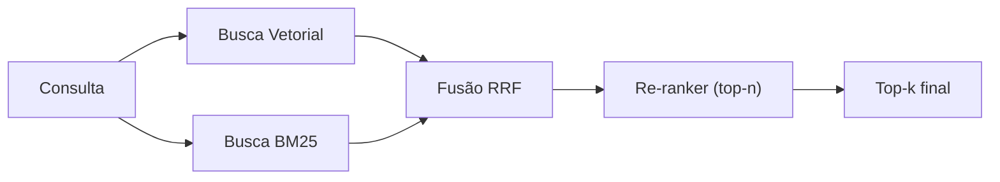

## Passo 1 · Leitura · Onde o vetor falha e o BM25 brilha: busca híbrida e RRF

Embeddings densos capturam paráfrases e sinônimos (`"cancelar"` $\leftrightarrow$ `"trancar"`), mas sofrem quando o aluno pergunta por **códigos exatos de disciplina** (`"MAC0121"` vs `"MAC0110"`), **números de artigos** (`"Art. 73"`) ou **siglas raras**. Nesses casos, a busca lexical clássica — liderada pelo algoritmo **BM25** — encontra o termo exato com precisão cirúrgica.



O **BM25** pontua um documento $d$ para uma consulta $q$ somando, para cada termo $t \in q$, a raridade do termo na coleção (**IDF suavizado**) multiplicada pela frequência $f(t, d)$ saturada por $k_1$ e normalizada pelo tamanho $|d|$ em relação à média $\text{avgdl}$:

$$\text{IDF}(t) = \ln\!\left(1 + \frac{N - n_t + 0{,}5}{n_t + 0{,}5}\right)$$

$$\text{BM25}(q, d) = \sum_{t \in q} \text{IDF}(t) \cdot \frac{f(t, d) \cdot (k_1 + 1)}{f(t, d) + k_1 \cdot \left(1 - b + b \cdot \frac{|d|}{\text{avgdl}}\right)}$$

Como combinar o ranking da busca vetorial (cujos scores ficam em $[-1, 1]$) com o ranking do BM25 (cujos scores podem passar de $10{,}0$)? Somar os scores brutos distorce completamente a lista. O **Reciprocal Rank Fusion (RRF)** resolve isso combinando apenas a **posição** $\text{pos}_r(d) \in \{1, 2, \dots\}$ de cada documento $d$ em cada ranking $r \in \mathcal{R}$ (tipicamente com $k = 60$):

$$\text{RRF}(d) = \sum_{r \in \mathcal{R}} \frac{1}{k + \text{pos}_r(d)}$$

Por fim, aplicamos um **re-ranker** (*cross-encoder*) apenas sobre os $n$ melhores candidatos da fusão (ex.: top-$10$) para escolher os $k$ trechos finais enviados ao LLM. Avaliar pares $(\text{pergunta}, \text{trecho})$ com um *cross-encoder* é muito mais preciso que um produto interno simples, porém caro demais para rodar no corpus inteiro.

Veja no visualizador como um documento que fica em 2º lugar tanto na busca vetorial quanto no BM25 assume o 1º lugar geral após a fusão RRF:

```python visualizar
ranking_vetorial = ["doc_A", "doc_C", "doc_B"]
ranking_bm25 = ["doc_B", "doc_C", "doc_A"]

scores_rrf = {}
for lista in [ranking_vetorial, ranking_bm25]:
    for pos, doc_id in enumerate(lista, start=1):
        scores_rrf[doc_id] = round(scores_rrf.get(doc_id, 0.0) + 1.0 / (60 + pos), 6)

ordenado = sorted(scores_rrf.items(), key=lambda item: -item[1])
```

## Passo 2 · Previsão · Fusão de rankings com RRF

Analise o código abaixo e determine qual será a ordem final impressa pelo RRF para os três documentos.

### Código

```python
r1 = ["art_10", "art_25", "art_40"]
r2 = ["art_40", "art_25", "art_10"]

k = 60
pontuacoes = {}
for ranking in (r1, r2):
    for pos, doc in enumerate(ranking, start=1):
        pontuacoes[doc] = pontuacoes.get(doc, 0.0) + 1.0 / (k + pos)

ordem = sorted(pontuacoes.keys(), key=lambda d: (-pontuacoes[d], d))
print("Primeiro:", ordem[0])
print("Score art_25:", round(pontuacoes["art_25"], 6))
print("Ordem:", ordem)
```

### Dicas

1. `art_25` aparece na posição `2` nas duas listas, recebendo `1/62 + 1/62 = 2/62 = 0.032258`.
2. `art_10` e `art_40` aparecem nas posições `1` e `3` (`1/61 + 1/63 = 124/3843 = 0.032266`), empatando ligeiramente acima de `2/62`! Desempate por ordem alfabética coloca `art_10` antes de `art_40`.

### Saída esperada

```text
Primeiro: art_10
Score art_25: 0.032258
Ordem: ['art_10', 'art_40', 'art_25']
```

## Passo 3 · Exercício · Reciprocal Rank Fusion (RRF)

modo: ordenar

Ordene as linhas para implementar `rrf(rankings, k=60)`, que recebe uma lista de listas de identificadores de documentos (`rankings`), soma `1.0 / (k + pos)` (com `pos` começando em `1`) para cada ocorrência e retorna a lista de documentos ordenada do maior para o menor score RRF (desempatando pelo identificador em ordem crescente).

### Instruções

1. Inicialize o dicionário `scores = {}` e percorra cada `lista` de `rankings`.
2. Enumere cada `lista` com `start=1` e acumule `1.0 / (k + pos)` em `scores[doc]`.
3. Retorne as chaves de `scores` ordenadas por `(-scores[d], d)`.

### Solução

```python
def rrf(rankings, k=60):
    scores = {}
    for lista in rankings:
        for pos, doc in enumerate(lista, start=1):
            scores[doc] = scores.get(doc, 0.0) + 1.0 / (k + pos)
    return sorted(scores.keys(), key=lambda d: (-scores[d], d))
```

### Dicas

1. Use `enumerate(lista, start=1)` para que o primeiro colocado tenha `pos = 1`.
2. Acumule com `scores.get(doc, 0.0) + 1.0 / (k + pos)` para somar as contribuições de múltiplos rankings.

### Verificação

```json
[
  {
    "id": "rrf-consenso-vence",
    "name": "Documento presente no topo de duas listas vence documento presente em apenas uma",
    "checkpoint": 2,
    "kind": "call",
    "function": "rrf",
    "args": [
      [
        ["doc_x", "doc_comum", "doc_y"],
        ["doc_z", "doc_comum", "doc_w"]
      ],
      60
    ],
    "expected": ["doc_comum", "doc_x", "doc_z", "doc_w", "doc_y"]
  },
  {
    "id": "rrf-lista-unica",
    "name": "Preserva a ordem quando há apenas um ranking",
    "checkpoint": 3,
    "kind": "call",
    "function": "rrf",
    "args": [
      [
        ["d1", "d2", "d3"]
      ],
      60
    ],
    "expected": ["d1", "d2", "d3"]
  }
]
```

### Soluções erradas

```python name="Substitui a pontuação em vez de somar quando o documento aparece em mais de uma lista"
def rrf(rankings, k=60):
    scores = {}
    for lista in rankings:
        for pos, doc in enumerate(lista, start=1):
            scores[doc] = 1.0 / (k + pos)
    return sorted(scores.keys(), key=lambda d: (-scores[d], d))
```

```python name="Ordena os documentos da menor para a maior pontuação RRF"
def rrf(rankings, k=60):
    scores = {}
    for lista in rankings:
        for pos, doc in enumerate(lista, start=1):
            scores[doc] = scores.get(doc, 0.0) + 1.0 / (k + pos)
    return sorted(scores.keys(), key=lambda d: (scores[d], d))
```

## Passo 4 · Exercício · Implementando o BM25 do zero

Implemente `bm25_scores(corpus, consulta, k1=1.5, b=0.75)` para calcular a pontuação lexical BM25 de cada texto em `corpus` diante da string `consulta`.

### Instruções

1. Tokenize cada documento de `corpus` e a `consulta` extraindo palavras alfanuméricas em minúsculas com `re.findall(r"[a-z0-9]+", texto.lower())`. Se `corpus` estiver vazio, retorne `[]`.
2. Calcule o número de documentos $N = \text{len}(\text{corpus})$ e o comprimento médio $\text{avgdl} = \frac{1}{N} \sum_{i} |d_i|$ (se $\text{avgdl} == 0$, use `1.0`).
3. Para cada termo único $t$ da `consulta` (ou percorrendo os termos únicos da consulta — `termos_q = list(dict.fromkeys(tokens_consulta))`), conte em quantos documentos $n_t$ o termo aparece e calcule o IDF suavizado:
   $$\text{IDF}(t) = \ln\!\left(1 + \frac{N - n_t + 0{,}5}{n_t + 0{,}5}\right)$$
4. Para cada documento $d$, some sobre os termos únicos $t$ de `consulta` presentes em $d$:
   $$\text{IDF}(t) \cdot \frac{f(t, d) \cdot (k_1 + 1)}{f(t, d) + k_1 \cdot \left(1 - b + b \cdot \frac{|d|}{\text{avgdl}}\right)}$$
   Devolva a lista de `float` com a pontuação de cada documento.

### Código inicial

```python
import math
import re


def tokenizar(texto):
    return re.findall(r"[a-z0-9]+", texto.lower())


def bm25_scores(corpus, consulta, k1=1.5, b=0.75):
    # Calcule e retorne a lista de floats com os scores BM25 de cada documento
    pass
```

### Solução

```python
import math
import re


def tokenizar(texto):
    return re.findall(r"[a-z0-9]+", texto.lower())


def bm25_scores(corpus, consulta, k1=1.5, b=0.75):
    if not corpus:
        return []
    docs_tokens = [tokenizar(doc) for doc in corpus]
    n_docs = len(docs_tokens)
    tamanhos = [len(d) for d in docs_tokens]
    avgdl = (sum(tamanhos) / n_docs) if sum(tamanhos) > 0 else 1.0
    termos_q = list(dict.fromkeys(tokenizar(consulta)))

    idfs = {}
    for t in termos_q:
        n_t = sum(1 for d in docs_tokens if t in d)
        idfs[t] = math.log(1.0 + (n_docs - n_t + 0.5) / (n_t + 0.5))

    scores = []
    for d, tam in zip(docs_tokens, tamanhos):
        s = 0.0
        for t in termos_q:
            freq = d.count(t)
            if freq > 0:
                num = freq * (k1 + 1.0)
                den = freq + k1 * (1.0 - b + b * (tam / avgdl))
                s += idfs[t] * (num / den)
        scores.append(float(s))
    return scores
```

### Dicas

1. Use `math.log(1.0 + (n_docs - n_t + 0.5) / (n_t + 0.5))` para calcular o IDF suavizado sem risco de divisão por zero nem logaritmo negativo.
2. Use `list(dict.fromkeys(tokenizar(consulta)))` para iterar sobre os termos únicos da consulta.

### Verificação

```json
[
  {
    "id": "bm25-codigo-disciplina",
    "name": "Pontua mais alto o documento que contém o código exato MAC0121",
    "checkpoint": 4,
    "kind": "call",
    "function": "bm25_scores",
    "args": [
      [
        "A disciplina MAC0110 introduz computacao basica",
        "A disciplina MAC0121 aborda algoritmos e estruturas de dados",
        "O trancamento de matricula segue o calendario escolar"
      ],
      "ementa da disciplina MAC0121",
      1.5,
      0.75
    ],
    "expected": [
      0.5209678782000926,
      1.345530495642001,
      0.0
    ],
    "tolerance": 1e-5
  },
  {
    "id": "bm25-termo-ausente",
    "name": "Retorna zero para todos os documentos quando nenhum termo da consulta ocorre",
    "checkpoint": 4,
    "kind": "call",
    "function": "bm25_scores",
    "args": [
      [
        "regimento de graduacao",
        "normas de estagio"
      ],
      "cardapio bandejao",
      1.5,
      0.75
    ],
    "expected": [
      0.0,
      0.0
    ],
    "tolerance": 1e-6
  }
]
```

### Soluções erradas

```python name="Conta apenas o número bruto de termos sem IDF nem normalização de tamanho"
import re


def bm25_scores(corpus, consulta, k1=1.5, b=0.75):
    termos = set(re.findall(r"[a-z0-9]+", consulta.lower()))
    return [float(sum(1 for t in re.findall(r"[a-z0-9]+", d.lower()) if t in termos)) for d in corpus]
```

```python name="Ignora a penalidade de comprimento b e o tamanho médio avgdl"
import math
import re


def bm25_scores(corpus, consulta, k1=1.5, b=0.75):
    docs = [re.findall(r"[a-z0-9]+", d.lower()) for d in corpus]
    n_docs = len(docs)
    termos_q = list(dict.fromkeys(re.findall(r"[a-z0-9]+", consulta.lower())))
    scores = []
    for d in docs:
        s = 0.0
        for t in termos_q:
            n_t = sum(1 for doc in docs if t in doc)
            idf = math.log(1.0 + (n_docs - n_t + 0.5) / (n_t + 0.5))
            freq = d.count(t)
            if freq > 0:
                s += idf * (freq * (k1 + 1.0)) / (freq + k1)
        scores.append(float(s))
    return scores
```

## Passo 5 · Exercício · Re-ranking e comparação de estratégias

Agora vamos combinar a busca vetorial e o BM25 via RRF, aplicar um *cross-encoder* simulado (`reranker`) sobre os melhores candidatos e medir o `recall@3` das quatro estratégias no conjunto de avaliação.

### Instruções

1. Implemente `reranquear(reranker, pergunta, candidatos, top_n=3)`:
   - Recebe `candidatos` (lista de dicionários `{"id": str, "texto": str}`), calcula o score de cada candidato com `reranker.pontuar(pergunta, c["texto"])` e devolve os `top_n` dicionários ordenados do maior para o menor score (em caso de empate, preserve a ordem original em `candidatos`).
2. Implemente `comparar_estrategias(corpus, perguntas, reranker)`:
   - `corpus` é uma lista de dicionários `{"id": str, "texto": str}` e `perguntas` é uma lista de casos `{"pergunta": str, "relevante": str}`.
   - Para cada pergunta:
     - **Vetorial (`"vetorial"`):** ordene todos os documentos de `corpus` pelo score decrescente de `score_vetorial(pergunta, doc["texto"])` e pegue os top-3 IDs.
     - **BM25 (`"bm25"`):** calcule `bm25_scores([d["texto"] for d in corpus], pergunta)` e pegue os top-3 IDs em ordem decrescente de score.
     - **Híbrida (`"hibrida"`):** aplique `rrf([ranking_vetorial, ranking_bm25], k=60)` sobre os rankings completos de IDs das duas buscas e pegue os top-3 IDs.
     - **Híbrida + Re-rank (`"hibrida_rerank"`):** pegue os top-5 IDs do ranking híbrido (`rrf`), monte a lista dos 5 dicionários correspondentes de `corpus` e chame `reranquear(reranker, pergunta, candidatos_top5, top_n=3)` para obter os 3 IDs finais.
   - Devolva `{"vetorial": float, "bm25": float, "hibrida": float, "hibrida_rerank": float}` com a fração de perguntas em que `caso["relevante"]` apareceu entre os 3 IDs de cada estratégia.

### Código inicial

```python
import math
import re
import numpy as np

SINONIMOS = {
    "cancelar": "trancar",
    "interromper": "trancar",
    "trancamento": "trancar",
    "boletim": "historico",
    "notas": "historico",
    "dispensa": "aproveitamento",
    "equivalencia": "aproveitamento",
}

RADICAIS = ["tranc", "histo", "aprov", "matri", "frequ", "estag"]


def tokenizar(texto):
    return re.findall(r"[a-z0-9]+", texto.lower())


def embedding_simulado(texto):
    v = np.zeros(len(RADICAIS), dtype=float)
    for tok in tokenizar(texto):
        canon = SINONIMOS.get(tok, tok)
        for i, rad in enumerate(RADICAIS):
            if canon.startswith(rad):
                v[i] += 1.0
    n = float(np.linalg.norm(v))
    return v / n if n > 1e-12 else v


def score_vetorial(pergunta, texto):
    return float(np.dot(embedding_simulado(pergunta), embedding_simulado(texto)))


def bm25_scores(corpus_textos, consulta, k1=1.5, b=0.75):
    docs = [tokenizar(d) for d in corpus_textos]
    n_docs = len(docs)
    tamanhos = [len(d) for d in docs]
    avgdl = (sum(tamanhos) / n_docs) if sum(tamanhos) > 0 else 1.0
    termos_q = list(dict.fromkeys(tokenizar(consulta)))
    idfs = {
        t: math.log(1.0 + (n_docs - sum(1 for d in docs if t in d) + 0.5) / (sum(1 for d in docs if t in d) + 0.5))
        for t in termos_q
    }
    res = []
    for d, tam in zip(docs, tamanhos):
        s = 0.0
        for t in termos_q:
            f = d.count(t)
            if f > 0:
                s += idfs[t] * (f * (k1 + 1.0)) / (f + k1 * (1.0 - b + b * (tam / avgdl)))
        res.append(float(s))
    return res


def rrf(rankings, k=60):
    scores = {}
    for lista in rankings:
        for pos, doc in enumerate(lista, start=1):
            scores[doc] = scores.get(doc, 0.0) + 1.0 / (k + pos)
    return sorted(scores.keys(), key=lambda d: (-scores[d], d))


class RerankerSimulado:
    def pontuar(self, pergunta, texto):
        toks_q = [SINONIMOS.get(t, t) for t in tokenizar(pergunta)]
        toks_d = [SINONIMOS.get(t, t) for t in tokenizar(texto)]
        inter = sum(1 for t in set(toks_q) if t in toks_d)
        return float(inter) + 0.5 * score_vetorial(pergunta, texto)


def reranquear(reranker, pergunta, candidatos, top_n=3):
    # Reordene os candidatos usando reranker.pontuar e devolva os top_n
    pass


def comparar_estrategias(corpus, perguntas, reranker):
    # Compare o recall@3 de vetorial, bm25, hibrida e hibrida_rerank
    pass
```

### Solução

```python
import math
import re
import numpy as np

SINONIMOS = {
    "cancelar": "trancar",
    "interromper": "trancar",
    "trancamento": "trancar",
    "boletim": "historico",
    "notas": "historico",
    "dispensa": "aproveitamento",
    "equivalencia": "aproveitamento",
}

RADICAIS = ["tranc", "histo", "aprov", "matri", "frequ", "estag"]


def tokenizar(texto):
    return re.findall(r"[a-z0-9]+", texto.lower())


def embedding_simulado(texto):
    v = np.zeros(len(RADICAIS), dtype=float)
    for tok in tokenizar(texto):
        canon = SINONIMOS.get(tok, tok)
        for i, rad in enumerate(RADICAIS):
            if canon.startswith(rad):
                v[i] += 1.0
    n = float(np.linalg.norm(v))
    return v / n if n > 1e-12 else v


def score_vetorial(pergunta, texto):
    return float(np.dot(embedding_simulado(pergunta), embedding_simulado(texto)))


def bm25_scores(corpus_textos, consulta, k1=1.5, b=0.75):
    docs = [tokenizar(d) for d in corpus_textos]
    n_docs = len(docs)
    tamanhos = [len(d) for d in docs]
    avgdl = (sum(tamanhos) / n_docs) if sum(tamanhos) > 0 else 1.0
    termos_q = list(dict.fromkeys(tokenizar(consulta)))
    idfs = {
        t: math.log(1.0 + (n_docs - sum(1 for d in docs if t in d) + 0.5) / (sum(1 for d in docs if t in d) + 0.5))
        for t in termos_q
    }
    res = []
    for d, tam in zip(docs, tamanhos):
        s = 0.0
        for t in termos_q:
            f = d.count(t)
            if f > 0:
                s += idfs[t] * (f * (k1 + 1.0)) / (f + k1 * (1.0 - b + b * (tam / avgdl)))
        res.append(float(s))
    return res


def rrf(rankings, k=60):
    scores = {}
    for lista in rankings:
        for pos, doc in enumerate(lista, start=1):
            scores[doc] = scores.get(doc, 0.0) + 1.0 / (k + pos)
    return sorted(scores.keys(), key=lambda d: (-scores[d], d))


class RerankerSimulado:
    def pontuar(self, pergunta, texto):
        toks_q = [SINONIMOS.get(t, t) for t in tokenizar(pergunta)]
        toks_d = [SINONIMOS.get(t, t) for t in tokenizar(texto)]
        inter = sum(1 for t in set(toks_q) if t in toks_d)
        return float(inter) + 0.5 * score_vetorial(pergunta, texto)


def reranquear(reranker, pergunta, candidatos, top_n=3):
    ordenados = sorted(
        enumerate(candidatos),
        key=lambda par: (-reranker.pontuar(pergunta, par[1]["texto"]), par[0]),
    )
    return [par[1] for par in ordenados[:top_n]]


def comparar_estrategias(corpus, perguntas, reranker):
    if not perguntas:
        return {"vetorial": 0.0, "bm25": 0.0, "hibrida": 0.0, "hibrida_rerank": 0.0}
    mapa_docs = {d["id"]: d for d in corpus}
    textos = [d["texto"] for d in corpus]
    acertos = {"vetorial": 0, "bm25": 0, "hibrida": 0, "hibrida_rerank": 0}

    for caso in perguntas:
        q = caso["pergunta"]
        rel = caso["relevante"]

        s_vet = [score_vetorial(q, d["texto"]) for d in corpus]
        rank_vet = [corpus[i]["id"] for i in sorted(range(len(corpus)), key=lambda i: (-s_vet[i], corpus[i]["id"]))]

        s_bm = bm25_scores(textos, q)
        rank_bm = [corpus[i]["id"] for i in sorted(range(len(corpus)), key=lambda i: (-s_bm[i], corpus[i]["id"]))]

        rank_hib = rrf([rank_vet, rank_bm], k=60)
        cand_top5 = [mapa_docs[doc_id] for doc_id in rank_hib[:5]]
        rank_rerank = [d["id"] for d in reranquear(reranker, q, cand_top5, top_n=3)]

        if rel in rank_vet[:3]:
            acertos["vetorial"] += 1
        if rel in rank_bm[:3]:
            acertos["bm25"] += 1
        if rel in rank_hib[:3]:
            acertos["hibrida"] += 1
        if rel in rank_rerank[:3]:
            acertos["hibrida_rerank"] += 1

    n = len(perguntas)
    return {chave: float(val / n) for chave, val in acertos.items()}
```

### Dicas

1. Em `reranquear`, use `sorted(enumerate(candidatos), key=lambda par: (-reranker.pontuar(pergunta, par[1]["texto"]), par[0]))` para ordenar pelo maior score preservando a ordem em empates.
2. Em `comparar_estrategias`, monte `rank_hib = rrf([rank_vet, rank_bm], k=60)` e passe os 5 primeiros dicionários (`[mapa_docs[i] for i in rank_hib[:5]]`) para `reranquear`.

### Verificação

```json
[
  {
    "id": "reranquear-ordem",
    "name": "Re-ranqueia candidatos colocando o trecho com código e semântica corretos no topo",
    "checkpoint": 1,
    "kind": "expr",
    "expr": "[d['id'] for d in reranquear(RerankerSimulado(), 'dispensa na disciplina MAC0121', [{'id': 'd1', 'texto': 'aproveitamento de estudos gerais'}, {'id': 'd2', 'texto': 'aproveitamento na disciplina MAC0121'}, {'id': 'd3', 'texto': 'normas de estagio'}], top_n=2)]",
    "expected": ["d2", "d1"]
  },
  {
    "id": "comparar-quatro-estrategias",
    "name": "Busca híbrida com re-ranking supera vetorial pura e BM25 pura em consultas mistas",
    "checkpoint": 2,
    "kind": "expr",
    "setup": "corpus_teste = [{'id': 'd1', 'texto': 'Relatorio final de estagio supervisionado'}, {'id': 'd2', 'texto': 'Regras de aproveitamento de estudos equivalentes'}, {'id': 'd3', 'texto': 'Normas de frequencia minima obrigatoria'}, {'id': 'd4', 'texto': 'Ementa oficial da disciplina MAC0121 algoritmos'}, {'id': 'd5', 'texto': 'Portaria 73 sobre colacao de grau'}, {'id': 'd6', 'texto': 'Normas de trancamento no semestre'}, {'id': 'd7', 'texto': 'Emissao de historico escolar oficial'}]; perguntas_teste = [{'pergunta': 'Como cancelar ou interromper?', 'relevante': 'd6'}, {'pergunta': 'Qual a ementa de MAC0121?', 'relevante': 'd4'}, {'pergunta': 'Pedir boletim de notas', 'relevante': 'd7'}, {'pergunta': 'O que diz a Portaria 73?', 'relevante': 'd5'}]; res = comparar_estrategias(corpus_teste, perguntas_teste, RerankerSimulado())",
    "expr": "[round(res['vetorial'], 4), round(res['bm25'], 4), round(res['hibrida_rerank'], 4), res['hibrida_rerank'] >= res['vetorial'] and res['hibrida_rerank'] >= res['bm25']]",
    "expected": [0.5, 0.5, 1.0, true]
  }
]
```

### Soluções erradas

```python name="Devolve os candidatos na ordem original sem consultar o reranker"
def reranquear(reranker, pergunta, candidatos, top_n=3):
    return list(candidatos[:top_n])


def comparar_estrategias(corpus, perguntas, reranker):
    return {"vetorial": 0.5, "bm25": 0.5, "hibrida": 0.5, "hibrida_rerank": 0.5}
```

```python name="Ordena os candidatos pelo menor score do reranker em vez do maior"
def reranquear(reranker, pergunta, candidatos, top_n=3):
    return sorted(candidatos, key=lambda c: reranker.pontuar(pergunta, c["texto"]))[:top_n]


def comparar_estrategias(corpus, perguntas, reranker):
    return {"vetorial": 0.0, "bm25": 0.0, "hibrida": 0.0, "hibrida_rerank": 0.0}
```

## Passo 6 · Quiz · BM25, RRF e re-ranking

### Pergunta

Por que consultas contendo códigos de disciplinas (`MAC0121`), números de portarias (`Portaria 73`) ou siglas específicas costumam ser melhor atendidas pelo BM25 do que por um modelo de embedding denso isolado?

- [ ] Porque o BM25 utiliza GPUs dedicadas enquanto embeddings rodam apenas em CPU.
- [x] Porque o BM25 pontua a correspondência exata de termos raros com alto IDF, enquanto embeddings comprimem a frase inteira num vetor contínuo que pode confundir códigos parecidos.
- [ ] Porque modelos de embedding removem todos os números antes de processar o texto.
- [ ] Porque o BM25 traduz automaticamente siglas para outros idiomas.

> Termos raros como `MAC0121` têm IDF elevado no BM25, garantindo forte pontuação aos documentos que contêm exatamente aquele código.

### Pergunta

Qual é a principal vantagem do *Reciprocal Rank Fusion* (RRF) em relação a somar diretamente a similaridade de cosseno com a pontuação do BM25?

- [ ] O RRF dispensa a execução do BM25.
- [x] O RRF baseia-se apenas nas posições (ranks) de cada documento nas listas, sendo imune às diferenças de escala e distribuição entre o cosseno ($[-1, 1]$) e o BM25 ($[0, +\infty)$).
- [ ] O RRF reduz a dimensão dos vetores de embedding pela metade.
- [ ] O RRF garante que apenas um único documento seja retornado.

> Como o BM25 não tem limite superior fixo e varia conforme o tamanho da consulta, somá-lo ao cosseno exige calibração delicada; o RRF elimina esse problema usando apenas $1/(k + \text{pos})$.

### Pergunta

Por que um modelo *cross-encoder* de re-ranking é aplicado apenas aos top-$n$ candidatos (por exemplo, $n = 20$) recuperados pela primeira fase, e não a todos os $100\,000$ documentos da base?

- [ ] Porque o *cross-encoder* não aceita textos com mais de três palavras.
- [x] Porque o *cross-encoder* precisa processar conjuntamente o par $(\text{pergunta}, \text{documento})$ a cada consulta, o que seria lento e caro demais em toda a coleção.
- [ ] Porque documentos fora do top-$n$ não possuem texto armazenado.
- [ ] Porque o RRF proíbe avaliar mais de 20 itens.

> Diferentemente dos embeddings bi-encoder (que são pré-computados uma única vez na indexação), o *cross-encoder* realiza inferência para cada par na hora da pergunta.
