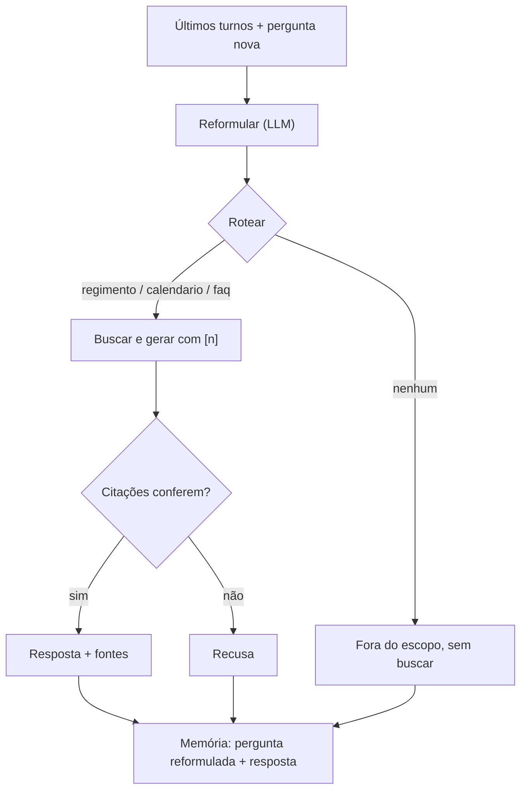

## Passo 1 · Leitura · A pergunta que só faz sentido na conversa

O aluno pergunta "Qual o prazo de trancamento parcial?" e recebe a resposta com o artigo citado. Em seguida escreve "E para a pós-graduação?". Para ele, a pergunta é óbvia. Para o índice, é uma frase sem assunto: embutida sozinha, fica perto de qualquer trecho que fale de pós-graduação (bolsas, defesa, matrícula), e o pipeline da lição 01 responde outra coisa, com citação e tudo, ou recusa.

A correção usual é **reformular** a pergunta (*query rewriting*, também chamada de condensação): antes de buscar, um LLM recebe os últimos turnos da conversa e a pergunta nova e devolve uma pergunta **autossuficiente**, "Qual o prazo de trancamento para a pós-graduação?". É essa versão que vai para o roteador, para a busca e para o gerador; a interface continua mostrando o que o aluno digitou.



Quatro decisões aparecem em todo projeto:

- **Quando chamar.** Reformular é uma chamada a mais por turno, com custo e latência. No primeiro turno não há histórico, e a chamada é desperdício.
- **Quantos turnos mandar.** Poucos. O histórico inteiro custa tokens a cada turno e dá ao modelo assuntos antigos para puxar por engano. Cuidado com o Python: `historico[-n:]` com `n = 0` devolve a lista **inteira**.
- **O que guardar.** Guarde a pergunta reformulada junto com a resposta. O turno seguinte ainda acha o assunto, mesmo com memória curta, e quem lê o log entende cada turno sozinho.
- **O que fazer quando a reescrita falha.** Texto cortado por `max_tokens` ou vazio não vira consulta: volte à pergunta original. Uma busca ruim se recupera; uma consulta com metade do assunto engana o resto do pipeline.

O reformulador deste módulo é o `ClienteLLM` com o comportamento do `modelo_consulta.py`, com regras explícitas como as do `modelo_rag.py`. Em vez de parafrasear como um modelo real, ele procura um tema conhecido nas falas recentes do aluno e devolve "Sobre trancamento: para a pós-graduação?". Não é bonito, mas o assunto entrou na consulta, que é o que a busca precisa.

## Passo 2 · Exercício · Reescrever a pergunta com o histórico

Escreva `reformular(cliente, historico, pergunta, max_turnos=2)`. `historico` é a lista de turnos `{"pergunta", "resposta"}`, do mais antigo para o mais recente; `cliente` é um `ClienteLLM`, e a instrução `REESCRITA` já está no código inicial.

- Sem histórico, ou com `max_turnos` menor ou igual a 0, devolva a pergunta sem espaços nas pontas **sem chamar o modelo**.
- Senão, chame `cliente.completar` com `[{"role": "system", "content": REESCRITA}, {"role": "user", "content": ...}]`, `max_tokens=60` e `temperature=0`. O conteúdo do `user` é `Conversa:`, uma linha `Aluno: ...` e uma `Assistente: ...` para cada um dos últimos `max_turnos` turnos (do mais antigo para o mais recente), uma linha em branco e `Pergunta atual: ` com a pergunta. Cada texto vai numa linha só, com os espaços repetidos reduzidos a um.
- Devolva o texto do modelo sem espaços nas pontas. Se ele veio cortado (`finish_reason` diferente de `"stop"`) ou vazio, devolva a pergunta original sem espaços nas pontas.
- O `historico` recebido não pode ser alterado.

Com o histórico do exemplo abaixo, o `user` fica assim, e o modelo simulado devolve "Sobre trancamento: para a pós-graduação?":

```text
Conversa:
Aluno: Qual o prazo de trancamento parcial?
Assistente: O trancamento parcial pode ser pedido até o 60º dia letivo. [1]

Pergunta atual: E para a pós-graduação?
```

### Instruções
1. Pule a chamada quando não há histórico para usar.
2. Monte o prompt com as duas falas de cada um dos últimos `max_turnos` turnos, numa linha cada.
3. Use a reescrita só quando ela veio inteira; senão, fique com a pergunta original.

### Código inicial
```python
from llm_simulado import ClienteLLM
from modelo_consulta import responder

REESCRITA = (
    "Reescreva a última pergunta do aluno para que ela se entenda sem a conversa.\n"
    "Mantenha o assunto da conversa e não responda à pergunta.\n"
    "Se ela já se entende sozinha, devolva-a sem mudanças.\n"
    "Responda só com a pergunta reescrita, numa linha."
)


def reformular(cliente, historico, pergunta, max_turnos=2):
    pass


if __name__ == "__main__":
    cliente = ClienteLLM(responder)
    historico = []
    for pergunta in ["Qual o prazo de trancamento parcial?", "E para a pós-graduação?",
                     "Como peço o histórico escolar?"]:
        busca = reformular(cliente, historico, pergunta)
        print(pergunta, "->", busca)
        historico.append({"pergunta": busca, "resposta": "(resposta do assistente)"})
    print("chamadas ao modelo:", cliente.chamadas)
```
```python path=llm_simulado.py
"""Cliente de LLM simulado do curso: a interface de um SDK real, sem rede.

Aproximações declaradas (tudo reproduzível):
- tokens: brinquedo, cada palavra vira pedaços de até 4 caracteres;
  o espaço em branco (quebras de linha inclusive) não conta à parte:
  vai colado no pedaço seguinte, ou no último quando fecha o texto,
  então "".join(tokenizar(t)) == t; o tokenizador real dá outros números;
- preços: fictícios, em R$ por milhão de tokens;
- latência: TTFT + ms por token de saída, somada a um relógio falso;
- sorteio: random.Random(seed); com temperature > 0 a resposta pode variar;
- falhas: fila programada (429, 503, "timeout", 400), consumida em ordem.
"""
import random
import re

PRECO_ENTRADA = 2.0  # R$ por milhão de tokens de entrada (fictício)
PRECO_SAIDA = 8.0  # R$ por milhão de tokens de saída (fictício)
SOBRECARGA_POR_MENSAGEM = 4  # tokens de formatação de cada mensagem


class ErroDeTaxa(Exception):  # HTTP 429: transitório
    def __init__(self, mensagem="429 Too Many Requests", retry_after=None):
        super().__init__(mensagem)
        self.retry_after = retry_after  # espera sugerida pelo servidor, em s


class ErroDeServidor(Exception):  # HTTP 5xx: transitório
    pass


class ErroDeTimeout(Exception):  # resposta não chegou no prazo: transitório
    pass


class ErroDeRequisicao(Exception):  # HTTP 400/401: permanente, não repita
    pass


def tokenizar(texto):
    return re.findall(r"\s*\S{1,4}(?:\s+\Z)?|\s+\Z", texto)


def contar_tokens(texto):
    return len(tokenizar(texto))


class Resposta:
    def __init__(self, conteudo, finish_reason, prompt_tokens, completion_tokens,
                 latencia_ms=0, tool_calls=None):
        self.conteudo = conteudo
        self.finish_reason = finish_reason  # "stop", "length" ou "tool_calls"
        self.usage = {"prompt_tokens": prompt_tokens,
                      "completion_tokens": completion_tokens,
                      "total_tokens": prompt_tokens + completion_tokens}
        self.latencia_ms = latencia_ms
        self.tool_calls = tool_calls or []


class Relogio:  # relógio falso: só anda quando alguém manda
    def __init__(self):
        self.agora_ms = 0

    def avancar(self, ms):
        self.agora_ms += ms


class ClienteLLM:
    """respostas: lista de textos candidatos, ou função(mensagens) que devolve
    um texto ou uma lista de tool_calls."""

    def __init__(self, respostas, seed=None, falhas=(), relogio=None,
                 ttft_ms=300, ms_por_token=20):
        self.respostas = respostas
        self.rng = random.Random(seed)
        self.falhas = list(falhas)
        self.relogio = relogio or Relogio()
        self.ttft_ms = ttft_ms
        self.ms_por_token = ms_por_token
        self.chamadas = 0

    def _preparar(self, mensagens, temperature):
        self.chamadas += 1
        falha = self.falhas.pop(0) if self.falhas else None
        if falha == 429:
            raise ErroDeTaxa(retry_after=2.0)
        if falha == 503:
            raise ErroDeServidor("503 Service Unavailable")
        if falha == "timeout":
            self.relogio.avancar(10_000)
            raise ErroDeTimeout("sem resposta em 10 s")
        if falha == 400:
            raise ErroDeRequisicao("400 Bad Request")
        if callable(self.respostas):
            return self.respostas(mensagens)
        if temperature == 0:
            return self.respostas[0]  # num servidor real, nem isso é garantido
        return self.rng.choice(self.respostas)

    def completar(self, mensagens, max_tokens=256, temperature=1.0):
        gerado = self._preparar(mensagens, temperature)
        entrada = sum(contar_tokens(m["content"]) + SOBRECARGA_POR_MENSAGEM
                      for m in mensagens)
        if isinstance(gerado, list):  # o modelo pediu ferramentas
            self.relogio.avancar(self.ttft_ms)
            return Resposta("", "tool_calls", entrada, 10, self.ttft_ms, gerado)
        tokens, motivo = tokenizar(gerado), "stop"
        if len(tokens) > max_tokens:
            tokens, motivo = tokens[:max_tokens], "length"
        latencia = self.ttft_ms + len(tokens) * self.ms_por_token
        self.relogio.avancar(latencia)
        return Resposta("".join(tokens), motivo, entrada, len(tokens), latencia)

    def completar_stream(self, mensagens, max_tokens=256, temperature=1.0, cair_apos=None):
        """Gera eventos {"delta": texto}; o último traz "finish_reason".
        cair_apos=n: a conexão cai depois de n tokens, sem o evento final."""
        tokens, motivo = tokenizar(self._preparar(mensagens, temperature)), "stop"
        if len(tokens) > max_tokens:
            tokens, motivo = tokens[:max_tokens], "length"
        self.relogio.avancar(self.ttft_ms)
        for i, token in enumerate(tokens):
            if i == cair_apos:
                return
            self.relogio.avancar(self.ms_por_token)
            yield {"delta": token}
        yield {"delta": "", "finish_reason": motivo}
```
```python path=modelo_consulta.py
"""Comportamento SIMULADO do modelo que prepara a consulta: ClienteLLM(responder).

O llm_simulado.py é o cliente do módulo 1; esta função decide o texto que ele
devolve. A tarefa é reconhecida pela mensagem "system":
1. "Reescreva": lê as linhas "Aluno: ..." da última mensagem "user" e a linha
   "Pergunta atual: ...". A pergunta depende da conversa quando não cita
   nenhum tema de TEMAS e começa com "E " ou usa uma palavra de REFERENCIAS
   ("dele", "isso"...). Se não depende, volta sem mudanças. Se depende, o
   modelo procura o tema na fala do aluno mais recente que tenha um e devolve
   "Sobre <tema>: <pergunta>?"; sem tema nas falas, devolve a pergunta como
   veio. Um modelo real também lê as falas do assistente; este não lê.
2. "Divida": lê a linha "Pergunta: ...". Corta em " e " só quando a palavra
   seguinte é interrogativa (qual, como, quando...) e devolve uma lista JSON.
   Não obedece a limite de partes e monta o JSON sem escapar aspas: pergunta
   com aspas gera JSON inválido, como acontece com modelos reais.
3. "Classifique": as linhas "- rota: descrição" do system são as opções.
   Pontua cada rota (menos "nenhum") pelos radicais (4 primeiras letras das
   palavras de 4 letras ou mais, sem acento) em comum entre a pergunta e a
   descrição; ganha a maior pontuação, e o empate fica com a rota listada
   primeiro. Sem radical em comum: "nenhum" se essa opção foi oferecida; se não
   foi, a primeira rota, como um modelo obrigado a escolher. Responde com o
   nome escrito para gente ler ("Calendário."), não com a etiqueta crua.
Um modelo real reescreve com mais liberdade, entende paráfrase e também erra.
"""
import re
import unicodedata

TEMAS = {
    "trancamento": "trancamento", "trancar": "trancamento",
    "matricula": "matrícula", "historico": "histórico escolar",
    "frequencia": "frequência", "estagio": "estágio",
    "diploma": "diploma", "carteirinha": "carteirinha",
}
REFERENCIAS = {"dele", "dela", "disso", "isso", "nele", "nela", "nisso", "desse", "dessa", "esse", "essa"}
INTERROGATIVAS = "qual|quais|como|quando|onde|quanto|quantos|quantas|quem|posso|preciso"
EXIBICAO = {"calendario": "Calendário", "regimento": "Regimento", "faq": "FAQ", "nenhum": "Nenhum"}


def sem_acento(texto):
    return unicodedata.normalize("NFKD", texto.lower()).encode("ascii", "ignore").decode()


def tema(texto):
    for palavra in re.findall(r"[a-z0-9]+", sem_acento(texto)):
        if palavra in TEMAS:
            return TEMAS[palavra]
    return None


def radicais(texto):
    return {p[:4] for p in re.findall(r"[a-z0-9]{4,}", sem_acento(texto))}


def reescrever(usuario):
    falas, pergunta = [], ""
    for linha in usuario.splitlines():
        if linha.startswith("Aluno:"):
            falas.append(linha[len("Aluno:"):].strip())
        elif linha.startswith("Pergunta atual:"):
            pergunta = linha[len("Pergunta atual:"):].strip()
    termos = re.findall(r"[a-z0-9]+", sem_acento(pergunta))
    depende = termos[:1] == ["e"] or any(t in REFERENCIAS for t in termos)
    if tema(pergunta) or not depende:
        return pergunta
    for fala in reversed(falas):
        achado = tema(fala)
        if achado:
            resto = re.sub(r"^e\s+", "", pergunta.rstrip(" ?"), flags=re.IGNORECASE)
            return f"Sobre {achado}: {resto[:1].lower() + resto[1:]}?"
    return pergunta


def dividir(usuario):
    pergunta = ""
    for linha in usuario.splitlines():
        if linha.startswith("Pergunta:"):
            pergunta = linha[len("Pergunta:"):].strip()
    pedacos = re.split(rf"\s+e\s+(?=(?:{INTERROGATIVAS})\b)|\?\s+", pergunta, flags=re.IGNORECASE)
    partes = []
    for pedaco in pedacos:
        limpo = re.sub(r"^e\s+", "", pedaco.strip(" ?"), flags=re.IGNORECASE)
        if limpo:
            partes.append(limpo[:1].upper() + limpo[1:] + "?")
    return "[" + ", ".join(f'"{p}"' for p in partes) + "]"


def classificar(sistema, usuario):
    rotas = re.findall(r"^- ([a-z_]+): (.*)$", sistema, flags=re.MULTILINE)
    alvo = radicais(usuario)
    melhor, escolhida = 0, None
    for nome, descricao in rotas:
        if nome == "nenhum":
            continue
        pontos = len(alvo & radicais(descricao))
        if pontos > melhor:
            melhor, escolhida = pontos, nome
    if escolhida is None:
        nomes = [nome for nome, _ in rotas]
        escolhida = "nenhum" if "nenhum" in nomes or not nomes else nomes[0]
    return EXIBICAO.get(escolhida, escolhida.capitalize()) + "."


def responder(mensagens):
    sistema = mensagens[0]["content"] if mensagens[0]["role"] == "system" else ""
    usuario = mensagens[-1]["content"]
    if "Reescreva" in sistema:
        return reescrever(usuario)
    if "Divida" in sistema:
        return dividir(usuario)
    if "Classifique" in sistema:
        return classificar(sistema, usuario)
    return "Não entendi a tarefa."
```

### Solução
```python
from llm_simulado import ClienteLLM
from modelo_consulta import responder

REESCRITA = (
    "Reescreva a última pergunta do aluno para que ela se entenda sem a conversa.\n"
    "Mantenha o assunto da conversa e não responda à pergunta.\n"
    "Se ela já se entende sozinha, devolva-a sem mudanças.\n"
    "Responda só com a pergunta reescrita, numa linha."
)


def uma_linha(texto):
    return " ".join(texto.split())


def reformular(cliente, historico, pergunta, max_turnos=2):
    if not historico or max_turnos <= 0:
        return pergunta.strip()
    linhas = []
    for turno in historico[-max_turnos:]:
        linhas.append("Aluno: " + uma_linha(turno["pergunta"]))
        linhas.append("Assistente: " + uma_linha(turno["resposta"]))
    usuario = "Conversa:\n" + "\n".join(linhas) + "\n\nPergunta atual: " + uma_linha(pergunta)
    r = cliente.completar([{"role": "system", "content": REESCRITA},
                           {"role": "user", "content": usuario}], max_tokens=60, temperature=0)
    texto = r.conteudo.strip()
    if r.finish_reason != "stop" or not texto:
        return pergunta.strip()
    return texto


if __name__ == "__main__":
    cliente = ClienteLLM(responder)
    historico = []
    for pergunta in ["Qual o prazo de trancamento parcial?", "E para a pós-graduação?",
                     "Como peço o histórico escolar?"]:
        busca = reformular(cliente, historico, pergunta)
        print(pergunta, "->", busca)
        historico.append({"pergunta": busca, "resposta": "(resposta do assistente)"})
    print("chamadas ao modelo:", cliente.chamadas)
```
```python path=llm_simulado.py
"""Cliente de LLM simulado do curso: a interface de um SDK real, sem rede.

Aproximações declaradas (tudo reproduzível):
- tokens: brinquedo, cada palavra vira pedaços de até 4 caracteres;
  o espaço em branco (quebras de linha inclusive) não conta à parte:
  vai colado no pedaço seguinte, ou no último quando fecha o texto,
  então "".join(tokenizar(t)) == t; o tokenizador real dá outros números;
- preços: fictícios, em R$ por milhão de tokens;
- latência: TTFT + ms por token de saída, somada a um relógio falso;
- sorteio: random.Random(seed); com temperature > 0 a resposta pode variar;
- falhas: fila programada (429, 503, "timeout", 400), consumida em ordem.
"""
import random
import re

PRECO_ENTRADA = 2.0  # R$ por milhão de tokens de entrada (fictício)
PRECO_SAIDA = 8.0  # R$ por milhão de tokens de saída (fictício)
SOBRECARGA_POR_MENSAGEM = 4  # tokens de formatação de cada mensagem


class ErroDeTaxa(Exception):  # HTTP 429: transitório
    def __init__(self, mensagem="429 Too Many Requests", retry_after=None):
        super().__init__(mensagem)
        self.retry_after = retry_after  # espera sugerida pelo servidor, em s


class ErroDeServidor(Exception):  # HTTP 5xx: transitório
    pass


class ErroDeTimeout(Exception):  # resposta não chegou no prazo: transitório
    pass


class ErroDeRequisicao(Exception):  # HTTP 400/401: permanente, não repita
    pass


def tokenizar(texto):
    return re.findall(r"\s*\S{1,4}(?:\s+\Z)?|\s+\Z", texto)


def contar_tokens(texto):
    return len(tokenizar(texto))


class Resposta:
    def __init__(self, conteudo, finish_reason, prompt_tokens, completion_tokens,
                 latencia_ms=0, tool_calls=None):
        self.conteudo = conteudo
        self.finish_reason = finish_reason  # "stop", "length" ou "tool_calls"
        self.usage = {"prompt_tokens": prompt_tokens,
                      "completion_tokens": completion_tokens,
                      "total_tokens": prompt_tokens + completion_tokens}
        self.latencia_ms = latencia_ms
        self.tool_calls = tool_calls or []


class Relogio:  # relógio falso: só anda quando alguém manda
    def __init__(self):
        self.agora_ms = 0

    def avancar(self, ms):
        self.agora_ms += ms


class ClienteLLM:
    """respostas: lista de textos candidatos, ou função(mensagens) que devolve
    um texto ou uma lista de tool_calls."""

    def __init__(self, respostas, seed=None, falhas=(), relogio=None,
                 ttft_ms=300, ms_por_token=20):
        self.respostas = respostas
        self.rng = random.Random(seed)
        self.falhas = list(falhas)
        self.relogio = relogio or Relogio()
        self.ttft_ms = ttft_ms
        self.ms_por_token = ms_por_token
        self.chamadas = 0

    def _preparar(self, mensagens, temperature):
        self.chamadas += 1
        falha = self.falhas.pop(0) if self.falhas else None
        if falha == 429:
            raise ErroDeTaxa(retry_after=2.0)
        if falha == 503:
            raise ErroDeServidor("503 Service Unavailable")
        if falha == "timeout":
            self.relogio.avancar(10_000)
            raise ErroDeTimeout("sem resposta em 10 s")
        if falha == 400:
            raise ErroDeRequisicao("400 Bad Request")
        if callable(self.respostas):
            return self.respostas(mensagens)
        if temperature == 0:
            return self.respostas[0]  # num servidor real, nem isso é garantido
        return self.rng.choice(self.respostas)

    def completar(self, mensagens, max_tokens=256, temperature=1.0):
        gerado = self._preparar(mensagens, temperature)
        entrada = sum(contar_tokens(m["content"]) + SOBRECARGA_POR_MENSAGEM
                      for m in mensagens)
        if isinstance(gerado, list):  # o modelo pediu ferramentas
            self.relogio.avancar(self.ttft_ms)
            return Resposta("", "tool_calls", entrada, 10, self.ttft_ms, gerado)
        tokens, motivo = tokenizar(gerado), "stop"
        if len(tokens) > max_tokens:
            tokens, motivo = tokens[:max_tokens], "length"
        latencia = self.ttft_ms + len(tokens) * self.ms_por_token
        self.relogio.avancar(latencia)
        return Resposta("".join(tokens), motivo, entrada, len(tokens), latencia)

    def completar_stream(self, mensagens, max_tokens=256, temperature=1.0, cair_apos=None):
        """Gera eventos {"delta": texto}; o último traz "finish_reason".
        cair_apos=n: a conexão cai depois de n tokens, sem o evento final."""
        tokens, motivo = tokenizar(self._preparar(mensagens, temperature)), "stop"
        if len(tokens) > max_tokens:
            tokens, motivo = tokens[:max_tokens], "length"
        self.relogio.avancar(self.ttft_ms)
        for i, token in enumerate(tokens):
            if i == cair_apos:
                return
            self.relogio.avancar(self.ms_por_token)
            yield {"delta": token}
        yield {"delta": "", "finish_reason": motivo}
```
```python path=modelo_consulta.py
"""Comportamento SIMULADO do modelo que prepara a consulta: ClienteLLM(responder).

O llm_simulado.py é o cliente do módulo 1; esta função decide o texto que ele
devolve. A tarefa é reconhecida pela mensagem "system":
1. "Reescreva": lê as linhas "Aluno: ..." da última mensagem "user" e a linha
   "Pergunta atual: ...". A pergunta depende da conversa quando não cita
   nenhum tema de TEMAS e começa com "E " ou usa uma palavra de REFERENCIAS
   ("dele", "isso"...). Se não depende, volta sem mudanças. Se depende, o
   modelo procura o tema na fala do aluno mais recente que tenha um e devolve
   "Sobre <tema>: <pergunta>?"; sem tema nas falas, devolve a pergunta como
   veio. Um modelo real também lê as falas do assistente; este não lê.
2. "Divida": lê a linha "Pergunta: ...". Corta em " e " só quando a palavra
   seguinte é interrogativa (qual, como, quando...) e devolve uma lista JSON.
   Não obedece a limite de partes e monta o JSON sem escapar aspas: pergunta
   com aspas gera JSON inválido, como acontece com modelos reais.
3. "Classifique": as linhas "- rota: descrição" do system são as opções.
   Pontua cada rota (menos "nenhum") pelos radicais (4 primeiras letras das
   palavras de 4 letras ou mais, sem acento) em comum entre a pergunta e a
   descrição; ganha a maior pontuação, e o empate fica com a rota listada
   primeiro. Sem radical em comum: "nenhum" se essa opção foi oferecida; se não
   foi, a primeira rota, como um modelo obrigado a escolher. Responde com o
   nome escrito para gente ler ("Calendário."), não com a etiqueta crua.
Um modelo real reescreve com mais liberdade, entende paráfrase e também erra.
"""
import re
import unicodedata

TEMAS = {
    "trancamento": "trancamento", "trancar": "trancamento",
    "matricula": "matrícula", "historico": "histórico escolar",
    "frequencia": "frequência", "estagio": "estágio",
    "diploma": "diploma", "carteirinha": "carteirinha",
}
REFERENCIAS = {"dele", "dela", "disso", "isso", "nele", "nela", "nisso", "desse", "dessa", "esse", "essa"}
INTERROGATIVAS = "qual|quais|como|quando|onde|quanto|quantos|quantas|quem|posso|preciso"
EXIBICAO = {"calendario": "Calendário", "regimento": "Regimento", "faq": "FAQ", "nenhum": "Nenhum"}


def sem_acento(texto):
    return unicodedata.normalize("NFKD", texto.lower()).encode("ascii", "ignore").decode()


def tema(texto):
    for palavra in re.findall(r"[a-z0-9]+", sem_acento(texto)):
        if palavra in TEMAS:
            return TEMAS[palavra]
    return None


def radicais(texto):
    return {p[:4] for p in re.findall(r"[a-z0-9]{4,}", sem_acento(texto))}


def reescrever(usuario):
    falas, pergunta = [], ""
    for linha in usuario.splitlines():
        if linha.startswith("Aluno:"):
            falas.append(linha[len("Aluno:"):].strip())
        elif linha.startswith("Pergunta atual:"):
            pergunta = linha[len("Pergunta atual:"):].strip()
    termos = re.findall(r"[a-z0-9]+", sem_acento(pergunta))
    depende = termos[:1] == ["e"] or any(t in REFERENCIAS for t in termos)
    if tema(pergunta) or not depende:
        return pergunta
    for fala in reversed(falas):
        achado = tema(fala)
        if achado:
            resto = re.sub(r"^e\s+", "", pergunta.rstrip(" ?"), flags=re.IGNORECASE)
            return f"Sobre {achado}: {resto[:1].lower() + resto[1:]}?"
    return pergunta


def dividir(usuario):
    pergunta = ""
    for linha in usuario.splitlines():
        if linha.startswith("Pergunta:"):
            pergunta = linha[len("Pergunta:"):].strip()
    pedacos = re.split(rf"\s+e\s+(?=(?:{INTERROGATIVAS})\b)|\?\s+", pergunta, flags=re.IGNORECASE)
    partes = []
    for pedaco in pedacos:
        limpo = re.sub(r"^e\s+", "", pedaco.strip(" ?"), flags=re.IGNORECASE)
        if limpo:
            partes.append(limpo[:1].upper() + limpo[1:] + "?")
    return "[" + ", ".join(f'"{p}"' for p in partes) + "]"


def classificar(sistema, usuario):
    rotas = re.findall(r"^- ([a-z_]+): (.*)$", sistema, flags=re.MULTILINE)
    alvo = radicais(usuario)
    melhor, escolhida = 0, None
    for nome, descricao in rotas:
        if nome == "nenhum":
            continue
        pontos = len(alvo & radicais(descricao))
        if pontos > melhor:
            melhor, escolhida = pontos, nome
    if escolhida is None:
        nomes = [nome for nome, _ in rotas]
        escolhida = "nenhum" if "nenhum" in nomes or not nomes else nomes[0]
    return EXIBICAO.get(escolhida, escolhida.capitalize()) + "."


def responder(mensagens):
    sistema = mensagens[0]["content"] if mensagens[0]["role"] == "system" else ""
    usuario = mensagens[-1]["content"]
    if "Reescreva" in sistema:
        return reescrever(usuario)
    if "Divida" in sistema:
        return dividir(usuario)
    if "Classifique" in sistema:
        return classificar(sistema, usuario)
    return "Não entendi a tarefa."
```

### Dicas
1. Confira no interpretador o que `[1, 2, 3][-0:]` devolve antes de confiar numa fatia negativa.
2. `str.split()` sem argumento separa em qualquer espaço em branco, inclusive `\n`.
3. O objeto devolvido por `completar` diz por que a geração parou.

### Verificação
```json
[
  {"id": "sem-historico", "checkpoint": 1, "kind": "expr", "setup": "c = ClienteLLM(responder)\nr = reformular(c, [], '  Qual o prazo de trancamento?  ')", "expr": "[r, c.chamadas]", "expected": ["Qual o prazo de trancamento?", 0], "name": "Primeiro turno: devolve a pergunta limpa sem chamar o modelo"},
  {"id": "zero-turnos", "checkpoint": 1, "kind": "expr", "setup": "H1 = [{'pergunta': 'Qual o prazo de trancamento parcial?', 'resposta': 'O trancamento parcial pode ser pedido até o 60º dia letivo. [1]'}]\nc = ClienteLLM(responder)\nr = reformular(c, H1, 'E para a pós-graduação?', max_turnos=0)", "expr": "[r, c.chamadas]", "expected": ["E para a pós-graduação?", 0], "name": "max_turnos=0 é conversa sem memória: nenhuma chamada", "hint": "Confira o que uma fatia [-0:] devolve."},
  {"id": "eliptica", "checkpoint": 2, "kind": "expr", "setup": "H1 = [{'pergunta': 'Qual o prazo de trancamento parcial?', 'resposta': 'O trancamento parcial pode ser pedido até o 60º dia letivo. [1]'}]\nc = ClienteLLM(responder)\nr = reformular(c, H1, 'E para a pós-graduação?')", "expr": "[r, c.chamadas]", "expected": ["Sobre trancamento: para a pós-graduação?", 1], "name": "Pergunta elíptica ganha o assunto do turno anterior"},
  {"id": "troca-de-assunto", "checkpoint": 2, "kind": "expr", "setup": "H1 = [{'pergunta': 'Qual o prazo de trancamento parcial?', 'resposta': 'O trancamento parcial pode ser pedido até o 60º dia letivo. [1]'}]\nc = ClienteLLM(responder)", "expr": "reformular(c, H1, 'Como peço o histórico escolar?')", "expected": "Como peço o histórico escolar?", "name": "Pergunta que já se entende sozinha não herda o assunto antigo"},
  {"id": "prompt-exato", "checkpoint": 2, "kind": "expr", "setup": "H3 = [{'pergunta': 'Posso trancar uma disciplina?', 'resposta': 'Sim, até o 60º dia letivo. [1]'}, {'pergunta': 'Onde fica a secretaria?', 'resposta': 'No prédio da\\nadministração. [1]'}, {'pergunta': 'Ela abre aos sábados?', 'resposta': 'Não há informação suficiente nos documentos.'}]\nvistos = []\ndef espiao(mensagens):\n    vistos.append(mensagens)\n    return responder(mensagens)\nc = ClienteLLM(espiao)\nreformular(c, H3, '  E até quando   posso fazer isso? ')", "expr": "[[m['role'] for m in vistos[0]], vistos[0][0]['content'] == REESCRITA, vistos[0][1]['content']]", "expected": [["system", "user"], true, "Conversa:\nAluno: Onde fica a secretaria?\nAssistente: No prédio da administração. [1]\nAluno: Ela abre aos sábados?\nAssistente: Não há informação suficiente nos documentos.\n\nPergunta atual: E até quando posso fazer isso?"], "name": "Prompt com só os últimos turnos, as duas falas de cada um, numa linha cada", "hint": "Cada turno vira duas linhas, Aluno e Assistente, e só os últimos max_turnos entram."},
  {"id": "janela-de-turnos", "checkpoint": 2, "kind": "expr", "setup": "H3 = [{'pergunta': 'Posso trancar uma disciplina?', 'resposta': 'Sim, até o 60º dia letivo. [1]'}, {'pergunta': 'Onde fica a secretaria?', 'resposta': 'No prédio da\\nadministração. [1]'}, {'pergunta': 'Ela abre aos sábados?', 'resposta': 'Não há informação suficiente nos documentos.'}]\nc = ClienteLLM(responder)", "expr": "[reformular(c, H3, 'E até quando posso fazer isso?'), reformular(c, H3, 'E até quando posso fazer isso?', max_turnos=3)]", "expected": ["E até quando posso fazer isso?", "Sobre trancamento: até quando posso fazer isso?"], "name": "O assunto de três turnos atrás só entra quando max_turnos alcança esse turno"},
  {"id": "cortada", "checkpoint": 3, "kind": "expr", "setup": "H1 = [{'pergunta': 'Qual o prazo de trancamento parcial?', 'resposta': 'O trancamento parcial pode ser pedido até o 60º dia letivo. [1]'}]\nr = reformular(ClienteLLM(['Qual ' * 80]), H1, ' E para a pós-graduação? ')", "expr": "r", "expected": "E para a pós-graduação?", "name": "Reescrita cortada por max_tokens não vira consulta", "hint": "Uma resposta que parou por limite de tokens está incompleta."},
  {"id": "vazia", "checkpoint": 3, "kind": "expr", "setup": "H1 = [{'pergunta': 'Qual o prazo de trancamento parcial?', 'resposta': 'O trancamento parcial pode ser pedido até o 60º dia letivo. [1]'}]", "expr": "reformular(ClienteLLM(['   ']), H1, 'E para a pós-graduação?')", "expected": "E para a pós-graduação?", "name": "Reescrita vazia volta para a pergunta original"},
  {"id": "nao-altera", "checkpoint": 2, "kind": "expr", "setup": "import copy\nH3 = [{'pergunta': 'Posso trancar uma disciplina?', 'resposta': 'Sim, até o 60º dia letivo. [1]'}, {'pergunta': 'Onde fica a secretaria?', 'resposta': 'No prédio da\\nadministração. [1]'}, {'pergunta': 'Ela abre aos sábados?', 'resposta': 'Não há informação suficiente nos documentos.'}]\nantes = copy.deepcopy(H3)\nr = reformular(ClienteLLM(responder), H3, 'E até quando posso fazer isso?', max_turnos=3)", "expr": "[H3 == antes, r]", "expected": [true, "Sobre trancamento: até quando posso fazer isso?"], "name": "O histórico recebido não é alterado"}
]
```

### Soluções erradas
```python name="chama o modelo mesmo sem histórico"
from llm_simulado import ClienteLLM
from modelo_consulta import responder

REESCRITA = (
    "Reescreva a última pergunta do aluno para que ela se entenda sem a conversa.\n"
    "Mantenha o assunto da conversa e não responda à pergunta.\n"
    "Se ela já se entende sozinha, devolva-a sem mudanças.\n"
    "Responda só com a pergunta reescrita, numa linha."
)


def uma_linha(texto):
    return " ".join(texto.split())


def reformular(cliente, historico, pergunta, max_turnos=2):
    if max_turnos <= 0:
        return pergunta.strip()
    linhas = []
    for turno in historico[-max_turnos:]:
        linhas.append("Aluno: " + uma_linha(turno["pergunta"]))
        linhas.append("Assistente: " + uma_linha(turno["resposta"]))
    usuario = "Conversa:\n" + "\n".join(linhas) + "\n\nPergunta atual: " + uma_linha(pergunta)
    r = cliente.completar([{"role": "system", "content": REESCRITA},
                           {"role": "user", "content": usuario}], max_tokens=60, temperature=0)
    texto = r.conteudo.strip()
    if r.finish_reason != "stop" or not texto:
        return pergunta.strip()
    return texto


if __name__ == "__main__":
    cliente = ClienteLLM(responder)
    historico = []
    for pergunta in ["Qual o prazo de trancamento parcial?", "E para a pós-graduação?",
                     "Como peço o histórico escolar?"]:
        busca = reformular(cliente, historico, pergunta)
        print(pergunta, "->", busca)
        historico.append({"pergunta": busca, "resposta": "(resposta do assistente)"})
    print("chamadas ao modelo:", cliente.chamadas)
```
```python name="manda o histórico inteiro"
from llm_simulado import ClienteLLM
from modelo_consulta import responder

REESCRITA = (
    "Reescreva a última pergunta do aluno para que ela se entenda sem a conversa.\n"
    "Mantenha o assunto da conversa e não responda à pergunta.\n"
    "Se ela já se entende sozinha, devolva-a sem mudanças.\n"
    "Responda só com a pergunta reescrita, numa linha."
)


def uma_linha(texto):
    return " ".join(texto.split())


def reformular(cliente, historico, pergunta, max_turnos=2):
    if not historico or max_turnos <= 0:
        return pergunta.strip()
    linhas = []
    for turno in historico:
        linhas.append("Aluno: " + uma_linha(turno["pergunta"]))
        linhas.append("Assistente: " + uma_linha(turno["resposta"]))
    usuario = "Conversa:\n" + "\n".join(linhas) + "\n\nPergunta atual: " + uma_linha(pergunta)
    r = cliente.completar([{"role": "system", "content": REESCRITA},
                           {"role": "user", "content": usuario}], max_tokens=60, temperature=0)
    texto = r.conteudo.strip()
    if r.finish_reason != "stop" or not texto:
        return pergunta.strip()
    return texto


if __name__ == "__main__":
    cliente = ClienteLLM(responder)
    historico = []
    for pergunta in ["Qual o prazo de trancamento parcial?", "E para a pós-graduação?",
                     "Como peço o histórico escolar?"]:
        busca = reformular(cliente, historico, pergunta)
        print(pergunta, "->", busca)
        historico.append({"pergunta": busca, "resposta": "(resposta do assistente)"})
    print("chamadas ao modelo:", cliente.chamadas)
```
```python name="fatia com -max_turnos sem tratar o zero"
from llm_simulado import ClienteLLM
from modelo_consulta import responder

REESCRITA = (
    "Reescreva a última pergunta do aluno para que ela se entenda sem a conversa.\n"
    "Mantenha o assunto da conversa e não responda à pergunta.\n"
    "Se ela já se entende sozinha, devolva-a sem mudanças.\n"
    "Responda só com a pergunta reescrita, numa linha."
)


def uma_linha(texto):
    return " ".join(texto.split())


def reformular(cliente, historico, pergunta, max_turnos=2):
    if not historico:
        return pergunta.strip()
    linhas = []
    for turno in historico[-max_turnos:]:
        linhas.append("Aluno: " + uma_linha(turno["pergunta"]))
        linhas.append("Assistente: " + uma_linha(turno["resposta"]))
    usuario = "Conversa:\n" + "\n".join(linhas) + "\n\nPergunta atual: " + uma_linha(pergunta)
    r = cliente.completar([{"role": "system", "content": REESCRITA},
                           {"role": "user", "content": usuario}], max_tokens=60, temperature=0)
    texto = r.conteudo.strip()
    if r.finish_reason != "stop" or not texto:
        return pergunta.strip()
    return texto


if __name__ == "__main__":
    cliente = ClienteLLM(responder)
    historico = []
    for pergunta in ["Qual o prazo de trancamento parcial?", "E para a pós-graduação?",
                     "Como peço o histórico escolar?"]:
        busca = reformular(cliente, historico, pergunta)
        print(pergunta, "->", busca)
        historico.append({"pergunta": busca, "resposta": "(resposta do assistente)"})
    print("chamadas ao modelo:", cliente.chamadas)
```
```python name="usa a reescrita mesmo cortada"
from llm_simulado import ClienteLLM
from modelo_consulta import responder

REESCRITA = (
    "Reescreva a última pergunta do aluno para que ela se entenda sem a conversa.\n"
    "Mantenha o assunto da conversa e não responda à pergunta.\n"
    "Se ela já se entende sozinha, devolva-a sem mudanças.\n"
    "Responda só com a pergunta reescrita, numa linha."
)


def uma_linha(texto):
    return " ".join(texto.split())


def reformular(cliente, historico, pergunta, max_turnos=2):
    if not historico or max_turnos <= 0:
        return pergunta.strip()
    linhas = []
    for turno in historico[-max_turnos:]:
        linhas.append("Aluno: " + uma_linha(turno["pergunta"]))
        linhas.append("Assistente: " + uma_linha(turno["resposta"]))
    usuario = "Conversa:\n" + "\n".join(linhas) + "\n\nPergunta atual: " + uma_linha(pergunta)
    r = cliente.completar([{"role": "system", "content": REESCRITA},
                           {"role": "user", "content": usuario}], max_tokens=60, temperature=0)
    texto = r.conteudo.strip()
    if not texto:
        return pergunta.strip()
    return texto


if __name__ == "__main__":
    cliente = ClienteLLM(responder)
    historico = []
    for pergunta in ["Qual o prazo de trancamento parcial?", "E para a pós-graduação?",
                     "Como peço o histórico escolar?"]:
        busca = reformular(cliente, historico, pergunta)
        print(pergunta, "->", busca)
        historico.append({"pergunta": busca, "resposta": "(resposta do assistente)"})
    print("chamadas ao modelo:", cliente.chamadas)
```
```python name="junta a pergunta anterior em vez de chamar o modelo"
from llm_simulado import ClienteLLM
from modelo_consulta import responder

REESCRITA = (
    "Reescreva a última pergunta do aluno para que ela se entenda sem a conversa.\n"
    "Mantenha o assunto da conversa e não responda à pergunta.\n"
    "Se ela já se entende sozinha, devolva-a sem mudanças.\n"
    "Responda só com a pergunta reescrita, numa linha."
)


def uma_linha(texto):
    return " ".join(texto.split())


def reformular(cliente, historico, pergunta, max_turnos=2):
    if not historico or max_turnos <= 0:
        return pergunta.strip()
    linhas = []
    for turno in historico[-max_turnos:]:
        linhas.append("Aluno: " + uma_linha(turno["pergunta"]))
        linhas.append("Assistente: " + uma_linha(turno["resposta"]))
    usuario = "Conversa:\n" + "\n".join(linhas) + "\n\nPergunta atual: " + uma_linha(pergunta)
    anterior = historico[-1]["pergunta"].strip().rstrip("?")
    return anterior + ", " + pergunta.strip()


if __name__ == "__main__":
    cliente = ClienteLLM(responder)
    historico = []
    for pergunta in ["Qual o prazo de trancamento parcial?", "E para a pós-graduação?",
                     "Como peço o histórico escolar?"]:
        busca = reformular(cliente, historico, pergunta)
        print(pergunta, "->", busca)
        historico.append({"pergunta": busca, "resposta": "(resposta do assistente)"})
    print("chamadas ao modelo:", cliente.chamadas)
```
```python name="põe a conversa na mensagem system"
from llm_simulado import ClienteLLM
from modelo_consulta import responder

REESCRITA = (
    "Reescreva a última pergunta do aluno para que ela se entenda sem a conversa.\n"
    "Mantenha o assunto da conversa e não responda à pergunta.\n"
    "Se ela já se entende sozinha, devolva-a sem mudanças.\n"
    "Responda só com a pergunta reescrita, numa linha."
)


def uma_linha(texto):
    return " ".join(texto.split())


def reformular(cliente, historico, pergunta, max_turnos=2):
    if not historico or max_turnos <= 0:
        return pergunta.strip()
    linhas = []
    for turno in historico[-max_turnos:]:
        linhas.append("Aluno: " + uma_linha(turno["pergunta"]))
        linhas.append("Assistente: " + uma_linha(turno["resposta"]))
    usuario = "Conversa:\n" + "\n".join(linhas) + "\n\nPergunta atual: " + uma_linha(pergunta)
    r = cliente.completar([{"role": "system", "content": REESCRITA + "\n\n" + usuario},
                           {"role": "user", "content": "Pergunta atual: " + uma_linha(pergunta)}],
                          max_tokens=60, temperature=0)
    texto = r.conteudo.strip()
    if r.finish_reason != "stop" or not texto:
        return pergunta.strip()
    return texto


if __name__ == "__main__":
    cliente = ClienteLLM(responder)
    historico = []
    for pergunta in ["Qual o prazo de trancamento parcial?", "E para a pós-graduação?",
                     "Como peço o histórico escolar?"]:
        busca = reformular(cliente, historico, pergunta)
        print(pergunta, "->", busca)
        historico.append({"pergunta": busca, "resposta": "(resposta do assistente)"})
    print("chamadas ao modelo:", cliente.chamadas)
```
```python name="manda só as falas do aluno"
from llm_simulado import ClienteLLM
from modelo_consulta import responder

REESCRITA = (
    "Reescreva a última pergunta do aluno para que ela se entenda sem a conversa.\n"
    "Mantenha o assunto da conversa e não responda à pergunta.\n"
    "Se ela já se entende sozinha, devolva-a sem mudanças.\n"
    "Responda só com a pergunta reescrita, numa linha."
)


def uma_linha(texto):
    return " ".join(texto.split())


def reformular(cliente, historico, pergunta, max_turnos=2):
    if not historico or max_turnos <= 0:
        return pergunta.strip()
    linhas = []
    for turno in historico[-max_turnos:]:
        linhas.append("Aluno: " + uma_linha(turno["pergunta"]))
    usuario = "Conversa:\n" + "\n".join(linhas) + "\n\nPergunta atual: " + uma_linha(pergunta)
    r = cliente.completar([{"role": "system", "content": REESCRITA},
                           {"role": "user", "content": usuario}], max_tokens=60, temperature=0)
    texto = r.conteudo.strip()
    if r.finish_reason != "stop" or not texto:
        return pergunta.strip()
    return texto


if __name__ == "__main__":
    cliente = ClienteLLM(responder)
    historico = []
    for pergunta in ["Qual o prazo de trancamento parcial?", "E para a pós-graduação?",
                     "Como peço o histórico escolar?"]:
        busca = reformular(cliente, historico, pergunta)
        print(pergunta, "->", busca)
        historico.append({"pergunta": busca, "resposta": "(resposta do assistente)"})
    print("chamadas ao modelo:", cliente.chamadas)
```

## Passo 3 · Previsão · O " e " que não separa perguntas

Uma pergunta com dois assuntos pede duas buscas, e a tentação é cortar no " e ". O programa aplica esse corte a três perguntas reais de alunos. Leia sem executar e digite o que ele imprime.

### Código
```python
perguntas = [
    "Qual o prazo de trancamento e como peço o histórico?",
    "Quais as regras de ensino e pesquisa?",
    "Qual e o prazo de trancamento?",
]
for p in perguntas:
    partes = [x.strip(" ?") for x in p.split(" e ")]
    print(len(partes), partes)
```

### Dicas
1. `split(" e ")` corta em toda ocorrência do texto " e ", com os dois espaços, não importa o que vem depois.
2. `strip(" ?")` tira espaços e interrogações só das pontas.
3. Quem digita sem acento escreve "e" no lugar de "é".

### Saída esperada
```text
2 ['Qual o prazo de trancamento', 'como peço o histórico']
2 ['Quais as regras de ensino', 'pesquisa']
2 ['Qual', 'o prazo de trancamento']
```

## Passo 4 · Exercício · Decompor e buscar cada parte

"Qual o prazo de trancamento e como peço o histórico?" tem dois assuntos. Embutida inteira, vira um vetor a meio caminho dos dois, e o top-k costuma trazer trechos de um assunto só. **Decompor** é transformar a pergunta em subperguntas independentes, buscar cada uma e juntar os trechos antes de gerar. A Previsão mostrou que o corte não pode ser no texto " e ": quem decide é o modelo, e a saída dele é dado estruturado, que se valida como no módulo 1. JSON que não abre, objeto no lugar de lista, item que não é texto, lista vazia ou com mais partes que o limite não servem; nesses casos, busque a pergunta inteira, que é pior que uma boa decomposição e melhor que meia pergunta. O limite existe porque cada parte custa uma busca e disputa espaço na janela.

Ao juntar, **intercale**: o 1º de cada lista, depois o 2º de cada uma, e assim por diante, pulando o que já entrou. Concatenar as listas deixa a primeira subpergunta ocupar todas as `k` vagas. A fusão RRF da lição 03 também serviria; intercalar é a versão mais simples.

Escreva duas funções. A instrução `DIVISAO` já está no código inicial.

- `decompor(cliente, pergunta, max_partes=3)`: uma chamada `cliente.completar([{"role": "system", "content": DIVISAO}, {"role": "user", "content": "Pergunta: " + pergunta numa linha}], max_tokens=120, temperature=0)`. Aceite a saída só se for uma lista JSON de textos; tire os espaços das pontas de cada item, descarte os vazios e os repetidos (sem diferenciar maiúsculas, fica o primeiro). Se a resposta veio cortada, não serve, ou a lista limpa ficou vazia ou com mais de `max_partes` itens, devolva `[pergunta sem espaços nas pontas]`.
- `buscar_subconsultas(buscar, subperguntas, k)`: `buscar(texto)` devolve a lista de ids em ordem de relevância. Chame `buscar` **uma vez** por subpergunta, na ordem, e devolva até `k` ids intercalados, sem repetir.

### Instruções
1. Peça a divisão ao modelo e aceite só uma lista JSON de textos, limpa e sem repetições.
2. Fique com a pergunta inteira quando a saída não serve ou passa de `max_partes`.
3. Busque cada subpergunta uma vez e intercale os resultados, sem repetir, até `k`.

### Código inicial
```python
import json

from llm_simulado import ClienteLLM
from modelo_consulta import responder

DIVISAO = (
    "Divida a pergunta do aluno em perguntas independentes, uma por assunto, "
    "cada uma compreensível sozinha.\n"
    "Se ela trata de um assunto só, devolva uma lista com ela inteira.\n"
    "Responda só com uma lista JSON de strings, com no máximo 3 itens."
)


def decompor(cliente, pergunta, max_partes=3):
    pass


def buscar_subconsultas(buscar, subperguntas, k):
    pass


if __name__ == "__main__":
    RANKINGS = {
        "Qual o prazo de trancamento?": ["reg-12", "reg-13", "reg-41"],
        "Como peço o histórico?": ["faq-03", "reg-12", "faq-05"],
    }
    cliente = ClienteLLM(responder)
    partes = decompor(cliente, "Qual o prazo de trancamento e como peço o histórico?")
    print(partes)
    print(buscar_subconsultas(lambda texto: RANKINGS.get(texto, []), partes or [], 4))
```
```python path=llm_simulado.py
"""Cliente de LLM simulado do curso: a interface de um SDK real, sem rede.

Aproximações declaradas (tudo reproduzível):
- tokens: brinquedo, cada palavra vira pedaços de até 4 caracteres;
  o espaço em branco (quebras de linha inclusive) não conta à parte:
  vai colado no pedaço seguinte, ou no último quando fecha o texto,
  então "".join(tokenizar(t)) == t; o tokenizador real dá outros números;
- preços: fictícios, em R$ por milhão de tokens;
- latência: TTFT + ms por token de saída, somada a um relógio falso;
- sorteio: random.Random(seed); com temperature > 0 a resposta pode variar;
- falhas: fila programada (429, 503, "timeout", 400), consumida em ordem.
"""
import random
import re

PRECO_ENTRADA = 2.0  # R$ por milhão de tokens de entrada (fictício)
PRECO_SAIDA = 8.0  # R$ por milhão de tokens de saída (fictício)
SOBRECARGA_POR_MENSAGEM = 4  # tokens de formatação de cada mensagem


class ErroDeTaxa(Exception):  # HTTP 429: transitório
    def __init__(self, mensagem="429 Too Many Requests", retry_after=None):
        super().__init__(mensagem)
        self.retry_after = retry_after  # espera sugerida pelo servidor, em s


class ErroDeServidor(Exception):  # HTTP 5xx: transitório
    pass


class ErroDeTimeout(Exception):  # resposta não chegou no prazo: transitório
    pass


class ErroDeRequisicao(Exception):  # HTTP 400/401: permanente, não repita
    pass


def tokenizar(texto):
    return re.findall(r"\s*\S{1,4}(?:\s+\Z)?|\s+\Z", texto)


def contar_tokens(texto):
    return len(tokenizar(texto))


class Resposta:
    def __init__(self, conteudo, finish_reason, prompt_tokens, completion_tokens,
                 latencia_ms=0, tool_calls=None):
        self.conteudo = conteudo
        self.finish_reason = finish_reason  # "stop", "length" ou "tool_calls"
        self.usage = {"prompt_tokens": prompt_tokens,
                      "completion_tokens": completion_tokens,
                      "total_tokens": prompt_tokens + completion_tokens}
        self.latencia_ms = latencia_ms
        self.tool_calls = tool_calls or []


class Relogio:  # relógio falso: só anda quando alguém manda
    def __init__(self):
        self.agora_ms = 0

    def avancar(self, ms):
        self.agora_ms += ms


class ClienteLLM:
    """respostas: lista de textos candidatos, ou função(mensagens) que devolve
    um texto ou uma lista de tool_calls."""

    def __init__(self, respostas, seed=None, falhas=(), relogio=None,
                 ttft_ms=300, ms_por_token=20):
        self.respostas = respostas
        self.rng = random.Random(seed)
        self.falhas = list(falhas)
        self.relogio = relogio or Relogio()
        self.ttft_ms = ttft_ms
        self.ms_por_token = ms_por_token
        self.chamadas = 0

    def _preparar(self, mensagens, temperature):
        self.chamadas += 1
        falha = self.falhas.pop(0) if self.falhas else None
        if falha == 429:
            raise ErroDeTaxa(retry_after=2.0)
        if falha == 503:
            raise ErroDeServidor("503 Service Unavailable")
        if falha == "timeout":
            self.relogio.avancar(10_000)
            raise ErroDeTimeout("sem resposta em 10 s")
        if falha == 400:
            raise ErroDeRequisicao("400 Bad Request")
        if callable(self.respostas):
            return self.respostas(mensagens)
        if temperature == 0:
            return self.respostas[0]  # num servidor real, nem isso é garantido
        return self.rng.choice(self.respostas)

    def completar(self, mensagens, max_tokens=256, temperature=1.0):
        gerado = self._preparar(mensagens, temperature)
        entrada = sum(contar_tokens(m["content"]) + SOBRECARGA_POR_MENSAGEM
                      for m in mensagens)
        if isinstance(gerado, list):  # o modelo pediu ferramentas
            self.relogio.avancar(self.ttft_ms)
            return Resposta("", "tool_calls", entrada, 10, self.ttft_ms, gerado)
        tokens, motivo = tokenizar(gerado), "stop"
        if len(tokens) > max_tokens:
            tokens, motivo = tokens[:max_tokens], "length"
        latencia = self.ttft_ms + len(tokens) * self.ms_por_token
        self.relogio.avancar(latencia)
        return Resposta("".join(tokens), motivo, entrada, len(tokens), latencia)

    def completar_stream(self, mensagens, max_tokens=256, temperature=1.0, cair_apos=None):
        """Gera eventos {"delta": texto}; o último traz "finish_reason".
        cair_apos=n: a conexão cai depois de n tokens, sem o evento final."""
        tokens, motivo = tokenizar(self._preparar(mensagens, temperature)), "stop"
        if len(tokens) > max_tokens:
            tokens, motivo = tokens[:max_tokens], "length"
        self.relogio.avancar(self.ttft_ms)
        for i, token in enumerate(tokens):
            if i == cair_apos:
                return
            self.relogio.avancar(self.ms_por_token)
            yield {"delta": token}
        yield {"delta": "", "finish_reason": motivo}
```
```python path=modelo_consulta.py
"""Comportamento SIMULADO do modelo que prepara a consulta: ClienteLLM(responder).

O llm_simulado.py é o cliente do módulo 1; esta função decide o texto que ele
devolve. A tarefa é reconhecida pela mensagem "system":
1. "Reescreva": lê as linhas "Aluno: ..." da última mensagem "user" e a linha
   "Pergunta atual: ...". A pergunta depende da conversa quando não cita
   nenhum tema de TEMAS e começa com "E " ou usa uma palavra de REFERENCIAS
   ("dele", "isso"...). Se não depende, volta sem mudanças. Se depende, o
   modelo procura o tema na fala do aluno mais recente que tenha um e devolve
   "Sobre <tema>: <pergunta>?"; sem tema nas falas, devolve a pergunta como
   veio. Um modelo real também lê as falas do assistente; este não lê.
2. "Divida": lê a linha "Pergunta: ...". Corta em " e " só quando a palavra
   seguinte é interrogativa (qual, como, quando...) e devolve uma lista JSON.
   Não obedece a limite de partes e monta o JSON sem escapar aspas: pergunta
   com aspas gera JSON inválido, como acontece com modelos reais.
3. "Classifique": as linhas "- rota: descrição" do system são as opções.
   Pontua cada rota (menos "nenhum") pelos radicais (4 primeiras letras das
   palavras de 4 letras ou mais, sem acento) em comum entre a pergunta e a
   descrição; ganha a maior pontuação, e o empate fica com a rota listada
   primeiro. Sem radical em comum: "nenhum" se essa opção foi oferecida; se não
   foi, a primeira rota, como um modelo obrigado a escolher. Responde com o
   nome escrito para gente ler ("Calendário."), não com a etiqueta crua.
Um modelo real reescreve com mais liberdade, entende paráfrase e também erra.
"""
import re
import unicodedata

TEMAS = {
    "trancamento": "trancamento", "trancar": "trancamento",
    "matricula": "matrícula", "historico": "histórico escolar",
    "frequencia": "frequência", "estagio": "estágio",
    "diploma": "diploma", "carteirinha": "carteirinha",
}
REFERENCIAS = {"dele", "dela", "disso", "isso", "nele", "nela", "nisso", "desse", "dessa", "esse", "essa"}
INTERROGATIVAS = "qual|quais|como|quando|onde|quanto|quantos|quantas|quem|posso|preciso"
EXIBICAO = {"calendario": "Calendário", "regimento": "Regimento", "faq": "FAQ", "nenhum": "Nenhum"}


def sem_acento(texto):
    return unicodedata.normalize("NFKD", texto.lower()).encode("ascii", "ignore").decode()


def tema(texto):
    for palavra in re.findall(r"[a-z0-9]+", sem_acento(texto)):
        if palavra in TEMAS:
            return TEMAS[palavra]
    return None


def radicais(texto):
    return {p[:4] for p in re.findall(r"[a-z0-9]{4,}", sem_acento(texto))}


def reescrever(usuario):
    falas, pergunta = [], ""
    for linha in usuario.splitlines():
        if linha.startswith("Aluno:"):
            falas.append(linha[len("Aluno:"):].strip())
        elif linha.startswith("Pergunta atual:"):
            pergunta = linha[len("Pergunta atual:"):].strip()
    termos = re.findall(r"[a-z0-9]+", sem_acento(pergunta))
    depende = termos[:1] == ["e"] or any(t in REFERENCIAS for t in termos)
    if tema(pergunta) or not depende:
        return pergunta
    for fala in reversed(falas):
        achado = tema(fala)
        if achado:
            resto = re.sub(r"^e\s+", "", pergunta.rstrip(" ?"), flags=re.IGNORECASE)
            return f"Sobre {achado}: {resto[:1].lower() + resto[1:]}?"
    return pergunta


def dividir(usuario):
    pergunta = ""
    for linha in usuario.splitlines():
        if linha.startswith("Pergunta:"):
            pergunta = linha[len("Pergunta:"):].strip()
    pedacos = re.split(rf"\s+e\s+(?=(?:{INTERROGATIVAS})\b)|\?\s+", pergunta, flags=re.IGNORECASE)
    partes = []
    for pedaco in pedacos:
        limpo = re.sub(r"^e\s+", "", pedaco.strip(" ?"), flags=re.IGNORECASE)
        if limpo:
            partes.append(limpo[:1].upper() + limpo[1:] + "?")
    return "[" + ", ".join(f'"{p}"' for p in partes) + "]"


def classificar(sistema, usuario):
    rotas = re.findall(r"^- ([a-z_]+): (.*)$", sistema, flags=re.MULTILINE)
    alvo = radicais(usuario)
    melhor, escolhida = 0, None
    for nome, descricao in rotas:
        if nome == "nenhum":
            continue
        pontos = len(alvo & radicais(descricao))
        if pontos > melhor:
            melhor, escolhida = pontos, nome
    if escolhida is None:
        nomes = [nome for nome, _ in rotas]
        escolhida = "nenhum" if "nenhum" in nomes or not nomes else nomes[0]
    return EXIBICAO.get(escolhida, escolhida.capitalize()) + "."


def responder(mensagens):
    sistema = mensagens[0]["content"] if mensagens[0]["role"] == "system" else ""
    usuario = mensagens[-1]["content"]
    if "Reescreva" in sistema:
        return reescrever(usuario)
    if "Divida" in sistema:
        return dividir(usuario)
    if "Classifique" in sistema:
        return classificar(sistema, usuario)
    return "Não entendi a tarefa."
```

### Solução
```python
import json

from llm_simulado import ClienteLLM
from modelo_consulta import responder

DIVISAO = (
    "Divida a pergunta do aluno em perguntas independentes, uma por assunto, "
    "cada uma compreensível sozinha.\n"
    "Se ela trata de um assunto só, devolva uma lista com ela inteira.\n"
    "Responda só com uma lista JSON de strings, com no máximo 3 itens."
)


def uma_linha(texto):
    return " ".join(texto.split())


def decompor(cliente, pergunta, max_partes=3):
    inteira = [pergunta.strip()]
    r = cliente.completar([{"role": "system", "content": DIVISAO},
                           {"role": "user", "content": "Pergunta: " + uma_linha(pergunta)}],
                          max_tokens=120, temperature=0)
    if r.finish_reason != "stop":
        return inteira
    try:
        partes = json.loads(r.conteudo)
    except json.JSONDecodeError:
        return inteira
    if not isinstance(partes, list) or not all(isinstance(p, str) for p in partes):
        return inteira
    limpas, vistas = [], set()
    for parte in partes:
        parte = parte.strip()
        if parte and parte.lower() not in vistas:
            vistas.add(parte.lower())
            limpas.append(parte)
    if not limpas or len(limpas) > max_partes:
        return inteira
    return limpas


def buscar_subconsultas(buscar, subperguntas, k):
    listas = [buscar(s) for s in subperguntas]
    escolhidos = []
    rodada = 0
    while len(escolhidos) < k and any(rodada < len(lista) for lista in listas):
        for lista in listas:
            if len(escolhidos) == k:
                break
            if rodada < len(lista) and lista[rodada] not in escolhidos:
                escolhidos.append(lista[rodada])
        rodada += 1
    return escolhidos


if __name__ == "__main__":
    RANKINGS = {
        "Qual o prazo de trancamento?": ["reg-12", "reg-13", "reg-41"],
        "Como peço o histórico?": ["faq-03", "reg-12", "faq-05"],
    }
    cliente = ClienteLLM(responder)
    partes = decompor(cliente, "Qual o prazo de trancamento e como peço o histórico?")
    print(partes)
    print(buscar_subconsultas(lambda texto: RANKINGS.get(texto, []), partes or [], 4))
```
```python path=llm_simulado.py
"""Cliente de LLM simulado do curso: a interface de um SDK real, sem rede.

Aproximações declaradas (tudo reproduzível):
- tokens: brinquedo, cada palavra vira pedaços de até 4 caracteres;
  o espaço em branco (quebras de linha inclusive) não conta à parte:
  vai colado no pedaço seguinte, ou no último quando fecha o texto,
  então "".join(tokenizar(t)) == t; o tokenizador real dá outros números;
- preços: fictícios, em R$ por milhão de tokens;
- latência: TTFT + ms por token de saída, somada a um relógio falso;
- sorteio: random.Random(seed); com temperature > 0 a resposta pode variar;
- falhas: fila programada (429, 503, "timeout", 400), consumida em ordem.
"""
import random
import re

PRECO_ENTRADA = 2.0  # R$ por milhão de tokens de entrada (fictício)
PRECO_SAIDA = 8.0  # R$ por milhão de tokens de saída (fictício)
SOBRECARGA_POR_MENSAGEM = 4  # tokens de formatação de cada mensagem


class ErroDeTaxa(Exception):  # HTTP 429: transitório
    def __init__(self, mensagem="429 Too Many Requests", retry_after=None):
        super().__init__(mensagem)
        self.retry_after = retry_after  # espera sugerida pelo servidor, em s


class ErroDeServidor(Exception):  # HTTP 5xx: transitório
    pass


class ErroDeTimeout(Exception):  # resposta não chegou no prazo: transitório
    pass


class ErroDeRequisicao(Exception):  # HTTP 400/401: permanente, não repita
    pass


def tokenizar(texto):
    return re.findall(r"\s*\S{1,4}(?:\s+\Z)?|\s+\Z", texto)


def contar_tokens(texto):
    return len(tokenizar(texto))


class Resposta:
    def __init__(self, conteudo, finish_reason, prompt_tokens, completion_tokens,
                 latencia_ms=0, tool_calls=None):
        self.conteudo = conteudo
        self.finish_reason = finish_reason  # "stop", "length" ou "tool_calls"
        self.usage = {"prompt_tokens": prompt_tokens,
                      "completion_tokens": completion_tokens,
                      "total_tokens": prompt_tokens + completion_tokens}
        self.latencia_ms = latencia_ms
        self.tool_calls = tool_calls or []


class Relogio:  # relógio falso: só anda quando alguém manda
    def __init__(self):
        self.agora_ms = 0

    def avancar(self, ms):
        self.agora_ms += ms


class ClienteLLM:
    """respostas: lista de textos candidatos, ou função(mensagens) que devolve
    um texto ou uma lista de tool_calls."""

    def __init__(self, respostas, seed=None, falhas=(), relogio=None,
                 ttft_ms=300, ms_por_token=20):
        self.respostas = respostas
        self.rng = random.Random(seed)
        self.falhas = list(falhas)
        self.relogio = relogio or Relogio()
        self.ttft_ms = ttft_ms
        self.ms_por_token = ms_por_token
        self.chamadas = 0

    def _preparar(self, mensagens, temperature):
        self.chamadas += 1
        falha = self.falhas.pop(0) if self.falhas else None
        if falha == 429:
            raise ErroDeTaxa(retry_after=2.0)
        if falha == 503:
            raise ErroDeServidor("503 Service Unavailable")
        if falha == "timeout":
            self.relogio.avancar(10_000)
            raise ErroDeTimeout("sem resposta em 10 s")
        if falha == 400:
            raise ErroDeRequisicao("400 Bad Request")
        if callable(self.respostas):
            return self.respostas(mensagens)
        if temperature == 0:
            return self.respostas[0]  # num servidor real, nem isso é garantido
        return self.rng.choice(self.respostas)

    def completar(self, mensagens, max_tokens=256, temperature=1.0):
        gerado = self._preparar(mensagens, temperature)
        entrada = sum(contar_tokens(m["content"]) + SOBRECARGA_POR_MENSAGEM
                      for m in mensagens)
        if isinstance(gerado, list):  # o modelo pediu ferramentas
            self.relogio.avancar(self.ttft_ms)
            return Resposta("", "tool_calls", entrada, 10, self.ttft_ms, gerado)
        tokens, motivo = tokenizar(gerado), "stop"
        if len(tokens) > max_tokens:
            tokens, motivo = tokens[:max_tokens], "length"
        latencia = self.ttft_ms + len(tokens) * self.ms_por_token
        self.relogio.avancar(latencia)
        return Resposta("".join(tokens), motivo, entrada, len(tokens), latencia)

    def completar_stream(self, mensagens, max_tokens=256, temperature=1.0, cair_apos=None):
        """Gera eventos {"delta": texto}; o último traz "finish_reason".
        cair_apos=n: a conexão cai depois de n tokens, sem o evento final."""
        tokens, motivo = tokenizar(self._preparar(mensagens, temperature)), "stop"
        if len(tokens) > max_tokens:
            tokens, motivo = tokens[:max_tokens], "length"
        self.relogio.avancar(self.ttft_ms)
        for i, token in enumerate(tokens):
            if i == cair_apos:
                return
            self.relogio.avancar(self.ms_por_token)
            yield {"delta": token}
        yield {"delta": "", "finish_reason": motivo}
```
```python path=modelo_consulta.py
"""Comportamento SIMULADO do modelo que prepara a consulta: ClienteLLM(responder).

O llm_simulado.py é o cliente do módulo 1; esta função decide o texto que ele
devolve. A tarefa é reconhecida pela mensagem "system":
1. "Reescreva": lê as linhas "Aluno: ..." da última mensagem "user" e a linha
   "Pergunta atual: ...". A pergunta depende da conversa quando não cita
   nenhum tema de TEMAS e começa com "E " ou usa uma palavra de REFERENCIAS
   ("dele", "isso"...). Se não depende, volta sem mudanças. Se depende, o
   modelo procura o tema na fala do aluno mais recente que tenha um e devolve
   "Sobre <tema>: <pergunta>?"; sem tema nas falas, devolve a pergunta como
   veio. Um modelo real também lê as falas do assistente; este não lê.
2. "Divida": lê a linha "Pergunta: ...". Corta em " e " só quando a palavra
   seguinte é interrogativa (qual, como, quando...) e devolve uma lista JSON.
   Não obedece a limite de partes e monta o JSON sem escapar aspas: pergunta
   com aspas gera JSON inválido, como acontece com modelos reais.
3. "Classifique": as linhas "- rota: descrição" do system são as opções.
   Pontua cada rota (menos "nenhum") pelos radicais (4 primeiras letras das
   palavras de 4 letras ou mais, sem acento) em comum entre a pergunta e a
   descrição; ganha a maior pontuação, e o empate fica com a rota listada
   primeiro. Sem radical em comum: "nenhum" se essa opção foi oferecida; se não
   foi, a primeira rota, como um modelo obrigado a escolher. Responde com o
   nome escrito para gente ler ("Calendário."), não com a etiqueta crua.
Um modelo real reescreve com mais liberdade, entende paráfrase e também erra.
"""
import re
import unicodedata

TEMAS = {
    "trancamento": "trancamento", "trancar": "trancamento",
    "matricula": "matrícula", "historico": "histórico escolar",
    "frequencia": "frequência", "estagio": "estágio",
    "diploma": "diploma", "carteirinha": "carteirinha",
}
REFERENCIAS = {"dele", "dela", "disso", "isso", "nele", "nela", "nisso", "desse", "dessa", "esse", "essa"}
INTERROGATIVAS = "qual|quais|como|quando|onde|quanto|quantos|quantas|quem|posso|preciso"
EXIBICAO = {"calendario": "Calendário", "regimento": "Regimento", "faq": "FAQ", "nenhum": "Nenhum"}


def sem_acento(texto):
    return unicodedata.normalize("NFKD", texto.lower()).encode("ascii", "ignore").decode()


def tema(texto):
    for palavra in re.findall(r"[a-z0-9]+", sem_acento(texto)):
        if palavra in TEMAS:
            return TEMAS[palavra]
    return None


def radicais(texto):
    return {p[:4] for p in re.findall(r"[a-z0-9]{4,}", sem_acento(texto))}


def reescrever(usuario):
    falas, pergunta = [], ""
    for linha in usuario.splitlines():
        if linha.startswith("Aluno:"):
            falas.append(linha[len("Aluno:"):].strip())
        elif linha.startswith("Pergunta atual:"):
            pergunta = linha[len("Pergunta atual:"):].strip()
    termos = re.findall(r"[a-z0-9]+", sem_acento(pergunta))
    depende = termos[:1] == ["e"] or any(t in REFERENCIAS for t in termos)
    if tema(pergunta) or not depende:
        return pergunta
    for fala in reversed(falas):
        achado = tema(fala)
        if achado:
            resto = re.sub(r"^e\s+", "", pergunta.rstrip(" ?"), flags=re.IGNORECASE)
            return f"Sobre {achado}: {resto[:1].lower() + resto[1:]}?"
    return pergunta


def dividir(usuario):
    pergunta = ""
    for linha in usuario.splitlines():
        if linha.startswith("Pergunta:"):
            pergunta = linha[len("Pergunta:"):].strip()
    pedacos = re.split(rf"\s+e\s+(?=(?:{INTERROGATIVAS})\b)|\?\s+", pergunta, flags=re.IGNORECASE)
    partes = []
    for pedaco in pedacos:
        limpo = re.sub(r"^e\s+", "", pedaco.strip(" ?"), flags=re.IGNORECASE)
        if limpo:
            partes.append(limpo[:1].upper() + limpo[1:] + "?")
    return "[" + ", ".join(f'"{p}"' for p in partes) + "]"


def classificar(sistema, usuario):
    rotas = re.findall(r"^- ([a-z_]+): (.*)$", sistema, flags=re.MULTILINE)
    alvo = radicais(usuario)
    melhor, escolhida = 0, None
    for nome, descricao in rotas:
        if nome == "nenhum":
            continue
        pontos = len(alvo & radicais(descricao))
        if pontos > melhor:
            melhor, escolhida = pontos, nome
    if escolhida is None:
        nomes = [nome for nome, _ in rotas]
        escolhida = "nenhum" if "nenhum" in nomes or not nomes else nomes[0]
    return EXIBICAO.get(escolhida, escolhida.capitalize()) + "."


def responder(mensagens):
    sistema = mensagens[0]["content"] if mensagens[0]["role"] == "system" else ""
    usuario = mensagens[-1]["content"]
    if "Reescreva" in sistema:
        return reescrever(usuario)
    if "Divida" in sistema:
        return dividir(usuario)
    if "Classifique" in sistema:
        return classificar(sistema, usuario)
    return "Não entendi a tarefa."
```

### Dicas
1. `json.loads` aceita qualquer JSON válido: `'"texto"'` e `'{"a": 1}'` também abrem.
2. Desistir da decomposição é devolver a pergunta inteira, não uma parte dela.
3. Percorra as listas por "rodadas": na rodada `i`, o item `i` de cada lista que ainda tem item `i`.

### Verificação
```json
[
  {"id": "composta", "checkpoint": 1, "kind": "expr", "setup": "c = ClienteLLM(responder)\nr = decompor(c, 'Qual o prazo de trancamento e como peço o histórico?')", "expr": "[r, c.chamadas]", "expected": [["Qual o prazo de trancamento?", "Como peço o histórico?"], 1], "name": "Pergunta com dois assuntos vira duas subperguntas, numa chamada"},
  {"id": "um-assunto", "checkpoint": 1, "kind": "expr", "setup": "c = ClienteLLM(responder)", "expr": "[decompor(c, 'Quais as regras de ensino e pesquisa?'), decompor(c, ' Qual e o prazo de trancamento? ')]", "expected": [["Quais as regras de ensino e pesquisa?"], ["Qual e o prazo de trancamento?"]], "name": "Um ' e ' que não separa perguntas não divide nada", "hint": "Quem decide onde cortar é o modelo, não o texto ' e '."},
  {"id": "limpeza", "checkpoint": 1, "kind": "expr", "expr": "decompor(ClienteLLM(['[\"Qual o prazo?\", \"\", \"  Como peço o histórico? \", \"qual o prazo?\"]']), 'Pergunta X?')", "expected": ["Qual o prazo?", "Como peço o histórico?"], "name": "Partes sem espaços nas pontas, sem vazias e sem repetidas (maiúsculas não contam)"},
  {"id": "excesso", "checkpoint": 2, "kind": "expr", "setup": "c = ClienteLLM(responder)\np = 'Qual o prazo de trancamento e quando começam as aulas e como peço o histórico e quem assina o diploma?'", "expr": "[decompor(c, p), decompor(c, p, max_partes=4)]", "expected": [["Qual o prazo de trancamento e quando começam as aulas e como peço o histórico e quem assina o diploma?"], ["Qual o prazo de trancamento?", "Quando começam as aulas?", "Como peço o histórico?", "Quem assina o diploma?"]], "name": "Mais partes que max_partes: busca a pergunta inteira, não metade dela", "hint": "Descartar partes calado deixa uma pergunta do aluno sem resposta."},
  {"id": "json-invalido", "checkpoint": 2, "kind": "expr", "expr": "decompor(ClienteLLM(responder), 'O que é \"jubilamento\" e como peço o histórico?')", "expected": ["O que é \"jubilamento\" e como peço o histórico?"], "name": "JSON que não abre: fica a pergunta inteira, sem exceção"},
  {"id": "formato-errado", "checkpoint": 2, "kind": "expr", "setup": "saidas = ['{\"partes\": [\"A?\"]}', '[\"A?\", 3]', '\"A?\"', '[]', '[\"  \"]']", "expr": "[decompor(ClienteLLM([s]), 'Pergunta X?') for s in saidas]", "expected": [["Pergunta X?"], ["Pergunta X?"], ["Pergunta X?"], ["Pergunta X?"], ["Pergunta X?"]], "name": "Objeto, item que não é texto, texto solto e lista vazia não servem"},
  {"id": "intercala", "checkpoint": 3, "kind": "expr", "setup": "RANK = {'A?': ['r1', 'r2', 'r3'], 'B?': ['r2', 'f1', 'f2'], 'C?': []}\npedidos = []\ndef buscar(texto):\n    pedidos.append(texto)\n    return RANK[texto]\nr = buscar_subconsultas(buscar, ['A?', 'B?'], 4)", "expr": "[r, pedidos]", "expected": [["r1", "r2", "f1", "r3"], ["A?", "B?"]], "name": "Intercala as listas sem repetir e busca cada subpergunta uma vez", "hint": "Pegue o 1º de cada lista, depois o 2º de cada uma..."},
  {"id": "limites-de-k", "checkpoint": 3, "kind": "expr", "setup": "RANK = {'A?': ['r1', 'r2', 'r3'], 'B?': ['r2', 'f1', 'f2'], 'C?': []}\npedidos = []\ndef buscar(texto):\n    pedidos.append(texto)\n    return RANK[texto]", "expr": "[buscar_subconsultas(buscar, ['A?', 'B?'], 10), buscar_subconsultas(buscar, ['A?', 'B?'], 0), buscar_subconsultas(buscar, ['A?', 'B?'], 1)]", "expected": [["r1", "r2", "f1", "r3", "f2"], [], ["r1"]], "name": "k maior que o total, k = 0 e k = 1"},
  {"id": "lista-vazia", "checkpoint": 3, "kind": "expr", "setup": "RANK = {'A?': ['r1', 'r2', 'r3'], 'B?': ['r2', 'f1', 'f2'], 'C?': []}\npedidos = []\ndef buscar(texto):\n    pedidos.append(texto)\n    return RANK[texto]", "expr": "[buscar_subconsultas(buscar, ['C?', 'B?'], 2), buscar_subconsultas(buscar, ['A?'], 2), buscar_subconsultas(buscar, [], 3)]", "expected": [["r2", "f1"], ["r1", "r2"], []], "name": "Subpergunta sem resultado, subpergunta única e lista vazia"}
]
```

### Soluções erradas
```python name="corta no ' e ' em vez de pedir ao modelo"
import json

from llm_simulado import ClienteLLM
from modelo_consulta import responder

DIVISAO = (
    "Divida a pergunta do aluno em perguntas independentes, uma por assunto, "
    "cada uma compreensível sozinha.\n"
    "Se ela trata de um assunto só, devolva uma lista com ela inteira.\n"
    "Responda só com uma lista JSON de strings, com no máximo 3 itens."
)


def uma_linha(texto):
    return " ".join(texto.split())


def decompor(cliente, pergunta, max_partes=3):
    inteira = [pergunta.strip()]
    partes = [p.strip(" ?") + "?" for p in pergunta.split(" e ")]
    if not isinstance(partes, list) or not all(isinstance(p, str) for p in partes):
        return inteira
    limpas, vistas = [], set()
    for parte in partes:
        parte = parte.strip()
        if parte and parte.lower() not in vistas:
            vistas.add(parte.lower())
            limpas.append(parte)
    if not limpas or len(limpas) > max_partes:
        return inteira
    return limpas


def buscar_subconsultas(buscar, subperguntas, k):
    listas = [buscar(s) for s in subperguntas]
    escolhidos = []
    rodada = 0
    while len(escolhidos) < k and any(rodada < len(lista) for lista in listas):
        for lista in listas:
            if len(escolhidos) == k:
                break
            if rodada < len(lista) and lista[rodada] not in escolhidos:
                escolhidos.append(lista[rodada])
        rodada += 1
    return escolhidos


if __name__ == "__main__":
    RANKINGS = {
        "Qual o prazo de trancamento?": ["reg-12", "reg-13", "reg-41"],
        "Como peço o histórico?": ["faq-03", "reg-12", "faq-05"],
    }
    cliente = ClienteLLM(responder)
    partes = decompor(cliente, "Qual o prazo de trancamento e como peço o histórico?")
    print(partes)
    print(buscar_subconsultas(lambda texto: RANKINGS.get(texto, []), partes or [], 4))
```
```python name="não trata o JSON inválido"
import json

from llm_simulado import ClienteLLM
from modelo_consulta import responder

DIVISAO = (
    "Divida a pergunta do aluno em perguntas independentes, uma por assunto, "
    "cada uma compreensível sozinha.\n"
    "Se ela trata de um assunto só, devolva uma lista com ela inteira.\n"
    "Responda só com uma lista JSON de strings, com no máximo 3 itens."
)


def uma_linha(texto):
    return " ".join(texto.split())


def decompor(cliente, pergunta, max_partes=3):
    inteira = [pergunta.strip()]
    r = cliente.completar([{"role": "system", "content": DIVISAO},
                           {"role": "user", "content": "Pergunta: " + uma_linha(pergunta)}],
                          max_tokens=120, temperature=0)
    if r.finish_reason != "stop":
        return inteira
    partes = json.loads(r.conteudo)
    if not isinstance(partes, list) or not all(isinstance(p, str) for p in partes):
        return inteira
    limpas, vistas = [], set()
    for parte in partes:
        parte = parte.strip()
        if parte and parte.lower() not in vistas:
            vistas.add(parte.lower())
            limpas.append(parte)
    if not limpas or len(limpas) > max_partes:
        return inteira
    return limpas


def buscar_subconsultas(buscar, subperguntas, k):
    listas = [buscar(s) for s in subperguntas]
    escolhidos = []
    rodada = 0
    while len(escolhidos) < k and any(rodada < len(lista) for lista in listas):
        for lista in listas:
            if len(escolhidos) == k:
                break
            if rodada < len(lista) and lista[rodada] not in escolhidos:
                escolhidos.append(lista[rodada])
        rodada += 1
    return escolhidos


if __name__ == "__main__":
    RANKINGS = {
        "Qual o prazo de trancamento?": ["reg-12", "reg-13", "reg-41"],
        "Como peço o histórico?": ["faq-03", "reg-12", "faq-05"],
    }
    cliente = ClienteLLM(responder)
    partes = decompor(cliente, "Qual o prazo de trancamento e como peço o histórico?")
    print(partes)
    print(buscar_subconsultas(lambda texto: RANKINGS.get(texto, []), partes or [], 4))
```
```python name="corta em max_partes em vez de desistir"
import json

from llm_simulado import ClienteLLM
from modelo_consulta import responder

DIVISAO = (
    "Divida a pergunta do aluno em perguntas independentes, uma por assunto, "
    "cada uma compreensível sozinha.\n"
    "Se ela trata de um assunto só, devolva uma lista com ela inteira.\n"
    "Responda só com uma lista JSON de strings, com no máximo 3 itens."
)


def uma_linha(texto):
    return " ".join(texto.split())


def decompor(cliente, pergunta, max_partes=3):
    inteira = [pergunta.strip()]
    r = cliente.completar([{"role": "system", "content": DIVISAO},
                           {"role": "user", "content": "Pergunta: " + uma_linha(pergunta)}],
                          max_tokens=120, temperature=0)
    if r.finish_reason != "stop":
        return inteira
    try:
        partes = json.loads(r.conteudo)
    except json.JSONDecodeError:
        return inteira
    if not isinstance(partes, list) or not all(isinstance(p, str) for p in partes):
        return inteira
    limpas, vistas = [], set()
    for parte in partes:
        parte = parte.strip()
        if parte and parte.lower() not in vistas:
            vistas.add(parte.lower())
            limpas.append(parte)
    if not limpas:
        return inteira
    return limpas[:max_partes]


def buscar_subconsultas(buscar, subperguntas, k):
    listas = [buscar(s) for s in subperguntas]
    escolhidos = []
    rodada = 0
    while len(escolhidos) < k and any(rodada < len(lista) for lista in listas):
        for lista in listas:
            if len(escolhidos) == k:
                break
            if rodada < len(lista) and lista[rodada] not in escolhidos:
                escolhidos.append(lista[rodada])
        rodada += 1
    return escolhidos


if __name__ == "__main__":
    RANKINGS = {
        "Qual o prazo de trancamento?": ["reg-12", "reg-13", "reg-41"],
        "Como peço o histórico?": ["faq-03", "reg-12", "faq-05"],
    }
    cliente = ClienteLLM(responder)
    partes = decompor(cliente, "Qual o prazo de trancamento e como peço o histórico?")
    print(partes)
    print(buscar_subconsultas(lambda texto: RANKINGS.get(texto, []), partes or [], 4))
```
```python name="aceita qualquer JSON"
import json

from llm_simulado import ClienteLLM
from modelo_consulta import responder

DIVISAO = (
    "Divida a pergunta do aluno em perguntas independentes, uma por assunto, "
    "cada uma compreensível sozinha.\n"
    "Se ela trata de um assunto só, devolva uma lista com ela inteira.\n"
    "Responda só com uma lista JSON de strings, com no máximo 3 itens."
)


def uma_linha(texto):
    return " ".join(texto.split())


def decompor(cliente, pergunta, max_partes=3):
    inteira = [pergunta.strip()]
    r = cliente.completar([{"role": "system", "content": DIVISAO},
                           {"role": "user", "content": "Pergunta: " + uma_linha(pergunta)}],
                          max_tokens=120, temperature=0)
    if r.finish_reason != "stop":
        return inteira
    try:
        partes = json.loads(r.conteudo)
    except json.JSONDecodeError:
        return inteira
    limpas, vistas = [], set()
    for parte in partes:
        parte = str(parte).strip()
        if parte and parte.lower() not in vistas:
            vistas.add(parte.lower())
            limpas.append(parte)
    if not limpas or len(limpas) > max_partes:
        return inteira
    return limpas


def buscar_subconsultas(buscar, subperguntas, k):
    listas = [buscar(s) for s in subperguntas]
    escolhidos = []
    rodada = 0
    while len(escolhidos) < k and any(rodada < len(lista) for lista in listas):
        for lista in listas:
            if len(escolhidos) == k:
                break
            if rodada < len(lista) and lista[rodada] not in escolhidos:
                escolhidos.append(lista[rodada])
        rodada += 1
    return escolhidos


if __name__ == "__main__":
    RANKINGS = {
        "Qual o prazo de trancamento?": ["reg-12", "reg-13", "reg-41"],
        "Como peço o histórico?": ["faq-03", "reg-12", "faq-05"],
    }
    cliente = ClienteLLM(responder)
    partes = decompor(cliente, "Qual o prazo de trancamento e como peço o histórico?")
    print(partes)
    print(buscar_subconsultas(lambda texto: RANKINGS.get(texto, []), partes or [], 4))
```
```python name="não limpa nem tira as repetidas"
import json

from llm_simulado import ClienteLLM
from modelo_consulta import responder

DIVISAO = (
    "Divida a pergunta do aluno em perguntas independentes, uma por assunto, "
    "cada uma compreensível sozinha.\n"
    "Se ela trata de um assunto só, devolva uma lista com ela inteira.\n"
    "Responda só com uma lista JSON de strings, com no máximo 3 itens."
)


def uma_linha(texto):
    return " ".join(texto.split())


def decompor(cliente, pergunta, max_partes=3):
    inteira = [pergunta.strip()]
    r = cliente.completar([{"role": "system", "content": DIVISAO},
                           {"role": "user", "content": "Pergunta: " + uma_linha(pergunta)}],
                          max_tokens=120, temperature=0)
    if r.finish_reason != "stop":
        return inteira
    try:
        partes = json.loads(r.conteudo)
    except json.JSONDecodeError:
        return inteira
    if not isinstance(partes, list) or not all(isinstance(p, str) for p in partes):
        return inteira
    limpas = partes
    if not limpas or len(limpas) > max_partes:
        return inteira
    return limpas


def buscar_subconsultas(buscar, subperguntas, k):
    listas = [buscar(s) for s in subperguntas]
    escolhidos = []
    rodada = 0
    while len(escolhidos) < k and any(rodada < len(lista) for lista in listas):
        for lista in listas:
            if len(escolhidos) == k:
                break
            if rodada < len(lista) and lista[rodada] not in escolhidos:
                escolhidos.append(lista[rodada])
        rodada += 1
    return escolhidos


if __name__ == "__main__":
    RANKINGS = {
        "Qual o prazo de trancamento?": ["reg-12", "reg-13", "reg-41"],
        "Como peço o histórico?": ["faq-03", "reg-12", "faq-05"],
    }
    cliente = ClienteLLM(responder)
    partes = decompor(cliente, "Qual o prazo de trancamento e como peço o histórico?")
    print(partes)
    print(buscar_subconsultas(lambda texto: RANKINGS.get(texto, []), partes or [], 4))
```
```python name="junta as listas uma depois da outra"
import json

from llm_simulado import ClienteLLM
from modelo_consulta import responder

DIVISAO = (
    "Divida a pergunta do aluno em perguntas independentes, uma por assunto, "
    "cada uma compreensível sozinha.\n"
    "Se ela trata de um assunto só, devolva uma lista com ela inteira.\n"
    "Responda só com uma lista JSON de strings, com no máximo 3 itens."
)


def uma_linha(texto):
    return " ".join(texto.split())


def decompor(cliente, pergunta, max_partes=3):
    inteira = [pergunta.strip()]
    r = cliente.completar([{"role": "system", "content": DIVISAO},
                           {"role": "user", "content": "Pergunta: " + uma_linha(pergunta)}],
                          max_tokens=120, temperature=0)
    if r.finish_reason != "stop":
        return inteira
    try:
        partes = json.loads(r.conteudo)
    except json.JSONDecodeError:
        return inteira
    if not isinstance(partes, list) or not all(isinstance(p, str) for p in partes):
        return inteira
    limpas, vistas = [], set()
    for parte in partes:
        parte = parte.strip()
        if parte and parte.lower() not in vistas:
            vistas.add(parte.lower())
            limpas.append(parte)
    if not limpas or len(limpas) > max_partes:
        return inteira
    return limpas


def buscar_subconsultas(buscar, subperguntas, k):
    listas = [buscar(s) for s in subperguntas]
    escolhidos = []
    for lista in listas:
        for ident in lista:
            if ident not in escolhidos:
                escolhidos.append(ident)
    return escolhidos[:k]


if __name__ == "__main__":
    RANKINGS = {
        "Qual o prazo de trancamento?": ["reg-12", "reg-13", "reg-41"],
        "Como peço o histórico?": ["faq-03", "reg-12", "faq-05"],
    }
    cliente = ClienteLLM(responder)
    partes = decompor(cliente, "Qual o prazo de trancamento e como peço o histórico?")
    print(partes)
    print(buscar_subconsultas(lambda texto: RANKINGS.get(texto, []), partes or [], 4))
```
```python name="busca de novo a cada rodada"
import json

from llm_simulado import ClienteLLM
from modelo_consulta import responder

DIVISAO = (
    "Divida a pergunta do aluno em perguntas independentes, uma por assunto, "
    "cada uma compreensível sozinha.\n"
    "Se ela trata de um assunto só, devolva uma lista com ela inteira.\n"
    "Responda só com uma lista JSON de strings, com no máximo 3 itens."
)


def uma_linha(texto):
    return " ".join(texto.split())


def decompor(cliente, pergunta, max_partes=3):
    inteira = [pergunta.strip()]
    r = cliente.completar([{"role": "system", "content": DIVISAO},
                           {"role": "user", "content": "Pergunta: " + uma_linha(pergunta)}],
                          max_tokens=120, temperature=0)
    if r.finish_reason != "stop":
        return inteira
    try:
        partes = json.loads(r.conteudo)
    except json.JSONDecodeError:
        return inteira
    if not isinstance(partes, list) or not all(isinstance(p, str) for p in partes):
        return inteira
    limpas, vistas = [], set()
    for parte in partes:
        parte = parte.strip()
        if parte and parte.lower() not in vistas:
            vistas.add(parte.lower())
            limpas.append(parte)
    if not limpas or len(limpas) > max_partes:
        return inteira
    return limpas


def buscar_subconsultas(buscar, subperguntas, k):
    escolhidos = []
    rodada = 0
    while len(escolhidos) < k and any(rodada < len(buscar(s)) for s in subperguntas):
        for lista in [buscar(s) for s in subperguntas]:
            if len(escolhidos) == k:
                break
            if rodada < len(lista) and lista[rodada] not in escolhidos:
                escolhidos.append(lista[rodada])
        rodada += 1
    return escolhidos


if __name__ == "__main__":
    RANKINGS = {
        "Qual o prazo de trancamento?": ["reg-12", "reg-13", "reg-41"],
        "Como peço o histórico?": ["faq-03", "reg-12", "faq-05"],
    }
    cliente = ClienteLLM(responder)
    partes = decompor(cliente, "Qual o prazo de trancamento e como peço o histórico?")
    print(partes)
    print(buscar_subconsultas(lambda texto: RANKINGS.get(texto, []), partes or [], 4))
```

## Passo 5 · Leitura · Citações que se conferem e o roteador

O gerador escreveu "O trancamento parcial vai até o 90º dia letivo. [1]". O `[1]` existe, o formato está certo e a interface mostra "Regimento, art. 12" como fonte. Só que o artigo diz 60º. A citação é uma afirmação do modelo ("isto está no trecho 1") e, como toda saída de modelo, precisa ser conferida pelo código.

A conferência barata trabalha por **afirmação**: o texto entre um grupo de citações (`[1]` ou `[1] [3]`) e o grupo anterior. Para cada uma:

- **órfã**: algum número fora de `1..len(enviados)`. O `[0]` engana, porque `enviados[0 - 1]` é o último trecho em Python, não um erro;
- **número divergente**: um número da afirmação (prazo, crédito, artigo) que não está nos trechos citados, a alucinação mais cara em texto normativo;
- **sem apoio**: pouca sobreposição entre as palavras $P(a)$ da afirmação e as dos trechos citados $T_a$;
- **sem citação**: texto depois da última citação, que nada apoia.

$$
\text{cobertura}(a) = \frac{|P(a) \cap P(T_a)|}{|P(a)|}
$$

Um grupo `[1] [3]` diz que os dois trechos **juntos** apoiam a frase; conferir cada um sozinho reprova a frase que junta duas fontes. E a recusa exata não tem o que conferir.

Os limites são reais: sobreposição de palavras não vê negação ("não exige parecer" passa) nem paráfrase. Em produção, essa regra é o primeiro filtro, e um juiz ou modelo de inferência textual (NLI), como na lição 02, cuida do resto. O que fazer com a reprovação também é decisão; aqui a resposta vira recusa, porque mostrar uma fonte que não diz aquilo é pior que não responder.

O **roteador** decide onde buscar. Índices separados (calendário, regimento, FAQ) evitam que datas e artigos disputem o mesmo top-k. Aqui ele é uma chamada curta ao LLM, e pede três cuidados: oferecer só as rotas que existem; incluir `nenhum`, senão o modelo é obrigado a escolher e a pergunta sobre o tempo vai parar no regimento; e normalizar e validar o rótulo, porque o modelo responde "Calendário." quando o código espera `calendario`. E roteie a pergunta **reformulada**: "E para a pós-graduação?" sozinha não pertence a rota nenhuma.

## Passo 6 · Exercício · Auditar as citações da resposta

Escreva `auditar_citacoes(resposta, enviados, minimo=0.6)`. `enviados` é a lista de trechos `{"id", "fonte", "texto"}` na ordem do prompt (o `[1]` é o primeiro); `palavras(texto)`, a mesma regra do gerador simulado (palavras de 4 letras ou mais, sem acento), já está no código inicial. Devolva uma lista de dicionários `{"afirmacao", "citacoes", "status"}`, na ordem da resposta:

- Um **grupo** é uma ou mais citações `[n]` seguidas, separadas só por espaços (`[1] [3]`, `[2][2]`). A afirmação do grupo é o texto entre o fim do grupo anterior (ou o começo da resposta) e o grupo, sem espaços nem `.,;:` nas pontas; `citacoes` são os números do grupo, sem repetir, em ordem crescente.
- `status` é, nesta ordem de prioridade: `"orfa"` se algum número está fora de `1..len(enviados)`; `"numero_divergente"` se algum número da afirmação (sequência de dígitos) não aparece nos textos citados; `"sem_apoio"` se a cobertura, calculada com `palavras` sobre os textos citados **juntos**, é menor que `minimo` (afirmação sem nenhuma palavra tem cobertura 0); senão `"ok"`.
- O texto depois do último grupo, se tiver ao menos uma palavra de `palavras`, vira `{"afirmacao": ..., "citacoes": [], "status": "sem_citacao"}`, limpo nas pontas como as outras.
- A recusa exata (`RECUSA`, ignorando espaços nas pontas) devolve `[]`.

### Instruções
1. Separe a resposta em afirmações, uma por grupo de citações, e registre o texto sem citação do fim.
2. Classifique cada afirmação: órfã, número divergente, sem apoio ou ok.
3. Devolva a lista vazia para a recusa exata.

### Código inicial
```python
import re
import unicodedata

RECUSA = "Não há informação suficiente nos documentos."


def palavras(texto):
    sem_acento = unicodedata.normalize("NFKD", texto.lower()).encode("ascii", "ignore").decode()
    return set(re.findall(r"[a-z0-9]{4,}", sem_acento))


def auditar_citacoes(resposta, enviados, minimo=0.6):
    pass


if __name__ == "__main__":
    enviados = [
        {"id": "reg-12", "fonte": "Regimento, art. 12", "texto": "O trancamento parcial de disciplina pode ser pedido até o 60º dia letivo."},
        {"id": "reg-13", "fonte": "Regimento, art. 13", "texto": "O trancamento total do semestre exige parecer da coordenação do curso."},
    ]
    resposta = ("O trancamento parcial pode ser pedido até o 90º dia letivo [1]. "
                "O trancamento total exige parecer da coordenação [2]. Procure a secretaria.")
    print(auditar_citacoes(resposta, enviados))
```

### Solução
```python
import re
import unicodedata

RECUSA = "Não há informação suficiente nos documentos."


def palavras(texto):
    sem_acento = unicodedata.normalize("NFKD", texto.lower()).encode("ascii", "ignore").decode()
    return set(re.findall(r"[a-z0-9]{4,}", sem_acento))


def auditar_citacoes(resposta, enviados, minimo=0.6):
    if resposta.strip() == RECUSA:
        return []
    itens, inicio = [], 0
    for grupo in re.finditer(r"(?:\s*\[\d+\])+", resposta):
        afirmacao = resposta[inicio:grupo.start()].strip(" \n.,;:")
        citacoes = sorted({int(n) for n in re.findall(r"\d+", grupo.group())})
        inicio = grupo.end()
        if any(n < 1 or n > len(enviados) for n in citacoes):
            status = "orfa"
        else:
            apoio = " ".join(enviados[n - 1]["texto"] for n in citacoes)
            alvo = palavras(afirmacao)
            cobertura = len(alvo & palavras(apoio)) / len(alvo) if alvo else 0.0
            if set(re.findall(r"\d+", afirmacao)) - set(re.findall(r"\d+", apoio)):
                status = "numero_divergente"
            elif cobertura < minimo:
                status = "sem_apoio"
            else:
                status = "ok"
        itens.append({"afirmacao": afirmacao, "citacoes": citacoes, "status": status})
    resto = resposta[inicio:].strip(" \n.,;:")
    if palavras(resto):
        itens.append({"afirmacao": resto, "citacoes": [], "status": "sem_citacao"})
    return itens


if __name__ == "__main__":
    enviados = [
        {"id": "reg-12", "fonte": "Regimento, art. 12", "texto": "O trancamento parcial de disciplina pode ser pedido até o 60º dia letivo."},
        {"id": "reg-13", "fonte": "Regimento, art. 13", "texto": "O trancamento total do semestre exige parecer da coordenação do curso."},
    ]
    resposta = ("O trancamento parcial pode ser pedido até o 90º dia letivo [1]. "
                "O trancamento total exige parecer da coordenação [2]. Procure a secretaria.")
    print(auditar_citacoes(resposta, enviados))
```

### Dicas
1. `re.finditer` devolve cada ocorrência com `.start()` e `.end()`; um padrão entre `(?:...)+` casa uma ou mais repetições seguidas.
2. A afirmação de uma citação colocada depois do ponto ("letivo. [1]") é a frase inteira antes do ponto.
3. Some as palavras de todos os trechos do grupo antes de calcular a cobertura.

### Verificação
```json
[
  {"id": "copia-do-gerador", "checkpoint": 1, "kind": "expr", "setup": "E = [{'id': 'reg-12', 'fonte': 'Regimento, art. 12', 'texto': 'O trancamento parcial de disciplina pode ser pedido até o 60º dia letivo.'}, {'id': 'reg-13', 'fonte': 'Regimento, art. 13', 'texto': 'O trancamento total do semestre exige parecer da coordenação do curso.'}, {'id': 'faq-03', 'fonte': 'FAQ da secretaria', 'texto': 'O histórico escolar é emitido pelo sistema acadêmico em até dois dias úteis.'}]", "expr": "auditar_citacoes('O trancamento parcial de disciplina pode ser pedido até o 60º dia letivo. [1]', E)", "expected": [{"afirmacao": "O trancamento parcial de disciplina pode ser pedido até o 60º dia letivo", "citacoes": [1], "status": "ok"}], "name": "Citação depois do ponto, como o gerador escreve, apoiada pelo trecho", "hint": "A afirmação é todo o texto desde o grupo de citações anterior, mesmo que tenha um ponto antes do [n]."},
  {"id": "grupo-junto", "checkpoint": 1, "kind": "expr", "setup": "E = [{'id': 'reg-12', 'fonte': 'Regimento, art. 12', 'texto': 'O trancamento parcial de disciplina pode ser pedido até o 60º dia letivo.'}, {'id': 'reg-13', 'fonte': 'Regimento, art. 13', 'texto': 'O trancamento total do semestre exige parecer da coordenação do curso.'}, {'id': 'faq-03', 'fonte': 'FAQ da secretaria', 'texto': 'O histórico escolar é emitido pelo sistema acadêmico em até dois dias úteis.'}]", "expr": "auditar_citacoes('O trancamento parcial vai até o 60º dia letivo e o histórico sai em dois dias úteis [1] [3].', E)", "expected": [{"afirmacao": "O trancamento parcial vai até o 60º dia letivo e o histórico sai em dois dias úteis", "citacoes": [1, 3], "status": "ok"}], "name": "Um grupo [1] [3] é conferido contra os dois trechos juntos"},
  {"id": "repetida", "checkpoint": 1, "kind": "expr", "setup": "E = [{'id': 'reg-12', 'fonte': 'Regimento, art. 12', 'texto': 'O trancamento parcial de disciplina pode ser pedido até o 60º dia letivo.'}, {'id': 'reg-13', 'fonte': 'Regimento, art. 13', 'texto': 'O trancamento total do semestre exige parecer da coordenação do curso.'}, {'id': 'faq-03', 'fonte': 'FAQ da secretaria', 'texto': 'O histórico escolar é emitido pelo sistema acadêmico em até dois dias úteis.'}]", "expr": "auditar_citacoes('O trancamento total do semestre exige parecer [2][2]', E)", "expected": [{"afirmacao": "O trancamento total do semestre exige parecer", "citacoes": [2], "status": "ok"}], "name": "Número repetido no grupo aparece uma vez"},
  {"id": "sem-citacao-no-fim", "checkpoint": 1, "kind": "expr", "setup": "E = [{'id': 'reg-12', 'fonte': 'Regimento, art. 12', 'texto': 'O trancamento parcial de disciplina pode ser pedido até o 60º dia letivo.'}, {'id': 'reg-13', 'fonte': 'Regimento, art. 13', 'texto': 'O trancamento total do semestre exige parecer da coordenação do curso.'}, {'id': 'faq-03', 'fonte': 'FAQ da secretaria', 'texto': 'O histórico escolar é emitido pelo sistema acadêmico em até dois dias úteis.'}]", "expr": "auditar_citacoes('O trancamento total exige parecer da coordenação [2]. Depois disso, procure a secretaria.', E)", "expected": [{"afirmacao": "O trancamento total exige parecer da coordenação", "citacoes": [2], "status": "ok"}, {"afirmacao": "Depois disso, procure a secretaria", "citacoes": [], "status": "sem_citacao"}], "name": "Texto depois da última citação vira item sem_citacao"},
  {"id": "orfas", "checkpoint": 2, "kind": "expr", "setup": "E = [{'id': 'reg-12', 'fonte': 'Regimento, art. 12', 'texto': 'O trancamento parcial de disciplina pode ser pedido até o 60º dia letivo.'}, {'id': 'reg-13', 'fonte': 'Regimento, art. 13', 'texto': 'O trancamento total do semestre exige parecer da coordenação do curso.'}, {'id': 'faq-03', 'fonte': 'FAQ da secretaria', 'texto': 'O histórico escolar é emitido pelo sistema acadêmico em até dois dias úteis.'}]", "expr": "[i['status'] for i in auditar_citacoes('O histórico é emitido pelo sistema acadêmico [0]. O prazo é de dois dias úteis [4].', E)]", "expected": ["orfa", "orfa"], "name": "[0] e [4] com três trechos enviados são órfãs", "hint": "Em Python, enviados[0 - 1] não dá erro."},
  {"id": "trecho-errado", "checkpoint": 2, "kind": "expr", "setup": "E = [{'id': 'reg-12', 'fonte': 'Regimento, art. 12', 'texto': 'O trancamento parcial de disciplina pode ser pedido até o 60º dia letivo.'}, {'id': 'reg-13', 'fonte': 'Regimento, art. 13', 'texto': 'O trancamento total do semestre exige parecer da coordenação do curso.'}, {'id': 'faq-03', 'fonte': 'FAQ da secretaria', 'texto': 'O histórico escolar é emitido pelo sistema acadêmico em até dois dias úteis.'}]", "expr": "[i['status'] for i in auditar_citacoes('O trancamento total exige parecer da coordenação [2]. O histórico sai em até dois dias úteis [2].', E)]", "expected": ["ok", "sem_apoio"], "name": "Afirmação que cita um trecho de outro assunto fica sem_apoio"},
  {"id": "numero", "checkpoint": 2, "kind": "expr", "setup": "E = [{'id': 'reg-12', 'fonte': 'Regimento, art. 12', 'texto': 'O trancamento parcial de disciplina pode ser pedido até o 60º dia letivo.'}, {'id': 'reg-13', 'fonte': 'Regimento, art. 13', 'texto': 'O trancamento total do semestre exige parecer da coordenação do curso.'}, {'id': 'faq-03', 'fonte': 'FAQ da secretaria', 'texto': 'O histórico escolar é emitido pelo sistema acadêmico em até dois dias úteis.'}]", "expr": "auditar_citacoes('O trancamento parcial pode ser pedido até o 90º dia letivo [1].', E)[0]['status']", "expected": "numero_divergente", "name": "Mesmas palavras, número diferente do trecho: numero_divergente"},
  {"id": "fronteira", "checkpoint": 2, "kind": "expr", "setup": "E = [{'id': 'reg-12', 'fonte': 'Regimento, art. 12', 'texto': 'O trancamento parcial de disciplina pode ser pedido até o 60º dia letivo.'}, {'id': 'reg-13', 'fonte': 'Regimento, art. 13', 'texto': 'O trancamento total do semestre exige parecer da coordenação do curso.'}, {'id': 'faq-03', 'fonte': 'FAQ da secretaria', 'texto': 'O histórico escolar é emitido pelo sistema acadêmico em até dois dias úteis.'}]\nr = 'O trancamento total exige matrícula ativa [2].'", "expr": "[auditar_citacoes(r, E)[0]['status'], auditar_citacoes(r, E, minimo=0.61)[0]['status'], auditar_citacoes(r, E, minimo=0.5)[0]['status']]", "expected": ["ok", "sem_apoio", "ok"], "name": "Cobertura igual ao mínimo passa (3 de 5 palavras com mínimo 0,6)"},
  {"id": "sem-palavras", "checkpoint": 2, "kind": "expr", "setup": "E = [{'id': 'reg-12', 'fonte': 'Regimento, art. 12', 'texto': 'O trancamento parcial de disciplina pode ser pedido até o 60º dia letivo.'}, {'id': 'reg-13', 'fonte': 'Regimento, art. 13', 'texto': 'O trancamento total do semestre exige parecer da coordenação do curso.'}, {'id': 'faq-03', 'fonte': 'FAQ da secretaria', 'texto': 'O histórico escolar é emitido pelo sistema acadêmico em até dois dias úteis.'}]", "expr": "auditar_citacoes('Sim [1].', E)", "expected": [{"afirmacao": "Sim", "citacoes": [1], "status": "sem_apoio"}], "name": "Afirmação sem palavra para conferir tem cobertura 0, sem divisão por zero"},
  {"id": "recusa", "checkpoint": 3, "kind": "expr", "setup": "E = [{'id': 'reg-12', 'fonte': 'Regimento, art. 12', 'texto': 'O trancamento parcial de disciplina pode ser pedido até o 60º dia letivo.'}, {'id': 'reg-13', 'fonte': 'Regimento, art. 13', 'texto': 'O trancamento total do semestre exige parecer da coordenação do curso.'}, {'id': 'faq-03', 'fonte': 'FAQ da secretaria', 'texto': 'O histórico escolar é emitido pelo sistema acadêmico em até dois dias úteis.'}]", "expr": "[auditar_citacoes('  ' + RECUSA + '\\n', E), auditar_citacoes(RECUSA, [])]", "expected": [[], []], "name": "A recusa exata não tem afirmação para conferir"}
]
```

### Soluções erradas
```python name="pega só o texto sem ponto antes de cada [n]"
import re
import unicodedata

RECUSA = "Não há informação suficiente nos documentos."


def palavras(texto):
    sem_acento = unicodedata.normalize("NFKD", texto.lower()).encode("ascii", "ignore").decode()
    return set(re.findall(r"[a-z0-9]{4,}", sem_acento))


def auditar_citacoes(resposta, enviados, minimo=0.6):
    if resposta.strip() == RECUSA:
        return []
    itens, inicio = [], 0
    for grupo in re.finditer(r"([^.\n]+?)\[(\d+)\]", resposta):
        afirmacao = grupo.group(1).strip(" \n.,;:")
        citacoes = [int(grupo.group(2))]
        inicio = grupo.end()
        if any(n < 1 or n > len(enviados) for n in citacoes):
            status = "orfa"
        else:
            apoio = " ".join(enviados[n - 1]["texto"] for n in citacoes)
            alvo = palavras(afirmacao)
            cobertura = len(alvo & palavras(apoio)) / len(alvo) if alvo else 0.0
            if set(re.findall(r"\d+", afirmacao)) - set(re.findall(r"\d+", apoio)):
                status = "numero_divergente"
            elif cobertura < minimo:
                status = "sem_apoio"
            else:
                status = "ok"
        itens.append({"afirmacao": afirmacao, "citacoes": citacoes, "status": status})
    resto = resposta[inicio:].strip(" \n.,;:")
    if palavras(resto):
        itens.append({"afirmacao": resto, "citacoes": [], "status": "sem_citacao"})
    return itens


if __name__ == "__main__":
    enviados = [
        {"id": "reg-12", "fonte": "Regimento, art. 12", "texto": "O trancamento parcial de disciplina pode ser pedido até o 60º dia letivo."},
        {"id": "reg-13", "fonte": "Regimento, art. 13", "texto": "O trancamento total do semestre exige parecer da coordenação do curso."},
    ]
    resposta = ("O trancamento parcial pode ser pedido até o 90º dia letivo [1]. "
                "O trancamento total exige parecer da coordenação [2]. Procure a secretaria.")
    print(auditar_citacoes(resposta, enviados))
```
```python name="conta as citações a partir de 0"
import re
import unicodedata

RECUSA = "Não há informação suficiente nos documentos."


def palavras(texto):
    sem_acento = unicodedata.normalize("NFKD", texto.lower()).encode("ascii", "ignore").decode()
    return set(re.findall(r"[a-z0-9]{4,}", sem_acento))


def auditar_citacoes(resposta, enviados, minimo=0.6):
    if resposta.strip() == RECUSA:
        return []
    itens, inicio = [], 0
    for grupo in re.finditer(r"(?:\s*\[\d+\])+", resposta):
        afirmacao = resposta[inicio:grupo.start()].strip(" \n.,;:")
        citacoes = sorted({int(n) for n in re.findall(r"\d+", grupo.group())})
        inicio = grupo.end()
        if any(n < 0 or n >= len(enviados) for n in citacoes):
            status = "orfa"
        else:
            apoio = " ".join(enviados[n]["texto"] for n in citacoes)
            alvo = palavras(afirmacao)
            cobertura = len(alvo & palavras(apoio)) / len(alvo) if alvo else 0.0
            if set(re.findall(r"\d+", afirmacao)) - set(re.findall(r"\d+", apoio)):
                status = "numero_divergente"
            elif cobertura < minimo:
                status = "sem_apoio"
            else:
                status = "ok"
        itens.append({"afirmacao": afirmacao, "citacoes": citacoes, "status": status})
    resto = resposta[inicio:].strip(" \n.,;:")
    if palavras(resto):
        itens.append({"afirmacao": resto, "citacoes": [], "status": "sem_citacao"})
    return itens


if __name__ == "__main__":
    enviados = [
        {"id": "reg-12", "fonte": "Regimento, art. 12", "texto": "O trancamento parcial de disciplina pode ser pedido até o 60º dia letivo."},
        {"id": "reg-13", "fonte": "Regimento, art. 13", "texto": "O trancamento total do semestre exige parecer da coordenação do curso."},
    ]
    resposta = ("O trancamento parcial pode ser pedido até o 90º dia letivo [1]. "
                "O trancamento total exige parecer da coordenação [2]. Procure a secretaria.")
    print(auditar_citacoes(resposta, enviados))
```
```python name="só confere o limite de cima"
import re
import unicodedata

RECUSA = "Não há informação suficiente nos documentos."


def palavras(texto):
    sem_acento = unicodedata.normalize("NFKD", texto.lower()).encode("ascii", "ignore").decode()
    return set(re.findall(r"[a-z0-9]{4,}", sem_acento))


def auditar_citacoes(resposta, enviados, minimo=0.6):
    if resposta.strip() == RECUSA:
        return []
    itens, inicio = [], 0
    for grupo in re.finditer(r"(?:\s*\[\d+\])+", resposta):
        afirmacao = resposta[inicio:grupo.start()].strip(" \n.,;:")
        citacoes = sorted({int(n) for n in re.findall(r"\d+", grupo.group())})
        inicio = grupo.end()
        if any(n > len(enviados) for n in citacoes):
            status = "orfa"
        else:
            apoio = " ".join(enviados[n - 1]["texto"] for n in citacoes)
            alvo = palavras(afirmacao)
            cobertura = len(alvo & palavras(apoio)) / len(alvo) if alvo else 0.0
            if set(re.findall(r"\d+", afirmacao)) - set(re.findall(r"\d+", apoio)):
                status = "numero_divergente"
            elif cobertura < minimo:
                status = "sem_apoio"
            else:
                status = "ok"
        itens.append({"afirmacao": afirmacao, "citacoes": citacoes, "status": status})
    resto = resposta[inicio:].strip(" \n.,;:")
    if palavras(resto):
        itens.append({"afirmacao": resto, "citacoes": [], "status": "sem_citacao"})
    return itens


if __name__ == "__main__":
    enviados = [
        {"id": "reg-12", "fonte": "Regimento, art. 12", "texto": "O trancamento parcial de disciplina pode ser pedido até o 60º dia letivo."},
        {"id": "reg-13", "fonte": "Regimento, art. 13", "texto": "O trancamento total do semestre exige parecer da coordenação do curso."},
    ]
    resposta = ("O trancamento parcial pode ser pedido até o 90º dia letivo [1]. "
                "O trancamento total exige parecer da coordenação [2]. Procure a secretaria.")
    print(auditar_citacoes(resposta, enviados))
```
```python name="não confere os números"
import re
import unicodedata

RECUSA = "Não há informação suficiente nos documentos."


def palavras(texto):
    sem_acento = unicodedata.normalize("NFKD", texto.lower()).encode("ascii", "ignore").decode()
    return set(re.findall(r"[a-z0-9]{4,}", sem_acento))


def auditar_citacoes(resposta, enviados, minimo=0.6):
    if resposta.strip() == RECUSA:
        return []
    itens, inicio = [], 0
    for grupo in re.finditer(r"(?:\s*\[\d+\])+", resposta):
        afirmacao = resposta[inicio:grupo.start()].strip(" \n.,;:")
        citacoes = sorted({int(n) for n in re.findall(r"\d+", grupo.group())})
        inicio = grupo.end()
        if any(n < 1 or n > len(enviados) for n in citacoes):
            status = "orfa"
        else:
            apoio = " ".join(enviados[n - 1]["texto"] for n in citacoes)
            alvo = palavras(afirmacao)
            cobertura = len(alvo & palavras(apoio)) / len(alvo) if alvo else 0.0
            if cobertura < minimo:
                status = "sem_apoio"
            else:
                status = "ok"
        itens.append({"afirmacao": afirmacao, "citacoes": citacoes, "status": status})
    resto = resposta[inicio:].strip(" \n.,;:")
    if palavras(resto):
        itens.append({"afirmacao": resto, "citacoes": [], "status": "sem_citacao"})
    return itens


if __name__ == "__main__":
    enviados = [
        {"id": "reg-12", "fonte": "Regimento, art. 12", "texto": "O trancamento parcial de disciplina pode ser pedido até o 60º dia letivo."},
        {"id": "reg-13", "fonte": "Regimento, art. 13", "texto": "O trancamento total do semestre exige parecer da coordenação do curso."},
    ]
    resposta = ("O trancamento parcial pode ser pedido até o 90º dia letivo [1]. "
                "O trancamento total exige parecer da coordenação [2]. Procure a secretaria.")
    print(auditar_citacoes(resposta, enviados))
```
```python name="confere cada citação do grupo sozinha"
import re
import unicodedata

RECUSA = "Não há informação suficiente nos documentos."


def palavras(texto):
    sem_acento = unicodedata.normalize("NFKD", texto.lower()).encode("ascii", "ignore").decode()
    return set(re.findall(r"[a-z0-9]{4,}", sem_acento))


def auditar_citacoes(resposta, enviados, minimo=0.6):
    if resposta.strip() == RECUSA:
        return []
    itens, inicio = [], 0
    for grupo in re.finditer(r"(?:\s*\[\d+\])+", resposta):
        afirmacao = resposta[inicio:grupo.start()].strip(" \n.,;:")
        citacoes = sorted({int(n) for n in re.findall(r"\d+", grupo.group())})
        inicio = grupo.end()
        if any(n < 1 or n > len(enviados) for n in citacoes):
            status = "orfa"
        else:
            alvo = palavras(afirmacao)
            coberturas = [len(alvo & palavras(enviados[n - 1]["texto"])) / len(alvo) if alvo else 0.0
                          for n in citacoes]
            numeros = [set(re.findall(r"\d+", afirmacao)) - set(re.findall(r"\d+", enviados[n - 1]["texto"]))
                       for n in citacoes]
            if any(numeros):
                status = "numero_divergente"
            elif min(coberturas) < minimo:
                status = "sem_apoio"
            else:
                status = "ok"
        itens.append({"afirmacao": afirmacao, "citacoes": citacoes, "status": status})
    resto = resposta[inicio:].strip(" \n.,;:")
    if palavras(resto):
        itens.append({"afirmacao": resto, "citacoes": [], "status": "sem_citacao"})
    return itens


if __name__ == "__main__":
    enviados = [
        {"id": "reg-12", "fonte": "Regimento, art. 12", "texto": "O trancamento parcial de disciplina pode ser pedido até o 60º dia letivo."},
        {"id": "reg-13", "fonte": "Regimento, art. 13", "texto": "O trancamento total do semestre exige parecer da coordenação do curso."},
    ]
    resposta = ("O trancamento parcial pode ser pedido até o 90º dia letivo [1]. "
                "O trancamento total exige parecer da coordenação [2]. Procure a secretaria.")
    print(auditar_citacoes(resposta, enviados))
```
```python name="ignora o texto sem citação no fim"
import re
import unicodedata

RECUSA = "Não há informação suficiente nos documentos."


def palavras(texto):
    sem_acento = unicodedata.normalize("NFKD", texto.lower()).encode("ascii", "ignore").decode()
    return set(re.findall(r"[a-z0-9]{4,}", sem_acento))


def auditar_citacoes(resposta, enviados, minimo=0.6):
    if resposta.strip() == RECUSA:
        return []
    itens, inicio = [], 0
    for grupo in re.finditer(r"(?:\s*\[\d+\])+", resposta):
        afirmacao = resposta[inicio:grupo.start()].strip(" \n.,;:")
        citacoes = sorted({int(n) for n in re.findall(r"\d+", grupo.group())})
        inicio = grupo.end()
        if any(n < 1 or n > len(enviados) for n in citacoes):
            status = "orfa"
        else:
            apoio = " ".join(enviados[n - 1]["texto"] for n in citacoes)
            alvo = palavras(afirmacao)
            cobertura = len(alvo & palavras(apoio)) / len(alvo) if alvo else 0.0
            if set(re.findall(r"\d+", afirmacao)) - set(re.findall(r"\d+", apoio)):
                status = "numero_divergente"
            elif cobertura < minimo:
                status = "sem_apoio"
            else:
                status = "ok"
        itens.append({"afirmacao": afirmacao, "citacoes": citacoes, "status": status})
    return itens


if __name__ == "__main__":
    enviados = [
        {"id": "reg-12", "fonte": "Regimento, art. 12", "texto": "O trancamento parcial de disciplina pode ser pedido até o 60º dia letivo."},
        {"id": "reg-13", "fonte": "Regimento, art. 13", "texto": "O trancamento total do semestre exige parecer da coordenação do curso."},
    ]
    resposta = ("O trancamento parcial pode ser pedido até o 90º dia letivo [1]. "
                "O trancamento total exige parecer da coordenação [2]. Procure a secretaria.")
    print(auditar_citacoes(resposta, enviados))
```
```python name="não reconhece a recusa"
import re
import unicodedata

RECUSA = "Não há informação suficiente nos documentos."


def palavras(texto):
    sem_acento = unicodedata.normalize("NFKD", texto.lower()).encode("ascii", "ignore").decode()
    return set(re.findall(r"[a-z0-9]{4,}", sem_acento))


def auditar_citacoes(resposta, enviados, minimo=0.6):
    itens, inicio = [], 0
    for grupo in re.finditer(r"(?:\s*\[\d+\])+", resposta):
        afirmacao = resposta[inicio:grupo.start()].strip(" \n.,;:")
        citacoes = sorted({int(n) for n in re.findall(r"\d+", grupo.group())})
        inicio = grupo.end()
        if any(n < 1 or n > len(enviados) for n in citacoes):
            status = "orfa"
        else:
            apoio = " ".join(enviados[n - 1]["texto"] for n in citacoes)
            alvo = palavras(afirmacao)
            cobertura = len(alvo & palavras(apoio)) / len(alvo) if alvo else 0.0
            if set(re.findall(r"\d+", afirmacao)) - set(re.findall(r"\d+", apoio)):
                status = "numero_divergente"
            elif cobertura < minimo:
                status = "sem_apoio"
            else:
                status = "ok"
        itens.append({"afirmacao": afirmacao, "citacoes": citacoes, "status": status})
    resto = resposta[inicio:].strip(" \n.,;:")
    if palavras(resto):
        itens.append({"afirmacao": resto, "citacoes": [], "status": "sem_citacao"})
    return itens


if __name__ == "__main__":
    enviados = [
        {"id": "reg-12", "fonte": "Regimento, art. 12", "texto": "O trancamento parcial de disciplina pode ser pedido até o 60º dia letivo."},
        {"id": "reg-13", "fonte": "Regimento, art. 13", "texto": "O trancamento total do semestre exige parecer da coordenação do curso."},
    ]
    resposta = ("O trancamento parcial pode ser pedido até o 90º dia letivo [1]. "
                "O trancamento total exige parecer da coordenação [2]. Procure a secretaria.")
    print(auditar_citacoes(resposta, enviados))
```
```python name="aceita só cobertura acima do mínimo"
import re
import unicodedata

RECUSA = "Não há informação suficiente nos documentos."


def palavras(texto):
    sem_acento = unicodedata.normalize("NFKD", texto.lower()).encode("ascii", "ignore").decode()
    return set(re.findall(r"[a-z0-9]{4,}", sem_acento))


def auditar_citacoes(resposta, enviados, minimo=0.6):
    if resposta.strip() == RECUSA:
        return []
    itens, inicio = [], 0
    for grupo in re.finditer(r"(?:\s*\[\d+\])+", resposta):
        afirmacao = resposta[inicio:grupo.start()].strip(" \n.,;:")
        citacoes = sorted({int(n) for n in re.findall(r"\d+", grupo.group())})
        inicio = grupo.end()
        if any(n < 1 or n > len(enviados) for n in citacoes):
            status = "orfa"
        else:
            apoio = " ".join(enviados[n - 1]["texto"] for n in citacoes)
            alvo = palavras(afirmacao)
            cobertura = len(alvo & palavras(apoio)) / len(alvo) if alvo else 0.0
            if set(re.findall(r"\d+", afirmacao)) - set(re.findall(r"\d+", apoio)):
                status = "numero_divergente"
            elif cobertura <= minimo:
                status = "sem_apoio"
            else:
                status = "ok"
        itens.append({"afirmacao": afirmacao, "citacoes": citacoes, "status": status})
    resto = resposta[inicio:].strip(" \n.,;:")
    if palavras(resto):
        itens.append({"afirmacao": resto, "citacoes": [], "status": "sem_citacao"})
    return itens


if __name__ == "__main__":
    enviados = [
        {"id": "reg-12", "fonte": "Regimento, art. 12", "texto": "O trancamento parcial de disciplina pode ser pedido até o 60º dia letivo."},
        {"id": "reg-13", "fonte": "Regimento, art. 13", "texto": "O trancamento total do semestre exige parecer da coordenação do curso."},
    ]
    resposta = ("O trancamento parcial pode ser pedido até o 90º dia letivo [1]. "
                "O trancamento total exige parecer da coordenação [2]. Procure a secretaria.")
    print(auditar_citacoes(resposta, enviados))
```

## Passo 7 · Exercício · Roteamento e a conversa inteira

Junte as peças. O arquivo `pipeline_rag.py` traz o `PipelineRAG` da lição 01, pronto, e `montar_pipelines(cliente)`, que indexa os três índices da secretaria (`regimento`, `calendario`, `faq`) e devolve o dicionário rota → pipeline. `reformular` e `auditar_citacoes` estão no código inicial, com `ROTAS` (a descrição de cada rota), `CLASSIFICACAO` e `FORA_DE_ESCOPO`. O mesmo `cliente` (o `ClienteLLM` do `modelo_consulta.py`) reformula e roteia.

`rotear(cliente, pergunta, disponiveis)`:

- `system`: `CLASSIFICACAO`, depois uma linha `- rota: descrição` para cada rota de `ROTAS` que está em `disponiveis` (na ordem de `ROTAS`) e, por último, a linha de `nenhum`; `user`: a pergunta numa linha só; `max_tokens=5`, `temperature=0`;
- normalize o rótulo devolvido (minúsculas, sem acento, sem espaços, pontos e aspas nas pontas); se não for uma rota de `disponiveis`, devolva `"nenhum"`.

`Assistente(cliente, pipelines, max_turnos=2)` guarda `self.historico` (lista de turnos, começa vazia), e `perguntar(pergunta)` devolve `{"pergunta_busca", "rota", "resposta", "recusou", "fontes"}`:

1. reformula com `self.historico` e `self.max_turnos` e roteia a pergunta **reformulada** entre as chaves de `pipelines`;
2. rota `"nenhum"`: `resposta = FORA_DE_ESCOPO`, `recusou = True`, `fontes = []`, sem chamar pipeline nenhum;
3. senão, chama `responder` do pipeline da rota com a pergunta reformulada e copia `resposta`, `recusou` e `fontes`. Se ele não recusou, audita a resposta contra os trechos **enviados** (a saída traz os ids em `enviados`; os trechos estão em `pipeline.trechos`); qualquer afirmação com status diferente de `"ok"` troca a saída por `RECUSA`, `recusou = True` e `fontes = []`;
4. grava `{"pergunta": pergunta reformulada, "resposta": resposta final}` em `self.historico`, que guarda só os últimos `max_turnos` turnos.

### Instruções
1. Roteie oferecendo só as rotas disponíveis mais `nenhum`, e normalize e valide o rótulo.
2. Reformule, roteie a pergunta reformulada e recuse o que está fora do escopo sem buscar.
3. Audite as citações antes de mostrar a resposta e guarde na memória a pergunta reformulada.

### Código inicial
```python
import unicodedata

from etapas import auditar_citacoes, reformular, uma_linha
from llm_simulado import ClienteLLM
from modelo_consulta import responder as responder_consulta
from modelo_rag import RECUSA, responder as responder_rag
from pipeline_rag import montar_pipelines

CLASSIFICACAO = "Classifique a pergunta do aluno em uma das rotas abaixo e responda só com o nome da rota."
ROTAS = {
    "calendario": "datas do semestre: começo das aulas, semana de provas, feriados e férias",
    "regimento": "regras acadêmicas: trancamento, jubilamento, frequência mínima, créditos e matrícula",
    "faq": "serviços da secretaria: histórico escolar, atestados, carteirinha e senha do sistema",
    "nenhum": "assunto fora da secretaria acadêmica",
}
FORA_DE_ESCOPO = "Só posso ajudar com assuntos da secretaria acadêmica."


def rotear(cliente, pergunta, disponiveis):
    pass


class Assistente:
    def __init__(self, cliente, pipelines, max_turnos=2):
        pass

    def perguntar(self, pergunta):
        pass


if __name__ == "__main__":
    assistente = Assistente(ClienteLLM(responder_consulta), montar_pipelines(ClienteLLM(responder_rag)))
    for pergunta in ["Qual o prazo de trancamento parcial?", "E para a pós-graduação?",
                     "Em quantos dias sai o histórico escolar?", "Qual a previsão do tempo amanhã?"]:
        print(assistente.perguntar(pergunta))
```
```python path=etapas.py
"""As funções prontas dos passos 2 (reformular) e 6 (auditar_citacoes)."""
import re
import unicodedata

from modelo_rag import RECUSA

REESCRITA = (
    "Reescreva a última pergunta do aluno para que ela se entenda sem a conversa.\n"
    "Mantenha o assunto da conversa e não responda à pergunta.\n"
    "Se ela já se entende sozinha, devolva-a sem mudanças.\n"
    "Responda só com a pergunta reescrita, numa linha."
)


def uma_linha(texto):
    return " ".join(texto.split())


def reformular(cliente, historico, pergunta, max_turnos=2):
    if not historico or max_turnos <= 0:
        return pergunta.strip()
    linhas = []
    for turno in historico[-max_turnos:]:
        linhas.append("Aluno: " + uma_linha(turno["pergunta"]))
        linhas.append("Assistente: " + uma_linha(turno["resposta"]))
    usuario = "Conversa:\n" + "\n".join(linhas) + "\n\nPergunta atual: " + uma_linha(pergunta)
    r = cliente.completar([{"role": "system", "content": REESCRITA},
                           {"role": "user", "content": usuario}], max_tokens=60, temperature=0)
    texto = r.conteudo.strip()
    if r.finish_reason != "stop" or not texto:
        return pergunta.strip()
    return texto


def palavras(texto):
    sem_acento = unicodedata.normalize("NFKD", texto.lower()).encode("ascii", "ignore").decode()
    return set(re.findall(r"[a-z0-9]{4,}", sem_acento))


def auditar_citacoes(resposta, enviados, minimo=0.6):
    if resposta.strip() == RECUSA:
        return []
    itens, inicio = [], 0
    for grupo in re.finditer(r"(?:\s*\[\d+\])+", resposta):
        afirmacao = resposta[inicio:grupo.start()].strip(" \n.,;:")
        citacoes = sorted({int(n) for n in re.findall(r"\d+", grupo.group())})
        inicio = grupo.end()
        if any(n < 1 or n > len(enviados) for n in citacoes):
            status = "orfa"
        else:
            apoio = " ".join(enviados[n - 1]["texto"] for n in citacoes)
            alvo = palavras(afirmacao)
            cobertura = len(alvo & palavras(apoio)) / len(alvo) if alvo else 0.0
            if set(re.findall(r"\d+", afirmacao)) - set(re.findall(r"\d+", apoio)):
                status = "numero_divergente"
            elif cobertura < minimo:
                status = "sem_apoio"
            else:
                status = "ok"
        itens.append({"afirmacao": afirmacao, "citacoes": citacoes, "status": status})
    resto = resposta[inicio:].strip(" \n.,;:")
    if palavras(resto):
        itens.append({"afirmacao": resto, "citacoes": [], "status": "sem_citacao"})
    return itens
```
```python path=llm_simulado.py
"""Cliente de LLM simulado do curso: a interface de um SDK real, sem rede.

Aproximações declaradas (tudo reproduzível):
- tokens: brinquedo, cada palavra vira pedaços de até 4 caracteres;
  o espaço em branco (quebras de linha inclusive) não conta à parte:
  vai colado no pedaço seguinte, ou no último quando fecha o texto,
  então "".join(tokenizar(t)) == t; o tokenizador real dá outros números;
- preços: fictícios, em R$ por milhão de tokens;
- latência: TTFT + ms por token de saída, somada a um relógio falso;
- sorteio: random.Random(seed); com temperature > 0 a resposta pode variar;
- falhas: fila programada (429, 503, "timeout", 400), consumida em ordem.
"""
import random
import re

PRECO_ENTRADA = 2.0  # R$ por milhão de tokens de entrada (fictício)
PRECO_SAIDA = 8.0  # R$ por milhão de tokens de saída (fictício)
SOBRECARGA_POR_MENSAGEM = 4  # tokens de formatação de cada mensagem


class ErroDeTaxa(Exception):  # HTTP 429: transitório
    def __init__(self, mensagem="429 Too Many Requests", retry_after=None):
        super().__init__(mensagem)
        self.retry_after = retry_after  # espera sugerida pelo servidor, em s


class ErroDeServidor(Exception):  # HTTP 5xx: transitório
    pass


class ErroDeTimeout(Exception):  # resposta não chegou no prazo: transitório
    pass


class ErroDeRequisicao(Exception):  # HTTP 400/401: permanente, não repita
    pass


def tokenizar(texto):
    return re.findall(r"\s*\S{1,4}(?:\s+\Z)?|\s+\Z", texto)


def contar_tokens(texto):
    return len(tokenizar(texto))


class Resposta:
    def __init__(self, conteudo, finish_reason, prompt_tokens, completion_tokens,
                 latencia_ms=0, tool_calls=None):
        self.conteudo = conteudo
        self.finish_reason = finish_reason  # "stop", "length" ou "tool_calls"
        self.usage = {"prompt_tokens": prompt_tokens,
                      "completion_tokens": completion_tokens,
                      "total_tokens": prompt_tokens + completion_tokens}
        self.latencia_ms = latencia_ms
        self.tool_calls = tool_calls or []


class Relogio:  # relógio falso: só anda quando alguém manda
    def __init__(self):
        self.agora_ms = 0

    def avancar(self, ms):
        self.agora_ms += ms


class ClienteLLM:
    """respostas: lista de textos candidatos, ou função(mensagens) que devolve
    um texto ou uma lista de tool_calls."""

    def __init__(self, respostas, seed=None, falhas=(), relogio=None,
                 ttft_ms=300, ms_por_token=20):
        self.respostas = respostas
        self.rng = random.Random(seed)
        self.falhas = list(falhas)
        self.relogio = relogio or Relogio()
        self.ttft_ms = ttft_ms
        self.ms_por_token = ms_por_token
        self.chamadas = 0

    def _preparar(self, mensagens, temperature):
        self.chamadas += 1
        falha = self.falhas.pop(0) if self.falhas else None
        if falha == 429:
            raise ErroDeTaxa(retry_after=2.0)
        if falha == 503:
            raise ErroDeServidor("503 Service Unavailable")
        if falha == "timeout":
            self.relogio.avancar(10_000)
            raise ErroDeTimeout("sem resposta em 10 s")
        if falha == 400:
            raise ErroDeRequisicao("400 Bad Request")
        if callable(self.respostas):
            return self.respostas(mensagens)
        if temperature == 0:
            return self.respostas[0]  # num servidor real, nem isso é garantido
        return self.rng.choice(self.respostas)

    def completar(self, mensagens, max_tokens=256, temperature=1.0):
        gerado = self._preparar(mensagens, temperature)
        entrada = sum(contar_tokens(m["content"]) + SOBRECARGA_POR_MENSAGEM
                      for m in mensagens)
        if isinstance(gerado, list):  # o modelo pediu ferramentas
            self.relogio.avancar(self.ttft_ms)
            return Resposta("", "tool_calls", entrada, 10, self.ttft_ms, gerado)
        tokens, motivo = tokenizar(gerado), "stop"
        if len(tokens) > max_tokens:
            tokens, motivo = tokens[:max_tokens], "length"
        latencia = self.ttft_ms + len(tokens) * self.ms_por_token
        self.relogio.avancar(latencia)
        return Resposta("".join(tokens), motivo, entrada, len(tokens), latencia)

    def completar_stream(self, mensagens, max_tokens=256, temperature=1.0, cair_apos=None):
        """Gera eventos {"delta": texto}; o último traz "finish_reason".
        cair_apos=n: a conexão cai depois de n tokens, sem o evento final."""
        tokens, motivo = tokenizar(self._preparar(mensagens, temperature)), "stop"
        if len(tokens) > max_tokens:
            tokens, motivo = tokens[:max_tokens], "length"
        self.relogio.avancar(self.ttft_ms)
        for i, token in enumerate(tokens):
            if i == cair_apos:
                return
            self.relogio.avancar(self.ms_por_token)
            yield {"delta": token}
        yield {"delta": "", "finish_reason": motivo}
```
```python path=modelo_consulta.py
"""Comportamento SIMULADO do modelo que prepara a consulta: ClienteLLM(responder).

O llm_simulado.py é o cliente do módulo 1; esta função decide o texto que ele
devolve. A tarefa é reconhecida pela mensagem "system":
1. "Reescreva": lê as linhas "Aluno: ..." da última mensagem "user" e a linha
   "Pergunta atual: ...". A pergunta depende da conversa quando não cita
   nenhum tema de TEMAS e começa com "E " ou usa uma palavra de REFERENCIAS
   ("dele", "isso"...). Se não depende, volta sem mudanças. Se depende, o
   modelo procura o tema na fala do aluno mais recente que tenha um e devolve
   "Sobre <tema>: <pergunta>?"; sem tema nas falas, devolve a pergunta como
   veio. Um modelo real também lê as falas do assistente; este não lê.
2. "Divida": lê a linha "Pergunta: ...". Corta em " e " só quando a palavra
   seguinte é interrogativa (qual, como, quando...) e devolve uma lista JSON.
   Não obedece a limite de partes e monta o JSON sem escapar aspas: pergunta
   com aspas gera JSON inválido, como acontece com modelos reais.
3. "Classifique": as linhas "- rota: descrição" do system são as opções.
   Pontua cada rota (menos "nenhum") pelos radicais (4 primeiras letras das
   palavras de 4 letras ou mais, sem acento) em comum entre a pergunta e a
   descrição; ganha a maior pontuação, e o empate fica com a rota listada
   primeiro. Sem radical em comum: "nenhum" se essa opção foi oferecida; se não
   foi, a primeira rota, como um modelo obrigado a escolher. Responde com o
   nome escrito para gente ler ("Calendário."), não com a etiqueta crua.
Um modelo real reescreve com mais liberdade, entende paráfrase e também erra.
"""
import re
import unicodedata

TEMAS = {
    "trancamento": "trancamento", "trancar": "trancamento",
    "matricula": "matrícula", "historico": "histórico escolar",
    "frequencia": "frequência", "estagio": "estágio",
    "diploma": "diploma", "carteirinha": "carteirinha",
}
REFERENCIAS = {"dele", "dela", "disso", "isso", "nele", "nela", "nisso", "desse", "dessa", "esse", "essa"}
INTERROGATIVAS = "qual|quais|como|quando|onde|quanto|quantos|quantas|quem|posso|preciso"
EXIBICAO = {"calendario": "Calendário", "regimento": "Regimento", "faq": "FAQ", "nenhum": "Nenhum"}


def sem_acento(texto):
    return unicodedata.normalize("NFKD", texto.lower()).encode("ascii", "ignore").decode()


def tema(texto):
    for palavra in re.findall(r"[a-z0-9]+", sem_acento(texto)):
        if palavra in TEMAS:
            return TEMAS[palavra]
    return None


def radicais(texto):
    return {p[:4] for p in re.findall(r"[a-z0-9]{4,}", sem_acento(texto))}


def reescrever(usuario):
    falas, pergunta = [], ""
    for linha in usuario.splitlines():
        if linha.startswith("Aluno:"):
            falas.append(linha[len("Aluno:"):].strip())
        elif linha.startswith("Pergunta atual:"):
            pergunta = linha[len("Pergunta atual:"):].strip()
    termos = re.findall(r"[a-z0-9]+", sem_acento(pergunta))
    depende = termos[:1] == ["e"] or any(t in REFERENCIAS for t in termos)
    if tema(pergunta) or not depende:
        return pergunta
    for fala in reversed(falas):
        achado = tema(fala)
        if achado:
            resto = re.sub(r"^e\s+", "", pergunta.rstrip(" ?"), flags=re.IGNORECASE)
            return f"Sobre {achado}: {resto[:1].lower() + resto[1:]}?"
    return pergunta


def dividir(usuario):
    pergunta = ""
    for linha in usuario.splitlines():
        if linha.startswith("Pergunta:"):
            pergunta = linha[len("Pergunta:"):].strip()
    pedacos = re.split(rf"\s+e\s+(?=(?:{INTERROGATIVAS})\b)|\?\s+", pergunta, flags=re.IGNORECASE)
    partes = []
    for pedaco in pedacos:
        limpo = re.sub(r"^e\s+", "", pedaco.strip(" ?"), flags=re.IGNORECASE)
        if limpo:
            partes.append(limpo[:1].upper() + limpo[1:] + "?")
    return "[" + ", ".join(f'"{p}"' for p in partes) + "]"


def classificar(sistema, usuario):
    rotas = re.findall(r"^- ([a-z_]+): (.*)$", sistema, flags=re.MULTILINE)
    alvo = radicais(usuario)
    melhor, escolhida = 0, None
    for nome, descricao in rotas:
        if nome == "nenhum":
            continue
        pontos = len(alvo & radicais(descricao))
        if pontos > melhor:
            melhor, escolhida = pontos, nome
    if escolhida is None:
        nomes = [nome for nome, _ in rotas]
        escolhida = "nenhum" if "nenhum" in nomes or not nomes else nomes[0]
    return EXIBICAO.get(escolhida, escolhida.capitalize()) + "."


def responder(mensagens):
    sistema = mensagens[0]["content"] if mensagens[0]["role"] == "system" else ""
    usuario = mensagens[-1]["content"]
    if "Reescreva" in sistema:
        return reescrever(usuario)
    if "Divida" in sistema:
        return dividir(usuario)
    if "Classifique" in sistema:
        return classificar(sistema, usuario)
    return "Não entendi a tarefa."
```
```python path=modelo_rag.py
"""Comportamento do gerador SIMULADO do módulo de RAG: ClienteLLM(responder).

O llm_simulado.py é o cliente do módulo 1; esta função decide o texto que ele
devolve, com regras fixas, para você poder explicar cada saída:
1. Na última mensagem "user", cada linha "[n] (fonte) texto" é um trecho e a
   linha que começa com "Pergunta:" é a pergunta.
2. O trecho escolhido é o que tem mais palavras em comum com a pergunta
   (palavras de 4 letras ou mais, sem acento); empate fica com o menor n.
3. Se o system manda responder "apenas com base nos trechos":
   - nenhum trecho com palavra em comum: devolve a frase de RECUSA, exata;
   - senão: devolve o texto do trecho escolhido seguido de " [n]".
4. Sem essa instrução, o modelo completa "de memória": devolve uma frase
   plausível, inventada e sem citação, como um modelo real que não foi
   mandado se limitar ao contexto.
Um modelo real parafraseia, junta vários trechos, se distrai com trechos do
meio de um contexto longo e às vezes cita o número errado; este só copia.
"""
import re
import unicodedata

RECUSA = "Não há informação suficiente nos documentos."
INVENTADA = "O prazo é de 30 dias corridos, conforme o regimento."


def palavras(texto):
    sem_acento = unicodedata.normalize("NFKD", texto.lower()).encode("ascii", "ignore").decode()
    return set(re.findall(r"[a-z0-9]{4,}", sem_acento))


def responder(mensagens):
    sistema = mensagens[0]["content"].lower() if mensagens[0]["role"] == "system" else ""
    trechos, pergunta = [], ""
    for linha in mensagens[-1]["content"].splitlines():
        achado = re.match(r"\[(\d+)\] \((.*?)\) (.*)", linha)
        if achado:
            trechos.append((int(achado.group(1)), achado.group(3)))
        elif linha.startswith("Pergunta:"):
            pergunta = linha[len("Pergunta:"):]
    if "apenas com base nos trechos" not in sistema:
        return INVENTADA
    alvo = palavras(pergunta)
    melhor, escolhido = 0, None
    for n, texto in trechos:
        comuns = len(alvo & palavras(texto))
        if comuns > melhor:
            melhor, escolhido = comuns, (n, texto)
    if escolhido is None:
        return RECUSA
    return f"{escolhido[1]} [{escolhido[0]}]"
```
```python path=embedder_simulado.py
"""Modelo de embedding SIMULADO do curso. Não é um modelo treinado.

O que ele faz:
- quebra o texto em palavras minúsculas e sem acento;
- descarta palavras vazias ("de", "o", "para"...) e troca os sinônimos de
  SINONIMOS pela forma canônica ("cancelar" vira "trancar");
- cada palavra vira um vetor pseudoaleatório fixo de `dim` números, tirado do
  hash da palavra junto com o nome do modelo;
- o vetor do texto é a SOMA dos vetores das palavras (saco de palavras).

O que um modelo real faz diferente: lê o texto inteiro com atenção (ordem e
contexto contam), aprendeu paráfrases no treino em vez de usar um mapa fixo e
aproxima frases sem nenhuma palavra em comum.

Como alguns provedores, devolve os vetores SEM normalizar.
"""
import hashlib
import unicodedata

import numpy as np

SINONIMOS = {
    "cancelar": "trancar",
    "desistir": "trancar",
    "trancamento": "trancar",
    "inscrever": "matricular",
    "inscricao": "matricular",
    "matricula": "matricular",
    "boletim": "historico",
    "notas": "historico",
    "materia": "disciplina",
}
PALAVRAS_VAZIAS = {
    "a", "o", "as", "os", "de", "da", "do", "das", "dos", "e", "em", "no",
    "na", "nos", "nas", "um", "uma", "para", "por", "com", "que", "meu", "minha",
}


def tokenizar(texto):
    decomposto = unicodedata.normalize("NFD", texto.lower())
    sem_acento = "".join(c for c in decomposto if not unicodedata.combining(c))
    limpo = "".join(c if c.isalnum() else " " for c in sem_acento)
    return [SINONIMOS.get(p, p) for p in limpo.split() if p not in PALAVRAS_VAZIAS]


class EmbedderSimulado:
    def __init__(self, dim=64, nome="emb-simulado-v1"):
        self.dim = dim
        self.nome = nome
        self.chamadas = 0

    def vetor_da_palavra(self, palavra):
        bruto = hashlib.shake_256(f"{self.nome}:{palavra}".encode("utf-8")).digest(self.dim)
        return np.frombuffer(bruto, dtype=np.uint8) / 127.5 - 1.0

    def embutir(self, textos):
        """Uma linha por texto: matriz (len(textos), dim), sem normalizar."""
        self.chamadas += 1
        matriz = np.zeros((len(textos), self.dim))
        for i, texto in enumerate(textos):
            for palavra in tokenizar(texto):
                matriz[i] += self.vetor_da_palavra(palavra)
        return matriz
```
```python path=pipeline_rag.py
"""O PipelineRAG da lição 01 (Passo 7), pronto, e os três índices da secretaria.

PipelineRAG(modelo, cliente, limiar, janela, max_tokens):
- indexar(trechos): trechos {"id", "fonte", "texto"}, embutidos numa chamada;
- responder(pergunta, k=3) -> {"resposta", "recusou", "enviados", "fontes"},
  com "enviados" = ids dos trechos que foram no prompt, na ordem [1], [2]...
montar_pipelines(cliente): um PipelineRAG por rota de CORPUS, todos com o
mesmo EmbedderSimulado e o mesmo cliente gerador.
"""
import re

import numpy as np

from embedder_simulado import EmbedderSimulado
from llm_simulado import SOBRECARGA_POR_MENSAGEM, contar_tokens
from modelo_rag import RECUSA

SISTEMA = (
    "Você é o assistente da secretaria acadêmica.\n"
    "Responda apenas com base nos trechos numerados enviados pelo usuário.\n"
    "Cite o número do trecho que apoia cada frase, como [1].\n"
    f"Se os trechos não trazem a resposta, responda exatamente: {RECUSA}"
)


def montar_prompt(pergunta, trechos):
    linhas = []
    for n, t in enumerate(trechos, start=1):
        texto = " ".join(t["texto"].split())
        linhas.append(f"[{n}] ({t['fonte']}) {texto}")
    usuario = "Trechos:\n" + "\n".join(linhas) + "\n\nPergunta: " + pergunta.strip()
    return [{"role": "system", "content": SISTEMA}, {"role": "user", "content": usuario}]


def tokens_do_prompt(mensagens):
    return sum(contar_tokens(m["content"]) + SOBRECARGA_POR_MENSAGEM for m in mensagens)


def caber_na_janela(pergunta, trechos, janela, max_tokens):
    limite = janela - max_tokens
    if tokens_do_prompt(montar_prompt(pergunta, [])) > limite:
        raise ValueError("a pergunta sozinha não cabe na janela")
    escolhidos = []
    for t in trechos:
        if tokens_do_prompt(montar_prompt(pergunta, escolhidos + [t])) > limite:
            break
        escolhidos.append(t)
    return escolhidos


def top_k(scores, k):
    s = np.asarray(scores, dtype=float)
    k = min(k, len(s))
    if k <= 0:
        return []
    limiar = s[np.argpartition(-s, k - 1)[k - 1]]
    candidatos = np.flatnonzero(s >= limiar)
    ordem = candidatos[np.argsort(-s[candidatos], kind="stable")]
    return ordem[:k].tolist()


def normalizar_linhas(matriz):
    arr = np.asarray(matriz, dtype=float)
    normas = np.linalg.norm(arr, axis=1, keepdims=True)
    return arr / np.where(normas == 0, 1.0, normas)


class PipelineRAG:
    def __init__(self, modelo, cliente, limiar=0.3, janela=400, max_tokens=80):
        self.modelo = modelo
        self.cliente = cliente
        self.limiar = limiar
        self.janela = janela
        self.max_tokens = max_tokens
        self.trechos = []
        self.matriz = None

    def indexar(self, trechos):
        self.trechos = [dict(t) for t in trechos]
        self.matriz = normalizar_linhas(self.modelo.embutir([t["texto"] for t in self.trechos]))

    def responder(self, pergunta, k=3):
        recusa = {"resposta": RECUSA, "recusou": True, "enviados": [], "fontes": []}
        if not self.trechos:
            return recusa
        q = normalizar_linhas(self.modelo.embutir([pergunta]))[0]
        scores = self.matriz @ q
        melhores = top_k(scores, k)
        if scores[melhores[0]] < self.limiar:
            return recusa
        candidatos = [self.trechos[i] for i in melhores]
        enviados = caber_na_janela(pergunta, candidatos, self.janela, self.max_tokens)
        if not enviados:
            return recusa
        r = self.cliente.completar(montar_prompt(pergunta, enviados),
                                   max_tokens=self.max_tokens, temperature=0)
        if r.finish_reason == "length":
            raise RuntimeError("resposta truncada: aumente max_tokens")
        ids = [t["id"] for t in enviados]
        if r.conteudo.strip() == RECUSA:
            return {"resposta": RECUSA, "recusou": True, "enviados": ids, "fontes": []}
        citados = sorted({int(n) for n in re.findall(r"\[(\d+)\]", r.conteudo)})
        fontes = [enviados[n - 1]["fonte"] for n in citados if 1 <= n <= len(enviados)]
        return {"resposta": r.conteudo, "recusou": False, "enviados": ids, "fontes": fontes}


CORPUS = {
    "regimento": [
        {"id": "reg-12", "fonte": "Regimento, art. 12", "texto": "O trancamento parcial de disciplina pode ser pedido até o 60º dia letivo."},
        {"id": "reg-13", "fonte": "Regimento, art. 13", "texto": "O trancamento total do semestre exige parecer da coordenação do curso."},
        {"id": "reg-20", "fonte": "Regimento, art. 20", "texto": "A matrícula exige inscrição em no mínimo 12 créditos por semestre."},
        {"id": "reg-41", "fonte": "Regimento da pós-graduação, art. 41", "texto": "Na pós-graduação, o trancamento depende de aprovação do orientador e da comissão do programa."},
    ],
    "calendario": [
        {"id": "cal-01", "fonte": "Calendário 2026", "texto": "As aulas do segundo semestre começam em 3 de agosto."},
        {"id": "cal-07", "fonte": "Calendário 2026", "texto": "A semana de provas finais vai de 7 a 11 de dezembro."},
    ],
    "faq": [
        {"id": "faq-03", "fonte": "FAQ da secretaria", "texto": "O histórico escolar é emitido pelo sistema acadêmico em até dois dias úteis."},
        {"id": "faq-05", "fonte": "FAQ da secretaria", "texto": "A carteirinha é retirada na secretaria com um documento de identidade."},
    ],
}


def montar_pipelines(cliente):
    modelo = EmbedderSimulado()
    pipelines = {}
    for rota, trechos in CORPUS.items():
        pipelines[rota] = PipelineRAG(modelo, cliente)
        pipelines[rota].indexar(trechos)
    return pipelines
```

### Solução
```python
import unicodedata

from etapas import auditar_citacoes, reformular, uma_linha
from llm_simulado import ClienteLLM
from modelo_consulta import responder as responder_consulta
from modelo_rag import RECUSA, responder as responder_rag
from pipeline_rag import montar_pipelines

CLASSIFICACAO = "Classifique a pergunta do aluno em uma das rotas abaixo e responda só com o nome da rota."
ROTAS = {
    "calendario": "datas do semestre: começo das aulas, semana de provas, feriados e férias",
    "regimento": "regras acadêmicas: trancamento, jubilamento, frequência mínima, créditos e matrícula",
    "faq": "serviços da secretaria: histórico escolar, atestados, carteirinha e senha do sistema",
    "nenhum": "assunto fora da secretaria acadêmica",
}
FORA_DE_ESCOPO = "Só posso ajudar com assuntos da secretaria acadêmica."


def rotear(cliente, pergunta, disponiveis):
    opcoes = [rota for rota in ROTAS if rota in disponiveis and rota != "nenhum"] + ["nenhum"]
    sistema = CLASSIFICACAO + "\n" + "\n".join(f"- {rota}: {ROTAS[rota]}" for rota in opcoes)
    r = cliente.completar([{"role": "system", "content": sistema},
                           {"role": "user", "content": uma_linha(pergunta)}],
                          max_tokens=5, temperature=0)
    sem_acento = unicodedata.normalize("NFKD", r.conteudo.lower()).encode("ascii", "ignore").decode()
    rotulo = sem_acento.strip(" .\n\"'")
    return rotulo if rotulo in disponiveis else "nenhum"


class Assistente:
    def __init__(self, cliente, pipelines, max_turnos=2):
        self.cliente = cliente
        self.pipelines = pipelines
        self.max_turnos = max_turnos
        self.historico = []

    def perguntar(self, pergunta):
        busca = reformular(self.cliente, self.historico, pergunta, self.max_turnos)
        rota = rotear(self.cliente, busca, list(self.pipelines))
        resposta, recusou, fontes = FORA_DE_ESCOPO, True, []
        if rota != "nenhum":
            pipeline = self.pipelines[rota]
            saida = pipeline.responder(busca)
            resposta, recusou, fontes = saida["resposta"], saida["recusou"], saida["fontes"]
            if not recusou:
                por_id = {t["id"]: t for t in pipeline.trechos}
                enviados = [por_id[i] for i in saida["enviados"]]
                if any(item["status"] != "ok" for item in auditar_citacoes(resposta, enviados)):
                    resposta, recusou, fontes = RECUSA, True, []
        if self.max_turnos > 0:
            turno = {"pergunta": busca, "resposta": resposta}
            self.historico = (self.historico + [turno])[-self.max_turnos:]
        return {"pergunta_busca": busca, "rota": rota, "resposta": resposta,
                "recusou": recusou, "fontes": fontes}


if __name__ == "__main__":
    assistente = Assistente(ClienteLLM(responder_consulta), montar_pipelines(ClienteLLM(responder_rag)))
    for pergunta in ["Qual o prazo de trancamento parcial?", "E para a pós-graduação?",
                     "Em quantos dias sai o histórico escolar?", "Qual a previsão do tempo amanhã?"]:
        print(assistente.perguntar(pergunta))
```
```python path=etapas.py
"""As funções prontas dos passos 2 (reformular) e 6 (auditar_citacoes)."""
import re
import unicodedata

from modelo_rag import RECUSA

REESCRITA = (
    "Reescreva a última pergunta do aluno para que ela se entenda sem a conversa.\n"
    "Mantenha o assunto da conversa e não responda à pergunta.\n"
    "Se ela já se entende sozinha, devolva-a sem mudanças.\n"
    "Responda só com a pergunta reescrita, numa linha."
)


def uma_linha(texto):
    return " ".join(texto.split())


def reformular(cliente, historico, pergunta, max_turnos=2):
    if not historico or max_turnos <= 0:
        return pergunta.strip()
    linhas = []
    for turno in historico[-max_turnos:]:
        linhas.append("Aluno: " + uma_linha(turno["pergunta"]))
        linhas.append("Assistente: " + uma_linha(turno["resposta"]))
    usuario = "Conversa:\n" + "\n".join(linhas) + "\n\nPergunta atual: " + uma_linha(pergunta)
    r = cliente.completar([{"role": "system", "content": REESCRITA},
                           {"role": "user", "content": usuario}], max_tokens=60, temperature=0)
    texto = r.conteudo.strip()
    if r.finish_reason != "stop" or not texto:
        return pergunta.strip()
    return texto


def palavras(texto):
    sem_acento = unicodedata.normalize("NFKD", texto.lower()).encode("ascii", "ignore").decode()
    return set(re.findall(r"[a-z0-9]{4,}", sem_acento))


def auditar_citacoes(resposta, enviados, minimo=0.6):
    if resposta.strip() == RECUSA:
        return []
    itens, inicio = [], 0
    for grupo in re.finditer(r"(?:\s*\[\d+\])+", resposta):
        afirmacao = resposta[inicio:grupo.start()].strip(" \n.,;:")
        citacoes = sorted({int(n) for n in re.findall(r"\d+", grupo.group())})
        inicio = grupo.end()
        if any(n < 1 or n > len(enviados) for n in citacoes):
            status = "orfa"
        else:
            apoio = " ".join(enviados[n - 1]["texto"] for n in citacoes)
            alvo = palavras(afirmacao)
            cobertura = len(alvo & palavras(apoio)) / len(alvo) if alvo else 0.0
            if set(re.findall(r"\d+", afirmacao)) - set(re.findall(r"\d+", apoio)):
                status = "numero_divergente"
            elif cobertura < minimo:
                status = "sem_apoio"
            else:
                status = "ok"
        itens.append({"afirmacao": afirmacao, "citacoes": citacoes, "status": status})
    resto = resposta[inicio:].strip(" \n.,;:")
    if palavras(resto):
        itens.append({"afirmacao": resto, "citacoes": [], "status": "sem_citacao"})
    return itens
```
```python path=llm_simulado.py
"""Cliente de LLM simulado do curso: a interface de um SDK real, sem rede.

Aproximações declaradas (tudo reproduzível):
- tokens: brinquedo, cada palavra vira pedaços de até 4 caracteres;
  o espaço em branco (quebras de linha inclusive) não conta à parte:
  vai colado no pedaço seguinte, ou no último quando fecha o texto,
  então "".join(tokenizar(t)) == t; o tokenizador real dá outros números;
- preços: fictícios, em R$ por milhão de tokens;
- latência: TTFT + ms por token de saída, somada a um relógio falso;
- sorteio: random.Random(seed); com temperature > 0 a resposta pode variar;
- falhas: fila programada (429, 503, "timeout", 400), consumida em ordem.
"""
import random
import re

PRECO_ENTRADA = 2.0  # R$ por milhão de tokens de entrada (fictício)
PRECO_SAIDA = 8.0  # R$ por milhão de tokens de saída (fictício)
SOBRECARGA_POR_MENSAGEM = 4  # tokens de formatação de cada mensagem


class ErroDeTaxa(Exception):  # HTTP 429: transitório
    def __init__(self, mensagem="429 Too Many Requests", retry_after=None):
        super().__init__(mensagem)
        self.retry_after = retry_after  # espera sugerida pelo servidor, em s


class ErroDeServidor(Exception):  # HTTP 5xx: transitório
    pass


class ErroDeTimeout(Exception):  # resposta não chegou no prazo: transitório
    pass


class ErroDeRequisicao(Exception):  # HTTP 400/401: permanente, não repita
    pass


def tokenizar(texto):
    return re.findall(r"\s*\S{1,4}(?:\s+\Z)?|\s+\Z", texto)


def contar_tokens(texto):
    return len(tokenizar(texto))


class Resposta:
    def __init__(self, conteudo, finish_reason, prompt_tokens, completion_tokens,
                 latencia_ms=0, tool_calls=None):
        self.conteudo = conteudo
        self.finish_reason = finish_reason  # "stop", "length" ou "tool_calls"
        self.usage = {"prompt_tokens": prompt_tokens,
                      "completion_tokens": completion_tokens,
                      "total_tokens": prompt_tokens + completion_tokens}
        self.latencia_ms = latencia_ms
        self.tool_calls = tool_calls or []


class Relogio:  # relógio falso: só anda quando alguém manda
    def __init__(self):
        self.agora_ms = 0

    def avancar(self, ms):
        self.agora_ms += ms


class ClienteLLM:
    """respostas: lista de textos candidatos, ou função(mensagens) que devolve
    um texto ou uma lista de tool_calls."""

    def __init__(self, respostas, seed=None, falhas=(), relogio=None,
                 ttft_ms=300, ms_por_token=20):
        self.respostas = respostas
        self.rng = random.Random(seed)
        self.falhas = list(falhas)
        self.relogio = relogio or Relogio()
        self.ttft_ms = ttft_ms
        self.ms_por_token = ms_por_token
        self.chamadas = 0

    def _preparar(self, mensagens, temperature):
        self.chamadas += 1
        falha = self.falhas.pop(0) if self.falhas else None
        if falha == 429:
            raise ErroDeTaxa(retry_after=2.0)
        if falha == 503:
            raise ErroDeServidor("503 Service Unavailable")
        if falha == "timeout":
            self.relogio.avancar(10_000)
            raise ErroDeTimeout("sem resposta em 10 s")
        if falha == 400:
            raise ErroDeRequisicao("400 Bad Request")
        if callable(self.respostas):
            return self.respostas(mensagens)
        if temperature == 0:
            return self.respostas[0]  # num servidor real, nem isso é garantido
        return self.rng.choice(self.respostas)

    def completar(self, mensagens, max_tokens=256, temperature=1.0):
        gerado = self._preparar(mensagens, temperature)
        entrada = sum(contar_tokens(m["content"]) + SOBRECARGA_POR_MENSAGEM
                      for m in mensagens)
        if isinstance(gerado, list):  # o modelo pediu ferramentas
            self.relogio.avancar(self.ttft_ms)
            return Resposta("", "tool_calls", entrada, 10, self.ttft_ms, gerado)
        tokens, motivo = tokenizar(gerado), "stop"
        if len(tokens) > max_tokens:
            tokens, motivo = tokens[:max_tokens], "length"
        latencia = self.ttft_ms + len(tokens) * self.ms_por_token
        self.relogio.avancar(latencia)
        return Resposta("".join(tokens), motivo, entrada, len(tokens), latencia)

    def completar_stream(self, mensagens, max_tokens=256, temperature=1.0, cair_apos=None):
        """Gera eventos {"delta": texto}; o último traz "finish_reason".
        cair_apos=n: a conexão cai depois de n tokens, sem o evento final."""
        tokens, motivo = tokenizar(self._preparar(mensagens, temperature)), "stop"
        if len(tokens) > max_tokens:
            tokens, motivo = tokens[:max_tokens], "length"
        self.relogio.avancar(self.ttft_ms)
        for i, token in enumerate(tokens):
            if i == cair_apos:
                return
            self.relogio.avancar(self.ms_por_token)
            yield {"delta": token}
        yield {"delta": "", "finish_reason": motivo}
```
```python path=modelo_consulta.py
"""Comportamento SIMULADO do modelo que prepara a consulta: ClienteLLM(responder).

O llm_simulado.py é o cliente do módulo 1; esta função decide o texto que ele
devolve. A tarefa é reconhecida pela mensagem "system":
1. "Reescreva": lê as linhas "Aluno: ..." da última mensagem "user" e a linha
   "Pergunta atual: ...". A pergunta depende da conversa quando não cita
   nenhum tema de TEMAS e começa com "E " ou usa uma palavra de REFERENCIAS
   ("dele", "isso"...). Se não depende, volta sem mudanças. Se depende, o
   modelo procura o tema na fala do aluno mais recente que tenha um e devolve
   "Sobre <tema>: <pergunta>?"; sem tema nas falas, devolve a pergunta como
   veio. Um modelo real também lê as falas do assistente; este não lê.
2. "Divida": lê a linha "Pergunta: ...". Corta em " e " só quando a palavra
   seguinte é interrogativa (qual, como, quando...) e devolve uma lista JSON.
   Não obedece a limite de partes e monta o JSON sem escapar aspas: pergunta
   com aspas gera JSON inválido, como acontece com modelos reais.
3. "Classifique": as linhas "- rota: descrição" do system são as opções.
   Pontua cada rota (menos "nenhum") pelos radicais (4 primeiras letras das
   palavras de 4 letras ou mais, sem acento) em comum entre a pergunta e a
   descrição; ganha a maior pontuação, e o empate fica com a rota listada
   primeiro. Sem radical em comum: "nenhum" se essa opção foi oferecida; se não
   foi, a primeira rota, como um modelo obrigado a escolher. Responde com o
   nome escrito para gente ler ("Calendário."), não com a etiqueta crua.
Um modelo real reescreve com mais liberdade, entende paráfrase e também erra.
"""
import re
import unicodedata

TEMAS = {
    "trancamento": "trancamento", "trancar": "trancamento",
    "matricula": "matrícula", "historico": "histórico escolar",
    "frequencia": "frequência", "estagio": "estágio",
    "diploma": "diploma", "carteirinha": "carteirinha",
}
REFERENCIAS = {"dele", "dela", "disso", "isso", "nele", "nela", "nisso", "desse", "dessa", "esse", "essa"}
INTERROGATIVAS = "qual|quais|como|quando|onde|quanto|quantos|quantas|quem|posso|preciso"
EXIBICAO = {"calendario": "Calendário", "regimento": "Regimento", "faq": "FAQ", "nenhum": "Nenhum"}


def sem_acento(texto):
    return unicodedata.normalize("NFKD", texto.lower()).encode("ascii", "ignore").decode()


def tema(texto):
    for palavra in re.findall(r"[a-z0-9]+", sem_acento(texto)):
        if palavra in TEMAS:
            return TEMAS[palavra]
    return None


def radicais(texto):
    return {p[:4] for p in re.findall(r"[a-z0-9]{4,}", sem_acento(texto))}


def reescrever(usuario):
    falas, pergunta = [], ""
    for linha in usuario.splitlines():
        if linha.startswith("Aluno:"):
            falas.append(linha[len("Aluno:"):].strip())
        elif linha.startswith("Pergunta atual:"):
            pergunta = linha[len("Pergunta atual:"):].strip()
    termos = re.findall(r"[a-z0-9]+", sem_acento(pergunta))
    depende = termos[:1] == ["e"] or any(t in REFERENCIAS for t in termos)
    if tema(pergunta) or not depende:
        return pergunta
    for fala in reversed(falas):
        achado = tema(fala)
        if achado:
            resto = re.sub(r"^e\s+", "", pergunta.rstrip(" ?"), flags=re.IGNORECASE)
            return f"Sobre {achado}: {resto[:1].lower() + resto[1:]}?"
    return pergunta


def dividir(usuario):
    pergunta = ""
    for linha in usuario.splitlines():
        if linha.startswith("Pergunta:"):
            pergunta = linha[len("Pergunta:"):].strip()
    pedacos = re.split(rf"\s+e\s+(?=(?:{INTERROGATIVAS})\b)|\?\s+", pergunta, flags=re.IGNORECASE)
    partes = []
    for pedaco in pedacos:
        limpo = re.sub(r"^e\s+", "", pedaco.strip(" ?"), flags=re.IGNORECASE)
        if limpo:
            partes.append(limpo[:1].upper() + limpo[1:] + "?")
    return "[" + ", ".join(f'"{p}"' for p in partes) + "]"


def classificar(sistema, usuario):
    rotas = re.findall(r"^- ([a-z_]+): (.*)$", sistema, flags=re.MULTILINE)
    alvo = radicais(usuario)
    melhor, escolhida = 0, None
    for nome, descricao in rotas:
        if nome == "nenhum":
            continue
        pontos = len(alvo & radicais(descricao))
        if pontos > melhor:
            melhor, escolhida = pontos, nome
    if escolhida is None:
        nomes = [nome for nome, _ in rotas]
        escolhida = "nenhum" if "nenhum" in nomes or not nomes else nomes[0]
    return EXIBICAO.get(escolhida, escolhida.capitalize()) + "."


def responder(mensagens):
    sistema = mensagens[0]["content"] if mensagens[0]["role"] == "system" else ""
    usuario = mensagens[-1]["content"]
    if "Reescreva" in sistema:
        return reescrever(usuario)
    if "Divida" in sistema:
        return dividir(usuario)
    if "Classifique" in sistema:
        return classificar(sistema, usuario)
    return "Não entendi a tarefa."
```
```python path=modelo_rag.py
"""Comportamento do gerador SIMULADO do módulo de RAG: ClienteLLM(responder).

O llm_simulado.py é o cliente do módulo 1; esta função decide o texto que ele
devolve, com regras fixas, para você poder explicar cada saída:
1. Na última mensagem "user", cada linha "[n] (fonte) texto" é um trecho e a
   linha que começa com "Pergunta:" é a pergunta.
2. O trecho escolhido é o que tem mais palavras em comum com a pergunta
   (palavras de 4 letras ou mais, sem acento); empate fica com o menor n.
3. Se o system manda responder "apenas com base nos trechos":
   - nenhum trecho com palavra em comum: devolve a frase de RECUSA, exata;
   - senão: devolve o texto do trecho escolhido seguido de " [n]".
4. Sem essa instrução, o modelo completa "de memória": devolve uma frase
   plausível, inventada e sem citação, como um modelo real que não foi
   mandado se limitar ao contexto.
Um modelo real parafraseia, junta vários trechos, se distrai com trechos do
meio de um contexto longo e às vezes cita o número errado; este só copia.
"""
import re
import unicodedata

RECUSA = "Não há informação suficiente nos documentos."
INVENTADA = "O prazo é de 30 dias corridos, conforme o regimento."


def palavras(texto):
    sem_acento = unicodedata.normalize("NFKD", texto.lower()).encode("ascii", "ignore").decode()
    return set(re.findall(r"[a-z0-9]{4,}", sem_acento))


def responder(mensagens):
    sistema = mensagens[0]["content"].lower() if mensagens[0]["role"] == "system" else ""
    trechos, pergunta = [], ""
    for linha in mensagens[-1]["content"].splitlines():
        achado = re.match(r"\[(\d+)\] \((.*?)\) (.*)", linha)
        if achado:
            trechos.append((int(achado.group(1)), achado.group(3)))
        elif linha.startswith("Pergunta:"):
            pergunta = linha[len("Pergunta:"):]
    if "apenas com base nos trechos" not in sistema:
        return INVENTADA
    alvo = palavras(pergunta)
    melhor, escolhido = 0, None
    for n, texto in trechos:
        comuns = len(alvo & palavras(texto))
        if comuns > melhor:
            melhor, escolhido = comuns, (n, texto)
    if escolhido is None:
        return RECUSA
    return f"{escolhido[1]} [{escolhido[0]}]"
```
```python path=embedder_simulado.py
"""Modelo de embedding SIMULADO do curso. Não é um modelo treinado.

O que ele faz:
- quebra o texto em palavras minúsculas e sem acento;
- descarta palavras vazias ("de", "o", "para"...) e troca os sinônimos de
  SINONIMOS pela forma canônica ("cancelar" vira "trancar");
- cada palavra vira um vetor pseudoaleatório fixo de `dim` números, tirado do
  hash da palavra junto com o nome do modelo;
- o vetor do texto é a SOMA dos vetores das palavras (saco de palavras).

O que um modelo real faz diferente: lê o texto inteiro com atenção (ordem e
contexto contam), aprendeu paráfrases no treino em vez de usar um mapa fixo e
aproxima frases sem nenhuma palavra em comum.

Como alguns provedores, devolve os vetores SEM normalizar.
"""
import hashlib
import unicodedata

import numpy as np

SINONIMOS = {
    "cancelar": "trancar",
    "desistir": "trancar",
    "trancamento": "trancar",
    "inscrever": "matricular",
    "inscricao": "matricular",
    "matricula": "matricular",
    "boletim": "historico",
    "notas": "historico",
    "materia": "disciplina",
}
PALAVRAS_VAZIAS = {
    "a", "o", "as", "os", "de", "da", "do", "das", "dos", "e", "em", "no",
    "na", "nos", "nas", "um", "uma", "para", "por", "com", "que", "meu", "minha",
}


def tokenizar(texto):
    decomposto = unicodedata.normalize("NFD", texto.lower())
    sem_acento = "".join(c for c in decomposto if not unicodedata.combining(c))
    limpo = "".join(c if c.isalnum() else " " for c in sem_acento)
    return [SINONIMOS.get(p, p) for p in limpo.split() if p not in PALAVRAS_VAZIAS]


class EmbedderSimulado:
    def __init__(self, dim=64, nome="emb-simulado-v1"):
        self.dim = dim
        self.nome = nome
        self.chamadas = 0

    def vetor_da_palavra(self, palavra):
        bruto = hashlib.shake_256(f"{self.nome}:{palavra}".encode("utf-8")).digest(self.dim)
        return np.frombuffer(bruto, dtype=np.uint8) / 127.5 - 1.0

    def embutir(self, textos):
        """Uma linha por texto: matriz (len(textos), dim), sem normalizar."""
        self.chamadas += 1
        matriz = np.zeros((len(textos), self.dim))
        for i, texto in enumerate(textos):
            for palavra in tokenizar(texto):
                matriz[i] += self.vetor_da_palavra(palavra)
        return matriz
```
```python path=pipeline_rag.py
"""O PipelineRAG da lição 01 (Passo 7), pronto, e os três índices da secretaria.

PipelineRAG(modelo, cliente, limiar, janela, max_tokens):
- indexar(trechos): trechos {"id", "fonte", "texto"}, embutidos numa chamada;
- responder(pergunta, k=3) -> {"resposta", "recusou", "enviados", "fontes"},
  com "enviados" = ids dos trechos que foram no prompt, na ordem [1], [2]...
montar_pipelines(cliente): um PipelineRAG por rota de CORPUS, todos com o
mesmo EmbedderSimulado e o mesmo cliente gerador.
"""
import re

import numpy as np

from embedder_simulado import EmbedderSimulado
from llm_simulado import SOBRECARGA_POR_MENSAGEM, contar_tokens
from modelo_rag import RECUSA

SISTEMA = (
    "Você é o assistente da secretaria acadêmica.\n"
    "Responda apenas com base nos trechos numerados enviados pelo usuário.\n"
    "Cite o número do trecho que apoia cada frase, como [1].\n"
    f"Se os trechos não trazem a resposta, responda exatamente: {RECUSA}"
)


def montar_prompt(pergunta, trechos):
    linhas = []
    for n, t in enumerate(trechos, start=1):
        texto = " ".join(t["texto"].split())
        linhas.append(f"[{n}] ({t['fonte']}) {texto}")
    usuario = "Trechos:\n" + "\n".join(linhas) + "\n\nPergunta: " + pergunta.strip()
    return [{"role": "system", "content": SISTEMA}, {"role": "user", "content": usuario}]


def tokens_do_prompt(mensagens):
    return sum(contar_tokens(m["content"]) + SOBRECARGA_POR_MENSAGEM for m in mensagens)


def caber_na_janela(pergunta, trechos, janela, max_tokens):
    limite = janela - max_tokens
    if tokens_do_prompt(montar_prompt(pergunta, [])) > limite:
        raise ValueError("a pergunta sozinha não cabe na janela")
    escolhidos = []
    for t in trechos:
        if tokens_do_prompt(montar_prompt(pergunta, escolhidos + [t])) > limite:
            break
        escolhidos.append(t)
    return escolhidos


def top_k(scores, k):
    s = np.asarray(scores, dtype=float)
    k = min(k, len(s))
    if k <= 0:
        return []
    limiar = s[np.argpartition(-s, k - 1)[k - 1]]
    candidatos = np.flatnonzero(s >= limiar)
    ordem = candidatos[np.argsort(-s[candidatos], kind="stable")]
    return ordem[:k].tolist()


def normalizar_linhas(matriz):
    arr = np.asarray(matriz, dtype=float)
    normas = np.linalg.norm(arr, axis=1, keepdims=True)
    return arr / np.where(normas == 0, 1.0, normas)


class PipelineRAG:
    def __init__(self, modelo, cliente, limiar=0.3, janela=400, max_tokens=80):
        self.modelo = modelo
        self.cliente = cliente
        self.limiar = limiar
        self.janela = janela
        self.max_tokens = max_tokens
        self.trechos = []
        self.matriz = None

    def indexar(self, trechos):
        self.trechos = [dict(t) for t in trechos]
        self.matriz = normalizar_linhas(self.modelo.embutir([t["texto"] for t in self.trechos]))

    def responder(self, pergunta, k=3):
        recusa = {"resposta": RECUSA, "recusou": True, "enviados": [], "fontes": []}
        if not self.trechos:
            return recusa
        q = normalizar_linhas(self.modelo.embutir([pergunta]))[0]
        scores = self.matriz @ q
        melhores = top_k(scores, k)
        if scores[melhores[0]] < self.limiar:
            return recusa
        candidatos = [self.trechos[i] for i in melhores]
        enviados = caber_na_janela(pergunta, candidatos, self.janela, self.max_tokens)
        if not enviados:
            return recusa
        r = self.cliente.completar(montar_prompt(pergunta, enviados),
                                   max_tokens=self.max_tokens, temperature=0)
        if r.finish_reason == "length":
            raise RuntimeError("resposta truncada: aumente max_tokens")
        ids = [t["id"] for t in enviados]
        if r.conteudo.strip() == RECUSA:
            return {"resposta": RECUSA, "recusou": True, "enviados": ids, "fontes": []}
        citados = sorted({int(n) for n in re.findall(r"\[(\d+)\]", r.conteudo)})
        fontes = [enviados[n - 1]["fonte"] for n in citados if 1 <= n <= len(enviados)]
        return {"resposta": r.conteudo, "recusou": False, "enviados": ids, "fontes": fontes}


CORPUS = {
    "regimento": [
        {"id": "reg-12", "fonte": "Regimento, art. 12", "texto": "O trancamento parcial de disciplina pode ser pedido até o 60º dia letivo."},
        {"id": "reg-13", "fonte": "Regimento, art. 13", "texto": "O trancamento total do semestre exige parecer da coordenação do curso."},
        {"id": "reg-20", "fonte": "Regimento, art. 20", "texto": "A matrícula exige inscrição em no mínimo 12 créditos por semestre."},
        {"id": "reg-41", "fonte": "Regimento da pós-graduação, art. 41", "texto": "Na pós-graduação, o trancamento depende de aprovação do orientador e da comissão do programa."},
    ],
    "calendario": [
        {"id": "cal-01", "fonte": "Calendário 2026", "texto": "As aulas do segundo semestre começam em 3 de agosto."},
        {"id": "cal-07", "fonte": "Calendário 2026", "texto": "A semana de provas finais vai de 7 a 11 de dezembro."},
    ],
    "faq": [
        {"id": "faq-03", "fonte": "FAQ da secretaria", "texto": "O histórico escolar é emitido pelo sistema acadêmico em até dois dias úteis."},
        {"id": "faq-05", "fonte": "FAQ da secretaria", "texto": "A carteirinha é retirada na secretaria com um documento de identidade."},
    ],
}


def montar_pipelines(cliente):
    modelo = EmbedderSimulado()
    pipelines = {}
    for rota, trechos in CORPUS.items():
        pipelines[rota] = PipelineRAG(modelo, cliente)
        pipelines[rota].indexar(trechos)
    return pipelines
```

### Dicas
1. O topo do `modelo_consulta.py` diz como o modelo escreve o nome da rota.
2. "E para a pós-graduação?" não cita assunto nenhum: confira qual das duas perguntas chega ao roteador.
3. Com memória de um turno, uma pergunta guardada sem assunto não ajuda o turno seguinte.

### Verificação
```json
[
  {"id": "rotas", "checkpoint": 1, "kind": "expr", "setup": "c = ClienteLLM(responder_consulta)\nd = ['calendario', 'regimento', 'faq']", "expr": "[rotear(c, p, d) for p in ['Quando começam as aulas do semestre?', 'Posso trancar depois do prazo?', 'Onde retiro a carteirinha?', 'Qual a previsão do tempo amanhã?']] + [c.chamadas]", "expected": ["calendario", "regimento", "faq", "nenhum", 4], "name": "Cada pergunta vai para a sua rota, e o assunto de fora vai para nenhum", "hint": "Veja no modelo_consulta.py como ele escreve o nome da rota."},
  {"id": "so-disponiveis", "checkpoint": 1, "kind": "expr", "setup": "c = ClienteLLM(responder_consulta)\np = 'Quando sai o histórico na semana de provas?'", "expr": "[rotear(c, p, ['calendario', 'regimento', 'faq']), rotear(c, p, ['faq', 'regimento'])]", "expected": ["calendario", "faq"], "name": "Sem o índice do calendário, a pergunta vai para a melhor rota que existe"},
  {"id": "prompt-roteador", "checkpoint": 1, "kind": "expr", "setup": "vistos = []\ndef espiao(mensagens):\n    vistos.append(mensagens)\n    return responder_consulta(mensagens)\nc = ClienteLLM(espiao)\nrotear(c, '  Posso trancar\\n depois do prazo? ', ['faq', 'calendario'])", "expr": "[[m['role'] for m in vistos[0]], vistos[0][0]['content'], vistos[0][1]['content']]", "expected": [["system", "user"], "Classifique a pergunta do aluno em uma das rotas abaixo e responda só com o nome da rota.\n- calendario: datas do semestre: começo das aulas, semana de provas, feriados e férias\n- faq: serviços da secretaria: histórico escolar, atestados, carteirinha e senha do sistema\n- nenhum: assunto fora da secretaria acadêmica", "Posso trancar depois do prazo?"], "name": "Prompt com as rotas disponíveis na ordem de ROTAS, mais nenhum, e a pergunta numa linha"},
  {"id": "rotulo", "checkpoint": 1, "kind": "expr", "setup": "d = ['calendario', 'regimento', 'faq']", "expr": "[rotear(ClienteLLM(['Bolsas.']), 'x', d), rotear(ClienteLLM([' \"Regimento\" ']), 'x', ['faq']), rotear(ClienteLLM(['FAQ.']), 'x', ['faq'])]", "expected": ["nenhum", "nenhum", "faq"], "name": "Rótulo fora das rotas disponíveis vira nenhum; aspas e ponto não atrapalham"},
  {"id": "conversa", "checkpoint": 2, "kind": "expr", "setup": "g = ClienteLLM(responder_rag)\nc = ClienteLLM(responder_consulta)\na = Assistente(c, montar_pipelines(g))\nrs = [a.perguntar(p) for p in ['Qual o prazo de trancamento parcial?', 'E para a pós-graduação?', 'Em quantos dias sai o histórico escolar?', 'Quando começam as aulas do segundo semestre?']]", "expr": "[[r['rota'], r['pergunta_busca'], r['fontes']] for r in rs] + [c.chamadas, g.chamadas]", "expected": [["regimento", "Qual o prazo de trancamento parcial?", ["Regimento, art. 12"]], ["regimento", "Sobre trancamento: para a pós-graduação?", ["Regimento da pós-graduação, art. 41"]], ["faq", "Em quantos dias sai o histórico escolar?", ["FAQ da secretaria"]], ["calendario", "Quando começam as aulas do segundo semestre?", ["Calendário 2026"]], 7, 4], "name": "Conversa de quatro turnos com os índices da secretaria", "hint": "Por turno: reescrita (se houver histórico) e roteamento no cliente de consulta; uma geração."},
  {"id": "resposta-completa", "checkpoint": 2, "kind": "expr", "setup": "a = Assistente(ClienteLLM(responder_consulta), montar_pipelines(ClienteLLM(responder_rag)))", "expr": "a.perguntar('  Qual o prazo de trancamento parcial? ')", "expected": {"pergunta_busca": "Qual o prazo de trancamento parcial?", "rota": "regimento", "resposta": "O trancamento parcial de disciplina pode ser pedido até o 60º dia letivo. [1]", "recusou": false, "fontes": ["Regimento, art. 12"]}, "name": "perguntar devolve pergunta_busca, rota, resposta, recusou e fontes"},
  {"id": "fora-do-escopo", "checkpoint": 2, "kind": "expr", "setup": "g = ClienteLLM(responder_rag)\nps = montar_pipelines(g)\na = Assistente(ClienteLLM(responder_consulta), ps)\nr = a.perguntar('Qual a previsão do tempo amanhã?')", "expr": "[r, g.chamadas, ps['faq'].modelo.chamadas]", "expected": [{"pergunta_busca": "Qual a previsão do tempo amanhã?", "rota": "nenhum", "resposta": "Só posso ajudar com assuntos da secretaria acadêmica.", "recusou": true, "fontes": []}, 0, 3], "name": "Fora do escopo: recusa sem embutir a pergunta nem chamar o gerador", "hint": "As 3 chamadas ao embedder são as da indexação."},
  {"id": "rota-da-reformulada", "checkpoint": 2, "kind": "expr", "setup": "a = Assistente(ClienteLLM(responder_consulta), montar_pipelines(ClienteLLM(responder_rag)))\na.perguntar('Qual o prazo de trancamento parcial?')\nr = a.perguntar('E para a pós-graduação?')", "expr": "[r['rota'], r['recusou']]", "expected": ["regimento", false], "name": "A pergunta de acompanhamento é roteada já com o assunto", "hint": "Qual das duas perguntas o roteador recebe?"},
  {"id": "auditoria", "checkpoint": 3, "kind": "expr", "setup": "class Falso:\n    def __init__(self, resposta):\n        self.trechos = [{'id': 'reg-13', 'fonte': 'Regimento, art. 13', 'texto': 'O trancamento total do semestre exige parecer da coordenação do curso.'},\n                        {'id': 'reg-12', 'fonte': 'Regimento, art. 12', 'texto': 'O trancamento parcial de disciplina pode ser pedido até o 60º dia letivo.'}]\n        self.resposta = resposta\n    def responder(self, pergunta, k=3):\n        return {'resposta': self.resposta, 'recusou': False, 'enviados': ['reg-12'], 'fontes': ['Regimento, art. 12']}\nruim = Assistente(ClienteLLM(responder_consulta), {'regimento': Falso('O trancamento parcial pode ser pedido até o 90º dia letivo. [1]')})\nbom = Assistente(ClienteLLM(responder_consulta), {'regimento': Falso('O trancamento parcial pode ser pedido até o 60º dia letivo. [1]')})\nr1 = ruim.perguntar('Qual o prazo de trancamento parcial?')\nr2 = bom.perguntar('Qual o prazo de trancamento parcial?')", "expr": "[[r1['resposta'], r1['recusou'], r1['fontes']], [r2['resposta'], r2['recusou'], r2['fontes']], ruim.historico[0]['resposta']]", "expected": [["Não há informação suficiente nos documentos.", true, []], ["O trancamento parcial pode ser pedido até o 60º dia letivo. [1]", false, ["Regimento, art. 12"]], "Não há informação suficiente nos documentos."], "name": "Resposta com citação que não confere vira recusa; a que confere passa", "hint": "O [1] da resposta é o primeiro trecho ENVIADO, não o primeiro do índice."},
  {"id": "memoria-reformulada", "checkpoint": 3, "kind": "expr", "setup": "a = Assistente(ClienteLLM(responder_consulta), montar_pipelines(ClienteLLM(responder_rag)), max_turnos=1)\na.perguntar('Qual o prazo de trancamento parcial?')\na.perguntar('E para a pós-graduação?')\nr = a.perguntar('E para quem é ingressante?')", "expr": "[r['pergunta_busca'], r['rota'], a.historico]", "expected": ["Sobre trancamento: para quem é ingressante?", "regimento", [{"pergunta": "Sobre trancamento: para quem é ingressante?", "resposta": "O trancamento parcial de disciplina pode ser pedido até o 60º dia letivo. [1]"}]], "name": "Com memória de um turno, o assunto sobrevive porque a memória guarda a pergunta reformulada"},
  {"id": "memoria-limitada", "checkpoint": 3, "kind": "expr", "setup": "a = Assistente(ClienteLLM(responder_consulta), montar_pipelines(ClienteLLM(responder_rag)))\nfor p in ['Qual o prazo de trancamento parcial?', 'E para a pós-graduação?', 'Em quantos dias sai o histórico escolar?']:\n    a.perguntar(p)", "expr": "[t['pergunta'] for t in a.historico]", "expected": ["Sobre trancamento: para a pós-graduação?", "Em quantos dias sai o histórico escolar?"], "name": "A memória guarda só os últimos max_turnos turnos"}
]
```

### Soluções erradas
```python name="compara o rótulo cru do modelo"
import unicodedata

from etapas import auditar_citacoes, reformular, uma_linha
from llm_simulado import ClienteLLM
from modelo_consulta import responder as responder_consulta
from modelo_rag import RECUSA, responder as responder_rag
from pipeline_rag import montar_pipelines

CLASSIFICACAO = "Classifique a pergunta do aluno em uma das rotas abaixo e responda só com o nome da rota."
ROTAS = {
    "calendario": "datas do semestre: começo das aulas, semana de provas, feriados e férias",
    "regimento": "regras acadêmicas: trancamento, jubilamento, frequência mínima, créditos e matrícula",
    "faq": "serviços da secretaria: histórico escolar, atestados, carteirinha e senha do sistema",
    "nenhum": "assunto fora da secretaria acadêmica",
}
FORA_DE_ESCOPO = "Só posso ajudar com assuntos da secretaria acadêmica."


def rotear(cliente, pergunta, disponiveis):
    opcoes = [rota for rota in ROTAS if rota in disponiveis and rota != "nenhum"] + ["nenhum"]
    sistema = CLASSIFICACAO + "\n" + "\n".join(f"- {rota}: {ROTAS[rota]}" for rota in opcoes)
    r = cliente.completar([{"role": "system", "content": sistema},
                           {"role": "user", "content": uma_linha(pergunta)}],
                          max_tokens=5, temperature=0)
    rotulo = r.conteudo.strip()
    return rotulo if rotulo in disponiveis else "nenhum"


class Assistente:
    def __init__(self, cliente, pipelines, max_turnos=2):
        self.cliente = cliente
        self.pipelines = pipelines
        self.max_turnos = max_turnos
        self.historico = []

    def perguntar(self, pergunta):
        busca = reformular(self.cliente, self.historico, pergunta, self.max_turnos)
        rota = rotear(self.cliente, busca, list(self.pipelines))
        resposta, recusou, fontes = FORA_DE_ESCOPO, True, []
        if rota != "nenhum":
            pipeline = self.pipelines[rota]
            saida = pipeline.responder(busca)
            resposta, recusou, fontes = saida["resposta"], saida["recusou"], saida["fontes"]
            if not recusou:
                por_id = {t["id"]: t for t in pipeline.trechos}
                enviados = [por_id[i] for i in saida["enviados"]]
                if any(item["status"] != "ok" for item in auditar_citacoes(resposta, enviados)):
                    resposta, recusou, fontes = RECUSA, True, []
        if self.max_turnos > 0:
            turno = {"pergunta": busca, "resposta": resposta}
            self.historico = (self.historico + [turno])[-self.max_turnos:]
        return {"pergunta_busca": busca, "rota": rota, "resposta": resposta,
                "recusou": recusou, "fontes": fontes}


if __name__ == "__main__":
    assistente = Assistente(ClienteLLM(responder_consulta), montar_pipelines(ClienteLLM(responder_rag)))
    for pergunta in ["Qual o prazo de trancamento parcial?", "E para a pós-graduação?",
                     "Em quantos dias sai o histórico escolar?", "Qual a previsão do tempo amanhã?"]:
        print(assistente.perguntar(pergunta))
```
```python name="oferece todas as rotas"
import unicodedata

from etapas import auditar_citacoes, reformular, uma_linha
from llm_simulado import ClienteLLM
from modelo_consulta import responder as responder_consulta
from modelo_rag import RECUSA, responder as responder_rag
from pipeline_rag import montar_pipelines

CLASSIFICACAO = "Classifique a pergunta do aluno em uma das rotas abaixo e responda só com o nome da rota."
ROTAS = {
    "calendario": "datas do semestre: começo das aulas, semana de provas, feriados e férias",
    "regimento": "regras acadêmicas: trancamento, jubilamento, frequência mínima, créditos e matrícula",
    "faq": "serviços da secretaria: histórico escolar, atestados, carteirinha e senha do sistema",
    "nenhum": "assunto fora da secretaria acadêmica",
}
FORA_DE_ESCOPO = "Só posso ajudar com assuntos da secretaria acadêmica."


def rotear(cliente, pergunta, disponiveis):
    opcoes = list(ROTAS)
    sistema = CLASSIFICACAO + "\n" + "\n".join(f"- {rota}: {ROTAS[rota]}" for rota in opcoes)
    r = cliente.completar([{"role": "system", "content": sistema},
                           {"role": "user", "content": uma_linha(pergunta)}],
                          max_tokens=5, temperature=0)
    sem_acento = unicodedata.normalize("NFKD", r.conteudo.lower()).encode("ascii", "ignore").decode()
    rotulo = sem_acento.strip(" .\n\"'")
    return rotulo if rotulo in disponiveis else "nenhum"


class Assistente:
    def __init__(self, cliente, pipelines, max_turnos=2):
        self.cliente = cliente
        self.pipelines = pipelines
        self.max_turnos = max_turnos
        self.historico = []

    def perguntar(self, pergunta):
        busca = reformular(self.cliente, self.historico, pergunta, self.max_turnos)
        rota = rotear(self.cliente, busca, list(self.pipelines))
        resposta, recusou, fontes = FORA_DE_ESCOPO, True, []
        if rota != "nenhum":
            pipeline = self.pipelines[rota]
            saida = pipeline.responder(busca)
            resposta, recusou, fontes = saida["resposta"], saida["recusou"], saida["fontes"]
            if not recusou:
                por_id = {t["id"]: t for t in pipeline.trechos}
                enviados = [por_id[i] for i in saida["enviados"]]
                if any(item["status"] != "ok" for item in auditar_citacoes(resposta, enviados)):
                    resposta, recusou, fontes = RECUSA, True, []
        if self.max_turnos > 0:
            turno = {"pergunta": busca, "resposta": resposta}
            self.historico = (self.historico + [turno])[-self.max_turnos:]
        return {"pergunta_busca": busca, "rota": rota, "resposta": resposta,
                "recusou": recusou, "fontes": fontes}


if __name__ == "__main__":
    assistente = Assistente(ClienteLLM(responder_consulta), montar_pipelines(ClienteLLM(responder_rag)))
    for pergunta in ["Qual o prazo de trancamento parcial?", "E para a pós-graduação?",
                     "Em quantos dias sai o histórico escolar?", "Qual a previsão do tempo amanhã?"]:
        print(assistente.perguntar(pergunta))
```
```python name="roteador sem a opção nenhum"
import unicodedata

from etapas import auditar_citacoes, reformular, uma_linha
from llm_simulado import ClienteLLM
from modelo_consulta import responder as responder_consulta
from modelo_rag import RECUSA, responder as responder_rag
from pipeline_rag import montar_pipelines

CLASSIFICACAO = "Classifique a pergunta do aluno em uma das rotas abaixo e responda só com o nome da rota."
ROTAS = {
    "calendario": "datas do semestre: começo das aulas, semana de provas, feriados e férias",
    "regimento": "regras acadêmicas: trancamento, jubilamento, frequência mínima, créditos e matrícula",
    "faq": "serviços da secretaria: histórico escolar, atestados, carteirinha e senha do sistema",
    "nenhum": "assunto fora da secretaria acadêmica",
}
FORA_DE_ESCOPO = "Só posso ajudar com assuntos da secretaria acadêmica."


def rotear(cliente, pergunta, disponiveis):
    opcoes = [rota for rota in ROTAS if rota in disponiveis and rota != "nenhum"]
    sistema = CLASSIFICACAO + "\n" + "\n".join(f"- {rota}: {ROTAS[rota]}" for rota in opcoes)
    r = cliente.completar([{"role": "system", "content": sistema},
                           {"role": "user", "content": uma_linha(pergunta)}],
                          max_tokens=5, temperature=0)
    sem_acento = unicodedata.normalize("NFKD", r.conteudo.lower()).encode("ascii", "ignore").decode()
    rotulo = sem_acento.strip(" .\n\"'")
    return rotulo if rotulo in disponiveis else "nenhum"


class Assistente:
    def __init__(self, cliente, pipelines, max_turnos=2):
        self.cliente = cliente
        self.pipelines = pipelines
        self.max_turnos = max_turnos
        self.historico = []

    def perguntar(self, pergunta):
        busca = reformular(self.cliente, self.historico, pergunta, self.max_turnos)
        rota = rotear(self.cliente, busca, list(self.pipelines))
        resposta, recusou, fontes = FORA_DE_ESCOPO, True, []
        if rota != "nenhum":
            pipeline = self.pipelines[rota]
            saida = pipeline.responder(busca)
            resposta, recusou, fontes = saida["resposta"], saida["recusou"], saida["fontes"]
            if not recusou:
                por_id = {t["id"]: t for t in pipeline.trechos}
                enviados = [por_id[i] for i in saida["enviados"]]
                if any(item["status"] != "ok" for item in auditar_citacoes(resposta, enviados)):
                    resposta, recusou, fontes = RECUSA, True, []
        if self.max_turnos > 0:
            turno = {"pergunta": busca, "resposta": resposta}
            self.historico = (self.historico + [turno])[-self.max_turnos:]
        return {"pergunta_busca": busca, "rota": rota, "resposta": resposta,
                "recusou": recusou, "fontes": fontes}


if __name__ == "__main__":
    assistente = Assistente(ClienteLLM(responder_consulta), montar_pipelines(ClienteLLM(responder_rag)))
    for pergunta in ["Qual o prazo de trancamento parcial?", "E para a pós-graduação?",
                     "Em quantos dias sai o histórico escolar?", "Qual a previsão do tempo amanhã?"]:
        print(assistente.perguntar(pergunta))
```
```python name="roteia a pergunta original"
import unicodedata

from etapas import auditar_citacoes, reformular, uma_linha
from llm_simulado import ClienteLLM
from modelo_consulta import responder as responder_consulta
from modelo_rag import RECUSA, responder as responder_rag
from pipeline_rag import montar_pipelines

CLASSIFICACAO = "Classifique a pergunta do aluno em uma das rotas abaixo e responda só com o nome da rota."
ROTAS = {
    "calendario": "datas do semestre: começo das aulas, semana de provas, feriados e férias",
    "regimento": "regras acadêmicas: trancamento, jubilamento, frequência mínima, créditos e matrícula",
    "faq": "serviços da secretaria: histórico escolar, atestados, carteirinha e senha do sistema",
    "nenhum": "assunto fora da secretaria acadêmica",
}
FORA_DE_ESCOPO = "Só posso ajudar com assuntos da secretaria acadêmica."


def rotear(cliente, pergunta, disponiveis):
    opcoes = [rota for rota in ROTAS if rota in disponiveis and rota != "nenhum"] + ["nenhum"]
    sistema = CLASSIFICACAO + "\n" + "\n".join(f"- {rota}: {ROTAS[rota]}" for rota in opcoes)
    r = cliente.completar([{"role": "system", "content": sistema},
                           {"role": "user", "content": uma_linha(pergunta)}],
                          max_tokens=5, temperature=0)
    sem_acento = unicodedata.normalize("NFKD", r.conteudo.lower()).encode("ascii", "ignore").decode()
    rotulo = sem_acento.strip(" .\n\"'")
    return rotulo if rotulo in disponiveis else "nenhum"


class Assistente:
    def __init__(self, cliente, pipelines, max_turnos=2):
        self.cliente = cliente
        self.pipelines = pipelines
        self.max_turnos = max_turnos
        self.historico = []

    def perguntar(self, pergunta):
        busca = reformular(self.cliente, self.historico, pergunta, self.max_turnos)
        rota = rotear(self.cliente, pergunta, list(self.pipelines))
        resposta, recusou, fontes = FORA_DE_ESCOPO, True, []
        if rota != "nenhum":
            pipeline = self.pipelines[rota]
            saida = pipeline.responder(busca)
            resposta, recusou, fontes = saida["resposta"], saida["recusou"], saida["fontes"]
            if not recusou:
                por_id = {t["id"]: t for t in pipeline.trechos}
                enviados = [por_id[i] for i in saida["enviados"]]
                if any(item["status"] != "ok" for item in auditar_citacoes(resposta, enviados)):
                    resposta, recusou, fontes = RECUSA, True, []
        if self.max_turnos > 0:
            turno = {"pergunta": busca, "resposta": resposta}
            self.historico = (self.historico + [turno])[-self.max_turnos:]
        return {"pergunta_busca": busca, "rota": rota, "resposta": resposta,
                "recusou": recusou, "fontes": fontes}


if __name__ == "__main__":
    assistente = Assistente(ClienteLLM(responder_consulta), montar_pipelines(ClienteLLM(responder_rag)))
    for pergunta in ["Qual o prazo de trancamento parcial?", "E para a pós-graduação?",
                     "Em quantos dias sai o histórico escolar?", "Qual a previsão do tempo amanhã?"]:
        print(assistente.perguntar(pergunta))
```
```python name="manda o fora do escopo para o primeiro índice"
import unicodedata

from etapas import auditar_citacoes, reformular, uma_linha
from llm_simulado import ClienteLLM
from modelo_consulta import responder as responder_consulta
from modelo_rag import RECUSA, responder as responder_rag
from pipeline_rag import montar_pipelines

CLASSIFICACAO = "Classifique a pergunta do aluno em uma das rotas abaixo e responda só com o nome da rota."
ROTAS = {
    "calendario": "datas do semestre: começo das aulas, semana de provas, feriados e férias",
    "regimento": "regras acadêmicas: trancamento, jubilamento, frequência mínima, créditos e matrícula",
    "faq": "serviços da secretaria: histórico escolar, atestados, carteirinha e senha do sistema",
    "nenhum": "assunto fora da secretaria acadêmica",
}
FORA_DE_ESCOPO = "Só posso ajudar com assuntos da secretaria acadêmica."


def rotear(cliente, pergunta, disponiveis):
    opcoes = [rota for rota in ROTAS if rota in disponiveis and rota != "nenhum"] + ["nenhum"]
    sistema = CLASSIFICACAO + "\n" + "\n".join(f"- {rota}: {ROTAS[rota]}" for rota in opcoes)
    r = cliente.completar([{"role": "system", "content": sistema},
                           {"role": "user", "content": uma_linha(pergunta)}],
                          max_tokens=5, temperature=0)
    sem_acento = unicodedata.normalize("NFKD", r.conteudo.lower()).encode("ascii", "ignore").decode()
    rotulo = sem_acento.strip(" .\n\"'")
    return rotulo if rotulo in disponiveis else "nenhum"


class Assistente:
    def __init__(self, cliente, pipelines, max_turnos=2):
        self.cliente = cliente
        self.pipelines = pipelines
        self.max_turnos = max_turnos
        self.historico = []

    def perguntar(self, pergunta):
        busca = reformular(self.cliente, self.historico, pergunta, self.max_turnos)
        rota = rotear(self.cliente, busca, list(self.pipelines))
        resposta, recusou, fontes = FORA_DE_ESCOPO, True, []
        if True:
            pipeline = self.pipelines.get(rota, next(iter(self.pipelines.values())))
            saida = pipeline.responder(busca)
            resposta, recusou, fontes = saida["resposta"], saida["recusou"], saida["fontes"]
            if not recusou:
                por_id = {t["id"]: t for t in pipeline.trechos}
                enviados = [por_id[i] for i in saida["enviados"]]
                if any(item["status"] != "ok" for item in auditar_citacoes(resposta, enviados)):
                    resposta, recusou, fontes = RECUSA, True, []
        if self.max_turnos > 0:
            turno = {"pergunta": busca, "resposta": resposta}
            self.historico = (self.historico + [turno])[-self.max_turnos:]
        return {"pergunta_busca": busca, "rota": rota, "resposta": resposta,
                "recusou": recusou, "fontes": fontes}


if __name__ == "__main__":
    assistente = Assistente(ClienteLLM(responder_consulta), montar_pipelines(ClienteLLM(responder_rag)))
    for pergunta in ["Qual o prazo de trancamento parcial?", "E para a pós-graduação?",
                     "Em quantos dias sai o histórico escolar?", "Qual a previsão do tempo amanhã?"]:
        print(assistente.perguntar(pergunta))
```
```python name="mostra a resposta sem auditar"
import unicodedata

from etapas import auditar_citacoes, reformular, uma_linha
from llm_simulado import ClienteLLM
from modelo_consulta import responder as responder_consulta
from modelo_rag import RECUSA, responder as responder_rag
from pipeline_rag import montar_pipelines

CLASSIFICACAO = "Classifique a pergunta do aluno em uma das rotas abaixo e responda só com o nome da rota."
ROTAS = {
    "calendario": "datas do semestre: começo das aulas, semana de provas, feriados e férias",
    "regimento": "regras acadêmicas: trancamento, jubilamento, frequência mínima, créditos e matrícula",
    "faq": "serviços da secretaria: histórico escolar, atestados, carteirinha e senha do sistema",
    "nenhum": "assunto fora da secretaria acadêmica",
}
FORA_DE_ESCOPO = "Só posso ajudar com assuntos da secretaria acadêmica."


def rotear(cliente, pergunta, disponiveis):
    opcoes = [rota for rota in ROTAS if rota in disponiveis and rota != "nenhum"] + ["nenhum"]
    sistema = CLASSIFICACAO + "\n" + "\n".join(f"- {rota}: {ROTAS[rota]}" for rota in opcoes)
    r = cliente.completar([{"role": "system", "content": sistema},
                           {"role": "user", "content": uma_linha(pergunta)}],
                          max_tokens=5, temperature=0)
    sem_acento = unicodedata.normalize("NFKD", r.conteudo.lower()).encode("ascii", "ignore").decode()
    rotulo = sem_acento.strip(" .\n\"'")
    return rotulo if rotulo in disponiveis else "nenhum"


class Assistente:
    def __init__(self, cliente, pipelines, max_turnos=2):
        self.cliente = cliente
        self.pipelines = pipelines
        self.max_turnos = max_turnos
        self.historico = []

    def perguntar(self, pergunta):
        busca = reformular(self.cliente, self.historico, pergunta, self.max_turnos)
        rota = rotear(self.cliente, busca, list(self.pipelines))
        resposta, recusou, fontes = FORA_DE_ESCOPO, True, []
        if rota != "nenhum":
            pipeline = self.pipelines[rota]
            saida = pipeline.responder(busca)
            resposta, recusou, fontes = saida["resposta"], saida["recusou"], saida["fontes"]
        if self.max_turnos > 0:
            turno = {"pergunta": busca, "resposta": resposta}
            self.historico = (self.historico + [turno])[-self.max_turnos:]
        return {"pergunta_busca": busca, "rota": rota, "resposta": resposta,
                "recusou": recusou, "fontes": fontes}


if __name__ == "__main__":
    assistente = Assistente(ClienteLLM(responder_consulta), montar_pipelines(ClienteLLM(responder_rag)))
    for pergunta in ["Qual o prazo de trancamento parcial?", "E para a pós-graduação?",
                     "Em quantos dias sai o histórico escolar?", "Qual a previsão do tempo amanhã?"]:
        print(assistente.perguntar(pergunta))
```
```python name="audita contra o índice inteiro"
import unicodedata

from etapas import auditar_citacoes, reformular, uma_linha
from llm_simulado import ClienteLLM
from modelo_consulta import responder as responder_consulta
from modelo_rag import RECUSA, responder as responder_rag
from pipeline_rag import montar_pipelines

CLASSIFICACAO = "Classifique a pergunta do aluno em uma das rotas abaixo e responda só com o nome da rota."
ROTAS = {
    "calendario": "datas do semestre: começo das aulas, semana de provas, feriados e férias",
    "regimento": "regras acadêmicas: trancamento, jubilamento, frequência mínima, créditos e matrícula",
    "faq": "serviços da secretaria: histórico escolar, atestados, carteirinha e senha do sistema",
    "nenhum": "assunto fora da secretaria acadêmica",
}
FORA_DE_ESCOPO = "Só posso ajudar com assuntos da secretaria acadêmica."


def rotear(cliente, pergunta, disponiveis):
    opcoes = [rota for rota in ROTAS if rota in disponiveis and rota != "nenhum"] + ["nenhum"]
    sistema = CLASSIFICACAO + "\n" + "\n".join(f"- {rota}: {ROTAS[rota]}" for rota in opcoes)
    r = cliente.completar([{"role": "system", "content": sistema},
                           {"role": "user", "content": uma_linha(pergunta)}],
                          max_tokens=5, temperature=0)
    sem_acento = unicodedata.normalize("NFKD", r.conteudo.lower()).encode("ascii", "ignore").decode()
    rotulo = sem_acento.strip(" .\n\"'")
    return rotulo if rotulo in disponiveis else "nenhum"


class Assistente:
    def __init__(self, cliente, pipelines, max_turnos=2):
        self.cliente = cliente
        self.pipelines = pipelines
        self.max_turnos = max_turnos
        self.historico = []

    def perguntar(self, pergunta):
        busca = reformular(self.cliente, self.historico, pergunta, self.max_turnos)
        rota = rotear(self.cliente, busca, list(self.pipelines))
        resposta, recusou, fontes = FORA_DE_ESCOPO, True, []
        if rota != "nenhum":
            pipeline = self.pipelines[rota]
            saida = pipeline.responder(busca)
            resposta, recusou, fontes = saida["resposta"], saida["recusou"], saida["fontes"]
            if not recusou:
                enviados = pipeline.trechos
                if any(item["status"] != "ok" for item in auditar_citacoes(resposta, enviados)):
                    resposta, recusou, fontes = RECUSA, True, []
        if self.max_turnos > 0:
            turno = {"pergunta": busca, "resposta": resposta}
            self.historico = (self.historico + [turno])[-self.max_turnos:]
        return {"pergunta_busca": busca, "rota": rota, "resposta": resposta,
                "recusou": recusou, "fontes": fontes}


if __name__ == "__main__":
    assistente = Assistente(ClienteLLM(responder_consulta), montar_pipelines(ClienteLLM(responder_rag)))
    for pergunta in ["Qual o prazo de trancamento parcial?", "E para a pós-graduação?",
                     "Em quantos dias sai o histórico escolar?", "Qual a previsão do tempo amanhã?"]:
        print(assistente.perguntar(pergunta))
```
```python name="guarda a pergunta original na memória"
import unicodedata

from etapas import auditar_citacoes, reformular, uma_linha
from llm_simulado import ClienteLLM
from modelo_consulta import responder as responder_consulta
from modelo_rag import RECUSA, responder as responder_rag
from pipeline_rag import montar_pipelines

CLASSIFICACAO = "Classifique a pergunta do aluno em uma das rotas abaixo e responda só com o nome da rota."
ROTAS = {
    "calendario": "datas do semestre: começo das aulas, semana de provas, feriados e férias",
    "regimento": "regras acadêmicas: trancamento, jubilamento, frequência mínima, créditos e matrícula",
    "faq": "serviços da secretaria: histórico escolar, atestados, carteirinha e senha do sistema",
    "nenhum": "assunto fora da secretaria acadêmica",
}
FORA_DE_ESCOPO = "Só posso ajudar com assuntos da secretaria acadêmica."


def rotear(cliente, pergunta, disponiveis):
    opcoes = [rota for rota in ROTAS if rota in disponiveis and rota != "nenhum"] + ["nenhum"]
    sistema = CLASSIFICACAO + "\n" + "\n".join(f"- {rota}: {ROTAS[rota]}" for rota in opcoes)
    r = cliente.completar([{"role": "system", "content": sistema},
                           {"role": "user", "content": uma_linha(pergunta)}],
                          max_tokens=5, temperature=0)
    sem_acento = unicodedata.normalize("NFKD", r.conteudo.lower()).encode("ascii", "ignore").decode()
    rotulo = sem_acento.strip(" .\n\"'")
    return rotulo if rotulo in disponiveis else "nenhum"


class Assistente:
    def __init__(self, cliente, pipelines, max_turnos=2):
        self.cliente = cliente
        self.pipelines = pipelines
        self.max_turnos = max_turnos
        self.historico = []

    def perguntar(self, pergunta):
        busca = reformular(self.cliente, self.historico, pergunta, self.max_turnos)
        rota = rotear(self.cliente, busca, list(self.pipelines))
        resposta, recusou, fontes = FORA_DE_ESCOPO, True, []
        if rota != "nenhum":
            pipeline = self.pipelines[rota]
            saida = pipeline.responder(busca)
            resposta, recusou, fontes = saida["resposta"], saida["recusou"], saida["fontes"]
            if not recusou:
                por_id = {t["id"]: t for t in pipeline.trechos}
                enviados = [por_id[i] for i in saida["enviados"]]
                if any(item["status"] != "ok" for item in auditar_citacoes(resposta, enviados)):
                    resposta, recusou, fontes = RECUSA, True, []
        if self.max_turnos > 0:
            turno = {"pergunta": pergunta, "resposta": resposta}
            self.historico = (self.historico + [turno])[-self.max_turnos:]
        return {"pergunta_busca": busca, "rota": rota, "resposta": resposta,
                "recusou": recusou, "fontes": fontes}


if __name__ == "__main__":
    assistente = Assistente(ClienteLLM(responder_consulta), montar_pipelines(ClienteLLM(responder_rag)))
    for pergunta in ["Qual o prazo de trancamento parcial?", "E para a pós-graduação?",
                     "Em quantos dias sai o histórico escolar?", "Qual a previsão do tempo amanhã?"]:
        print(assistente.perguntar(pergunta))
```
```python name="memória sem limite"
import unicodedata

from etapas import auditar_citacoes, reformular, uma_linha
from llm_simulado import ClienteLLM
from modelo_consulta import responder as responder_consulta
from modelo_rag import RECUSA, responder as responder_rag
from pipeline_rag import montar_pipelines

CLASSIFICACAO = "Classifique a pergunta do aluno em uma das rotas abaixo e responda só com o nome da rota."
ROTAS = {
    "calendario": "datas do semestre: começo das aulas, semana de provas, feriados e férias",
    "regimento": "regras acadêmicas: trancamento, jubilamento, frequência mínima, créditos e matrícula",
    "faq": "serviços da secretaria: histórico escolar, atestados, carteirinha e senha do sistema",
    "nenhum": "assunto fora da secretaria acadêmica",
}
FORA_DE_ESCOPO = "Só posso ajudar com assuntos da secretaria acadêmica."


def rotear(cliente, pergunta, disponiveis):
    opcoes = [rota for rota in ROTAS if rota in disponiveis and rota != "nenhum"] + ["nenhum"]
    sistema = CLASSIFICACAO + "\n" + "\n".join(f"- {rota}: {ROTAS[rota]}" for rota in opcoes)
    r = cliente.completar([{"role": "system", "content": sistema},
                           {"role": "user", "content": uma_linha(pergunta)}],
                          max_tokens=5, temperature=0)
    sem_acento = unicodedata.normalize("NFKD", r.conteudo.lower()).encode("ascii", "ignore").decode()
    rotulo = sem_acento.strip(" .\n\"'")
    return rotulo if rotulo in disponiveis else "nenhum"


class Assistente:
    def __init__(self, cliente, pipelines, max_turnos=2):
        self.cliente = cliente
        self.pipelines = pipelines
        self.max_turnos = max_turnos
        self.historico = []

    def perguntar(self, pergunta):
        busca = reformular(self.cliente, self.historico, pergunta, self.max_turnos)
        rota = rotear(self.cliente, busca, list(self.pipelines))
        resposta, recusou, fontes = FORA_DE_ESCOPO, True, []
        if rota != "nenhum":
            pipeline = self.pipelines[rota]
            saida = pipeline.responder(busca)
            resposta, recusou, fontes = saida["resposta"], saida["recusou"], saida["fontes"]
            if not recusou:
                por_id = {t["id"]: t for t in pipeline.trechos}
                enviados = [por_id[i] for i in saida["enviados"]]
                if any(item["status"] != "ok" for item in auditar_citacoes(resposta, enviados)):
                    resposta, recusou, fontes = RECUSA, True, []
        if self.max_turnos > 0:
            turno = {"pergunta": busca, "resposta": resposta}
            self.historico.append(turno)
        return {"pergunta_busca": busca, "rota": rota, "resposta": resposta,
                "recusou": recusou, "fontes": fontes}


if __name__ == "__main__":
    assistente = Assistente(ClienteLLM(responder_consulta), montar_pipelines(ClienteLLM(responder_rag)))
    for pergunta in ["Qual o prazo de trancamento parcial?", "E para a pós-graduação?",
                     "Em quantos dias sai o histórico escolar?", "Qual a previsão do tempo amanhã?"]:
        print(assistente.perguntar(pergunta))
```

## Passo 8 · Quiz · Conversa, rotas e citações

### Pergunta
O assistente manda os últimos 6 turnos ao reformulador. Uma aluna perguntou sobre trancamento, depois "Como peço o histórico escolar?", e agora escreve "E quanto tempo demora?". A consulta reformulada sai "Quanto tempo demora o trancamento?". O que mais provavelmente corrige isso?
- [ ] Baixar o limiar da busca, para que trechos sobre o histórico também entrem.
- [x] Mandar menos turnos, priorizar o mais recente na instrução e testar o reformulador com conversas que trocam de assunto.
- [ ] Decompor "E quanto tempo demora?" em subperguntas antes de buscar.
- [ ] Deixar de guardar as respostas do assistente no histórico.
> O defeito está antes da busca: o reformulador puxou o assunto de turnos antigos. Menos turnos e uma instrução que privilegie o último assunto reduzem o erro, e só um conjunto de conversas de teste mostra se ele sumiu. Mexer no limiar ou decompor não traz o assunto certo de volta; e a resposta do assistente costuma ser justamente o que diz qual é o assunto atual.

### Pergunta
O roteador tem só `calendario`, `regimento` e `faq` no prompt. "Qual o horário do restaurante universitário?" vai para `faq`; o gerador copia um trecho sobre o horário de atendimento da secretaria, com `[1]`, e a auditoria de citações aprova. O que corrigir?
- [ ] Exigir cobertura 1,0 na auditoria, para nenhuma resposta duvidosa passar.
- [ ] Juntar os três índices num só, para o roteador não ter como errar.
- [x] Oferecer a rota `nenhum` e recusar sem buscar; a auditoria confere se o trecho apoia a frase, não se a frase responde à pergunta.
- [ ] Aumentar `k`, para o gerador ver mais trechos da FAQ.
> Sem `nenhum`, o classificador é obrigado a escolher uma rota. A resposta é fiel ao trecho (por isso a auditoria passa), mas irrelevante para a pergunta. Cobertura 1,0 não muda nada aqui, porque o gerador copiou o trecho; juntar índices ou aumentar `k` só dá mais material parecido.

### Pergunta
A auditoria marcou `ok` em "O trancamento total não exige parecer da coordenação [2]", e o trecho 2 diz que o trancamento total **exige** parecer. Qual leitura está certa?
- [ ] O `minimo` de 0,6 está baixo; com 0,9 a afirmação seria reprovada.
- [ ] A citação deveria ter sido marcada como órfã.
- [ ] A conferência de números deveria ter pegado a diferença.
- [x] Sobreposição de palavras não vê negação; a regra é um primeiro filtro barato, e afirmações que importam precisam de um juiz ou modelo de inferência textual (NLI) por cima, ao menos numa amostra monitorada.
> "não" tem menos de 4 letras e nem entra na conta; todas as outras palavras estão no trecho, então a cobertura é 1,0 com qualquer mínimo. O `[2]` existe e não há números. O que falta é entender o sentido, que é o trabalho de um juiz ou de um modelo de NLI.
