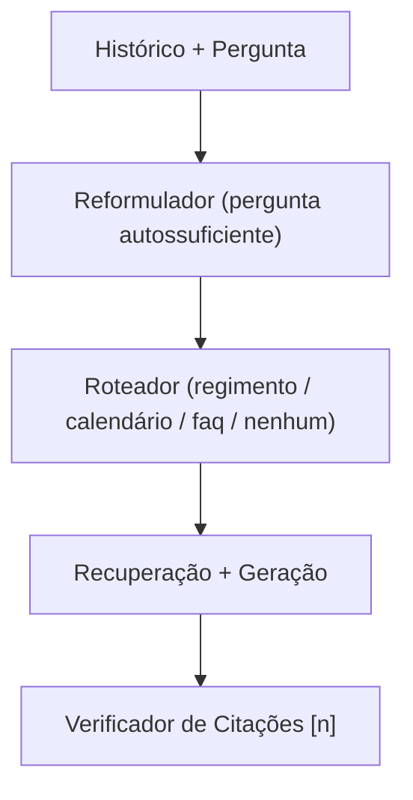

## Passo 1 · Leitura · Perguntas de acompanhamento, múltiplas fontes e citações auditáveis

Em uma conversa real com o assistente da secretaria, o aluno raramente repete todo o contexto a cada turno. Depois de perguntar *"Qual é o prazo para trancamento na graduação?"*, a pergunta seguinte costuma ser apenas *"E no semestre seguinte?"* ou *"E para a pós-graduação?"*. Se enviarmos *"E no semestre seguinte?"* diretamente ao índice vetorial ou ao BM25, a busca falhará porque a palavra-chave **trancamento** desapareceu!



Para tornar o RAG robusto em diálogos e bases heterogêneas, adicionamos quatro camadas ao redor do núcleo de busca e geração:

1. **Reformulação com histórico (*query rewriting*):** antes de buscar, combinamos as últimas interações do histórico com a nova mensagem para produzir uma pergunta autossuficiente (ex.: `"E para a pós-graduação?"` $\rightarrow$ `"Qual o prazo de trancamento para a pós-graduação?"`). Se o histórico estiver vazio, economizamos a chamada e mantemos a pergunta original.
2. **Decomposição de perguntas compostas (*sub-queries*):** perguntas que pedem duas coisas distintas ou comparam duas regras (*"Qual o prazo de trancamento e como pedir histórico escolar?"*) são decompostas em subconsultas independentes para que cada regra tenha seu próprio top-$k$.
3. **Roteamento entre índices:** em vez de jogar datas letivas, artigos formais do regimento e dúvidas operacionais num único índice gigante, um classificador leve encaminha a consulta para o índice certo (`"regimento"`, `"calendario"`, `"faq"`) — ou para `"nenhum"` quando o assunto foge do escopo da secretaria.
4. **Verificação pós-geração de citações:** o modelo pode escrever `[1]` ao final de uma frase mesmo quando o trecho `1` trata de outro assunto, ou citar `[5]` quando só enviamos `3` trechos. Uma etapa determinística pós-geração inspeciona cada `[n]` na resposta e confere se $1 \le n \le |\text{trechos}|$ e se os termos-chave da afirmação realmente constam no trecho $n$.

## Passo 2 · Exercício · Reformulação com histórico e decomposição

Implemente `reformular(cliente, historico, pergunta)` e `decompor(cliente, pergunta)` para transformar entradas elípticas ou compostas em consultas prontas para o índice.

### Instruções

1. Em `reformular(cliente, historico, pergunta)`:
   - Se `historico` estiver vazio (`not historico`), retorne `pergunta.strip()` diretamente **sem** chamar o `cliente`.
   - Caso contrário, passe apenas as **últimas 2 interações** (`historico[-2:]`) e a `pergunta` para `cliente.reescrever(historico[-2:], pergunta)` e retorne o texto limpo com `.strip()`.
2. Em `decompor(cliente, pergunta)`:
   - Se a `pergunta` em minúsculas contiver `" e "` ou `" compare "`, chame `partes = cliente.dividir(pergunta)` e retorne a lista contendo apenas as partes não vazias (`[p.strip() for p in partes if p and p.strip()]`).
   - Caso contrário (pergunta simples), retorne `[pergunta.strip()]` sem chamar `cliente.dividir`.

### Código inicial

```python
import re


class ClienteConsultaSimulado:
    def __init__(self):
        self.chamadas_reescrever = 0
        self.chamadas_dividir = 0

    def reescrever(self, historico_recente, pergunta):
        self.chamadas_reescrever += 1
        ultimo_turno = historico_recente[-1]["pergunta"]
        palavras_chave = [
            p for p in re.findall(r"[a-z0-9]{5,}", ultimo_turno.lower())
            if p not in {"como", "quando", "quais", "sobre", "posso", "fazer", "prazo"}
        ]
        topico = palavras_chave[0] if palavras_chave else "regimento"
        if topico not in pergunta.lower():
            return f"{pergunta.rstrip('?')} sobre {topico}?"
        return pergunta

    def dividir(self, pergunta):
        self.chamadas_dividir += 1
        partes = re.split(r"\s+e\s+|\s*compare\s*", pergunta, flags=re.IGNORECASE)
        return [p.strip(" ?") + "?" for p in partes if p.strip(" ?")]


def reformular(cliente, historico, pergunta):
    # Reescreva apenas quando houver histórico, limitando aos últimos 2 turnos
    pass


def decompor(cliente, pergunta):
    # Divida perguntas compostas (' e ' ou ' compare ') e preserve perguntas simples
    pass
```

### Solução

```python
import re


class ClienteConsultaSimulado:
    def __init__(self):
        self.chamadas_reescrever = 0
        self.chamadas_dividir = 0

    def reescrever(self, historico_recente, pergunta):
        self.chamadas_reescrever += 1
        ultimo_turno = historico_recente[-1]["pergunta"]
        palavras_chave = [
            p for p in re.findall(r"[a-z0-9]{5,}", ultimo_turno.lower())
            if p not in {"como", "quando", "quais", "sobre", "posso", "fazer", "prazo"}
        ]
        topico = palavras_chave[0] if palavras_chave else "regimento"
        if topico not in pergunta.lower():
            return f"{pergunta.rstrip('?')} sobre {topico}?"
        return pergunta

    def dividir(self, pergunta):
        self.chamadas_dividir += 1
        partes = re.split(r"\s+e\s+|\s*compare\s*", pergunta, flags=re.IGNORECASE)
        return [p.strip(" ?") + "?" for p in partes if p.strip(" ?")]


def reformular(cliente, historico, pergunta):
    if not historico:
        return pergunta.strip()
    return cliente.reescrever(historico[-2:], pergunta).strip()


def decompor(cliente, pergunta):
    texto_baixo = pergunta.lower()
    if " e " in texto_baixo or " compare " in texto_baixo:
        partes = cliente.dividir(pergunta)
        return [p.strip() for p in partes if p and p.strip()]
    return [pergunta.strip()]
```

### Dicas

1. Verifique `if not historico:` no início de `reformular` para evitar uma chamada desnecessária ao cliente no primeiro turno da conversa.
2. Em `decompor`, só chame `cliente.dividir(pergunta)` quando `" e "` ou `" compare "` aparecer em `pergunta.lower()`.

### Verificação

```json
[
  {
    "id": "reformular-com-e-sem-historico",
    "name": "Economiza chamada sem histórico e incorpora tópico quando há histórico",
    "checkpoint": 1,
    "kind": "expr",
    "setup": "c = ClienteConsultaSimulado(); r1 = reformular(c, [], 'Qual o prazo de trancamento?'); n1 = c.chamadas_reescrever; r2 = reformular(c, [{'pergunta': 'Qual o prazo de trancamento?', 'resposta': 'Quinze dias.'}], 'E no semestre seguinte?'); n2 = c.chamadas_reescrever",
    "expr": "[r1, n1, r2, n2]",
    "expected": [
      "Qual o prazo de trancamento?",
      0,
      "E no semestre seguinte sobre trancamento?",
      1
    ]
  },
  {
    "id": "decompor-composta-vs-simples",
    "name": "Decompõe perguntas compostas e mantém perguntas simples intactas",
    "checkpoint": 2,
    "kind": "expr",
    "setup": "c = ClienteConsultaSimulado(); d1 = decompor(c, 'Qual o prazo de trancamento?'); c1 = c.chamadas_dividir; d2 = decompor(c, 'Qual o prazo de trancamento e como emitir historico?'); c2 = c.chamadas_dividir",
    "expr": "[d1, c1, d2, c2]",
    "expected": [
      ["Qual o prazo de trancamento?"],
      0,
      ["Qual o prazo de trancamento?", "como emitir historico?"],
      1
    ]
  }
]
```

### Soluções erradas

```python name="Retorna a pergunta sem reformular mesmo quando há histórico"
def reformular(cliente, historico, pergunta):
    return pergunta.strip()


def decompor(cliente, pergunta):
    return [pergunta.strip()]
```

```python name="Chama dividir mesmo em perguntas simples e não filtra strings vazias"
def reformular(cliente, historico, pergunta):
    return cliente.reescrever(historico, pergunta)


def decompor(cliente, pergunta):
    return pergunta.split(" ")
```

## Passo 3 · Exercício · Roteamento entre índices especializados

Implemente `rotear_consulta(cliente, pergunta, indices_disponiveis)` para encaminhar cada consulta ao índice adequado ou devolver `"nenhum"` quando a pergunta estiver fora de escopo.

### Instruções

1. Chame `escolha = cliente.classificar_rota(pergunta).strip().lower()`.
2. Se `escolha` pertencer a `indices_disponiveis`, retorne `escolha`.
3. Caso contrário (inclusive quando o classificador devolver `"nenhum"` ou um nome inexistente em `indices_disponiveis`), retorne `"nenhum"`.

### Código inicial

```python
class RoteadorSimulado:
    def classificar_rota(self, pergunta):
        p = pergunta.lower()
        if any(k in p for k in ("data", "prazo", "quando", "calendario", "semestre")):
            return "calendario"
        if any(k in p for k in ("artigo", "regimento", "jubilamento", "recurso", "norma")):
            return "regimento"
        if any(k in p for k in ("como", "sistema", "senha", "atestado", "carteira")):
            return "faq"
        return "nenhum"


def rotear_consulta(cliente, pergunta, indices_disponiveis):
    # Classifique a rota e valide contra indices_disponiveis
    pass
```

### Solução

```python
class RoteadorSimulado:
    def classificar_rota(self, pergunta):
        p = pergunta.lower()
        if any(k in p for k in ("data", "prazo", "quando", "calendario", "semestre")):
            return "calendario"
        if any(k in p for k in ("artigo", "regimento", "jubilamento", "recurso", "norma")):
            return "regimento"
        if any(k in p for k in ("como", "sistema", "senha", "atestado", "carteira")):
            return "faq"
        return "nenhum"


def rotear_consulta(cliente, pergunta, indices_disponiveis):
    escolha = cliente.classificar_rota(pergunta).strip().lower()
    if escolha in indices_disponiveis:
        return escolha
    return "nenhum"
```

### Dicas

1. Normalize a resposta do cliente com `.strip().lower()`.
2. Verifique `if escolha in indices_disponiveis:` antes de retornar; se não estiver presente, devolva `"nenhum"`.

### Verificação

```json
[
  {
    "id": "roteamento-quatro-casos",
    "name": "Encaminha para calendario, regimento, faq ou nenhum conforme escopo e índices",
    "checkpoint": 3,
    "kind": "expr",
    "setup": "rot = RoteadorSimulado(); disp = ['calendario', 'regimento', 'faq']",
    "expr": "[rotear_consulta(rot, 'Qual a data limite do semestre?', disp), rotear_consulta(rot, 'O que diz o regimento sobre jubilamento?', disp), rotear_consulta(rot, 'Como emitir atestado no sistema?', disp), rotear_consulta(rot, 'Qual a previsao de chuva hoje?', disp), rotear_consulta(rot, 'Como emitir atestado no sistema?', ['regimento'])]",
    "expected": [
      "calendario",
      "regimento",
      "faq",
      "nenhum",
      "nenhum"
    ]
  }
]
```

### Soluções erradas

```python name="Devolve sempre o primeiro índice disponível mesmo para perguntas fora de escopo"
def rotear_consulta(cliente, pergunta, indices_disponiveis):
    return indices_disponiveis[0] if indices_disponiveis else "nenhum"
```

```python name="Retorna a rota do classificador sem validar se ela consta em indices_disponiveis"
def rotear_consulta(cliente, pergunta, indices_disponiveis):
    return cliente.classificar_rota(pergunta).strip().lower()
```

## Passo 4 · Exercício · Verificação de citações e RAG conversacional

Por fim, vamos auditar todas as citações `[n]` presentes em uma resposta e integrar reformulação, busca e auditoria na função `rag_conversacional`.

### Instruções

1. Implemente `verificar_citacoes(resposta, trechos)`:
   - Divida a `resposta` em segmentos usando `re.findall(r"([^.\n]+?)\[(\d+)\]", resposta)` para capturar cada par `(afirmacao, numero_str)`.
   - Para cada par, converta `n = int(numero_str)`. Uma citação `n` é **inválida** se:
     - `n < 1` ou `n > len(trechos)`; ou
     - Nenhuma palavra de tamanho $\ge 4$ (`re.findall(r"[a-z0-9]{4,}", afirmacao.lower())`) aparece no conjunto de palavras de tamanho $\ge 4$ de `trechos[n - 1]["texto"].lower()`.
   - Devolva a lista ordenada de inteiros únicos `n` que foram considerados inválidos (`sorted(set(invalidas))`).
2. Implemente `rag_conversacional(sistema_rag, cliente_consulta, historico, pergunta)`:
   - Reformule a pergunta: se `historico` não estiver vazio, use `pergunta_busca = cliente_consulta.reescrever(historico[-2:], pergunta).strip()`; caso contrário, `pergunta_busca = pergunta.strip()`.
   - Consulte `saida = sistema_rag.responder(pergunta_busca)`.
   - Verifique as citações com `invalidas = verificar_citacoes(saida["resposta"], saida["trechos"])`.
   - Adicione um novo turno `{"pergunta": pergunta_busca, "resposta": saida["resposta"]}` ao `historico` (mantendo no máximo os últimos `5` turnos na lista retornada ou mutada).
   - Devolva `{"pergunta_busca": pergunta_busca, "resposta": saida["resposta"], "citacoes_invalidas": invalidas, "historico_tamanho": len(historico[-5:])}`.

### Código inicial

```python
import re


def verificar_citacoes(resposta, trechos):
    # Devolva a lista ordenada de números de citação [n] inválidos ou sem apoio no trecho n
    pass


def rag_conversacional(sistema_rag, cliente_consulta, historico, pergunta):
    # Reformule com histórico, consulte o RAG, audite citações e atualize o histórico
    pass
```

### Solução

```python
import re


def verificar_citacoes(resposta, trechos):
    invalidas = set()
    pares = re.findall(r"([^.\n]+?)\[(\d+)\]", resposta)
    for afirmacao, num_str in pares:
        n = int(num_str)
        if n < 1 or n > len(trechos):
            invalidas.add(n)
            continue
        palavras_afirm = set(re.findall(r"[a-z0-9]{4,}", afirmacao.lower()))
        palavras_trecho = set(re.findall(r"[a-z0-9]{4,}", trechos[n - 1]["texto"].lower()))
        if not (palavras_afirm & palavras_trecho):
            invalidas.add(n)
    return sorted(invalidas)


def rag_conversacional(sistema_rag, cliente_consulta, historico, pergunta):
    if historico:
        pergunta_busca = cliente_consulta.reescrever(historico[-2:], pergunta).strip()
    else:
        pergunta_busca = pergunta.strip()
    saida = sistema_rag.responder(pergunta_busca)
    invalidas = verificar_citacoes(saida["resposta"], saida["trechos"])
    historico.append({"pergunta": pergunta_busca, "resposta": saida["resposta"]})
    if len(historico) > 5:
        del historico[:-5]
    return {
        "pergunta_busca": pergunta_busca,
        "resposta": saida["resposta"],
        "citacoes_invalidas": invalidas,
        "historico_tamanho": len(historico),
    }
```

### Dicas

1. Em `verificar_citacoes`, lembre-se de que a citação `[1]` corresponde ao índice `0` da lista `trechos` (`trechos[n - 1]`).
2. Verifique primeiro se `n < 1 or n > len(trechos)` antes de indexar `trechos[n - 1]` para não levantar `IndexError`.
3. Em `rag_conversacional`, após fazer `historico.append(...)`, mantenha apenas os últimos 5 turnos se `len(historico) > 5`.

### Verificação

```json
[
  {
    "id": "citacoes-validas-e-invalidas",
    "name": "Detecta citação fora do intervalo [5] e citação apontando para trecho sem apoio [2]",
    "checkpoint": 1,
    "kind": "call",
    "function": "verificar_citacoes",
    "args": [
      "O trancamento exige matricula ativa [1]. O restaurante abre ao meio dia [2]. Prazo extra [5].",
      [
        {
          "fonte": "Art. 12",
          "texto": "O trancamento de semestre exige matricula ativa."
        },
        {
          "fonte": "Art. 30",
          "texto": "A frequencia minima obrigatoria e de setenta por cento."
        }
      ]
    ],
    "expected": [2, 5]
  },
  {
    "id": "conversa-multi-turno",
    "name": "Reformula pergunta com histórico, audita citações e atualiza memória de curto prazo",
    "checkpoint": 2,
    "kind": "expr",
    "setup": "hist = [{'pergunta': 'Qual o prazo de trancamento?', 'resposta': 'Quinze dias [1].'}]; cli = type('Cli', (), {'reescrever': lambda self, h, p: 'Qual o prazo de trancamento na pos-graduacao?'})(); rag = type('Rag', (), {'responder': lambda self, q: {'resposta': 'Na pos-graduacao o trancamento ocorre em trinta dias [1].', 'trechos': [{'fonte': 'Art. 20', 'texto': 'Na pos-graduacao o trancamento ocorre em trinta dias.'}]}})()",
    "expr": "rag_conversacional(rag, cli, hist, 'E na pos-graduacao?')",
    "expected": {
      "pergunta_busca": "Qual o prazo de trancamento na pos-graduacao?",
      "resposta": "Na pos-graduacao o trancamento ocorre em trinta dias [1].",
      "citacoes_invalidas": [],
      "historico_tamanho": 2
    }
  }
]
```

### Soluções erradas

```python name="Aceita qualquer citação dentro do intervalo 1..len(trechos) sem conferir o texto do trecho"
import re


def verificar_citacoes(resposta, trechos):
    invalidas = set()
    for _, num_str in re.findall(r"([^.\n]+?)\[(\d+)\]", resposta):
        n = int(num_str)
        if n < 1 or n > len(trechos):
            invalidas.add(n)
    return sorted(invalidas)


def rag_conversacional(sistema_rag, cliente_consulta, historico, pergunta):
    saida = sistema_rag.responder(pergunta)
    return {
        "pergunta_busca": pergunta,
        "resposta": saida["resposta"],
        "citacoes_invalidas": [],
        "historico_tamanho": len(historico),
    }
```

```python name="Não reformula a pergunta com o histórico antes de consultar o RAG"
import re


def verificar_citacoes(resposta, trechos):
    invalidas = set()
    for afirmacao, num_str in re.findall(r"([^.\n]+?)\[(\d+)\]", resposta):
        n = int(num_str)
        if n < 1 or n > len(trechos):
            invalidas.add(n)
            continue
        p1 = set(re.findall(r"[a-z0-9]{4,}", afirmacao.lower()))
        p2 = set(re.findall(r"[a-z0-9]{4,}", trechos[n - 1]["texto"].lower()))
        if not (p1 & p2):
            invalidas.add(n)
    return sorted(invalidas)


def rag_conversacional(sistema_rag, cliente_consulta, historico, pergunta):
    saida = sistema_rag.responder(pergunta)
    historico.append({"pergunta": pergunta, "resposta": saida["resposta"]})
    return {
        "pergunta_busca": pergunta,
        "resposta": saida["resposta"],
        "citacoes_invalidas": verificar_citacoes(saida["resposta"], saida["trechos"]),
        "historico_tamanho": len(historico),
    }
```

## Passo 5 · Quiz · RAG conversacional e verificação de citações

### Pergunta

Por que uma pergunta de acompanhamento como *"E para alunos de pós-graduação?"* deve ser reformulada com base no histórico antes de consultar o índice de documentos?

- [ ] Para traduzir a pergunta para inglês antes de calcular o embedding.
- [x] Porque a pergunta isolada omite o tópico discutido no turno anterior (como trancamento ou matrícula), fazendo com que a busca vetorial ou lexical recupere trechos genéricos.
- [ ] Porque índices vetoriais não aceitam frases com menos de dez palavras.
- [ ] Para apagar o histórico de conversa a cada pergunta.

> Sem recompor o referente omitido pelo pronome ou elipse, o índice busca apenas por *"pós-graduação"* sem saber qual regra está sendo consultada.

### Pergunta

Por que um roteador de consultas em um sistema RAG deve sempre incluir uma opção de saída como `"nenhum"` (fora de escopo)?

- [ ] Para duplicar o número de chamadas ao banco vetorial.
- [x] Para evitar consultar índices acadêmicos internos quando o usuário faz perguntas sem relação com o domínio (ex.: previsão do tempo ou receitas), permitindo resposta imediata de recusa.
- [ ] Porque o algoritmo BM25 exige um índice vazio para calibrar o IDF.
- [ ] Para substituir a necessidade de autenticação do usuário.

> Se o roteador for obrigado a escolher um índice mesmo para assuntos fora de escopo, o sistema gastará recursos buscando e aumentando a chance de respostas espúrias.

### Pergunta

Qual problema a verificação pós-geração de citações `[n]` resolve mesmo quando o modelo seguiu o formato e incluiu colchetes na resposta?

- [ ] Ela corrige erros de ortografia nos documentos originais do PDF.
- [x] Ela detecta citações para índices inexistentes (ex.: `[5]` quando só há 3 trechos) e citações falsas em que o trecho `[n]` não contém os fatos afirmados na sentença.
- [ ] Ela substitui a etapa de indexação vetorial.
- [ ] Ela reduz o tamanho dos vetores no índice HNSW.

> Modelos podem gerar `[1]` por imitação superficial do formato mesmo quando a afirmação não consta no trecho `1`; por isso a auditoria verifica se o conteúdo citado realmente apoia a frase.
