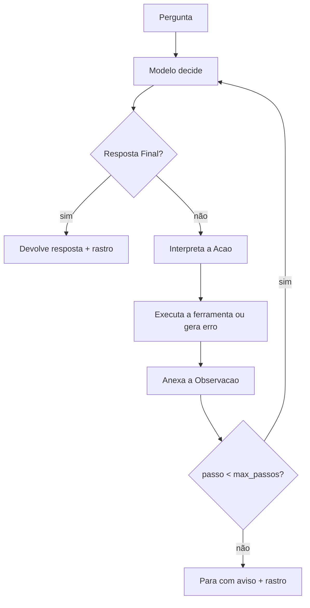

## Passo 1 · Leitura · Do ciclo de uma ferramenta ao agente

No módulo 1 você escreveu o ciclo de uma ferramenta: o modelo pede uma chamada, o seu código executa, o modelo responde. Uma rodada só. Muitas perguntas precisam de mais: "ainda dá para trancar `PRG101`?" exige consultar o prazo de trancamento no calendário, depois contar quantos dias faltam a partir de hoje, e só então responder. O segundo passo depende do resultado do primeiro, e quem decide qual é o próximo passo é o modelo.

Um **agente** é esse ciclo dentro de um laço: o modelo decide, o código age, o resultado volta como observação, e o modelo decide de novo, até dar a resposta. O padrão **ReAct** (*Reasoning + Acting*, Yao et al., 2022) organiza cada passo num protocolo de texto:

- `Pensamento:` o que o modelo já sabe e o que falta (opcional, ajuda a depurar);
- `Acao: nome({"arg": valor})` pede uma ferramenta, com os argumentos em JSON;
- `Observacao:` o resultado da ferramenta, **escrito pelo seu código**, nunca pelo modelo;
- `Resposta Final: texto` encerra.

As APIs com *function calling* fazem o mesmo laço com `tool_calls` estruturados no lugar do texto; o protocolo de texto deixa cada decisão visível e é o que este módulo usa.

O servidor do modelo não guarda estado (módulo 1). A cada passo o agente reenvia a conversa inteira: o `system` com o protocolo e as ferramentas, a pergunta, e um par por passo já dado, a saída do modelo como `assistant` e a observação como `user`. A conversa cresce a cada passo, e o custo também.



Duas regras valem para qualquer agente. Primeira: o laço tem **limite de passos** (`max_passos`), contado em chamadas ao modelo; um modelo pode repetir a mesma ação para sempre, e cada repetição custa uma chamada. Segunda: toda saída do laço, com resposta ou por limite, devolve também o **rastro**, a lista do que aconteceu em cada passo. Sem ele, quando a resposta vem errada, você só vê a resposta.

```python visualizar
from datetime import date


def calendario(evento):
    return {"trancamento": "2025-04-30", "matricula": "2025-02-14"}[evento]


def dias_entre(inicio, fim):
    return (date.fromisoformat(fim) - date.fromisoformat(inicio)).days


ferramentas = {"calendario": calendario, "dias_entre": dias_entre}

# o "modelo": decisões escritas à mão, uma por chamada
decisoes = [
    ("acao", "calendario", {"evento": "trancamento"}),
    ("acao", "dias_entre", {"inicio": "2025-04-10", "fim": "2025-04-30"}),
    ("resposta", "Faltam 20 dias para o fim do trancamento.", None),
]

conversa = ["system: protocolo + ferramentas", "user: quantos dias faltam? hoje é 2025-04-10"]
rastro = []
max_passos = 5
for passo in range(1, max_passos + 1):
    tipo, conteudo, args = decisoes[passo - 1]
    if tipo == "resposta":
        rastro.append({"passo": passo, "tipo": "resposta"})
        print("Resposta Final:", conteudo)
        break
    observacao = ferramentas[conteudo](**args)
    conversa.append(f"assistant: Acao: {conteudo}({args})")
    conversa.append(f"user: Observacao: {observacao}")
    rastro.append({"passo": passo, "ferramenta": conteudo, "observacao": observacao})
    print(passo, conteudo, "->", observacao, "| mensagens:", len(conversa))

print(rastro)
```

## Passo 2 · Previsão · Resposta no passo 2 ou parada por limite

A função `rodar` imita o laço de um agente. Quando o roteiro de saídas acaba, ela repete a última saída, como um modelo preso num loop. Leia sem executar e digite o que o programa imprime.

### Código
```python
def rodar(saidas, max_passos):
    rastro = []
    for passo in range(1, max_passos + 1):
        saida = saidas[min(passo, len(saidas)) - 1]
        if saida.startswith("Resposta Final:"):
            rastro.append((passo, "resposta"))
            return saida[len("Resposta Final:"):].strip(), rastro
        rastro.append((passo, saida.split(":", 1)[1].strip()))
    return "Limite de passos atingido.", rastro


print(rodar(["Acao: prazo", "Resposta Final: 30/04"], 3))
print(rodar(["Acao: prazo"], 3))
print(rodar(["Acao: prazo", "Acao: multa", "Resposta Final: sem multa"], 2))
```

### Dicas
1. `range(1, max_passos + 1)` dá exatamente `max_passos` voltas, e cada volta é uma chamada ao "modelo".
2. No segundo caso o roteiro tem uma saída só: `min(passo, len(saidas)) - 1` é sempre 0.
3. No terceiro, a resposta existe no roteiro, mas o limite chega antes dela.

### Saída esperada
```text
('30/04', [(1, 'prazo'), (2, 'resposta')])
('Limite de passos atingido.', [(1, 'prazo'), (2, 'prazo'), (3, 'prazo')])
('Limite de passos atingido.', [(1, 'prazo'), (2, 'multa')])
```

## Passo 3 · Exercício · Interpretar a saída do modelo
modo: lacunas

A saída do modelo é texto livre e pode vir de muitos jeitos. `interpretar_acao(texto)` transforma essa saída em um comando, ou devolve `None` quando não há comando válido:

- `{"tipo": "resposta", "conteudo": ...}` para `Resposta Final:` (o conteúdo vai até o fim do texto, sem espaços nas pontas; vazio é inválido);
- `{"tipo": "acao", "ferramenta": nome, "argumentos": dict}` para `Acao: nome(json)`; `nome()` sem argumentos vale `{}`;
- `None` para texto sem protocolo, JSON malformado ou JSON que não é objeto.

Duas regras pegam erros reais de modelos. Tudo a partir de `Observacao:` é descartado: se o modelo escreveu uma observação, ele a inventou, porque quem escreve observações é o código. E, se houver `Acao` e `Resposta Final`, vale a que aparece **primeiro**: um modelo que pede uma ação e já emenda a resposta respondeu sem ver o resultado.

Complete as lacunas (`___`).

### Instruções
1. Descarte tudo a partir da primeira `Observacao:`.
2. Reconheça `Resposta Final:` quando ela vem antes de qualquer `Acao`, e recuse a resposta vazia.
3. Reconheça `Acao: nome(json)`, inclusive `nome()`, com o JSON inteiro entre os parênteses.
4. Devolva `None` para JSON malformado ou que não seja um objeto, sem deixar a exceção escapar.

### Código inicial
```python
import json
import re

ACAO = re.compile(r"Acao:\s*([A-Za-z_]\w*)\((.*)\)")


def interpretar_acao(texto):
    corte = texto.find("Observacao:")
    if corte != -1:
        texto = texto[:___]
    m_acao = ACAO.search(texto)
    i_resp = texto.find("Resposta Final:")
    if i_resp != -1 and (m_acao is None or i_resp < ___):
        conteudo = texto[i_resp + len("Resposta Final:"):].strip()
        return {"tipo": "resposta", "conteudo": conteudo} if ___ else None
    if m_acao is None:
        return None
    bruto = m_acao.group(2).strip() or ___
    try:
        argumentos = json.loads(bruto)
    except ___:
        return None
    if not isinstance(argumentos, ___):
        return None
    return {"tipo": "acao", "ferramenta": m_acao.group(1), "argumentos": argumentos}
```

### Solução
```python
import json
import re

ACAO = re.compile(r"Acao:\s*([A-Za-z_]\w*)\((.*)\)")


def interpretar_acao(texto):
    corte = texto.find("Observacao:")
    if corte != -1:
        texto = texto[:corte]
    m_acao = ACAO.search(texto)
    i_resp = texto.find("Resposta Final:")
    if i_resp != -1 and (m_acao is None or i_resp < m_acao.start()):
        conteudo = texto[i_resp + len("Resposta Final:"):].strip()
        return {"tipo": "resposta", "conteudo": conteudo} if conteudo else None
    if m_acao is None:
        return None
    bruto = m_acao.group(2).strip() or "{}"
    try:
        argumentos = json.loads(bruto)
    except json.JSONDecodeError:
        return None
    if not isinstance(argumentos, dict):
        return None
    return {"tipo": "acao", "ferramenta": m_acao.group(1), "argumentos": argumentos}
```

### Dicas
1. `m.start()` diz em que posição do texto o casamento da expressão regular começou; `str.find` devolve -1 quando não acha.
2. `json.loads("")` levanta erro: o caso `nome()` precisa de um texto JSON que represente um objeto vazio.
3. A regex é gulosa de propósito: `(.*)\)` vai até o último `)` da linha, então parênteses dentro de uma string do JSON não cortam os argumentos.

### Verificação
```json
[
  {"id": "acao-com-pensamento", "checkpoint": 3, "kind": "call", "function": "interpretar_acao", "args": ["Pensamento: preciso do prazo.\nAcao: consultar_calendario({\"evento\": \"trancamento\"})"], "expected": {"tipo": "acao", "ferramenta": "consultar_calendario", "argumentos": {"evento": "trancamento"}}, "name": "Extrai ferramenta e argumentos depois de um Pensamento"},
  {"id": "resposta", "checkpoint": 2, "kind": "call", "function": "interpretar_acao", "args": ["Pensamento: já tenho a data.\nResposta Final: O trancamento vai até 30/04."], "expected": {"tipo": "resposta", "conteudo": "O trancamento vai até 30/04."}, "name": "Extrai a Resposta Final"},
  {"id": "resposta-varias-linhas", "checkpoint": 2, "kind": "call", "function": "interpretar_acao", "args": ["Resposta Final: Prazo: 30/04.\nLeve o comprovante de matrícula."], "expected": {"tipo": "resposta", "conteudo": "Prazo: 30/04.\nLeve o comprovante de matrícula."}, "name": "A Resposta Final vai até o fim do texto, com todas as linhas"},
  {"id": "resposta-na-mesma-linha", "checkpoint": 2, "kind": "call", "function": "interpretar_acao", "args": ["Pensamento: já sei. Resposta Final: 30/04."], "expected": {"tipo": "resposta", "conteudo": "30/04."}, "name": "Resposta Final no meio da linha também vale"},
  {"id": "resposta-vazia", "checkpoint": 2, "kind": "call", "function": "interpretar_acao", "args": ["Resposta Final:   "], "expected": null, "name": "Resposta Final vazia é inválida"},
  {"id": "observacao-inventada", "checkpoint": 1, "kind": "call", "function": "interpretar_acao", "args": ["Acao: consultar_prazo({\"evento\": \"trancamento\"})\nObservacao: 30/04\nResposta Final: Você pode trancar até 30/04."], "expected": {"tipo": "acao", "ferramenta": "consultar_prazo", "argumentos": {"evento": "trancamento"}}, "name": "Ignora a observação inventada pelo modelo e o que vem depois dela", "hint": "Quem escreve observações é o código, não o modelo."},
  {"id": "acao-antes-da-resposta", "checkpoint": 2, "kind": "call", "function": "interpretar_acao", "args": ["Acao: consultar_prazo({\"evento\": \"trancamento\"})\nResposta Final: deve ser 30/04."], "expected": {"tipo": "acao", "ferramenta": "consultar_prazo", "argumentos": {"evento": "trancamento"}}, "name": "Com Acao antes da Resposta Final, vale a ação", "hint": "O modelo respondeu sem ver o resultado da ação que ele mesmo pediu."},
  {"id": "sem-argumentos", "checkpoint": 3, "kind": "call", "function": "interpretar_acao", "args": ["Acao: listar_feriados()"], "expected": {"tipo": "acao", "ferramenta": "listar_feriados", "argumentos": {}}, "name": "nome() sem argumentos vira um dicionário vazio"},
  {"id": "parenteses-no-json", "checkpoint": 3, "kind": "call", "function": "interpretar_acao", "args": ["Acao: buscar_turma({\"nome\": \"PRG101 (noturno)\"})"], "expected": {"tipo": "acao", "ferramenta": "buscar_turma", "argumentos": {"nome": "PRG101 (noturno)"}}, "name": "Parênteses dentro de uma string do JSON não cortam os argumentos"},
  {"id": "json-malformado", "checkpoint": 4, "kind": "call", "function": "interpretar_acao", "args": ["Acao: consultar_calendario({evento: 'trancamento'})"], "expected": null, "name": "JSON malformado devolve None, sem exceção"},
  {"id": "json-lista", "checkpoint": 4, "kind": "call", "function": "interpretar_acao", "args": ["Acao: consultar_calendario([\"trancamento\"])"], "expected": null, "name": "Argumentos que não são um objeto JSON devolvem None"},
  {"id": "texto-livre", "checkpoint": 1, "kind": "call", "function": "interpretar_acao", "args": ["Acho que o prazo de trancamento é 30/04."], "expected": null, "name": "Texto sem protocolo devolve None"}
]
```

### Soluções erradas
```python name="deixa o JSONDecodeError escapar"
import json
import re

ACAO = re.compile(r"Acao:\s*([A-Za-z_]\w*)\((.*)\)")


def interpretar_acao(texto):
    corte = texto.find("Observacao:")
    if corte != -1:
        texto = texto[:corte]
    m_acao = ACAO.search(texto)
    i_resp = texto.find("Resposta Final:")
    if i_resp != -1 and (m_acao is None or i_resp < m_acao.start()):
        conteudo = texto[i_resp + len("Resposta Final:"):].strip()
        return {"tipo": "resposta", "conteudo": conteudo} if conteudo else None
    if m_acao is None:
        return None
    argumentos = json.loads(m_acao.group(2).strip() or "{}")
    if not isinstance(argumentos, dict):
        return None
    return {"tipo": "acao", "ferramenta": m_acao.group(1), "argumentos": argumentos}
```
```python name="procura a Resposta Final primeiro, sem cortar a observação inventada"
import json
import re

ACAO = re.compile(r"Acao:\s*([A-Za-z_]\w*)\((.*)\)")


def interpretar_acao(texto):
    i_resp = texto.find("Resposta Final:")
    if i_resp != -1:
        conteudo = texto[i_resp + len("Resposta Final:"):].strip()
        return {"tipo": "resposta", "conteudo": conteudo} if conteudo else None
    m_acao = ACAO.search(texto)
    if m_acao is None:
        return None
    try:
        argumentos = json.loads(m_acao.group(2).strip() or "{}")
    except json.JSONDecodeError:
        return None
    if not isinstance(argumentos, dict):
        return None
    return {"tipo": "acao", "ferramenta": m_acao.group(1), "argumentos": argumentos}
```
```python name="aceita JSON que não é objeto"
import json
import re

ACAO = re.compile(r"Acao:\s*([A-Za-z_]\w*)\((.*)\)")


def interpretar_acao(texto):
    corte = texto.find("Observacao:")
    if corte != -1:
        texto = texto[:corte]
    m_acao = ACAO.search(texto)
    i_resp = texto.find("Resposta Final:")
    if i_resp != -1 and (m_acao is None or i_resp < m_acao.start()):
        conteudo = texto[i_resp + len("Resposta Final:"):].strip()
        return {"tipo": "resposta", "conteudo": conteudo} if conteudo else None
    if m_acao is None:
        return None
    try:
        argumentos = json.loads(m_acao.group(2).strip() or "{}")
    except json.JSONDecodeError:
        return None
    return {"tipo": "acao", "ferramenta": m_acao.group(1), "argumentos": argumentos}
```
```python name="regex não gulosa corta no primeiro parêntese"
import json
import re

ACAO = re.compile(r"Acao:\s*([A-Za-z_]\w*)\((.*?)\)")


def interpretar_acao(texto):
    corte = texto.find("Observacao:")
    if corte != -1:
        texto = texto[:corte]
    m_acao = ACAO.search(texto)
    i_resp = texto.find("Resposta Final:")
    if i_resp != -1 and (m_acao is None or i_resp < m_acao.start()):
        conteudo = texto[i_resp + len("Resposta Final:"):].strip()
        return {"tipo": "resposta", "conteudo": conteudo} if conteudo else None
    if m_acao is None:
        return None
    try:
        argumentos = json.loads(m_acao.group(2).strip() or "{}")
    except json.JSONDecodeError:
        return None
    if not isinstance(argumentos, dict):
        return None
    return {"tipo": "acao", "ferramenta": m_acao.group(1), "argumentos": argumentos}
```
```python name="não trata a ação sem argumentos"
import json
import re

ACAO = re.compile(r"Acao:\s*([A-Za-z_]\w*)\((.*)\)")


def interpretar_acao(texto):
    corte = texto.find("Observacao:")
    if corte != -1:
        texto = texto[:corte]
    m_acao = ACAO.search(texto)
    i_resp = texto.find("Resposta Final:")
    if i_resp != -1 and (m_acao is None or i_resp < m_acao.start()):
        conteudo = texto[i_resp + len("Resposta Final:"):].strip()
        return {"tipo": "resposta", "conteudo": conteudo} if conteudo else None
    if m_acao is None:
        return None
    try:
        argumentos = json.loads(m_acao.group(2).strip())
    except json.JSONDecodeError:
        return None
    if not isinstance(argumentos, dict):
        return None
    return {"tipo": "acao", "ferramenta": m_acao.group(1), "argumentos": argumentos}
```
```python name="aceita a Resposta Final vazia"
import json
import re

ACAO = re.compile(r"Acao:\s*([A-Za-z_]\w*)\((.*)\)")


def interpretar_acao(texto):
    corte = texto.find("Observacao:")
    if corte != -1:
        texto = texto[:corte]
    m_acao = ACAO.search(texto)
    i_resp = texto.find("Resposta Final:")
    if i_resp != -1 and (m_acao is None or i_resp < m_acao.start()):
        return {"tipo": "resposta", "conteudo": texto[i_resp + len("Resposta Final:"):].strip()}
    if m_acao is None:
        return None
    try:
        argumentos = json.loads(m_acao.group(2).strip() or "{}")
    except json.JSONDecodeError:
        return None
    if not isinstance(argumentos, dict):
        return None
    return {"tipo": "acao", "ferramenta": m_acao.group(1), "argumentos": argumentos}
```

## Passo 4 · Leitura · Onde o loop quebra, e o que o rastro mostra

Agentes falham de jeitos repetidos. Os mais comuns:

- **Formato inválido.** O modelo responde em prosa, ou escreve o JSON com aspas simples. O parser devolve `None` e o agente manda de volta uma observação de erro explicando o formato. Na maioria das vezes o modelo se corrige no passo seguinte.
- **Observação inventada.** O modelo continua escrevendo depois da `Acao` e inventa o resultado. As APIs aceitam *stop sequences* (`stop=["Observacao:"]`) para cortar a geração ali; o parser corta de novo, por garantia.
- **Resposta prematura.** O modelo responde sem consultar nada, ou emenda a resposta numa ação. No rastro aparece como resposta no passo 1, ou sem nenhuma ferramenta antes.
- **Ferramenta alucinada.** O modelo pede `cancelar_matricula` e ela não existe. Nunca procure o nome em `globals()`: responda que a ferramenta não existe e liste as disponíveis.
- **Ferramenta que lança exceção.** Um `KeyError` numa consulta não pode derrubar o agente. A exceção vira observação (`Erro: KeyError: 'PRG999'`), o modelo pode tentar outro argumento, e o evento fica no rastro para você corrigir a ferramenta depois. Capturar `Exception` aqui é deliberado: é a fronteira entre o modelo e o código.
- **Loop.** A mesma chamada, com os mesmos argumentos, várias vezes. O `max_passos` é a última defesa; o rastro permite detectar o loop antes.

O **rastro** guarda, por passo, o número do passo, a saída bruta do modelo, a ação, os argumentos e a observação. É ele que responde "por que o agente disse isso?": a resposta errada quase sempre vem de uma observação de erro ignorada, de um argumento errado ou de uma resposta que não se apoia em nenhuma observação.

#### O modelo dos exercícios

Para testar o laço sem modelo real, os exercícios usam `cliente_roteirizado(saidas)`, do arquivo `roteiro.py`: um dublê de teste montado sobre o `ClienteLLM` do curso. A chamada $n$ devolve a saída $n$ do roteiro e, quando o roteiro acaba, repete a última, como um modelo preso. `cliente.chamadas` conta as chamadas e `cliente.vistas` guarda uma cópia de cada conversa recebida. Depois de 50 chamadas ele levanta `RoteiroEsgotado`, para que um agente sem limite não trave o teste. Trocar o dublê por um cliente real não muda uma linha do agente.

## Passo 5 · Exercício · A classe Agente com rastro

Escreva `Agente(cliente, ferramentas, max_passos=5)`, em que `ferramentas` é um dicionário `{nome: função}`. O método `executar(pergunta)` roda o laço e devolve `(resposta, rastro)`.

A conversa começa com `{"role": "system", "content": montar_prompt(ferramentas)}` e `{"role": "user", "content": pergunta}`. A cada passo, o agente chama `cliente.completar(conversa)`, acrescenta a saída do modelo como `{"role": "assistant", "content": saida}` e a interpreta com `interpretar_acao` (as duas funções estão prontas em `protocolo.py`). Cada passo gera um evento no rastro com `"passo"` (de 1 em diante), `"saida"` (o texto do modelo) e `"tipo"`:

| Situação | `tipo` e campos extras | Observação devolvida ao modelo |
|---|---|---|
| Resposta final | `"resposta"`, `"conteudo"` | nenhuma: devolve `(conteudo, rastro)` |
| Ação executada | `"acao"`, `"ferramenta"`, `"argumentos"`, `"observacao"` | `str(resultado)` |
| Saída sem comando válido | `"erro"`, `"detalhe": "acao_invalida"`, `"observacao"` | `Erro: formato inválido. Use Acao: nome({...}) ou Resposta Final: texto.` |
| Ferramenta fora do dicionário | `"erro"`, `"detalhe": "ferramenta_desconhecida"`, `"ferramenta"`, `"argumentos"`, `"observacao"` | `Erro: ferramenta desconhecida '<nome>'. Disponíveis: <nomes em ordem alfabética, separados por vírgula e espaço>.` |
| A ferramenta levantou uma exceção | `"erro"`, `"detalhe": "falha_na_ferramenta"`, `"ferramenta"`, `"argumentos"`, `"observacao"` | `Erro: <NomeDaExcecao>: <mensagem>` |

Toda observação entra na conversa como `{"role": "user", "content": "Observacao: " + observacao}`. Depois de `max_passos` chamadas ao modelo sem resposta, `executar` devolve `("Limite de passos atingido.", rastro)`. `max_passos` menor que 1 levanta `ValueError` no construtor.

### Instruções
1. Monte a conversa inicial e, a cada passo, chame o cliente com a conversa e guarde a saída do modelo como mensagem `assistant`.
   Dica: o servidor do modelo não lembra de nada; tudo o que ele precisa ver está na lista que você manda.
2. Encerre com `(conteudo, rastro)` quando o modelo der a resposta final.
3. Execute a ação pedida com os argumentos nomeados, registre o evento e devolva o resultado ao modelo como observação.
4. Transforme formato inválido, ferramenta desconhecida e exceção da ferramenta em observações de erro, sem interromper o laço.
5. Pare depois de `max_passos` chamadas ao modelo e recuse `max_passos < 1`.

### Código inicial
```python
from protocolo import interpretar_acao, montar_prompt
from roteiro import cliente_roteirizado


class Agente:
    def __init__(self, cliente, ferramentas, max_passos=5):
        pass

    def executar(self, pergunta):
        pass
```
```python path=protocolo.py
import json
import re

ACAO = re.compile(r"Acao:\s*([A-Za-z_]\w*)\((.*)\)")

PROTOCOLO = (
    "Responda em uma linha, num destes formatos: "
    'Acao: nome({"arg": valor}) para usar uma ferramenta, '
    "ou Resposta Final: texto quando já tiver a resposta. "
    "Depois de cada Acao você recebe uma Observacao com o resultado."
)


def montar_prompt(ferramentas):
    nomes = ", ".join(sorted(ferramentas)) or "nenhuma"
    return f"{PROTOCOLO} Ferramentas: {nomes}."


def interpretar_acao(texto):
    corte = texto.find("Observacao:")
    if corte != -1:
        texto = texto[:corte]
    m_acao = ACAO.search(texto)
    i_resp = texto.find("Resposta Final:")
    if i_resp != -1 and (m_acao is None or i_resp < m_acao.start()):
        conteudo = texto[i_resp + len("Resposta Final:"):].strip()
        return {"tipo": "resposta", "conteudo": conteudo} if conteudo else None
    if m_acao is None:
        return None
    bruto = m_acao.group(2).strip() or "{}"
    try:
        argumentos = json.loads(bruto)
    except json.JSONDecodeError:
        return None
    if not isinstance(argumentos, dict):
        return None
    return {"tipo": "acao", "ferramenta": m_acao.group(1), "argumentos": argumentos}
```
```python path=roteiro.py
"""Dublê de teste: um "modelo" que segue um roteiro fixo, montado sobre o ClienteLLM.

Um modelo real decide o próximo passo lendo a conversa. Aqui a decisão já está
escrita: a chamada n devolve saidas[n - 1] e, quando o roteiro acaba, repete a
última saída (é o que um modelo preso num loop faz). Cada conversa recebida fica
copiada em cliente.vistas, para o teste conferir o que o agente mandou ao modelo.
Depois de limite_de_seguranca chamadas levanta RoteiroEsgotado: protege o teste
de um agente sem limite de passos. O contador cliente.chamadas é o do ClienteLLM.
"""
from llm_simulado import ClienteLLM


class RoteiroEsgotado(RuntimeError):
    pass


def cliente_roteirizado(saidas, limite_de_seguranca=50):
    vistas = []

    def decidir(mensagens):
        if len(vistas) >= limite_de_seguranca:
            raise RoteiroEsgotado("o agente não parou: chamadas demais ao modelo")
        vistas.append([dict(m) for m in mensagens])
        return saidas[min(len(vistas), len(saidas)) - 1]

    cliente = ClienteLLM(decidir)
    cliente.vistas = vistas
    return cliente
```
```python path=llm_simulado.py
"""Cliente de LLM simulado do curso: a interface de um SDK real, sem rede.

Aproximações declaradas (tudo reproduzível):
- tokens: brinquedo, cada palavra vira pedaços de até 4 caracteres;
  o tokenizador de um modelo real dá outros números;
- preços: fictícios, em R$ por milhão de tokens;
- latência: TTFT + ms por token de saída, somada a um relógio falso;
- sorteio: random.Random(seed); com temperature > 0 a resposta pode variar;
- falhas: fila programada (429, 503, "timeout", 400), consumida em ordem.
"""
import random

PRECO_ENTRADA = 2.0  # R$ por milhão de tokens de entrada (fictício)
PRECO_SAIDA = 8.0  # R$ por milhão de tokens de saída (fictício)
SOBRECARGA_POR_MENSAGEM = 4  # tokens de formatação de cada mensagem


class ErroDeTaxa(Exception):  # HTTP 429: transitório
    def __init__(self, mensagem="429 Too Many Requests", retry_after=None):
        super().__init__(mensagem)
        self.retry_after = retry_after  # espera sugerida pelo servidor, em s


class ErroDeServidor(Exception):  # HTTP 5xx: transitório
    pass


class ErroDeTimeout(Exception):  # resposta não chegou no prazo: transitório
    pass


class ErroDeRequisicao(Exception):  # HTTP 400/401: permanente, não repita
    pass


def tokenizar(texto):
    tokens = []
    for i, palavra in enumerate(texto.split()):
        pedacos = [palavra[j:j + 4] for j in range(0, len(palavra), 4)]
        if i > 0:
            pedacos[0] = " " + pedacos[0]
        tokens.extend(pedacos)
    return tokens


def contar_tokens(texto):
    return len(tokenizar(texto))


class Resposta:
    def __init__(self, conteudo, finish_reason, prompt_tokens, completion_tokens,
                 latencia_ms=0, tool_calls=None):
        self.conteudo = conteudo
        self.finish_reason = finish_reason  # "stop", "length" ou "tool_calls"
        self.usage = {"prompt_tokens": prompt_tokens,
                      "completion_tokens": completion_tokens,
                      "total_tokens": prompt_tokens + completion_tokens}
        self.latencia_ms = latencia_ms
        self.tool_calls = tool_calls or []


class Relogio:  # relógio falso: só anda quando alguém manda
    def __init__(self):
        self.agora_ms = 0

    def avancar(self, ms):
        self.agora_ms += ms


class ClienteLLM:
    """respostas: lista de textos candidatos, ou função(mensagens) que devolve
    um texto ou uma lista de tool_calls."""

    def __init__(self, respostas, seed=None, falhas=(), relogio=None,
                 ttft_ms=300, ms_por_token=20):
        self.respostas = respostas
        self.rng = random.Random(seed)
        self.falhas = list(falhas)
        self.relogio = relogio or Relogio()
        self.ttft_ms = ttft_ms
        self.ms_por_token = ms_por_token
        self.chamadas = 0

    def _preparar(self, mensagens, temperature):
        self.chamadas += 1
        falha = self.falhas.pop(0) if self.falhas else None
        if falha == 429:
            raise ErroDeTaxa(retry_after=2.0)
        if falha == 503:
            raise ErroDeServidor("503 Service Unavailable")
        if falha == "timeout":
            self.relogio.avancar(10_000)
            raise ErroDeTimeout("sem resposta em 10 s")
        if falha == 400:
            raise ErroDeRequisicao("400 Bad Request")
        if callable(self.respostas):
            return self.respostas(mensagens)
        if temperature == 0:
            return self.respostas[0]  # num servidor real, nem isso é garantido
        return self.rng.choice(self.respostas)

    def completar(self, mensagens, max_tokens=256, temperature=1.0):
        gerado = self._preparar(mensagens, temperature)
        entrada = sum(contar_tokens(m["content"]) + SOBRECARGA_POR_MENSAGEM
                      for m in mensagens)
        if isinstance(gerado, list):  # o modelo pediu ferramentas
            self.relogio.avancar(self.ttft_ms)
            return Resposta("", "tool_calls", entrada, 10, self.ttft_ms, gerado)
        tokens, motivo = tokenizar(gerado), "stop"
        if len(tokens) > max_tokens:
            tokens, motivo = tokens[:max_tokens], "length"
        latencia = self.ttft_ms + len(tokens) * self.ms_por_token
        self.relogio.avancar(latencia)
        return Resposta("".join(tokens), motivo, entrada, len(tokens), latencia)

    def completar_stream(self, mensagens, max_tokens=256, temperature=1.0, cair_apos=None):
        """Gera eventos {"delta": texto}; o último traz "finish_reason".
        cair_apos=n: a conexão cai depois de n tokens, sem o evento final."""
        tokens, motivo = tokenizar(self._preparar(mensagens, temperature)), "stop"
        if len(tokens) > max_tokens:
            tokens, motivo = tokens[:max_tokens], "length"
        self.relogio.avancar(self.ttft_ms)
        for i, token in enumerate(tokens):
            if i == cair_apos:
                return
            self.relogio.avancar(self.ms_por_token)
            yield {"delta": token}
        yield {"delta": "", "finish_reason": motivo}
```

### Solução
```python
from protocolo import interpretar_acao, montar_prompt
from roteiro import cliente_roteirizado

ERRO_DE_FORMATO = "Erro: formato inválido. Use Acao: nome({...}) ou Resposta Final: texto."


class Agente:
    def __init__(self, cliente, ferramentas, max_passos=5):
        if max_passos < 1:
            raise ValueError("max_passos precisa ser pelo menos 1")
        self.cliente = cliente
        self.ferramentas = dict(ferramentas)
        self.max_passos = max_passos

    def executar(self, pergunta):
        conversa = [
            {"role": "system", "content": montar_prompt(self.ferramentas)},
            {"role": "user", "content": pergunta},
        ]
        rastro = []
        for passo in range(1, self.max_passos + 1):
            saida = self.cliente.completar(conversa).conteudo
            conversa.append({"role": "assistant", "content": saida})
            cmd = interpretar_acao(saida)
            evento = {"passo": passo, "saida": saida}
            if cmd is None:
                evento.update(tipo="erro", detalhe="acao_invalida")
                observacao = ERRO_DE_FORMATO
            elif cmd["tipo"] == "resposta":
                evento.update(tipo="resposta", conteudo=cmd["conteudo"])
                rastro.append(evento)
                return cmd["conteudo"], rastro
            else:
                nome, args = cmd["ferramenta"], cmd["argumentos"]
                evento.update(ferramenta=nome, argumentos=args)
                if nome not in self.ferramentas:
                    disponiveis = ", ".join(sorted(self.ferramentas)) or "nenhuma"
                    evento.update(tipo="erro", detalhe="ferramenta_desconhecida")
                    observacao = f"Erro: ferramenta desconhecida '{nome}'. Disponíveis: {disponiveis}."
                else:
                    try:
                        observacao = str(self.ferramentas[nome](**args))
                        evento["tipo"] = "acao"
                    except Exception as erro:
                        evento.update(tipo="erro", detalhe="falha_na_ferramenta")
                        observacao = f"Erro: {type(erro).__name__}: {erro}"
            evento["observacao"] = observacao
            rastro.append(evento)
            conversa.append({"role": "user", "content": "Observacao: " + observacao})
        return "Limite de passos atingido.", rastro
```
```python path=protocolo.py
import json
import re

ACAO = re.compile(r"Acao:\s*([A-Za-z_]\w*)\((.*)\)")

PROTOCOLO = (
    "Responda em uma linha, num destes formatos: "
    'Acao: nome({"arg": valor}) para usar uma ferramenta, '
    "ou Resposta Final: texto quando já tiver a resposta. "
    "Depois de cada Acao você recebe uma Observacao com o resultado."
)


def montar_prompt(ferramentas):
    nomes = ", ".join(sorted(ferramentas)) or "nenhuma"
    return f"{PROTOCOLO} Ferramentas: {nomes}."


def interpretar_acao(texto):
    corte = texto.find("Observacao:")
    if corte != -1:
        texto = texto[:corte]
    m_acao = ACAO.search(texto)
    i_resp = texto.find("Resposta Final:")
    if i_resp != -1 and (m_acao is None or i_resp < m_acao.start()):
        conteudo = texto[i_resp + len("Resposta Final:"):].strip()
        return {"tipo": "resposta", "conteudo": conteudo} if conteudo else None
    if m_acao is None:
        return None
    bruto = m_acao.group(2).strip() or "{}"
    try:
        argumentos = json.loads(bruto)
    except json.JSONDecodeError:
        return None
    if not isinstance(argumentos, dict):
        return None
    return {"tipo": "acao", "ferramenta": m_acao.group(1), "argumentos": argumentos}
```
```python path=roteiro.py
"""Dublê de teste: um "modelo" que segue um roteiro fixo, montado sobre o ClienteLLM.

Um modelo real decide o próximo passo lendo a conversa. Aqui a decisão já está
escrita: a chamada n devolve saidas[n - 1] e, quando o roteiro acaba, repete a
última saída (é o que um modelo preso num loop faz). Cada conversa recebida fica
copiada em cliente.vistas, para o teste conferir o que o agente mandou ao modelo.
Depois de limite_de_seguranca chamadas levanta RoteiroEsgotado: protege o teste
de um agente sem limite de passos. O contador cliente.chamadas é o do ClienteLLM.
"""
from llm_simulado import ClienteLLM


class RoteiroEsgotado(RuntimeError):
    pass


def cliente_roteirizado(saidas, limite_de_seguranca=50):
    vistas = []

    def decidir(mensagens):
        if len(vistas) >= limite_de_seguranca:
            raise RoteiroEsgotado("o agente não parou: chamadas demais ao modelo")
        vistas.append([dict(m) for m in mensagens])
        return saidas[min(len(vistas), len(saidas)) - 1]

    cliente = ClienteLLM(decidir)
    cliente.vistas = vistas
    return cliente
```
```python path=llm_simulado.py
"""Cliente de LLM simulado do curso: a interface de um SDK real, sem rede.

Aproximações declaradas (tudo reproduzível):
- tokens: brinquedo, cada palavra vira pedaços de até 4 caracteres;
  o tokenizador de um modelo real dá outros números;
- preços: fictícios, em R$ por milhão de tokens;
- latência: TTFT + ms por token de saída, somada a um relógio falso;
- sorteio: random.Random(seed); com temperature > 0 a resposta pode variar;
- falhas: fila programada (429, 503, "timeout", 400), consumida em ordem.
"""
import random

PRECO_ENTRADA = 2.0  # R$ por milhão de tokens de entrada (fictício)
PRECO_SAIDA = 8.0  # R$ por milhão de tokens de saída (fictício)
SOBRECARGA_POR_MENSAGEM = 4  # tokens de formatação de cada mensagem


class ErroDeTaxa(Exception):  # HTTP 429: transitório
    def __init__(self, mensagem="429 Too Many Requests", retry_after=None):
        super().__init__(mensagem)
        self.retry_after = retry_after  # espera sugerida pelo servidor, em s


class ErroDeServidor(Exception):  # HTTP 5xx: transitório
    pass


class ErroDeTimeout(Exception):  # resposta não chegou no prazo: transitório
    pass


class ErroDeRequisicao(Exception):  # HTTP 400/401: permanente, não repita
    pass


def tokenizar(texto):
    tokens = []
    for i, palavra in enumerate(texto.split()):
        pedacos = [palavra[j:j + 4] for j in range(0, len(palavra), 4)]
        if i > 0:
            pedacos[0] = " " + pedacos[0]
        tokens.extend(pedacos)
    return tokens


def contar_tokens(texto):
    return len(tokenizar(texto))


class Resposta:
    def __init__(self, conteudo, finish_reason, prompt_tokens, completion_tokens,
                 latencia_ms=0, tool_calls=None):
        self.conteudo = conteudo
        self.finish_reason = finish_reason  # "stop", "length" ou "tool_calls"
        self.usage = {"prompt_tokens": prompt_tokens,
                      "completion_tokens": completion_tokens,
                      "total_tokens": prompt_tokens + completion_tokens}
        self.latencia_ms = latencia_ms
        self.tool_calls = tool_calls or []


class Relogio:  # relógio falso: só anda quando alguém manda
    def __init__(self):
        self.agora_ms = 0

    def avancar(self, ms):
        self.agora_ms += ms


class ClienteLLM:
    """respostas: lista de textos candidatos, ou função(mensagens) que devolve
    um texto ou uma lista de tool_calls."""

    def __init__(self, respostas, seed=None, falhas=(), relogio=None,
                 ttft_ms=300, ms_por_token=20):
        self.respostas = respostas
        self.rng = random.Random(seed)
        self.falhas = list(falhas)
        self.relogio = relogio or Relogio()
        self.ttft_ms = ttft_ms
        self.ms_por_token = ms_por_token
        self.chamadas = 0

    def _preparar(self, mensagens, temperature):
        self.chamadas += 1
        falha = self.falhas.pop(0) if self.falhas else None
        if falha == 429:
            raise ErroDeTaxa(retry_after=2.0)
        if falha == 503:
            raise ErroDeServidor("503 Service Unavailable")
        if falha == "timeout":
            self.relogio.avancar(10_000)
            raise ErroDeTimeout("sem resposta em 10 s")
        if falha == 400:
            raise ErroDeRequisicao("400 Bad Request")
        if callable(self.respostas):
            return self.respostas(mensagens)
        if temperature == 0:
            return self.respostas[0]  # num servidor real, nem isso é garantido
        return self.rng.choice(self.respostas)

    def completar(self, mensagens, max_tokens=256, temperature=1.0):
        gerado = self._preparar(mensagens, temperature)
        entrada = sum(contar_tokens(m["content"]) + SOBRECARGA_POR_MENSAGEM
                      for m in mensagens)
        if isinstance(gerado, list):  # o modelo pediu ferramentas
            self.relogio.avancar(self.ttft_ms)
            return Resposta("", "tool_calls", entrada, 10, self.ttft_ms, gerado)
        tokens, motivo = tokenizar(gerado), "stop"
        if len(tokens) > max_tokens:
            tokens, motivo = tokens[:max_tokens], "length"
        latencia = self.ttft_ms + len(tokens) * self.ms_por_token
        self.relogio.avancar(latencia)
        return Resposta("".join(tokens), motivo, entrada, len(tokens), latencia)

    def completar_stream(self, mensagens, max_tokens=256, temperature=1.0, cair_apos=None):
        """Gera eventos {"delta": texto}; o último traz "finish_reason".
        cair_apos=n: a conexão cai depois de n tokens, sem o evento final."""
        tokens, motivo = tokenizar(self._preparar(mensagens, temperature)), "stop"
        if len(tokens) > max_tokens:
            tokens, motivo = tokens[:max_tokens], "length"
        self.relogio.avancar(self.ttft_ms)
        for i, token in enumerate(tokens):
            if i == cair_apos:
                return
            self.relogio.avancar(self.ms_por_token)
            yield {"delta": token}
        yield {"delta": "", "finish_reason": motivo}
```

### Dicas
1. Monte o evento com `"passo"` e `"saida"` assim que a saída chega e complete os outros campos conforme o caso; só a resposta final sai do laço antes de acrescentar a observação.
2. A ferramenta desconhecida precisa ser testada antes de chamar a função: se a chamada ficar dentro do `try`, o `KeyError` do dicionário vira "falha na ferramenta" e o modelo nunca fica sabendo quais ferramentas existem.
3. `type(erro).__name__` dá o nome da classe da exceção.

### Verificação
```json
[
  {"id": "duas-ferramentas", "checkpoint": 3, "kind": "expr", "setup": "cli = cliente_roteirizado(['Acao: fim_trancamento({\"semestre\": \"2025.1\"})', 'Acao: dias_entre({\"inicio\": \"2025-04-10\", \"fim\": \"2025-04-30\"})', 'Resposta Final: Faltam 20 dias.'])\nchamadas = []\ndef fim_trancamento(semestre):\n    chamadas.append(['fim_trancamento', semestre])\n    return '2025-04-30'\ndef dias_entre(inicio, fim):\n    chamadas.append(['dias_entre', inicio, fim])\n    return 20\nresp, rastro = Agente(cli, {'fim_trancamento': fim_trancamento, 'dias_entre': dias_entre}).executar('Quantos dias faltam para o fim do trancamento?')", "expr": "[resp, cli.chamadas, chamadas, [ev['tipo'] for ev in rastro], [ev['passo'] for ev in rastro]]", "expected": ["Faltam 20 dias.", 3, [["fim_trancamento", "2025.1"], ["dias_entre", "2025-04-10", "2025-04-30"]], ["acao", "acao", "resposta"], [1, 2, 3]], "name": "Encadeia duas ferramentas e devolve a resposta final no passo 3"},
  {"id": "conversa-enviada", "checkpoint": 1, "kind": "expr", "setup": "cli = cliente_roteirizado(['Acao: fim_trancamento({\"semestre\": \"2025.1\"})', 'Acao: dias_entre({\"inicio\": \"2025-04-10\", \"fim\": \"2025-04-30\"})', 'Resposta Final: Faltam 20 dias.'])\nchamadas = []\ndef fim_trancamento(semestre):\n    chamadas.append(['fim_trancamento', semestre])\n    return '2025-04-30'\ndef dias_entre(inicio, fim):\n    chamadas.append(['dias_entre', inicio, fim])\n    return 20\nresp, rastro = Agente(cli, {'fim_trancamento': fim_trancamento, 'dias_entre': dias_entre}).executar('Quantos dias faltam para o fim do trancamento?')", "expr": "[[m['role'] for m in cli.vistas[2]], cli.vistas[0][1], cli.vistas[2][2]['content'], cli.vistas[2][3]['content'], cli.vistas[2][5]['content']]", "expected": [["system", "user", "assistant", "user", "assistant", "user"], {"role": "user", "content": "Quantos dias faltam para o fim do trancamento?"}, "Acao: fim_trancamento({\"semestre\": \"2025.1\"})", "Observacao: 2025-04-30", "Observacao: 20"], "name": "Cada chamada leva a conversa inteira: saídas do modelo e observações, em ordem", "hint": "O modelo precisa ver o que ele mesmo pediu e o resultado de cada pedido."},
  {"id": "evento-de-acao", "checkpoint": 3, "kind": "expr", "setup": "cli = cliente_roteirizado(['Acao: fim_trancamento({\"semestre\": \"2025.1\"})', 'Acao: dias_entre({\"inicio\": \"2025-04-10\", \"fim\": \"2025-04-30\"})', 'Resposta Final: Faltam 20 dias.'])\nchamadas = []\ndef fim_trancamento(semestre):\n    chamadas.append(['fim_trancamento', semestre])\n    return '2025-04-30'\ndef dias_entre(inicio, fim):\n    chamadas.append(['dias_entre', inicio, fim])\n    return 20\nresp, rastro = Agente(cli, {'fim_trancamento': fim_trancamento, 'dias_entre': dias_entre}).executar('Quantos dias faltam para o fim do trancamento?')", "expr": "rastro[0]", "expected": {"passo": 1, "saida": "Acao: fim_trancamento({\"semestre\": \"2025.1\"})", "tipo": "acao", "ferramenta": "fim_trancamento", "argumentos": {"semestre": "2025.1"}, "observacao": "2025-04-30"}, "name": "O evento de ação guarda passo, saída bruta, ferramenta, argumentos e observação"},
  {"id": "resposta-direta", "checkpoint": 2, "kind": "expr", "setup": "usos = []\ncli = cliente_roteirizado(['Resposta Final: A secretaria abre às 9h.'])\nresp, rastro = Agente(cli, {'consultar': lambda **k: usos.append(k)}).executar('Que horas abre?')", "expr": "[resp, cli.chamadas, usos, rastro]", "expected": ["A secretaria abre às 9h.", 1, [], [{"passo": 1, "saida": "Resposta Final: A secretaria abre às 9h.", "tipo": "resposta", "conteudo": "A secretaria abre às 9h."}]], "name": "Resposta no primeiro passo: uma chamada ao modelo e nenhuma ferramenta"},
  {"id": "ferramenta-desconhecida", "checkpoint": 4, "kind": "expr", "setup": "cli = cliente_roteirizado(['Acao: cancelar_matricula({\"ra\": \"123\"})', 'Resposta Final: Não posso cancelar matrículas.'])\nresp, rastro = Agente(cli, {'consultar_prazo': lambda evento: '30/04', 'calendario': lambda: 'ok'}).executar('Cancele minha matrícula')", "expr": "[resp, rastro[0]['tipo'], rastro[0]['detalhe'], rastro[0]['ferramenta'], cli.vistas[1][-1]['content']]", "expected": ["Não posso cancelar matrículas.", "erro", "ferramenta_desconhecida", "cancelar_matricula", "Observacao: Erro: ferramenta desconhecida 'cancelar_matricula'. Disponíveis: calendario, consultar_prazo."], "name": "Ferramenta fora do dicionário vira observação de erro com as disponíveis", "hint": "Confira se o nome está no dicionário antes de tentar chamar."},
  {"id": "ferramenta-lanca", "checkpoint": 4, "kind": "expr", "setup": "def vagas(codigo):\n    return {'PRG101': 12}[codigo]\ncli = cliente_roteirizado(['Acao: vagas({\"codigo\": \"PRG999\"})', 'Acao: vagas({\"codigo\": \"PRG101\"})', 'Resposta Final: Restam 12 vagas.'])\nresp, rastro = Agente(cli, {'vagas': vagas}).executar('Há vagas?')", "expr": "[resp, [ev['tipo'] for ev in rastro], rastro[0]['detalhe'], cli.vistas[1][-1]['content'], cli.vistas[2][-1]['content']]", "expected": ["Restam 12 vagas.", ["erro", "acao", "resposta"], "falha_na_ferramenta", "Observacao: Erro: KeyError: 'PRG999'", "Observacao: 12"], "name": "Exceção da ferramenta vira observação e o agente continua", "hint": "Uma exceção dentro da ferramenta não pode encerrar o laço."},
  {"id": "argumento-errado", "checkpoint": 4, "kind": "expr", "setup": "cli = cliente_roteirizado(['Acao: vagas({\"disciplina\": \"PRG101\"})', 'Resposta Final: Não consegui consultar.'])\nresp, rastro = Agente(cli, {'vagas': lambda codigo: 12}).executar('Há vagas?')", "expr": "[resp, rastro[0]['detalhe'], cli.vistas[1][-1]['content'].startswith('Observacao: Erro: TypeError: ')]", "expected": ["Não consegui consultar.", "falha_na_ferramenta", true], "name": "Argumento com nome errado (TypeError) também vira observação de erro"},
  {"id": "formato-invalido", "checkpoint": 4, "kind": "expr", "setup": "cli = cliente_roteirizado(['Vou olhar o calendário.', 'Resposta Final: Até 30/04.'])\nresp, rastro = Agente(cli, {}).executar('Até quando posso trancar?')", "expr": "[resp, rastro[0]['tipo'], rastro[0]['detalhe'], cli.vistas[1][-1]['content'], cli.chamadas]", "expected": ["Até 30/04.", "erro", "acao_invalida", "Observacao: Erro: formato inválido. Use Acao: nome({...}) ou Resposta Final: texto.", 2], "name": "Saída sem protocolo vira observação de erro e o modelo tem outra chance"},
  {"id": "limite-em-loop", "checkpoint": 5, "kind": "expr", "setup": "usos = []\ncli = cliente_roteirizado(['Acao: consultar_prazo({\"evento\": \"trancamento\"})'])\nresp, rastro = Agente(cli, {'consultar_prazo': lambda evento: usos.append(evento) or '30/04'}, max_passos=3).executar('Prazo?')", "expr": "[resp, cli.chamadas, len(usos), [ev['passo'] for ev in rastro]]", "expected": ["Limite de passos atingido.", 3, 3, [1, 2, 3]], "name": "Modelo em loop: para depois de max_passos chamadas ao modelo", "hint": "max_passos conta chamadas ao modelo, nem uma a mais, nem uma a menos."},
  {"id": "limite-um", "checkpoint": 5, "kind": "expr", "setup": "cli = cliente_roteirizado(['Acao: consultar_prazo({})', 'Resposta Final: tarde demais'])\nresp, rastro = Agente(cli, {'consultar_prazo': lambda: '30/04'}, max_passos=1).executar('Prazo?')", "expr": "[resp, cli.chamadas, len(rastro)]", "expected": ["Limite de passos atingido.", 1, 1], "name": "Com max_passos=1, uma única chamada ao modelo"},
  {"id": "limite-invalido", "checkpoint": 5, "kind": "expr", "expr": "Agente(cliente_roteirizado(['Resposta Final: x']), {}, max_passos=0)", "raises": "ValueError", "name": "max_passos menor que 1 é recusado no construtor"}
]
```

### Soluções erradas
```python name="laço sem limite de passos"
from protocolo import interpretar_acao, montar_prompt
from roteiro import cliente_roteirizado

ERRO_DE_FORMATO = "Erro: formato inválido. Use Acao: nome({...}) ou Resposta Final: texto."


class Agente:
    def __init__(self, cliente, ferramentas, max_passos=5):
        if max_passos < 1:
            raise ValueError("max_passos precisa ser pelo menos 1")
        self.cliente = cliente
        self.ferramentas = dict(ferramentas)
        self.max_passos = max_passos

    def executar(self, pergunta):
        conversa = [
            {"role": "system", "content": montar_prompt(self.ferramentas)},
            {"role": "user", "content": pergunta},
        ]
        rastro = []
        passo = 0
        while True:
            passo += 1
            saida = self.cliente.completar(conversa).conteudo
            conversa.append({"role": "assistant", "content": saida})
            cmd = interpretar_acao(saida)
            evento = {"passo": passo, "saida": saida}
            if cmd is None:
                evento.update(tipo="erro", detalhe="acao_invalida")
                observacao = ERRO_DE_FORMATO
            elif cmd["tipo"] == "resposta":
                evento.update(tipo="resposta", conteudo=cmd["conteudo"])
                rastro.append(evento)
                return cmd["conteudo"], rastro
            else:
                nome, args = cmd["ferramenta"], cmd["argumentos"]
                evento.update(ferramenta=nome, argumentos=args)
                if nome not in self.ferramentas:
                    disponiveis = ", ".join(sorted(self.ferramentas)) or "nenhuma"
                    evento.update(tipo="erro", detalhe="ferramenta_desconhecida")
                    observacao = f"Erro: ferramenta desconhecida '{nome}'. Disponíveis: {disponiveis}."
                else:
                    try:
                        observacao = str(self.ferramentas[nome](**args))
                        evento["tipo"] = "acao"
                    except Exception as erro:
                        evento.update(tipo="erro", detalhe="falha_na_ferramenta")
                        observacao = f"Erro: {type(erro).__name__}: {erro}"
            evento["observacao"] = observacao
            rastro.append(evento)
            conversa.append({"role": "user", "content": "Observacao: " + observacao})
```
```python name="para um passo antes do limite"
from protocolo import interpretar_acao, montar_prompt
from roteiro import cliente_roteirizado

ERRO_DE_FORMATO = "Erro: formato inválido. Use Acao: nome({...}) ou Resposta Final: texto."


class Agente:
    def __init__(self, cliente, ferramentas, max_passos=5):
        if max_passos < 1:
            raise ValueError("max_passos precisa ser pelo menos 1")
        self.cliente = cliente
        self.ferramentas = dict(ferramentas)
        self.max_passos = max_passos

    def executar(self, pergunta):
        conversa = [
            {"role": "system", "content": montar_prompt(self.ferramentas)},
            {"role": "user", "content": pergunta},
        ]
        rastro = []
        for passo in range(1, self.max_passos):
            saida = self.cliente.completar(conversa).conteudo
            conversa.append({"role": "assistant", "content": saida})
            cmd = interpretar_acao(saida)
            evento = {"passo": passo, "saida": saida}
            if cmd is None:
                evento.update(tipo="erro", detalhe="acao_invalida")
                observacao = ERRO_DE_FORMATO
            elif cmd["tipo"] == "resposta":
                evento.update(tipo="resposta", conteudo=cmd["conteudo"])
                rastro.append(evento)
                return cmd["conteudo"], rastro
            else:
                nome, args = cmd["ferramenta"], cmd["argumentos"]
                evento.update(ferramenta=nome, argumentos=args)
                if nome not in self.ferramentas:
                    disponiveis = ", ".join(sorted(self.ferramentas)) or "nenhuma"
                    evento.update(tipo="erro", detalhe="ferramenta_desconhecida")
                    observacao = f"Erro: ferramenta desconhecida '{nome}'. Disponíveis: {disponiveis}."
                else:
                    try:
                        observacao = str(self.ferramentas[nome](**args))
                        evento["tipo"] = "acao"
                    except Exception as erro:
                        evento.update(tipo="erro", detalhe="falha_na_ferramenta")
                        observacao = f"Erro: {type(erro).__name__}: {erro}"
            evento["observacao"] = observacao
            rastro.append(evento)
            conversa.append({"role": "user", "content": "Observacao: " + observacao})
        return "Limite de passos atingido.", rastro
```
```python name="exceção da ferramenta derruba o agente"
from protocolo import interpretar_acao, montar_prompt
from roteiro import cliente_roteirizado

ERRO_DE_FORMATO = "Erro: formato inválido. Use Acao: nome({...}) ou Resposta Final: texto."


class Agente:
    def __init__(self, cliente, ferramentas, max_passos=5):
        if max_passos < 1:
            raise ValueError("max_passos precisa ser pelo menos 1")
        self.cliente = cliente
        self.ferramentas = dict(ferramentas)
        self.max_passos = max_passos

    def executar(self, pergunta):
        conversa = [
            {"role": "system", "content": montar_prompt(self.ferramentas)},
            {"role": "user", "content": pergunta},
        ]
        rastro = []
        for passo in range(1, self.max_passos + 1):
            saida = self.cliente.completar(conversa).conteudo
            conversa.append({"role": "assistant", "content": saida})
            cmd = interpretar_acao(saida)
            evento = {"passo": passo, "saida": saida}
            if cmd is None:
                evento.update(tipo="erro", detalhe="acao_invalida")
                observacao = ERRO_DE_FORMATO
            elif cmd["tipo"] == "resposta":
                evento.update(tipo="resposta", conteudo=cmd["conteudo"])
                rastro.append(evento)
                return cmd["conteudo"], rastro
            else:
                nome, args = cmd["ferramenta"], cmd["argumentos"]
                evento.update(ferramenta=nome, argumentos=args)
                if nome not in self.ferramentas:
                    disponiveis = ", ".join(sorted(self.ferramentas)) or "nenhuma"
                    evento.update(tipo="erro", detalhe="ferramenta_desconhecida")
                    observacao = f"Erro: ferramenta desconhecida '{nome}'. Disponíveis: {disponiveis}."
                else:
                    observacao = str(self.ferramentas[nome](**args))
                    evento["tipo"] = "acao"
            evento["observacao"] = observacao
            rastro.append(evento)
            conversa.append({"role": "user", "content": "Observacao: " + observacao})
        return "Limite de passos atingido.", rastro
```
```python name="guarda a observação só no rastro"
from protocolo import interpretar_acao, montar_prompt
from roteiro import cliente_roteirizado

ERRO_DE_FORMATO = "Erro: formato inválido. Use Acao: nome({...}) ou Resposta Final: texto."


class Agente:
    def __init__(self, cliente, ferramentas, max_passos=5):
        if max_passos < 1:
            raise ValueError("max_passos precisa ser pelo menos 1")
        self.cliente = cliente
        self.ferramentas = dict(ferramentas)
        self.max_passos = max_passos

    def executar(self, pergunta):
        conversa = [
            {"role": "system", "content": montar_prompt(self.ferramentas)},
            {"role": "user", "content": pergunta},
        ]
        rastro = []
        for passo in range(1, self.max_passos + 1):
            saida = self.cliente.completar(conversa).conteudo
            conversa.append({"role": "assistant", "content": saida})
            cmd = interpretar_acao(saida)
            evento = {"passo": passo, "saida": saida}
            if cmd is None:
                evento.update(tipo="erro", detalhe="acao_invalida")
                observacao = ERRO_DE_FORMATO
            elif cmd["tipo"] == "resposta":
                evento.update(tipo="resposta", conteudo=cmd["conteudo"])
                rastro.append(evento)
                return cmd["conteudo"], rastro
            else:
                nome, args = cmd["ferramenta"], cmd["argumentos"]
                evento.update(ferramenta=nome, argumentos=args)
                if nome not in self.ferramentas:
                    disponiveis = ", ".join(sorted(self.ferramentas)) or "nenhuma"
                    evento.update(tipo="erro", detalhe="ferramenta_desconhecida")
                    observacao = f"Erro: ferramenta desconhecida '{nome}'. Disponíveis: {disponiveis}."
                else:
                    try:
                        observacao = str(self.ferramentas[nome](**args))
                        evento["tipo"] = "acao"
                    except Exception as erro:
                        evento.update(tipo="erro", detalhe="falha_na_ferramenta")
                        observacao = f"Erro: {type(erro).__name__}: {erro}"
            evento["observacao"] = observacao
            rastro.append(evento)
        return "Limite de passos atingido.", rastro
```
```python name="não devolve a saída do modelo na conversa"
from protocolo import interpretar_acao, montar_prompt
from roteiro import cliente_roteirizado

ERRO_DE_FORMATO = "Erro: formato inválido. Use Acao: nome({...}) ou Resposta Final: texto."


class Agente:
    def __init__(self, cliente, ferramentas, max_passos=5):
        if max_passos < 1:
            raise ValueError("max_passos precisa ser pelo menos 1")
        self.cliente = cliente
        self.ferramentas = dict(ferramentas)
        self.max_passos = max_passos

    def executar(self, pergunta):
        conversa = [
            {"role": "system", "content": montar_prompt(self.ferramentas)},
            {"role": "user", "content": pergunta},
        ]
        rastro = []
        for passo in range(1, self.max_passos + 1):
            saida = self.cliente.completar(conversa).conteudo
            cmd = interpretar_acao(saida)
            evento = {"passo": passo, "saida": saida}
            if cmd is None:
                evento.update(tipo="erro", detalhe="acao_invalida")
                observacao = ERRO_DE_FORMATO
            elif cmd["tipo"] == "resposta":
                evento.update(tipo="resposta", conteudo=cmd["conteudo"])
                rastro.append(evento)
                return cmd["conteudo"], rastro
            else:
                nome, args = cmd["ferramenta"], cmd["argumentos"]
                evento.update(ferramenta=nome, argumentos=args)
                if nome not in self.ferramentas:
                    disponiveis = ", ".join(sorted(self.ferramentas)) or "nenhuma"
                    evento.update(tipo="erro", detalhe="ferramenta_desconhecida")
                    observacao = f"Erro: ferramenta desconhecida '{nome}'. Disponíveis: {disponiveis}."
                else:
                    try:
                        observacao = str(self.ferramentas[nome](**args))
                        evento["tipo"] = "acao"
                    except Exception as erro:
                        evento.update(tipo="erro", detalhe="falha_na_ferramenta")
                        observacao = f"Erro: {type(erro).__name__}: {erro}"
            evento["observacao"] = observacao
            rastro.append(evento)
            conversa.append({"role": "user", "content": "Observacao: " + observacao})
        return "Limite de passos atingido.", rastro
```
```python name="ferramenta desconhecida cai no except genérico"
from protocolo import interpretar_acao, montar_prompt
from roteiro import cliente_roteirizado

ERRO_DE_FORMATO = "Erro: formato inválido. Use Acao: nome({...}) ou Resposta Final: texto."


class Agente:
    def __init__(self, cliente, ferramentas, max_passos=5):
        if max_passos < 1:
            raise ValueError("max_passos precisa ser pelo menos 1")
        self.cliente = cliente
        self.ferramentas = dict(ferramentas)
        self.max_passos = max_passos

    def executar(self, pergunta):
        conversa = [
            {"role": "system", "content": montar_prompt(self.ferramentas)},
            {"role": "user", "content": pergunta},
        ]
        rastro = []
        for passo in range(1, self.max_passos + 1):
            saida = self.cliente.completar(conversa).conteudo
            conversa.append({"role": "assistant", "content": saida})
            cmd = interpretar_acao(saida)
            evento = {"passo": passo, "saida": saida}
            if cmd is None:
                evento.update(tipo="erro", detalhe="acao_invalida")
                observacao = ERRO_DE_FORMATO
            elif cmd["tipo"] == "resposta":
                evento.update(tipo="resposta", conteudo=cmd["conteudo"])
                rastro.append(evento)
                return cmd["conteudo"], rastro
            else:
                nome, args = cmd["ferramenta"], cmd["argumentos"]
                evento.update(ferramenta=nome, argumentos=args)
                try:
                    observacao = str(self.ferramentas[nome](**args))
                    evento["tipo"] = "acao"
                except Exception as erro:
                    evento.update(tipo="erro", detalhe="falha_na_ferramenta")
                    observacao = f"Erro: {type(erro).__name__}: {erro}"
            evento["observacao"] = observacao
            rastro.append(evento)
            conversa.append({"role": "user", "content": "Observacao: " + observacao})
        return "Limite de passos atingido.", rastro
```
```python name="formato inválido encerra o agente"
from protocolo import interpretar_acao, montar_prompt
from roteiro import cliente_roteirizado


class Agente:
    def __init__(self, cliente, ferramentas, max_passos=5):
        if max_passos < 1:
            raise ValueError("max_passos precisa ser pelo menos 1")
        self.cliente = cliente
        self.ferramentas = dict(ferramentas)
        self.max_passos = max_passos

    def executar(self, pergunta):
        conversa = [
            {"role": "system", "content": montar_prompt(self.ferramentas)},
            {"role": "user", "content": pergunta},
        ]
        rastro = []
        for passo in range(1, self.max_passos + 1):
            saida = self.cliente.completar(conversa).conteudo
            conversa.append({"role": "assistant", "content": saida})
            cmd = interpretar_acao(saida)
            evento = {"passo": passo, "saida": saida}
            if cmd is None:
                evento.update(tipo="erro", detalhe="acao_invalida")
                rastro.append(evento)
                return "Não entendi a resposta do modelo.", rastro
            if cmd["tipo"] == "resposta":
                evento.update(tipo="resposta", conteudo=cmd["conteudo"])
                rastro.append(evento)
                return cmd["conteudo"], rastro
            nome, args = cmd["ferramenta"], cmd["argumentos"]
            evento.update(ferramenta=nome, argumentos=args)
            if nome not in self.ferramentas:
                disponiveis = ", ".join(sorted(self.ferramentas)) or "nenhuma"
                evento.update(tipo="erro", detalhe="ferramenta_desconhecida")
                observacao = f"Erro: ferramenta desconhecida '{nome}'. Disponíveis: {disponiveis}."
            else:
                try:
                    observacao = str(self.ferramentas[nome](**args))
                    evento["tipo"] = "acao"
                except Exception as erro:
                    evento.update(tipo="erro", detalhe="falha_na_ferramenta")
                    observacao = f"Erro: {type(erro).__name__}: {erro}"
            evento["observacao"] = observacao
            rastro.append(evento)
            conversa.append({"role": "user", "content": "Observacao: " + observacao})
        return "Limite de passos atingido.", rastro
```

## Passo 6 · Exercício · Ler o rastro: resumo e detecção de loop

Com o rastro do passo anterior, duas ferramentas de diagnóstico.

**`resumir_rastro(rastro)`** devolve `{"passos", "chamadas", "erros", "concluiu", "resposta"}`: o número de eventos; um dicionário `{ferramenta: quantas vezes o modelo a pediu}`, contando todo evento que tem a chave `"ferramenta"` (inclusive os de erro, porque o pedido aconteceu); um dicionário `{detalhe: quantos eventos de erro}`; se houve evento `"resposta"`; e o conteúdo dessa resposta, ou `None`.

**`detectar_loop(rastro, repeticoes=3)`** devolve o `"passo"` do evento em que a **mesma chamada**, mesma ferramenta e mesmos argumentos, atinge `repeticoes` ocorrências no rastro, ou `None` se isso não acontece. Conta todo evento com a chave `"ferramenta"`, de ação ou de erro: repetir uma chamada que falha é o loop mais comum. As ocorrências não precisam ser seguidas, porque um agente que alterna `A, B, A, B, A` também está preso. A mesma ferramenta com argumentos diferentes não é repetição, e a ordem das chaves do JSON não muda os argumentos.

### Instruções
1. `resumir_rastro` conta passos, pedidos por ferramenta (ação ou erro) e erros por detalhe.
2. `resumir_rastro` informa se o agente concluiu e qual foi a resposta.
3. `detectar_loop` compara ferramenta e argumentos, e argumentos iguais com chaves em outra ordem contam como a mesma chamada.
4. `detectar_loop` conta ocorrências não consecutivas, inclusive de chamadas que falharam, e devolve o número do passo, não a posição na lista.

### Código inicial
```python
def resumir_rastro(rastro):
    pass


def detectar_loop(rastro, repeticoes=3):
    pass
```

### Solução
```python
import json


def resumir_rastro(rastro):
    chamadas = {}
    erros = {}
    resposta = None
    for ev in rastro:
        if "ferramenta" in ev:
            chamadas[ev["ferramenta"]] = chamadas.get(ev["ferramenta"], 0) + 1
        if ev["tipo"] == "erro":
            erros[ev["detalhe"]] = erros.get(ev["detalhe"], 0) + 1
        if ev["tipo"] == "resposta":
            resposta = ev["conteudo"]
    return {"passos": len(rastro), "chamadas": chamadas, "erros": erros,
            "concluiu": resposta is not None, "resposta": resposta}


def detectar_loop(rastro, repeticoes=3):
    vistas = {}
    for ev in rastro:
        if "ferramenta" not in ev:
            continue
        chave = (ev["ferramenta"], json.dumps(ev.get("argumentos"), sort_keys=True))
        vistas[chave] = vistas.get(chave, 0) + 1
        if vistas[chave] >= repeticoes:
            return ev["passo"]
    return None
```

### Dicas
1. Um dicionário não pode ser chave de outro dicionário nem entrar num `set`. Para contar argumentos, construa uma chave canônica: um texto que seja igual para dicionários iguais.
2. "Mesmos argumentos" é igualdade de dicionário: `{"a": 1, "b": 2} == {"b": 2, "a": 1}` é `True`, mas os textos que os representam podem não ser.
3. Eventos de erro de formato não têm `"ferramenta"`, mas ocupam uma posição na lista: a posição e o número do passo nem sempre coincidem.

### Verificação
```json
[
  {"id": "resumo-misto", "checkpoint": 1, "kind": "call", "function": "resumir_rastro", "args": [[{"passo": 1, "tipo": "erro", "saida": "...", "detalhe": "acao_invalida", "observacao": "Erro: formato inválido."}, {"passo": 2, "tipo": "erro", "saida": "...", "detalhe": "falha_na_ferramenta", "ferramenta": "vagas", "argumentos": {"codigo": "PRG999"}, "observacao": "Erro: KeyError: 'PRG999'"}, {"passo": 3, "tipo": "acao", "saida": "...", "ferramenta": "vagas", "argumentos": {"codigo": "PRG101"}, "observacao": "12"}, {"passo": 4, "tipo": "erro", "saida": "...", "detalhe": "ferramenta_desconhecida", "ferramenta": "reservar_vaga", "argumentos": {"codigo": "PRG101"}, "observacao": "Erro: ferramenta desconhecida"}, {"passo": 5, "tipo": "acao", "saida": "...", "ferramenta": "calendario", "argumentos": {}, "observacao": "30/04"}, {"passo": 6, "tipo": "resposta", "saida": "...", "conteudo": "Restam 12 vagas até 30/04."}]], "expected": {"passos": 6, "chamadas": {"vagas": 2, "reservar_vaga": 1, "calendario": 1}, "erros": {"acao_invalida": 1, "falha_na_ferramenta": 1, "ferramenta_desconhecida": 1}, "concluiu": true, "resposta": "Restam 12 vagas até 30/04."}, "name": "Resumo de um rastro com erros, ações e resposta", "hint": "Pedidos que falharam também contam como pedidos daquela ferramenta."},
  {"id": "resumo-limite", "checkpoint": 2, "kind": "call", "function": "resumir_rastro", "args": [[{"passo": 1, "tipo": "acao", "saida": "...", "ferramenta": "calendario", "argumentos": {"evento": "trancamento"}, "observacao": "30/04"}, {"passo": 2, "tipo": "acao", "saida": "...", "ferramenta": "calendario", "argumentos": {"evento": "trancamento"}, "observacao": "30/04"}]], "expected": {"passos": 2, "chamadas": {"calendario": 2}, "erros": {}, "concluiu": false, "resposta": null}, "name": "Rastro que parou no limite: não concluiu e não tem resposta"},
  {"id": "resumo-vazio", "checkpoint": 2, "kind": "call", "function": "resumir_rastro", "args": [[]], "expected": {"passos": 0, "chamadas": {}, "erros": {}, "concluiu": false, "resposta": null}, "name": "Rastro vazio"},
  {"id": "args-diferentes", "checkpoint": 3, "kind": "call", "function": "detectar_loop", "args": [[{"passo": 1, "tipo": "acao", "ferramenta": "vagas", "argumentos": {"codigo": "PRG101"}}, {"passo": 2, "tipo": "acao", "ferramenta": "vagas", "argumentos": {"codigo": "EST202"}}, {"passo": 3, "tipo": "acao", "ferramenta": "vagas", "argumentos": {"codigo": "MAT301"}}], 3], "expected": null, "name": "Mesma ferramenta com argumentos diferentes não é loop"},
  {"id": "tres-seguidas", "checkpoint": 3, "kind": "expr", "setup": "r = [{'passo': i, 'tipo': 'acao', 'ferramenta': 'vagas', 'argumentos': {'codigo': 'PRG101'}} for i in (1, 2, 3, 4)]", "expr": "[detectar_loop(r), detectar_loop(r, 2), detectar_loop(r, 5)]", "expected": [3, 2, null], "name": "Mesma chamada repetida: passo em que atinge o número de repetições"},
  {"id": "ordem-das-chaves", "checkpoint": 3, "kind": "call", "function": "detectar_loop", "args": [[{"passo": 1, "tipo": "acao", "ferramenta": "buscar", "argumentos": {"curso": "BCC", "ano": 2025}}, {"passo": 2, "tipo": "acao", "ferramenta": "buscar", "argumentos": {"ano": 2025, "curso": "BCC"}}], 2], "expected": 2, "name": "Argumentos iguais com as chaves em outra ordem são a mesma chamada", "hint": "Dois dicionários iguais podem virar textos diferentes."},
  {"id": "alternando", "checkpoint": 4, "kind": "call", "function": "detectar_loop", "args": [[{"passo": 1, "tipo": "acao", "ferramenta": "vagas", "argumentos": {"codigo": "PRG101"}}, {"passo": 2, "tipo": "acao", "ferramenta": "calendario", "argumentos": {}}, {"passo": 3, "tipo": "acao", "ferramenta": "vagas", "argumentos": {"codigo": "PRG101"}}, {"passo": 4, "tipo": "acao", "ferramenta": "calendario", "argumentos": {}}, {"passo": 5, "tipo": "acao", "ferramenta": "vagas", "argumentos": {"codigo": "PRG101"}}], 3], "expected": 5, "name": "Agente alternando entre duas chamadas também está em loop"},
  {"id": "falhas-repetidas", "checkpoint": 4, "kind": "call", "function": "detectar_loop", "args": [[{"passo": 1, "tipo": "erro", "ferramenta": "vagas", "argumentos": {"disciplina": "PRG101"}, "detalhe": "falha_na_ferramenta"}, {"passo": 2, "tipo": "erro", "ferramenta": "vagas", "argumentos": {"disciplina": "PRG101"}, "detalhe": "falha_na_ferramenta"}, {"passo": 3, "tipo": "erro", "ferramenta": "vagas", "argumentos": {"disciplina": "PRG101"}, "detalhe": "falha_na_ferramenta"}], 3], "expected": 3, "name": "Repetir uma chamada que falha também é loop"},
  {"id": "passo-nao-posicao", "checkpoint": 4, "kind": "call", "function": "detectar_loop", "args": [[{"passo": 1, "tipo": "erro", "detalhe": "acao_invalida"}, {"passo": 2, "tipo": "acao", "ferramenta": "calendario", "argumentos": {}}, {"passo": 3, "tipo": "acao", "ferramenta": "calendario", "argumentos": {}}], 2], "expected": 3, "name": "Devolve o número do passo, não a posição na lista"},
  {"id": "abaixo-do-limite", "checkpoint": 3, "kind": "call", "function": "detectar_loop", "args": [[{"passo": 1, "tipo": "acao", "ferramenta": "calendario", "argumentos": {}}, {"passo": 2, "tipo": "acao", "ferramenta": "vagas", "argumentos": {"codigo": "PRG101"}}, {"passo": 3, "tipo": "acao", "ferramenta": "calendario", "argumentos": {}}], 3], "expected": null, "name": "Duas repetições com repeticoes=3 ainda não é loop"}
]
```

### Soluções erradas
```python name="compara só o nome da ferramenta"
import json


def resumir_rastro(rastro):
    chamadas = {}
    erros = {}
    resposta = None
    for ev in rastro:
        if "ferramenta" in ev:
            chamadas[ev["ferramenta"]] = chamadas.get(ev["ferramenta"], 0) + 1
        if ev["tipo"] == "erro":
            erros[ev["detalhe"]] = erros.get(ev["detalhe"], 0) + 1
        if ev["tipo"] == "resposta":
            resposta = ev["conteudo"]
    return {"passos": len(rastro), "chamadas": chamadas, "erros": erros,
            "concluiu": resposta is not None, "resposta": resposta}


def detectar_loop(rastro, repeticoes=3):
    vistas = {}
    for ev in rastro:
        if "ferramenta" not in ev:
            continue
        vistas[ev["ferramenta"]] = vistas.get(ev["ferramenta"], 0) + 1
        if vistas[ev["ferramenta"]] >= repeticoes:
            return ev["passo"]
    return None
```
```python name="só conta repetições seguidas"
import json


def resumir_rastro(rastro):
    chamadas = {}
    erros = {}
    resposta = None
    for ev in rastro:
        if "ferramenta" in ev:
            chamadas[ev["ferramenta"]] = chamadas.get(ev["ferramenta"], 0) + 1
        if ev["tipo"] == "erro":
            erros[ev["detalhe"]] = erros.get(ev["detalhe"], 0) + 1
        if ev["tipo"] == "resposta":
            resposta = ev["conteudo"]
    return {"passos": len(rastro), "chamadas": chamadas, "erros": erros,
            "concluiu": resposta is not None, "resposta": resposta}


def detectar_loop(rastro, repeticoes=3):
    anterior = None
    seguidas = 0
    for ev in rastro:
        if "ferramenta" not in ev:
            continue
        chave = (ev["ferramenta"], json.dumps(ev.get("argumentos"), sort_keys=True))
        seguidas = seguidas + 1 if chave == anterior else 1
        anterior = chave
        if seguidas >= repeticoes:
            return ev["passo"]
    return None
```
```python name="chave com json.dumps sem ordenar as chaves"
import json


def resumir_rastro(rastro):
    chamadas = {}
    erros = {}
    resposta = None
    for ev in rastro:
        if "ferramenta" in ev:
            chamadas[ev["ferramenta"]] = chamadas.get(ev["ferramenta"], 0) + 1
        if ev["tipo"] == "erro":
            erros[ev["detalhe"]] = erros.get(ev["detalhe"], 0) + 1
        if ev["tipo"] == "resposta":
            resposta = ev["conteudo"]
    return {"passos": len(rastro), "chamadas": chamadas, "erros": erros,
            "concluiu": resposta is not None, "resposta": resposta}


def detectar_loop(rastro, repeticoes=3):
    vistas = {}
    for ev in rastro:
        if "ferramenta" not in ev:
            continue
        chave = (ev["ferramenta"], json.dumps(ev.get("argumentos")))
        vistas[chave] = vistas.get(chave, 0) + 1
        if vistas[chave] >= repeticoes:
            return ev["passo"]
    return None
```
```python name="ignora as chamadas que falharam"
import json


def resumir_rastro(rastro):
    chamadas = {}
    erros = {}
    resposta = None
    for ev in rastro:
        if ev["tipo"] == "acao":
            chamadas[ev["ferramenta"]] = chamadas.get(ev["ferramenta"], 0) + 1
        if ev["tipo"] == "erro":
            erros[ev["detalhe"]] = erros.get(ev["detalhe"], 0) + 1
        if ev["tipo"] == "resposta":
            resposta = ev["conteudo"]
    return {"passos": len(rastro), "chamadas": chamadas, "erros": erros,
            "concluiu": resposta is not None, "resposta": resposta}


def detectar_loop(rastro, repeticoes=3):
    vistas = {}
    for ev in rastro:
        if ev["tipo"] != "acao":
            continue
        chave = (ev["ferramenta"], json.dumps(ev.get("argumentos"), sort_keys=True))
        vistas[chave] = vistas.get(chave, 0) + 1
        if vistas[chave] >= repeticoes:
            return ev["passo"]
    return None
```
```python name="devolve a posição na lista em vez do passo"
import json


def resumir_rastro(rastro):
    chamadas = {}
    erros = {}
    resposta = None
    for ev in rastro:
        if "ferramenta" in ev:
            chamadas[ev["ferramenta"]] = chamadas.get(ev["ferramenta"], 0) + 1
        if ev["tipo"] == "erro":
            erros[ev["detalhe"]] = erros.get(ev["detalhe"], 0) + 1
        if ev["tipo"] == "resposta":
            resposta = ev["conteudo"]
    return {"passos": len(rastro), "chamadas": chamadas, "erros": erros,
            "concluiu": resposta is not None, "resposta": resposta}


def detectar_loop(rastro, repeticoes=3):
    vistas = {}
    for i, ev in enumerate(rastro):
        if "ferramenta" not in ev:
            continue
        chave = (ev["ferramenta"], json.dumps(ev.get("argumentos"), sort_keys=True))
        vistas[chave] = vistas.get(chave, 0) + 1
        if vistas[chave] >= repeticoes:
            return i
    return None
```
```python name="concluiu pelo tipo do último evento"
import json


def resumir_rastro(rastro):
    chamadas = {}
    erros = {}
    for ev in rastro:
        if "ferramenta" in ev:
            chamadas[ev["ferramenta"]] = chamadas.get(ev["ferramenta"], 0) + 1
        if ev["tipo"] == "erro":
            erros[ev["detalhe"]] = erros.get(ev["detalhe"], 0) + 1
    ultimo = rastro[-1]
    concluiu = ultimo["tipo"] == "resposta"
    return {"passos": len(rastro), "chamadas": chamadas, "erros": erros,
            "concluiu": concluiu, "resposta": ultimo["conteudo"] if concluiu else None}


def detectar_loop(rastro, repeticoes=3):
    vistas = {}
    for ev in rastro:
        if "ferramenta" not in ev:
            continue
        chave = (ev["ferramenta"], json.dumps(ev.get("argumentos"), sort_keys=True))
        vistas[chave] = vistas.get(chave, 0) + 1
        if vistas[chave] >= repeticoes:
            return ev["passo"]
    return None
```

## Passo 7 · Quiz · O loop ReAct e suas falhas

### Pergunta
Uma única saída do modelo veio assim: `Acao: consultar_prazo({"evento": "trancamento"}) Observacao: o prazo é 30/04 Resposta Final: Você pode trancar até 30/04.` O que o agente deve fazer?
- [ ] Aceitar a resposta final, porque ela já está pronta e economiza uma chamada ao modelo.
- [x] Descartar tudo a partir de `Observacao:`, executar `consultar_prazo` e devolver o resultado real ao modelo no passo seguinte.
- [ ] Executar a ação e devolver ao usuário a resposta que o modelo já escreveu.
- [ ] Tratar a saída inteira como inválida e encerrar o agente com erro.
> A observação foi inventada: quem escreve observações é o código. A data "30/04" não veio de nenhuma ferramenta. O certo é cortar ali (as APIs fazem isso com `stop`), executar a ação e deixar o modelo responder com o dado real.

### Pergunta
Um aluno reclama de uma resposta errada. No rastro, os passos 2, 3 e 4 têm `buscar_disciplina({"disciplina": "PRG101"})` com a observação `Erro: TypeError: buscar_disciplina() got an unexpected keyword argument 'disciplina'`, e o passo 5 é uma resposta final. Qual é a correção mais provável?
- [ ] Aumentar `max_passos`, para o modelo ter mais tentativas.
- [ ] Baixar a temperatura, para o modelo errar menos.
- [x] Corrigir o contrato da ferramenta: o parâmetro tem outro nome na função, e a descrição dada ao modelo não deixa isso claro.
- [ ] Trocar o `except Exception` por `except TypeError`.
> O rastro mostra a mesma chamada falhando pelo mesmo motivo, e a resposta final não se apoia em nenhuma observação válida. Mais passos ou outra temperatura repetiriam o erro; o problema está na descrição da ferramenta, assunto da próxima lição.

### Pergunta
Um agente em produção usa `max_passos = 50` "para garantir que nada fique sem resposta". Uma pergunta ambígua faz o modelo alternar entre duas consultas até o limite. Qual configuração é melhor?
- [ ] Tirar o limite e confiar que o modelo sempre chega a uma `Resposta Final`.
- [ ] `max_passos = 1`, para nunca haver loop.
- [x] Um limite próximo do número de passos da tarefa legítima mais longa, a detecção de chamadas repetidas para parar antes, e uma mensagem honesta ao usuário quando o agente para.
- [ ] Manter 50 e repetir a execução inteira quando o limite for atingido.
> Cada passo é uma chamada ao modelo com a conversa inteira, que cresce: 50 passos de um loop custam caro e não produzem nada. Com `max_passos = 1` o agente não consegue encadear consultas. O limite é a última defesa; a detecção de loop corta antes.
