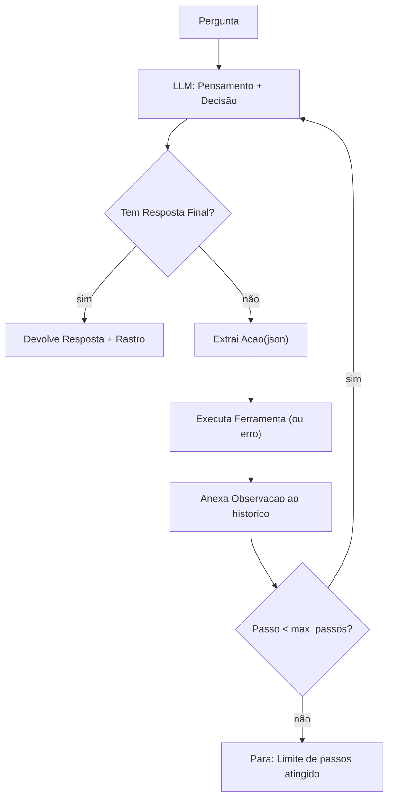

## Passo 1 · Leitura · Pensar, agir e observar em loop

No Módulo 1, vimos como o modelo pode sugerir uma única chamada de função. Mas muitas demandas da secretaria acadêmica exigem **múltiplos passos encadeados** onde o segundo passo depende do resultado do primeiro — por exemplo, consultar no calendário quando termina o período de matrícula e, com essa data em mãos, calcular quantos dias úteis restam para o protocolo de recurso.

O padrão **ReAct** (*Reasoning + Acting*) organiza esse ciclo em turnos de três partes:

- `Pensamento:` o modelo explicita o que já sabe e qual é o próximo passo;
- `Acao: nome_da_ferramenta({"arg": valor})` (ou `Resposta Final: <texto>` quando já tem tudo para responder);
- `Observacao:` o código da aplicação executa a ferramenta solicitada e devolve o resultado ao modelo para o turno seguinte.



Três regras de engenharia separam um agente de brinquedo de um agente seguro em produção:

1. **Limite rígido de passos (`max_passos`):** nunca use `while True`. Se o modelo entrar em loop chamando a mesma ferramenta repetidamente, o laço precisa encerrar após `max_passos` iterações.
2. **Erros devolvidos como `Observacao:`:** se o modelo pedir uma ferramenta que não existe ou gerar argumentos inválidos, não aborte o processo com exceção não tratada — devolva `"Observacao: Erro: ..."` para que o modelo possa corrigir a rota no passo seguinte, e contabilize o erro.
3. **Rastro completo (*trace*):** cada passo executado (ação, argumentos, observação ou erro) deve ser gravado em uma lista estruturada `rastro`, permitindo auditar por que o agente tomou cada decisão.

Veja no visualizador como o rastro acumula os passos de ação e observação até chegar à resposta final:

```python visualizar
ferramentas = {
    "fim_matricula": lambda semestre: "2025-03-10",
    "somar_dias": lambda data, dias: "2025-03-25",
}

roteiro_modelo = [
    ("acao", "fim_matricula", {"semestre": "2025.1"}),
    ("acao", "somar_dias", {"data": "2025-03-10", "dias": 15}),
    ("resposta", "O prazo final com recurso e 2025-03-25.", {}),
]

rastro = []
for passo, (tipo, nome_ou_texto, args) in enumerate(roteiro_modelo, start=1):
    if tipo == "acao":
        obs = ferramentas[nome_ou_texto](**args)
        rastro.append({"passo": passo, "ferramenta": nome_ou_texto, "observacao": obs})
    else:
        rastro.append({"passo": passo, "resposta": nome_ou_texto})
```

## Passo 2 · Previsão · Rastros e parada por limite de passos

Analise o código abaixo e determine o que será impresso quando o agente executa com `max_passos = 2` sobre uma fila de saídas que só teria resposta final no 3º passo.

### Código

```python
saidas = [
    "Acao: consultar_prazo",
    "Acao: calcular_multa",
    "Resposta Final: Sem multa.",
]

max_passos = 2
rastro = []
resposta = "Limite de passos atingido."

for passo in range(1, max_passos + 1):
    linha = saidas[passo - 1]
    if linha.startswith("Resposta Final:"):
        resposta = linha.split(":", 1)[1].strip()
        rastro.append(("resposta", passo))
        break
    acao = linha.split(":", 1)[1].strip()
    rastro.append(("acao", acao))

print("Resposta:", resposta)
print("Passos no rastro:", len(rastro))
print("Ultimo evento:", rastro[-1])
```

### Dicas

1. O laço `range(1, max_passos + 1)` executa apenas para `passo = 1` e `passo = 2`.
2. Como a `"Resposta Final:"` está no índice `2` (3º item), o laço termina sem atingi-la e mantém o valor padrão de `resposta`.

### Saída esperada

```text
Resposta: Limite de passos atingido.
Passos no rastro: 2
Ultimo evento: ('acao', 'calcular_multa')
```

## Passo 3 · Exercício · Interpretando a ação do modelo

modo: lacunas

Complete `interpretar_acao(texto)` para extrair com segurança uma resposta final (`Resposta Final: ...`) ou uma chamada de ferramenta (`Acao: nome({"chave": "valor"})`), devolvendo `None` sempre que o formato ou o JSON for inválido.

### Instruções

1. Se houver uma linha com `Resposta Final:`, devolva `{"tipo": "resposta", "conteudo": m_resp.group(1).strip()}`.
2. Se houver um padrão `Acao: <identificador>(<json>)`, faça `json.loads` do argumento dentro de um bloco `try/except json.JSONDecodeError`, verifique se o resultado é um `dict` e devolva `{"tipo": "acao", "ferramenta": nome, "argumentos": args}`. Caso contrário, devolva `None`.

### Código inicial

```python
import json
import re


def interpretar_acao(texto):
    m_resp = re.search(r"Resposta Final:\s*(.+)", texto, flags=re.DOTALL)
    if m_resp:
        return {"tipo": "___", "conteudo": m_resp.group(1).strip()}

    m_acao = re.search(r"Acao:\s*([a-zA-Z_][a-zA-Z0-9_]*)\((.*)\)", texto, flags=re.DOTALL)
    if not m_acao:
        return None
    nome = m_acao.group(1).strip()
    bruto = m_acao.group(2).strip()
    try:
        args = json.___(bruto)
    except json.JSONDecodeError:
        return ___
    if not isinstance(args, dict):
        return None
    return {"tipo": "acao", "ferramenta": nome, "argumentos": args}
```

### Solução

```python
import json
import re


def interpretar_acao(texto):
    m_resp = re.search(r"Resposta Final:\s*(.+)", texto, flags=re.DOTALL)
    if m_resp:
        return {"tipo": "resposta", "conteudo": m_resp.group(1).strip()}

    m_acao = re.search(r"Acao:\s*([a-zA-Z_][a-zA-Z0-9_]*)\((.*)\)", texto, flags=re.DOTALL)
    if not m_acao:
        return None
    nome = m_acao.group(1).strip()
    bruto = m_acao.group(2).strip()
    try:
        args = json.loads(bruto)
    except json.JSONDecodeError:
        return None
    if not isinstance(args, dict):
        return None
    return {"tipo": "acao", "ferramenta": nome, "argumentos": args}
```

### Dicas

1. Quando o texto contém `Resposta Final:`, o campo `"tipo"` deve ser `"resposta"`.
2. Para converter a string JSON em dicionário Python, use `json.loads(bruto)` e retorne `None` se ocorrer `json.JSONDecodeError`.

### Verificação

```json
[
  {
    "id": "parse-acao-valida",
    "name": "Extrai ferramenta e dicionário de argumentos de uma ação válida",
    "checkpoint": 2,
    "kind": "call",
    "function": "interpretar_acao",
    "args": [
      "Pensamento: Vou consultar o calendario.\nAcao: consultar_calendario({\"evento\": \"trancamento\"})"
    ],
    "expected": {
      "tipo": "acao",
      "ferramenta": "consultar_calendario",
      "argumentos": {
        "evento": "trancamento"
      }
    }
  },
  {
    "id": "parse-resposta-final",
    "name": "Extrai o conteúdo de uma Resposta Final",
    "checkpoint": 1,
    "kind": "call",
    "function": "interpretar_acao",
    "args": [
      "Pensamento: Ja tenho a data.\nResposta Final: O prazo termina em 15 de maio."
    ],
    "expected": {
      "tipo": "resposta",
      "conteudo": "O prazo termina em 15 de maio."
    }
  },
  {
    "id": "parse-json-quebrado",
    "name": "Devolve None quando o JSON dos argumentos está malformado",
    "checkpoint": 2,
    "kind": "call",
    "function": "interpretar_acao",
    "args": [
      "Acao: consultar_calendario({evento: sem_aspas})"
    ],
    "expected": null
  }
]
```

### Soluções erradas

```python name="Deixa json.loads levantar exceção quando o JSON é inválido"
import json
import re


def interpretar_acao(texto):
    m_resp = re.search(r"Resposta Final:\s*(.+)", texto, flags=re.DOTALL)
    if m_resp:
        return {"tipo": "resposta", "conteudo": m_resp.group(1).strip()}
    m_acao = re.search(r"Acao:\s*([a-zA-Z_][a-zA-Z0-9_]*)\((.*)\)", texto, flags=re.DOTALL)
    if not m_acao:
        return None
    return {
        "tipo": "acao",
        "ferramenta": m_acao.group(1).strip(),
        "argumentos": json.loads(m_acao.group(2).strip()),
    }
```

```python name="Rotula tanto resposta quanto ação com o mesmo tipo 'acao'"
import json
import re


def interpretar_acao(texto):
    m_resp = re.search(r"Resposta Final:\s*(.+)", texto, flags=re.DOTALL)
    if m_resp:
        return {"tipo": "acao", "conteudo": m_resp.group(1).strip()}
    return None
```

## Passo 4 · Exercício · A classe Agente ReAct com rastro

Implemente a classe `Agente(cliente, ferramentas, max_passos=5)` que executa o ciclo ReAct completo, tratando ações malformadas ou ferramentas inexistentes como observações de erro e respeitando `max_passos`.

### Instruções

1. No construtor `__init__(self, cliente, ferramentas, max_passos=5)`, guarde `self.cliente = cliente`, `self.ferramentas = dict(ferramentas)` e `self.max_passos = int(max_passos)`.
2. Em `executar(self, pergunta)`, inicialize `rastro = []` e `observacoes = []` e faça um laço `for passo in range(1, self.max_passos + 1):`:
   - Chame `saida = self.cliente.decidir(pergunta, observacoes)` e interprete com `cmd = interpretar_acao(saida)`.
   - Se `cmd is None`: adicione `{"passo": passo, "tipo": "erro", "detalhe": "acao_invalida"}` ao `rastro` e `"Observacao: Erro: acao invalida."` a `observacoes`.
   - Se `cmd["tipo"] == "resposta"`: adicione `{"passo": passo, "tipo": "resposta", "conteudo": cmd["conteudo"]}` ao `rastro` e retorne `(cmd["conteudo"], rastro)`.
   - Se `cmd["tipo"] == "acao"`:
     - Se `cmd["ferramenta"]` **não** estiver em `self.ferramentas`, adicione `{"passo": passo, "tipo": "erro", "ferramenta": cmd["ferramenta"], "detalhe": "ferramenta_desconhecida"}` ao `rastro` e `f"Observacao: Erro: ferramenta desconhecida '{cmd['ferramenta']}'."` a `observacoes`.
     - Se estiver em `self.ferramentas`, execute `obs = str(self.ferramentas[cmd["ferramenta"]](**cmd["argumentos"]))`, adicione `{"passo": passo, "tipo": "acao", "ferramenta": cmd["ferramenta"], "argumentos": cmd["argumentos"], "observacao": obs}` ao `rastro` e `f"Observacao: {obs}"` a `observacoes`.
3. Se o laço terminar sem uma `"resposta"`, retorne `("Limite de passos atingido.", rastro)`.

### Código inicial

```python
import json
import re


def interpretar_acao(texto):
    m_resp = re.search(r"Resposta Final:\s*(.+)", texto, flags=re.DOTALL)
    if m_resp:
        return {"tipo": "resposta", "conteudo": m_resp.group(1).strip()}
    m_acao = re.search(r"Acao:\s*([a-zA-Z_][a-zA-Z0-9_]*)\((.*)\)", texto, flags=re.DOTALL)
    if not m_acao:
        return None
    try:
        args = json.loads(m_acao.group(2).strip())
    except json.JSONDecodeError:
        return None
    if not isinstance(args, dict):
        return None
    return {"tipo": "acao", "ferramenta": m_acao.group(1).strip(), "argumentos": args}


class PlanejadorRoteirizado:
    def __init__(self, passos):
        self.passos = list(passos)
        self.indice = 0
        self.ultimo_historico = []

    def decidir(self, pergunta, observacoes):
        self.ultimo_historico = list(observacoes)
        if self.indice < len(self.passos):
            saida = self.passos[self.indice]
            self.indice += 1
            return saida
        return 'Acao: repetir({"tentativa": 1})'


class Agente:
    def __init__(self, cliente, ferramentas, max_passos=5):
        # Inicialize cliente, ferramentas e max_passos
        pass

    def executar(self, pergunta):
        # Execute o loop ReAct até max_passos e retorne (resposta, rastro)
        pass
```

### Solução

```python
import json
import re


def interpretar_acao(texto):
    m_resp = re.search(r"Resposta Final:\s*(.+)", texto, flags=re.DOTALL)
    if m_resp:
        return {"tipo": "resposta", "conteudo": m_resp.group(1).strip()}
    m_acao = re.search(r"Acao:\s*([a-zA-Z_][a-zA-Z0-9_]*)\((.*)\)", texto, flags=re.DOTALL)
    if not m_acao:
        return None
    try:
        args = json.loads(m_acao.group(2).strip())
    except json.JSONDecodeError:
        return None
    if not isinstance(args, dict):
        return None
    return {"tipo": "acao", "ferramenta": m_acao.group(1).strip(), "argumentos": args}


class PlanejadorRoteirizado:
    def __init__(self, passos):
        self.passos = list(passos)
        self.indice = 0
        self.ultimo_historico = []

    def decidir(self, pergunta, observacoes):
        self.ultimo_historico = list(observacoes)
        if self.indice < len(self.passos):
            saida = self.passos[self.indice]
            self.indice += 1
            return saida
        return 'Acao: repetir({"tentativa": 1})'


class Agente:
    def __init__(self, cliente, ferramentas, max_passos=5):
        self.cliente = cliente
        self.ferramentas = dict(ferramentas)
        self.max_passos = int(max_passos)

    def executar(self, pergunta):
        rastro = []
        observacoes = []
        for passo in range(1, self.max_passos + 1):
            saida = self.cliente.decidir(pergunta, observacoes)
            cmd = interpretar_acao(saida)
            if cmd is None:
                rastro.append({"passo": passo, "tipo": "erro", "detalhe": "acao_invalida"})
                observacoes.append("Observacao: Erro: acao invalida.")
                continue
            if cmd["tipo"] == "resposta":
                rastro.append({"passo": passo, "tipo": "resposta", "conteudo": cmd["conteudo"]})
                return cmd["conteudo"], rastro
            nome = cmd["ferramenta"]
            args = cmd["argumentos"]
            if nome not in self.ferramentas:
                rastro.append(
                    {
                        "passo": passo,
                        "tipo": "erro",
                        "ferramenta": nome,
                        "detalhe": "ferramenta_desconhecida",
                    }
                )
                observacoes.append(f"Observacao: Erro: ferramenta desconhecida '{nome}'.")
                continue
            obs = str(self.ferramentas[nome](**args))
            rastro.append(
                {
                    "passo": passo,
                    "tipo": "acao",
                    "ferramenta": nome,
                    "argumentos": args,
                    "observacao": obs,
                }
            )
            observacoes.append(f"Observacao: {obs}")
        return "Limite de passos atingido.", rastro
```

### Dicas

1. Não se esqueça de anexar `f"Observacao: {obs}"` à lista `observacoes` a cada passo para que o planejador receba o retorno da ferramenta no turno seguinte.
2. Trate `nome not in self.ferramentas` registrando um evento `"tipo": "erro"` no `rastro` em vez de levantar `KeyError`.

### Verificação

```json
[
  {
    "id": "agente-dois-passos",
    "name": "Executa duas ferramentas encadeadas e devolve a resposta final com rastro",
    "checkpoint": 2,
    "kind": "expr",
    "setup": "cli = PlanejadorRoteirizado(['Acao: buscar_data({\"evento\": \"trancamento\"})', 'Acao: somar_dias({\"data\": \"10/05\", \"dias\": 5})', 'Resposta Final: O prazo final e 15/05.']); ag = Agente(cli, {'buscar_data': lambda evento: '10/05', 'somar_dias': lambda data, dias: '15/05'}, max_passos=5); resp, rastro = ag.executar('Qual o prazo?')",
    "expr": "[resp, len(rastro), rastro[0]['observacao'], rastro[1]['observacao'], len(cli.ultimo_historico)]",
    "expected": [
      "O prazo final e 15/05.",
      3,
      "10/05",
      "15/05",
      2
    ]
  },
  {
    "id": "agente-recupera-de-erro-e-respeita-limite",
    "name": "Trata ferramenta desconhecida como observação de erro e respeita max_passos",
    "checkpoint": 3,
    "kind": "expr",
    "setup": "cli1 = PlanejadorRoteirizado(['Acao: inexistente({\"x\": 1})', 'Resposta Final: Corrigido.']); r1, tr1 = Agente(cli1, {}, max_passos=4).executar('oi'); cli2 = PlanejadorRoteirizado([]); r2, tr2 = Agente(cli2, {'repetir': lambda tentativa: 'ok'}, max_passos=3).executar('loop')",
    "expr": "[r1, tr1[0]['detalhe'], r2, len(tr2)]",
    "expected": [
      "Corrigido.",
      "ferramenta_desconhecida",
      "Limite de passos atingido.",
      3
    ]
  }
]
```

### Soluções erradas

```python name="Levanta KeyError ao tentar chamar uma ferramenta desconhecida"
class Agente:
    def __init__(self, cliente, ferramentas, max_passos=5):
        self.cliente = cliente
        self.ferramentas = dict(ferramentas)
        self.max_passos = int(max_passos)

    def executar(self, pergunta):
        rastro = []
        observacoes = []
        for passo in range(1, self.max_passos + 1):
            cmd = interpretar_acao(self.cliente.decidir(pergunta, observacoes))
            if cmd["tipo"] == "resposta":
                rastro.append({"passo": passo, "tipo": "resposta", "conteudo": cmd["conteudo"]})
                return cmd["conteudo"], rastro
            obs = str(self.ferramentas[cmd["ferramenta"]](**cmd["argumentos"]))
            rastro.append({"passo": passo, "tipo": "acao", "ferramenta": cmd["ferramenta"], "observacao": obs})
            observacoes.append(f"Observacao: {obs}")
        return "Limite de passos atingido.", rastro
```

```python name="Não repassa as observações acumuladas para o cliente nos passos seguintes"
class Agente:
    def __init__(self, cliente, ferramentas, max_passos=5):
        self.cliente = cliente
        self.ferramentas = dict(ferramentas)
        self.max_passos = int(max_passos)

    def executar(self, pergunta):
        rastro = []
        for passo in range(1, self.max_passos + 1):
            cmd = interpretar_acao(self.cliente.decidir(pergunta, []))
            if cmd is None:
                rastro.append({"passo": passo, "tipo": "erro", "detalhe": "acao_invalida"})
                continue
            if cmd["tipo"] == "resposta":
                rastro.append({"passo": passo, "tipo": "resposta", "conteudo": cmd["conteudo"]})
                return cmd["conteudo"], rastro
            nome = cmd["ferramenta"]
            if nome not in self.ferramentas:
                rastro.append({"passo": passo, "tipo": "erro", "ferramenta": nome, "detalhe": "ferramenta_desconhecida"})
                continue
            obs = str(self.ferramentas[nome](**cmd["argumentos"]))
            rastro.append({"passo": passo, "tipo": "acao", "ferramenta": nome, "argumentos": cmd["argumentos"], "observacao": obs})
        return "Limite de passos atingido.", rastro
```

## Passo 5 · Exercício · Resumo de rastro e detecção de loop

Com o rastro estruturado, podemos sintetizar métricas de cada execução e detectar quando o agente ficou preso repetindo exatamente a mesma chamada `(ferramenta, argumentos)`.

### Instruções

1. Implemente `resumir_rastro(rastro)` retornando:
   - `"passos"`: `len(rastro)`
   - `"ferramentas_usadas"`: lista com os nomes das ferramentas dos eventos em que `ev.get("tipo") == "acao"`, na ordem em que foram executadas
   - `"erros"`: quantidade de eventos em que `ev.get("tipo") == "erro"`
   - `"concluiu"`: `True` se houver algum evento com `ev.get("tipo") == "resposta"`, senão `False`.
2. Implemente `detectar_loop(rastro, repeticoes=2)`:
   - Percorra os eventos de `rastro` que possuem `ev.get("tipo") == "acao"`.
   - Considere que duas ações consecutivas são idênticas quando têm o mesmo par `(ev["ferramenta"], ev.get("argumentos"))`.
   - Devolva `True` se houver pelo menos `repeticoes` ações idênticas **consecutivas** (por exemplo, para `repeticoes=2`, a mesma ferramenta com os mesmos argumentos chamada 2 vezes seguidas), e `False` caso contrário.

### Código inicial

```python
def resumir_rastro(rastro):
    # Sintetize passos, ferramentas_usadas, erros e concluiu
    pass


def detectar_loop(rastro, repeticoes=2):
    # Retorne True se a mesma (ferramenta, argumentos) se repetir consecutivamente
    pass
```

### Solução

```python
def resumir_rastro(rastro):
    ferramentas = [ev["ferramenta"] for ev in rastro if ev.get("tipo") == "acao"]
    erros = sum(1 for ev in rastro if ev.get("tipo") == "erro")
    concluiu = any(ev.get("tipo") == "resposta" for ev in rastro)
    return {
        "passos": len(rastro),
        "ferramentas_usadas": ferramentas,
        "erros": int(erros),
        "concluiu": bool(concluiu),
    }


def detectar_loop(rastro, repeticoes=2):
    if repeticoes <= 1:
        return any(ev.get("tipo") == "acao" for ev in rastro)
    ultimo = None
    contagem = 0
    for ev in rastro:
        if ev.get("tipo") != "acao":
            continue
        atual = (ev.get("ferramenta"), ev.get("argumentos"))
        if atual == ultimo:
            contagem += 1
            if contagem >= repeticoes:
                return True
        else:
            ultimo = atual
            contagem = 1
    return False
```

### Dicas

1. Em `detectar_loop`, compare a tupla `(ev.get("ferramenta"), ev.get("argumentos"))`: chamar a mesma ferramenta com argumentos **diferentes** (ex.: consultar duas disciplinas distintas) não é loop!
2. Mantenha um contador `contagem` que reinicia em `1` quando a ação muda e incrementa `+1` quando `atual == ultimo`.

### Verificação

```json
[
  {
    "id": "resumo-rastro-completo",
    "name": "Resume passos, ferramentas usadas, erros e conclusão do rastro",
    "checkpoint": 1,
    "kind": "call",
    "function": "resumir_rastro",
    "args": [
      [
        {
          "passo": 1,
          "tipo": "erro",
          "detalhe": "acao_invalida"
        },
        {
          "passo": 2,
          "tipo": "acao",
          "ferramenta": "buscar_regra",
          "argumentos": {
            "artigo": 12
          },
          "observacao": "Prazo 15 dias"
        },
        {
          "passo": 3,
          "tipo": "resposta",
          "conteudo": "Prazo de 15 dias."
        }
      ]
    ],
    "expected": {
      "passos": 3,
      "ferramentas_usadas": [
        "buscar_regra"
      ],
      "erros": 1,
      "concluiu": true
    }
  },
  {
    "id": "loop-mesmos-argumentos-vs-diferentes",
    "name": "Distingue repetição idêntica de chamadas à mesma ferramenta com argumentos distintos",
    "checkpoint": 2,
    "kind": "expr",
    "expr": "[detectar_loop([{'tipo': 'acao', 'ferramenta': 'buscar', 'argumentos': {'q': 'a'}}, {'tipo': 'acao', 'ferramenta': 'buscar', 'argumentos': {'q': 'b'}}], 2), detectar_loop([{'tipo': 'acao', 'ferramenta': 'buscar', 'argumentos': {'q': 'a'}}, {'tipo': 'acao', 'ferramenta': 'buscar', 'argumentos': {'q': 'a'}}], 2)]",
    "expected": [
      false,
      true
    ]
  }
]
```

### Soluções erradas

```python name="Olha apenas o nome da ferramenta ignorando que os argumentos mudaram"
def resumir_rastro(rastro):
    return {
        "passos": len(rastro),
        "ferramentas_usadas": [ev["ferramenta"] for ev in rastro if ev.get("tipo") == "acao"],
        "erros": sum(1 for ev in rastro if ev.get("tipo") == "erro"),
        "concluiu": any(ev.get("tipo") == "resposta" for ev in rastro),
    }


def detectar_loop(rastro, repeticoes=2):
    nomes = [ev.get("ferramenta") for ev in rastro if ev.get("tipo") == "acao"]
    return len(nomes) >= repeticoes and len(set(nomes)) == 1
```

```python name="Considera concluiu=True mesmo quando o rastro terminou sem resposta final"
def resumir_rastro(rastro):
    return {
        "passos": len(rastro),
        "ferramentas_usadas": [ev["ferramenta"] for ev in rastro if ev.get("tipo") == "acao"],
        "erros": 0,
        "concluiu": True,
    }


def detectar_loop(rastro, repeticoes=2):
    return False
```

## Passo 6 · Quiz · O loop ReAct e suas falhas

### Pergunta

Qual é a função do bloco `Observacao:` no protocolo de um agente ReAct?

- [ ] Definir o preço por milhão de tokens do provedor.
- [x] Devolver ao modelo o resultado real da execução da ferramenta (ou a mensagem de erro), permitindo que ele decida o próximo passo com base nessa evidência.
- [ ] Substituir a pergunta original do usuário.
- [ ] Criptografar a resposta final antes de exibi-la.

> É a `Observacao:` anexada ao histórico que fecha o ciclo de feedback: o modelo lê o retorno da ferramenta e decide se precisa de outra ação ou se já pode emitir a `Resposta Final:`.

### Pergunta

O que o loop do agente deve fazer quando o modelo gera uma ação malformada ou pede uma ferramenta que não existe no catálogo?

- [ ] Executar `eval()` na string gerada para tentar adivinhar o comando.
- [ ] Encerrar todo o servidor HTTP com erro fatal.
- [x] Registrar o evento no rastro e devolver uma `Observacao:` clara de erro ao modelo (dentro do limite `max_passos`), dando chance de autocorreção.
- [ ] Aumentar `max_passos` para infinito.

> Devolver o erro estruturado como `Observacao:` permite que o modelo corrija o nome da ferramenta ou a sintaxe JSON no passo seguinte sem derrubar a aplicação.

### Pergunta

Por que comparar apenas o nome da ferramenta (`ferramenta_atual == ferramenta_anterior`) é um critério ruim para detectar que um agente entrou em loop?

- [ ] Porque nomes de ferramentas em Python não podem ser comparados com `==`.
- [x] Porque um agente legítimo frequentemente chama a mesma ferramenta várias vezes seguidas com argumentos diferentes (por exemplo, consultar a ementa de duas disciplinas distintas para compará-las).
- [ ] Porque um agente nunca pode chamar mais de uma ferramenta por conversa.
- [ ] Porque os argumentos de uma ferramenta são sempre vazios.

> O sinal clássico de loop improdutivo é repetir a **mesma ferramenta com os mesmos argumentos** esperando um resultado diferente.
