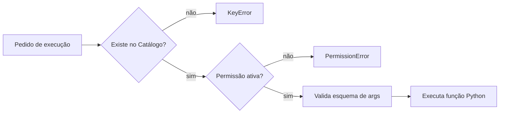

## Passo 1 · Leitura · Contratos de ferramentas, descrições claras e permissões

O modelo de linguagem nunca enxerga o corpo da sua função Python: ele decide qual ferramenta chamar lendo **exclusivamente** o nome, a descrição e o esquema de parâmetros que você injeta no prompt. Se duas ferramentas tiverem descrições vagas como `"busca dados do aluno"` e `"consulta informações acadêmicas"`, o agente escolherá entre elas quase ao acaso.



Para manter um conjunto de ferramentas seguro e sincronizado com o prompt, usamos três práticas:

1. **Fonte única de verdade via decorador (`@ferramenta`):** em vez de escrever a função em um arquivo e copiar a documentação manualmente para dentro do prompt (onde logo ficará desatualizada), anexamos os metadados (`nome`, `descricao`, `parametros`, `permissao`) diretamente à função e geramos a descrição do catálogo automaticamente.
2. **Validação estrita antes da execução:** modelos podem esquecer parâmetros obrigatórios, inventar argumentos extras (`{"forcar": True}`), enviar `"12"` como string quando a função espera `int` ou enviar `creditos = -50`. Validar contra o esquema antes de chamar a função protege o banco de dados e devolve mensagens claras ao agente.
3. **Separação de permissões (`"leitura"` vs `"escrita"`) e idempotência:** consultar o calendário é uma operação de `"leitura"` e **idempotente** (chamar uma ou três vezes produz o mesmo efeito); já abrir um requerimento ou cancelar uma matrícula é uma operação de `"escrita"` que altera estado e exige permissão explícita no contexto da sessão.

## Passo 2 · Exercício · Decorador @ferramenta

modo: lacunas

Complete o decorador `ferramenta(nome, descricao, parametros, permissao="leitura")` para anexar o dicionário `_meta` à função decorada e devolvê-la sem executá-la.

### Instruções

1. Defina a função interna `decorador(func)` que atribui o dicionário com `"nome"`, `"descricao"`, `"parametros"` e `"permissao"` ao atributo `func._meta`.
2. Retorne `func` dentro de `decorador` e retorne `decorador` dentro de `ferramenta`.

### Código inicial

```python
def ferramenta(nome, descricao, parametros, permissao="leitura"):
    def decorador(func):
        func.___ = {
            "nome": nome,
            "descricao": descricao,
            "parametros": dict(parametros),
            "permissao": ___,
        }
        return ___

    return decorador
```

### Solução

```python
def ferramenta(nome, descricao, parametros, permissao="leitura"):
    def decorador(func):
        func._meta = {
            "nome": nome,
            "descricao": descricao,
            "parametros": dict(parametros),
            "permissao": permissao,
        }
        return func

    return decorador
```

### Dicas

1. O atributo esperado nas etapas seguintes do catálogo chama-se `_meta`.
2. Um decorador parametrizado recebe a função em `decorador(func)`, anexa os metadados e devolve a própria função `func`.

### Verificação

```json
[
  {
    "id": "decorador-anexa-meta",
    "name": "Anexa _meta à função decorada e preserva sua execução normal",
    "checkpoint": 2,
    "kind": "expr",
    "setup": "@ferramenta('somar_dias', 'Soma dias a uma data', {'dias': {'tipo': int, 'obrigatorio': True}}, permissao='escrita')\ndef fn(dias):\n    return dias + 10",
    "expr": "[fn._meta['nome'], fn._meta['permissao'], sorted(fn._meta['parametros'].keys()), fn(5)]",
    "expected": [
      "somar_dias",
      "escrita",
      ["dias"],
      15
    ]
  }
]
```

### Soluções erradas

```python name="Esquece de retornar a função dentro do decorador"
def ferramenta(nome, descricao, parametros, permissao="leitura"):
    def decorador(func):
        func._meta = {
            "nome": nome,
            "descricao": descricao,
            "parametros": dict(parametros),
            "permissao": permissao,
        }

    return decorador
```

```python name="Ignora o parâmetro permissao e fixa sempre 'leitura'"
def ferramenta(nome, descricao, parametros, permissao="leitura"):
    def decorador(func):
        func._meta = {
            "nome": nome,
            "descricao": descricao,
            "parametros": dict(parametros),
            "permissao": "leitura",
        }
        return func

    return decorador
```

## Passo 3 · Exercício · Validação de argumentos de ferramenta

Implemente `validar_argumentos(esquema_params, args)` para verificar se o dicionário `args` enviado pelo modelo respeita todos os parâmetros obrigatórios, tipos e limites numéricos definidos em `esquema_params`.

### Instruções

1. Verifique se há alguma chave em `args` que **não** existe em `esquema_params`; se houver, levante `ValueError(f"Argumento desconhecido: {chave}")`.
2. Percorra cada `nome, regras` em `esquema_params.items()`:
   - Se `regras.get("obrigatorio", False)` for verdadeiro e `nome not in args`, levante `ValueError(f"Argumento obrigatorio ausente: {nome}")`.
   - Se `nome in args`, obtenha `valor = args[nome]` e `tipo_esperado = regras["tipo"]`:
     - Lembre-se de que em Python `isinstance(True, int)` é `True`! Se `tipo_esperado in (int, float)` e `isinstance(valor, bool)`, levante `ValueError(f"Tipo invalido para {nome}")`.
     - Se `not isinstance(valor, tipo_esperado)`, levante `ValueError(f"Tipo invalido para {nome}")`.
     - Se `"min"` estiver em `regras` e `valor < regras["min"]`, ou se `"max"` estiver em `regras` e `valor > regras["max"]`, levante `ValueError(f"Valor fora do intervalo para {nome}")`.
3. Se todas as verificações passarem, retorne `True`.

### Código inicial

```python
def validar_argumentos(esquema_params, args):
    # Valide argumentos desconhecidos, obrigatórios, tipos (cuidado com bool!) e limites min/max
    pass
```

### Solução

```python
def validar_argumentos(esquema_params, args):
    if not isinstance(args, dict):
        raise ValueError("Argumentos devem ser um dicionario")
    for chave in args:
        if chave not in esquema_params:
            raise ValueError(f"Argumento desconhecido: {chave}")
    for nome, regras in esquema_params.items():
        if regras.get("obrigatorio", False) and nome not in args:
            raise ValueError(f"Argumento obrigatorio ausente: {nome}")
        if nome not in args:
            continue
        valor = args[nome]
        tipo_esperado = regras["tipo"]
        if tipo_esperado in (int, float) and isinstance(valor, bool):
            raise ValueError(f"Tipo invalido para {nome}")
        if not isinstance(valor, tipo_esperado):
            raise ValueError(f"Tipo invalido para {nome}")
        if "min" in regras and valor < regras["min"]:
            raise ValueError(f"Valor fora do intervalo para {nome}")
        if "max" in regras and valor > regras["max"]:
            raise ValueError(f"Valor fora do intervalo para {nome}")
    return True
```

### Dicas

1. Teste primeiro `for chave in args: if chave not in esquema_params: raise ValueError(...)` para barrar argumentos inventados pelo modelo.
2. Em Python, `bool` é subclasse de `int`, então verifique `if tipo_esperado in (int, float) and isinstance(valor, bool): raise ValueError(...)` antes de `isinstance(valor, tipo_esperado)`.

### Verificação

```json
[
  {
    "id": "valida-argumentos-corretos",
    "name": "Aprova argumentos que respeitam tipo, obrigatoriedade e intervalo",
    "checkpoint": 1,
    "kind": "expr",
    "expr": "validar_argumentos({'semestre': {'tipo': int, 'obrigatorio': True, 'min': 1, 'max': 20}, 'motivo': {'tipo': str, 'obrigatorio': False}}, {'semestre': 4})",
    "expected": true
  },
  {
    "id": "rejeita-argumento-extra",
    "name": "Rejeita argumento desconhecido inventado pelo modelo",
    "checkpoint": 1,
    "kind": "expr",
    "expr": "validar_argumentos({'ra': {'tipo': str, 'obrigatorio': True}}, {'ra': '123', 'admin': True})",
    "raises": "ValueError"
  },
  {
    "id": "rejeita-bool-como-int-e-fora-de-intervalo",
    "name": "Rejeita booleano no lugar de int e valor fora de [min, max]",
    "checkpoint": 2,
    "kind": "expr",
    "setup": "esq = {'creditos': {'tipo': int, 'obrigatorio': True, 'min': 1, 'max': 40}}",
    "expr": "(lambda: [ (lambda f: (lambda: (f(), False)[1])() )(lambda: validar_argumentos(esq, {'creditos': True})) ])()",
    "raises": "ValueError"
  },
  {
    "id": "rejeita-valor-acima-do-maximo",
    "name": "Rejeita valor numérico acima do limite máximo",
    "checkpoint": 2,
    "kind": "expr",
    "expr": "validar_argumentos({'creditos': {'tipo': int, 'obrigatorio': True, 'min': 1, 'max': 40}}, {'creditos': 99})",
    "raises": "ValueError"
  }
]
```

### Soluções erradas

```python name="Aceita argumentos desconhecidos extras sem levantar ValueError"
def validar_argumentos(esquema_params, args):
    for nome, regras in esquema_params.items():
        if regras.get("obrigatorio", False) and nome not in args:
            raise ValueError(f"Ausente: {nome}")
        if nome in args:
            valor = args[nome]
            if not isinstance(valor, regras["tipo"]):
                raise ValueError("Tipo invalido")
    return True
```

```python name="Não verifica os limites numéricos min e max nem rejeita bool para int"
def validar_argumentos(esquema_params, args):
    for chave in args:
        if chave not in esquema_params:
            raise ValueError(f"Desconhecido: {chave}")
    for nome, regras in esquema_params.items():
        if regras.get("obrigatorio", False) and nome not in args:
            raise ValueError(f"Ausente: {nome}")
        if nome in args and not isinstance(args[nome], regras["tipo"]):
            raise ValueError("Tipo invalido")
    return True
```

## Passo 4 · Exercício · Catálogo com descrição automática e controle de permissão

Agora construa a classe `Catalogo` que armazena as ferramentas decoradas, gera o texto de descrição filtrado pelas permissões da sessão e valida permissões e argumentos antes de executar qualquer chamada.

### Instruções

1. Implemente `Catalogo` com um dicionário `self.itens = {}`.
2. Em `registrar(self, func)`, leia `meta = func._meta`, guarde `(func, meta)` em `self.itens[meta["nome"]]` e retorne `func`.
3. Em `descrever(self, permissoes_ativas=None)`:
   - Selecione as ferramentas registradas (ordenadas alfabeticamente pelo `nome`) cuja `meta["permissao"]` pertença a `permissoes_ativas` (ou todas as ferramentas se `permissoes_ativas is None`).
   - Formate cada ferramenta em uma linha exata:
     `f"- {nome} [{meta['permissao']}]: {meta['descricao']} (params: {', '.join(sorted(meta['parametros'].keys()))})"`
   - Retorne as linhas unidas por `"\n"`.
4. Em `executar(self, nome, args, permissoes_ativas)`:
   - Se `nome not in self.itens`, levante `KeyError(f"Ferramenta desconhecida: {nome}")`.
   - Se `meta["permissao"] not in permissoes_ativas`, levante `PermissionError(f"Permissao negada para {nome}")` **antes** de executar a função.
   - Valide os argumentos chamando `validar_argumentos(meta["parametros"], args)` e retorne `func(**args)`.

### Código inicial

```python
def ferramenta(nome, descricao, parametros, permissao="leitura"):
    def decorador(func):
        func._meta = {
            "nome": nome,
            "descricao": descricao,
            "parametros": dict(parametros),
            "permissao": permissao,
        }
        return func

    return decorador


def validar_argumentos(esquema_params, args):
    if not isinstance(args, dict):
        raise ValueError("Argumentos devem ser um dicionario")
    for chave in args:
        if chave not in esquema_params:
            raise ValueError(f"Argumento desconhecido: {chave}")
    for nome, regras in esquema_params.items():
        if regras.get("obrigatorio", False) and nome not in args:
            raise ValueError(f"Argumento obrigatorio ausente: {nome}")
        if nome not in args:
            continue
        valor = args[nome]
        tipo_esperado = regras["tipo"]
        if tipo_esperado in (int, float) and isinstance(valor, bool):
            raise ValueError(f"Tipo invalido para {nome}")
        if not isinstance(valor, tipo_esperado):
            raise ValueError(f"Tipo invalido para {nome}")
        if "min" in regras and valor < regras["min"]:
            raise ValueError(f"Valor fora do intervalo para {nome}")
        if "max" in regras and valor > regras["max"]:
            raise ValueError(f"Valor fora do intervalo para {nome}")
    return True


class Catalogo:
    def __init__(self):
        # Inicialize a estrutura de armazenamento das ferramentas
        pass

    def registrar(self, func):
        # Registre a função decorada usando func._meta
        pass

    def descrever(self, permissoes_ativas=None):
        # Gere a descrição em ordem alfabética filtrando por permissoes_ativas
        pass

    def executar(self, nome, args, permissoes_ativas):
        # Verifique existência, permissão e argumentos antes de executar
        pass
```

### Solução

```python
def ferramenta(nome, descricao, parametros, permissao="leitura"):
    def decorador(func):
        func._meta = {
            "nome": nome,
            "descricao": descricao,
            "parametros": dict(parametros),
            "permissao": permissao,
        }
        return func

    return decorador


def validar_argumentos(esquema_params, args):
    if not isinstance(args, dict):
        raise ValueError("Argumentos devem ser um dicionario")
    for chave in args:
        if chave not in esquema_params:
            raise ValueError(f"Argumento desconhecido: {chave}")
    for nome, regras in esquema_params.items():
        if regras.get("obrigatorio", False) and nome not in args:
            raise ValueError(f"Argumento obrigatorio ausente: {nome}")
        if nome not in args:
            continue
        valor = args[nome]
        tipo_esperado = regras["tipo"]
        if tipo_esperado in (int, float) and isinstance(valor, bool):
            raise ValueError(f"Tipo invalido para {nome}")
        if not isinstance(valor, tipo_esperado):
            raise ValueError(f"Tipo invalido para {nome}")
        if "min" in regras and valor < regras["min"]:
            raise ValueError(f"Valor fora do intervalo para {nome}")
        if "max" in regras and valor > regras["max"]:
            raise ValueError(f"Valor fora do intervalo para {nome}")
    return True


class Catalogo:
    def __init__(self):
        self.itens = {}

    def registrar(self, func):
        meta = func._meta
        self.itens[meta["nome"]] = (func, meta)
        return func

    def descrever(self, permissoes_ativas=None):
        linhas = []
        for nome in sorted(self.itens.keys()):
            _, meta = self.itens[nome]
            if permissoes_ativas is not None and meta["permissao"] not in permissoes_ativas:
                continue
            params_str = ", ".join(sorted(meta["parametros"].keys()))
            linhas.append(f"- {nome} [{meta['permissao']}]: {meta['descricao']} (params: {params_str})")
        return "\n".join(linhas)

    def executar(self, nome, args, permissoes_ativas):
        if nome not in self.itens:
            raise KeyError(f"Ferramenta desconhecida: {nome}")
        func, meta = self.itens[nome]
        if meta["permissao"] not in permissoes_ativas:
            raise PermissionError(f"Permissao negada para {nome}")
        validar_argumentos(meta["parametros"], args)
        return func(**args)
```

### Dicas

1. Em `descrever`, filtre `if permissoes_ativas is not None and meta["permissao"] not in permissoes_ativas: continue` para não expor no prompt ferramentas que o agente não tem permissão para usar.
2. Em `executar`, cheque a permissão **antes** de chamar `func(**args)`.

### Verificação

```json
[
  {
    "id": "catalogo-descrever-e-executar",
    "name": "Filtra descrição por permissão e executa ferramenta de leitura validada",
    "checkpoint": 3,
    "kind": "expr",
    "setup": "cat = Catalogo()\n@cat.registrar\n@ferramenta('consultar_nota', 'Consulta nota final', {'disciplina': {'tipo': str, 'obrigatorio': True}}, permissao='leitura')\ndef f1(disciplina):\n    return f'Nota 8.5 em {disciplina}'\n@cat.registrar\n@ferramenta('abrir_recurso', 'Abre pedido de revisao', {'disciplina': {'tipo': str, 'obrigatorio': True}}, permissao='escrita')\ndef f2(disciplina):\n    return f'Protocolo aberto para {disciplina}'",
    "expr": "[cat.descrever(permissoes_ativas={'leitura'}), cat.executar('consultar_nota', {'disciplina': 'MAC0110'}, {'leitura'})]",
    "expected": [
      "- consultar_nota [leitura]: Consulta nota final (params: disciplina)",
      "Nota 8.5 em MAC0110"
    ]
  },
  {
    "id": "catalogo-bloqueia-escrita-sem-permissao",
    "name": "Levanta PermissionError ao tentar executar ferramenta de escrita apenas com permissão de leitura",
    "checkpoint": 4,
    "kind": "expr",
    "setup": "cat = Catalogo()\n@cat.registrar\n@ferramenta('abrir_recurso', 'Abre pedido', {'disciplina': {'tipo': str, 'obrigatorio': True}}, permissao='escrita')\ndef f2(disciplina):\n    return 'ok'",
    "expr": "cat.executar('abrir_recurso', {'disciplina': 'MAC0110'}, {'leitura'})",
    "raises": "PermissionError"
  }
]
```

### Soluções erradas

```python name="Inclui ferramentas não permitidas na descrição e executa sem checar permissão"
class Catalogo:
    def __init__(self):
        self.itens = {}

    def registrar(self, func):
        self.itens[func._meta["nome"]] = (func, func._meta)
        return func

    def descrever(self, permissoes_ativas=None):
        linhas = []
        for nome in sorted(self.itens.keys()):
            _, meta = self.itens[nome]
            params_str = ", ".join(sorted(meta["parametros"].keys()))
            linhas.append(f"- {nome} [{meta['permissao']}]: {meta['descricao']} (params: {params_str})")
        return "\n".join(linhas)

    def executar(self, nome, args, permissoes_ativas):
        func, meta = self.itens[nome]
        validar_argumentos(meta["parametros"], args)
        return func(**args)
```

```python name="Executa a função sem validar os argumentos contra o esquema"
class Catalogo:
    def __init__(self):
        self.itens = {}

    def registrar(self, func):
        self.itens[func._meta["nome"]] = (func, func._meta)
        return func

    def descrever(self, permissoes_ativas=None):
        return ""

    def executar(self, nome, args, permissoes_ativas):
        func, meta = self.itens[nome]
        if meta["permissao"] not in permissoes_ativas:
            raise PermissionError("Negado")
        return func(**args)
```

## Passo 5 · Quiz · Esquemas, permissões e idempotência

### Pergunta

O que acontece na prática quando registramos no catálogo duas ferramentas com nomes e descrições quase idênticas (por exemplo, `buscar_info_aluno` e `consultar_dados_estudante`, ambas descritas como `"Busca informações do aluno"`)?

- [ ] O interpretador Python recusa compilar o arquivo.
- [x] A escolha da ferramenta pelo modelo torna-se instável e ambígua, aumentando a taxa de chamadas incorretas e tentativas desperdiçadas.
- [ ] O modelo funde automaticamente as duas funções em uma só.
- [ ] A velocidade de inferência dobra.

> Como o LLM roteia chamadas exclusivamente pela descrição e pelo esquema no prompt, ferramentas com fronteiras mal definidas induzem escolhas erradas.

### Pergunta

Por que é importante distinguir ferramentas de `"leitura"` (idempotentes) de ferramentas de `"escrita"` (que criam protocolos, enviam e-mails ou trancam disciplinas)?

- [ ] Porque ferramentas de leitura não recebem argumentos.
- [x] Porque ferramentas de escrita produzem efeitos colaterais persistentes no mundo real, exigindo controle estrito de permissão, confirmação do usuário e cuidado redobrado em caso de retentativas (*retries*).
- [ ] Porque ferramentas de escrita não podem retornar JSON.
- [ ] Porque ferramentas de leitura só funcionam sem rede.

> Repetir uma consulta de leitura não altera o sistema, mas repetir sem controle uma ferramenta de escrita pode abrir protocolos duplicados ou cancelar uma matrícula indevidamente.

### Pergunta

Quando a validação de argumentos detecta que o modelo enviou `semestre = 99` (fora do intervalo permitido `1..20`), por que devolver uma mensagem descritiva (`"Valor fora do intervalo para semestre"`) é melhor do que retornar apenas `"Erro"`?

- [ ] Porque mensagens longas reduzem o custo de tokens.
- [x] Porque a mensagem específica informa exatamente qual parâmetro falhou e por quê, permitindo que o agente corrija o argumento no próximo passo do loop ReAct.
- [ ] Porque o protocolo HTTP proíbe mensagens com menos de cinco palavras.
- [ ] Porque dispensa a existência de `max_passos`.

> Uma mensagem de erro informativa funciona como feedback acionável na `Observacao:`, guiando o modelo para reenviar a chamada com um valor válido.
